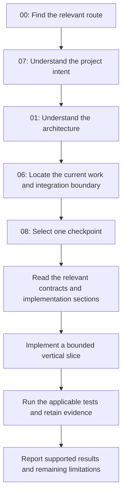
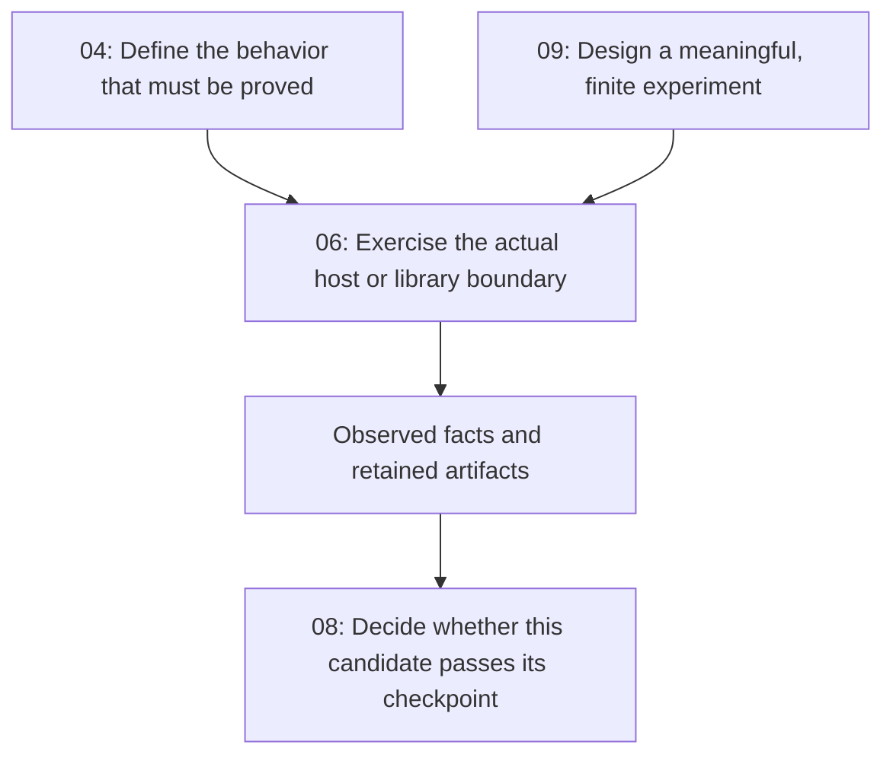

## Pi Quality Engine — Document Catalog and Reading Guide 🗺️

**Start here. Find the right document, understand its authority, and read only the material needed for the current decision.**

This catalog describes the nine existing Pi Quality Engine documents, explains when to read each one, and connects them into practical reading routes. Together with this catalog, the set contains **ten Markdown files: 00–09**. The filenames are document identities, not a compulsory reading order and not an instruction to implement the whole project at once.

The project is specified as a standalone Pi extension for evidence-based assessment and bounded feedback. Its documents cover purpose, architecture, public contracts, observability, implementation organization, integration probes, release checkpoints, and testing philosophy. They answer different questions about the same system; they are not nine independent specifications to combine by guesswork.

> [!important] Design material is not execution evidence
> The authored files describe proposed behavior, source observations, implementation obligations, and planned experiments. Their existence does not establish that the package has been implemented, a provider has been tested, a checkpoint has passed, or a release tag exists. Actual progress is established by candidate-specific test results and retained evidence, following Documents 04 and 08.

### Immediate destinations 🎯

| The immediate question | Open first | Why this is the right entry |
|---|---|---|
| What is the project trying to accomplish—and deliberately not trying to own? | [07 — Project Philosophy](07-project-philosophy.md) | Explains the intent behind the technical choices. |
| How does the system work, and why are its responsibilities divided this way? | [01 — Architecture and Decisions](01-architecture-and-decisions.md) | Defines the feedback loop, invariants, ownership, and trade-offs. |
| What is the exact interface or configuration behavior? | [02 — Component Contracts and Configuration](02-component-contracts-and-configuration.md) | Owns the public component and configuration contract. |
| What is logged, stored, counted, disclosed, or retained? | [03 — Observability and Data Policy](03-observability-and-data-policy.md) | Owns diagnostic and accounting semantics. |
| What constitutes a completed development stage? | [04 — Implementation, Testing, and Acceptance](04-implementation-testing-and-acceptance.md) | Defines the stages, behavioral obligations, and acceptance method. |
| Where should code live, and which dependencies are allowed? | [05 — Implementation Map and Dependency Rules](05-implementation-map-and-dependency-rules.md) | Maps contracts to implementation responsibilities without requiring a class for every role. |
| What should a coding agent do first, and what must be checked against real Pi? | [06 — Implementation Handoff and Integration Probes](06-implementation-handoff-and-integration-probes.md) | Gives the work order and focused integration experiments. |
| Which concrete checklist belongs to the next version or Git tag? | [08 — Development Checkpoints and Release Checklists](08-development-checkpoints-and-release-checklists.md) | Turns the stages into thirteen evidence-driven checkpoints. |
| How should synthetic agent behavior, real assessors, prompts, and real Pi be tested? | [09 — Testing Philosophy and Behavioral Evidence](09-testing-philosophy-and-behavioral-evidence.md) | Explains what each experiment proves and how to keep it bounded. |

<a id="current-checkpoint"></a>

### Current accepted checkpoint 📍

K01–K03 close bounded S1; K05 closes qualified mechanical S2; K07 closes the
qualified local S3 scope. **K08 /0.6.0 contributor preview is independently
ACCEPTED by Astra342 and locally released by344** at
`b0873d1972e842e0bbd04a36996b22400602ac35`. Unsigned annotated `v0.6.0`
targets that tested implementation, not later docs. Read [K08's original28
judgment and exact committed/EOL/63-payload qualification](08-development-checkpoints-and-release-checklists.md#k08).
The scope is Windows/NTFS, SDK1.1.0 and actual public packaged recombination,
including separately owned reviewer work. Role labels do not certify a fleet;
controlled protocols do not prove live usefulness or all remaining S4 obligations.
[K09 remains open](08-development-checkpoints-and-release-checklists.md#k09).
The accepted367/369 completed text-schema packet is negative data, canonical0/3,
not model/profile promotion. The [usable typed-assessor375–377 increment](08-development-checkpoints-and-release-checklists.md#k09-typed-assessor-376)
has scoped independent offline product/profile and canonical-doc acceptance378.
The corrected finite entry was separately accepted381; the accepted logical delta
and its actual index/build/extracted-package representation were locally saved382.
The linked record distinguishes the original accepted tar from the later qualified
pack. The [real typed calibration383 and control384](08-development-checkpoints-and-release-checklists.md#k09-typed-live-383)
now records a completed positive observe-only development smoke: one actual
002/003/001 batch, typed and completed canonical validity3/3, concern/scoped-negative/
conflict triage and effects0. These are correlated calibration siblings, not held-out
accuracy or supported-finding precision (0/0=null). Astra385 independently accepted
the actual-data/current-doc composite and the original finite observe-only
usable-assessor technical increment. Whole K09, automatic advice/feedback/D-39
and v0.7.0 remain unaccepted.

The exact381 initial approval and operational roots are consumed, not reusable.
Standing375 separate cumulative USD3/RUB100 is not renewed; any later justified
study must retain the actual completed ledger/count, not the old input prior or
synthetic costs. This control dispatches nobody. The separate earlier USD1
billable-input pilot remains blocked, not pooled. The selected Polza typed endpoint
accepted the actual bounded requests; native response model/build identity remains
UNKNOWN. OpenRouter/Jev and local d3-mini remain separate unverified routes.
No push/publication, working-Pi installation or spending reset follows. Current role defaults are in
[WORKFLOW](../Инструкции/WORKFLOW.orchestration.instructions.md).

<a id="first-reading"></a>

## 1. A useful first reading order 🧭

A new contributor should understand the purpose before choosing implementation details, then select one bounded increment rather than attempting the entire roadmap.



The diagram is a **reading and work route**, not a second runtime design. “Relevant contracts” usually means selected sections of Documents 02, 03, and 05. Documents 04 and 09 explain the required evidence and the limits of the chosen tests.

For an experienced contributor returning to an existing implementation, it is usually better to start with the current checkpoint in Document 08, inspect the actual accepted candidate and evidence, and then reopen the owning sections for the affected behavior. Document 06's original S1 starting instructions should not reset a project that has already progressed beyond S1.

> [!tip] Build a task-sized reading packet
> An assignment should identify the current candidate, the target checkpoint, the relevant section links, the behavior to preserve, and the evidence required. It should not simply say “implement all attached documents.” The documents remain available for lookup; the active task remains small.

<a id="catalog"></a>

## 2. The complete catalog: contents, timing, and purpose 📚

<a id="doc-01"></a>

### 01 — Architecture and Decisions 🏗️

**File:** [01-architecture-and-decisions.md](01-architecture-and-decisions.md)  
**Baseline:** A1  
**Primary question:** *What system is being built, and why does it have these boundaries?*

This is the structural foundation. It describes the managed feedback loop, standalone deployment, runtime ownership, the distinction between observations and authority, and the separation of assessment from intervention. It explains time-based checks, activity versus progress, waiting, evidence freshness, independent Pi reviewers, and the division between primary work, engine-owned evaluation, and optional external execution.

It also establishes existing project documents as the source of requirements, metadata-only standard observability, and honest handling of incomplete evidence and unknown spending. Its source baseline, reuse plan, license/provenance section, and open implementation gates explain which upstream ideas were inspected and which claims still require execution.

**Read it when** beginning the project, changing a responsibility boundary, reviewing a significant architecture proposal, deciding whether a feature belongs in the core, or selecting a donor mechanism.

**Why it matters:** without this context, a locally convenient implementation can introduce a second scheduler, a mandatory launcher plugin, an unowned model call, or feedback that bypasses the operator's authority.

**Leave with:** a clear account of the invariant being preserved, the owner of the proposed behavior, and the experiment needed for any unproven integration assumption.

**Useful entry points:** [§§1–3: intent, invariants, and ownership](01-architecture-and-decisions.md#section-1); [§§4–7: architecture, components, runtime, and time](01-architecture-and-decisions.md#section-4); [§§8–11: evidence, evaluation, reviewers, and actions](01-architecture-and-decisions.md#section-8); [§§16–17: frozen sources and reuse](01-architecture-and-decisions.md#section-16); [§19: proof obligations and open gates](01-architecture-and-decisions.md#section-19).

**Do not use it as** the final list of configuration keys or an executable SDK reference. Those details belong to Document 02 and the pinned upstream sources.

<a id="doc-02"></a>

### 02 — Component Contracts and Configuration 🧩

**File:** [02-component-contracts-and-configuration.md](02-component-contracts-and-configuration.md)  
**Baseline:** C1; configuration schema 1  
**Primary question:** *What must components exchange, support, and obey?*

This is the main implementation specification for the public surface. It defines configuration resolution, reusable definitions, identities, registration and readiness, permitted host services, source acquisition, scheduling behavior, assessment resources, model profiles, canonical outcomes, policy proposals, action receipts, and named operations.

Its eight component roles are `observation`, `trigger`, `context`, `prompt`, `evaluator`, `policy`, `action`, and `sink`. It includes complete configuration examples and an independent-extension example. It specifies how short model calls and clean Pi review sessions participate in one execution path without requiring other observer or subagent plugins.

**Read it when** implementing or changing a component interface, adding a trigger, configuring a profile, connecting project documents, introducing a new model route, writing a contributor package, or validating a configuration example.

**Why it matters:** this is where broad architectural ideas become exact contracts. A new component should fit the declared interface rather than invent a parallel vocabulary or rely on an accidental import from another package.

**Leave with:** the applicable input/output types, lifecycle rules, configuration scope, permissions, capability requirements, and expected failure states.

**Useful entry points:** [§§2–4: configuration and shared data](02-component-contracts-and-configuration.md#section-2); [§§5–6: registry and host boundaries](02-component-contracts-and-configuration.md#section-5); [§8: triggers](02-component-contracts-and-configuration.md#section-8); [§§9–13: context, prompts, and evaluators](02-component-contracts-and-configuration.md#section-9); [§§14–17: policies, actions, state, and observability controls](02-component-contracts-and-configuration.md#section-14); [§18: complete configurations](02-component-contracts-and-configuration.md#section-18); [§19: independent contribution](02-component-contracts-and-configuration.md#section-19).

**Do not confuse** proposed Quality Engine names with APIs already implemented by Pi. The document explicitly distinguishes them.

<a id="doc-03"></a>

### 03 — Observability and Data Policy 🔍

**File:** [03-observability-and-data-policy.md](03-observability-and-data-policy.md)  
**Baseline:** O1; diagnostic schema 1  
**Primary question:** *What can be observed and reconstructed, without silently retaining the project or miscounting work?*

This document defines the diagnostic promise and its limits. It covers event identity, causal relationships, record fields, measurements, final context manifests, tool metadata, request attempts, reviewer activity, conclusions, policies, and feedback receipts.

It separates detail profiles from permission to capture content. Minimal, Standard, Debug, and Trace do not automatically authorize source code, prompt bodies, or tool-result text. It also defines owned usage and price provenance, the functional accounting/checkpoint boundary, session journals, rotation, retention, bounded history, sink pressure, failure handling, local inspection, and explicit export.

**Read it when** adding anything that records information, calls a model, stores state, handles a tool result, writes a file, exports diagnostics, or claims that an intervention was delivered.

**Why it matters:** a correct evaluator can still make the product unsafe or misleading if its data projection leaks content, its usage is charged twice, its sink buffers indefinitely, or log cleanup erases functional spending history.

**Leave with:** the exact permitted record shape, the strongest supportable claim, the owner of accounting and persistence, and the failure behavior that must remain visible.

**Useful entry points:** [§§2–7: data planes, profiles, records, projection, and events](03-observability-and-data-policy.md#section-2); [§§8–11: context, tools, models, and effects](03-observability-and-data-policy.md#section-8); [§§12–14: usage and recovery](03-observability-and-data-policy.md#section-12); [§§15–16: disclosure and optional capture](03-observability-and-data-policy.md#section-15); [§§17–21: journals, rotation, pressure, and sinks](03-observability-and-data-policy.md#section-17); [§25: observability proof obligations](03-observability-and-data-policy.md#section-25).

**Do not use it to** turn Quality Engine into the authoritative monitor or accountant for unrelated Pi work. Its comprehensive diagnostics concern its own evaluations and effects; observed primary activity is scoped evidence.

<a id="doc-04"></a>

### 04 — Implementation, Testing, and Acceptance 🧪

**File:** [04-implementation-testing-and-acceptance.md](04-implementation-testing-and-acceptance.md)  
**Baseline:** D1  
**Primary question:** *What must be implemented and demonstrated before a stage or capability is accepted?*

This is the delivery and acceptance foundation. It defines four vertical development stages, independent acceptance dimensions, source/build provenance, isolated environments, ordinary development tasks, and the D-01–D-40 behavioral obligations.

It covers configuration and registry tests; time, concurrency, and Stop protection; source integrity; real Pi reviewers; feedback and effects; accounting and crash windows; storage; package installation; model-quality evaluation; and performance evidence. It distinguishes mechanical correctness, integration correctness, and judgment usefulness.

**Read it when** planning a stage, selecting required tests, deciding what a passing result actually proves, evaluating a release claim, or investigating whether a feature has adequate evidence.

**Why it matters:** neither compiled interfaces, a clean process exit, nor a convincing model report establish that the feature works at the relevant boundary.

**Leave with:** the applicable D/O obligations, the production path that the test must exercise, the independent oracle, and the evidence needed for acceptance.

**Useful entry points:** [§§2–4: restrained implementation, sources, and test layers](04-implementation-testing-and-acceptance.md#section-2); [§§5–9: stages S1–S4](04-implementation-testing-and-acceptance.md#section-5); [§10: behavioral catalog](04-implementation-testing-and-acceptance.md#section-10); [§20: semantic evaluation and promotion](04-implementation-testing-and-acceptance.md#section-20); [§§22–25: packaging, evidence, traceability, and release](04-implementation-testing-and-acceptance.md#section-22).

**Do not use it as** a competing version roadmap. The four stages remain here; Document 08 assigns the finer versioned checkpoints.

<a id="doc-05"></a>

### 05 — Implementation Map and Dependency Rules 🗂️

**File:** [05-implementation-map-and-dependency-rules.md](05-implementation-map-and-dependency-rules.md)  
**Baseline:** M1; first implementation supplement  
**Primary question:** *Where does code belong, what may it depend on, and who owns its lifetime?*

This supplement maps the existing architecture and contracts onto a practical implementation. It describes the reference source layout, import direction, composition root, component registration, ownership of identities and resources, check execution, model services, reviewer construction, policies, cancellation, and diagnostic boundaries.

It also maps selected donor files and mechanisms to intended local responsibilities, including explicit adaptation and rejection boundaries. Its architectural scenarios show how late results, accounting, projection, and storage remain under coherent ownership.

**Read it when** creating a source module, reviewing imports, adding an implementation behind a contract, relocating state, adapting donor code, or simplifying a growing implementation.

**Why it matters:** a flow diagram does not explain whether an evaluator may call the host directly or whether a budget ledger may depend on debug logs. This map makes those implementation boundaries explicit.

**Leave with:** the location and owner of the change, its allowed dependencies, its construction/disposal path, and the narrow donor mechanism—if any—that fits.

**Useful entry points:** [§§2–4: layout, dependencies, and assembly](05-implementation-map-and-dependency-rules.md#section-2); [§§5–8: registry, ownership, execution, and time](05-implementation-map-and-dependency-rules.md#section-5); [§§9–13: evidence, models, reviewers, policies, and retirement](05-implementation-map-and-dependency-rules.md#section-9); [§§14–16: diagnostics, storage, and functional state](05-implementation-map-and-dependency-rules.md#section-14); [§19: donor adaptation cards](05-implementation-map-and-dependency-rules.md#section-19); [§20: change-placement rules](05-implementation-map-and-dependency-rules.md#section-20).

**Do not treat its growth layout as** a request to create every directory, empty class, or placeholder before the first working slice. Internal grouping remains flexible; responsibility and dependency rules do not.

<a id="doc-06"></a>

### 06 — Implementation Handoff and Integration Probes 🛠️

**File:** [06-implementation-handoff-and-integration-probes.md](06-implementation-handoff-and-integration-probes.md)  
**Baseline:** H1; second implementation supplement  
**Primary question:** *What should be done next, and how are the remaining host and library assumptions checked?*

This is the practical engineering entry point. It gives the no-paid-request S1 work order, source acquisition at frozen revisions, package/SDK identity checks, isolated setup, and ten focused probe families P-01–P-10.

The probes cover real host/package behavior, registration, time and Stop, source/Git integrity, direct models, clean reviewers, feedback, logging, privacy/recovery, and the installed standalone path. The document identifies exact source-reading targets, expected artifacts, and what to do when a library cannot implement the declared contract.

**Read it when** starting implementation, taking over work, connecting a new external boundary, validating an SDK assumption, debugging a failing integration, or preparing a factual work report.

**Why it matters:** source inspection is not execution evidence. A method name in an upstream file does not establish that the installed artifact behaves as the adapter claims.

**Leave with:** one bounded assignment, the actual environment and source identities, the probe procedure, and the artifact that will establish or reject the claim.

**Useful entry points:** [§§1–4: immediate handoff, sources, environment, and S1](06-implementation-handoff-and-integration-probes.md#section-1); [§5: probe catalog and independent oracles](06-implementation-handoff-and-integration-probes.md#section-5); [§§6–15: P-01–P-10](06-implementation-handoff-and-integration-probes.md#section-6); [§17: exact source-reading map](06-implementation-handoff-and-integration-probes.md#section-17); [§18: interpreting a failed probe](06-implementation-handoff-and-integration-probes.md#section-18); [§21: coding-agent assignments](06-implementation-handoff-and-integration-probes.md#section-21).

**Do not read a proposed probe as** a passed test, a dependency-installation requirement, or permission to substitute a donor plugin for a missing core capability.

<a id="doc-07"></a>

### 07 — Project Philosophy 🧭

**File:** [07-project-philosophy.md](07-project-philosophy.md)  
**Role:** conceptual, read-first companion  
**Primary question:** *Which values should guide a choice when several implementations are possible?*

This is the shortest conceptual route into the project. It explains engineering quality rather than review volume, genuine modularity rather than a proliferation of layers, standalone usefulness, optional interoperability, existing project documents as truth, proportionate autonomy, and the separation between judgment and authorization.

It also clarifies role-neutral observation: a primary session or a delegated worker should not require a different quality engine merely because its role has a different name. Ownership, scope, exposed evidence, and permission still matter. Observing selected Pi activity does not make the project responsible for Pi-wide fleet monitoring or unrelated billing.

**Read it when** onboarding, evaluating a proposed feature, deciding whether an abstraction is useful, discussing product scope, reviewing a contributor proposal, or resisting an unnecessary expansion of responsibilities.

**Why it matters:** the technical documents can be followed literally while the project drifts toward intrusive review, mandatory integrations, or excessive machinery. This companion explains the purpose those contracts are intended to preserve.

**Leave with:** an answer to whether the proposal improves authorized work at proportionate cost, preserves independent choices, and belongs within the project's responsibility boundary.

**Useful sections:** §§1–3 for intent, modularity, and independence; §§4–5 for session roles and observability scope; §§6–10 for requirements, autonomy, judgment, and data; §§11–12 for simplicity and feature decisions. Open the file and use its headings; this companion does not define explicit numbered HTML anchors.

**Do not use philosophical wording to** override an exact C1/O1 rule or claim automatic support for every subagent topology. A necessary contract change remains explicit.

<a id="doc-08"></a>

### 08 — Development Checkpoints and Release Checklists 🏁

**File:** [08-development-checkpoints-and-release-checklists.md](08-development-checkpoints-and-release-checklists.md)  
**Baseline:** K1; planned project versions 0.0.1–1.0.0  
**Primary question:** *What must be completed and demonstrated for this particular checkpoint?*

This is the working delivery workbook. It divides D1's four stages into thirteen reviewable checkpoints, each with construction tasks, practical cases, expected diagnostic evidence, and exit conditions. It includes common gates, a small evidence bundle, an independent accounting example, semantic evaluation guidance, failure handling, and Git-tag discipline.

It binds an accepted claim to the actual candidate commit and package artifact. A local annotated tag, a remotely pushed tag, and publication of a package are treated as distinct actions. A report added after testing does not silently move acceptance to another untested source commit.

**Read it when** selecting the next increment, assigning work, checking progress, preparing an acceptance report, deciding whether a version can be tagged, or publishing an accepted artifact.

**Why it matters:** the architectural scope is much larger than a sensible first change. This workbook makes progress finite and evidence-based rather than a claim that “the whole design is implemented.”

**Leave with:** the target K-checkpoint, its applicable obligations and tests, the evidence still missing, and a precise tag/release decision.

**Useful entry points:** [version map](08-development-checkpoints-and-release-checklists.md#version-map); [common gate](08-development-checkpoints-and-release-checklists.md#common-gate); [K01](08-development-checkpoints-and-release-checklists.md#k01) through [K13](08-development-checkpoints-and-release-checklists.md#k13); [observability cross-check](08-development-checkpoints-and-release-checklists.md#observability-crosscheck); [tagging protocol](08-development-checkpoints-and-release-checklists.md#tagging-protocol); [handoff template](08-development-checkpoints-and-release-checklists.md#handoff-template).

**Do not treat unchecked plans as** completed releases, or duplicate a test merely because it supports several checklist items. One genuine piece of evidence can cover multiple obligations.

<a id="doc-09"></a>

### 09 — Testing Philosophy and Behavioral Evidence 🔬

**File:** [09-testing-philosophy-and-behavioral-evidence.md](09-testing-philosophy-and-behavioral-evidence.md)  
**Baseline:** T1  
**Primary question:** *How can an experiment establish real behavior without gaming tests, leaking the answer, or running indefinitely?*

Its central experiment is **invented preceding agent work assessed by a real configured decision model through the production prompt/context path**. A fixture can establish edits, repeated tests, missing instructions, and a completion claim without requiring a paid primary agent to manufacture that history. The assessor's answer remains live and is judged against independent evidence.

The document distinguishes frozen-input assessor cases, materialized histories, real Pi integration with a scripted primary, hybrid Pi/live-assessor tests, and a few live closed-loop tasks. It covers contrasting cases, prompt comparisons, holdout discipline, graders, finite execution envelopes, actual termination, compact artifacts suitable for review or Git, and avoiding test-driven overengineering.

**Read it when** writing a fixture, evaluating a prompt or System 1 route, deciding what may be simulated, interpreting a model's score, organizing E2E work, or defining stopping conditions for a coding agent running experiments.

**Why it matters:** a scripted assessor proves mechanics, not live judgment; a live assessor on invented history proves a narrower claim than real host integration; real host integration does not by itself prove improved engineering outcomes.

**Leave with:** the boundary under study, what remains real, a reviewed expected outcome, a finite experiment plan, and a compact evidence requirement.

**Useful entry points:** [§§2–3: synthetic work and honest test boundaries](09-testing-philosophy-and-behavioral-evidence.md#section-2); [§§4–6: fixtures and worked cases](09-testing-philosophy-and-behavioral-evidence.md#section-4); [§§7–9: prompts, grading, and corpus](09-testing-philosophy-and-behavioral-evidence.md#section-7); [§§10–12: actual Pi and closed-loop work](09-testing-philosophy-and-behavioral-evidence.md#section-10); [§§13–15: finite experiments and termination](09-testing-philosophy-and-behavioral-evidence.md#section-13); [§§16–17: artifacts and commits](09-testing-philosophy-and-behavioral-evidence.md#section-16).

**Do not use its example experiment envelopes as** new production configuration defaults, or quietly replace a failed live route with recorded answers and still label the result live.

<a id="authority"></a>

## 3. Which document answers a disagreement? ⚖️

Authority follows the **subject of the decision**, not the highest document number or the most recently written paragraph. The following map summarizes the boundaries declared by the documents themselves.

| Subject | Owning document | Supporting material |
|---|---|---|
| Product structure, invariants, and responsibility boundaries | 01 | 07 explains intent; 05 maps implementation. |
| Exact public component/configuration contract | 02 | 05 locates implementations; 06 probes real integration. |
| Event payloads, data policy, accounting, and storage semantics | 03 | 02 owns the corresponding configuration keys; 05 locates the owners. |
| Development stages and behavioral acceptance obligations | 04 | 06 supplies probes; 08 assigns checkpoint work. |
| Source responsibility and allowed dependency direction | 05, within 01–03 | 06 supplies the concrete work order. |
| Integration-probe procedures and interpretation | 06, within 01–05 | 04 determines acceptance; results must be generated by execution. |
| Project values and feature-fit reasoning | 07 | Exact changes still go through the relevant technical owner. |
| Version checkpoints and candidate/tag procedure | 08, preserving D1 and C1/O1 | 04 owns the underlying acceptance method. |
| Semantic test design, prompt experiments, and bounded execution | 09, preserving the earlier contracts | 04 and 08 retain their acceptance/checkpoint roles. |
| Navigation and reading order | 00 | No new runtime or release requirements are introduced here. |

If a conflict is found, identify the owning contract and the two conflicting statements. Determine whether the issue is an illustrative example, an implementation mistake, or a genuine contract change. Record and resolve it explicitly. A convenient library behavior, a green fixture, or a later checklist item is not permission to weaken an invariant silently.

> [!note] Some overlap is intentional; duplicate authority is not
> **01 versus 05:** why the boundaries exist versus where they are implemented.  
> **04 versus 06:** what must be demonstrated versus how to probe the actual external boundary.  
> **04 versus 08:** four development stages and obligations versus the versioned completion workbook.  
> **04 versus 09:** acceptance rules versus the philosophy and design of meaningful experiments.  
> **02 versus 03:** component/configuration contract versus diagnostic and accounting semantics.  
> **07 versus 01:** intent and decision values versus architectural requirements.

<a id="task-routes"></a>

## 4. Reading routes for concrete work 🛤️

The routes below are lookup packets, not a requirement to reread every linked document in full. Start at the stated owning sections, then consult the implementation and evidence material affected by the task.

### Starting the first implementation 🌱

Read [07](07-project-philosophy.md), then [01 §§1–7](01-architecture-and-decisions.md#section-1). Use [06 §§1–4](06-implementation-handoff-and-integration-probes.md#section-1) to establish the actual starting path, and select [08 K01](08-development-checkpoints-and-release-checklists.md#k01) or the next checkpoint supported by existing evidence.

Then open the required [02 contracts](02-component-contracts-and-configuration.md#section-1), [03 record rules](03-observability-and-data-policy.md#section-4), and [05 assembly map](05-implementation-map-and-dependency-rules.md#section-4). The first slice is a real standalone path, not a scaffold representing every future feature. S1 does not require paid assessment or autonomous feedback.

### Adding a trigger or diagnosing idle behavior ⏱️

Start with [02 §8](02-component-contracts-and-configuration.md#section-8) for exact trigger behavior and [01 §7](01-architecture-and-decisions.md#section-7) for the distinction between time, activity, progress, and waiting. Follow [05 §8](05-implementation-map-and-dependency-rules.md#section-8) for runtime ownership, [06 P-03](06-implementation-handoff-and-integration-probes.md#section-8) for actual host probes, and [04 §12](04-implementation-testing-and-acceptance.md#section-12) for acceptance.

The reason for this route is practical: a timer becoming due, a task remaining incomplete, and authority to restart work are different facts. Reviewer activity must not silently advance the primary agent's cadence.

### Adding project sources, context selection, or prompts 📚

Start with [02 §§9–10](02-component-contracts-and-configuration.md#section-9). Use [03 §8](03-observability-and-data-policy.md#section-8) for the final observable manifest, [05 §9](05-implementation-map-and-dependency-rules.md#section-9) for acquisition ownership, and [06 P-04](06-implementation-handoff-and-integration-probes.md#section-9) for source/Git proof.

When the change affects what the model understands, also read [09 §§4–9](09-testing-philosophy-and-behavioral-evidence.md#section-4). A file path in configuration does not prove that the required text reached the evaluator. Prompt changes belong to the tested behavior, not merely documentation maintenance.

### Implementing an assessor or a clean Pi reviewer 🤖

Read [02 §§11–13](02-component-contracts-and-configuration.md#section-11), [05 §§10–11](05-implementation-map-and-dependency-rules.md#section-10), and [03 §§10–13](03-observability-and-data-policy.md#section-10). Execute the relevant [06 P-05](06-implementation-handoff-and-integration-probes.md#section-10) or [P-06](06-implementation-handoff-and-integration-probes.md#section-11) probes.

This route ties model choice and context to ownership, isolation, limits, usage, and cleanup. A scheduled deep review and an escalated review use the same managed check path; another launcher plugin is not needed to make either work.

### Changing policy, injecting feedback, or handling late results 🚦

Read [02 §§14–16](02-component-contracts-and-configuration.md#section-14), [05 §§12–13](05-implementation-map-and-dependency-rules.md#section-12), and [03 §11](03-observability-and-data-policy.md#section-11). Use [06 P-07](06-implementation-handoff-and-integration-probes.md#section-12) and [04 §15](04-implementation-testing-and-acceptance.md#section-15) for evidence.

The key question is not only whether a recommendation is sensible. It is whether this result is current, this recipient is authorized, this effect has already been attempted, and the claimed receipt is actually observable.

### Implementing logs, retention, or financial accounting 🔍

Start with the relevant [03 observability sections](03-observability-and-data-policy.md#section-1), not the API of a preferred logger. Use [02 §17](02-component-contracts-and-configuration.md#section-17) for configuration, [05 §§14–16](05-implementation-map-and-dependency-rules.md#section-14) for ownership, and [06 P-08/P-09](06-implementation-handoff-and-integration-probes.md#section-13) for real sink/privacy/recovery probes.

For arithmetic, consult [08's literal accounting oracle](08-development-checkpoints-and-release-checklists.md#accounting-oracle). For compact evidence, use [09 §§16–17](09-testing-philosophy-and-behavioral-evidence.md#section-16). The product journal, functional checkpoint, and test evidence bundle are different artifacts with different responsibilities.

### Creating an independently installed contribution 🔌

Read [02 §§5–6](02-component-contracts-and-configuration.md#section-5) and [§19](02-component-contracts-and-configuration.md#section-19), then [05 §5](05-implementation-map-and-dependency-rules.md#section-5), [06 P-02](06-implementation-handoff-and-integration-probes.md#section-7), and [08 K08](08-development-checkpoints-and-release-checklists.md#k08).

The contribution must work through actual package registration, readiness, cancellation, and diagnostics—not just import the engine's private files successfully inside a development workspace. A package can supply several compatible components; a new capability need not create a new runtime.

### Evaluating real System 1 judgments or prompt variants 🧠

Start with [09 §2](09-testing-philosophy-and-behavioral-evidence.md#section-2) and the [worked experiment in §5](09-testing-philosophy-and-behavioral-evidence.md#section-5). Read [§§7–9](09-testing-philosophy-and-behavioral-evidence.md#section-7) before comparing prompts, and [§§13–15](09-testing-philosophy-and-behavioral-evidence.md#section-13) before dispatching the experiment. Use [04 §20](04-implementation-testing-and-acceptance.md#section-20) and [08's semantic checkpoint](08-development-checkpoints-and-release-checklists.md#semantic-plan) for the promotion decision.

Synthetic agent history is legitimate input. A canned assessor response is not a live semantic trial. Real Pi integration remains a separate obligation, followed by a few bounded closed-loop trials where usefulness is claimed.

### Accepting a checkpoint, tagging, or publishing 🏷️

Start with the exact [08 checkpoint](08-development-checkpoints-and-release-checklists.md#version-map), its [common gate](08-development-checkpoints-and-release-checklists.md#common-gate), and the [tagging protocol](08-development-checkpoints-and-release-checklists.md#tagging-protocol). Consult [04 §§22–25](04-implementation-testing-and-acceptance.md#section-22), [06 P-10](06-implementation-handoff-and-integration-probes.md#section-15), and [09 §17](09-testing-philosophy-and-behavioral-evidence.md#section-17) where evidence is retained in Git.

The accepted source commit, packed artifact, execution evidence, and published object must be distinguished. This route prevents a checked Markdown box or a version bump from becoming an unsupported release claim.

<a id="checkpoints"></a>

## 5. Where the development versions fit 🏁

Document 04 defines **four stages**. Document 08 divides them into **thirteen checkpoints**. The compact map below is navigation only; the workbook contains the construction tasks, cases, and exit evidence.

| D1 stage | K1 checkpoints and planned versions | What the stage establishes | Main reading packet |
|---|---|---|---|
| **S1 — Observable standalone runtime** | [K01: 0.0.1](08-development-checkpoints-and-release-checklists.md#k01), [K02: 0.0.2](08-development-checkpoints-and-release-checklists.md#k02), [K03: 0.1.0](08-development-checkpoints-and-release-checklists.md#k03) | Inert package foundation, a real deterministic count/time loop, bounded lifecycle and metadata diagnostics. | 06 starting path; 02 registry/triggers; 03 records; 05 assembly. |
| **S2 — Real evidence and owned evaluation** | [K04: 0.2.0](08-development-checkpoints-and-release-checklists.md#k04), [K05: 0.3.0](08-development-checkpoints-and-release-checklists.md#k05) | Original sources, direct model assessment, clean Pi reviewers, explicit context and owned accounting. | 02 context/evaluators; 03 usage; 06 P-04–P-06; 09 assessor cases. |
| **S3 — Bounded feedback and recovery** | [K06: 0.4.0](08-development-checkpoints-and-release-checklists.md#k06), [K07: 0.5.0](08-development-checkpoints-and-release-checklists.md#k07) | Authorized feedback, expert-check escalation, freshness, Stop protection, and functional recovery. | 02 policies/actions; 03 receipts/checkpoints; 05 retirement; 06 P-07/P-09. |
| **S4 — Public extensibility and release validation** | [K08: 0.6.0](08-development-checkpoints-and-release-checklists.md#k08) through [K11: 0.9.0](08-development-checkpoints-and-release-checklists.md#k11) | Independent contributions, semantic profile evidence, operational support, and bounded integrated beta work. | 04 integration/quality/release; 06 P-10; 08 exact checkpoint; 09 finite studies. |
| **S4 release gate and exit** | [K12: 1.0.0-rc.1](08-development-checkpoints-and-release-checklists.md#k12), [K13: 1.0.0](08-development-checkpoints-and-release-checklists.md#k13) | Frozen candidate, reconciled artifacts and evidence, accepted stable release of the declared scope. | 08 candidate/tag protocol; 04 final gate; relevant regression evidence. |

This is a planned sequence, not an implementation progress report. Actual accepted progress must be read from the repository's candidate records and evidence. The stable endpoint does not promise flawless judgment by every model or untested support for every platform and session topology.

<a id="proof-routes"></a>

## 6. Four documents about testing—four different jobs 🔬

Documents 04, 06, 08, and 09 overlap intentionally because they connect a requirement to execution evidence from different directions.



For example, verifying that a recommendation reaches the next appropriate model request requires more than a log saying “delivered.” Document 04 supplies the behavioral obligation. Document 06 explains the real-boundary probe. Document 09 explains why a scripted primary can establish delivery mechanics but not live-agent usefulness. Document 08 determines the checkpoint and candidate to which the evidence applies.

Similarly, a synthetic history assessed by a real classifier is valuable without being mislabeled as complete end-to-end host proof. The fixture establishes the preceding work; the real model supplies the judgment; the production context and mapping path remain under test. Real Pi is still exercised separately, and a small live closed-loop comparison is needed before claiming that feedback improves outcomes.

**One test can satisfy several references when its evidence genuinely covers them.** The existence of four documents does not require four copies of the same test, four reporting systems, or one file per checklist item.

<a id="identities"></a>

## 7. Document identities, source pins, and historical wording 📌

### Baselines identify different kinds of decisions 🏷️

| Marker | Meaning in this set | Where to read it |
|---|---|---|
| **A1** | Architectural baseline. | 01 |
| **C1** | Component/configuration contract baseline. | 02 |
| **O1** | Observability and data-policy baseline. | 03 |
| **D1** | Delivery and acceptance baseline. | 04 |
| **M1** | Implementation responsibility/dependency map. | 05 |
| **H1** | Practical handoff and integration-probe baseline. | 06 |
| **K1** | Versioned checkpoint workbook. | 08 |
| **T1** | Testing philosophy and bounded evaluation guidance. | 09 |

`D-01`–`D-40` identify behavioral obligations; O-series references identify observability obligations; `P-01`–`P-10` identify probe families; `K01`–`K13` identify version checkpoints. They are traceability references, not runtime event names, automatically generated test counts, or an instruction to create one module per identifier.

The files' **document version `0.1.0`**, the product's planned **0.0.1–1.0.0** releases, public schema versions, donor manifest versions, and actual installed Pi version are separate identities. Advancing one does not automatically advance another.

### Frozen sources are consulted through their owning references 🔒

The shared inspected upstream baseline is **12 October 2026**. The detailed repository commits, manifest versions, file links, and reuse notes belong in [01 §§16–17](01-architecture-and-decisions.md#section-16), [04 §3](04-implementation-testing-and-acceptance.md#section-3), [05 §§18–19](05-implementation-map-and-dependency-rules.md#section-18), and [06 §§2 and 17](06-implementation-handoff-and-integration-probes.md#section-2).

This catalog does not create another copy of the source manifest. Development should use those frozen references when reproducing the inspected material and record the actual installed artifact separately. A later upstream release may justify a deliberate baseline change; it must not silently replace the source underlying the specifications.

### Earlier companion labels reflect writing order, not missing files 📑

Documents 01–04 retain the original “of 04” labels because they form the four core specifications. Documents 05–06 are the two implementation supplements. Documents 07–09 are the philosophy, checkpoint, and testing companions added afterward.

Some earlier files say that a later companion is “planned” or “will define” a subject. Those statements describe the writing sequence. All nine companion files listed in this catalog now exist. Their presence still does not prove that the proposed software exists or that its tests have run.

Existing companion fingerprints and source pins should not be rewritten merely to make historical wording look newer. A substantive revision should update the relevant document identity and affected cross-references deliberately.

<a id="working-handoff"></a>

## 8. How to hand this set to an implementing agent 🧑‍💻

A useful assignment cites a small, explicit reading packet and one result. The agent should be able to locate the exact contracts without receiving an invitation to redesign everything.

```text
Project: Pi Quality Engine
Actual current candidate / accepted checkpoint: <verified repository state>
Target: <one checkpoint or bounded correction>

Read for this task:
- 00: the relevant reading route
- 07: the applicable project principles
- 01 / 02 / 03: the owning sections for the changed behavior
- 05: the affected responsibility and dependency boundary
- 06: the applicable integration probe, if needed
- 04 / 08: the required behavior, checkpoint, and evidence
- 09: the experiment-design and stopping rules, if model testing is involved

Implement:
<one working behavior; no speculative future subsystem>

Demonstrate:
<independent assertions at the actual boundary>

Report:
<tested commit/artifact, executed cases, retained evidence, and limitations>

Stop condition:
<the declared increment is complete, a named blocker is established,
 or the approved experiment envelope is reached>
```

This is an assignment template, not a new product configuration. The actual repository state must be established rather than inferred from a filename or a planned version. Reading and experimentation should expand only to resolve a named uncertainty that affects the assignment.

A complete handoff also distinguishes decisions the agent may make—such as internal helper grouping—from behavior it may not silently change, such as C1 public fields, O1 disclosure, owned-spend accounting, operator Stop, or the meaning of an acceptance oracle. Documents 05 and 06 explain those boundaries; the catalog points to them rather than repeating every rule.

<a id="use-without-bloat"></a>

## 9. Using the catalog without growing another specification 🪶

This file should remain a map. New technical requirements belong in the document that owns the subject. New code does not automatically require a new document. When a companion changes, update the relevant description, section link, and reading route here only where the navigation changed.

Keep the companion filenames together so that relative links resolve. The `section-N` links used in most technical documents and the named checkpoint anchors in Document 08 lead to explicit anchors already present in those files. Document 07 is linked by filename with section numbers described in text, rather than relying on a renderer-specific heading slug.

The catalog reflects the actual authored files and their stated boundaries. It is not a claim that every declaration has been compiled, every example executed, every internal inconsistency resolved, or every external URL verified. Those tasks remain part of the relevant implementation and acceptance work.

> [!summary] The set in nine questions
> **07:** Why should this project exist in this form?  
> **01:** What is the system, and where are its boundaries?  
> **02:** What is the exact public behavior and configuration?  
> **03:** What is observed, retained, counted, and disclosed?  
> **05:** Where does the implementation belong, and what may it depend on?  
> **06:** What should be built or probed next?  
> **04:** What constitutes demonstrated correctness and acceptance?  
> **08:** Which evidence earns the current checkpoint and tag?  
> **09:** How does a bounded experiment establish meaningful facts?
>
> Read for the decision at hand. Implement one coherent increment. Retain evidence for what actually happened. Do not mistake the size of the document set for the scope of the next task.
