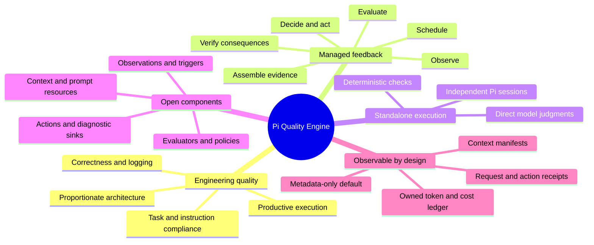
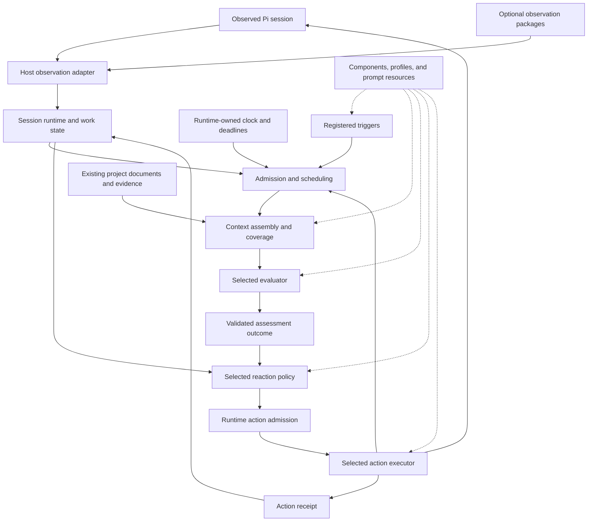
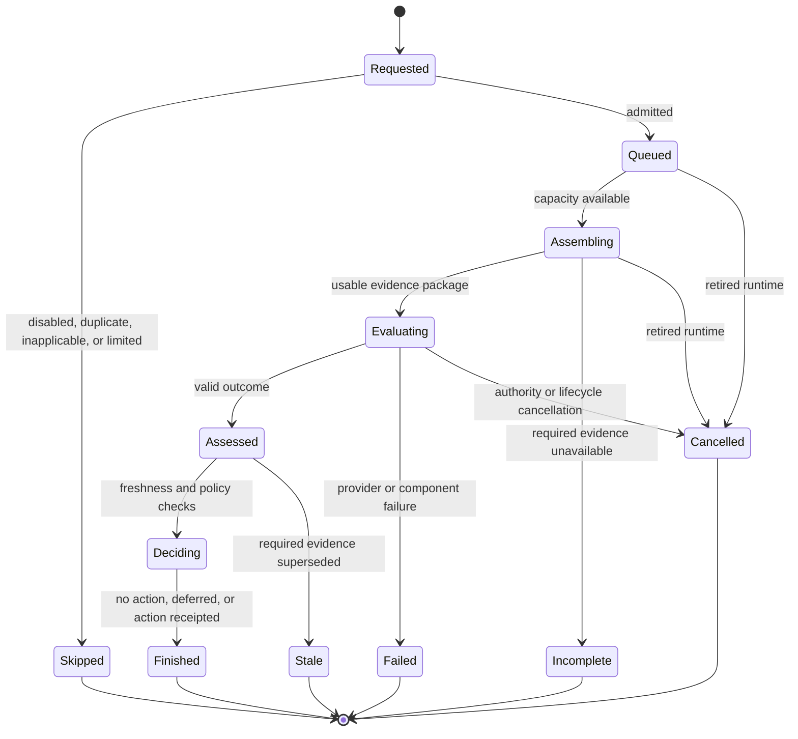
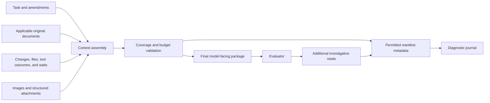
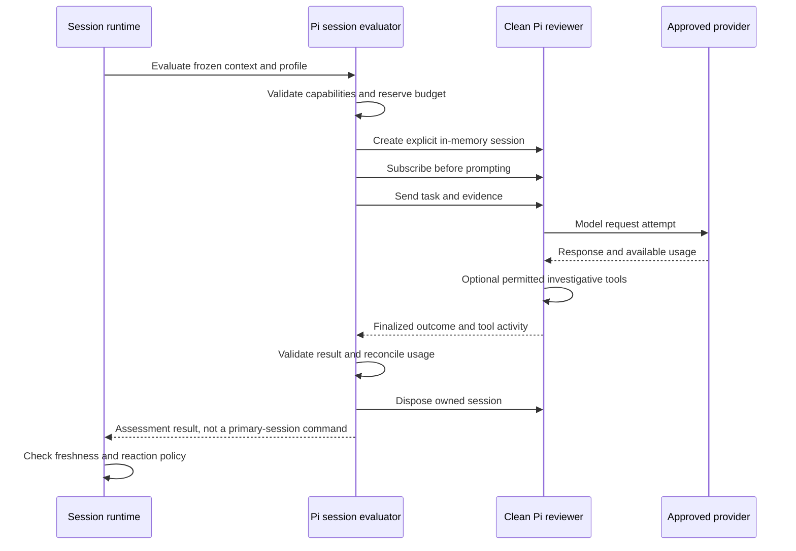
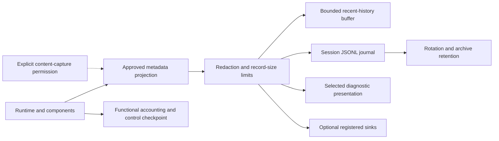

## Pi Quality Engine — Architecture and Decisions 🧭

**Document 1 of 4 · Architecture baseline A1 · 12 October 2026**

Pi Quality Engine is a proposed, standalone Pi extension that observes engineering work, evaluates it against the actual task and existing project documentation, and provides bounded, evidence-based feedback. It can perform inexpensive checks, request a model judgment, or launch an explicitly configured, independent Pi review session. Its purpose is better engineering outcomes with less wasted work—not more reviews, more messages, or more opportunities to stop the executor.

The architecture is organized around a **managed feedback loop**. Components are replaceable; ownership, cancellation, spending, evidence provenance, and the meaning of an action remain explicit.

> [!important] The deployment contract
> A clean Pi installation, this package, and a configured provider are sufficient for observation, model evaluation, independent review, feedback delivery, and local observability. Warden, OMP Advisor, Ribbons Advisor, pi-jev, and pi-subagents are **not required installed plugins**. Their source code may inform or supply selected implementations under the applicable licenses.

### Document authority and boundaries 📑

This document defines architectural responsibilities, invariants, trade-offs, and the frozen source baseline. It does not claim that the proposed package has already been implemented, that the referenced projects have been integration-tested together, or that any model reliably identifies every engineering mistake.

| Companion document | Responsibility |
|---|---|
| `01-architecture-and-decisions.md` | This document: system structure, decisions, evidence, reuse boundaries, and architectural proof obligations. |
| `02-component-contracts-and-configuration.md` | Exact component interfaces, schemas, configuration resolution, profiles, registration protocol, and examples. |
| `03-observability-and-data-policy.md` | Event catalog, data-capture profiles, accounting rules, persistence, rotation, retention, privacy, and diagnostic presentation. |
| `04-implementation-testing-and-acceptance.md` | Development stages, behavioral tests, scenario modeling, evaluation methodology, and stage acceptance evidence. |

The companion filenames describe the agreed document set; they are not claims that the other files already exist. Definitions introduced here should remain consistent across the set. Exact configuration keys should have one authoritative definition in Document 2, and exact event fields should have one in Document 3.

The words **must**, **should**, and **may** express, respectively, an architectural requirement, a justified default that can have a documented exception, and an optional capability. A **source observation** describes inspected upstream material. A **design decision** describes this proposed system. An **implementation gate** identifies something that still requires a working test. These categories must not be conflated.

### Reading map 🗺️

| Question | Sections |
|---|---|
| What is being built, and what defines success? | [1–3](#section-1) |
| How are responsibilities divided without building an oversized framework? | [4–6](#section-4) |
| How do time, inactivity, progress, and overlapping checks work? | [7](#section-7) |
| What reaches an evaluator, and how is a judgment formed? | [8–10](#section-8) |
| How does feedback become an action without creating loops? | [11](#section-11) |
| How are visibility, privacy, costs, and restoration handled? | [12–14](#section-12) |
| What is reused, from exactly where, under which conditions? | [16–17](#section-16) |
| What must be proven before accepting the architecture? | [15](#section-15), [18–20](#section-18) |



<a id="section-1"></a>

## 1. Product intent and engineering philosophy 🎯

### 1.1 The problem is broader than code correctness 🔎

A change can pass its tests and still be a poor implementation. It can introduce unnecessary layers, alter unrelated behavior, omit required operational logging, depend on a known test fixture, or satisfy only part of the task. An agent can also produce no useful change while repeatedly inspecting, planning, or verifying the same information.

The observer therefore evaluates both the **work product** and the **process that produced it**. Neither dimension can be reduced to one universal score. A legitimate investigation can involve many reads and no edits. A one-use helper can improve clarity. A repeated test can be necessary after a relevant change. A missing commit matters only when committing is actually part of the authorized workflow.

The intended behavior is pragmatic: recognize a concrete departure from the task or project standards, establish the evidence needed to judge it, and choose the smallest useful intervention.

> [!example] The desired correction
> “The task changes validation in the existing service. The new adapter adds no distinct responsibility and has one forwarding call. Check whether the existing service boundary already covers the requirement; remove the adapter only if it does.”
>
> The useful part is the specific evidence and decision to revisit—not an instruction to eliminate all adapters or all single-use functions.

### 1.2 Supported quality concerns 🧪

| Concern | Evidence normally needed | What must not count as proof by itself |
|---|---|---|
| Task completeness | Authorized request, explicit amendments, affected behavior, unresolved requirements. | An enthusiastic final message or a task title. |
| Instruction compliance | Applicable project documents, their versions, and the implementation under review. | A rule remembered from an earlier, different task. |
| Overengineering | Required behavior, existing architecture, changes, call sites, and reasons for new abstractions. | Number of classes, lines, files, or layers alone. |
| Architecture | Documented boundaries, contracts, dependencies, relevant existing code, and the change. | The evaluator's preferred architectural style. |
| Test-specific production behavior | Product requirements, production code, tests, and the relevant execution path. | A changed test or dependency injection alone. |
| Required logging | Operational requirements and the paths where meaningful events or failures occur. | Absence of a logging call in every function. |
| Verification quality | Actual commands, outcomes, applicability, and whether evidence covers the latest relevant code. | A tool call being issued, an exit code hidden by a pipeline, or a previous passing run. |
| Execution efficiency | Recent actions, results, known waits, new information, and task-dependent progress signals. | Elapsed time, tool count, or lack of edits alone. |
| Visual quality | A render, viewport and state metadata, references or criteria, and optionally layout measurements. | Source code inspection or a model's unexplained taste. |

These are initial applications of the engine, not categories hardcoded into the runtime. A specialist package may introduce another assessment domain without changing the scheduling or delivery machinery.

### 1.3 Success is net improvement, not inspection volume 📈

The product succeeds when it prevents meaningful violations, reduces avoidable rework, and helps the executor finish the authorized task with proportionate effort. Counts of findings, reviews, or injected messages are operational measurements—not quality objectives.

A useful evaluation program compares confirmed corrections, false interventions, unwanted wakes, added latency, and owned assessment cost. It does not reward the observer for producing a constant stream of criticism. Silence can be a correct assessment outcome, but silence caused by missing context, a disabled component, or a failed provider must remain distinguishable in diagnostics.

### 1.4 Simplicity applies to the observer itself 🪶

The implementation should use ordinary functions, small stateful objects where state is real, and explicit data contracts. A role in an architecture diagram does not require a class hierarchy, a package, or a service. A stable name for an operation does not require a distributed command system.

Production behavior is derived from requirements. Tests verify that behavior; they do not justify test-only branches, hidden bypasses, or layers with no operational responsibility. Conversely, making clocks, model calls, and filesystem boundaries controllable is justified by actual runtime variability—not merely by the existence of tests.

<a id="section-2"></a>

## 2. Non-negotiable architectural invariants 🧱

The following invariants are the acceptance baseline. They are intentionally fewer and stronger than a catalog of implementation preferences.

| ID | Invariant | Consequence |
|---|---|---|
| A-01 | Core scenarios work on bare Pi with this package. | Independent review uses Pi directly; another plugin is never a mandatory launcher. |
| A-02 | Existing project documents remain the source of requirements. | No second manually maintained rule database is required. |
| A-03 | Observation, assessment, policy, and execution are separate responsibilities. | A model finding is not an authorization to act. |
| A-04 | Time is a first-class scheduling input. | A stalled executor can be investigated even when no new tool event arrives. |
| A-05 | Activity, progress, waiting, and permission to continue are different facts. | A timer alone cannot authorize a wake or cancellation. |
| A-06 | Each assessment has identifiable, versioned evidence. | A conclusion can be traced to its actual inputs and checked for staleness. |
| A-07 | Missing evidence is not a clean bill of health. | Incomplete, unavailable, failed, and clean outcomes remain distinct. |
| A-08 | Runtime ownership is explicit. | Timers, requests, sessions, and actions cannot survive replacement with stale authority. |
| A-09 | Operator stops outrank autonomous feedback. | Automatic activity cannot restart intentionally stopped work without a new authorization boundary. |
| A-10 | Observability is mandatory; content capture is not. | The standard journal explains behavior without copying code, prompts, or tool-result bodies. |
| A-11 | Spending is counted by ownership, not by component names. | All engine-owned model work is accounted for, including independent Pi reviewers. |
| A-12 | Extensibility preserves common lifecycle and visibility. | A third-party component cannot be a legitimate black box inside the supported contract. |
| A-13 | Repetition is controlled without deleting obligations. | Repeated advice may be suppressed; mandatory project requirements are not silently disabled. |
| A-14 | Failure containment is bounded and honest. | An unavailable observer does not become a failing executor, and uncertainty is not recorded as success. |

Some of these constraints are operational policies enforced by the engine's cooperative component API. They are not an operating-system sandbox against malicious JavaScript loaded into the same process.

<a id="section-3"></a>

## 3. Scope, terminology, and ownership 📐

### 3.1 The boundary of one installation 🧭

One installed package supplies the initial observation adapters, time- and event-based triggers, context collection, model evaluation, a clean Pi-session evaluator, feedback policies, actions, and local diagnostics. These built-ins should use the same component contracts offered to extensions. There should not be a privileged “real” implementation path and a weaker public imitation.

The host Pi remains responsible for its normal conversation, provider authentication, execution of the main agent's tools, and user interface lifecycle. The engine owns its assessment runs and its review sessions. Existing plugin integrations can be added as adapters, but the core cannot assume that any is installed.

The inspected Pi SDK supports separate model, session-storage, resource-loading, and tool configuration through `createAgentSession()`. This is the technical foundation for standalone review; it is not necessary to reconstruct an agent runtime.[^pi-sdk]

### 3.2 Terms used throughout the document 📖

| Term | Meaning |
|---|---|
| **Observed session** | The primary Pi conversation whose work is being evaluated. |
| **Work episode** | A bounded period of authorized work associated with a task and its amendments; not an entire goal-management system. |
| **Observation** | An attributable fact about execution, evidence, waiting, or an external integration. |
| **Check definition** | Configuration and assessment resources describing what is evaluated, when, from which context, and under which policy. |
| **Evaluation run** | One admitted execution of a check against an identified evidence window. |
| **Request attempt** | One actually dispatched model request, including a retry or an internal reviewer call. |
| **Reviewer session** | An engine-owned, independent Pi session used as an evaluator. |
| **Finding** | A specific concern or confirmed defect with evidence and a connection to a requirement or quality criterion. |
| **Action proposal** | A policy-selected intervention that still requires runtime admission. |
| **Action receipt** | What is known about dispatch, queuing, completion, rejection, or an unknown outcome. |
| **Context snapshot** | The material assembled for a particular evaluation or request, with provenance and coverage information. |
| **Context manifest** | The metadata describing that snapshot, without necessarily storing its text. |
| **Control checkpoint** | Bounded functional state needed for safe restoration and accounting. It is not a diagnostic transcript. |
| **Journal** | The configurable, append-oriented diagnostic record of one observed session. |

“Step” is not an unqualified architectural term. Configuration must identify whether a cadence counts completed tools, completed model/tool cycles, changes, or elapsed time. Pi permits multiple tool calls from a single assistant message to execute in parallel.[^pi-events]

### 3.3 Three ownership domains 🏷️

**Primary execution** belongs to the observed Pi session. Its tokens and costs are not included in the observer's owned-spend total. An injected message can cause additional primary work, but the engine must not claim that this makes primary billing fully observable or attributable.

**Owned assessment work** includes direct classification, generative assessment, any model-assisted context preparation, and every model request inside the engine's independent Pi reviewers. This work is included in the engine's accounting.

**Delegated external work** belongs to an optional external executor. The engine records what it sent, the handoff identity, and the result it receives. It does not inspect or reconstruct external internal billing. This boundary must be visible rather than silently treating excluded spend as zero.

<a id="section-4"></a>

## 4. Overall architecture: one managed feedback loop 🔄

### 4.1 The control path 🛤️



The diagram has one owner of the control loop: the session runtime. Components perform their responsibilities, but the runtime determines whether work remains admissible. Observability follows the whole path; it is not a final optional action attached only when a finding exists.

### 4.2 Two decisions, not one ⚖️

An evaluation trigger answers **whether there is a reason to assess**. Scheduling then checks enablement, relevant work state, existing runs, cooldowns, and available resources. A trigger firing does not guarantee a new paid request.

An outcome policy answers **whether a useful intervention follows from the result**. Action admission then checks current authority, evidence freshness, duplicates, limits, and the target session. A high score does not guarantee delivery.

Keeping these stages separate makes it possible to run a new check in observation-only mode without replacing its evaluator, or to change from immediate advice to expert confirmation without changing the assessment question.

### 4.3 What the runtime knows—and what it does not 🧠

The runtime knows identities, states, relationships, configured limits, evidence versions, and legal lifecycle transitions. It must be able to tell that a result belongs to a retired session or that an action was already dispatched.

It does not define the right architecture for a Django service, the correct amount of logging in a worker, or the aesthetics of a React screen. Those judgments belong to check definitions and evaluators. It does not require every assessment to use a model.

A practical first implementation can express the control flow as a small orchestrator with explicit asynchronous operations. There is no architectural requirement for a generic workflow language, a general-purpose dependency-injection container, or event sourcing of every internal mutation.

<a id="section-5"></a>

## 5. Component boundaries and open extension points 🧩

### 5.1 Behavioral roles rather than mandatory class hierarchies 🧰

| Role | Responsibility | Required output boundary | Explicit non-responsibility |
|---|---|---|---|
| Observation source | Translate a host or integration signal into a fact with origin and scope. | Normalized observation, including unavailable or partial visibility. | Deciding that the task has failed. |
| Trigger | Determine whether an observation or deadline creates a reason to evaluate. | Evaluation intent and, where needed, next due time. | Calling a model or delivering advice. |
| Context provider | Produce requested material and provenance. | Context items plus coverage and omission information. | Redefining project policy. |
| Evaluator | Assess an assembled task and evidence package. | Validated outcome, findings, additional reads, and owned usage. | Directly commanding the primary executor. |
| Reaction policy | Interpret an outcome in the current work state. | An action proposal or an explicit reason for no action. | Performing the proposed side effect. |
| Action executor | Carry out an admitted operation. | A receipt with the strongest state actually known. | Inventing new review criteria. |
| Diagnostic sink | Consume already-permitted diagnostic records. | Delivery or degradation information for the sink. | Accessing raw evidence merely because tracing is enabled. |

These are semantic boundaries, not a promise to freeze every interface before a prototype exists. Document 2 will specify the public contract and versioning. A package may contribute more than one role. A small pure evaluator may be a single function.

### 5.2 Check definitions and prompt resources 📝

A check combines registered capabilities. Its definition selects triggers, context, an evaluator profile, assessment instructions or typed questions, and a reaction policy. A simple change to cadence or a prompt should not require TypeScript changes.

Prompt resources are data. A Markdown file can hold assessment instructions; a classifier resource can hold typed questions; a JSON schema can define the output. An optional prompt provider may build these resources dynamically. Dynamic providers use the same provenance, cancellation, and resource accounting as other components. A new mandatory template language is not part of this baseline.

Existing project requirements are different from these assessment resources. The former say what the project requires; the latter say how a check should examine compliance. A generated index or cache may accelerate access, but it is derived and disposable, never a new authoritative rule collection.

### 5.3 Substitutability requires capability declarations 🔌

An evaluator must advertise what it supports: for example, text, images, typed decisions, generative output, tool-assisted investigation, cancellation, and available usage reporting. A context provider advertises its output types. An action declares its effect class and the authority it requires.

Configuration validation must reject incompatible combinations before repeated runtime failure. An image check cannot silently become a text-only check because the selected model lacks image input. An unavailable provider must not cause an unannounced switch to a different paid service.

Substitutability means preserving the contract and reporting limitations, not pretending that every model has the same semantics or reliability.

### 5.4 Registration, discovery, and readiness 🧾

Component identity combines a namespaced ID, contract major version, and owning package. Registration is acknowledged. Duplicate identities are errors unless an explicit operator-selected override is supported. A dependency on an absent component disables the affected check with a visible reason rather than creating a partly active configuration.

Pi's event bus is useful for discovery and notifications, but its inspected `emit()` returns `void`; asynchronous handlers are not awaited by the emitter and their errors are caught. It cannot serve as an implicit “all plugins are ready” barrier.[^pi-event-bus]

The integration should therefore use a small, versioned registration handshake: subscribe to availability notifications, query the current registry if the notification was missed, register through an acknowledged API, and mark asynchronous preparation complete explicitly. A single startup broadcast is insufficient. Execution of registered components should use ordinary awaited calls owned by the runtime—not an untracked chain of bus events.

Registration handles must be disposable. Unload or replacement retires the component generation, stops admitting dependent work, and prevents retired callbacks from acting. A compatible replacement does not inherit arbitrary mutable state unless that state has a versioned representation defined for restoration.

### 5.5 Extensibility does not imply unrestricted autonomy 🛡️

Within the supported API, triggers propose checks and policies propose actions. The runtime mediates scheduling, feedback, spending, and lifecycle. This allows an independently installed package to behave consistently with built-ins.

A trusted custom action may legitimately have new effects. It must declare them, receive the corresponding operator permission, and produce a receipt. The engine should not hardcode all future action types into one closed enumeration; it should apply common constraints based on declared capabilities and the registered handler.

This is a cooperative architecture. A malicious same-process extension could bypass it and call Node.js directly. Manifests are not a sandbox. The system must neither claim protection it does not provide nor add a complex security theater around an inherently trusted extension model.

<a id="section-6"></a>

## 6. Runtime ownership, state, and identities 🧠

### 6.1 Execution state and work state are independent 🧭

A single `isIdle` boolean cannot distinguish healthy waiting from abandoned work. The runtime maintains two small projections.

| Projection | Representative values | Authority and use |
|---|---|---|
| Execution | Model request active, tool active, provider retry, compacting, idle, interrupted, shutdown. | Derived from host signals and supported instrumentation; controls safe timing. |
| Work | Work expected, waiting for dependency, waiting for operator, completion candidate, complete, unknown. | Derived from authorized task context and explicit or assessed evidence; controls whether a continuation is meaningful. |

The exact enums belong to Document 2. The requirement is the separation, including an explicit unknown state. An active task is not automatically cancelled by an unrelated side question. Equally, every question is not a perpetual authorization to perform all historical work.

A work-state assessment may recommend “completion candidate” or “apparently stalled.” It cannot manufacture authority to continue after an operator stop. The runtime keeps the authorization boundary separate from model interpretation.

### 6.2 A minimal work record, not another task system 🗃️

The engine needs a bounded reference to the initiating request, material amendments, applicable instruction version, outstanding dependencies, and the current assessment of completion. It does not need to recreate a project-management hierarchy.

Wait records should identify what is awaited, the known owner or operation, the last evidence of status, and a review deadline. They can express that an external result is not currently observable. They should not require a specific background-task plugin to exist.

Claimed progress and observed progress remain distinct. “I am working on it” is activity, not a completed milestone. A relevant diagnosis supported by new evidence may count as progress even without a file change.

### 6.3 Identities and bounded state 🏷️

The smallest useful identity set links the observed session and branch, runtime generation, evaluation run, model request attempt, and action. Findings have stable identities within their evidence and criterion scope so repeated wording does not create new incidents.

Configuration, prompt, source, and model-profile revisions can be fingerprints referenced by these records rather than copied into every event. A single correlation chain should support diagnostic inspection without a custom ID for every token or internal function call.

The runtime owns bounded maps or queues for active work, pending intents, recent evidence references, findings awaiting follow-up, action receipts, and budget reservations. Their bounds are configuration with documented consequences. “Bounded” must cover bytes as well as counts where an entry can carry arbitrary data.

### 6.4 Evaluation-run lifecycle 🔁



The diagram is a behavioral model, not a requirement to adopt a state-machine library. Terminal evaluation status and action-delivery status are distinct. A valid assessment may produce no action; an action can remain uncertain after the assessment itself has completed.

### 6.5 Replacement, branch changes, and restart 🧯

Every callback that can mutate runtime state or dispatch an action checks that its generation still owns the session. Cancellation signals are propagated, but cancellation alone is not enough: a provider may return after the signal. A late result may still contribute final known usage, but it must not regain action authority.

Branch-sensitive evidence is restored only for the active branch. **Actual spending and already executed side effects are not undone by a branch change.** Session-level accounting and action tombstones therefore cannot be reconstructed solely by replaying the active conversational branch.

A compact metadata-only control checkpoint should retain essential limits, ownership references, accounting completeness, and action identities independently of diagnostic verbosity or log rotation. It may be a small atomic sidecar owned by the session. It is not a second full transcript or a general database.

The checkpoint contains bounded metadata, not deferred prompt or code bodies in Standard mode. If evidence needed for a queued intervention is no longer available, restoration drops or re-derives that intervention from current permitted sources; it does not relax the content policy to make recovery easier.

After a process restart, in-flight model requests and actions can have uncertain outcomes. The engine does not automatically replay old paid work or old feedback. It reconciles available receipts and host history, marks remaining uncertainty, and rebuilds evidence when a fresh admissible check is requested. A missing response is not proof that no charge or side effect occurred.

Pi session replacement invalidates old contexts and requires subscriptions to be rebound; the engine must implement the corresponding ownership boundary for its own work.[^pi-sdk]

<a id="section-7"></a>

## 7. Scheduling: steps, time, progress, and completion ⏱️

### 7.1 Time is a signal, not a verdict 🕰️

The scheduler must support time-driven evaluation from the first operational prototype. An observer driven only by completed tool events cannot detect a missing next event. However, elapsed time alone establishes neither failure nor permission to resume.

| Trigger family | Question answered | Typical guard against false intervention |
|---|---|---|
| Count-based | Has a configured number of completed operations or cycles accumulated? | Count the selected unit once; exclude observer-owned activity. |
| Periodic | Is a periodic assessment due while relevant work is expected? | No paid checks during irrelevant idle time; unchanged-input policy and cooldown. |
| Inactivity | Has expected activity been absent for too long? | Distinguish a live model request, tool, retry, or known wait. |
| No progress | Has work remained unproductive despite activity? | Require task-dependent progress evidence; do not equate progress with edits. |
| Wait deadline | Does a specific dependency need status reconciliation? | Identify the wait owner and what completion evidence is available. |
| Evidence change | Did an applicable source, file set, render, or result change? | Debounce related edits and avoid judging intermediate inconsistent states. |
| Completion boundary | Is the executor presenting work as complete? | Check unresolved authorized requirements and current verification evidence. |
| Manual | Did the operator explicitly request an assessment? | Use the same context, accounting, and action-admission path as automatic checks. |

The OMP Advisor source supplies a useful but narrower pattern: a deadline for the oldest buffered message that is not postponed by later messages. It can dispatch a review while a tool is still active. That mechanism prevents indefinite batching; it is not itself a full inactivity or progress detector.[^omp-cadence]

### 7.2 Clocks, deadlines, and suspension 🌙

Runtime durations use a monotonic clock. Calendar timestamps are recorded for human interpretation and retention. A deadline is represented as due work, not as an assumption that a callback fires exactly on time. Node.js timers depend on event-loop execution and do not guarantee exact callback timing.[^node-timers]

The runtime owns timer resources. Trigger implementations declare the next relevant deadline instead of starting independent perpetual intervals. A straightforward earliest-deadline scan is sufficient initially; a specialized timer heap is justified only by measured scale.

After system sleep, timer delay, or session restoration, the scheduler evaluates current conditions and coalesces overdue work. It does not issue one paid review for every missed interval. Wall-clock timestamps are not converted into fictional monotonic continuity across process restarts.

An internal timer cannot recover a dead Pi process or run while that process's event loop is permanently blocked. An out-of-process watchdog would be a different deployment capability. The baseline promises diagnosis and bounded response while the host runtime is able to execute—not magical self-recovery from its own absence.

### 7.3 Healthy waiting versus abandoned work 🚦

A live tool with an expected long duration is not idle abandonment. A model waiting for a provider response is not necessarily a planning loop. A known dependency whose deadline has not expired should suppress generic “resume work” actions.

Conversely, repeated successful reads can conceal a stall. The runtime keeps separate activity and progress timestamps or evidence markers. Progress detection may be deterministic for a known milestone or model-assisted for open-ended work. Its origin and uncertainty are recorded.

When no operation is active, work remains explicitly outstanding, and no dependency or operator wait explains the pause, an inactivity check can ask a narrowly scoped question: whether a useful next action remains authorized. A supported continuation is then a policy decision. If the task status is uncertain, the observer should gather evidence or report uncertainty, not keep the executor alive indefinitely.

A stop initiated by the operator suppresses automatic continuation until a new authorized run begins. This stop protection must survive ordinary pause/resume of the observer itself; toggling the observer is not authorization to undo a primary-session stop.

### 7.4 Short and deep cadence can coexist 🪜

The following is a behavioral example, not a frozen configuration schema or a calibrated default:

```text
Completed primary tools:  1  2  3  4  5  6  7  8  9 10 11 12 13 14 15
Short progress check:                Q              Q              Q
Deep engineering review:                                          D
Time-triggered diagnosis:     may become due independently of tool completion
Completion check:            may become due before either count is reached
```

A profile may request short assessment every five completed tools and deep review every fifteen. The deep review may use a stronger direct model or a clean Pi reviewer with investigative tools. Cadence, context size, evaluator capability, and feedback frequency are independent choices.

If a deep review covers the same criteria and evidence as a due short check, policy may let it subsume that check. Coverage must be declared. Architectural review does not inherently subsume stalled-execution diagnosis. Both reasons remain visible even when only one execution is admitted.

### 7.5 Queueing and overlap 🧵

The default queueing policy should permit one active run and one coalesced pending intent per check. Global limits bound overall concurrent assessments and reviewer sessions. These limits are configuration, not permission for each module to invent its own scheduler. A slow deep review must not indefinitely starve due lightweight checks; bounded priorities and explicit capacity reservations can be introduced within this one scheduler. The initial policy can remain small, but its starvation behavior must be specified and tested.

New evidence normally updates the pending intent. It does not automatically cancel the active run. Cancelling on every new executor event would starve review of a fast-moving session. Before acting on a completed run, the runtime checks the specific dependencies of that result.

The implementation must distinguish a trailing debounce from a maximum wait. Continuous edits may delay an edit-coalescing check briefly, but cannot postpone all assessment forever. Conversely, a maximum-wait trigger can admit an incomplete in-progress assessment without pretending that unfinished work is final.

The scheduler records why an intent was queued, coalesced, skipped, superseded, or limited. It reserves resources before dispatch and releases or reconciles them when the run settles. A concurrency slot is not silently considered free while a non-cooperative timed-out request may still be active.

### 7.6 Final-boundary review without an endless tail 🏁

A completion check should use the host's actual actionable boundary. At the frozen Pi baseline, `turn_end` and `agent_before_settle` can propose entries and a bounded continuation; `agent_settled` is notification-only. Long network work should not be inserted into a callback merely because an event happens to have a promising name.[^pi-events]

The host adapter must implement and test a bounded strategy: consume an already available review, wait only within a documented short boundary budget where supported, or schedule a later authorized continuation through the proper host API. Returning a continuation request from a notification-only event is not a valid implementation.

Per-finding and per-episode continuation limits prevent chains in which each final review produces another final review with no new evidence. Exhausting an observer limit does not convert unfinished work into completed work. It stops further autonomous intervention and leaves an honest unresolved status.

<a id="section-8"></a>

## 8. Context architecture: original requirements, explicit evidence 📚

### 8.1 Sources remain where the project already keeps them 📂

The engine accepts references to existing files, directories, glob selections, and supported external-source adapters. `AGENTS.md`, architecture documents, requirements, coding standards, ADRs, and UI references are not migrated into a new hand-maintained format.

Source selection is configurable. A small project can require three complete documents in every check. A larger project can require a stable core and explicitly scoped sections. A review profile can permit the reviewer to read more evidence. There is no mandatory semantic-retrieval subsystem and no automatic deletion of “less relevant” instructions.

External URIs need an explicit retrieval and trust policy, including allowed destinations, cache/version behavior, and what happens when retrieval fails. They are not executed as instructions or fetched silently from arbitrary links found inside untrusted tool output.

### 8.2 Sources, requirements, and evaluator instructions are distinct 🧷

The observer's policy specifies how a review is performed and what actions are allowed. Project documents specify engineering requirements. The user task specifies the authorized work. Source code and logs supply evidence. Prior assistant conclusions are assertions to verify.

These categories should remain labeled in the evidence package. A command-like string in a log must not become an observer instruction. A note from a previous reviewer must not silently outrank a newer explicit operator request.

If authoritative sources conflict, the assessment reports the conflict and its scope. The engine does not invent a universal precedence rule that silently changes project intent. Source precedence and permitted task overrides must be explicit in the configured policy. Changes to policy, disclosure, or action permissions are never authorized merely by the assessed code or an evaluator's response.

If the executor edits an instruction document during the same task, the run records both relevant revisions and whether the change was authorized as policy work. The implementation must not allow an unreviewed rewrite of a rule to erase the evidence that the prior requirement was violated.

### 8.3 A context package has four parts 📦



The four conceptual parts are the task, applicable requirements, observed evidence, and optional attachments. Previous findings can accompany them, but must be labeled as hypotheses or earlier conclusions.

Every item carries provenance and its role. The context assembler enforces required items, deterministic ordering where useful, configured size budgets, and the selected disclosure policy. The evaluator receives a snapshot; it does not receive a mutable reference to the main runtime's entire state.

### 8.4 Coverage must survive truncation and selection ✂️

The manifest distinguishes **configured**, **retrieved**, **selected**, and **actually dispatched** material. It records the revision or content fingerprint, ranges, encoded size where known, and whether the item was omitted, truncated, unavailable, or changed during acquisition.

A budget reduction cannot silently drop required evidence and still label the assessment complete. The engine can ask a narrower question, use another approved profile, or produce an incomplete result. All three are preferable to pretending that a partial review covers the whole project.

Warden demonstrates why these distinctions matter: the inspected rules code bounds sampled content and rule bodies and limits the number of per-request rule questions. Those bounds are sensible for its own mechanism but cannot be reinterpreted as universal coverage of an arbitrary documentation set.[^warden-rules]

### 8.5 Evidence consistency in a live repository 🌳

A working repository can change during collection. A “snapshot” is not automatically an atomic filesystem snapshot. Providers should record file fingerprints, compare before/after metadata where necessary, and retry a bounded acquisition or mark it inconsistent if relevant input changes during collection.

The change collector must distinguish pre-existing changes from changes made during the observed episode. A session-start `HEAD` alone is insufficient: it can include earlier dirty files, and later commits can hide work from a plain working-tree diff. The baseline design captures the initial relevant working-tree state plus Git identity, then compares the final relevant state. Exact collection mechanics belong in Document 2. The first collector should prefer read-only Git queries and bounded in-memory baseline evidence over a blanket index or object-store snapshot. If it cannot reconstruct the selected scope safely, it reports incomplete coverage rather than persisting the entire repository as a convenience.

Warden's `src/turn-rules.ts` offers a useful implementation reference: a temporary Git index and tree snapshots isolate the real working index while comparing a run. That approach may still write Git object data; it should not be described as having literally no filesystem effects. A direct port is not the default decision: creating Git objects can retain previously untracked content, including content that should never have been captured. Any selected adaptation must scope and exclude sensitive material before collection, preserve operator data, exclude observer artifacts, handle untracked files deliberately, and be tested against existing staged and unstaged work.[^warden-turn]

Concurrent writers also affect attribution. A shared-worktree change is repository evidence, not proof that the observed agent authored it. The observer should identify attribution limits rather than blame one session for every edit it sees.

### 8.6 Stable instructions without copying history forever 🧠

Mandatory review instructions and selected project requirements are assembled explicitly for every new evaluation context. They must not depend on whether a previous long-running reviewer still remembers a file after compaction.

For direct requests, the engine can keep stable instruction prefixes and append changing evidence. For a multi-turn reviewer, it must preserve the required instructions across its own maintenance and record additional reads. Prompt caching can be exploited where supported, but savings cannot be assumed to be identical across providers.

The engine does not repeatedly replace the primary agent's system prompt to keep the reviewer informed. Evaluator input and executor feedback are different channels.

### 8.7 A hash is not a transcript 🔐

Metadata-only mode can establish which material was used and whether a later copy matches it. It cannot reconstruct content that was never retained. Full reproduction requires an explicitly enabled, bounded evidence snapshot or access to the original version through a trusted source.

This is a data-policy decision, not a defect to hide. Exact-content hashes, filenames, URLs, and error types can themselves reveal information. Document 3 must specify masking options, excluded secret classes, and where opaque identifiers are preferable to raw fingerprints.

<a id="section-9"></a>

## 9. Evaluation architecture and the meaning of a result 🧪

### 9.1 Three built-in evaluation mechanisms ⚙️

| Mechanism | Execution | Appropriate use | Limitation |
|---|---|---|---|
| Deterministic | Code examines observed facts or structured evidence. | Repeated identical operations, known command outcomes, deadline checks, specified invariants. | Cannot settle arbitrary architectural intent. |
| Direct model | A classifier or generative model receives the prepared package. | Frequent classification, bounded rule assessment, structured text or visual evaluation where supported. | Only sees supplied evidence; model-specific uncertainty remains. |
| Independent Pi session | A separately configured model can investigate through allowed tools. | Architecture, ambiguous violations, broader verification, and deeper visual investigation. | More latency and cost; tool restrictions are not a security sandbox. |

These mechanisms are interchangeable only where their declared capabilities meet the check's needs. The inspected Pi model documentation exposes native typed classification through `ctx.modelRegistry.classify()`; this allows the engine to use Pi's provider integration rather than requiring a Jev plugin.[^pi-models]

The architecture does not hardcode a specific vendor's model ID or pricing. A chosen deployment profile names available models and their requirements. Image support is verified for the actual evaluator route; it is not inferred from the phrase “System 1” or from a provider family name.

### 9.2 Operational outcome and engineering conclusion are separate 🧾

An evaluator first reports whether it executed successfully and what coverage it achieved. It then reports findings or a clean result within that coverage. These dimensions must not be flattened into a single number.

A useful result distinguishes:

| Dimension | Examples |
|---|---|
| Operational status | Completed, failed, cancelled, unavailable. |
| Coverage | Complete for declared scope, partial, insufficient. |
| Engineering conclusion | No supported finding, suspected violation, confirmed violation, conflicting requirements. |
| Finding evidence | Source references, changed locations, observed outcomes, and limitations. |
| Optional score | Criterion, scale, value, model provenance, and calibration version if any. |

“Provider failed” is not “quality zero.” “No context” is not “no defects.” “No tools called” is not automatically proof of either a clean or a poor review.

### 9.3 Scores are not interchangeable probabilities 📊

A classifier probability, a generative model's self-reported confidence, and a human-style quality grade have different meanings. The engine may normalize structure, but it must not invent a shared statistical calibration.

Reaction thresholds are tied to a criterion and evaluator profile. Replacing a model or materially changing a prompt invalidates assumptions behind its threshold. The new combination should be tested in observation-only mode or against the corresponding scenario set before automatic action is trusted.

Typed questions should isolate useful judgments. For example, “Does the change introduce behavior not required by the task?” is more inspectable than “Is the agent doing a bad job?” The first still needs task and implementation evidence; its output is not a universal truth simply because it is numeric.

### 9.4 Findings must be actionable and falsifiable 🧷

A finding should identify the relevant requirement or criterion, the evidence, the actual or suspected failure mode, and the smallest correction or investigation that would resolve it. A supported “insufficient evidence” result should identify the missing information rather than hallucinate a defect.

The evaluator should be able to reject the preliminary suspicion. An expert review that merely receives “the agent is overengineering; explain why” is not independent verification. Its task should ask whether the suspicion is supported and what alternative explanation exists.

Evidence from a test must concern the current relevant implementation. A command being started does not prove it completed, succeeded, or ran meaningful checks. In the inspected pi-jev watchdog, a verification-evidence flag can be set when a matching command is issued. That code is useful as a small organizational example, but this boolean is not sufficient evidence for the new engine's acceptance semantics.[^jev-watchdog]

### 9.5 Assessment quality must remain subordinate to project intent 🛠️

A built-in overengineering check should not adopt an unconditional rule against all single-use abstractions. A logging check should not request sensitive payload logging to satisfy observability. A verification check should not demand new frameworks or exhaustive tests for every trivial change.

Likewise, tests must not become the product specification by accident. A legitimate failing test may reveal a bug; a fixture-specific expectation may itself be wrong. The reviewer compares both with the requirement and reports the discrepancy. “Tests adapt to code” means test structure follows public behavior and real boundaries—not that tests are weakened whenever correct assertions fail.

<a id="section-10"></a>

## 10. Independent review with clean Pi sessions 🤖

### 10.1 A reviewer is an evaluator, not a mandatory external subsystem 🧭

A deep scheduled check and an escalation use the same session evaluator. They differ in profile, scope, and evidence—not in launcher ownership. The initial package therefore needs one coherent implementation of independent review rather than one path for scheduled sessions and another for “subagents.”

The frozen SDK supports explicit session creation, model selection, in-memory storage, resource loading, and allowed tools. Its full-control example demonstrates a session without discovered extensions or context files.[^pi-full-control]

### 10.2 The review profile is explicit 📋

A review profile defines the provider and model route, supported reasoning settings, assessment instructions, allowed context sources, permitted tools, duration and request limits, expected output, and data-capture policy. It must not inherit a large ambient extension stack simply because the primary session has it installed.

Default review sessions use `SessionManager.inMemory()`. Project context is supplied intentionally; the primary's full conversation is not silently forked. The profile may allow further file reads, but every such read belongs to the review and is recorded under its identity. The SDK's context-file example demonstrates explicit addition or replacement of project instruction material.[^pi-context-files]

The OMP source's `ADVISOR_RESOURCE_ISOLATION` is a particularly relevant reuse example: it disables automatic extension, skill, prompt-template, theme, and context-file discovery to prevent recursive or unrelated initialization.[^omp-isolation]

> [!warning] Isolation has a precise meaning
> A clean in-process Pi session has independent conversation and resource configuration. It does not provide process, filesystem, credential, or network isolation. “Read-only reviewer” describes the permitted tool surface; it is not an operating-system guarantee against malicious code.

### 10.3 Tool-assisted review starts narrow 🔬

The default engineering reviewer should inspect with approved reading and search tools, plus a bounded change view supplied by the engine. It should not write project files or start its own reviewer tree.

Executing tests, browser automation, or shell commands requires a profile that explicitly permits them. Such operations can create caches, change files, access networks, or run project code; describing them as read-only would be misleading. A fixed trusted test runner or constrained browser integration may be preferable to unrestricted shell access.

A visual reviewer can receive a screenshot and its viewport/state metadata or use an approved tool to inspect a render. Layout measurements and image judgments are separate evidence types. Reference assets and design criteria should accompany subjective visual review. The architecture supports this route without assuming that the first classifier selected for text also accepts images.

### 10.4 Owned lifecycle and bounded failure 🧯



Creation, subscription, prompting, cancellation, and disposal belong to one evaluator-owned scope. All owned usage is collected even when no finding is emitted. If the caller is cancelled, the session is aborted and retired; late events cannot deliver primary feedback.

Disposal cannot be assumed to terminate arbitrary external processes created by a permitted tool. A profile that grants such tools must define their cleanup semantics. The default narrow reviewer avoids making promises about processes it never owns.

Internal reviewer maintenance also consumes resources. If compaction, retries, or additional model calls are enabled, they count toward the same owned-review limits. If their usage cannot be observed exactly, accounting is marked partial rather than silently omitting it.

### 10.5 Stateless by default, with an explicit evolution path 🧠

A fresh session per deep review is the initial default. It gives a clear evidence boundary, predictable disposal, and fewer opportunities for stale beliefs. This does not prohibit a later bounded, reusable reviewer evaluator, but that evaluator must expose its retained context and compaction behavior.

The first design should not create a session pool solely to reduce construction overhead. A pool is justified only after measuring meaningful setup cost relative to model inference and demonstrating that reuse preserves evidence and policy isolation.

<a id="section-11"></a>

## 11. Reaction policies, commands, and feedback delivery 🚦

### 11.1 Findings are inputs to policy, not imperative instructions ⚖️

A policy can choose no action, a short recommendation, a deeper evaluation, or another registered effect. Admission checks apply after the policy proposal. They prevent stale results, revoked authority, exhausted limits, or duplicate operations from being dispatched.

The default engineering policy should favor a short evidence-based correction for a supported ordinary issue and a clean expert review for a consequential ambiguity. It should not abort work because a model dislikes an abstraction. Stronger interruption capabilities may be registered and explicitly enabled for appropriate domains.

An escalation graph must be finite: profiles cannot recursively launch themselves without an explicit bounded policy. One preliminary check and one expert confirmation are sufficient for the initial built-in path. Reviewer tool calls and observer-generated messages are tagged as owned assessment activity and do not advance primary-tool cadence or prove primary progress.

No-action decisions are first-class results. “Already resolved,” “insufficient evidence,” “operator stopped,” “duplicate,” and “outside scope” mean different things and should be inspectable.

### 11.2 A single named-operation surface 🧩

The architecture adopts a modest command-oriented principle: automatic triggers, manual controls, and optional integrations request the same named operations. Representative operations are `check.run`, `check.inspect`, `context.inspect`, `finding.deliver`, and `runtime.pause`.

These are proposed engine operations, not existing Pi commands. Each has typed arguments, a known owner, validation, and a receipt. A reviewer launch is a normal evaluation request selecting a Pi-session profile; it should not require a second independent workflow engine.

PhotoCraft provides a useful architectural reference: its documented `engine.execute` and command discovery expose a common operation surface through its control interface. This document borrows that principle, not its editor state model, Rust implementation, or network transport.[^photocraft-control]

Inspection must remain honest about effects. Showing an existing manifest is local inspection. Materializing context may read files or retrieve external content. Requesting a new model judgment is billable execution. A command called “inspect” must not silently do all three.

### 11.3 Delivery states must not overclaim 📬

| State | Meaning |
|---|---|
| Proposed | A policy selected the action; it has not passed admission. |
| Admitted | Authority and limits allow dispatch. |
| Dispatched | The relevant API or destination was called. |
| Queued | The receiver confirms that work or a message is waiting. |
| Applied or included | The host exposes evidence that the operation took effect or the message entered a model request. |
| Completed | The action's own defined completion condition was observed. |
| Rejected, failed, cancelled, unknown | Distinct non-success outcomes with reasons. |

An implementation may expose fewer states if the host cannot provide evidence for the stronger ones. It must not label API acceptance as proof that the agent read, understood, or followed a recommendation.

At the inspected Pi baseline, steering enters after the current assistant turn and its tools; a follow-up enters after the current run's pending work. Neither is equivalent to immediately aborting an executing tool.[^pi-sdk]

### 11.4 Hung tools and stopped work require different actions 🛑

If a tool never returns, queuing another steering message may not change anything. A stall policy must distinguish advice, status reconciliation, and an explicit cancellation operation supported by the host.

The first release should implement safe diagnosis and ordinary feedback while making stronger interruption separately permissioned. It should not announce that it can stop one exact tool if the available API only cancels an entire run. Capability checks must describe the actual granularity.

When the operator has stopped the primary session, automatic feedback stays suppressed or available for later inspection. New explicit operator work can establish a new authorization boundary. A clock tick, model severity, or observer restart cannot do so.

### 11.5 Duplicate suppression, freshness, and follow-up 🔁

A finding key should identify a criterion and concrete failure mode against affected evidence, not merely the wording of a note. The runtime records whether an equivalent concern has been assessed, delivered, or resolved. New evidence can justify reassessment; paraphrasing the same accusation cannot justify another expert launch.

Freshness checks use relevant dependencies. An unrelated documentation edit need not invalidate a review of payment logic. A changed requirement, affected function, screenshot state, or pending authorization does. When dependencies are insufficiently known, the system marks limited freshness instead of claiming exact validity.

After delivery, the engine may observe a relevant change and re-evaluate the affected concern. An acknowledgment is not a correction. A file edit is not automatically a fix. “Resolved” requires evidence appropriate to the finding. The observer must not require a complete project audit to close one narrow issue.

Ribbons' `selectAdviceDispatch()` is a reusable example of explicit routing based on idle/aborted state, newer instructions, and continuation limits. Its particular defaults and memory features should not become implicit requirements of this engine.[^ribbons-delivery]

### 11.6 Adapt delivery, never silently repeal a requirement 🧷

Some donor behavior adapts advice delivery based on whether the executor follows or disputes it. For this system, response statistics can guide wording, timing, or escalation policy. They cannot automatically deactivate a mandatory project instruction.

Persistent noncompliance might mean a bad check, missing context, conflicting requirements, or an executor ignoring a valid rule. Those cases require different responses. “The agent argues with this warning” is not sufficient evidence that the warning is invalid.

### 11.7 Side effects are not safely repeatable by assumption 🧾

Before dispatch, an action is identified and recorded in functional state. If the receiver provides a receipt, it is reconciled. A timeout with no receipt is an unknown outcome—not automatic permission to retry.

For engine-owned in-process review sessions, ownership is easier than for detached workers, but model requests can still be charged after cancellation. For feedback and optional external actions, exactly-once behavior is promised only where the actual receiving API supports it. Otherwise the safe default is bounded reconciliation and no blind duplicate dispatch.

A runtime generation that has been replaced loses dispatch authority immediately. This check applies at the last responsible moment before the side effect, not only when the evaluation starts.

<a id="section-12"></a>

## 12. Observability as a first-class runtime capability 🔍

### 12.1 The diagnostic contract 🧭

For any evaluation, an operator should be able to establish why it became due, why it was admitted or skipped, which effective configuration applied, what material actually reached the evaluator, which provider calls occurred, what the conclusion was, and why an action was or was not executed.

Observability includes explanations of **non-events**: coalesced triggers, suppressed duplicates, exhausted limits, unavailable components, missing evidence, deferred feedback, and retired results. A silent checker must not be indistinguishable from a broken checker.

All components use a shared diagnostic context. Records carry stable correlation identifiers, scope, timestamps where appropriate, and versions. The event vocabulary should describe domain operations, not expose every internal function name as a permanent API.



Functional context held temporarily for evaluation is also different from diagnostic history: a metadata-only journal does not mean the model evaluator is denied the source text it needs. That evidence is bounded, owned, and released under the evaluation lifecycle; it is not automatically offered to log subscribers.

The functional control checkpoint is deliberately outside the configurable diagnostic pipeline. Turning off trace records or deleting old archives must not erase the budget, restore retired authority, or permit an already-dispatched action to run again.

### 12.2 Diagnostic detail and content permission are independent 🎚️

| Profile | Operational detail | Default payload behavior |
|---|---|---|
| **Minimal** | Check lifecycle, material decisions, failures, and owned usage summaries. | No code, prompt bodies, or tool-result bodies. |
| **Standard** | Significant triggers, admission decisions, actual context manifest, request attempts, tools, outcomes, and action receipts. | Metadata only; this is the default. |
| **Debug** | Additional state transitions, configuration provenance, coalescing, freshness tests, retry reasons, and limits. | Still metadata only unless separately permitted. |
| **Trace** | Fine-grained timing and lifecycle diagnostics needed to investigate interactions and races. | Still metadata only unless separately permitted. |

A separate capture policy controls documents, prompts, tool arguments, tool results, model responses, images, and any provider-exposed reasoning content. The default is not to retain these bodies. A user may explicitly allow bounded excerpts or permitted content for a diagnostic investigation. Capture of available reasoning text must not be described as access to hidden model reasoning.

Changing a detail level must never implicitly increase disclosure. A `Trace` session can be more detailed than `Standard` while storing exactly the same categories of content: none of the raw bodies.

### 12.3 What “everything listed, no text” means 🧾

A standard record can identify a tool, its owning review, timing, argument-field names and types, permitted target metadata, output type, byte count, line count, status, and whether content was saved. It does not copy generic argument objects or result strings.

Tool descriptions, argument schemas, prompt resources, and context documents can be referenced by version and size rather than repeatedly copied. The final request manifest identifies which resources were included. Free-form exception messages, commands, search patterns, and generated finding prose are content too; they do not become safe merely by being called “metadata.”

The following is an illustrative **diagnostic projection**, not the final event schema:

```json
{
  "event": "tool.completed",
  "observedSessionId": "session-example",
  "evaluationRunId": "review-0042",
  "origin": "owned-reviewer",
  "tool": "read",
  "target": "src/services.py",
  "argumentShape": {
    "path": "string",
    "offset": "number",
    "limit": "number"
  },
  "resultStatus": "success",
  "outputBytes": 6830,
  "outputLines": 142,
  "durationMs": 18,
  "contentSaved": false
}
```

The relative target is shown only when path disclosure is allowed. Counts are illustrative. Exact character-count units and token-estimation methods belong in Document 3. Byte size, Unicode character count, approximate tokens, and provider-reported request tokens are not interchangeable.

### 12.4 Record the final context, not merely the plan 📦

A source declared in configuration may fail to load. A loaded source may be excluded by scope. A selected source may be truncated by budget. A model adapter may serialize data differently. The manifest must report the last point actually observed before dispatch.

For independent reviewers, additional reads extend the review's evidence ledger. The engine can report what it directly supplied and observed, but must not claim to know hidden provider-side transformations. When transport instrumentation cannot expose the final wire payload, diagnostics should name the observed boundary rather than assert byte-perfect wire capture.

A standard finding record stores identifiers, criterion references, categorical outcome, scores where present, and references to affected material. The feedback body can be delivered to the primary agent without also being copied into this metadata-only journal. The primary Pi transcript has its own persistence policy, which this package does not retroactively alter.

### 12.5 One observed session, one logical journal 🗂️

The default is one append-oriented JSONL journal for an observed session. Engine-owned review sessions write correlated records into that journal rather than creating a file for every short evaluation.

Rotation creates additional physical segments of the same logical history. Segment naming preserves session identity and order. Resume appends safely or opens a new segment; it never truncates an existing journal. Branch identifiers separate alternative histories inside the session.

A logical journal may be accompanied by a compact control checkpoint, rotation metadata, and explicitly enabled evidence snapshots. “One session, one file” means one primary journal stream until rotation—not a misleading claim that no supporting files can exist.

Default storage should be outside the working tree, or explicitly excluded from change observation. Otherwise the observer may trigger itself by writing its own logs. Parallel independent Pi sessions must not share an active log filename. Concurrent owners of the same observed session must never write the same active segment without a supported ownership arrangement; the first release should reject duplicate autonomous ownership rather than improvise multi-process coordination.

### 12.6 Rotation, retention, and recent history are separate 🗄️

Rotation decides when to close the active segment: a size threshold, a time boundary, or both. Retention decides which closed segments may be removed: age, count, or aggregate storage budget. Recent history controls how many permitted records remain in memory for immediate inspection.

These limits must state their scope: one session, one writer, or the entire journal directory. A per-session archive limit is not a global storage limit. Active files and live evidence must not be deleted by an indiscriminate retention sweep. Inspection should identify when history is partial because older segments were intentionally removed.

A record must remain valid JSON after any truncation. A large payload cannot be split arbitrarily into malformed records. The record-size bound, buffered-byte bound, and file-size threshold have separate purposes and must all be explicit.

### 12.7 Candidate implementation: Pino with a rotating stream 🧰

The preliminary implementation choice is Pino for structured logging plus `rotating-file-stream` for the file destination. Pino provides levels, structured records, serializers, and configured-field redaction. The engine still owns its domain schema and approved metadata projection; Pino redaction is not an automatic detector of every sensitive string.[^pino-api][^pino-redaction]

The inspected rotation library supports time- and size-based rotation, archive count/size bounds, and gzip. It does not split a single write across files and checks size after writes, so the rotation threshold is not an absolute maximum file length. Its archive inventory can require a history file, and its `rotate` option changes the semantics of several other options. These behaviors must be accommodated explicitly, not hidden behind generic “rotation supported” claims.[^rfs]

Cross-session age and total-directory retention remain a small engine-owned policy. The selected libraries are ordinary package dependencies, not required Pi plugins. Their combined behavior inside Pi, including Windows file handling and shutdown, remains an implementation gate.

### 12.8 Native telemetry contracts are useful, not a mandatory platform 📡

The frozen Pi tree contains `@earendil-works/pi-telemetry`, with explicit contexts, spans, events, and adapter contracts. It has no required exporter or telemetry backend. The engine should align with or adapt these public concepts where they reduce duplication.[^pi-telemetry]

Its provided in-memory reference retains an unbounded set of spans and does not record timestamps. It is therefore not the production recent-history implementation for this engine. A small adapter to the bounded journal is preferable to importing a complete observability platform or wrapping every trivial function in a span.[^pi-telemetry]

### 12.9 Failure of logging must be visible but not destructive 🧯

A diagnostic sink failure must not change whether an already admitted business callback is invoked, fabricate a clean assessment, or crash the main agent. Repeated filesystem errors should produce a bounded, content-safe warning and an inspectable degraded state rather than recursive logging failures.

Buffers must be bounded. A slow destination cannot accumulate arbitrary memory. Overflow behavior should preserve compact status and usage summaries where possible, count lost records, and expose gaps. A logger's buffering threshold alone is not a hard memory cap; Node.js documents this distinction for streams.[^node-streams]

If essential functional accounting or action-state persistence fails, the engine may suspend **new autonomous paid work or new interventions** whose safety depends on that state. The primary session remains usable. This is different from refusing normal engineering work because a debug file could not be written.

<a id="section-13"></a>

## 13. Owned usage, financial accounting, and budgets 💰

### 13.1 Ownership determines inclusion 🧮

| Work | Included in owned totals? | What the engine records |
|---|---|---|
| Direct classifier or generative assessment | Yes. | Actual attempts, available usage, price basis, duration, and status. |
| Model-assisted context preparation | Yes. | Its own attempts, not hidden inside “context loading.” |
| Independent Pi reviewer created by this package | Yes. | Every observable owned model request, retries, and enabled maintenance calls. |
| Primary executor | No. | Observed activity as permitted, without claiming its whole bill as observer spend. |
| Optional external executor | No. | Handoff intent, receipt, external identity, and returned assessment; costs remain external. |
| Deterministic local check | No model charge. | Duration and operational counters; not an invented token value. |

A deep reviewer is not exempt from accounting because it is colloquially called a subagent. If this package creates and owns the session, the work belongs in its total. Conversely, an optional adapter does not acquire ownership of another plugin's internal calls merely by receiving its result.

### 13.2 Measurements and estimates stay separate 📏

The ledger distinguishes provider-reported usage, locally estimated input size, provider-supplied cost if available, and cost computed from a versioned price source. Missing prices or missing usage produce an unknown or partial amount—not zero.

Cache-read, cache-write, input, output, and reasoning counters must be interpreted using the provider's schema. Some are subcategories of other totals. The engine must not add them all together indiscriminately. The adapter records its accounting basis and exposes uncertainty where normalization is not possible.

A request canceled locally may still be processed or billed remotely. Final usage received after cancellation can be reconciled without restoring the result's action authority. An unobserved response leaves an unresolved attempt; it does not erase the attempt.

Cost values should use an explicit currency and a representation that avoids cumulative floating-point rounding surprises. Cross-currency amounts are not silently summed. The initial implementation can standardize configured price tables on one currency while retaining the original basis.

### 13.3 One accounting owner per request 🔗

Every owned model attempt has one accounting owner. Streaming usage and finalized usage are observations of that attempt, not separate charges. A final authoritative report replaces or reconciles provisional figures. Aggregate reviewer totals are derived views and must not be added again to their request-level components.

Provider or SDK retries that are not individually visible must be reported as an accounting limitation. The engine cannot promise per-attempt exactness it cannot observe. No wrapper should simulate missing billed requests from timestamps or token guesses.

### 13.4 Admission budgets versus invoices 🚥

The runtime reserves an estimated allowance before dispatch where a useful estimate is possible, then reconciles actual known usage. Concurrent requests must share the same admission ledger; checking a total independently in every component permits overspend races.

Model, token, request-count, reviewer-duration, and concurrency limits can complement one another. A monetary soft cap is not a provider-side guaranteed spend ceiling: in-flight requests, unknown pricing, and non-cooperative cancellation can exceed an estimate. The UI and documentation must describe that boundary.

An explicit policy defines whether a route with unknown pricing is allowed under token/request limits or disallowed when a strict known-cost policy is required. The system must not silently choose a convenient assumption.

### 13.5 Logging configuration must not change financial behavior 🧷

Usage accounting remains functional state even in Minimal mode or with a file sink disabled. Rotation, retention, branch navigation, and reload cannot reset session-owned totals or resurrect an exhausted budget.

On a new deliberately created Pi session, session-scoped limits begin a new scope. Any broader operator-wide budget is a separately declared capability, not an implied guarantee of a session-only engine. The initial product should state the scope plainly rather than suggest that a per-session cap protects an entire account.

<a id="section-14"></a>

## 14. Trust, configuration, and containment 🛡️

### 14.1 Explicit configuration resolution 🧭

Configuration may be supplied by user defaults, a trusted project, a selected profile, and explicit session controls. The effective configuration must be inspectable with field provenance. Document 2 defines precedence and merge rules; this document requires that they are deterministic and do not depend on plugin load timing.

Changing a check's prompt or evaluator creates a new assessment generation. Existing runs retain the version they started with and undergo normal freshness and authority checks. Invalid configuration disables affected behavior with a clear reason; it must not silently fall back to a more expensive or more intrusive mode.

Project configuration should not independently enable broader content capture, redirect private data to a new network destination, widen reviewer permissions, or increase global spending authorization beyond the operator policy. A project can specify legitimate engineering requirements without acquiring unrestricted control over the observer.

### 14.2 Data to the model is not data to the logger 🔐

The evaluator may need code and documentation to do its job. The journal normally does not. Context retrieval, model transmission, diagnostic capture, and export are separately governed actions.

Data minimization happens before an observation is exposed to diagnostic sinks or the recent-history buffer. Default records are constructed from allowed fields rather than produced by serializing a rich object and hoping a blacklist catches every secret. Error serializers require the same care as ordinary tool records.

Safe logging does not guarantee safe model disclosure. Protected sources, approved providers, and permitted network routes need their own policy. The engine should never claim that removing an API key from a log prevented the original prompt from being sent to a provider.

### 14.3 Prompt-injection boundaries 🧱

Tool outputs, source comments, remote documents, and earlier model conclusions are untrusted evidence. They must not supply new action permissions, model routes, disclosure settings, or instructions to disable the observer.

Marking text as evidence and restricting tools reduces risk; it does not prove that a model cannot be influenced. Deterministic admission of actions remains necessary even when a strong reviewer is used. The model may recommend a policy change, but it cannot enact that policy change by returning a cleverly formatted result.

### 14.4 The default failure policy is scoped degradation 🧯

| Failure | Default response |
|---|---|
| One context source unavailable | Report partial coverage; do not invent compliance. |
| One evaluator route fails | Fail that assessment and apply bounded retry/cooldown policy; do not change provider silently. |
| One third-party component fails | Retire or disable dependent checks as needed; retain the rest of the runtime. |
| One log destination fails | Show diagnostic degradation and preserve bounded functional accounting. |
| Essential control state cannot be saved | Suspend new uncertain autonomous effects; leave primary Pi usable. |
| Host API cannot perform a requested action | Return unsupported capability; never simulate success. |
| Parent session stops or is replaced | Cancel/retire owned work and revoke delivery authority. |

Validation belongs at external boundaries and meaningful state transitions. This is not a requirement to surround every internal function with fallback behavior or to hide programming errors behind generic “continue anyway” logic.

### 14.5 Host modes and event-loop discipline 🖥️

Host event handlers should capture bounded facts and schedule work, not perform unbounded repository scans, network requests, or file flushes on latency-sensitive paths. An explicitly configured pre-execution guard is a different capability from background assessment and must declare its blocking behavior.

An interactive host can keep the runtime alive while work is expected. A print or one-shot host may finish after a bounded completion assessment and shutdown. The engine must not keep a completed one-shot process alive forever merely because an interval exists, or promise a later wake after the owning host has exited. Capability and lifecycle tests must cover the supported modes.

Diagnostic output must not corrupt the host's TUI or machine-readable stdout. The file sink is the default; presentation uses the host's supported UI surface, and any emergency stderr reporting is bounded and content-safe. A custom logger or component cannot print raw tool responses directly and still claim compliance with the standard data policy.

<a id="section-15"></a>

## 15. Architectural scenarios and failure traces 🧩

### 15.1 Frequent cheap checks with selective escalation 🔎

A short check becomes due after five completed primary tools. It receives the current task, selected mandatory instructions, recent operation metadata, and a bounded evidence delta. It finds a possible repeated-verification pattern but cannot establish whether the latest test covered new behavior.

The result is partial, not a confirmed violation. Policy either requests the missing evidence through the next admissible check or launches a narrow independent review when the expected benefit warrants it. The reviewer can reject the suspicion. Only supported feedback reaches the executor.

The journal links the original trigger, the missing evidence, the reviewer profile, every owned request, and the eventual action decision. It does not need the source text to explain why escalation happened.

### 15.2 A long-running tool is quiet but healthy ⏳

An inactivity deadline expires while a build remains active. The wait record identifies the build and its timeout policy. The runtime can reconcile status or record that the deadline was reviewed. It does not send “continue working” into a session that is already working.

If the build exceeds its own relevant deadline, a different policy can investigate or request the actually supported cancellation granularity. The mere absence of output cannot be treated as proof of a dead process.

### 15.3 The executor has stopped with unfinished authorized work 💤

The primary is idle. A current requirement is demonstrably incomplete, no active wait explains the stop, and the operator has not interrupted the run. A temporal check may request a bounded completion assessment. If supported, one continuation asks the executor to complete the specific missing requirement or explain the concrete blocker.

The system does not wake repeatedly from the same unchanged assessment. A maximum number of recovery interventions and a requirement for new evidence bound the loop. An explicit operator stop immediately changes the outcome to suppressed continuation.

### 15.4 A review finishes after the relevant code changed 🕒

The review refers to a version of `service.py` that no longer exists in the working tree. The runtime checks whether the changed material affects the finding. It may discard the finding, mark it stale, or schedule one bounded recheck. It does not inject a confident allegation based on obsolete evidence.

If only an unrelated file changed, the result may still be usable. Freshness is tied to dependencies, not to the fact that any event happened while the model was thinking.

### 15.5 The evaluator ignores a mandatory rule repeatedly 📌

A project requirement is repeatedly violated. The executor disputes the advice. Response statistics are recorded, but the requirement remains active. A later policy may prefer expert confirmation, a more precise source reference, or a less frequent consolidated intervention.

The system must never infer “this requirement should be forgotten” solely from resistance. If the check was wrong, that conclusion needs evidence and can update the check's calibration or prompt—not silently rewrite the project document.

### 15.6 Reload during an owned review ♻️

A reviewer request is active when the extension reloads. The old runtime generation is retired; its timer handles and subscriptions are released and its reviewer is cancelled. A late result may update known usage through a bounded reconciliation path, but it cannot act on the replacement session.

The new runtime restores permitted metadata, not old raw prompts. If review input is needed again, it is rebuilt and evaluated under a new run identity when admissible. No automatic duplicate invoice or feedback is assumed safe.

### 15.7 Metadata-only diagnostics encounter a secret 🗝️

A tool result contains a credential and a source-code fragment. The evaluator may have received the permitted original evidence under its model-disclosure policy. The standard diagnostic projection contains only approved type, status, size, and reference metadata. The secret is absent from the file sink, in-memory history, and UI diagnostic stream.

The same test is repeated with a secret in a command argument, exception message, tool description, model response, and third-party custom field. Metadata-only behavior is verified at the diagnostic boundary, not by testing one redaction regex.

### 15.8 Multiple triggers and a rotating journal coincide 🗃️

A count threshold, a time deadline, and a completion signal all arrive around one boundary. The scheduler coalesces equivalent intents, preserving their reasons. A single check emits valid records while the journal rotates. Records are not interleaved into malformed JSON or assigned to the wrong session.

The journal may lose a noncritical diagnostic record under an explicitly tested buffer-overflow policy, but that loss is counted. It cannot cause another evaluation, reset a budget, or erase an already dispatched action.

<a id="section-16"></a>

## 16. Frozen source baseline and reuse plan 📌

### 16.1 What the baseline means 🔒

The following revisions are the reference set for this document series. A version is the value in the referenced repository's package manifest at that revision. It is **not** a claim that the commit is the latest npm release, that all peer dependencies are compatible, or that the source has been built in the target environment.

The baseline preserves the already selected 12 October 2026 revisions. It must not drift between documents because a default branch advances. A later source update requires an explicit change to the affected evidence and decisions. Commit SHAs below identify revisions; the `sha` returned by a file-content API can instead identify a file blob and must not be substituted for them.

| ID | Repository and manifest | Source version | Frozen commit |
|---|---|---|---|
| B1 | [earendil-works/pi — coding-agent package][pi-package] | `1.1.0` | `c661bc574f9e9713cc2af567fc1ac00621377a0c` |
| B2 | [DevMortimer/pi-warden][warden-package] | `1.6.0` | `74989d5adf091c9cb5651450917d9f110e3fba2d` |
| B3 | [riposta/pi-jev][jev-package] | `0.2.3` | `7c1ab8c82b66d845eda0f5cd111f858e9aed0cd1` |
| B4 | [Scott-Meyer/pi-omp-advisor][omp-package] | `0.7.2` | `95917211d150ff95484fc3bb85462656bf9ebdfb` |
| B5 | [ribbons-digital/pi-advisor][ribbons-package] | `0.5.0` | `34a148e7993bf6f5661e0bdc92b4391ec072e8db` |
| B6 | [pinojs/pino][pino-package] | `10.4.0` | `b29dbe97820630e7128e464c50263b427965ec99` |
| B7 | [iccicci/rotating-file-stream][rfs-package] | `3.2.10` | `f00ed46c57fc25e9ac4c535f32134338f84cd9c4` |
| B8 | [storytold/photocraft — workspace manifest][photo-package] | `0.7.0` | `78c611007be069535d76813b339461bc2d75114e` |

B8 is an architectural-inspiration reference pinned while preparing this document, not a runtime dependency or a planned Rust-code import. The Pi telemetry package is part of B1 and has its own versioned [package manifest][pi-telemetry-package].

Selected upstream documentation and source files were inspected. A complete local clone, dependency audit, build, live model experiment, and cross-platform integration test were **not** performed for this document. The source map below is an implementation plan with explicit limits, not a report of copied code already running.

### 16.2 Reuse modes and decision rules 🧰

| Reuse mode | Appropriate situation | Obligation |
|---|---|---|
| Use a public host API | Pi already provides the required runtime capability. | Bind to the actual supported contract and test the interaction. |
| Use a normal library dependency | A focused, maintained package supplies a well-bounded function. | Pin the dependency through the project lockfile, preserve licenses, and own its integration behavior. |
| Vendor a small implementation | The source is self-contained and its behavior is valuable, but upstream API stability is not promised. | Record the exact origin and modifications, preserve notices, and bring relevant behavioral tests. |
| Reimplement a design idea | The original implementation is tightly coupled or carries unsuitable policy. | Cite the source of the idea, specify the desired behavior, and avoid claiming a line-for-line port. |
| Do not adopt | The mechanism conflicts with the product's boundaries or lacks useful evidence. | State the reason rather than importing it “for completeness.” |

No donor is a mandatory active Pi plugin. A donor's public library interface may still be useful, but importing its whole package is justified only if the dependency cost is smaller than maintaining the selected implementation. A large export list does not mean every symbol is covered by upstream compatibility guarantees.

### 16.3 Pi: host contracts and isolated reviewers 🧭

| Exact source | Relevant API or concept | Intended use | Limit or verification requirement |
|---|---|---|---|
| [SDK guide][pi-sdk-file] | `createAgentSession`, `SessionManager.inMemory`, subscription and disposal. | Public API for owned independent review. | Session defaults discover resources; explicit configuration is required. |
| [Full-control SDK example][pi-full-file] | Explicit `ResourceLoader`, model, tools, and in-memory state. | Implementation reference for a clean reviewer profile. | Do not copy its demonstration credentials, paths, or tool policy as product defaults. |
| [Context-files SDK example][pi-context-file] | `agentsFilesOverride` and explicit context material. | Reference for intentional instruction assembly. | Do not accidentally append all discovered instructions when the profile requests explicit-only context. |
| [Extension lifecycle documentation][pi-ext-file] | Session lifecycle, actionable boundaries, cancellation, `pi.appendEntry`. | Host adapter and restoration boundary. | A notification event cannot be treated as an actionable hook. |
| [Event-bus implementation][pi-bus-file] | `createEventBus`, non-awaiting `emit`, error handling. | Discovery mechanism only; informs readiness design. | No implicit asynchronous registration barrier. |
| [Model documentation][pi-models-file] | Native classifier routing and model capabilities. | Direct evaluator adapter using the host model registry. | Classifier, image, and usage behavior is route-specific. |
| [Telemetry README][pi-telemetry-file] | Explicit context, span, and adapter semantics. | Small compatibility adapter where useful. | In-memory reference is not a bounded production store. |

This use of Pi is narrower than embedding a second copy of the entire primary environment. The engine borrows host services through defined APIs and owns only resources that it explicitly creates. Disposal of a reviewer must not dispose a borrowed host model runtime, credential store, or another session's subscriptions. Reviewer-local configuration must not mutate primary-session settings.

### 16.4 Warden: focused checks, not its whole runtime 🛠️

| Exact source | Symbol or mechanism | Intended reuse | What must change or remain excluded |
|---|---|---|---|
| [Extension-author API][warden-api-file] | Supported public exports and compatibility boundary. | Decide which functions can be used as a dependency. | Do not infer stability for every exported internal. |
| [Rules implementation][warden-rules-file] | `RuleStore`, `evaluateRules`, `MAX_RULES`, sampling limits. | Reference or selective adaptation of rule-to-evidence assessment. | No mandatory migration to `pi-warden.md`; expose coverage, caps, and source selection. |
| [End-of-run rules][warden-turn-file] | `snapshotTree`, `evaluateTurnRules`, `evaluateTurnRun`. | Reference for whole-change review and missed shell-written changes. | Review Git-object effects, scope, attribution, and data handling before porting. |
| [Stuck detection][warden-stuck-file] | `AttemptWindow`, `makeAttempt`, `evaluateStuck`. | Candidate small detector implementation or library use. | Replace donor-specific state ownership and delivery with engine contracts. |
| [Verification evidence][warden-done-file] | `recordOutcome`, `needsDoneCheck`, `evaluateDone`. | Candidate parsing and current-evidence checks. | Check applicability; do not impose irrelevant verification work. |
| [Trace implementation][warden-trace-file] | `Trace`, `TraceEvent`, detail formatters. | Reference for bounded recent history and amendment notifications. | Do not copy text-bearing command/plan/result formatters into Standard logs. |
| [Whole-turn rule fixtures][warden-turn-rules-file] | Scope, speculative work, duplication, and abstraction examples. | Donor examples for assessment design and tests. | A blanket ban on a single-use abstraction is not adopted. |

A useful adaptation example is to take a repeat detector's compact input/output behavior and route the result through the engine's evaluator outcome and reaction policy. The detector must not also retain the donor's direct injection path or its own competing session scheduler.

### 16.5 pi-jev: explicit questions and small decision modules 🧪

| Exact source | Symbol or mechanism | Intended reuse | What must change or remain excluded |
|---|---|---|---|
| [Question catalog][jev-questions-file] | `WATCHDOG_QUESTIONS`, `QUESTIONS_VERSION`, typed question definitions. | Reference for inspectable criteria and prompt-generation identity. | Keep provider-specific answer semantics explicit; do not treat every score as calibrated confidence. |
| [Watchdog module][jev-watchdog-file] | `evaluateWatchdog`, `register`, `loopMessage`, `verifyMessage`. | Reference for a small periodic assessment and explicit reaction mapping. | Separate scheduling, assessment, and actions; strengthen verification evidence. |
| [Message summaries][jev-messages-file] | `summariseTurn` and bounded local summaries. | Candidate local evidence summaries where sufficient. | Preserve omissions and applicability; do not claim a summary replaces all code evidence. |
| [Configuration][jev-config-file] | `defaultWatchdog` and per-module limits. | Examples of independent cadence and thresholds. | No hardcoded vendor tiers or unvalidated inherited thresholds. |

The core lesson is that the question set and the decision policy should be inspectable. Its HTTP client is not a required import when Pi already provides the selected model route. Its disabled/shadow defaults are donor behavior, not automatic product defaults.

### 16.6 OMP Advisor: independent context and temporal delivery 🧠

| Exact source | Symbol or mechanism | Intended reuse | What must change or remain excluded |
|---|---|---|---|
| [Orchestrator][omp-orchestrator-file] | `ADVISOR_RESOURCE_ISOLATION`, owned session construction, `#scheduleFlushTimer`. | Reference or selective port of clean session setup and maximum-wait batching. | Do not import the complete manager or treat a flush deadline as progress diagnosis. |
| [Observation rendering][omp-observations-file] | `advisorObservationContent`, tool/activity cards. | Reference for compact evidence views. | Distinguish evaluator context from metadata-only diagnostic output. |
| [Advice routing][omp-logic-file] | `resolveAdvisorDeliveryChannel` and interruption immunity. | Reference for state-aware delivery. | Route all actions through the new runtime's ownership and stop rules. |
| [Usage ledger][omp-usage-file] | `AdvisorUsageLedger`. | Reference for connecting owned-session usage and exposing incomplete accounting. | Reconcile with the selected Pi API and avoid duplicate aggregate counting. |
| [Provenance declaration][omp-provenance-file] | File-level origin from oh-my-pi. | Preserve attribution for any selected code or prompt port. | Do not discard earlier copyright notices. |

The correct reuse unit is a concrete mechanism, not the whole idea of a permanent second model. A deep review in this engine is initially fresh and bounded, whereas an always-present advisor is an optional evaluator design.

### 16.7 Ribbons Advisor: explicit delivery and restrained persistence 📬

| Exact source | Symbol or mechanism | Intended reuse | What must change or remain excluded |
|---|---|---|---|
| [Delivery implementation][ribbons-delivery-file] | `selectAdviceDispatch`, `BoundedKeyedByteFifo`. | Small policy/queue reference with explicit admission states. | Do not copy unrelated memory-suggestion policy or arbitrary large queue defaults. |
| [Runtime implementation][ribbons-runtime-file] | `buildAdvisorSystemPrompt`, context and lifecycle coordination. | Reference for scoped evidence and current-instruction checks. | Do not vendor the whole runtime. |
| [Configuration reference][ribbons-config-file] | Limits, context policy, record classes, and retained advice. | Reference for bounded attempts and metadata-oriented activity records. | New journal rotation and content defaults remain engine-owned. |

The source configuration documents limits and gaps, including incomplete accounting coverage for some nested maintenance. That is a reason to test our own full owned-work ledger, not to assume that borrowing a counter makes it complete.

### 16.8 Logging libraries and command-oriented inspiration 🧰

| Source | What is reused | What is not delegated to it |
|---|---|---|
| [Pino API][pino-api-file] and [redaction documentation][pino-redaction-file] | Structured output, levels, serializers, and configured-field filtering. | Deciding which project data may be retained, interpreting tokens, or owning task state. |
| [rotating-file-stream README][rfs-readme-file] | File stream, segmentation, compression, and documented archive limits. | Global multi-session retention, accounting persistence, or exact hard file-size guarantees. |
| [PhotoCraft control protocol][photo-control-file] | The principle that named operations have one execution contract regardless of caller. | Rust code, editor history, UI state, brand assets, or a required network transport. |

The `pi-subagents` family remains an optional future executor integration, not a baseline donor whose internals must be downloaded for standalone review. Any future code reuse from it requires its own pinned source record at that time.

<a id="section-17"></a>

## 17. Licensing, provenance, and reproducible source acquisition ⚖️

### 17.1 License findings at the pinned revisions 📜

| Source | Inspected declaration | Reuse implication |
|---|---|---|
| Pi | [MIT license][pi-license] | Preserve applicable notices for copied portions; use the public package contract for host integration. |
| Warden | [MIT license][warden-license] | Selected code can be adapted under its notice conditions. |
| pi-jev | [MIT license][jev-license] | Same; preserve the original author notice for copied material. |
| OMP Advisor | [MIT license with derivative notices][omp-license] | Preserve the relevant Scott Meyer and upstream Zechner/Bölük/Stencil Labs notices and provenance. |
| Ribbons Advisor | [MIT license][ribbons-license] | Preserve Ribbons Digital's notice for copied material. |
| Pino | [MIT license][pino-license] | Include required dependency notices; the logger does not license model services. |
| rotating-file-stream | [MIT license][rfs-license] | Include required dependency notices for distribution. |
| PhotoCraft | [Workspace license declaration][photo-package]: `MIT OR Apache-2.0` | Inspiration only in this baseline; no asset or code redistribution is proposed. |

These root declarations do not establish that every dependency, asset, or inherited file has identical terms. File-level headers and any notices must be checked when a concrete file is imported. Access to a model service remains governed by that service's terms; a donor's MIT license does not confer model access or usage rights.

The project should maintain ordinary third-party notices and a small provenance record for vendored files. This is release material, not another architecture document. No upstream source file is claimed as already vendored by the existence of this specification.

### 17.2 A minimal provenance record for each import 🧾

Each copied implementation records the repository, full commit, source path and symbol, destination path, reuse mode, license notice, modifications, and the behavioral tests carried over or newly written. The record must identify the exact imported portion rather than vaguely stating “inspired by Warden.”

For a public library dependency, the package version and lockfile integrity identify what is installed; the source review pin identifies what was inspected. Those can differ and must not be silently treated as the same revision.

For a reimplemented idea, the record names the reference and the intended behavior, but does not claim source equivalence. A changed algorithm receives its own acceptance criteria.

### 17.3 Reproduce the inspected checkout without following main 🔗

The following example retrieves the pinned OMP Advisor source into a reference directory. It does not install or activate the donor plugin and does not run its package scripts.

```bash
git clone --filter=blob:none --no-checkout https://github.com/Scott-Meyer/pi-omp-advisor.git .references/pi-omp-advisor
```

```bash
git -C .references/pi-omp-advisor checkout --detach 95917211d150ff95484fc3bb85462656bf9ebdfb
```

```bash
git -C .references/pi-omp-advisor rev-parse HEAD
```

The final command must report the full pinned commit. For another source, substitute its repository and commit from Section 16. Reference checkouts should be outside the production source tree or excluded from both packaging and observation. Source acquisition is not evidence that the donor has been built or that its runtime is compatible.

<a id="section-18"></a>

## 18. Implementation shape and justified trade-offs 🛠️

### 18.1 One package with small internal responsibilities 📦

A plausible initial structure is shown below. It describes cohesive implementation areas, not a mandatory file for every abstraction. Files may be merged when the resulting code remains clearer.

```text
src/
  index.ts                 Pi entry point and resource ownership
  runtime.ts               check lifecycle and action admission
  scheduling.ts            counts, deadlines, coalescing, and waits
  contracts.ts             public data and component contracts
  registry.ts              acknowledged component registration
  configuration.ts         effective configuration and profiles
  context.ts               assembly, coverage, and manifests
  evaluation.ts            common outcome validation and request ownership
  policy.ts                built-in reaction policies and finding follow-up
  persistence.ts           bounded control checkpoint
  observability/
    events.ts              permitted domain event records
    journal.ts             projection, sinks, rotation, and diagnostics
    usage.ts               owned request ledger and budgets
  builtins/
    observations.ts        host signals
    triggers.ts            count, time, wait, and completion triggers
    contexts.ts            project/task/change providers
    evaluators.ts          deterministic and direct-model evaluators
    pi-reviewer.ts         explicit independent Pi sessions
    actions.ts             feedback and re-evaluation actions
resources/
  checks/                  bundled check definitions
  prompts/                 assessment instructions and typed questions
examples/
  independent-extension/   separately installable conformance example
```

A function should not be moved into a new adapter solely because the diagram contains a box. Conversely, a provider call, a filesystem read, or a clock is a real boundary and deserves an explicit contract when its failure, lifetime, or cost matters.

### 18.2 Decisions and rejected alternatives 🧠

| Decision | Reason | Alternative not selected |
|---|---|---|
| Standalone package with direct Pi reviewer sessions. | Removes mandatory launcher plugins and gives complete ownership of review context and usage. | Core review delegated exclusively to pi-subagents or another installed plugin. |
| One runtime owns scheduling and actions. | Prevents competing timers, duplicated intervention, and split budget authority. | Each check independently subscribes, spends, and injects. |
| Original documentation is authoritative. | Avoids rule drift and duplicate maintenance. | A second hand-maintained catalog of all project rules. |
| Versioned evidence packages. | Enables meaningful freshness, partial coverage, and reproducible diagnosis. | Passing an unbounded live transcript to every evaluator. |
| Evaluation and reaction policy are separate. | Allows shadow operation, calibrated escalation, and reusable evaluators. | A model decides and performs its own intervention. |
| Time triggers in the first prototype. | Required to detect missing future activity. | Treating timers as a later optional convenience. |
| Fresh review sessions initially. | Simple scope, disposal, and independence. | A session pool or perpetual reviewer by default. |
| Common named operations with ordinary calls. | Keeps manual and automatic behavior consistent. | A generic workflow engine before concrete workflows require it. |
| Metadata-only Standard journal. | Provides useful auditability without duplicating project text. | Treating debug verbosity as permission to record all content. |
| Functional state separate from rotatable diagnostics. | Log settings cannot reset budgets or replay actions. | Reconstructing all authority and spend solely from retained debug logs. |
| Focused library use and selective donor ports. | Retains useful behavior without inheriting an unrelated runtime. | Forking an entire observer and progressively replacing its philosophy. |
| Contract tests at natural boundaries. | Verifies actual behavior with limited test infrastructure. | Test-only product branches or a separate simulation engine. |

These are architecture decisions, not claims that every selected implementation is already proven. Changing one is legitimate when new evidence justifies it; the reason and affected invariants should be recorded in this document rather than accumulated in an unbounded collection of ceremonial ADRs.

### 18.3 Complexity has a required justification 🪶

A new abstraction is justified when it owns a real lifecycle, replaces a concrete integration, removes duplicated decision logic, or makes a stated capability independently extensible. A new general framework is not justified merely because some future user might need it.

Every additional fallback must name the failure it addresses and the observable consequence. “Robustness” is not a reason to swallow all exceptions. Every new retained cache must name its owner, bound, invalidation rule, and value. Every autonomous action must identify authority and a stopping condition.

The core should remain explainable as a short sequence of operations: admit, assemble, evaluate, validate, decide, dispatch, and record consequences. Specialized domain logic belongs in components; shared lifecycle and accounting do not.

<a id="section-19"></a>

## 19. Architectural proof obligations and open gates 🧪

### 19.1 Evidence required before calling the architecture implemented ✅

| Proof obligation | Minimum observable result |
|---|---|
| Standalone operation | Bare Pi plus this package performs direct assessment, independent review, and feedback without donor plugins. |
| Real extension boundary | A separately installed example contributes a trigger and at least one other component without editing the engine. |
| Time-driven diagnosis | A check becomes due without a new tool event; a healthy long wait is not misclassified as abandoned work. |
| Stop protection | An operator stop suppresses late advice-driven continuation, including after observer reload. |
| Bounded overlap | Coincident triggers and slow reviewers do not create unbounded requests or duplicate sessions. |
| Evidence honesty | Missing or truncated required material produces a partial assessment, not an unqualified pass. |
| Reviewer ownership | Resources are explicit, ambient plugins are absent by default, and owned calls are accounted for. |
| Delivery honesty | Diagnostics distinguish proposal, dispatch, queuing, and observed completion. |
| Staleness handling | A late finding cannot automatically act on materially changed evidence. |
| Metadata privacy | Standard and Trace-without-capture do not leak test secrets through tool, error, prompt, or result fields. |
| Journal lifecycle | Rotation and resume preserve valid records and do not reset control state or spending. |
| Failure containment | A failed evaluator or sink degrades the observer without silently corrupting the main run. |

These obligations become concrete tests and stage evidence in Document 4. They are not a request to build a general-purpose test framework.

### 19.2 Minimal scenario modeling 🧩

The test strategy should exercise the actual runtime with controlled clocks, a deterministic model boundary, and temporary files. Small recorded or constructed event sequences can model a stopped user run, a delayed tool, a provider retry, a late review, and a log rotation.

The same production scheduling and policy functions should process these scenarios. There must not be a separate simulator implementation that is tested while production logic follows another path. Boundary injection is limited to real sources of nondeterminism; internal methods are not exposed solely to help tests.

Assertions focus on observable behavior: admitted runs, request counts, receipts, diagnostic records, and unchanged operator files. A test should not prescribe a private method-call sequence when several correct implementations are possible.

### 19.3 Mechanical correctness and judgment quality are separate gates 🎯

A deterministic provider response can prove that a finding is routed correctly. It cannot prove that a live model detects overengineering well. Live or replay-based assessment evaluation requires labeled cases, including legitimate near-misses, with the actual context and prompt version recorded.

Thresholds and acceptance metrics are set before evaluating the held-out cases. Accuracy must not be improved by weakening the intended requirements or adapting production code to known fixtures. A failing test can reveal either a bug in the product or a mistake in the test; that distinction is resolved against the specification.

The first release should prioritize a small set of meaningful scenarios over enormous synthetic coverage counts. Further test complexity must be justified by a reproduced defect or a stated invariant.

### 19.4 Open implementation gates—not hidden architecture assumptions 🚧

| Gate | Why it remains open | Decision boundary |
|---|---|---|
| Host event mapping at B1 | Documentation identifies boundaries, but exact behavior across TUI, print, and restored sessions needs execution. | Do not enable a wake route until its host contract is demonstrated. |
| Owned reviewer usage completeness | SDK/provider retries and maintenance may expose different counters. | Report partial usage rather than fabricate complete accounting. |
| Pino plus rotation integration | Combined behavior, buffering, shutdown, and Windows file semantics have not been run here. | Keep the chosen libraries provisional until the focused smoke tests pass. |
| Repository evidence collection | Dirty starts, commits, untracked files, and concurrent writers need explicit semantics. | Limit claims to observed scope; do not silently attribute all changes to one actor. |
| Final-boundary waiting budget | A useful short wait is workload-dependent. | Use a bounded configurable budget and measure its effect; do not block forever. |
| Model-specific criteria and thresholds | Confidence and quality are not portable across models. | Calibrate check/profile combinations before consequential automation. |
| Visual evaluator route | Images require actual supported model and tool behavior. | Validate capabilities; no inferred support from model marketing names. |
| Persistent control-state recovery | Crash windows can leave dispatch or spend uncertain. | No blind replay of uncertain effects; retain explicit unknown states. |

A gate is not permission to leave a critical behavior undefined in implementation. It identifies the narrow experiment needed before the corresponding feature is accepted.

<a id="section-20"></a>

## 20. Handoff to the remaining documents and final architecture statement 🧭

### 20.1 What is fixed by this document 📍

The deployment is standalone. The runtime owns the feedback loop. Sources of project truth remain external documents. Time, evidence coverage, stop authority, stale results, and owned spending are first-class concepts. Independent Pi reviewers are built-in evaluators. Standard observability is metadata-only, configurable, session-scoped, and independent of functional accounting.

The extension system supports independently contributed observation sources, triggers, context, evaluator resources, evaluators, reaction policies, actions, and diagnostic sinks. Its guarantee is common behavior and lifecycle—not a promise that arbitrary same-process code is sandboxed.

### 20.2 What Document 2 must make executable 🧾

Document 2 turns these decisions into interfaces and schema definitions: identities, component registration and disposal, capability declarations, trigger results, evidence/coverage records, evaluation outcomes, action receipts, profile configuration, and the exact host adapter surface. It must include examples that work on bare Pi and an example independent extension.

Illustrative names in this document are not a substitute for that schema. Final configuration should be small enough to configure a short check and a deep reviewer without duplicating the same settings across multiple unrelated sections.

### 20.3 What Document 3 must make inspectable 🔍

Document 3 defines the event vocabulary, detail profiles, content permissions, final context manifests, attempt accounting, price provenance, sink behavior, journal naming, rotation, retention, buffer limits, and degraded-mode presentation. It must show how the same execution appears in Minimal, Standard, Debug, and Trace while preserving the metadata-only default.

It must also state what cannot be recovered from metadata, what belongs to the main Pi transcript rather than this journal, and what externally delegated work is excluded from owned totals.

### 20.4 What Document 4 must prove 🧪

Document 4 organizes implementation around working vertical slices. Time-driven observation, explicit context, a clean Pi reviewer, and end-to-end diagnostics must be exercised early because they determine whether the architecture is sound.

Each stage is accepted through observable behavior and saved evidence, not through a list of files created. Mechanical tests, limited scenario modeling, and live assessment-quality measurements have distinct purposes. Production code remains driven by requirements, not by test convenience.

> [!summary] Architecture baseline A1
> Pi Quality Engine is a single standalone package with a small managed runtime and replaceable assessment components. It observes actual work, schedules bounded evaluations, supplies explicit evidence, separates judgments from authority, and records what happened without retaining raw project text by default. Its independent reviewers are ordinary, deliberately configured Pi sessions. Donor code is reused selectively at pinned revisions; donor plugins do not become hidden runtime prerequisites.
>
> The architecture is accepted only when a clean installation and an independent extension can demonstrate these behaviors—including time-based diagnosis, cancellation, partial evidence, honest accounting, and safe restoration—without special production branches for tests.

## Source references and immutable links 🔗

The references below support upstream observations. Proposed engine behavior is specified by this document and must be validated during implementation. Links to source code and project documentation are pinned to full commits. Node.js runtime references are versioned or dated documentation references rather than donor source imports.

[^pi-sdk]: Pi SDK: independent sessions, explicit configuration, queuing, and lifecycle. [Source](https://github.com/earendil-works/pi/blob/c661bc574f9e9713cc2af567fc1ac00621377a0c/packages/coding-agent/docs/sdk.md).

[^pi-events]: Pi extension contracts: resource ownership, actionable boundaries, and concurrent tool events. [Source](https://github.com/earendil-works/pi/blob/c661bc574f9e9713cc2af567fc1ac00621377a0c/packages/coding-agent/docs/extensions.md#L44-L150).

[^pi-event-bus]: Pi event-bus implementation: non-awaiting emit and guarded asynchronous handlers. [Source](https://github.com/earendil-works/pi/blob/c661bc574f9e9713cc2af567fc1ac00621377a0c/packages/coding-agent/src/core/event-bus.ts).

[^omp-cadence]: OMP Advisor: buffering and the oldest-message flush timer. [Source](https://github.com/Scott-Meyer/pi-omp-advisor/blob/95917211d150ff95484fc3bb85462656bf9ebdfb/src/advisor/orchestrator.ts#L894-L1008).

[^node-timers]: Node.js 22.19.0 timer semantics: scheduling depends on the event loop, not exact wall-clock execution. [Source](https://nodejs.org/download/release/v22.19.0/docs/api/timers.html#scheduling-timers).

[^warden-rules]: Warden rule-source resolution and bounded sampling; see MAX_RULES, CONTENT_LIMIT, and RULE_BODY_LIMIT. [Source](https://github.com/DevMortimer/pi-warden/blob/74989d5adf091c9cb5651450917d9f110e3fba2d/src/rules.ts).

[^warden-turn]: Warden whole-run evidence: temporary index/tree construction and end-of-run evaluation. [Source](https://github.com/DevMortimer/pi-warden/blob/74989d5adf091c9cb5651450917d9f110e3fba2d/src/turn-rules.ts).

[^pi-models]: Pi model guide: native typed classifier calls and route-dependent input capabilities. [Source](https://github.com/earendil-works/pi/blob/c661bc574f9e9713cc2af567fc1ac00621377a0c/packages/coding-agent/docs/models.md).

[^jev-watchdog]: pi-jev watchdog: periodic state construction and command-evidence handling. [Source](https://github.com/riposta/pi-jev/blob/7c1ab8c82b66d845eda0f5cd111f858e9aed0cd1/src/modules/watchdog.ts#L71-L181).

[^pi-full-control]: Pi full-control SDK example: an explicit model, resource loader, tool set, and in-memory session. [Source](https://github.com/earendil-works/pi/blob/c661bc574f9e9713cc2af567fc1ac00621377a0c/packages/coding-agent/examples/sdk/12-full-control.ts).

[^pi-context-files]: Pi context-file example: explicit project-context overrides. [Source](https://github.com/earendil-works/pi/blob/c661bc574f9e9713cc2af567fc1ac00621377a0c/packages/coding-agent/examples/sdk/07-context-files.ts).

[^omp-isolation]: OMP Advisor resource isolation and explicit tool-list considerations. [Source](https://github.com/Scott-Meyer/pi-omp-advisor/blob/95917211d150ff95484fc3bb85462656bf9ebdfb/src/advisor/orchestrator.ts#L65-L120).

[^photocraft-control]: PhotoCraft command-control documentation: engine.execute and engine.commands. Used as design inspiration only. [Source](https://github.com/storytold/photocraft/blob/78c611007be069535d76813b339461bc2d75114e/docs/control-protocol.md#L35-L47).

[^ribbons-delivery]: Ribbons delivery selection and bounded keyed queue. [Source](https://github.com/ribbons-digital/pi-advisor/blob/34a148e7993bf6f5661e0bdc92b4391ec072e8db/src/delivery.ts#L1-L136).

[^pino-api]: Pino structured logging API at the pinned library revision. [Source](https://github.com/pinojs/pino/blob/b29dbe97820630e7128e464c50263b427965ec99/docs/api.md).

[^pino-redaction]: Pino redaction: explicit field-path filtering and removal. [Source](https://github.com/pinojs/pino/blob/b29dbe97820630e7128e464c50263b427965ec99/docs/redaction.md).

[^rfs]: rotating-file-stream: rotation, history, bounds, and write semantics. [Source](https://github.com/iccicci/rotating-file-stream/blob/f00ed46c57fc25e9ac4c535f32134338f84cd9c4/README.md).

[^pi-telemetry]: Pi telemetry contracts and the limitations of the in-memory reference implementation. [Source](https://github.com/earendil-works/pi/blob/c661bc574f9e9713cc2af567fc1ac00621377a0c/packages/telemetry/README.md).

[^node-streams]: Node.js 22.19.0 streams: buffering and highWaterMark are not general hard memory limits. [Source](https://nodejs.org/download/release/v22.19.0/docs/api/stream.html#buffering).

<!-- Immutable reference links. Keep these pins synchronized across the four-document set. -->

[pi-package]: https://github.com/earendil-works/pi/blob/c661bc574f9e9713cc2af567fc1ac00621377a0c/packages/coding-agent/package.json
[pi-sdk-file]: https://github.com/earendil-works/pi/blob/c661bc574f9e9713cc2af567fc1ac00621377a0c/packages/coding-agent/docs/sdk.md
[pi-full-file]: https://github.com/earendil-works/pi/blob/c661bc574f9e9713cc2af567fc1ac00621377a0c/packages/coding-agent/examples/sdk/12-full-control.ts
[pi-context-file]: https://github.com/earendil-works/pi/blob/c661bc574f9e9713cc2af567fc1ac00621377a0c/packages/coding-agent/examples/sdk/07-context-files.ts
[pi-ext-file]: https://github.com/earendil-works/pi/blob/c661bc574f9e9713cc2af567fc1ac00621377a0c/packages/coding-agent/docs/extensions.md
[pi-bus-file]: https://github.com/earendil-works/pi/blob/c661bc574f9e9713cc2af567fc1ac00621377a0c/packages/coding-agent/src/core/event-bus.ts
[pi-models-file]: https://github.com/earendil-works/pi/blob/c661bc574f9e9713cc2af567fc1ac00621377a0c/packages/coding-agent/docs/models.md
[pi-telemetry-file]: https://github.com/earendil-works/pi/blob/c661bc574f9e9713cc2af567fc1ac00621377a0c/packages/telemetry/README.md
[pi-telemetry-package]: https://github.com/earendil-works/pi/blob/c661bc574f9e9713cc2af567fc1ac00621377a0c/packages/telemetry/package.json
[pi-license]: https://github.com/earendil-works/pi/blob/c661bc574f9e9713cc2af567fc1ac00621377a0c/LICENSE
[warden-package]: https://github.com/DevMortimer/pi-warden/blob/74989d5adf091c9cb5651450917d9f110e3fba2d/package.json
[warden-api-file]: https://github.com/DevMortimer/pi-warden/blob/74989d5adf091c9cb5651450917d9f110e3fba2d/docs/extension-authors.md
[warden-rules-file]: https://github.com/DevMortimer/pi-warden/blob/74989d5adf091c9cb5651450917d9f110e3fba2d/src/rules.ts
[warden-turn-file]: https://github.com/DevMortimer/pi-warden/blob/74989d5adf091c9cb5651450917d9f110e3fba2d/src/turn-rules.ts
[warden-stuck-file]: https://github.com/DevMortimer/pi-warden/blob/74989d5adf091c9cb5651450917d9f110e3fba2d/src/stuck.ts
[warden-done-file]: https://github.com/DevMortimer/pi-warden/blob/74989d5adf091c9cb5651450917d9f110e3fba2d/src/done.ts
[warden-trace-file]: https://github.com/DevMortimer/pi-warden/blob/74989d5adf091c9cb5651450917d9f110e3fba2d/src/trace.ts
[warden-turn-rules-file]: https://github.com/DevMortimer/pi-warden/blob/74989d5adf091c9cb5651450917d9f110e3fba2d/eval/rules-bench/turn-rules.md
[warden-license]: https://github.com/DevMortimer/pi-warden/blob/74989d5adf091c9cb5651450917d9f110e3fba2d/LICENSE
[jev-package]: https://github.com/riposta/pi-jev/blob/7c1ab8c82b66d845eda0f5cd111f858e9aed0cd1/package.json
[jev-questions-file]: https://github.com/riposta/pi-jev/blob/7c1ab8c82b66d845eda0f5cd111f858e9aed0cd1/src/questions.ts
[jev-watchdog-file]: https://github.com/riposta/pi-jev/blob/7c1ab8c82b66d845eda0f5cd111f858e9aed0cd1/src/modules/watchdog.ts
[jev-messages-file]: https://github.com/riposta/pi-jev/blob/7c1ab8c82b66d845eda0f5cd111f858e9aed0cd1/src/messages.ts
[jev-config-file]: https://github.com/riposta/pi-jev/blob/7c1ab8c82b66d845eda0f5cd111f858e9aed0cd1/src/config.ts
[jev-license]: https://github.com/riposta/pi-jev/blob/7c1ab8c82b66d845eda0f5cd111f858e9aed0cd1/LICENSE
[omp-package]: https://github.com/Scott-Meyer/pi-omp-advisor/blob/95917211d150ff95484fc3bb85462656bf9ebdfb/package.json
[omp-orchestrator-file]: https://github.com/Scott-Meyer/pi-omp-advisor/blob/95917211d150ff95484fc3bb85462656bf9ebdfb/src/advisor/orchestrator.ts
[omp-observations-file]: https://github.com/Scott-Meyer/pi-omp-advisor/blob/95917211d150ff95484fc3bb85462656bf9ebdfb/src/advisor/observations.ts
[omp-logic-file]: https://github.com/Scott-Meyer/pi-omp-advisor/blob/95917211d150ff95484fc3bb85462656bf9ebdfb/src/advisor/advise-logic.ts
[omp-usage-file]: https://github.com/Scott-Meyer/pi-omp-advisor/blob/95917211d150ff95484fc3bb85462656bf9ebdfb/src/advisor/usage.ts
[omp-provenance-file]: https://github.com/Scott-Meyer/pi-omp-advisor/blob/95917211d150ff95484fc3bb85462656bf9ebdfb/PROVENANCE.md
[omp-license]: https://github.com/Scott-Meyer/pi-omp-advisor/blob/95917211d150ff95484fc3bb85462656bf9ebdfb/LICENSE
[ribbons-package]: https://github.com/ribbons-digital/pi-advisor/blob/34a148e7993bf6f5661e0bdc92b4391ec072e8db/package.json
[ribbons-delivery-file]: https://github.com/ribbons-digital/pi-advisor/blob/34a148e7993bf6f5661e0bdc92b4391ec072e8db/src/delivery.ts
[ribbons-runtime-file]: https://github.com/ribbons-digital/pi-advisor/blob/34a148e7993bf6f5661e0bdc92b4391ec072e8db/src/runtime.ts
[ribbons-config-file]: https://github.com/ribbons-digital/pi-advisor/blob/34a148e7993bf6f5661e0bdc92b4391ec072e8db/docs/configuration.md
[ribbons-license]: https://github.com/ribbons-digital/pi-advisor/blob/34a148e7993bf6f5661e0bdc92b4391ec072e8db/LICENSE
[pino-package]: https://github.com/pinojs/pino/blob/b29dbe97820630e7128e464c50263b427965ec99/package.json
[pino-api-file]: https://github.com/pinojs/pino/blob/b29dbe97820630e7128e464c50263b427965ec99/docs/api.md
[pino-redaction-file]: https://github.com/pinojs/pino/blob/b29dbe97820630e7128e464c50263b427965ec99/docs/redaction.md
[pino-license]: https://github.com/pinojs/pino/blob/b29dbe97820630e7128e464c50263b427965ec99/LICENSE
[rfs-package]: https://github.com/iccicci/rotating-file-stream/blob/f00ed46c57fc25e9ac4c535f32134338f84cd9c4/package.json
[rfs-readme-file]: https://github.com/iccicci/rotating-file-stream/blob/f00ed46c57fc25e9ac4c535f32134338f84cd9c4/README.md
[rfs-license]: https://github.com/iccicci/rotating-file-stream/blob/f00ed46c57fc25e9ac4c535f32134338f84cd9c4/LICENSE
[photo-package]: https://github.com/storytold/photocraft/blob/78c611007be069535d76813b339461bc2d75114e/Cargo.toml
[photo-control-file]: https://github.com/storytold/photocraft/blob/78c611007be069535d76813b339461bc2d75114e/docs/control-protocol.md
