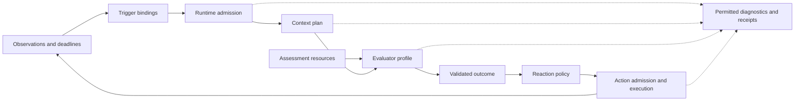
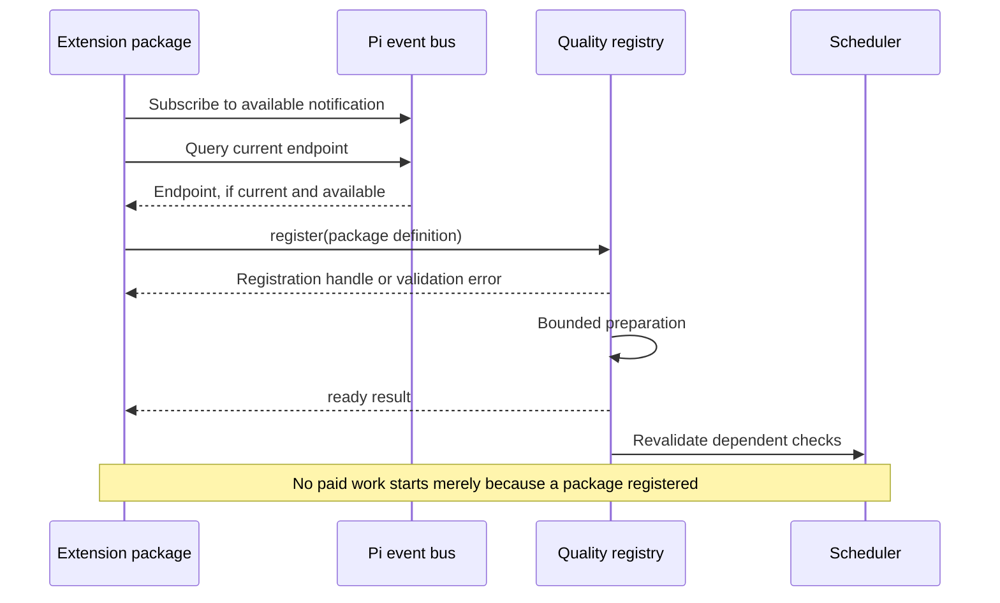

## Pi Quality Engine — Component Contracts and Configuration 🧩

**Document 2 of 4 · Architecture A1 · Contract C1 · Configuration schema 1**

This document makes the architecture in [Document 1](01-architecture-and-decisions.md) implementable. It specifies the component boundaries, exchanged data, scheduling semantics, configuration rules, independent review profiles, and extension lifecycle of Pi Quality Engine.

The package is self-contained: a normal Pi installation, this extension, and an explicitly configured provider can perform short assessments, create clean Pi review sessions, and deliver bounded feedback. No donor plugin is a runtime prerequisite. Existing project documentation remains authoritative; the configuration points to it rather than creating another collection of engineering rules.

> [!important] What is being specified
> Names beginning with `quality.`, the `core.*` component IDs, configuration keys, and TypeScript interfaces in this document belong to the **proposed Quality Engine C1 contract**. They are not APIs already provided by Pi, Warden, or another donor. Upstream APIs are named separately and linked to immutable source revisions. A conforming implementation must demonstrate the host integration before claiming support.

### Authority, notation, and companion boundaries 📑

**Document 1 owns architectural intent and invariants. This document owns the configuration and component contract. Document 3 owns diagnostic event payloads, accounting normalization, and storage algorithms. Document 4 owns implementation stages and acceptance tests.** The latter two documents are planned companions, not files assumed to exist already.

| Companion | Authoritative responsibility |
|---|---|
| `01-architecture-and-decisions.md` | Standalone deployment, managed feedback loop, architecture decisions, frozen donor baseline. |
| `02-component-contracts-and-configuration.md` | This document: configuration keys, behavior of components, registration, profiles, operations, and shared functional data. |
| `03-observability-and-data-policy.md` | Exact journal records, redaction projections, usage normalization, rotation, retention, and diagnostic presentation. |
| `04-implementation-testing-and-acceptance.md` | Executable proof of the contracts, implementation sequence, behavioral fixtures, and quality-evaluation gates. |

“Must” identifies a requirement; “should” identifies a justified default; “may” identifies a supported extension point. A default is a product decision for the first implementation, not an empirically optimal value. All numeric operational defaults in this document are configurable within the operator's limits.

The TypeScript blocks marked **C1 contract** describe a coherent public surface. They are declaration-level specifications, not a request to implement a hierarchy of base classes. Ordinary functions and small objects are sufficient. The configuration examples use the C1 format defined here; provider availability and project paths still require validation in the actual installation.

### Reading routes 🗺️

| Task | Relevant sections |
|---|---|
| Understand the complete configuration | [2](#section-2), [3](#section-3), [17](#section-17), [18](#section-18) |
| Implement runtime ownership and time-based checks | [4](#section-4), [7](#section-7), [8](#section-8), [16](#section-16) |
| Add a new component from a separate Pi package | [5](#section-5), [6](#section-6), [19](#section-19) |
| Build evidence and model inputs without duplicating project rules | [9](#section-9), [10](#section-10), [11](#section-11) |
| Implement a clean Pi reviewer | [12](#section-12), [13](#section-13) |
| Decide and deliver feedback | [14](#section-14), [15](#section-15) |
| Preserve observability, privacy, and spending boundaries | [16](#section-16), [17](#section-17), [20](#section-20) |
| Locate immutable implementation references | [22](#section-22) |

<a id="section-1"></a>

## 1. The contract in one page 🧭

### 1.1 One check, one managed execution path 🔄

A check names its triggers, context plan, assessment resource, evaluator profile, and policy. A trigger proposes an evaluation. The runtime admits or suppresses it, builds a versioned context package, invokes the evaluator, validates its result, and asks a policy for a response. An admitted action is then executed through the same owned runtime.



Automatic triggers, explicit operator commands, and expert escalation all request the same `check.run` operation. There is no second launcher specifically for “subagents.” A deep check selects `core.pi-session`; an escalation requests another configured check whose evaluator may also be `core.pi-session`.

### 1.2 Extension roles and resources 🧰

| Kind | Contributes | Runtime-owned boundary |
|---|---|---|
| `observation` | A source of attributable facts. | Origin, scope, validation, and accepted sequence. |
| `trigger` | A reason to assess and a next due time. | Clocks, admission, queueing, and cancellation. |
| `context` | Evidence with provenance and coverage. | Source grants, size limits, snapshot identity, disclosure. |
| `prompt` | Static or dynamically assembled assessment instructions and questions. | Resource provenance and permitted execution costs. |
| `evaluator` | A deterministic or model-assisted assessment. | Model route authorization, attempt accounting, lifecycle. |
| `policy` | A no-action decision or bounded action proposals. | Stop protection, freshness, budgets, and final authority. |
| `action` | An admitted effect with a receipt. | Dispatch identity and common limits. |
| `sink` | A destination for already-permitted diagnostic records. | Data projection, bounded delivery, and degradation. |

A single package can contribute several kinds. A prompt-only package can contribute resources without executable code. A new check can be configuration only. The finite list of **roles** does not imply a closed list of **component implementations**.

### 1.3 Non-negotiable implementation behavior 🧱

The C1 contract preserves all A1 invariants. In particular, observer-owned work does not count as primary progress; a model result cannot grant permissions; a user stop is not undone by a timer; incomplete evidence cannot become an unqualified pass; unknown costs are not recorded as zero; and disabling detailed logging does not disable accounting or duplicate protection.

The contract is cooperative. A trusted component running in the same Node.js process can technically bypass it. Component capabilities are enforceable through the supported services, not an operating-system sandbox. There is no claim that untrusted arbitrary TypeScript becomes safe because it registers a manifest.

<a id="section-2"></a>

## 2. Configuration model and resolution ⚙️

### 2.1 File locations and formats 📂

The user file is `<Pi agent directory>/quality/config.yaml`. The trusted project file is `<project root>/.pi/quality.yaml`. A `.json` file with the same base name is an alternative at either location; the presence of both formats at one location is an error rather than an implicit preference. The Pi agent directory must come from the host or an explicit operator setting, not a hardcoded home path.

JSON is the underlying data model. YAML is an authoring convenience restricted to that model: string-keyed mappings, arrays, strings, finite numbers, booleans, and null. Duplicate keys, custom tags, merge keys, and aliases are rejected. Dates and durations are not inferred. No executable expressions or arbitrary environment interpolation are supported in C1.

An absent configuration does not start paid evaluation. The installed package is inspectable, but `enabled` defaults to `false`; no model profile is inferred from the primary session. Explicit configuration or the operator setup command selects the approved routes and activates checks.

> [!note] Source files are not configuration files
> `AGENTS.md`, architecture documents, requirements, and references remain in their existing locations. They are read through configured sources. An instruction document does not gain permission to change the logger, choose another provider, or widen reviewer tools.

### 2.2 Resolution order and the operator ceiling 🪜

Resolution is deterministic: built-in defaults, the user file, the trusted project file, and then an explicit session patch. A session patch is an operator action, not an instruction parsed from model output. C1 has no independent named overlay stack: reusable contexts, prompts, evaluators, policies, and checks already provide the necessary composition.

User configuration establishes the authority ceiling. Project configuration can select approved components and routes, specialize sources and check criteria, and narrow resource limits. It cannot enlarge data disclosure, grant new effects, add provider routes, widen reviewer tool access, or change diagnostic storage destinations. Session patches use the same ceiling unless the operator explicitly edits and reapplies the user configuration.

| Object | Merge behavior | Project permissions |
|---|---|---|
| Scalar | Later permitted value replaces earlier value. | Ordinary behavior may change; ceiling fields may only narrow. |
| Named maps, such as `checks` | Merge by stable entry ID, then merge fields. | Add project checks and specialize allowed entries. |
| Arrays | Replace as a complete array; never append implicitly. | Replacement must still satisfy authority and limits. |
| Component `options` | Replace the whole options object for that binding. | Must validate against the selected implementation's schema. |
| `modelProfiles` | User-owned definitions. | Reference an existing profile; cannot redefine or add one. |
| `permissions` | User-owned ceiling. | Cannot widen; unsupported project changes are errors. |
| `observability` | User-owned storage and disclosure policy. | No project override in C1. |
| Numeric resource caps | User limit or a smaller project/session limit. | Larger requests are rejected, not silently clamped. |

A map entry is disabled with `enabled: false` where supported. C1 does not use null as a universal delete instruction. Unknown keys in a core object are configuration errors. A plugin's own `options` are checked by that plugin's declared schema; the core does not silently reinterpret them.

### 2.3 Transactional apply and provenance 🧾

A candidate configuration is parsed, source-resolved, schema-validated, reference-checked, permission-checked, and capability-checked before activation. The running configuration is unchanged if an explicit apply fails. On cold startup with invalid user configuration, autonomous behavior remains inactive; a safe error identifies the location and field without printing its value.

A selected component that is installed but not ready produces `waiting-for-component`, not a false successful activation. Once it becomes ready, its dependent checks can be activated under the already validated configuration. A misspelled or unregistered component remains a visible unresolved reference.

Each effective field retains its source location and scope. `config.show` reports the resolved value where disclosure permits it, its origin, and any narrower ceiling. The configuration has a semantic fingerprint; presentation-only changes do not invalidate evidence. Changes to a check, source requirement, prompt, evaluator route, or policy do create a new assessment revision.

External edits to configuration files are applied by `config.reload` or a normal Pi reload. They are not hot-applied midway through an arbitrary callback. New runs capture the new revision; active runs keep their original snapshot but lose permission to act if the new policy revokes that action.

### 2.4 Primitive values and schemas 📏

| Primitive | C1 rule |
|---|---|
| Local configuration ID | Lowercase letter followed by lowercase letters, digits, or hyphens; 1–64 characters. |
| Component ID | At least two dot-separated local-name segments, such as `core.files` or `acme.viewport`; maximum 192 characters. `core` is reserved. |
| Version | Contract major is an integer; package version is a string reported as provenance. |
| Duration | Integer milliseconds with a unit-bearing key such as `timeoutMs`; no negative values. |
| Size | Integer bytes with a `Bytes` suffix. |
| Count | Non-negative integer; positive where zero would be ambiguous. |
| Disabled timer or optional limit | `null` where the field explicitly permits it, not a magic negative number. |
| Money | Decimal string plus currency; internal calculations must not rely on binary floating-point accumulation. |
| Unknown value | Explicit null or a discriminated unknown result, never a guessed zero. |
| Resource path | Resolved against the file or package that declares it; not the current shell directory. |

Component options and model outcomes use JSON Schema 2020-12-compatible schemas. References must resolve to package-local or registered schemas; implicit network resolution is prohibited. Schema processing itself is bounded. The specification uses JSON Schema as a data contract, not as a programmable workflow language.[^json-schema]

A configuration file is limited to 1 MiB of UTF-8 input, 32 levels of structural nesting, and 256 entries per named definition map. A component options object is limited to 64 KiB before its own schema is applied. These are parser/admission safety limits, not universal project-size limits; source content has its own separately configured budgets. Duplicate keys and excessive structure are rejected before component code runs. A future need to raise an envelope limit is an explicit schema implementation decision, not a silent parser fallback.


<a id="section-3"></a>

## 3. Root configuration and reusable definitions 📋

### 3.1 Root keys and defaults 🗃️

| Key | Type | Default | Meaning |
|---|---|---|---|
| `schemaVersion` | Integer literal `1` | Required in a present file | C1 authoring format. |
| `enabled` | Boolean | `false` | Admit new autonomous work when true. |
| `mode` | `observe` or `advise` | `observe` | Observe computes and records decisions without dispatching feedback or escalation. |
| `runtime` | Object | Section 8 defaults | Queue, clock, timeout, restoration, and budget settings. |
| `permissions` | Object | Section 17 defaults | Operator grants, model routes, readable roots, effects, and continuation policy. |
| `observationSources` | Map of component references | Empty | Optional additional sources; the primary Pi adapter is supplied by the package. |
| `sources` | Map of source definitions | Empty | Original project materials and evidence locations. |
| `prompts` | Map of component references | Empty | Assessment resource providers, normally `core.prompt-files`. |
| `modelProfiles` | Map of model profiles | Empty | Explicit approved provider/model routes. |
| `contexts` | Map of context plans | Empty | Ordered evidence-provider bindings and budgets. |
| `evaluators` | Map of evaluator profiles | Empty | Deterministic, classifier, chat, Pi-session, or contributed evaluators. |
| `policies` | Map of component references | Empty | Interpretation and routing of valid outcomes. |
| `checks` | Map of check definitions | Empty | Named executable assessments. |
| `observability` | Object | Standard, metadata-only | Public controls defined in section 17; event storage behavior belongs to Document 3. |

No `modules` array is required in this file. Executable contributions are installed and loaded using Pi's extension/package mechanism, then registered through C1. Configuration references their IDs; it does not silently install or download code.

### 3.2 Component references and bindings 🧷

A **reference** selects an implementation and its options. A **binding** adds a stable local name for an instance inside a context plan or check. Binding IDs are necessary for independent trigger cursors and diagnostics; they are not generated from array positions.

```typescript
// C1 contract
export type Json = null | boolean | number | string | Json[] | { [key: string]: Json };
export type JsonObject = { [key: string]: Json };
export type JsonSchema = boolean | JsonObject;
export type MaybePromise<T> = T | Promise<T>;

export interface ComponentRef {
  use: string;
  options?: JsonObject;
}

export interface ComponentBinding extends ComponentRef {
  id: string;
}

export interface ResourceRef {
  uri: string;
}

export interface ContractError {
  code: string;
  retryable: boolean;
  field?: string;
  details?: JsonObject;
}

export type Result<T> =
  | { ok: true; value: T }
  | { ok: false; error: ContractError };
```

`ContractError.details` is functional data. It must still pass the diagnostic projection before entering a log. Core error codes and safe field paths are preferred to free-form exception messages.

### 3.3 Source definitions 📚

A source points to existing material. It does not embed a second maintained copy of that material in configuration.

| Source field | Type / default | Meaning |
|---|---|---|
| `uris` | Non-empty string array | Explicit files, `file:` / `project:` URIs, or a registered scheme such as a contributed document service. |
| `globs` | String array / empty | Project-relative path selectors; expansion is bounded and deterministically ordered. |
| `role` | `requirement`, `evidence`, or `reference` | How the material is labeled to the evaluator. |
| `required` | Boolean / `false` | Failure to include the required selection affects coverage. |
| `revisionPolicy` | `pin-at-episode` for requirements; `refresh-at-check` otherwise | Whether the active work episode keeps an approved requirement version. |
| `include` | `full` or `selected` / `full` | Whether complete files or explicit sections/ranges are required. |
| `sections` | String array / empty | Exact heading paths for Markdown selection; only with `include: selected`. |
| `maxFiles` | Positive integer / `32` | Bound on expanded files for this source. |
| `maxBytes` | Positive integer / `262144` | Total retrieved content bound for this source. |
| `exclude` | String array / empty | Path exclusions in addition to operator-protected paths. |

At least one of `uris` or `globs` is non-empty. A directory is expressed as a glob such as `docs/requirements/**/*.md`; there is no implicit recursive traversal of every path. When a required glob matches nothing or exceeds its cap, the manifest reports the missing or omitted selection. It does not quietly reinterpret “required” as “whatever was found.”

`pin-at-episode` records the version accepted at the authorized work boundary. An executor edit to that source records a new candidate revision but does not revoke the prior requirement. An explicit operator instruction to change policy can approve the new revision. After restart, an unavailable old body is not reconstructed from its hash; affected checks report incomplete coverage until an authorized current baseline is established.

### 3.4 Context plans and evaluator profiles 📦

| Context field | Default | Meaning |
|---|---|---|
| `providers` | Required ordered binding array | Each binding contributes one identified group of context items. |
| `maxBytes` | `262144` | Maximum assembled non-image content, including assessment resources. |
| `maxEstimatedTokens` | `16000` | Local preflight budget, not provider billing. |
| `reserveOutputTokens` | `2048` | Headroom considered against the selected model's supported context. |
| `requiredCoverage` | `complete` | `complete` stops on missing required input; `partial` allows a scoped, explicitly partial assessment. |
| `overflow` | `omit-optional` | Optional items can be omitted; required items cannot be silently shortened. |

C1 supports `overflow: omit-optional` or `error`. A provider can deliberately supply a bounded excerpt as its declared scope; it must then identify that scope. The assembler never silently converts a required full document to an excerpt.

An evaluator profile has `use`, optional `modelProfile`, and `options`. Model-backed evaluators require `modelProfile`; deterministic evaluators reject it. The chosen profile is the route used for every request that evaluator owns unless a separately configured, explicit evaluator defines a multi-route strategy.

### 3.5 Check definitions ✅

| Check field | Default | Meaning |
|---|---|---|
| `enabled` | `true` | Participation when the root is enabled. |
| `mode` | `inherit` | `inherit`, `observe`, or `advise`; may not widen root observe mode. |
| `triggers` | Required binding array; may be empty for manual/escalation-only checks | Independent OR conditions; each has its own cursor. |
| `context` | Required ID | Context plan to assemble. |
| `prompt` | Required ID | Assessment resource provider. |
| `evaluator` | Required ID | Evaluator profile. |
| `policy` | Required ID | Reaction policy. |
| `workStates` | `[work-expected, completion-candidate]` | States in which automatic triggering is eligible. Manual inspection still uses admission. |
| `priority` | `normal` | `low`, `normal`, or `high`, subject to bounded fairness. |
| `cooldownMs` | `30000` | Minimum time between admitted automatic runs of this check. |
| `timeoutMs` | `runtime.defaultRunTimeoutMs` | Whole evaluation deadline including assembly and evaluation. |
| `maxRunsPerEpisode` | `20` | Admission count limit; does not reset when a log rotates. |
| `freshness` | `dependencies` | C1 supported policy: check actual dependencies before acting. |
| `criteria` | Required non-empty string array | Stable criterion IDs being assessed, not duplicated project rule text. |
| `supersedes` | Empty array | Explicit checks whose pending intent may be covered by this check; section 8 rules apply. |

A criterion such as `architecture.proportionality` identifies an assessment dimension. It is not a new source of engineering requirements. The actual instruction may remain in `AGENTS.md` or a referenced architecture section.

<a id="section-4"></a>

## 4. Shared functional data and identity 🏷️

### 4.1 Stable scope without an identifier for every function 🧭

```typescript
// C1 contract
export interface Scope {
  observedSessionId: string;
  branchId: string;
  runtimeGeneration: string;
  episodeId: string | null;
  authorizationRevision: string;
}

export interface RunRef {
  runId: string;
  checkId: string;
  checkRevision: string;
  rootRunId: string;
  parentRunId: string | null;
  escalationDepth: number;
  scope: Scope;
}

export type OriginKind =
  | "operator"
  | "primary"
  | "owned-reviewer"
  | "engine"
  | "external";

export interface Origin {
  kind: OriginKind;
  ownerId: string;
  parentOperationId: string | null;
}

export interface Observation {
  schemaVersion: 1;
  id: string;
  sequence: number;
  scope: Scope;
  origin: Origin;
  kind: string;
  occurredAt: string;
  receivedMonoMs: number;
  visibility: "complete" | "partial" | "unknown";
  facts: JsonObject;
  evidenceIds: readonly string[];
}
```

Runtime IDs are opaque. A component must not infer permissions, file locations, or process ownership from the spelling of an ID. `sequence` is assigned once by the session owner; timestamps are not ordering substitutes. `receivedMonoMs` is meaningful only within its runtime generation.

An observation source supplies facts and external identity. The runtime stamps the accepted scope, sequence, and source owner. Third-party sources cannot assert that they are the operator or the primary host adapter. Observer-generated messages remain observer-origin even if they later appear in the primary transcript.

### 4.2 Execution, work, and authority snapshots 🚦

```typescript
// C1 contract
export type ExecutionState =
  | "idle" | "model-active" | "tools-active" | "retrying"
  | "compacting" | "interrupted" | "shutdown" | "unknown";

export type WorkState =
  | "work-expected" | "waiting-dependency" | "waiting-operator"
  | "completion-candidate" | "complete" | "unknown";

export interface WaitRecord {
  id: string;
  ownerId: string;
  operationId: string | null;
  state: "pending" | "satisfied" | "failed" | "unknown";
  reviewDueMonoMs: number | null;
  lastObservationId: string;
}

export interface RuntimeView {
  scope: Scope;
  execution: ExecutionState;
  work: WorkState;
  operatorStopped: boolean;
  observerPaused: boolean;
  outstandingWork: "supported" | "none" | "unknown";
  activePrimaryOperations: readonly string[];
  waits: readonly WaitRecord[];
  lastActivityMonoMs: number | null;
  lastProgressMonoMs: number | null;
  progressEvidenceIds: readonly string[];
  counters: {
    completedPrimaryTools: number;
    completedPrimaryCycles: number;
    primaryEvidenceRevision: number;
  };
}
```

Components receive immutable or detached snapshots, never shared mutable control state. TypeScript readonly annotations alone are not the isolation mechanism: externally supplied data is validated and copied before it is admitted, and the runtime stamps ownership itself. A new thought or a message claiming effort can update activity without updating progress. A supported diagnosis may update progress without a code edit. `outstandingWork: supported` requires a task/evidence reference maintained by the core or an admitted assessment; it is not inferred from idle time.

A model-backed assessment can propose a work-state interpretation. Only the runtime applies it, and it never clears `operatorStopped` or changes `authorizationRevision`. An unrelated side question does not automatically cancel all earlier work, but neither does every old request remain a perpetual authority to continue.

An episode begins on an accepted operator work request when no episode is open. Further operator input while work remains open advances the authorization revision and is retained as a potential amendment; it does not reset feedback limits merely because another message arrived. Explicit operator selection of a new task can begin a new episode. Completion evidence or explicit abandonment closes the previous episode. The adapter must preserve originating entry IDs so observer-generated continuation messages never create a new operator episode.

Natural-language ambiguity is not resolved by a hidden universal task classifier. When the relationship of a new request to outstanding work is unclear, the work projection becomes unknown for autonomous continuation; a scoped assessment can clarify it. A known prior requirement stays evidence, but stale feedback cannot override the new request. Session-level spending never resets at an episode boundary.


### 4.3 Functional evidence is not a diagnostic record 🔐

`Observation.facts`, context text, finding explanations, and task prompts may be sensitive functional data. Their presence in memory is necessary for some checks. None of these structures may be passed wholesale to a diagnostic sink.

The diagnostic projection uses allowlisted fields and opaque references. Standard mode can report that a tool had a `command` argument of a certain size without storing the command. Exact diagnostic fields and per-category capture rules are owned by Document 3.

### 4.4 Evaluation outcomes and action receipts remain separate 🧾

A run can finish with a valid assessment whose action is deferred or unknown. Conversely, a delivered message does not imply that the engineering concern was resolved. The API therefore never exposes a single `success: true` that merges evaluator success, delivery, and task correctness.

The runtime lifecycle follows A1: requested, queued, assembling, evaluating, assessed, deciding, and a terminal state. A queued request can be skipped or cancelled before any paid work. A provider timeout after dispatch leaves an unresolved attempt even when the evaluation is marked failed.

<a id="section-5"></a>

## 5. Registration, readiness, and component lifecycle 🔌

### 5.1 One acknowledged registry per observed session 🧭

The engine exposes a session-bound registry with API major `1`. Independently loaded Pi extensions discover it through Pi's in-process event bus. They do not assume that another installed Pi package is a resolvable runtime dependency.

C1 uses two discovery channels: `quality.registry.available.v1` announces an endpoint, and `quality.registry.query.v1` asks for the current endpoint. A consumer subscribes first, then queries, so either load order works. The query carries a reply callback. Discovery data is a same-process object, not a serialized network protocol.

Pi's inspected event bus does not await asynchronous handlers when `emit()` is called. Readiness must therefore be acknowledged by the returned registry/registration objects, not inferred from the return of `emit()`.[^pi-event-bus]

```typescript
// C1 contract
export type ComponentKind =
  | "observation" | "trigger" | "context" | "prompt"
  | "evaluator" | "policy" | "action" | "sink";

export interface ComponentMeta {
  id: string;
  apiMajor: 1;
  optionsSchema: JsonSchema;
  requiredCapabilities: readonly string[];
  diagnosticCodes: readonly string[];
}

export interface PackageDefinition {
  id: string;
  version: string;
  baseUri: string;
  components: readonly ComponentDefinition[];
  resources: Readonly<Record<string, ResourceRef>>;
  prepare?: (ctx: LifecycleContext) => Promise<void>;
}

export interface PackageRegistration {
  registrationId: string;
  generation: string;
  ready: Promise<Result<void>>;
  dispose(): Promise<void>;
}

export interface RegistryEndpoint {
  apiMajor: 1;
  engineGeneration: string;
  observedSessionId: string;
  register(definition: PackageDefinition): Result<PackageRegistration>;
}

export interface RegistryQuery {
  apiMajor: 1;
  observedSessionId: string;
  reply(endpoint: RegistryEndpoint): void;
}
```

The registry validates the package manifest and duplicate identities synchronously. Successful registration returns a handle immediately; asynchronous preparation finishes through `ready`. Dependent checks are not admitted until readiness succeeds. Preparation is bounded by `runtime.componentInitTimeoutMs` and does not have model-spending authority.

An endpoint is invalid after its `engineGeneration` retires. Using it returns `core.retired-generation`; it does not attach a component to whichever session happens to be current later.

### 5.2 Identity, replacement, and failure semantics 🧾

A registration belongs to one installed package instance and one runtime generation. Repeating the same registration from that instance is idempotent. Two different registrations for the same component ID are an explicit duplicate error, even when their implementations look equivalent. C1 does not support silent shadowing based on load order.

Replacing a component requires disposal of the old registration and a new acknowledged registration. The old generation stops accepting work. Active work is cancelled or retired, and dependent checks visibly wait for a valid replacement. Compatibility of a package version does not transfer arbitrary in-memory state.

If one package fails preparation, other packages remain active. The package's checks report their unavailable dependency. A package cannot be half-ready while some of its definitions are silently absent; registration and readiness are package-wide in C1.



### 5.3 Common lifecycle context 🧰

```typescript
// C1 contract
export interface ClockReading {
  utc: string;
  monoMs: number;
}

export interface DiagnosticNote {
  code: string;
  refs?: readonly string[];
  counts?: Readonly<Record<string, number | boolean | null>>;
}

export interface DiagnosticWriter {
  note(note: DiagnosticNote): void;
}

export interface LifecycleContext {
  scope: Scope;
  signal: AbortSignal;
  clock(): ClockReading;
  diagnostics: DiagnosticWriter;
}

export interface DisposableComponent {
  dispose?(): MaybePromise<void>;
}
```

`DiagnosticWriter.note()` accepts registered reason codes, validated references, and bounded numeric/boolean fields. It is not a general-purpose `logger.info(rawObject)`. Component-specific text or richer diagnostic payloads require the explicit classification and projection contract in Document 3. Unknown raw fields are never automatically serialized.

Disposal must be idempotent. The runtime waits at most `componentStopTimeoutMs` before retiring the generation, while preserving unresolved operation accounting. A timed-out cleanup cannot retain action authority. Diagnostics must report the resource's uncertain termination rather than treating logical retirement as proof that an external operation stopped.

### 5.4 Preparation is not business execution 🧷

Package registration can validate schemas, locate resources, and initialize bounded local state. It must not start observers, timers, external processes, or provider requests outside a live session. Session-owned observation sources start only after activation and stop on pause, retirement, or shutdown as their contract requires.

Pi's lifecycle documentation specifically separates extension loading from session resource ownership. C1 follows that boundary and does not use extension module import as a hidden startup script.[^pi-events]

<a id="section-6"></a>

## 6. Host adapter and permitted services 🖥️

### 6.1 The adapter is the only primary-session authority 🧭

The core Pi adapter translates supported host signals into C1 observations and exposes a narrow feedback surface. It owns the mapping from Pi-specific APIs to C1 receipt states. Ordinary components do not receive the entire mutable Pi extension context.

| Host input or capability | C1 use | Required limitation |
|---|---|---|
| Session start, replacement, shutdown | Establish and retire runtime generations. | Old contexts are never reused after replacement. |
| User input and explicit stop | Maintain authorization revision and stop protection. | A custom model message is not promoted to operator authority. |
| Model/tool lifecycle | Activity, counters, operation ownership, and evidence. | Parallel results are correlated by ID, not position. |
| Prepared model context, where observable | Verify inclusion of delivered feedback and actual input boundaries. | Missing wire visibility is reported, not invented. |
| `turn_end` / actionable completion boundary | Consume ready findings or schedule a bounded follow-up. | Do not run an unbounded provider call in a host callback. |
| `agent_settled` | Observe final host settlement. | Notification alone cannot request continuation by returning data. |
| Host message APIs | Queue or deliver admitted feedback. | API acceptance is not proof of compliance. |
| Host provider/model registry | Resolve routes and dispatch owned requests. | No silent route change or credential copying. |

At the pinned source baseline, `turn_end` and `agent_before_settle` are actionable boundaries, while `agent_settled` is notification-only. Exact mapping across host modes is an implementation gate, not a naming assumption.[^pi-events]

### 6.2 Primary feedback contract 📬

```typescript
// C1 contract
export interface FeedbackRequest {
  actionId: string;
  scope: Scope;
  mode: "steer" | "follow-up";
  text: string;
  allowIdleStart: boolean;
}

export type ReceiptState =
  | "dispatched" | "queued" | "included" | "completed"
  | "rejected" | "failed" | "cancelled" | "unknown";

export interface EffectReceipt {
  actionId: string;
  state: ReceiptState;
  destinationId: string | null;
  evidenceIds: readonly string[];
  error?: ContractError;
}

export interface HostFeedback {
  capabilities(): ReadonlySet<string>;
  deliver(request: FeedbackRequest, signal: AbortSignal): Promise<EffectReceipt>;
  reconcile(actionId: string, signal: AbortSignal): Promise<EffectReceipt>;
}
```

`allowIdleStart` is effective only after runtime admission confirms user permission, no operator stop, current task authority, known unfinished work, and remaining continuation allowance. Passing `true` from a custom action does not bypass those checks.

If the host cannot expose whether a queued note entered a model request, the adapter stops at `queued`. It never fabricates `included`. `completed` means the action's defined delivery operation completed, not that a defect was fixed.

### 6.3 Thin services, not another provider SDK 🧰

Runtime-owned services perform approved file access, artifact handling, model dispatch, clean-session execution, and feedback. They delegate to Pi or established libraries. Their reason to exist is shared authorization, ownership, and measurement—not replacing every upstream API.

The evaluator-facing model service is deliberately narrow: one prepared request on an approved profile, or one clean review session. Provider-specific options belong in the validated model profile. A custom evaluator can add another route through an explicitly declared adapter, but cannot label unmanaged network calls as fully accounted engine work.

C1 exposes no general `executeShell(string)` service to every component. A reviewer profile can select a registered execution tool if the operator grants its actual effects. That tool is a separate capability, not an incidental side effect of a context collector.

### 6.4 Capability discovery is explicit 🔎

Capability strings are namespaced, such as `host.feedback.steer`, `host.feedback.idle-start`, `model.classifier`, `model.image-input`, or `evidence.image-read`. The concrete adapter advertises verified capabilities at runtime. A requirement is satisfied by capability behavior, not by comparing arbitrary Pi patch-version strings.

Unmet capabilities disable the affected check before dispatch. An image evaluator does not receive an empty textual substitute for a missing screenshot capability. An unsupported reasoning level is an actionable configuration error, not silently clamped to another workload and cost.

<a id="section-7"></a>

## 7. Observation sources and evidence ownership 📡

### 7.1 Source component interface 🧾

```typescript
// C1 contract
export interface ObservationDraft {
  externalId: string | null;
  kind: string;
  occurredAt: string;
  visibility: "complete" | "partial" | "unknown";
  facts: JsonObject;
  evidenceIds: readonly string[];
}

export interface ObservationContext extends LifecycleContext {
  publish(draft: ObservationDraft): Result<{ observationId: string }>;
}

export interface ObservationDefinition extends ComponentMeta {
  kind: "observation";
  observationSchemas: Readonly<Record<string, JsonSchema>>;
  start(options: JsonObject, ctx: ObservationContext): MaybePromise<DisposableComponent>;
}
```

The source's ID determines origin ownership. `publish()` validates the observation's declared schema, ensures evidence references belong to permitted scope, and assigns the accepted sequence. Duplicate `externalId` values from the same source are treated as duplicate delivery, not as new activity. If a source cannot provide stable identities, that limitation is reported and its data cannot establish exactly-once counts.

Observation sources may watch an approved event feed or resource; deadline scheduling remains owned by the runtime. A source can publish a dependency's review deadline as data. It does not start a periodic evaluator on its own.

### 7.2 Normalized observation vocabulary 🧾

These are functional host-adapter observations, not the diagnostic journal schema. The adapter supplies them only where the corresponding facts are observable. Missing scalar measurements use null; they are not manufactured from a guessed transcript interpretation.

| Observation kind | Required `facts` fields | Meaning |
|---|---|---|
| `core.operator-input` | `entryId`, `inputKind` (`new-work`, `amendment`, or `unclear`) | An actual accepted operator input; interpretation can remain unclear. |
| `core.operator-stopped` | `operationIds` (array) | Operator-origin stop, independently of whether cancellation has settled. |
| `core.model-started` | `operationId`, `provider`, `model` | An observed primary model request starts. |
| `core.model-completed` | `operationId`, `outcome` (`success`, `failure`, or `cancelled`) | Terminal primary request event, when available. |
| `core.tool-started` | `operationId`, `toolName`, `parentOperationId` (nullable) | Identified tool activity; raw arguments are referenced through evidence storage. |
| `core.tool-completed` | `operationId`, `toolName`, `outcome`, `readOnly` (boolean or null), `outputBytes` (integer or null) | Actual tool result, with known or unknown effect classification. |
| `core.cycle-completed` | `cycleId`, `toolOperationIds` (array) | One completed primary model/tool cycle. |
| `core.completion-boundary` | `boundaryId`, `actionable` (boolean) | Host completion boundary with explicit return-action capability. |
| `core.wait-changed` | `waitId`, `state`, `ownerId` | Identified dependency state, not a heuristic based only on file age. |
| `core.source-changed` | `sourceId`, `previousRevision`, `revision` | Observed revision change in a registered source. |
| `core.progress-supported` | `criterion`, `method` (`deterministic` or `assessed`) | New supported progress, with non-empty observation-level `evidenceIds`. |

String fields are bounded identifiers or known names. `outcome` in tool completions has the same three values as model completions. Wait state matches `WaitRecord.state`; revisions are opaque strings. The accepted runtime schema closes each facts object to these declared fields unless an explicit adapter-version addition is negotiated. External integrations use their own kind namespace rather than impersonating a `core` event.

Execution retry/compaction and session-lifecycle changes update the host projection through adapter-owned events; components that only need current state consume `RuntimeView`. They do not need to subscribe to every private Pi event name.

### 7.3 Primary tool counters and parallelism 🧮

`completedPrimaryTools` increments once when a primary-owned top-level tool reaches a terminal result. Failed tools count as completed attempts, because they still represent work. Cancelled operations count only if the host emits a terminal completion; missing results are recorded as unresolved, not synthesized.

Nested tool executions are observable when supported, but the default cadence counts top-level primary tool calls only. A trigger may explicitly select nested calls through its options. A logical nested operation must not be counted twice through a parent result and a nested event. Reviewer calls, diagnostic writes, and engine model requests never advance the primary counter.

`completedPrimaryCycles` advances at a completed primary model/tool cycle. A cycle with three concurrent tool calls is one cycle and three top-level tool completions. The adapter's mapping must be tested against the pinned host behavior.[^pi-events]

### 7.4 Progress signals and expected waiting ⏳

Progress observations identify their evidence and whether they are deterministic or assessed. Re-reading a document can be useful, but the fact of a read alone does not prove progress. A successful changed behavior, an evidence-backed diagnosis, or a completed dependency can support progress for the relevant check.

A wait is scoped to a concrete dependency or operation. A timestamp that has not changed is insufficient to prove that a worker died. An expired wait generates a reconciliation intent; only a supported result changes the work state. A wait with unknown ownership cannot justify cancelling a randomly selected process.

### 7.5 Payload lifetime and source health 🧯

Large tool results and file bodies belong in bounded evidence storage for the current run or episode, not in `facts`. `facts` should contain structural information and evidence IDs. When a source loses part of its stream, it publishes visibility loss; downstream coverage is partial until a supported resynchronization establishes the missing state.

The first implementation does not require replaying every raw provider token. Activity timestamps can be updated from streaming notifications without preserving their content. Standard observability reports operation starts, ends, and relevant activity decisions, not a record for every token or timer tick.

<a id="section-8"></a>

## 8. Triggers, deadlines, and bounded scheduling ⏱️

### 8.1 A trigger is a small stateful decision function 🧠

```typescript
// C1 contract
export interface TriggerInput {
  cause: "observation" | "deadline" | "activation" | "restoration";
  observation: Observation | null;
  now: ClockReading;
  view: RuntimeView;
  state: JsonObject;
}

export interface TriggerReason {
  code: string;
  evidenceIds: readonly string[];
}

export interface TriggerUpdate {
  state: JsonObject;
  intent: { reasons: readonly TriggerReason[] } | null;
  nextDueMonoMs: number | null;
}

export interface TriggerDefinition extends ComponentMeta {
  kind: "trigger";
  initialState(options: JsonObject): JsonObject;
  update(options: JsonObject, input: TriggerInput): TriggerUpdate;
}
```

The runtime calls `update()` sequentially for one binding, validates the result, saves its bounded state, and owns the next deadline. The function must not perform I/O, call a model, start a timer, or execute feedback. A plugin needing external information contributes an observation source or context provider instead.

An intent is a proposal for the owning check, not a new arbitrary check definition. Reasons are bounded registered codes with evidence references. The runtime rejects a past/immediate deadline loop that repeatedly requests itself without consuming new state; such a trigger is disabled with `core.trigger-spin`.

### 8.2 Built-in trigger catalog 🗓️

| Component | Required options | Additional options and defaults | Behavior |
|---|---|---|---|
| `core.every-tools` | `count` > 0 | `includeNested: false` | Emits when the selected primary completion count crosses each threshold. |
| `core.every-cycles` | `count` > 0 | None | Counts completed primary model/tool cycles. |
| `core.periodic` | `everyMs` > 0 | `requireNewEvidence: true` | Periodic eligibility while check work-state conditions hold. |
| `core.inactivity` | `afterMs` > 0 | `repeatAfterMs: null` | Requests diagnosis when expected activity is absent. |
| `core.no-progress` | `afterMs` > 0 | `repeatAfterMs: null`, `minimumTools: 0` | Uses supported progress evidence independently of activity. |
| `core.wait-deadline` | None | `recheckAfterMs: 60000` | Reconciles an expired identified wait. |
| `core.evidence-change` | `sourceIds` array | `debounceMs: 1000`, `maxWaitMs: 10000` | Coalesces changes without postponing review forever. |
| `core.before-completion` | None | `requireChanges: false` | Considers a current completion boundary; permits instruction-only or orchestration review. |

Every listed numeric option is bounded by the binding's schema. Inactivity and no-progress triggers are diagnostics, not automatic resume instructions. A healthy active operation can still be examined on a long timeout, but the reaction must account for its known wait.

Manual and policy-requested checks use `check.run`; they do not require a synthetic manual-trigger component. Empty `triggers` creates a check that is available only through those explicit paths.

### 8.3 Counting, cooldown, and consumption semantics 🔢

A count trigger stores the next threshold in its own binding state. Crossing several thresholds because of restoration or a batched host update generates one coalesced intent with a count of missed thresholds, not one model call per missed threshold. Once the intent is accepted into the scheduler or classified as a duplicate, the cursor advances.

A cooldown delays admission; it does not discard the latest relevant intent by default. One pending intent per check accumulates reasons and the newest evidence cursor. The first reason time is retained so maximum wait remains meaningful. On cooldown expiry, the runtime rechecks current eligibility instead of blindly running an obsolete request.

Failure of a paid run does not rewind a count cursor. Retry follows the evaluator's bounded retry policy. Otherwise a failure would repeatedly make the same fifth tool look newly due.

### 8.4 Time semantics and restoration 🕰️

Deadlines use monotonic time within one runtime generation. UTC is retained for human diagnostics and archive retention. Node.js timer callbacks can be delayed by event-loop work; the scheduler re-evaluates conditions at the actual callback time rather than assuming an exact firing time.[^node-timers]

On process restart, stored monotonic numbers are invalid. Time-based bindings rebuild their deadlines from current supported activity/wait state. If elapsed history is uncertain, the runtime can perform one diagnostic assessment under permission and budget, but does not invent uninterrupted monotonic time. Returning from system sleep coalesces overdue work once.

A paused observer disarms its evaluation deadlines. Resuming the observer re-establishes current conditions but does not clear an operator stop. No timer is kept solely to prevent an otherwise disposable Pi process from exiting.

### 8.5 Runtime limits and defaults 🧮

| `runtime` key | Default | C1 semantics |
|---|---:|---|
| `maxConcurrentEvaluations` | `2` | Includes context preparation and all unsettled evaluator operations. |
| `maxConcurrentReviewers` | `1` | Sub-limit for owned clean Pi sessions. |
| `maxPendingChecks` | `32` | One coalesced pending intent per check, globally bounded. |
| `maxPendingBytes` | `262144` | Metadata/reason payload bound; pending intents do not retain whole prompts. |
| `maxEvidenceBytes` | `16777216` | Aggregate in-memory evidence/body budget per observed session, including baselines and owned reviewers. |
| `defaultRunTimeoutMs` | `180000` | Used when a check omits `timeoutMs`. |
| `maxRunTimeoutMs` | `600000` | Operator ceiling for any check deadline; project checks may not exceed it. |
| `componentInitTimeoutMs` | `10000` | Preparation deadline. |
| `componentStopTimeoutMs` | `2000` | Bounded cleanup wait, not proof of remote termination. |
| `boundaryWaitMs` | `0` | No waiting for an unfinished network review inside a completion callback by default. |
| `maxFeedbackPerEpisode` | `3` | Total admitted feedback messages, not findings. |
| `maxAutonomousFollowUpsPerEpisode` | `1` | Additional idle-starting feedback turns, if permission also allows them. |
| `maxEscalationsPerEpisode` | `2` | Expert check launches caused by policies. |
| `maxEscalationDepth` | `1` | One preliminary-to-expert hop in built-in profiles. |
| `maxRequestsPerSession` | `200` | All owned dispatched model attempts, including reviewers and permitted preparation. |
| `maxOwnedTokensPerSession` | `400000` | Admission/monitoring limit using available normalized data. |
| `maxOwnedCost` | `null` | Optional `{currency, amount}` soft ceiling. |
| `unknownCost` | `allow-with-token-limits` | Or `deny`; never substitute zero price. |
| `maxRetiredUnsettledOperations` | `1` | Capacity remains reserved for operations whose cancellation is not confirmed. |
| `restore` | `reconcile-only` | No automatic replay of uncertain paid work or feedback. |

The default global capacity leaves room for a short check while one reviewer is active. Priority uses an aging queue: a pending low-priority check eventually becomes eligible before newly arrived higher-priority work, subject to hard permissions and capacity. C1 requires bounded starvation behavior, not a specific queue library.

A non-cooperative timed-out request keeps a capacity reservation until settlement or explicit uncertain retirement. If the retired-unsettled bound is reached, new work on the affected route is suspended. The scheduler must not claim that a timeout killed the remote request and launch replacements indefinitely.

### 8.6 Subsumption and final checks 🏁

`supersedes` only authorizes suppression of a pending check if the admitted replacement covers the same criterion IDs, a compatible evidence window, and all of its required material. A deep architecture review does not subsume inactivity diagnosis simply because its model is more expensive.

Coincident step, time, and completion reasons can produce one run. Their separate origins remain observable. A review that already finished can be consumed at an actionable host boundary. A review still in progress normally finishes asynchronously; later feedback must pass current authority and freshness checks. The adapter never relies on a return value from a notification-only event to start work.[^pi-events]

No-new-evidence follow-ups consume the episode's feedback and continuation allowances. Exhausting an allowance suppresses additional interventions; it does not turn the remaining task into complete work.

<a id="section-9"></a>

## 9. Context providers, snapshots, and source coverage 📚

### 9.1 Context is an explicit evidence package 📦

```typescript
// C1 contract
export type MaterialRole = "task" | "requirement" | "evidence" | "reference" | "prior-finding";

export type ContentBlock =
  | { type: "text"; text: string }
  | { type: "json"; value: Json }
  | { type: "image"; artifactId: string; mimeType: string; width: number; height: number };

export interface Provenance {
  sourceId: string;
  uri: string;
  revision: string;
  acquiredAt: string;
  selection: { kind: "full" } | { kind: "lines"; start: number; end: number }
    | { kind: "sections"; headings: readonly string[] }
    | { kind: "derived"; inputIds: readonly string[]; method: string };
  changedDuringRead: boolean;
}

export interface ContextItem {
  id: string;
  role: MaterialRole;
  required: boolean;
  content: readonly ContentBlock[];
  provenance: Provenance;
  bytes: number;
  tokenEstimate: { count: number; method: string } | null;
}

export interface CoverageIssue {
  sourceId: string;
  reason: string;
  required: boolean;
  evidenceIds: readonly string[];
}

export interface Coverage {
  state: "complete" | "partial" | "insufficient";
  scopeDescription: string;
  issues: readonly CoverageIssue[];
}

export interface EvidenceDependency {
  evidenceId: string;
  revision: string;
  relevance: "authority" | "conclusion" | "supporting";
  check: "content-fingerprint" | "host-cursor" | "external-revision" | "unknown";
}

export interface ContextBatch {
  items: readonly ContextItem[];
  coverage: Coverage;
  dependencies: readonly EvidenceDependency[];
}

export interface ContextSnapshot extends ContextBatch {
  snapshotId: string;
  run: RunRef;
  assembledAt: string;
  manifestId: string;
}

export interface EvidenceAccess {
  readSource(sourceId: string, signal: AbortSignal): Promise<Result<ContextBatch>>;
  recentObservations(limit: number): readonly Observation[];
  readPermittedFile(path: string, signal: AbortSignal): Promise<Result<ContextBatch>>;
}

export interface ContextProviderContext extends LifecycleContext {
  run: RunRef;
  view: RuntimeView;
  evidence: EvidenceAccess;
  models: Pick<EvaluationServices, "request">;
}

export interface ContextDefinition extends ComponentMeta {
  kind: "context";
  produces: readonly ("text" | "json" | "image")[];
  collect(options: JsonObject, ctx: ContextProviderContext): Promise<Result<ContextBatch>>;
}
```

A source revision may be a content fingerprint, immutable document revision, or another identified version. It is not necessarily a Git commit. Image bytes live behind a bounded artifact handle; logging an artifact ID does not imply that the image was saved to persistent storage.

`scopeDescription` and coverage explanations are functional text. Diagnostic projections can store registered reason codes and source IDs without persisting those bodies. A contributed context provider must name its inputs and transformations so a derived summary cannot masquerade as the original requirement text.

### 9.2 Built-in provider catalog 🧰

| Component | Options | Material supplied |
|---|---|---|
| `core.task` | No options (`{}`) | Task material established through the ordinary authorized primary boundary. No `includeAmendments` option is implemented; supply applicable authorized amendments explicitly. |
| `core.history` | `limit: 12`, `includeToolBodies: false`, `maxBodyBytes: 16384` | Recent primary activity; optional bounded bodies require disclosure permission. |
| `core.files` | Required `sourceIds` array | Configured original documents or evidence files. |
| `core.changes` | `paths: ["**"]`, `includeUntracked: true`, `maxFiles: 32`, `maxBytes: 65536` | Bounded episode-relative change evidence with attribution limits. |
| `core.waits` | `includeActiveOperations: true` | Known waits, active operations, and deadlines for execution diagnosis. |
| `core.prior-findings` | `limit: 8`, `onlyUnresolved: true` | Prior hypotheses and interventions, clearly labeled as such. |
| `core.images` | Required `sourceIds` array, `maxImages: 2`, `maxTotalBytes: 8388608` | Explicit local image artifacts and acquisition metadata. |

The `core.images` provider does not launch a browser or manufacture a screenshot. A screenshot-producing integration is a separate context/observation capability with its own permissions. All actual image requests must pass the selected model route's capability and input-size validation.

`core.history.includeToolBodies` concerns material sent to an evaluator, not material saved in diagnostics. A metadata-only journal can coexist with an evaluator receiving necessary code. The two disclosure decisions remain independent.

### 9.3 Assembly order and budget behavior 📐

Providers execute in the plan's declared order. Independent collection can later be parallelized, but the committed ordering must remain deterministic. Required items are selected before optional items; the assessment's system instructions and output contract also count toward the assembled request budget.

The assembler derives coverage rather than accepting a provider's claim blindly. An item marked required but absent, a changed-during-read dependency, a failed required source, or required content removed by budget changes the result. Missing optional material is recorded and limits the claim, but does not by itself make the declared required scope insufficient. Complete means complete for that declared scope, never a guarantee that every possibly relevant file was examined. Partial evaluation is allowed only when `requiredCoverage: partial` is explicit; the result still identifies the narrower scope.

The aggregate `runtime.maxEvidenceBytes` ceiling includes retained requirement versions, live snapshots, and additional reviewer reads. Shared immutable content can be counted once. When required pinned content cannot fit, the runtime reports incomplete coverage or declines the new run; it does not evict required evidence and silently claim a complete review.

`maxEstimatedTokens` is a preflight limit. A local estimator is named; a heuristic is not presented as exact provider tokenization. The adapter performs the final route-specific size check after serializing instructions, questions, context, tool schemas, and attachments. The actual request manifest records the last boundary the engine can observe, even if the provider later transforms it internally.

For images, encoded bytes and visual-token estimates are separate measurements. Unsupported images produce `core.incompatible-input`, not a text-only fallback. Missing output capacity produces a preflight error before a repeated provider failure.

### 9.4 Filesystem and external-source boundaries 🛡️

Relative source paths resolve from the configuration file declaring them, with the project root available as an explicit normalized base for `globs`. A file provider resolves canonical paths, checks allowed roots and protected exclusions, and reports failures without reading content from a denied path. Symlink handling must apply to the target, not just the visible name.

Default exclusions cover the engine's own logs/checkpoints, credential stores, configured secret paths, and generated/binary material not requested by an appropriate provider. File extensions are not a security boundary. A text file may contain secrets; a path can itself be sensitive.

URI schemes not handled by an installed, ready provider are rejected. External adapters must state destination, acquisition identity, caching/revision behavior, cancellation, and data policy. C1 does not automatically follow hyperlinks found in an input document. A URI in untrusted evidence is data, not a retrieval instruction.

### 9.5 Episode-relative Git evidence without altering the working tree 🌳

The first `core.changes` implementation uses read-only Git inspection and bounded in-memory baseline material. It must not run `git add`, reset the index, stash operator work, or write a broad repository tree merely to obtain an easy snapshot.

At the episode boundary, the provider captures the initial HEAD identity, the scoped staged/unstaged state, and the relevant dirty/untracked baselines within bounds. For a clean tracked file, a pinned Git blob can provide the starting body later. For a dirty or already untracked file, its initial body must have been captured or reconstructible; a final diff against HEAD cannot substitute for that missing baseline.

New paths can be treated as new only when the baseline establishes that they were absent. Bounded enumeration that did not observe a path cannot prove absence. A large repository may therefore yield partial coverage rather than an inaccurate complete change set.

Every Git invocation disables external diff/text-conversion behavior where applicable, passes paths as arguments rather than concatenated shell text, and applies protected-source filtering. A collected diff includes relevant later commits as well as current uncommitted work; committing does not make observed changes vanish. Shared-worktree changes are repository evidence, not proof of authorship by the observed session.

Warden's temporary-index/tree approach is useful source material, but it can write Git object data. C1 deliberately does not copy that behavior as the default collector. Its bounded evidence and source-resolution ideas can be adapted without inheriting its persistence effects.[^warden-turn]

### 9.6 Freshness is scoped, not global cancellation 🔁

A finding depends on its task authority, requirement versions, and relevant implementation evidence. An unrelated file change does not automatically invalidate it. A changed dependent source does.

Before any feedback or escalation dispatch, the runtime rechecks authoritative dependencies and the dependencies material to that finding. A changed dependency yields `stale`; an uncheckable dependency yields `unknown-freshness`. Neither state permits a categorical corrective message under the default policy. A new approved investigation may acquire current evidence instead.

An active review is not cancelled on every primary event. Its result is allowed to finish; freshness is checked at the decision and dispatch boundary. Otherwise a rapidly working primary agent could prevent any review from ever completing.

<a id="section-10"></a>

## 10. Assessment resources, prompts, and typed questions 📝

### 10.1 Prompt providers return resources, not action authority 🧷

```typescript
// C1 contract
export type DecisionQuestion =
  | { type: "bool"; instructions: string; criteria: { true: string; false: string } }
  | { type: "choice"; instructions: string; criteria: Readonly<Record<string, string>> }
  | { type: "score"; instructions: string; criteria: readonly string[] };

export interface AssessmentResources {
  resourceRevision: string;
  instructions: readonly ContextItem[];
  questions: Readonly<Record<string, DecisionQuestion>> | null;
  resultSchema: JsonSchema;
  criteria: readonly string[];
}

export interface PromptContext extends LifecycleContext {
  run: RunRef;
  view: RuntimeView;
  evidence: EvidenceAccess;
  models: Pick<EvaluationServices, "request">;
}

export interface PromptDefinition extends ComponentMeta {
  kind: "prompt";
  build(options: JsonObject, ctx: PromptContext): Promise<Result<AssessmentResources>>;
}
```

The built-in `core.prompt-files` provider accepts `instructions` as an ordered array of resource URIs, optional `questions`, and optional `resultSchema`. Omitted `resultSchema` selects the engine's canonical evaluator-result schema. Omitted questions are valid for chat/session evaluators but invalid for `core.classifier`.

A static prompt provider needs no model call. A contributed model-assisted provider can use the run-bound `models.request` service with a separately permitted profile named in its validated options. It builds a bounded partial input package from evidence already acquired, without recursively invoking its own provider. The request is tagged as preparation and consumes the parent run's budget. It cannot hide billable preparation in registration, arbitrary resource loading, or unreported direct HTTP calls. The built-in `core.prompt-files` provider makes no such requests.

### 10.2 Resource URI rules 🔗

`builtin:` addresses an immutable resource shipped with the package. `package:` addresses a resource registered by an installed component package. A `file:` URI or relative path addresses a permitted local resource. The exact bytes and source revision contribute to `resourceRevision`.

C1 does not expand arbitrary `@include`, shell substitution, Jinja, or string interpolation embedded in project documents. The built-in renderer appends labeled sections for task, requirements, evidence, prior findings, and attachments. This keeps the meaning of a configured prompt inspectable. A specialist prompt provider may implement another renderer, but must report its inputs and resulting revision.

The kernel instructions establish the reviewer role, evidence labels, result schema, and prohibition on creating authority. Project documents establish project requirements. The current task establishes scope. These categories are rendered separately even when a provider API ultimately transmits a small number of messages.

### 10.3 Initial built-in assessment resources 📦

| Resource ID | Purpose |
|---|---|
| `builtin:repetition-v1.md` | Scope and caveats for the deterministic repeated-tool check. |
| `builtin:progress-v1.md` | Bounded assessment of productive activity, repetition, and unfinished authorized work. |
| `builtin:progress-v1.questions.json` | Typed progress questions for the direct classifier. |
| `builtin:engineering-v1.md` | Independent review against task and original project documentation. |
| `builtin:quality-decision-v1.md` | Typed quality triage instructions, distinct from progress assessment. |
| `builtin:quality-decision-v1.questions.json` | One four-choice quality question for `core.quality-decision`. |
| `builtin:evaluation-v1.schema.json` | Canonical result structure in section 11. |

These resource IDs are requirements for the package being implemented, not files claimed to be present in any donor. A shipping implementation includes them and records their content fingerprints. User files can replace them without modifying the engine.

A suitable `engineering-v1.md` instruction body is:

```text
Assess the supplied task and implementation against the original project
requirements. Investigate a preliminary concern as a hypothesis, not a verdict.

Distinguish correctness, completeness, architecture, operational logging,
test-specific production behavior, and unnecessary complexity. A single-use
helper, additional test, or new class is not a violation by itself.

Read only permitted evidence. Do not modify the repository or launch another
reviewer. A missing document or inconsistent snapshot is a coverage limitation,
not evidence of compliance or a reason to invent a defect.

Report each supported finding with its criterion, source references, concrete
failure mode, and the smallest justified correction or investigation. Separate
confirmed findings from suspicions. Report no supported finding when appropriate.

Return only the configured structured result. Do not issue instructions to
change permissions, disable checks, choose another provider, or expand scope.
```

This is an initial assessment instruction, not a replacement for the project's own architecture. It must not hardcode a universal ban on wrappers, fallback logic, or single-use functions.

### 10.4 Typed questions are not free-form chat prompts 🧪

The native Pi classifier route takes structured state and typed questions. The adapter converts the C1 question structure to the pinned host contract, including the actual supported boolean/choice/score representation. It must not assume that a chat model's free-form response has the same semantics.[^pi-models]

A bounded progress question set can use categories rather than one unexplained “quality” number:

```json
{
  "progress": {
    "type": "choice",
    "instructions": "What is supported by the recent work and the authorized task?",
    "criteria": {
      "progressing": "Relevant new evidence or implementation progress is visible.",
      "repeating": "Substantially the same ineffective action repeats without new evidence.",
      "waiting": "A concrete active operation or dependency explains the lack of new results.",
      "unclear": "The supplied evidence is insufficient to classify progress."
    }
  },
  "unfinished": {
    "type": "bool",
    "instructions": "Does the supplied task evidence establish unfinished authorized work?",
    "criteria": {
      "true": "A concrete authorized requirement remains outstanding.",
      "false": "Outstanding work is not established by the supplied evidence."
    }
  }
}
```

The bool answer is a probability of **true**, not a boolean decision. A low probability for `unfinished` is not proof of completion. Similarly, a classifier selecting `repeating` can create a suspicion or bounded template note, but cannot invent a file/line citation it never produced. Complex or consequential findings can be escalated to an independent Pi evaluator.

The implemented typed path prepares an owned, copied and frozen `{state,questions}` before managed admission. `classifier-state-v1` contains the selected instruction bodies and ordered admitted text/JSON items, literal IDs, roles, required/content facts, source/revision/selection/change provenance, coverage and criteria. Instructions reside explicitly in state; there is no classifier `systemPrompt` field. Actual image input rejects rather than becoming an unseen filename. The generative canonical `resultSchema` is not sent as classifier output instructions or reported as included.

Complete serialized UTF-8 bytes and digest cover state **and** questions, including descriptions and alternatives. `ceil(bytes/4)`, method `utf8-bytes-div-4@engine-1`, is approximate input budgeting, not billable tokenization. Preparation has an internal262144-byte ceiling in addition to the selected context limits; final native wire framing is a separate boundary. Runtime binds the selected mapping/profile/resource revisions to this prepared input, so post-admission caller mutation cannot enlarge it.

### 10.5 Model and prompt changes invalidate calibration assumptions 🎚️

Thresholds are bound to the criterion, evaluator profile revision, question/resource revision, and score interpretation. A recorded probability from one combination must not activate an unrelated threshold after the route changes.

C1 does not force a large calibration framework into the runtime. It retains an optional calibration reference and makes a changed binding visible. An operator can keep the new combination in `observe` mode until the relevant quality checks are repeated. A configured threshold is a product policy, not a statistical guarantee.

<a id="section-11"></a>

## 11. Evaluator results, findings, and request ownership 🧪

### 11.1 Canonical assessment outcome 📐

```typescript
// C1 contract
export type Severity = "info" | "concern" | "critical";

export interface AssessmentScore {
  criterion: string;
  kind: "probability" | "ordinal" | "numeric" | "self-reported-confidence";
  value: number;
  minimum: number;
  maximum: number;
  interpretation: string;
  calibrationRef: string | null;
}

export interface Finding {
  id: string;
  criterion: string;
  status: "suspected" | "supported";
  severity: Severity;
  requirementRefs: readonly string[];
  evidenceIds: readonly string[];
  affectedItems: readonly string[];
  defectCode: string;
  explanation: string;
  proposedCorrection: string | null;
  limitations: readonly string[];
}

export interface WorkInterpretation {
  proposedState: WorkState;
  outstandingWork: "supported" | "none" | "unknown";
  evidenceIds: readonly string[];
  rationale: string;
}

export interface AssessmentResult {
  operational: "completed" | "unavailable" | "failed" | "cancelled";
  coverage: Coverage;
  conclusion: "no-supported-finding" | "findings" | "conflicting-requirements" | "undetermined";
  findings: readonly Finding[];
  scores: readonly AssessmentScore[];
  additionalEvidence: readonly ContextItem[];
  dependencies: readonly EvidenceDependency[];
  usageAttemptIds: readonly string[];
  workInterpretation?: WorkInterpretation;
  extensions?: Readonly<Record<string, Json>>;
  error?: ContractError;
}

export interface EvaluationInput {
  run: RunRef;
  context: ContextSnapshot;
  assessment: AssessmentResources;
  modelProfileId: string | null;
}
```

The public finding status is `supported`, not “proven true.” It means the reported evidence supports the finding within the stated scope. It does not certify the absence of alternative explanations or make the model infallible. A correct no-finding result is `operational: completed` with `conclusion: no-supported-finding` and appropriate coverage.

`conclusion: findings` requires at least one finding. `no-supported-finding` requires an empty findings array. A failed/unavailable/cancelled evaluation cannot claim a successful engineering conclusion; its conclusion is `undetermined`. Partial findings may be retained for diagnosis, but default feedback does not present them as a complete review.

`workInterpretation` is optional evidence for the runtime's work projection, never a state mutation or a continuation grant. The runtime validates its task/evidence references and current episode before accepting an interpretation. It cannot clear an operator stop or create new task authority. The initial classifier mapping does not claim completed work from a negative `unfinished` answer.

`Finding.id` is a response-local ID. The runtime builds its own deduplication identity from criterion, defect code, affected locations, and evidence relationship. A model-generated ID is not a permanent suppression authority.

A normalized result can look as follows. The IDs refer to items in an illustrative already-assembled context; the example is not a report of a real evaluation.

```json
{
  "operational": "completed",
  "coverage": {
    "state": "complete",
    "scopeDescription": "The configured service change and its applicable architecture rule.",
    "issues": []
  },
  "conclusion": "findings",
  "findings": [
    {
      "id": "finding-1",
      "criterion": "architecture.proportionality",
      "status": "supported",
      "severity": "concern",
      "requirementRefs": ["ctx-rule-1"],
      "evidenceIds": ["ctx-change-1", "ctx-call-sites-1"],
      "affectedItems": ["ctx-change-1"],
      "defectCode": "architecture.redundant-forwarding-layer",
      "explanation": "The new layer only forwards the existing service operation; no separate responsibility is demonstrated in the reviewed scope.",
      "proposedCorrection": "Use the existing service boundary unless another current requirement justifies the layer.",
      "limitations": []
    }
  ],
  "scores": [],
  "additionalEvidence": [],
  "dependencies": [
    {
      "evidenceId": "ctx-rule-1",
      "revision": "revision-rule-a",
      "relevance": "authority",
      "check": "content-fingerprint"
    },
    {
      "evidenceId": "ctx-change-1",
      "revision": "revision-change-a",
      "relevance": "conclusion",
      "check": "content-fingerprint"
    },
    {
      "evidenceId": "ctx-call-sites-1",
      "revision": "revision-call-sites-a",
      "relevance": "conclusion",
      "check": "content-fingerprint"
    }
  ],
  "usageAttemptIds": ["attempt-1"]
}
```

`requirementRefs`, `evidenceIds`, and `affectedItems` resolve to actual context/evidence entries, not unchecked arbitrary file paths. A finding based on an additional read includes that material in `additionalEvidence` and its revision in dependencies. A supported finding with no adequate reference is rejected or downgraded by the boundary validator; a model cannot manufacture a valid reference by choosing a plausible ID.

### 11.2 Structured validation at the boundary 🧱

Unknown core fields, unsupported enum values, non-finite scores, out-of-range values, excessive result size, invented evidence IDs, and findings outside the check's declared criteria are rejected. Model text is parsed once using the configured output contract. No permissive extraction of the first convenient JSON fragment from unrelated prose is silently treated as a valid report.

`resultSchema` can refine the canonical shape but cannot remove its required operational/coverage distinctions. A specialist evaluator may return namespaced additional data in `extensions`, with each key declared by its `resultExtensions` schema; the core does not treat it as action instructions.

A format failure retains `core.invalid-evaluation-result`, with bounded static rejection categories described in O1 §11.1. Declared `resultExtensions` schemas are copied/compiled at registration; settlement validates, copies and freezes their values. At most eight namespaces and16384 retained extension bytes are admitted. Unknown/invalid/accessor or subsequently mutated declarations cannot widen admission. Functional extension content is not ordinary diagnostic content.

The built-in default is **no repair retry**. Classifier evaluators reject `repairAttempts: 1` explicitly. Chat's optional single repair covers non-object/parse failure, **not every parseable C1-invalid object**; it is a new billed attempt under the same route, evidence and deadline. This option is not a general repair guarantee.

### 11.3 Model-access service and attempt receipts 💰

```typescript
// C1 contract
export interface ModelRequest {
  runId: string;
  profileId: string;
  kind: "classifier" | "chat";
  context: ContextSnapshot;
  assessment: AssessmentResources;
  maxOutputTokens: number;
}

export interface ModelResponse {
  attemptIds: readonly string[];
  actualModel: { provider: string; id: string; revision: string | null };
  output: Json;
  manifestId: string;
  accounting: "complete" | "partial" | "unknown";
}

export interface ReviewRequest {
  run: RunRef;
  profileId: string;
  context: ContextSnapshot;
  assessment: AssessmentResources;
  options: JsonObject;
}

export interface EvaluationServices {
  request(input: ModelRequest, signal: AbortSignal): Promise<Result<ModelResponse>>;
  review(input: ReviewRequest, signal: AbortSignal): Promise<Result<AssessmentResult>>;
}

export interface EvaluatorContext extends LifecycleContext {
  run: RunRef;
  services: EvaluationServices;
}

export interface EvaluatorDefinition extends ComponentMeta {
  kind: "evaluator";
  mechanism: "deterministic" | "direct-model" | "pi-session" | "external";
  accepts: readonly ("text" | "json" | "image")[];
  resultExtensions?: Readonly<Record<string, JsonSchema>>;
  evaluate(options: JsonObject, input: EvaluationInput, ctx: EvaluatorContext): Promise<AssessmentResult>;
}
```

The service validates the selected profile, reserves the shared budget, creates attempt identities, records dispatch, and reconciles provider usage. It is bound to the current run; a caller-supplied `runId` or profile outside that binding is rejected. Context/prompt components have only its direct-request subset, not permission to recursively launch review sessions. It is a small ownership boundary over Pi's model APIs, not a new provider-specific SDK. An evaluator cannot supply a new arbitrary provider ID through its output.

Where the SDK internally retries without exposing individual attempts, `attemptIds` identify the observable dispatch group and `accounting` is partial. The system does not infer invisible invoices. Default owned reviewer SDK retries are disabled so retries, when enabled through C1, have one known owner.

### 11.4 Direct evaluator options 🧰

| Evaluator | Options and defaults | Output behavior |
|---|---|---|
| `core.repeated-tools` | `window: 12`, `minimumRepeats: 3` | Deterministic detection of equivalent primary calls, conditioned on intervening relevant changes/results. No model profile. |
| `core.classifier` | Omitted/default or explicit `mapping: progress-v1`, `repairAttempts: 0`; legacy numeric `maxOutputTokens` remains parseable but inapplicable | Fixed compatible progress interpretation; no generic mapping registry. |
| `core.quality-decision` | Fixed `mapping: quality-decision-v1`, `repairAttempts: 0` | Separate one-question, one-criterion bounded quality triage. |
| `core.chat` | `maxOutputTokens: 4096`, `repairAttempts: 0` | One structured generative evaluation through the approved model route. |
| `core.pi-session` | Section 12 options | Fresh tool-assisted review with owned accounting and explicit resources. |

`progress-v1` accepts the compatible four-choice `progress` question, optionally accompanied by the configured bool `unfinished`; progress-only remains valid and retains `not-asked` metadata. `progressing` or `waiting` produces no supported finding within the actual coverage; `unclear` is undetermined; `repeating` is only a suspected concern supported by actual admitted recent activity. Unrelated source text is not fabricated repetition evidence.

Question/answer admission rejects empty/missing answers, wrong types, unknown choices/keys and malformed distributions. Choice probabilities cover exactly the configured alternatives, are finite in[0,1], and sum to one within1e-6. Native confidence is retained separately as a finite **uncalibrated** number, not forced equal to the selected probability. Bool retains probability-of-true. `core.progress-v1` extension data preserves revisioned choice/distribution/nativeConfidence and unfinished probability/not-asked; labeled probability scores use the check-owned criterion with `calibrationRef: null`. No WorkInterpretation, completion or continuation authority is fabricated. Generic score normalization validates the expected-index range, but neither fixed progress nor quality mapping accepts score questions.

`core.quality-decision` requires one compatible `quality` choice question and one explicitly configured criterion. `concern` produces one suspected/concern whole-packet hypothesis; `not-established` is a scoped negative only with sufficient coverage; `conflict` is conflicting-requirements; `insufficient` is completed/undetermined with a limitation. Fixed explanations and bounded known scope references are labeled adapter-supplied scope, not classifier rationale or line-level proof. `proposedCorrection` is null and `affectedItems` empty. Overlarge scope refuses instead of selecting an arbitrary subset. Its declared `core.quality-decision-v1` extension retains the typed observation.

Unsupported mappings/question sets fail explicitly. A different question interpretation uses a contributed evaluator, not label guessing or a generic expression language.

The deterministic repeated-tool check must use actual outcomes and intervening evidence. It must not flag every repeated test or every repeated read. Its initial scope can be deliberately narrow; unsupported tool kinds produce no claim rather than speculative equivalence.

### 11.5 Limits and uncertainty are part of the result 🧷

A timeout, request quota, malformed provider response, unavailable model, or missing source remains an operational condition. It does not generate a critical quality finding. A request that was dispatched but failed locally still appears in the owned attempt ledger.

A numerical threshold can inform policy only for its configured criterion and score type. `0.9` from an uncalibrated model confidence field is not automatically interchangeable with a classifier probability. No policy is permitted to route every below-threshold number to “restart the agent.”

<a id="section-12"></a>

## 12. Clean Pi-session evaluators 🤖

### 12.1 A review profile is explicit and self-contained 📋

`core.pi-session` creates one fresh SDK session per evaluation. It uses the selected model profile, an in-memory session manager, an explicit resource loader, and a deliberate tool list. The primary conversation is not silently forked. No Warden, OMP, Ribbons, or pi-subagents installation is needed.

The pinned Pi full-control example demonstrates the necessary independent model, resource loader, tool selection, and `SessionManager.inMemory()` configuration. C1 uses those host primitives rather than adding another agent runtime.[^pi-full-control]

| `core.pi-session.options` field | Default | Meaning |
|---|---|---|
| `tools` | `[read, grep, find, ls]` | Explicit tool IDs; actual names are resolved through the host adapter. |
| `readSources` | Empty array | Sources the reviewer may additionally inspect. Initial supplied context remains available. |
| `allowProjectReads` | `true` | Read permitted evidence under approved project roots, excluding protected sources. |
| `maxModelRequests` | `4` | Entire review, including any configured format repair. |
| `maxToolCalls` | `8` | Attempts at permitted investigative tools, not only successful calls. |
| `timeoutMs` | `120000` | Evaluator-specific wall time, also bounded by the whole run deadline. |
| `maxOutputTokens` | `4096` | Per model response, subject to route capability. |
| `maxAdditionalReadBytes` | `262144` | Aggregate added file/tool evidence. |
| `compaction` | `disabled` | C1 built-in behavior; restart/pool/compaction variants require another explicit evaluator. |
| `extensions` | Empty array | Only operator-approved, explicitly listed resources can be loaded. |
| `skills` | Empty array | Explicit skills only, with recorded resource revisions. |
| `resultMode` | `structured` | Canonical assessment result; no narrative-only successful result. |
| `repairAttempts` | `0` | Optional single format repair if permitted; included in request limit. |

A tool allowlist must include the package-owned structured-result tool if that is the selected result mechanism. Supplying only investigative tools and forgetting the result tool would make a reviewer unable to submit its finding. The donor OMP implementation specifically documents the interaction between explicit tool selection and internal advice tools.[^omp-isolation]

### 12.2 Explicit resource construction and inheritance 🧱

The resource loader has ambient extensions, skills, prompt templates, themes, and context-file discovery disabled. Approved source content is supplied through the context assembler or an explicit context-file override. The evaluator can reuse the host's approved model/authentication services without loading every extension that registered them.

A provider whose operation depends on its own extension lifecycle is a special integration case. The built-in baseline does not promise compatibility with arbitrary hook-dependent providers; the route must pass the clean-session capability probe or be reported unavailable. It must not reactivate all ambient extensions to make the first request work.

Default sessions are in-memory. They must not produce an unfiltered SDK transcript on disk beside a metadata-only Quality journal. The observed primary session retains its normal Pi persistence policy, which this extension does not rewrite.[^pi-sdk]

### 12.3 Additional reading must pass the same evidence boundary 🔍

Permitted read/search/list tools are wrapped or configured so each attempted read has an owned operation ID, permitted target, size bound, result status, and evidence reference. The content actually returned to the reviewer extends its context manifest. The manifest identifies new evidence, not just the list of tools it was allowed to call.

A search can reveal filenames and fragments from many files; it is not exempt from source exclusions. A `read` of an image must pass image and byte limits. A tool returning JSON and text must have both result surfaces filtered consistently before model use or logging.

`read`, `grep`, `find`, and `ls` do not constitute a filesystem sandbox. A malicious same-process extension can escape cooperative restrictions. The tool boundary nevertheless prevents accidental ambient access in the supported implementation and makes expected data use inspectable.

### 12.4 Test execution and browser work are optional effects 🛠️

A profile that permits `bash`, a test runner, or browser automation has more than read-only effects. Tests can modify caches, fixtures, snapshots, or databases; browser interaction can send network requests. Such tools require explicit operator grants and actual cleanup semantics.

Observe mode suppresses primary feedback and policy escalation, not the work of an explicitly requested evaluator. Any permitted investigative tools still execute and consume their budgets; therefore a profile with mutating or network-active tools must not be marketed as a side-effect-free dry run.

The initial architecture reviewer needs only evidence and bounded reads. A specialist verification profile may add a trusted, constrained tool. C1 does not automatically run every test framework or install dependencies in order to verify a small change.

The reviewer must be able to return a supported limitation: for example, the supplied tests were not rerun and the profile did not permit execution. That is preferable to inventing a passing result or expanding permissions.

### 12.5 Session lifecycle and non-cooperative operations 🧯

The evaluator subscribes before prompting, captures owned requests/tool results, validates the terminal result, and disposes the session in a `finally`-equivalent ownership scope. Cancellation revokes result authority immediately and requests abort/disposal; late provider usage can still reconcile accounting.

If a session or tool does not settle within the cleanup budget, the runtime marks an unresolved retired operation and keeps the applicable capacity reservation. Logical cancellation is not proof that a subprocess or remote service stopped. Built-in reviewer tools cannot launch a nested review tree.

The pinned SDK describes `abort()`, `dispose()`, queueing, and session replacement. The integration must be tested against those semantics; a `Promise.race` timeout alone is not adequate cancellation.[^pi-sdk]

### 12.6 Escalation is another check execution, not punishment ⚖️

A preliminary finding is passed as a labeled hypothesis. The expert receives the authorized task, applicable original documentation, current evidence, and the question to resolve. It can reject the suspicion or narrow it.

The prompt must not order the expert to justify an already decided accusation. A stricter profile means deeper evidence access or a different approved model, not stronger rhetoric. Only the resulting evidence-backed findings return through the normal policy and action path.

<a id="section-13"></a>

## 13. Model profiles, limits, and route capability 🧠

### 13.1 Exact route selection 🧭

| Model profile field | Default | Meaning |
|---|---|---|
| `provider` | Required | Exact Pi provider ID. |
| `model` | Required | Exact model ID in that provider's registry. |
| `reasoning` | `off` | An actual supported reasoning setting; unsupported values fail validation. |
| `requestTimeoutMs` | `30000` | Per dispatched request; reviewer options can require a different user-approved profile. |
| `maxAttempts` | `1` | Request-level attempts, including retries; SDK hidden retries must not be doubled. |
| `retryDelayMs` | `1000` | Delay for explicit retryable failures when attempts > 1. |
| `maxOutputTokens` | `4096` | Generative-route ceiling; evaluator can request less. Legacy configuration remains valid for classifiers but supplies no classifier output cap. |
| `price` | `host-catalog` | `host-catalog`, `unknown`, or the explicit price object below. |
| `requiredInputs` | `[text]` | Must be supported by the actual route. |

Models are not automatically inherited from the primary agent. Configuration chooses a route because evaluator capability, cost, and latency are part of the check. There is no fallback to another provider after a quota or authentication failure unless an explicitly configured contributed evaluator implements that policy under operator grants.

The first packaged examples can name models present in the pinned Pi examples, but their continued availability is an installation-time fact. A model name in this document is not a recommendation or a promise that a subscription authorizes that API route.

### 13.2 Price provenance and unknown-cost policy 💰

An explicit price object has `currency`, `revision`, `inputPerMillion`, `outputPerMillion`, and optional cache-specific rates. Amounts are decimal strings. These values are a tariff basis, not a provider invoice. A zero price is valid only when the configured basis truly says zero; an absent price is `unknown`.

The request ledger stores the actual route, available usage, rate basis, and whether its amount is reported, calculated, estimated, partial, or unknown. C1 does not define the final normalized cost event payload here; Document 3 does. It does require that the ledger never adds cached-input subcategories twice or adds a whole reviewer total to its already-counted requests.

Changing `price` does not retroactively rewrite prior request records. New requests use the new profile revision. Reports may separately offer a re-estimate under another rate table, but that is not the original accounting record.

### 13.3 Capability preflight 🔎

Preflight resolves the configured route, authentication availability, supported text/image inputs, output format, reasoning controls, and model context limits. A provider registry entry is useful evidence; a focused installation test is still required where the SDK's behavior is ambiguous.

`core.classifier` requires typed-decision support. `core.chat` requires structured response handling or a bounded explicit schema-validation path. `core.pi-session` requires the normal session/tool contract. These are not interchangeable merely because the same vendor offers all three kinds of models.

The direct classifier adapter delegates to the actual Pi classifier API; it does not require pi-jev or TypeSafe-specific extension state.[^pi-models] A classifier requires a positive finite actual `contextWindow`; its complete prepared input must fit. Operational output allowance/reservation and `maxOutputTokens` metadata are0 (not applicable), **not server-enforced zero generation**. The SDK receives state/questions, signal, `timeoutMs` and `maxRetries: 0`, not fictitious `maxTokens`. The adapter bounds the response stream to1MiB without replacing the public serializer/parser. Chat's real output cap/reasoning path remains separate.

One classify invocation counts once for its question batch. Retained question count does not multiply aggregate usage into fabricated per-question invoices.

### 13.4 Accounting and request limits across clean reviewers 🧮

Every owned direct call, retry, permitted model-assisted preparation, and reviewer model call consumes the same session ledger. A review's four-request limit is a sublimit, not a second free allowance. Hidden or unobservable SDK maintenance marks accounting partial.

An operator can set a money soft cap, but in-flight calls and unknown provider usage can exceed a local estimate. The API reports the reservation and remaining admissible capacity honestly. No claim of a guaranteed provider-side hard ceiling is made.

Primary-session usage is excluded from the observer total. Optional work handed to another plugin or service is also excluded internally; the handoff has its own receipt and the exclusion is explicit. An engine-owned Pi review session is included even if it is colloquially called a subagent.

<a id="section-14"></a>

## 14. Reaction policies and decision records 🚦

### 14.1 Policies produce proposals, not side effects 🧷

```typescript
// C1 contract
export interface ActionProposal {
  localId: string;
  action: string;
  options: JsonObject;
  findingIds: readonly string[];
  evidenceIds: readonly string[];
  reasonCode: string;
}

export interface PolicyDecision {
  outcome: "no-action" | "propose";
  reasonCode: string;
  actions: readonly ActionProposal[];
}

export interface PolicyInput {
  run: RunRef;
  result: AssessmentResult;
  view: RuntimeView;
  freshness: "current" | "stale" | "unknown";
  previouslyDeliveredFindingIds: readonly string[];
  mode: "observe" | "advise";
}

export interface PolicyDefinition extends ComponentMeta {
  kind: "policy";
  decide(options: JsonObject, input: PolicyInput): PolicyDecision;
}
```

A policy is synchronous and bounded. It can examine supplied facts but cannot read arbitrary files, call a model, or start a reviewer. If additional investigation is needed, it proposes `core.request-check`. This keeps scheduling and spending under one owner.

An empty action list with `outcome: no-action` is normal. Reasons such as `no-supported-finding`, `partial-evidence`, `already-addressed`, `operator-stopped`, `stale`, and `observation-only` are distinct. A free-form explanation can be rendered for the operator when allowed, but is not required to establish the decision.

### 14.2 Initial policy catalog 🎚️

`core.record-only` always returns a no-action decision after preserving the result for functional follow-up and permitted diagnostics. It is suitable for evaluating a new prompt or model without interference.

`core.engineering` implements the first normal feedback policy:

| Option | Default | Behavior |
|---|---|---|
| `minimumSeverity` | `concern` | Lower-severity findings remain recorded only. |
| `requireCompleteCoverage` | `true` | Ordinary corrective feedback requires complete declared coverage. |
| `maxFindingsPerMessage` | `2` | Combine a small set of related findings into one note. |
| `allowIdleContinuation` | `false` | Also requires the operator's continuation grant. |
| `escalateTo` | `null` | Check ID for suspected or consequential ambiguous findings. |
| `escalateOnPartial` | `false` | May request a current-evidence expert review when partial input can be remedied by its approved context. |
| `feedbackTemplate` | `builtin:feedback-v1` | Deterministic bounded rendering of evidence-backed advice. |

Supported current findings can become short feedback. Suspected findings can request the configured expert check instead. An unavailable evaluator does not trigger escalation by default. Partial evidence does not become criticism merely because a numerical score is large.

`core.record-only` still counts owned requests; silence is not free execution. `mode: observe` suppresses all action dispatch, including expert escalation. An operator can explicitly run the expert check for evaluation; observe mode does not silently turn it into a paid second tier.

### 14.3 Permission, completeness, and freshness are runtime gates 🛡️

The runtime revalidates every proposal after the policy returns. Policy code cannot override user stop, scope, evidence freshness, action grants, or depleted limits. A plugin that proposes an ungranted action receives a rejected proposal record rather than a partial unauthorized execution.

C1 distinguishes **assessment completeness** from **the permission to investigate**. A partial preliminary assessment can justify an explicitly allowed expert investigation, but it cannot justify a categorical demand to rewrite code without checking what was missing.

### 14.4 Duplicate findings and outcomes after feedback 🔁

The issue identity combines criterion, affected location, and concrete defect kind. The evidence revision is tracked separately: a new revision permits reassessment without pretending the same unresolved issue is a new unrelated incident. Rephrasing the note does not create a new finding identity.

A relevant edit can mark a finding `needs-recheck`. It does not mark it resolved. An explicit operator dismissal is recorded without deleting the source requirement. A supported follow-up assessment can close the finding; a model acknowledgment cannot.

The default policy does not mute required project instructions based on the executor ignoring or disputing messages. Delivery effectiveness can inform a later policy revision, but obligation and communication strategy are separate.

### 14.5 Finite escalation graphs 🌿

Each policy target references an existing configured check. Static cycles are rejected at configuration apply. Runtime depth and per-episode escalation limits remain necessary for contributed policies whose target cannot be fully derived statically.

The built-in path permits one preliminary check to request one expert check. The expert's policy must not route back to the preliminary check. Scheduled deep checks remain independently runnable and can coalesce with the same expert check requested by a policy if their scope and evidence requirements coincide.

<a id="section-15"></a>

## 15. Actions, receipts, and named operations 📬

### 15.1 Action component interface 🧾

```typescript
// C1 contract
export interface AdmittedAction {
  actionId: string;
  run: RunRef;
  proposal: ActionProposal;
  authorizationRevision: string;
}

export interface ActionContext extends LifecycleContext {
  host: HostFeedback;
  requestCheck(checkId: string, cause: {
    parentRunId: string;
    findingIds: readonly string[];
    evidenceIds: readonly string[];
  }): Promise<Result<{ runId: string; state: "queued" | "coalesced" }>>;
}

export interface ActionDefinition extends ComponentMeta {
  kind: "action";
  effects: readonly string[];
  execute(input: AdmittedAction, ctx: ActionContext): Promise<EffectReceipt>;
  reconcile?(actionId: string, ctx: ActionContext): Promise<EffectReceipt>;
}
```

The admitted action contains an engine-generated ID and current authority. The runtime rechecks ownership immediately before dispatch. A retired generation cannot call `requestCheck` or `host.deliver` successfully.

Effects are namespaced descriptions such as `primary.feedback`, `evaluation.request`, or `acme.issue-create`. A new action ID is granted explicitly by the operator. Its approved effect declaration is pinned at configuration acceptance; a later implementation cannot widen its declared effects under the same grant without reapproval.

### 15.2 Built-in action behavior ⚙️

| Action | Parameters | Completion boundary |
|---|---|---|
| `core.feedback` | Finding IDs, rendered note, `delivery: steer` or `follow-up`, `allowIdleStart` | Strongest host-confirmed delivery state. |
| `core.request-check` | Target check ID, preliminary finding/evidence references | Queue admission and resulting run identity; not completion of the expert assessment. |

Journal recording is not an optional action. It happens around every admitted operation and permitted no-action outcome. There is no way to install a normal action that disables mandatory accounting merely by omitting a log action from its list.

The initial built-ins do not abort the primary run for ordinary engineering concerns. A custom cancellation action must advertise actual granularity and be explicitly granted. If Pi can cancel only a whole run, the UI cannot claim that it stopped one exact tool.

### 15.3 Feedback content and context budgets 📝

A standard feedback note identifies the concrete criterion, evidence, uncertainty where applicable, and smallest corrective step. The message is bounded to 2048 UTF-8 bytes by default (`permissions.maxFeedbackBytes`); excess findings remain inspectable rather than being concatenated into a giant prompt.

Only the note is injected. Private reviewer reasoning, raw tool results, full policy documents, and the entire assessment JSON do not automatically enter the primary context. The manifest links the note to its source finding without requiring its body to be retained in a metadata-only journal.

The rendered note is untrusted advisory content below operator authority. It does not impersonate a new user command and cannot authorize broader access. A conflicting new task invalidates the old intervention or limits it to non-intrusive inspection.

### 15.4 Dispatch and acknowledgment semantics 🚥

Before a potentially observable effect, the runtime records a bounded functional dispatch intent with its action ID. When the receiver confirms a state, the receipt is reconciled. A timeout without proof of completion becomes `unknown`; the action is not blindly repeated.

`core.feedback` uses steering during active eligible work. A follow-up after natural completion is possible only when current task evidence supports unfinished work and both policy and operator permission allow it. An operator stop blocks both routes from restarting work. An observer pause/resume or configuration reload does not grant new primary authority.

Pi's steering and follow-up are queued lifecycle operations, not immediate interruption of an active command. An indefinitely stuck tool might never reach the delivery boundary; the correct result is an honest pending/unsupported diagnosis, not a claim that the note fixed the stall.[^pi-sdk]

### 15.5 Named operation surface 🧩

| Operation | Caller and effects | Result |
|---|---|---|
| `check.list` | Local inspection. | Available checks, revisions, readiness, mode, and disabled reasons. |
| `check.inspect` | Local inspection of effective configuration and latest permitted result. | No new model call. |
| `check.run` | Operator or admitted policy. May read sources and spend on an approved evaluator. | Run receipt; optional wait for terminal assessment. |
| `context.inspect` | Existing manifest only by default. `materialize: true` explicitly reads approved sources without evaluating. | Manifest and coverage. |
| `finding.deliver` | Explicit operator request; still checks scope, permissions, and stop policy. | Action receipt. |
| `runtime.pause` / `runtime.resume` | Operator control of the observer. | State; never clears primary stop authority. |
| `runtime.status` | Local inspection. | Active/pending/retired work and observability health. |
| `config.show` | Local inspection with permitted provenance. | Effective configuration or selected fields. |
| `config.reload` | Explicit parse/validate/apply transaction. | Accepted revision or unchanged runtime with errors. |
| `report.export` | Explicit destination and data policy. | Export receipt; no hidden provider request. |

These operation names are C1 API names. The proposed Pi command adapter exposes them under `/quality`, for example `/quality run engineering` and `/quality status`. It uses the same validation and queue as autonomous requests. The main model does not receive a tool that edits user permissions or selects arbitrary provider routes.

### 15.6 Outcome uncertainty survives restart 🧯

A receipt stored before a crash may say only `dispatched`. That state must remain distinct from `completed` after restart. The runtime reconciles available host evidence or reports an unresolved action; it never erases the action merely because its diagnostic segment rotated.

A clean reviewer is also paid work with uncertain remote outcomes after process loss. Its session is not automatically recreated to replay an old review. A newly admitted check assembles current evidence and receives a new run identity, while previous unresolved spend remains visible.

<a id="section-16"></a>

## 16. Functional state, restoration, and observability contracts 🔍

### 16.1 Control checkpoint is independent of diagnostic detail 🗃️

C1 retains a compact session-owned checkpoint containing accepted authority revision, stop protection, budget totals/reservations, unresolved attempt IDs, dispatch tombstones, and bounded dedupe/control references. It contains no raw context bodies under the standard policy.

The checkpoint is updated atomically around meaningful control transitions. It is not a write-ahead log for every internal function and not a second transcript. The active conversational branch can change, but already spent money and dispatched side effects remain session-wide facts.

A disabled file sink, lower diagnostic level, deletion of old archives, or an observer reload cannot reset these values. If the checkpoint cannot be safely maintained, new paid autonomous work and new uncertain effects are suspended; the primary Pi session remains usable.

### 16.2 Diagnostic sink contract 📡

```typescript
// C1 contract
export interface PermittedDiagnosticRecord {
  schemaVersion: number;
  eventId: string;
  sequence: number;
  event: string;
  observedSessionId: string;
  fields: JsonObject;
}

export interface DiagnosticSinkInstance extends DisposableComponent {
  write(record: PermittedDiagnosticRecord): MaybePromise<void>;
  flush?(): Promise<void>;
}

export interface SinkDefinition extends ComponentMeta {
  kind: "sink";
  create(options: JsonObject, ctx: LifecycleContext): MaybePromise<DiagnosticSinkInstance>;
}
```

The record above is an **opaque post-projection delivery envelope**. Document 3 defines its actual event-specific fields and allowed categories. Sinks do not receive raw `ContextSnapshot`, `AssessmentResult`, errors, or arbitrary model messages. They cannot bypass the capture policy by requesting more detailed runtime objects.

Sink writes can fail or become slow. The runtime owns the bounded queue, loss counters, and degradation state. A sink failure must not cause an already admitted callback to execute twice, crash primary execution, or disable functional accounting.

### 16.3 Operation visibility without retained bodies 📊

Every component operation records start/settlement, correlation IDs, relevant reason codes, and permitted size/usage summaries. Actual model request attempts and action receipts are visible even when no finding is emitted. Source selection records configured, retrieved, selected, and dispatched stages; a list of requested filenames is not a substitute for the dispatched manifest.

The default recent-history buffer and disk stream receive the same sanitized projection. Raising detail to Trace does not widen payload access. Tool argument shape, schema/description revision, result type, byte count, status, and elapsed time can be retained without their text.

### 16.4 One accounting owner, late updates, and reconciliation 💰

The model service owns attempt IDs and final reconciliation. Streaming usage updates and the final provider response refer to the same attempt. Reviewer aggregate counters are derived, not additive charges. All declared owned requests remain counted in observe mode.

Provider responses received after logical cancellation may correct known usage. They cannot make a retired finding eligible for action. If a plugin reports costs without an underlying owned attempt record, the runtime marks it as an external/partial report rather than merging it into an exact internal total.

The own-versus-external distinction is defined by who dispatches and owns the request, not by the word “agent.” Owned Pi sessions count; another plugin's internal calls do not. Unknown price or usage is recorded explicitly and participates in the configured admission policy.

### 16.5 Stop, branch, and generation restoration ♻️

An operator stop remains effective through observer restart. Resuming the observer is not resuming the main task. A new explicit operator work boundary can change authorization; ordinary extension messages cannot.

Branch-sensitive evidence, task references, and pending findings are restored only when compatible with the active branch and instruction revisions. Session-wide accounting and action identities are restored independently. C1 restoration reconciles old effects but does not replay paid work by default.

A new runtime generation rejects all old component callbacks at mutation and dispatch boundaries. Old non-cooperative provider work can still be tracked as unresolved without retaining a live reference to the replaced primary context.

<a id="section-17"></a>

## 17. Permission and observability configuration 🛡️

### 17.1 Operator permissions and effect admission 🔑

| `permissions` field | Default | Meaning |
|---|---|---|
| `modelProfiles` | Empty array | Exact profile IDs authorized for engine-owned model work. Defining a profile alone is not a spending grant. |
| `actions` | Empty array | Exact action IDs authorized for dispatch in advise mode. |
| `readRoots` | `[project]` | The normalized project root; explicit additional `file:` roots may be granted. |
| `protectedPaths` | Built-in protected set | Additional exclusions; project files may add but not remove them. |
| `externalSourceHosts` | Empty array | Hosts approved for registered external source providers. |
| `reviewTools` | `[read, grep, find, ls]` | Ceiling for investigative profiles; a profile may select fewer. |
| `reviewExtensions` | Empty array | Explicit extension resource IDs allowed inside owned Pi reviewers. |
| `allowIdleContinuation` | `false` | Necessary, but not sufficient, for feedback to start a natural-idle primary run. |
| `allowPrimaryAbort` | `false` | C1 built-ins never use it; a supported custom action requires an explicit grant and actual host capability. |
| `maxFeedbackBytes` | `2048` | Maximum one-message feedback size. |

`project` in `readRoots` is a reserved root alias, not a relative filename. `project:` source/resource URIs resolve beneath it. `agent:` is supported only for engine-managed storage locations and explicitly approved operator resources; it does not grant reviewers access to the host's credentials.

The default protected set includes credential stores such as the Pi auth file, `.env` and `.env.*` other than explicitly safe example material, private-key stores, and the observer's own state, log, and snapshot directories. Exact path matching and safe-example exceptions are specified by the data policy; ordinary source files such as `config.ts` are not globally denied merely because their name contains "config". An operator can add explicit narrowly scoped exceptions through a future specialized source provider or a documented user-only override; C1 does not expose a universal “ignore protection” boolean.

The operator grant applies to the concrete profile and component revision accepted at apply time. A project cannot add another provider under the same profile name, and a component update that changes effect declarations requires reapproval. Ordinary compatible implementation updates do not require rewriting all configuration, but their version is recorded.

### 17.2 Public observability keys 🎛️

These keys are owned by this configuration specification. Document 3 must implement their detailed event and persistence semantics without creating a competing configuration surface.

| Key under `observability` | Default | Meaning |
|---|---|---|
| `detail` | `standard` | `minimal`, `standard`, `debug`, or `trace`. Changes which operational decisions are recorded. |
| `capture` | All categories `none` | Independent content permissions, described below. |
| `pathDisclosure` | `relative` | `relative`, `opaque`, or `full`; full paths require explicit user configuration. |
| `maxRecordBytes` | `65536` | Maximum sanitized serialized event size. |
| `maxCapturedBodyBytes` | `8192` | Per-body ceiling after redaction; applies even to full capture. |
| `maxSnapshotBytesPerRun` | `1048576` | Aggregate optional retained-body budget per evaluation. |
| `recentHistory.maxEvents` | `512` | Bounded in-memory history, after projection. |
| `recentHistory.maxBytes` | `2097152` | Byte ceiling for that same history. |
| `journal.enabled` | `true` | Standard session journal; functional accounting is unaffected if disabled. |
| `journal.directory` | `agent:quality/logs` | Approved storage location outside observed project evidence by default. |
| `journal.maxFileBytes` | `10485760` | Rotation threshold, not a strict guarantee that a final record cannot exceed it. |
| `journal.rotationIntervalMs` | `null` | Optional periodic rotation, independent of file size. |
| `journal.compressArchives` | `false` | Optional gzip compression after rotation. |
| `retention.maxArchivesPerSession` | `4` | Per-session archive count, excluding the active segment. |
| `retention.maxAgeMs` | `1209600000` | Fourteen-day archive age; never used to truncate an active stream. |
| `retention.maxStorageBytes` | `268435456` | Directory-wide cleanup target for owned closed archives, not a hard filesystem quota. |
| `presentation` | `summary` | `quiet`, `summary`, or `diagnostic` local UI presentation. No raw stdout stream by default. |
| `sinks` | Empty array | Additional named sink bindings; they receive the same permitted record projection. |

A path refers to an owned directory, not a command. Changing a storage destination requires operator configuration and creates a destination transition record. It does not migrate or delete old logs silently.

The `journal` block supplies the built-in session sink; entries in `sinks` are additional destinations and must not duplicate the same active file. One observed session has one logical journal including its owned reviews. Rotation may create several physical segments. A checkpoint and the library's rotation metadata are supporting files, not additional assessment transcripts.

### 17.3 Independent content capture controls 🔐

`capture` has the exact categories `documents`, `prompts`, `toolDescriptions`, `toolArguments`, `toolResults`, `modelResponses`, `images`, and `reasoning`. Text categories accept `none`, `excerpt`, or `full`; images accept only `none` or `full`. Every category defaults to `none`.

“Full” permits the category within the configured byte and run limits; it is not permission to store unlimited payloads or credentials. Excerpts are bounded and marked as excerpts. Images are kept as explicit artifacts, not enormous inline JSON strings. `reasoning` can cover only provider-exposed reasoning text; it is not access to hidden model internals.

Trace with capture set to none still omits raw code, command values, prompts, output bodies, finding prose, and exception messages. Names, structural argument shape, registered reason codes, ranges, permitted paths, measured sizes, and token/cost summaries can remain visible.

Capture permissions apply before records reach recent history, file sinks, or contributed sinks. A sink cannot request the pre-projection object. Full replay is not promised in metadata-only mode, because a hash is not retained content.

### 17.4 Logging failure and financial integrity 🧯

A slow or failing journal is visibly degraded. Buffer limits are enforced independently of stream high-water marks. Loss counters and diagnostic gaps are reported without recursive attempts to log the same write failure forever.

A diagnostic sink failure does not crash the primary agent or rerun an evaluation. Essential budget/action checkpoint failure is different: it suspends new autonomous paid work or side effects whose correctness depends on that state. Minimal mode or `journal.enabled: false` never disables that checkpoint.

Pino and rotating-file-stream are implementation candidates at the frozen baseline, not public API dependencies that a component author must use. The core-owned sink can change library without changing these settings or record meanings. In particular, archive history and size/interval rotation have different semantics from directory-wide retention; the library must not be credited with guarantees it does not implement.[^pino] [^rotation]

<a id="section-18"></a>

## 18. Complete configuration examples 🧪

### 18.1 Minimal standalone observation with no paid calls 🌱

The following is a complete user configuration using only built-in components. It observes repeated tools and periodic execution state but dispatches no feedback. It needs no model profile and no other Pi plugin.

```yaml
# Example C1 configuration: metadata-only, deterministic, observation-only.
schemaVersion: 1
enabled: true
mode: observe

prompts:
  repetition:
    use: core.prompt-files
    options:
      instructions: ["builtin:repetition-v1.md"]

contexts:
  recent-work:
    providers:
      - id: task
        use: core.task
      - id: history
        use: core.history
        options:
          limit: 12
          includeToolBodies: false
      - id: waits
        use: core.waits
    maxEstimatedTokens: 4000

evaluators:
  repetition-check:
    use: core.repeated-tools
    options:
      window: 12
      minimumRepeats: 3

policies:
  record:
    use: core.record-only

checks:
  repetition:
    triggers:
      - id: every-five
        use: core.every-tools
        options: {count: 5}
      - id: periodic
        use: core.periodic
        options: {everyMs: 120000, requireNewEvidence: true}
    context: recent-work
    prompt: repetition
    evaluator: repetition-check
    policy: record
    criteria: [efficiency.repetition]

observability:
  detail: standard
  presentation: summary
```

The absence of copied code in its journal does not imply that all later model contexts must omit code. This example simply needs metadata for its narrow deterministic assessment. It is not a comprehensive overengineering detector.

### 18.2 Frequent classification and independent engineering review 🪜

This second complete user configuration demonstrates short evaluation every five tools, a deep check every fifteen tools and before completion, time-driven stall diagnosis, and bounded expert escalation. The model IDs illustrate the pinned host material; installation preflight must verify them. They are not claimed to be the best current models or universally available routes.

```yaml
# Example C1 configuration: standalone owned model work and Pi reviews.
schemaVersion: 1
enabled: true
mode: advise

runtime:
  maxConcurrentEvaluations: 2
  maxConcurrentReviewers: 1
  maxRequestsPerSession: 200
  maxOwnedTokensPerSession: 400000
  maxFeedbackPerEpisode: 3
  maxAutonomousFollowUpsPerEpisode: 1
  maxEscalationsPerEpisode: 2
  maxEscalationDepth: 1
  boundaryWaitMs: 0
  unknownCost: allow-with-token-limits

permissions:
  modelProfiles: [fast-model, expert-model]
  actions: [core.feedback, core.request-check]
  readRoots: [project]
  reviewTools: [read, grep, find, ls]
  allowIdleContinuation: true

sources:
  project-rules:
    uris: ["project:AGENTS.md"]
    role: requirement
    required: true
    revisionPolicy: pin-at-episode
    include: full
  architecture:
    uris: ["project:docs/architecture.md"]
    role: requirement
    required: true
    revisionPolicy: pin-at-episode
    include: full
  requirements:
    globs: ["docs/requirements/**/*.md"]
    role: requirement
    required: false
    revisionPolicy: pin-at-episode
    maxFiles: 16

prompts:
  progress:
    use: core.prompt-files
    options:
      instructions: ["builtin:progress-v1.md"]
      questions: "builtin:progress-v1.questions.json"
  engineering:
    use: core.prompt-files
    options:
      instructions: ["builtin:engineering-v1.md"]

modelProfiles:
  fast-model:
    provider: typesafe
    model: jev-latest
    reasoning: "off"
    requestTimeoutMs: 5000
    maxOutputTokens: 1024
    price: unknown
  expert-model:
    provider: anthropic
    model: claude-sonnet-4-5
    reasoning: "off"
    requestTimeoutMs: 60000
    maxOutputTokens: 4096
    price: host-catalog

contexts:
  recent-work:
    providers:
      - id: task
        use: core.task
      - id: history
        use: core.history
        options: {limit: 12, includeToolBodies: false}
      - id: waits
        use: core.waits
    maxEstimatedTokens: 6000
  implementation:
    providers:
      - id: task
        use: core.task
      - id: requirements
        use: core.files
        options:
          sourceIds: [project-rules, architecture, requirements]
      - id: changes
        use: core.changes
        options:
          paths: ["src/**", "tests/**"]
          includeUntracked: true
          maxFiles: 32
          maxBytes: 65536
      - id: hypotheses
        use: core.prior-findings
        options: {limit: 4, onlyUnresolved: true}
    maxBytes: 262144
    maxEstimatedTokens: 24000
    reserveOutputTokens: 4096
    requiredCoverage: complete

evaluators:
  quick:
    use: core.classifier
    modelProfile: fast-model
    options:
      maxOutputTokens: 1024
      mapping: progress-v1
  expert:
    use: core.pi-session
    modelProfile: expert-model
    options:
      tools: [read, grep, find, ls]
      readSources: [project-rules, architecture, requirements]
      maxModelRequests: 4
      maxToolCalls: 8
      timeoutMs: 120000
      maxOutputTokens: 4096
      extensions: []
      skills: []
      compaction: disabled

policies:
  quick-response:
    use: core.engineering
    options:
      minimumSeverity: concern
      requireCompleteCoverage: true
      allowIdleContinuation: true
      escalateTo: engineering
  expert-response:
    use: core.engineering
    options:
      minimumSeverity: concern
      requireCompleteCoverage: true
      allowIdleContinuation: true
      escalateTo: null

checks:
  progress:
    triggers:
      - id: five-tools
        use: core.every-tools
        options: {count: 5}
      - id: periodic
        use: core.periodic
        options: {everyMs: 120000, requireNewEvidence: true}
    context: recent-work
    prompt: progress
    evaluator: quick
    policy: quick-response
    criteria: [efficiency.progress, task.completeness]
    cooldownMs: 30000
  stalled:
    triggers:
      - id: inactive
        use: core.inactivity
        options: {afterMs: 180000}
      - id: no-progress
        use: core.no-progress
        options: {afterMs: 300000, minimumTools: 3}
      - id: wait-overdue
        use: core.wait-deadline
    workStates: [work-expected, waiting-dependency, unknown]
    context: recent-work
    prompt: progress
    evaluator: quick
    policy: quick-response
    criteria: [efficiency.progress, task.completeness]
    cooldownMs: 60000
  engineering:
    triggers:
      - id: fifteen-tools
        use: core.every-tools
        options: {count: 15}
      - id: before-finish
        use: core.before-completion
    context: implementation
    prompt: engineering
    evaluator: expert
    policy: expert-response
    criteria:
      - task.completeness
      - instructions.compliance
      - architecture.proportionality
      - implementation.correctness
      - logging.requirements
      - tests.production-independence
    cooldownMs: 60000
    timeoutMs: 180000

observability:
  detail: standard
  capture:
    documents: none
    prompts: none
    toolDescriptions: none
    toolArguments: none
    toolResults: none
    modelResponses: none
    images: none
    reasoning: none
  pathDisclosure: relative
  journal:
    enabled: true
    directory: "agent:quality/logs"
    maxFileBytes: 10485760
    rotationIntervalMs: null
  presentation: summary
```

The architecture and project-rule source paths must exist in the target project. A project without `docs/architecture.md` should select its actual documentation, not create a duplicate solely to satisfy this example. No numerical threshold from the example is asserted to be calibrated for these models.

The final implementation context explicitly covers `src/**` and `tests/**`; it does not claim whole-repository coverage outside those paths. A project with application code elsewhere changes the scope accordingly. A missing required source or a changes cap causes an incomplete check instead of an unqualified pass.

#### Separate typed quality example — implemented candidate, not live qualification

The shipped [quality-decision configuration](../examples/quality-decision/config.json),
[public registration](../examples/quality-decision/register.mjs) and
[usage/caveats](../examples/quality-decision/README.md) provide the separate
observe/`core.record-only` path: `core.quality-decision`, one `quality` question,
criterion `task.instructions`, explicitly selected quality resources and
`price: unknown` with `runtime.unknownCost: allow-with-token-limits`.
The original target task must also enter the ordinary authorized primary boundary;
a selected task file alone does not create that authority.

The example registers `polza` / `typesafe/jev`, type `classifier`, API
`typesafe-system-one`, text input, declared context64000 and
`https://api.polza.ai/api/v1/` through an explicitly isolated public `ModelRuntime`.
Its selected credential is a separate in-memory argument, never a literal,
environment-discovery instruction or ambient-primary inheritance. Registering a
provider replaces that provider's model list: do not apply this illustrative
registration to the operator's working Pi. Required SDK catalog price zeros are
unavailable-price placeholders, not free service or native USD charges. Public Pi
peers remain unbundled (tested local SDK1.1.0, distinct from orchestration CLI1.3.0).
Actual remote availability, native pricing and semantic usefulness require the
separate [K09 typed increment](08-development-checkpoints-and-release-checklists.md#k09-typed-assessor-376).

### 18.3 Trusted project specialization without increasing authority 📂

A project can narrow the implementation scope or add its own original documentation and prompt. The following is a **project overlay**, not a second complete user configuration:

```yaml
# Project overlay at <project>/.pi/quality.yaml.
schemaVersion: 1
sources:
  architecture:
    uris: ["project:docs/design/backend.md"]
    role: requirement
    required: true
    revisionPolicy: pin-at-episode
    include: full

prompts:
  engineering:
    use: core.prompt-files
    options:
      instructions: ["project:.pi/quality/prompts/backend-review.md"]

contexts:
  implementation:
    providers:
      - id: task
        use: core.task
      - id: requirements
        use: core.files
        options: {sourceIds: [project-rules, architecture]}
      - id: changes
        use: core.changes
        options:
          paths: ["backend/**", "tests/**"]
          maxFiles: 24
          maxBytes: 49152
    maxEstimatedTokens: 18000

checks:
  engineering:
    cooldownMs: 120000
    maxRunsPerEpisode: 10
```

Arrays replace arrays; the `providers` list above intentionally restates the intended provider set. The overlay cannot redefine `expert-model`, enable tool-result capture, add `bash` to reviewer grants, or grant automatic continuation that the operator disabled.

### 18.4 Detailed diagnostics without recording source bodies 🔬

This user/session diagnostic patch increases operational visibility but does not enable content capture:

```yaml
schemaVersion: 1
observability:
  detail: trace
  pathDisclosure: opaque
  recentHistory:
    maxEvents: 1024
    maxBytes: 4194304
  journal:
    maxFileBytes: 20971520
    rotationIntervalMs: 86400000
    compressArchives: true
  retention:
    maxArchivesPerSession: 6
    maxAgeMs: 604800000
    maxStorageBytes: 536870912
```

The patch requires operator authority because it changes storage limits. Capture remains none in every category. Standardized reason codes and operation identities still permit a detailed timeline. This patch is not valid as an untrusted project change.

### 18.5 Local diagnostic capture is a separate deliberate change 🔐

For a bounded investigation, an operator can explicitly allow selected excerpts:

```yaml
schemaVersion: 1
observability:
  detail: debug
  capture:
    prompts: excerpt
    modelResponses: excerpt
  maxCapturedBodyBytes: 4096
  maxSnapshotBytesPerRun: 65536
```

This changes what can be retained and therefore requires a separate visible permission transition. Credentials and protected categories remain excluded. Once a body was not stored, changing this setting later does not reconstruct it from a manifest.

<a id="section-19"></a>

## 19. A real independent extension boundary 🧩

### 19.1 Public component union and no privileged built-in path 📐

```typescript
// C1 contract
export type ComponentDefinition =
  | ObservationDefinition
  | TriggerDefinition
  | ContextDefinition
  | PromptDefinition
  | EvaluatorDefinition
  | PolicyDefinition
  | ActionDefinition
  | SinkDefinition;
```

A built-in component is registered through these same contracts. The primary host adapter and permission/accounting owner are infrastructure, not an alternate private evaluator interface. A third-party trigger can use a built-in context and evaluator; a third-party evaluator can use existing triggers and policies.

The public SDK can provide types and a small discovery helper. Installing the SDK as a development dependency is optional for a package that uses structural TypeScript types; importing another independently installed runtime package is not assumed to work.

### 19.2 Example: a package adds a new trigger without changing the core 🧪

The following example shows the component itself. It requests a check after a configured amount of primary activity with no observed progress. It uses the existing runtime-owned clock and does not create a timer. The production implementation validates the options against the declared schema before invocation.

```typescript
// Example component implementation; interfaces are the C1 declarations above.
const readOnlyStreak: TriggerDefinition = {
  kind: "trigger",
  id: "example.read-only-streak",
  apiMajor: 1,
  requiredCapabilities: [],
  diagnosticCodes: ["read-streak"],
  optionsSchema: {
    type: "object",
    properties: { count: { type: "integer", minimum: 2, maximum: 100 } },
    required: ["count"],
    additionalProperties: false
  },
  initialState() {
    return { count: 0, lastProgress: null };
  },
  update(options, input) {
    const limit = options.count as number;
    const progress = input.view.lastProgressMonoMs;
    let count = Number(input.state.count ?? 0);
    if (input.state.lastProgress !== progress) count = 0;
    const event = input.observation;
    const primaryRead = event?.origin.kind === "primary"
      && event.kind === "core.tool-completed"
      && event.facts.readOnly === true;
    if (primaryRead) count += 1;
    const due = primaryRead && count >= limit;
    return {
      state: { count: due ? 0 : count, lastProgress: progress },
      intent: due ? {
        reasons: [{ code: "read-streak", evidenceIds: event!.evidenceIds }]
      } : null,
      nextDueMonoMs: null
    };
  }
};
```

This is a trigger for investigation, not proof that reading is wasteful. A task can legitimately require long read-only exploration. The evaluator receives task and progress evidence before any policy chooses a response.

The example assumes the core host observation declares `facts.readOnly` from known tool semantics. A shell command is not classified read-only merely because its tool name is `bash`. Unknown cases do not contribute to this narrow trigger.

### 19.3 Discovery helper semantics, without a fake readiness barrier 🔗

A conforming SDK helper performs the following transaction: subscribe for registry availability; query the current registry; ignore endpoints for another observed session or a retired generation; register exactly once on the matching endpoint; await the registration's `ready`; retain the disposal handle; unregister listeners and dispose on session shutdown.

The helper's timeout produces a visible unavailable integration, not a fallback installation of the engine. A later availability notification can retry registration within the live session. No paid evaluation starts until the complete dependent check validates.

A minimal request shape is:

```typescript
// Example protocol use; the host adapter owns lifecycle and cleanup.
const query: RegistryQuery = {
  apiMajor: 1,
  observedSessionId: currentObservedSessionId,
  reply(endpoint) {
    // The real consumer verifies generation/session and retains the handle.
    const result = endpoint.register({
      id: "example.quality-tools",
      version: "0.1.0",
      baseUri: packageBaseUri,
      components: [readOnlyStreak],
      resources: {}
    });
    onRegistrationResult(result);
  }
};
pi.events.emit("quality.registry.query.v1", query);
```

The names `pi`, `currentObservedSessionId`, `packageBaseUri`, and `onRegistrationResult` belong to the integrating extension. This snippet illustrates the wire shape; it is not a complete startup module. The behavioral requirements above are mandatory, including late availability and disposal. The implementation stage must provide one complete, separately installable example rather than accepting the snippet as proof.

### 19.4 Third-party configuration 🧾

Once the package is installed and ready, a check can use its trigger without changing another component:

```yaml
schemaVersion: 1
checks:
  progress:
    triggers:
      - id: read-streak
        use: example.read-only-streak
        options: {count: 10}
      - id: periodic
        use: core.periodic
        options: {everyMs: 120000, requireNewEvidence: true}
```

This overlay replaces the previous trigger array. It keeps the existing context, prompt, evaluator, and policy from the resolved `progress` check. The event and finding history remains in the same observed-session journal.

### 19.5 New contexts, policies, and actions obey the same ownership rules 🧭

A custom screenshot provider returns image evidence and acquisition metadata. A specialist SQL evaluator returns its own supported criteria and findings. A notification action declares the external destination and its effect. A diagnostic sink receives only permitted records.

None requires a new core branch that recognizes the component's vendor name. Common validation, cancellation, limits, and journaling wrap the registered call. Where a new capability genuinely requires a new shared primitive, it is proposed as a contract revision with a concrete use case, not added as a hidden exception.

Changing the registry union's finite role list is different from adding an implementation. Most community work should add IDs inside existing roles. A new role is justified only when it has a genuinely different lifecycle or authority boundary.

<a id="section-20"></a>

## 20. Validation, degraded states, and non-negotiable edge cases 🧯

### 20.1 Validation layers and error ownership 📐

| Boundary | What is checked | Failure scope |
|---|---|---|
| Configuration parse | Format, duplicate keys, primitive constraints, unknown core fields. | Candidate apply rejected; existing runtime unchanged. |
| Reference resolution | Component, source, prompt, evaluator, policy, and target check IDs. | Affected checks inactive with explicit dependency reason. |
| Component preparation | API major, schemas, effect/capability declarations, bounded readiness. | Package not ready; unrelated packages continue. |
| Context collection | Read permissions, source revisions, bounds, consistency, and required coverage. | Partial/incomplete evaluation, not a clean result. |
| Model preflight | Approved profile, actual route capability, input/output bounds, remaining budget. | Request not dispatched. |
| Model response | Structured result, allowed criteria, valid evidence references, bounded content. | Failed assessment; charged/unknown attempt still counted. |
| Policy proposal | Current state, declared action, scope and target, finite escalation. | Proposal rejected or recorded-only. |
| Effect dispatch | Last-moment generation, stop, permission, freshness, and duplicate checks. | No effect or an explicit receipt. |
| Sink delivery | Already projected data, size and queue bounds, destination health. | Diagnostic degradation; primary work continues. |

Validation is concentrated at real boundaries. The implementation must not wrap every small internal operation in fallback logic or create test-only routes to make invalid data appear valid.

### 20.2 Core error/reason code families 🏷️

C1 reserves `core.*` reason/error codes. Extensions use their own registered namespace. A code identifies an operational category; it is not an arbitrary prose field.

| Code | Meaning |
|---|---|
| `core.invalid-config` | Malformed or unknown configuration field. |
| `core.unresolved-reference` | Named component/resource is not registered. |
| `core.waiting-for-component` | Definition exists but readiness has not completed. |
| `core.unsupported-contract` | Incompatible component API major. |
| `core.duplicate-component` | Conflicting registration identity. |
| `core.retired-generation` | Callback/operation no longer owns the session. |
| `core.permission-denied` | Operation exceeds operator grant. |
| `core.incompatible-input` | Selected evaluator route cannot handle the supplied material. |
| `core.required-source-unavailable` | Necessary original material was not available. |
| `core.context-incomplete` | Required coverage was lost or cannot be established. |
| `core.evidence-inconsistent` | Relevant source changed during collection. |
| `core.budget-exhausted` | Further owned work is not admissible. |
| `core.unknown-cost-disallowed` | The route's pricing is unavailable under the selected policy. |
| `core.evaluator-unavailable` | Route/component cannot execute. |
| `core.invalid-evaluation-result` | Output fails structural or referential validation. |
| `core.trigger-spin` | Trigger requests an immediate repeat without consuming new state. |
| `core.operator-stopped` | Automatic continuation remains unauthorized. |
| `core.stale-evidence` | Material grounds for the finding were superseded. |
| `core.unknown-freshness` | Current validity cannot be established. |
| `core.duplicate-effect` | Equivalent dispatch was already admitted or executed. |
| `core.effect-outcome-unknown` | Dispatch occurred without conclusive receipt. |
| `core.diagnostics-degraded` | Journal or sink lost availability or records. |
| `core.control-state-unavailable` | Safe autonomous accounting/action state cannot be maintained. |

Explanatory UI text may accompany a code after data-policy filtering. Diagnostic sinks need no raw exception to distinguish these states.

### 20.3 Required behavior matrix 🧪

| Scenario | Required observable behavior |
|---|---|
| Fifth tool, periodic deadline, and completion coincide | One admissible run where coverage allows coalescing; all reasons retained. |
| Model is silent during a known long request | Inactivity diagnosis can run; no unsupported assertion that work was abandoned. |
| Agent repeats reads without new evidence | No-progress assessment remains eligible even though activity is frequent. |
| Primary operator pressed Stop | No late assessment, timer, or observer resume starts primary work. |
| User changes the task while an expert reviews | Old result retains its original context and loses incompatible action authority. |
| Mandatory source no longer exists | Incomplete outcome; no default success or invented rule interpretation. |
| Unrelated file changes during review | Do not invalidate an otherwise current narrow finding without a dependency reason. |
| A relevant reviewed file changes | Stale finding is suppressed or re-evaluated on new evidence. |
| Provider response arrives after timeout | Accounting may reconcile; retired result cannot regain authority. |
| Expert output is malformed | Failure with one known/partial attempt history; no unlimited repair loop. |
| Journal rotates during an evaluation | Correlation and counters remain continuous; no raw body is introduced. |
| File sink fails | Safe bounded warning and degraded diagnostics; no primary crash. |
| Control checkpoint cannot persist | New dependent autonomous effects are suspended rather than replayed unsafely. |
| Same action is requested after a lost acknowledgment | Reconcile known identity; do not create a blind duplicate. |
| User changes Trace to Minimal | Fewer diagnostic events, unchanged functional budget and stop state. |
| A donated plugin is absent | All built-in core scenarios still run on bare Pi. |

Document 4 will assign concrete tests and stage evidence to this matrix. The matrix is a behavior contract, not a demand for a second simulated implementation of Pi.

### 20.4 Recovery does not require persistent raw context 🔐

An interrupted review normally loses its in-memory bodies. That is intentional in the default data policy. The runtime can restore its cost uncertainty and action identities without retaining source code. A later check obtains fresh permitted evidence instead of pretending to resume the old exact request.

Some operator-selected capture modes permit bounded evidence snapshots, but they do not automatically authorize replay or guarantee byte-identical provider behavior. Functional reconciliation and diagnostic replay remain different operations.

<a id="section-21"></a>

## 21. Implementation contract checklist and handoff ✅

### 21.1 What this document fixes 📍

C1 fixes the named configuration objects, their resolution rules, independent component roles, shared functional result types, registry readiness semantics, initial trigger/provider/evaluator catalogs, clean Pi-review behavior, policy/action separation, operator grants, and public observability controls.

The implementation may reorganize files or use different internal helper functions without changing these semantics. It need not allocate a class for each interface. It must not alter externally visible behavior just to fit a test fixture.

### 21.2 What remains an implementation gate 🚧

The host adapter must demonstrate message inclusion and continuation behavior on the actual Pi baseline. The model service must determine which retry/maintenance usage is visible and mark limitations. The file sink must exercise actual rotation, buffering, shutdown, and platform behavior. The initial Git collector must prove that it preserves dirty/staged work and reports incomplete baselines honestly.

These gates do not permit silent substitute behavior. A capability that has not passed its focused test remains disabled or explicitly limited. Version pinning provides reproducible source evidence, not proof that a live integration already works.

### 21.3 Handoff to observability and delivery documents 🔍

Document 3 must define concrete diagnostic records using C1 identities, the approved projection for each content category, request usage/cost normalization, attempt reconciliation, journal segment naming, retention policies, lost-record behavior, and functional checkpoint persistence. It must use the configuration keys in section 17 rather than inventing a competing logger configuration.

Document 4 must implement vertical slices that include real time-trigger behavior, context snapshots, a clean Pi reviewer, and end-to-end diagnostics early. Tests use production scheduling/policy code with controllable clocks, provider boundaries, and temporary files. They do not require special production test flags, private-method exposure, or a shadow agent framework.

The first independent extension must contribute a real trigger and another component while retaining C1 lifecycle and observability. Passing a registration example is not enough; its new component must actually participate in a check, be cancelled, unload cleanly, and appear in diagnostics.

### 21.4 Definition of an implementation-ready contract 🧭

A contributor should be able to answer these questions without relying on the original conversation: which configuration applies; which component is called; what data it receives; what it is allowed to do; how long it may run; how cancellation affects it; what is counted; what is logged; what remains unknown; and how its result reaches the primary agent.

> [!summary] Contract C1
> The engine accepts references to existing project truth, composes independently registered components, and owns all scheduling, authority, spending, and delivery boundaries. Short model calls and fresh Pi reviewers are evaluator profiles, not separate subsystems. Time-driven checks remain possible without new primary events. Every result declares its operational state and coverage. Every effect has an identity and a receipt. Every component is inspectable without requiring raw project content in the journal.

<a id="section-22"></a>

## 22. Frozen implementation references and source map 📌

### 22.1 The baseline is inherited, not refreshed to main 🔒

This document preserves the source set selected in Document 1. The source version is the manifest value at the frozen commit, not a promise that it is the newest released package. File-content blob hashes are not substitutes for repository commit SHAs.

| Baseline | Repository | Source version | Frozen repository commit |
|---|---|---|---|
| B1 | `earendil-works/pi` | Coding Agent `1.1.0` | `c661bc574f9e9713cc2af567fc1ac00621377a0c` |
| B2 | `DevMortimer/pi-warden` | `1.6.0` | `74989d5adf091c9cb5651450917d9f110e3fba2d` |
| B3 | `riposta/pi-jev` | `0.2.3` | `7c1ab8c82b66d845eda0f5cd111f858e9aed0cd1` |
| B4 | `Scott-Meyer/pi-omp-advisor` | `0.7.2` | `95917211d150ff95484fc3bb85462656bf9ebdfb` |
| B5 | `ribbons-digital/pi-advisor` | `0.5.0` | `34a148e7993bf6f5661e0bdc92b4391ec072e8db` |
| B6 | `pinojs/pino` | `10.4.0` | `b29dbe97820630e7128e464c50263b427965ec99` |
| B7 | `iccicci/rotating-file-stream` | `3.2.10` | `f00ed46c57fc25e9ac4c535f32134338f84cd9c4` |
| B8 | `storytold/photocraft` | Workspace `0.7.0` | `78c611007be069535d76813b339461bc2d75114e` |

B8 is command-oriented design inspiration only. No Rust code or editor runtime is required for C1. The licensing/provenance decisions in Document 1 apply to any copied implementation; C1 does not assert that donor code has already been copied, built, or integration-tested.

### 22.2 Contract-to-source implementation map 🧰

| C1 responsibility | Exact upstream reference | Reuse decision and caveat |
|---|---|---|
| Owned independent Pi session | [B1 `docs/sdk.md`][src-sdk] and [full-control example][src-full] | Use public Pi APIs. Keep model, resources, tool set, and session storage explicit. |
| Actionable versus notification boundaries | [B1 `docs/extensions.md`][src-events] | Implement a host adapter and test the mapping; do not infer return semantics from event names. |
| Registry discovery | [B1 `src/core/event-bus.ts`][src-bus] | Use the bus for discovery, not an implicit awaitable readiness barrier. |
| Explicit project context | [B1 `examples/sdk/07-context-files.ts`][src-context] | Use intentional resource/context supply; do not auto-inherit the full primary conversation. |
| Classifier route | [B1 `docs/models.md`][src-models] | Native model registry, with actual route capability checks. No mandatory Jev plugin. |
| Resource isolation | [B4 `src/advisor/orchestrator.ts`, isolation block][src-isolation] | Adapt the selected isolation pattern and explicit result-tool handling; not the entire advisor runtime. |
| Bounded cadence and oldest-message deadline | [B4 `src/advisor/orchestrator.ts`, timer/batching section][src-cadence] | Adapt timing principles; this is not a complete progress/abandonment detector. |
| Rules and source bounds | [B2 `src/rules.ts`][src-rules] | Inspect source resolution and constraints; no silent 31-rule coverage assumption. |
| Dirty-baseline change collection | [B2 `src/turn-rules.ts`][src-turn] | Reference only for first collector; do not copy blanket index/tree persistence. |
| Small classifier module structure | [B3 `src/modules/watchdog.ts`][src-jev] | Reuse organization, not the assumption that issued commands prove verification. |
| Explicit policy versus dispatch | [B5 `src/delivery.ts`][src-delivery] | Adapt pure routing and bounded receipts without adopting unrelated memory features. |
| Donor public-library boundary | [B2 `docs/extension-authors.md`][src-warden-api] | Only listed public exports have the stated support contract; exported internals need a deliberate vendoring decision. |
| Structured journal implementation | [B6 Pino API][src-pino] and [redaction][src-redaction] | Library candidate behind the sink; field-path removal does not guarantee arbitrary secret detection. |
| Session file rotation | [B7 README][src-rotation] | Size/time rotation and archive history; global retention remains owned policy. |
| Native diagnostic concepts | [B1 telemetry README][src-telemetry] | Optional contract alignment; do not use its unbounded reference storage as production history. |

No source reference authorizes copying all of a file. Each actual import must retain the upstream copyright/license notices and record the selected symbols, modifications, and associated behavioral tests, as specified in Document 1.

### 22.3 Immutable references 🔗

[^pi-sdk]: Pi SDK, frozen B1. Independent session lifecycle, explicit configuration, in-memory storage, steering, and follow-up. [Source][src-sdk].
[^pi-events]: Pi extension lifecycle and event contracts, frozen B1. [Source][src-events].
[^pi-event-bus]: Pi event-bus implementation, frozen B1. `emit()` returns void and does not await the wrapped asynchronous handlers. [Source][src-bus].
[^pi-full-control]: Pi full-control SDK example, frozen B1. [Source][src-full].
[^pi-models]: Pi model guide, frozen B1. Typed classifier API and route-dependent input support. [Source][src-models].
[^omp-isolation]: OMP Advisor resource isolation and explicit tool-list caveat, frozen B4. [Source][src-isolation].
[^warden-turn]: Warden episode snapshot and whole-run change evaluation, frozen B2. [Source][src-turn].
[^pino]: Pino structured logger API and explicit field redaction, frozen B6. [API][src-pino]; [redaction][src-redaction].
[^rotation]: rotating-file-stream rotation/history semantics, frozen B7. [Source][src-rotation].
[^node-timers]: Node.js 22.19.0 timer documentation. Scheduling depends on the event loop; callback timing is not an exact deadline guarantee. [Source](https://nodejs.org/download/release/v22.19.0/docs/api/timers.html#scheduling-timers).
[^json-schema]: JSON Schema Core, draft 2020-12. The C1 schema dialect choice is a proposed product contract. [Specification](https://json-schema.org/draft/2020-12/json-schema-core).

[src-sdk]: https://github.com/earendil-works/pi/blob/c661bc574f9e9713cc2af567fc1ac00621377a0c/packages/coding-agent/docs/sdk.md
[src-events]: https://github.com/earendil-works/pi/blob/c661bc574f9e9713cc2af567fc1ac00621377a0c/packages/coding-agent/docs/extensions.md#L50-L160
[src-bus]: https://github.com/earendil-works/pi/blob/c661bc574f9e9713cc2af567fc1ac00621377a0c/packages/coding-agent/src/core/event-bus.ts
[src-full]: https://github.com/earendil-works/pi/blob/c661bc574f9e9713cc2af567fc1ac00621377a0c/packages/coding-agent/examples/sdk/12-full-control.ts
[src-context]: https://github.com/earendil-works/pi/blob/c661bc574f9e9713cc2af567fc1ac00621377a0c/packages/coding-agent/examples/sdk/07-context-files.ts
[src-models]: https://github.com/earendil-works/pi/blob/c661bc574f9e9713cc2af567fc1ac00621377a0c/packages/coding-agent/docs/models.md
[src-isolation]: https://github.com/Scott-Meyer/pi-omp-advisor/blob/95917211d150ff95484fc3bb85462656bf9ebdfb/src/advisor/orchestrator.ts#L65-L120
[src-cadence]: https://github.com/Scott-Meyer/pi-omp-advisor/blob/95917211d150ff95484fc3bb85462656bf9ebdfb/src/advisor/orchestrator.ts#L894-L1008
[src-rules]: https://github.com/DevMortimer/pi-warden/blob/74989d5adf091c9cb5651450917d9f110e3fba2d/src/rules.ts
[src-turn]: https://github.com/DevMortimer/pi-warden/blob/74989d5adf091c9cb5651450917d9f110e3fba2d/src/turn-rules.ts
[src-jev]: https://github.com/riposta/pi-jev/blob/7c1ab8c82b66d845eda0f5cd111f858e9aed0cd1/src/modules/watchdog.ts
[src-delivery]: https://github.com/ribbons-digital/pi-advisor/blob/34a148e7993bf6f5661e0bdc92b4391ec072e8db/src/delivery.ts
[src-warden-api]: https://github.com/DevMortimer/pi-warden/blob/74989d5adf091c9cb5651450917d9f110e3fba2d/docs/extension-authors.md
[src-pino]: https://github.com/pinojs/pino/blob/b29dbe97820630e7128e464c50263b427965ec99/docs/api.md
[src-redaction]: https://github.com/pinojs/pino/blob/b29dbe97820630e7128e464c50263b427965ec99/docs/redaction.md
[src-rotation]: https://github.com/iccicci/rotating-file-stream/blob/f00ed46c57fc25e9ac4c535f32134338f84cd9c4/README.md
[src-telemetry]: https://github.com/earendil-works/pi/blob/c661bc574f9e9713cc2af567fc1ac00621377a0c/packages/telemetry/README.md
