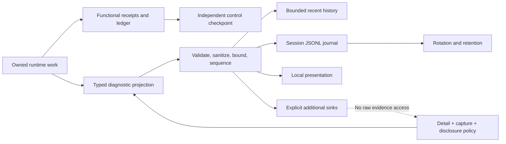
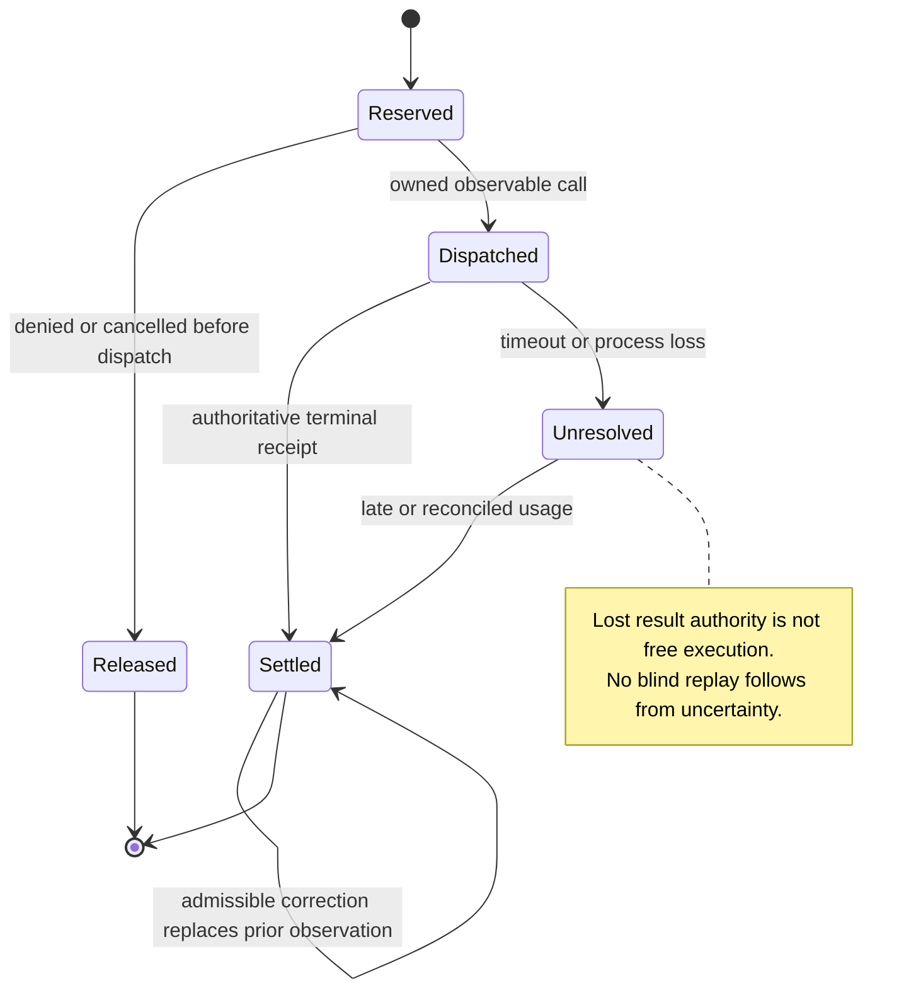

## Pi Quality Engine — Observability and Data Policy 🔍

**Document 3 of 4 · Architecture A1 · Contract C1 · Observability O1 · Diagnostic schema 1**

Pi Quality Engine must make its own behavior understandable without turning ordinary diagnostics into a second copy of the project. An operator must be able to discover which trigger became due, why a check ran or did not run, what evidence reached the evaluator, which model requests consumed resources, what conclusion was returned, and what happened to the resulting intervention.

The default is **Standard, metadata-only observability: one logical JSONL journal per observed Pi session, including its engine-owned reviewers, with bounded history and configurable rotation and retention**. More operational detail does not automatically authorize more content. Trace mode can expose a scheduling race without saving a line of source code.

This specification defines the records and rules behind that promise. It treats request accounting and action reconciliation as functional state, not as optional logging. Deleting archives or changing verbosity cannot create a new spending allowance or make an uncertain intervention safe to repeat.

> [!important] The visibility boundary
> A clean Pi installation and this package are sufficient. A reviewer created through the Pi SDK is engine-owned work and is included in the engine's accounting. Work delegated to an optional external executor remains external: the engine records its own handoff and received result, not an invented reconstruction of the external executor's transcript or bill.

### Authority and companion boundaries 📑

[Document 1](01-architecture-and-decisions.md) owns architectural intent. [Document 2](02-component-contracts-and-configuration.md) owns component interfaces and configuration keys. **This document owns diagnostic projections, event fields, measurement semantics, accounting normalization, storage behavior, and data handling.** Document 4 will own implementation stages and executable acceptance evidence.

| Document | Responsibility relevant to O1 |
|---|---|
| `01-architecture-and-decisions.md` | Standalone deployment; explicit ownership; metadata-only default; control state independent of diagnostics. |
| `02-component-contracts-and-configuration.md` | C1 `Scope`, `RunRef`, `DiagnosticWriter`, `PermittedDiagnosticRecord`, sink interfaces, exact configuration keys and defaults. |
| `03-observability-and-data-policy.md` | This document: what is recorded, permitted, counted, stored, presented, reconciled, and intentionally omitted. |
| `04-implementation-testing-and-acceptance.md` | Planned companion: behavioral tests and stage acceptance, including the proof obligations in this document. |

“Must” is a requirement. “Should” is a justified default with a documented exception. “May” identifies an optional capability. O1-specific event names and declaration examples describe the **proposed package**, not APIs already implemented by Pi or donor projects. Statements about upstream behavior use immutable source references. No combined Pino/rotation/Pi integration is claimed to have been run as part of writing this document.

O1 refines the opaque `fields` member of the C1 diagnostic envelope. It does not rename `observability`, add a competing logger configuration, alter feedback permissions, or expand the set of automatic recovery actions. Numeric resource defaults inherited from C1 remain unchanged. Additional implementation bounds below are named internal limits, not undocumented YAML keys.

### Reading routes 🗺️

| Question | Sections |
|---|---|
| What is visible, and what remains outside the journal? | [1–3](#section-1) |
| What is the exact record and event model? | [4–7](#section-4) |
| How are context, tools, model requests, and feedback represented? | [8–11](#section-8) |
| How do owned tokens, prices, retries, and budgets reconcile? | [12–14](#section-12) |
| How are content, paths, images, and snapshots protected? | [15–16](#section-15) |
| How do files, rotation, retention, and restart work? | [17–20](#section-17) |
| How do sinks, backpressure, presentation, and export work? | [21–23](#section-21) |
| Which configuration is valid, and what must be tested? | [24–26](#section-24) |
| Which exact donor files inform the implementation? | [27](#section-27) |



<a id="section-1"></a>

## 1. The observability promise and its limits 🧭

### 1.1 The questions every assessment must answer 🔎

Observability is a product capability, not a development switch. For an evaluation within retained history, the standard record set must support the following investigation.

| Question | Required evidence |
|---|---|
| Why did the engine consider a check? | Trigger binding or explicit operation, reason code, evidence cursor, and due conditions. |
| Why did it run, wait, merge, or disappear? | Admission outcome, coalescing references, capacity/cooldown/authority reason, and resulting run ID. |
| Which configuration actually applied? | Effective revision, selected component/profile IDs, and permitted provenance. |
| What did the evaluator receive? | Final observable input manifest, resource revisions, selection ranges, coverage, and serialization boundary. |
| Which work was paid? | Owned request-attempt identities, actual route, reported usage, cost basis, and known limitations. |
| What was concluded? | Operational outcome, coverage, conclusion, criterion-level scores, and finding metadata. |
| What reached the primary agent? | Action intent, dispatch record, receiver receipt, and strongest demonstrated inclusion state. |
| Did the intervention help? | Subsequent evidence or a qualified behavioral observation, not an acknowledgment treated as success. |
| Why is part of the history absent? | Detail filtering, intentional retention, projection limits, sink loss, crash uncertainty, or disabled recording. |

The system does not need to save all natural-language text to answer these structural questions. It does need to make absent text explicit when an investigation requires the exact wording.

### 1.2 Four facts that must never be collapsed ⚖️

**The evaluator received evidence. The evaluator produced a valid result. The runtime delivered advice. The engineering defect was resolved.** These are separate facts. One boolean named `success` cannot represent all four.

Likewise, recording a filename does not establish that its contents were included; receiving a provider response does not establish that every hidden retry was observed; and a successful stream write does not certify power-loss durability.

O1 therefore keeps operational status, engineering conclusion, evidence coverage, delivery status, and accounting coverage separate. Unknown values are first-class values rather than missing explanations filled in by a dashboard.

### 1.3 Visibility is bounded, not omniscient 🧷

The journal describes the last boundary the engine actually observes. An engine-prepared prompt is not necessarily the exact HTTP payload. A finalized SDK usage object may be normalized rather than provider-native. A reviewer tool can report a subset of a large file. An external executor may expose only a handoff acknowledgment.

These limitations are recorded in named fields. The engine must not infer private provider transformations, invisible billing attempts, hidden reasoning, or the full context of another plugin. Metadata-only mode is suitable for structural analysis, **not byte-identical replay of requests**.

### 1.4 Observability must not become the workload 🪶

Routine diagnostics must avoid provider calls, whole-transcript duplication, per-token file writes, and recursive self-inspection. A summary is computed from records and receipts; it does not require another LLM to explain the logger.

An error in recording cannot run an evaluator twice. The primary session remains usable when a diagnostic destination is unavailable. A separate failure to maintain functional budget or dispatch state may suspend new autonomous work whose correctness depends on that state. Those two failure classes are deliberately different.

<a id="section-2"></a>

## 2. Ownership, data planes, and persistence boundaries 🏷️

### 2.1 Four distinct data planes 📐

| Plane | Examples | Lifetime and authority |
|---|---|---|
| **Functional evidence** | Task text, source bodies, tool results, requirement versions, screenshots supplied to an evaluator. | Bounded run/episode memory under C1 evidence permissions. Not automatically diagnostic data. |
| **Functional control** | Stop state, reservations, request receipts, action identities, accounting reconciliation, dedupe tombstones. | Compact durable checkpoint plus live state. Required for safe autonomy. |
| **Diagnostics** | Approved event metadata, manifests, timing, scores, usage projections, loss notices. | Configurable journal, recent history, presentation, and explicit sinks. |
| **Optional captured content** | Approved excerpts or bounded bodies retained for investigation. | Separate explicit artifacts or bounded event attachments governed by capture and retention. |

The distinction is architectural. It must not depend on whether the implementation happens to use one TypeScript object in two places. Raw functional objects never become diagnostic records by spreading their properties into a logger call.

The final reviewer result and injected advice can exist transiently even when `capture.modelResponses` and `capture.prompts` are `none`. That is permitted functional processing, not permission to persist those bodies in the Quality journal.

### 2.2 Engine-owned, primary, and external work 🧮

| Origin | Activity visibility | Inclusion in owned model totals |
|---|---|---|
| Engine direct assessment | Request, manifest, outcome, and permitted response metadata. | Included. |
| Engine model-assisted context/prompt preparation | Its own purpose, attempts, and transformed-resource provenance. | Included. |
| Engine-created clean Pi reviewer | Reviewer lifecycle and observable model/tool attempts. | Included. |
| Primary Pi executor | Permitted lifecycle, tools, evidence, and progress observations. | Excluded. |
| Optional external executor | Engine-side handoff, remote identity reference, and received assessment. | Excluded. |
| Local deterministic processing | Duration, sizes, and operational counters. | No model charge; not a fabricated zero-token model request. |

A public inspection view must label excluded work. It must not display “total session cost” when it means only the observer's owned cost. O1's default label is **Owned observer cost**, with clean reviewers broken out as a derived subcategory.

### 2.3 The primary transcript remains Pi-owned 📄

The Quality journal's capture policy does not delete or sanitize Pi's ordinary primary transcript. A feedback body delivered to the primary may subsequently be stored by Pi. An operator investigating sensitive deployments must understand this separate boundary.

For engine-owned reviewers, C1 specifies `SessionManager.inMemory()` and explicit resource loading. The engine must not leave an unfiltered SDK session file beside its metadata-only journal. Pi documents both persistent default session storage and the explicit in-memory alternative.[^pi-sdk]

### 2.4 Control state is not reconstructed from verbosity 🧱

The attempt ledger and dispatch receipts are updated independently of event selection. `detail: minimal`, `journal.enabled: false`, retention cleanup, and recent-history eviction do not change paid-work counters or effect identities.

A journal is evidence for inspection. It is not the sole authority used to decide whether an action may be repeated. This avoids making safety depend on whether a diagnostic record happened to survive rotation or a slow sink.

<a id="section-3"></a>

## 3. Detail profiles and independent disclosure 🎚️

### 3.1 The four C1 profiles 📊

| Profile | Included operational detail | Intended use |
|---|---|---|
| `minimal` | Runtime start/stop/degradation; check starts and terminal results; material policy/action decisions; errors; owned usage summaries; meaningful history gaps. | Compact long-running operation. |
| `standard` | Minimal plus significant trigger/admission decisions; actual context/resource manifests; request attempts; tool attempts and outcomes; reviewer lifecycle; finding metadata. | Default causal audit without content bodies. |
| `debug` | Standard plus state transitions, dependency freshness checks, configuration provenance, reservations/reconciliation details, retry planning, and queue diagnostics. | Explain unexpected choices or spending. |
| `trace` | Debug plus fine-grained operation timing, accepted observation links, deadline arm/disarm/resynchronization, and lifecycle race evidence. | Investigate concurrency and timing. |

Profiles are cumulative. A severity such as `error` can elevate an otherwise debug-only failure into a compact minimal record. The additional information still passes the same disclosure projection.

Trace does not mean a record for every generated token, every timer poll, or every internal function call. Such instrumentation would alter the workload and produce a stream with little diagnostic value. Significant scheduling decisions and aggregated streaming statistics are sufficient for O1.

### 3.2 Detail is not Pino severity 🧭

`observability.detail` selects domain events and their allowed metadata. A logging library's `info`/`debug`/`trace` threshold must not become a second, conflicting public control surface. Event severity describes operational health; an engineering `critical` finding is not automatically an application crash.

For example, a valid evaluation that reports a critical defect can be an `info` event with `findingSeverity: critical`. A failed file write is an operational `error`. The built-in sink must preserve all records already selected by O1 rather than accidentally dropping Standard events through an unrelated library threshold.

### 3.3 Content permissions are orthogonal 🔐

C1 defines these exact capture categories: `documents`, `prompts`, `toolDescriptions`, `toolArguments`, `toolResults`, `modelResponses`, `images`, and `reasoning`. Text categories support `none`, `excerpt`, and `full`; images support only `none` and `full`. Every category defaults to `none`.

| Setting combination | Meaning |
|---|---|
| Standard + all capture `none` | Complete significant operation list without bodies. |
| Trace + all capture `none` | Detailed timing/state diagnostics without bodies. |
| Debug + selected `excerpt` categories | More operational context plus deliberately retained bounded content. |
| Minimal + permitted content | Only Minimal-eligible operations can produce capture records; the permission does not create another unbounded transcript stream. |

A capture permission is an upper bound, not a command to collect all available text. In O1, content capture occurs only for an operation/resource represented at the selected detail. Capture for omitted events is not backfilled later. No provider call is made solely to reconstruct content for diagnostics.

Increasing detail or capture does not recover text that was not stored. Reducing disclosure affects newly projected records and queued records not yet handed to a destination; it cannot retract bytes already written or received by another sink.

### 3.4 Presentation is independent of recording 🖥️

`presentation: quiet` suppresses routine local chatter. `summary` displays concise status, material warnings, and owned usage. `diagnostic` permits the detailed local timeline. All presentations use the same permitted records and summaries.

Quiet is not “hide that the observer is broken.” A material loss of accounting/control capability remains visible in status and produces a bounded local warning when the host supports one. Presentation changes do not automatically put diagnostics into the primary model's context.

### 3.5 What Standard deliberately excludes 🚫

Standard excludes source bodies, arbitrary command values, search strings, task text, prompt bodies, generated finding explanations, model-response text, exception messages/stacks, image bytes, credentials, environment dumps, and generic serialized argument/result objects.

Standard may include registered IDs and reason codes, permitted paths, line ranges, sizes, shapes based on declared schemas, result types, outcome categories, timings, criterion IDs, score values, and token/cost summaries. Merely naming a field `metadata`, `summary`, or `safeText` does not make its content eligible.

<a id="section-4"></a>

## 4. Diagnostic record contract and causal identity 🧾

### 4.1 O1 specializes the C1 envelope 📐

The outer JSON object remains exactly the C1 sink envelope. No raw library logger wrapper becomes the public format.

```typescript
// O1 diagnostic contract; JsonObject is the C1 JSON object type.
export interface DiagnosticRecordV1 {
  schemaVersion: 1;
  eventId: string;
  sequence: number;
  event: string;
  observedSessionId: string;
  fields: DiagnosticFieldsV1;
}

export interface DiagnosticFieldsV1 extends JsonObject {
  time: {
    recordedAt: string;                 // UTC ISO 8601, millisecond precision
    monoMs: number;                      // generation-relative, finite, >= 0
    occurredAt: string | null;           // source clock, if known
  };
  scope: {
    branchId: string;
    runtimeGeneration: string;
    episodeId: string | null;
    authorizationRevision: string;
  };
  origin: {
    kind: "operator" | "primary" | "owned-reviewer" | "engine" | "external";
    ownerId: string;
    parentOperationId: string | null;
  };
  correlation: {
    runId: string | null;
    rootRunId: string | null;
    parentRunId: string | null;
    operationId: string | null;
    attemptId: string | null;
    actionId: string | null;
    reviewerSessionId: string | null;
  };
  level: "info" | "warn" | "error";
  detail: "minimal" | "standard" | "debug" | "trace";
  configRevision: string;
  dataPolicyRevision: string;
  reasonCodes: string[];
  data: JsonObject;                       // event-specific closed schema
  projection: {
    metadataTruncated: boolean;
    omittedFields: string[];              // schema paths, never raw values
    omittedItems: number;
    captureRefs: string[];                // approved retained artifacts only
  };
}
```

`data` is not an arbitrary logging escape hatch. Each event name in section 7 has a closed payload schema or an explicitly registered diagnostic-note form. String-valued fields are either known identifiers/enums or independently classified content. Unknown fields are rejected from the diagnostic projection, not recursively serialized.

Fields that do not apply are null or an empty collection as declared. Optional event-specific fields are identified below. This makes an absent measurement distinguishable from a measured zero without requiring every event to reproduce every possible field.

### 4.2 Three sequences with different purposes 🔢

Functional observations already have their own C1 sequence. Diagnostic `sequence` is assigned after profile selection and successful projection by the active journal owner. It orders diagnostic records **within one runtime generation**, continues across rotations, and never rewinds in that generation. `eventId` is globally unique for the event and is preserved across fan-out or export.

A new generation may begin its diagnostic sequence at 1. Cross-generation session order comes from the monotonic segment ordinal and the generation-opening record. This avoids synchronous checkpoint writes for every diagnostic event while remaining unambiguous: the key is `(observedSessionId, runtimeGeneration, sequence)`, not sequence alone. O1 does not reinterpret an observation sequence as a journal sequence.

References to accepted observations use their IDs. Source `occurredAt` timestamps can be delayed, inaccurate, or supplied by another process; they never determine authority or replace arrival order. A usage update received late is recorded now and references the original attempt.

### 4.3 Correlation does not require tracing infrastructure 🧩

A run links its context operations, model attempts, assessment, policy, and actions. An expert check has its own run ID and the initiating run as parent. A clean review session links back to its evaluation run; its tool attempts link to the generating model operation where observable.

These are ordinary IDs and parent references. No global ambient span, distributed tracing server, or service mesh is required. Native Pi telemetry contexts may carry the same operation nesting, but external telemetry IDs are not allowed to replace the engine's functional identities.[^pi-telemetry]

### 4.4 Trustworthy identity fields 🏷️

IDs are issued or validated at the owning boundary. A model-supplied finding label is mapped to an engine finding reference before it reaches a journal. A provider request ID may be retained only after bounded identifier validation; otherwise it becomes an opaque local reference. A URI, shell command, API key, or free-form title must not be smuggled into an ID field.

`origin.kind` is assigned by the runtime. An observer message that later appears in the main transcript remains observer-origin. This prevents its model calls, logging operations, or reviewer reads from increasing primary progress/cadence counters.

### 4.5 Schema evolution and compatibility 🔄

`schemaVersion: 1` identifies O1. Event payload schemas are packaged with the implementation and versioned with that contract. Compatible readers may ignore a new event they do not recognize, but must count it as an unsupported event rather than reinterpret it as a known success. Known event names with malformed core fields are rejected.

A record reader never executes data, resolves a schema over the network, or reads an arbitrary path named by an imported record. Cross-document references are informational. A future incompatible field meaning requires a schema revision and an explicit migration/read policy; changing a dashboard label is not a migration.

<a id="section-5"></a>

## 5. Measurements, resource references, and bounded records 📏

### 5.1 Sizes have explicit units and boundaries 🧮

A number named `size` is insufficient. O1 uses these definitions consistently.

| Measurement | Definition | Important limitation |
|---|---|---|
| `utf8Bytes` | Length of the UTF-8 byte representation at the named boundary. | Not JavaScript string length and not encrypted/network-transfer bytes. |
| `unicodeScalars` | Count of Unicode code points in the decoded text, with malformed input handling declared. | Not grapheme clusters; a visible symbol may contain several code points. |
| `lines` | Empty string is 0; otherwise split on LF and count a non-empty final unterminated segment. A trailing LF does not create an extra content line. | CRLF is one LF-delimited line; CR characters are not silently stripped from the byte measurement. |
| `serializedBytes` | UTF-8 bytes of the actual serialized representation being measured. | JSON escaping and framing can make this larger than source text. |
| `estimatedTokens` | Named estimator's result for the selected model/input representation. | Never relabeled provider-reported usage. |
| `durationMs` | Difference between monotonic readings in the same generation. | Not computed by subtracting clocks from different processes. |
| `imageBytes` | Binary attachment bytes at the named preparation stage. | Not a visual-token count or base64 string length. |

JavaScript strings and UTF-8 bytes have different lengths; Node's `Buffer.byteLength()` is an appropriate byte measurement for text at an encoding boundary.[^node-buffer] Binary sources have null text counts unless a declared text decoder actually ran. Unknown counts are null. Counting is bounded by the evidence already available; the logger must not read an entire file merely to report its character count.

```typescript
// O1 reusable metadata shape.
export interface SizeMeasurement {
  boundary: "source" | "selected" | "prepared" | "sdk-input" | "transport-input"
    | "tool-result" | "captured" | "serialized-record";
  utf8Bytes: number | null;
  unicodeScalars: number | null;
  lines: number | null;
  estimatedTokens: { count: number; methodId: string; revision: string | null } | null;
  complete: boolean;
}
```

`complete: false` means the measurement describes an observed subset or cannot cover the whole object. It is not an instruction to estimate the missing remainder. Exact provider request tokens belong to the attempt ledger, not this structure.

### 5.2 Registered resource descriptors reduce repetition 🗃️

Documents, prompt templates, question sets, result schemas, and tool descriptions often repeat across checks. O1 represents them by a resource ID and revision. A `quality.resource.described` record describes an approved resource once per relevant revision and physical segment when referenced there.

A descriptor contains `resourceId`, `kind`, `revisionRef`, `sourceId` or null, `displayPath` or null, `sizes`, and `visibility`. `kind` is one of `document`, `prompt`, `questions`, `result-schema`, `tool-description`, `tool-schema`, `image`, or `derived`. Resource bodies are absent unless independently captured.

Descriptors can be emitted again with `repeated: true` after rotation so the new segment is useful without loading every archive. This is a reference dictionary, not a second database of project rules. Re-describing metadata must never reread source bodies or perform a model request.

### 5.3 Revisions and fingerprints are not interchangeable 🔖

Functional C1 provenance may contain a Git object ID, content fingerprint, external document revision, or host cursor. O1's `revisionRef` identifies that version without requiring its original spelling to be disclosed. A verified non-sensitive commit ID can remain literal. A sensitive external identifier can be represented by a stable local token.

A digest must declare its domain: raw source bytes, selected material, sanitized capture, or final observable request representation. Equality in one domain does not establish equality in another. A redacted snapshot hash cannot be used as proof of unchanged unredacted source.

Opaque mode must not emit an unkeyed hash of a short secret or a guessed filename as if that made the value anonymous. Use a session-scoped keyed token or random reference with an owned mapping where equality is needed. The tokenization secret is functional protected state, not a logged field. Metadata-only mode is data minimization, not a claim of anonymity.

### 5.4 Record size is measured after projection and serialization ✂️

`observability.maxRecordBytes` limits the complete UTF-8 JSON record plus its terminating LF. It applies to the built-in file format and to the serialized size used for sink/history admission. The default is 65,536 bytes, as fixed in C1.

Oversize handling must preserve valid structure. The projector removes disallowed bodies first, then limits optional arrays or supplemental metadata, marking omitted counts. If the event's essential fields still cannot fit, it emits a compact `quality.diagnostic.omitted` record identifying the event kind, owner, and reason. It does not slice a JSON string mid-byte or silently lose the identity of a paid attempt.

Known event schemas distinguish essential accounting values and receipts from optional display lists. A displayed usage summary can lose a tool-name breakdown before it loses `accountingCoverage`. A large context manifest is segmented into bounded metadata-part records rather than truncated into an apparently complete list.

Impossible configurations are rejected before activation: for example, a record limit that cannot hold the mandatory envelope and smallest failure notice. The implementation reports the minimum required serialized size, not a hidden raised limit.

### 5.5 Bounded traversal before serialization 🧱

Only validated plain JSON data from the projector enters serialization. The logger does not walk arbitrary live objects, invoke getters, preserve cycles, call untrusted `toJSON`, or copy deeply nested exception causes. Numeric measurements are finite and non-negative where required.

Default schema traversal limits are 16 nesting levels, 128 items per ordinary display array, and 64 fields per ordinary metadata object. Larger manifest lists use explicit parts. These are O1 internal admission limits and do not expand C1's configuration surface.

Pino's documented fallback depth/edge settings apply when normal JSON serialization fails; they are not general output or traversal bounds. Therefore those options cannot replace the engine's own typed projection and byte admission.[^pino-api]

<a id="section-6"></a>

## 6. Projection, component notes, and the diagnostic pipeline 🛤️

### 6.1 Approved data is created, not discovered by subtraction 🔐

The runtime builds a new diagnostic object from an event-specific allowlist. It does not create a raw copy and hope a redactor removes every dangerous field. This is especially important for tool arguments, findings, exception strings, and composite model prompts.

The pipeline is: select the operational event by detail; apply its typed metadata projection; determine content-capture eligibility; sanitize permitted content; enforce record/run bounds; assign identity and sequence; then offer the permitted record to history and destinations. Functional accounting happens independently at its own receipt boundary.

No destination receives an earlier object. A source provider cannot publish a `ContextSnapshot` into the sink bus. A UI renderer receives the same safe projection unless it is executing a separately authorized live functional inspection; such inspection must not implicitly persist or export the underlying text.

### 6.2 C1 component notes remain deliberately small 🧩

C1 exposes `DiagnosticWriter.note({ code, refs, counts })`. O1 maps that to `quality.component.note` with this payload:

```typescript
export interface ComponentNoteData {
  componentId: string;
  registrationId: string;
  code: string;
  refs: string[];
  counts: Record<string, number | boolean | null>;
}
```

The component must declare `code` in `diagnosticCodes`. Reference values resolve to already accepted identities, not arbitrary strings. `counts` is limited to 32 stable field names and finite scalar values; a component cannot encode a command as a property name. Registration and tests establish the stable vocabulary. Invalid notes are counted and represented by a safe schema error, not forwarded as raw debug text.

A third-party module can therefore add meaningful decisions and measurements without introducing another logger. C1 does not currently expose arbitrary structured event-schema registration; richer functional `observationSchemas` or evaluator extensions are **not automatically richer diagnostic permissions**. O1 intentionally uses this safe note path plus runtime-owned lifecycle records. A future richer diagnostic API needs explicit field classification, not a raw-object callback slipped into C1.

### 6.3 Default event elevation and failure projection 🚨

A debug-only component preparation detail can be omitted in Standard. A preparation failure affecting a configured check must still produce a compact minimal failure/dependency record. Similarly, a request's missing terminal usage must appear in the next owned summary even when individual attempts are not journaled in Minimal.

An error projection retains a registered reason code, retryability, known safe system error category, operation reference, and bounded numeric details such as HTTP status. It does not include free-form provider errors, `stderr`, stack traces, paths embedded in stacks, or request bodies by default.

### 6.4 Domain outcomes do not become logger exceptions 🧠

A successful classifier call with insufficient evidence is a normal operational completion and an incomplete assessment. A rejected action proposal is a decision. An intentionally skipped periodic check is not a failure. These distinctions reduce warning fatigue and make real degradation visible.

The pipeline must not throw merely because a well-formed assessment is inconclusive. Conversely, a logging failure cannot be converted into `conclusion: no-supported-finding`.

### 6.5 Bounded recording is passive with respect to admitted work 🪶

Projection methods are synchronous, small, and non-throwing to component callers. Sink delivery is queued and bounded. A callback wrapped for diagnostics is invoked exactly once and its result/rejection is preserved.

Pi's telemetry adapter contract makes the same important distinction: recording failures must not change the callback's execution, and the reference storage is not a production retention policy.[^pi-telemetry] O1 follows that behavior without requiring every component to depend directly on a particular telemetry package.

<a id="section-7"></a>

## 7. Core event catalog and payload ownership 🗺️

### 7.1 Reading the catalog 📖

All events below use the envelope in section 4. `data` keys listed in a row are required unless followed by `?`; referenced metadata structures are defined in the following sections. No row permits arbitrary extra fields. Empty arrays and nullable fields preserve the declared shape.

The profile column gives the lowest ordinary detail that selects the event: **M** Minimal, **S** Standard, **D** Debug, **T** Trace. Material failures and suppression of an already proposed consequential action are elevated as described in section 6. A record can link to an outcome in another event; it does not need to duplicate that payload.

The catalog describes domain boundaries, not a new public callback for every line of implementation. Closely related states use one event with an explicit phase/outcome when their meaning remains clear.

### 7.2 Runtime, configuration, and component events 🧭

| Event | Profile | `data` and meaning |
|---|---|---|
| `quality.runtime.started` | M | `engineVersion`, `engineBuildRef`, `hostVersion`, `hostMode`, `restored`, `checkpointRevision`, `executionState`, `workState`, `operatorStopped`, `accountingCoverage`. One active owner generation begins. |
| `quality.runtime.retired` | M | `cause`, `unsettledOperations`, `unresolvedAttempts`, `pendingActions`, `checkpointRevision`, `journalFlushState`. Logical retirement, not proof of remote termination. |
| `quality.runtime.state` | D | `previousExecution`, `execution`, `previousWork`, `work`, `operatorStopped`, `observerPaused`, `evidenceRefs`. Accepted state transition. |
| `quality.config.applied` | M | `configRevision`, `previousRevision`, `dataPolicyRevision`, `changedFieldPaths`, `captureWidened`, `destinationChanged`, `activeCheckCount`. Paths name schema fields, not values. |
| `quality.config.rejected` | M | `candidateRevision`, `fieldPaths`, `errorCodes`, `runtimeUnchanged`. No raw invalid configuration is logged. |
| `quality.component.lifecycle` | S | `componentId`, `packageId`, `packageVersion`, `registrationId`, `phase`, `capabilityRefs`, `durationMs`, `errorCode`. Phase is `registered`, `ready`, `failed`, or `disposed`. |
| `quality.component.note` | S | Section 6.2 payload. A declared module-specific fact. |
| `quality.observation.accepted` | T | `observationId`, `observationSequence`, `kind`, `sourceId`, `visibility`, `evidenceRefs`, `factsPresent`. No wholesale copy of `facts`. |
| `quality.observation.gap` | M | `sourceId`, `lastKnownObservationId`, `lostCount`, `coverageAfter`, `resynchronized`. Count may be null. A source-stream gap, not a sink-write gap. |

Runtime pause, stop, and restoration that affect authority must be reflected in Minimal through a material runtime/action/check record even when the full state-transition event is filtered. A static record of `operatorStopped: true` is not replaced by a model-authored interpretation.

### 7.3 Trigger and scheduling events ⏱️

| Event | Profile | `data` and meaning |
|---|---|---|
| `quality.trigger.due` | S | `checkId`, `checkRevision`, `bindingId`, `componentId`, `intentId`, `basis`, `firstDueAt`, `measurements`, `evidenceCursor`, `workEligibility`. Basis is `count`, `time`, `evidence`, `completion`, or `external`. |
| `quality.trigger.deadline` | T | `checkId`, `bindingId`, `phase`, `dueMonoMs`, `delayMs`, `reasonCode`. Phase is `armed`, `rearmed`, or `disarmed`; monotonic deadline belongs to the recorded generation. |
| `quality.clock.resynchronized` | D | `cause`, `overdueBindings`, `coalescedIntents`, `elapsedHistoryKnown`. Sleep/resume or recovered timing is not expanded into many missed checks. |
| `quality.check.requested` | S | `checkId`, `checkRevision`, `requestSource`, `intentRefs`, `criterionIds`. Source is `trigger`, `operator`, or `policy`. |
| `quality.check.admission` | S | `checkId`, `outcome`, `runId`, `intentRefs`, `mergedIntoRunId`, `queuePosition`, `reasonCodes`, `coveredByCheckId`. Outcome is `admitted`, `queued`, `coalesced`, `skipped`, or `denied`. |
| `quality.check.started` | M | `checkId`, `checkRevision`, `intentRefs`, `evaluatorProfileId`, `policyId`, `configuredTimeoutMs`, `queueWaitMs`, `mode`. Starts real context/evaluator work. |
| `quality.check.settled` | M | `operational`, `conclusion`, `coverage`, `findingCount`, `actionCount`, `usageAttemptRefs`, `accountingCoverage`, `durationMs`, `terminalReason`. Run completion does not imply problem resolution. |

Trigger `measurements` is a small closed union: count triggers report `counter`, `value`, `threshold`, and `crossedThresholds`; time triggers report `elapsedMs`, `thresholdMs`, `lastActivityAgeMs`, `lastProgressAgeMs`, and `activeOperationCount`; evidence/completion triggers report accepted reference IDs and omitted counts. Values not known are null. Raw activity text is never embedded in `measurements`.

A no-action timer tick is not ordinarily recorded. A due intent suppressed by operator stop, unknown work, capacity, or no new evidence is observable through admission. The terminal record includes a compact count of each suppressed reason family so Minimal can explain why a session did little work.

### 7.4 Evidence, request, and reviewer events 📦

| Event | Profile | `data` and meaning |
|---|---|---|
| `quality.resource.described` | S | Resource descriptor in section 5.2 and `repeated`. No resource body. |
| `quality.context.source` | S | `manifestId`, `sourceId`, `stage`, `resourceRefs`, `required`, `selectionState`, `sizes`, `omittedCount`, `reasonCode`. Stage is `configured`, `retrieved`, or `selected`. A provider may coalesce repeated unchanged stages. |
| `quality.context.manifest` | S | Context/request manifest header in section 8. |
| `quality.context.manifest-part` | S | `manifestId`, `partIndex`, `itemCount`, `items`. Bounded item metadata; header declares expected part count. |
| `quality.context.freshness` | D | `manifestId`, `findingRefs`, `state`, `changedDependencyRefs`, `unknownDependencyRefs`, `checkedAt`. State is `current`, `stale`, or `unknown`. |
| `quality.model.preflight` | D | `profileId`, `outcome`, `capabilityRefs`, `manifestId`, `estimatedInputTokens`, `reservedOutputTokens`, `errorCode`. A denied paid call is elevated to S or M as a material admission result. |
| `quality.model.dispatched` | S | Request-attempt descriptor from section 10; establishes the observable dispatch boundary. |
| `quality.model.settled` | S | `attemptId`, `attemptRevision`, `outcome`, `stopReasonCode`, `durationMs`, `responseSizes`, `usage`, `cost`, `accountingCoverage`, `errorCode`. Nullable usage/cost use section 12 structures. |
| `quality.model.usage-updated` | D | `attemptId`, `attemptRevision`, `replacesRevision`, `usage`, `cost`, `accountingCoverage`, `late`, `source`. Full replacement observation, not an additive charge. |
| `quality.model.retry-planned` | D | `previousAttemptId`, `requestGroupId`, `nextOrdinal`, `delayMs`, `reasonCode`, `admitted`. The next dispatch gets a new attempt ID. |
| `quality.reviewer.started` | S | `reviewerSessionId`, `profileId`, `modelProfileId`, `resourceIsolation`, `toolRefs`, `manifestId`, `limits`. No transcript or tool bodies. |
| `quality.reviewer.settled` | S | `reviewerSessionId`, `operational`, `requestCount`, `toolAttemptCount`, `additionalEvidenceCount`, `accountingCoverage`, `disposalState`, `durationMs`. Financial totals are referenced/derived, never charged again. |

The contextual `runId` lives in the envelope, so payloads need not repeat it except where a payload describes admission of a different/new run. A manifest header can describe an assembled context or an individual actual request; its `boundary` distinguishes them.

### 7.5 Tools, assessments, policies, and actions 🛠️

| Event | Profile | `data` and meaning |
|---|---|---|
| `quality.tool.requested` | S | Tool-attempt metadata from section 9; `admission` is `allowed`, `denied`, or `unknown`. Denial is still an attempted tool call. |
| `quality.tool.completed` | S | Tool-result metadata from section 9. A missing terminal event remains unresolved; it is not fabricated. |
| `quality.assessment.result` | S | `operational`, `coverage`, `conclusion`, `findings`, `scores`, `dependencyRefs`, `additionalEvidenceRefs`, `attemptRefs`, `validationState`. Findings/scores use metadata projections, not functional prose. |
| `quality.policy.decided` | M | `policyId`, `policyRevision`, `disposition`, `findingRefs`, `proposalRefs`, `reasonCodes`. Disposition is `no-action`, `record-only`, `propose`, or `failed`. |
| `quality.action.admission` | M | `actionId`, `componentId`, `outcome`, `effectKinds`, `findingRefs`, `currentAuthority`, `freshness`, `reasonCodes`. Rejected actions remain visible. |
| `quality.action.dispatched` | M | `actionId`, `componentId`, `effectKinds`, `destinationRef`, `bodyDescriptor`, `checkpointRevision`. This records intent/observable dispatch, not guaranteed completion. |
| `quality.action.receipt` | M | `actionId`, `receiptRevision`, `state`, `destinationRef`, `evidenceRefs`, `errorCode`. State preserves the exact C1 receipt vocabulary. |
| `quality.feedback.observed` | S | `actionId`, `classification`, `method`, `evidenceRefs`, `assessedAt`, `coverage`. Classification is `acknowledged`, `disputed`, `behavior-changed`, `finding-cleared`, `not-observed`, or `unknown`. |
| `quality.external.handoff` | S | `handoffId`, `adapterId`, `phase`, `externalOperationRef`, `manifestId`, `outcome`, `accountingOwner`. Owner is always `external` for the remote work. |

`quality.action.receipt.state` is exactly C1's `dispatched`, `queued`, `included`, `completed`, `rejected`, `failed`, `cancelled`, or `unknown`. Do not invent `fixed` as a delivery state. A registered method can establish `finding-cleared` only from appropriate new evidence, not from a polite reply.

### 7.6 Accounting, capture, storage, and degradation events 🗄️

| Event | Profile | `data` and meaning |
|---|---|---|
| `quality.budget.changed` | D | `ledgerRevision`, `currency`, `knownCost`, `reservedCost`, `unknownAttempts`, `requestCount`, `tokens`, `admissionState`. Values reflect the functional ledger. |
| `quality.budget.denied` | M | `operationRef`, `limitKind`, `limitValue`, `knownValue`, `reservedValue`, `unknownCoverage`, `reasonCode`. No dispatch follows this denial. |
| `quality.usage.summary` | M | Owned summary in section 13 with its ledger revision and coverage. Cumulative snapshot, not a charge. |
| `quality.control.checkpoint` | D | `revision`, `outcome`, `serializedBytes`, `durationMs`, `protectedStateRef`. Failure is elevated to M and pauses new dependent autonomy. |
| `quality.capture.artifact` | S | Artifact metadata in section 16 with `state`: `saved`, `omitted`, `failed`, or `deleted`. No unapproved body or arbitrary path. |
| `quality.journal.opened` | M | `logicalJournalId`, `segmentOrdinal`, `writerGeneration`, `previousSegmentOrdinal`, `openReason`, `previousTailState`, `recordPolicyRevision`. |
| `quality.journal.closed` | M | `logicalJournalId`, `segmentOrdinal`, `closeReason`, `recordCount`, `serializedBytes`, `flushState`, `historyCoverage`. |
| `quality.journal.rotation` | S | `fromSegment`, `toSegment`, `reason`, `thresholdBytes`, `observedBytes`, `archiveCompression`, `outcome`. Threshold crossing is not a new session. |
| `quality.retention.sweep` | S | `scope`, `eligibleFiles`, `removedFiles`, `removedBytes`, `remainingOwnedBytes`, `targetBytes`, `overTargetReason`, `historyCoverage`. A bounded list of removed segment/artifact IDs is allowed. |
| `quality.sink.health` | M | `sinkId`, `previousState`, `state`, `queuedRecords`, `queuedBytes`, `lostRecords`, `reasonCode`. No recursive raw write error. |
| `quality.diagnostic.gap` | M | `sinkId`, `firstLostSequence`, `lastLostSequence`, `lostCount`, `byEventFamily`, `cause`, `exact`. Known ranges can be summarized; unknown crash loss stays unknown. |
| `quality.diagnostic.omitted` | M | `originalEvent`, `operationRef`, `reasonCode`, `originalMeasuredBytes`, `omittedCount`. Safe replacement for an unrepresentable record. |
| `quality.export.completed` | S | `exportId`, `format`, `destinationRef`, `recordCount`, `historyCoverage`, `contentIncluded`, `bytes`, `outcome`. Local explicit export, not automatic upload. |

Recording sink/rotation/retention activity must not create an infinite stream of observations about its own output. These events bypass primary observation counters and use guarded emission. Ordinary successful disk writes do not get a separate disk-write event.

### 7.7 Closed schemas and extension evolution 🧱

The implementation must ship machine-readable validation for these event payloads. A column naming a reusable shape requires that shape's O1 schema; `JsonObject` in the TypeScript envelope does not authorize arbitrary JSON at runtime.

A supported implementation may initially omit an optional event family for a capability not shipped, but it must declare that absence in `runtime.status` and export coverage. It cannot omit required Standard request/manifest/tool/action evidence while advertising Standard-complete diagnostics. Missing upstream visibility is reported as partial rather than filled with synthetic facts.

<a id="section-8"></a>

## 8. Context manifests and evidence coverage 📚

### 8.1 The manifest is a chain of custody, not a filename list 🔗

The evidence pipeline has four distinct stages: **configured, retrieved, selected, and submitted at the final observable request boundary**. A source may exist at one stage and not reach the next. The diagnostic model must preserve that difference.

For example, an architecture document can be configured but denied by a source grant; retrieved but outside the applicable selection; selected but displaced by an input limit; or present in a prepared SDK request while the actual network serialization is hidden. Only the last observed stage may be claimed.

`quality.context.source` records acquisition/selection outcomes. `quality.context.manifest` identifies a committed snapshot or request. Request-level manifests reference the source descriptors and exactly which selections survived preparation. No manifest entry is marked submitted simply because it was listed in a context plan.

### 8.2 Manifest header and item shapes 📦

```typescript
export interface ContextManifestData {
  manifestId: string;
  snapshotId: string;
  boundary: "assembled-context" | "prepared-request" | "sdk-input" | "transport-input";
  attemptId: string | null;
  profileId: string | null;
  parentManifestId: string | null;
  coverage: "complete" | "partial" | "insufficient";
  inputVisibility: "complete" | "partial" | "unknown";
  requiredItems: number;
  includedRequiredItems: number;
  optionalItems: number;
  includedOptionalItems: number;
  omittedItems: number;
  contentTruncated: boolean;
  manifestTruncated: boolean;
  itemCount: number;
  partCount: number;
  resourceRefs: string[];
  issueCodes: string[];
  sizes: SizeMeasurement[];
}

export interface ManifestItemMetadata {
  itemId: string;
  resourceId: string;
  sourceId: string;
  role: "task" | "requirement" | "evidence" | "reference" | "prior-finding";
  required: boolean;
  revisionRef: string;
  selection: {
    kind: "full" | "lines" | "sections" | "derived";
    ranges: Array<{ start: number; end: number }>;
    sectionRefs: string[];
    inputRefs: string[];
    methodId: string | null;
  };
  disposition: "included" | "omitted" | "unavailable" | "denied";
  changedDuringRead: boolean;
  sizes: SizeMeasurement[];
  captureRefs: string[];
}
```

`role` follows the corresponding C1 material roles. Prompt resources, questions, tool schemas, and result schemas are request resources referenced by `resourceRefs`; they need not pretend to be a project requirement or a tool-result context item. Section titles are treated as text: Standard uses `sectionRefs` instead of copying arbitrary heading text.

`manifestTruncated` describes diagnostic metadata completeness. `contentTruncated` describes actual evaluator input truncation. The two can differ. A complete functional evaluation with an omitted diagnostic item list does not become an incomplete engineering result, but its exported audit coverage is partial. Conversely, a perfectly retained manifest of an incomplete input does not make the evaluation complete.

### 8.3 Metadata parts and completeness of an exported manifest 🧾

Large item lists are emitted as `manifest-part` records. Parts are ordered by `partIndex`, starting at zero, and every header declares `partCount` and `itemCount`. Each part fits `maxRecordBytes` independently. The manifest ID joins them.

A reader missing a part must display “manifest metadata incomplete.” It must not treat the existing prefix as the full set of evaluator inputs. Parts are bounded to the selected source sizes and runtime limits; an adversarial provider cannot force an unbounded metadata stream by returning millions of tiny items.

A record-size failure can preserve a header with correct totals and `manifestTruncated: true`. The engine should prefer bounded parts over omission. Full bodies are never embedded merely to avoid dealing with a resource reference.

### 8.4 Final request overhead is part of the input 📐

Input accounting includes evaluator instructions, selected source material, task amendments, question definitions, tool descriptions/schemas, result schema instructions, message framing where observable, and image attachments. Reporting only the code-file tokens would understate a review's context.

The manifest distinguishes its named estimator from provider-reported request usage. An adapter that sees the SDK-level request but not exact transport bytes records `boundary: sdk-input`. It may still receive exact provider token usage at settlement, but must not call its earlier byte measurement a wire measurement.

For typed classification, the prepared complete `{state,questions}` has nonzero SDK-input bytes/digest and an explicit approximate `ceil(bytes/4)` estimate (`utf8-bytes-div-4@engine-1`). Its manifest identifies actual included instructions, ordered admitted text/JSON items and the question resource; the unsent generative result schema is not marked included. This copied/frozen representation is measured before admission. System One's bool→noul conversion and added native framing are separate SDK-specific wire facts, not hidden-provider-token visibility.

Caching does not remove the cached material from the logical input. A cache hit can change billing categories while the manifest continues to identify all input resources supplied logically to that request.

### 8.5 Additional reviewer reads extend evidence, not authority 🔍

A clean Pi reviewer may read further files within its grants. Each actual tool result receives an evidence reference and resource descriptor. The next request's manifest shows which of those results entered the reviewer context. A read that failed, was redacted to an empty value, exceeded its cap, or was omitted is not recorded as a successful inspected source.

Additional reading cannot authorize new roots or reinterpret an edited requirement as approved policy. `pin-at-episode` requirement versions remain identified. A newly changed requirement is a candidate revision until the runtime has actual authorization to adopt it.

### 8.6 Freshness checks have their own evidence 🔁

Before feedback or escalation, the runtime compares the relevant current authority and evidence dependencies to those used for the finding. The debug record names changed/unknown dependency references and the resulting `current`, `stale`, or `unknown` state.

An unrelated edit does not automatically stale a finding. A changed dependent source does. An old assessment remains in history with its original snapshot; it is not rewritten to look as though it reviewed the new code. If a current check is launched, it gets a new run/manifest identity linked to the prior suspicion.

### 8.7 What cannot be reconstructed 📎

A metadata-only manifest can show that a requirement was supplied, how much was supplied, and which version was used. It cannot reproduce the exact text from its hash. If the original document changed and no permitted snapshot or immutable original is available, exact replay is unavailable.

An explicit `context.inspect(materialize: true)` can acquire current permitted evidence under C1. That is a new acquisition, not reconstruction of an old request. Ordinary export and timeline inspection never perform hidden source reads, network fetches, or model calls to fill missing history.

<a id="section-9"></a>

## 9. Tools, argument shapes, and result metadata 🛠️

### 9.1 Attempted, executed, and completed tools are different 🧭

A model can request a tool that is denied before execution. A started tool can fail, be cancelled, or never yield a terminal event. A tool can return a successful transport result containing domain failure. O1 records these distinctions without equating “tool mentioned” with “work verified.”

An attempted tool operation has an engine operation ID, optional originating model attempt ID, tool resource reference, parent operation reference, admission state, and owning origin. Parent and nested calls are correlated by IDs; array position is not identity.

Primary top-level completions, primary nested executions, reviewer attempts, and observer operations remain separate counter families. The default cadence uses C1's completed primary top-level tool counter. Diagnostic writes and reviewer reads never advance it.

### 9.2 Tool metadata shapes 📋

```typescript
export interface ToolRequestMetadata {
  toolOperationId: string;
  toolId: string | null;                // registered exact name, otherwise null
  toolResourceRef: string;
  parentToolOperationId: string | null;
  generatingAttemptId: string | null;
  internal: boolean;
  admission: "allowed" | "denied" | "unknown";
  targetRefs: string[];
  argumentShape: Array<{
    field: string;                       // declared schema field, not dynamic input key
    type: "null" | "boolean" | "number" | "string" | "array" | "object" | "unknown";
    present: boolean;
    size: SizeMeasurement | null;
  }>;
  additionalFieldCount: number | null;
  argumentsMeasuredAt: "requested" | "effective" | "unknown";
  effectClassification: "read-only" | "mutating" | "network-active" | "mixed" | "unknown";
}

export interface ToolResultMetadata {
  toolOperationId: string;
  outcome: "success" | "failure" | "cancelled" | "not-executed" | "unknown";
  executed: boolean | null;
  durationMs: number | null;
  errorCode: string | null;
  exitCode: number | null;
  resultKinds: Array<"text" | "json" | "image" | "binary" | "other">;
  outputSizes: SizeMeasurement[];
  resultItemCount: number | null;
  evidenceRefs: string[];
  schemaValid: boolean | null;
  visibility: "complete" | "partial" | "unknown";
  domainResult: "passed" | "failed" | "not-assessed" | "unknown";
}
```

An explicit tool adapter may prove `domainResult: passed` from the tool's contract and actual outcome. A generic shell exit code or issued test command cannot universally prove that all relevant tests ran. Domain-result interpretation remains a separately identified deterministic or assessed check.

### 9.3 Argument values remain out of Standard 🔐

A `bash` call can reveal the presence and byte length of a declared `command` field without retaining its value. A `read` call can expose permitted relative path metadata and a numeric line range if the adapter classifies those fields. An `edit` call's `oldText` and `newText` values are source-bearing tool arguments and are never default metadata.

Dynamic JSON keys may themselves contain secrets or source text. Standard records declared schema field names and an `additionalFieldCount`, not arbitrary object keys. Array values, SQL strings, search patterns, and embedded URLs remain bodies even when short.

If another host handler transforms a tool input, diagnostics distinguish requested versus effective arguments where observable. The engine does not claim to know the executed command when only the original model request was visible.

### 9.4 Result surfaces must be treated consistently 🧱

A tool can return both textual content and structured JSON. Sanitizing one and serializing the other would defeat the capture policy. O1 measurements can describe both surfaces, but bodies require the corresponding category permission and the same exclusion/redaction rules.

Images returned by tools are identified by media metadata and artifact references. They are not converted to base64 and inserted into ordinary JSONL records. A path to an image does not prove that a model viewed it; input manifests and tool receipts establish what was actually supplied.

### 9.5 Read-only classification is not a security assertion 🛡️

`effectClassification` reports the known contract of the executed tool. It does not certify a filesystem sandbox. A test runner can alter fixtures, caches, or databases; a browser tool can perform network writes. A package that labels arbitrary shell execution read-only is non-conforming even if no mutation occurred in one example.

Unsupported effect classification is `unknown`. The logger must not use an uncertain label to approve another tool call or hide a missing grant.

<a id="section-10"></a>

## 10. Owned model attempts and clean reviewer sessions 🤖

### 10.1 The request descriptor identifies what actually ran 📡

`quality.model.dispatched` records one observable owned dispatch, not an intention to dispatch. The descriptor includes:

| Field | Meaning |
|---|---|
| `attemptId` | Unique identity owned by the model service. |
| `requestGroupId` | Logical request grouping retries/format repairs where applicable. |
| `ordinal` | One-based observed attempt number in that group. |
| `purpose` | `assessment`, `context-preparation`, `prompt-preparation`, `reviewer`, `format-repair`, or explicitly declared maintenance. |
| `profileId` / `profileRevision` | Approved configured route and captured revision. |
| `requestedRoute` | Provider/model IDs requested by configuration. |
| `actualRoute` | Confirmed provider/model/revision, with unknown members null. |
| `destinationRef` | Approved endpoint/resource identity; never credentials, query strings, or headers. |
| `manifestId` | Final observable input manifest for this attempt. |
| `requestBoundary` | `sdk-call` or `transport-attempt`; does not imply more visibility than available. |
| `retryVisibility` | `attempt-level`, `dispatch-group-only`, or `unknown`. |
| `priceBasisRef` | Rate basis captured before dispatch, or null. |
| `reservationRef` | Functional budget admission record, or null when no monetary reservation is possible. |
| `requestTimeoutMs` / `maxOutputTokens` | Actual admitted timeout and generative output limit. Classifier output metadata0 means not applicable, not a server-enforced zero-generation ceiling. |
| `operationKind` / `classifierQuestionCount` / `outputTokenLimitApplicable` | Closed optional metadata distinguishing operation and question batch from generative output capacity. |
| `inputManifestRef` / `inputSerializedDigest` | Closed optional owned prepared-input identity/digest where supplied; no content body. |
| `reasoningSetting` | Supported route setting actually applied, or null. |
| `accountingOwner` | `engine`; external executor operations are not represented as owned dispatches. |

Provider/authentication discovery does not justify logging secrets. A provider's base URL can contain credentials or tenant identifiers; Standard records an approved destination reference and optionally its safe origin metadata, not the unfiltered URL. Authentication status is boolean/categorical, with a credential source reference at most.

### 10.2 Settlement and streaming are observations of the same attempt 🔁

An owned attempt begins when the model service hands the request to the observable execution boundary. A streaming usage message is provisional information about that attempt. The final response, a later correction, and restoration reconciliation update the same attempt revision.

The engine records first-observed-output latency and overall duration where it can actually measure them. It may summarize stream chunk count or maximum inter-chunk gap at Debug/Trace, but does not log every token. Provider-exposed reasoning is omitted unless separately captured, and hidden reasoning is not observable at any profile.

Cancellation has two meanings: the engine can revoke result authority immediately, while remote execution may still continue. A late response can reconcile usage without making the old finding actionable.

The typed adapter passes the actual signal, `timeoutMs` and `maxRetries: 0`, with no unsupported `maxTokens`, and bounds its response stream to1MiB while preserving the public SDK serializer/parser. Usage received before answer rejection remains owned. Local timeout/revocation does not erase a late receipt or establish remote cancellation.

### 10.3 Clean-session lifecycle is observable without a second transcript 🧾

A reviewer-start record identifies the explicit model profile, resource isolation, available tool references, input manifest, and limits. Every observable reviewer model call gets an owned attempt record, and investigative tool attempts use section 9.

The reviewer is fresh by default and uses in-memory storage. The initial context is not an automatic fork of the primary transcript. Additional reads extend the same evidence chain. No ambient copy of the observer or another installed plugin should start inside the reviewer.

The SDK supports explicit independent session/resources, and the OMP donor demonstrates why disabling ambient resource discovery matters.[^pi-sdk][^omp-isolation] O1 records the effective isolation configuration rather than assuming that a profile name such as `read-only-reviewer` proves it.

### 10.4 Maintenance and repair requests are not free hidden work 💸

C1's built-in Pi reviewer disables automatic compaction and SDK retries by default. A supported configured format repair is an additional request within the same limits. Typed classifiers reject repair1; chat's optional repair is not general repair of every parseable C1-invalid object. If a contributed evaluator enables maintenance, reranking, model-assisted summarization, or another owned call, it must report it through the same model service and attempt ledger.

When a host or provider performs unobservable retries, the engine records a dispatch group with partial attempt visibility. It must not synthesize HTTP attempts from elapsed time or claim complete accounting from the number of assistant messages alone. The OMP usage ledger explicitly distinguishes agent turns from HTTP retries; this limitation is useful, but its particular accumulation format is not adopted as O1's ledger.[^omp-usage]

### 10.5 External work remains an explicit handoff 📨

An external evaluator produces `quality.external.handoff` phases such as `requested`, `accepted`, `result-received`, or `unknown`. Its submitted context manifest describes only what the engine sent. The external result may include additional evidence declarations, which remain attributed to that executor and its visibility contract.

Externally reported cost is not merged into owned totals. O1's first implementation can retain only `externalUsageAvailable: true` in a permitted extension note and an external result reference; a future UI can link to the other mechanism's accounting. It must not display an exact combined bill from incompatible or incomplete reports.

<a id="section-11"></a>

## 11. Assessment, policy, and feedback visibility ⚖️

### 11.1 Metadata-only assessment projection 🧪

A successful schema validation records `operational`, `conclusion`, `coverage`, recognized criterion IDs, findings, and score metadata. A finding projection retains its engine finding reference, response-local ID reference, criterion ID, `suspected`/`supported` status, engineering severity, validated defect code, requirement/evidence references, and affected item references.

The projection excludes explanation, correction prose, limitations text, free-form scope descriptions, and arbitrary extension values. Those fields are functional model/result content. Source-sensitive information is not safe simply because the evaluator wrote it in its own words.

Scores retain `kind`, `value`, `minimum`, `maximum`, criterion ID, calibration reference, and an interpretation-resource reference. The numeric fields are validated, while the free-form interpretation text is represented by a resource reference. A self-reported confidence value is not relabeled calibrated probability.

`core.invalid-evaluation-result` remains the stable outer failure. Safe supplemental categories are `core.assessment.{parse,non-object,structure,consistency,reference,criterion,score,typed-answer,transport,cancelled,extension}`. Descriptor-safe shared validation classifies bounded consistency failures before the unchanged full shared schema; direct and reviewer submissions use the same outer validator. The reviewer's local FAILED envelope retains the category through existing reason codes. Unknown references/keys, arbitrary extensions, model/source prose and exception bodies are not diagnostic payloads. Completed/undetermined is a legitimate limitation; a local FAILED envelope is not model abstention.

### 11.2 Policy decisions explain both intervention and restraint 🚦

A policy decision identifies its own revision, input finding references, current evidence/authority status, disposition, and reason codes. A runtime gate that rejects a proposal records the rejection separately from the policy's original proposal.

Typical reasons include operator stop, observe mode, insufficient coverage, unknown freshness, duplicate effect, already active investigation, incompatible target, exhausted feedback allowance, or exhausted model budget. The reason is actionable in a local explanation without requiring the original finding prose to be saved.

In `mode: observe`, evaluations still consume their own authorized resources. Policy-generated feedback and escalation are recorded-only. Observe mode does not mean that a permitted reviewer with tools had no external effects; its profile and actual tool receipts remain visible.

### 11.3 Dispatch is not inclusion, and inclusion is not compliance 📬

Action state follows C1. A `queued` note is awaiting a host boundary. `included` requires evidence that it entered an actual primary request. If the host does not expose that boundary, the strongest defensible state remains `queued` or the adapter's narrower completed delivery operation.

An internal `core.request-check` action completes when the requested expert check is admitted or coalesced. Its completion does not mean the expert finished. The resulting run ID joins the rest of the trace.

A delayed action receipt is a revision of the same action, not permission to issue another copy. A reader must not count every receipt revision as a new intervention.

### 11.4 Feedback body provenance and captured content 📝

The exact text returned to the primary is a **prompt body** for capture purposes. It therefore requires `capture.prompts` before it can be retained diagnostically. A known copied source fragment also remains subject to its source category; embedding it in feedback does not launder its provenance.

Model-backed finding/result text falls under `modelResponses`. Provider-exposed reasoning additionally requires `reasoning`. When known lineage spans several categories, all applicable permissions are required for that captured fragment. A generated model response can contain source-derived text not mechanically separable from its prose; enabling response capture must be presented as permission to retain such potentially code-bearing response content after sanitization. The only reliable default exclusion is capture `none`.

The ordinary action record still carries note byte count, referenced findings, destination, and a body identity without the text. The primary transcript can contain the delivered body under Pi's separate storage policy.

### 11.5 Subsequent behavior is evidence, not an automatic success rate 📈

`quality.feedback.observed` identifies the method used. A simple deterministic method can detect a requested tool family or an edit to an affected file; that is `behavior-changed`, not necessarily `finding-cleared`. A later scoped assessment can support that the violation no longer appears in the relevant evidence.

A model saying “understood” is only acknowledgment. A model disputing a note is not proof that the note was false. A mandatory requirement is not automatically muted because the primary ignores it. Diagnostics can help compare delivery strategies without converting compliance frequency into authority to repeal project instructions.

<a id="section-12"></a>

## 12. Token normalization and price provenance 💰

### 12.1 Owned accounting uses one receipt per attempt 🧮

The model service is the only accounting owner for an engine-dispatched request. An evaluator returns attempt references, not another bill to add. A reviewer aggregate is derived from those attempts. Streaming updates, a final response, an SDK message, and a later replay of that message are observations about an attempt, not four separate expenses.

The immutable event stream can contain several revisions of one attempt. The functional ledger applies the latest admissible revision once. Reports either read the functional ledger or reproduce the same replacement semantics with a coverage warning when history is incomplete.

### 12.2 Usage shape and provenance 📐

```typescript
export interface NormalizedUsageV1 {
  revision: number;
  observationSource: "provider" | "sdk-normalized" | "local-estimate";
  sourceSchemaId: string;
  adapterRevision: string;
  inputTokens: number | null;            // all input, including cached input when known
  uncachedInputTokens: number | null;
  cacheReadTokens: number | null;
  cacheWriteTokens: number | null;
  outputTokens: number | null;           // includes reasoning when normalization can establish it
  reasoningTokens: number | null;        // informational subset, not added again
  totalTokens: number | null;
  inputPartition: "disjoint-complete" | "partial" | "unknown";
  outputIncludesReasoning: boolean | null;
  totalBasis: "normalized-sum" | "reported-total" | "estimate" | "unknown";
  coverage: "complete" | "partial" | "unknown";
  finality: "provisional" | "final" | "unresolved";
}

export interface PriceBasisV1 {
  id: string;
  source: "operator" | "host-catalog" | "provider" | "unknown";
  sourceRevision: string | null;
  capturedAt: string;
  currency: string | null;
  rates: Array<{
    category: "uncached-input" | "cache-read" | "cache-write" | "output" | "other";
    unit: "per-million-tokens" | "per-request" | "other";
    amount: string;
    applicabilityRef: string | null;
  }>;
  completeForRequest: boolean;
}

export interface CostObservationV1 {
  amount: string | null;
  currency: string | null;
  basis: "reported" | "calculated" | "estimated" | "unknown";
  coverage: "complete" | "partial" | "unknown";
  priceBasisRef: string | null;
  usageRevision: number | null;
  source: "provider" | "sdk-estimate" | "engine-calculation" | "none";
  knownComponents: Array<{ category: string; amount: string }>;
  unknownComponentCount: number;
}
```

These are receipt/event shapes, not new price-configuration keys. C1 remains authoritative for model-profile prices. A rate basis records exactly what that approved profile/host/provider supplied and how it applies. Unsupported pricing structures remain partial instead of being squeezed into a false two-rate formula.

All token counts are non-negative safe integers or null. Monetary values are non-negative decimal strings for ordinary usage. O1 does not mix provider account credits, refunds, subscriptions, tax, or unrelated purchases into a per-request token bill.

### 12.3 Inclusive input and cache partitions 🧩

Adapters must document the relationship between provider counters. Some inputs are inclusive totals with cached tokens as a subset; others expose disjoint uncached/cache-read/cache-write fields. O1 normalizes to a disjoint partition only when that relationship is established.

If the provider reports input 10,000 and cache-read 8,000 as an input subset, the normalized input is **10,000**, not 18,000. If output 600 includes reasoning 200, normalized output is **600**, not 800. A valid normalized total is 10,600 when those dimensions cover the whole request.

If the relationship cannot be established, retain known counters and set partition/total coverage accordingly. Do not subtract unrelated cache counts, infer a missing cache-write count from zero-filled SDK defaults, or add reasoning to an already inclusive output value.

The OMP donor explicitly documents its particular SDK input/output semantics and invisible retry limitations. That informs adapter tests, not a universal claim that every provider uses the same schema.[^omp-usage]

### 12.4 Estimates of files are not request usage 📏

A context provider's token estimator supports input budgeting. It does not observe provider billing. Individual item estimates are non-additive in the strict tokenizer sense because concatenation, separators, tool schemas, and multimodal framing can change tokenization. A summed estimate must be labeled approximate.

The request-level estimate is based on the assembled representation. Provider-reported usage, when available, remains a separate value. A request that has no provider usage is not silently replaced by the file-token estimate in a column labeled actual.

One classifier call owns its question batch once; `classifierQuestionCount` is not a multiplier for aggregate token usage or cost. The SDK may pad absent/invalid usage counts with0 and calculate catalog cost: these remain SDK-normalized observations, not native counters, proven zero debit or invoice settlement. A profile explicitly set to `price: unknown` remains unknown even when SDK catalog placeholders are zero. Typed probabilities and separate native confidence likewise retain their distinct uncalibrated meanings.

A deterministic check has no model attempt. Its runtime cost can be described as local processing, but token fields are not a fabricated all-zero provider receipt.

### 12.5 Cost calculation and immutable rate context 🧾

A calculated amount uses the applicable disjoint charge quantities and captured rates. With token quantities `q` and per-million rates `r`, the amount is the sum of `q × r / 1,000,000` over known charge categories. It is calculated using decimal arithmetic or scaled integers, not cumulative binary floating-point addition.

The implementation keeps calculation precision through aggregation and rounds only for display. The default display may show six decimal places, while stored decimal strings preserve the actual calculation's precision. The rate revision used for a dispatched request never changes merely because the operator updates a tariff later.

Provider-reported amounts and engine-calculated estimates may both be retained as observations with explicit provenance. They are alternatives for the same attempt, not additive charges. A documented reported final amount takes precedence for the displayed amount when it actually corresponds to that request; SDK cost is an estimate unless the upstream contract proves otherwise.

### 12.6 Missing cost, genuine zero, and mixed currencies 🚦

An absent tariff is unknown. An SDK-provided zero can mean missing price metadata. A calculated zero is valid only when the applicable basis establishes zero charges for all relevant categories; it is not inferred from a missing usage object.

A partial amount is a **known subtotal**, not an exact total. The UI always states how many attempts or charge components remain unresolved. Currency totals are grouped. A USD cap cannot be honestly enforced against an unrelated-currency amount without an explicitly approved conversion basis; C1 does not define automatic FX conversion.

A native response `usage.cost_rub`, when actually observed by an external campaign owner, is a separate native-reported RUB observation. It replaces that draw's booked estimate rather than adding to it; it is not an O1 calculated USD amount, automatic FX or invoice proof. Missing metering after physically completed response EOF differs from unresolved transport/custody: an explicitly authorized campaign estimate may remain booked in the former; the latter closes new admission and retains exposure. Neither local drainage nor absent metering proves remote cancellation or free service.

The session can expose known USD subtotal and a separate unknown/unmatched-currency count. A monetary limit with unknown cost follows C1's `runtime.unknownCost`, not a hidden conversion or zero assumption.

### 12.7 Worked normalization example 🧪

The following figures are synthetic test data, not real vendor prices or a pricing recommendation.

| Quantity | Example input | Normalized interpretation |
|---|---:|---|
| Inclusive input | 10,000 tokens | 2,000 uncached + 8,000 cache-read |
| Cache-write | 0 tokens, explicitly reported | Zero in the applicable partition |
| Output | 600 tokens | Includes the separately reported 200 reasoning tokens |
| Total | 10,600 tokens | Input + inclusive output |
| Uncached-input rate | USD `0.20` / million | Charge USD `0.0004` |
| Cache-read rate | USD `0.02` / million | Charge USD `0.00016` |
| Output rate | USD `0.80` / million | Charge USD `0.00048` |
| Known request amount | — | USD `0.00104` |

A provisional estimate of `0.00090` later replaced by `0.00104` leaves the request at `0.00104`, not `0.00194`. If another timed-out attempt later reports `0.00025`, the known subtotal becomes `0.00129`. Until that late report arrives, the first request's `0.00104` is shown with one unresolved attempt, not as the complete cost of both requests.

<a id="section-13"></a>

## 13. Attempt ledger, summaries, and budget integrity 🧱

### 13.1 Attempt state is independent of engineering outcome 🔄

An attempt can be prepared, dispatched, settled, or unresolved. Local cancellation can retire its action authority while its billing outcome remains unresolved. A malformed assessment can still have complete usage. A valid assessment can still have partial cost.

The ledger stores scope, purpose, route, request group, reservation, settlement, latest usage/cost revisions, and visibility limitations. It stores no source bodies, credentials, raw provider response, or full prompt under the standard policy.



### 13.2 Reconciliation precedence 🧭

An observation is admitted only for an existing owned attempt or an explicitly identified restored dispatch group. Duplicate observations with the same source receipt identity do not advance the ledger. A new authoritative final usage record replaces provisional estimates. An incompatible correction is retained as a conflict and marks the amount partial until resolved; it is not arbitrarily selected because its timestamp is later.

A final record read from a restored reviewer message must match the existing attempt/group mapping. Without that mapping, it is an unlinked external/partial report, not a new internal charge. Reviewer totals returned by a helper are evidence for reconciliation, not amounts to add on top of known child requests.

Late updates are allowed through a narrowly owned accounting path. They cannot reactivate an old `RunRef`, clear operator stop, or dispatch feedback. The current diagnostic record references both the original attempt generation and the receiving generation when they differ.

### 13.3 Session-wide summaries are derived views 📊

`quality.usage.summary` contains a ledger revision and the following fields. Cumulative snapshots are never summed together.

| Summary field | Meaning |
|---|---|
| `scopeKind` | `observed-session`; branch-filtered displays are separately labeled views. |
| `ledgerRevision` | Functional ledger revision underlying the summary. |
| `ownedRequestCount` | Observable owned dispatched attempts/groups, explicitly labeled by visibility. |
| `attemptVisibility` | `attempt-level`, `mixed`, or `partial`. |
| `settledCount`, `unresolvedCount`, `cancelledCount` | Operational subsets; their overlap rules are documented in the schema. Cancellation does not erase a dispatched request. |
| `usageKnownCount`, `usagePartialCount`, `usageUnknownCount` | Mutually exclusive receipt-coverage groups. |
| `normalizedTokens` | Known disjoint totals plus coverage; no unconditional cache/reasoning double sum. |
| `costByCurrency` | Known amount, basis mix, unresolved counts, and reserved amount for each currency. |
| `byPurpose` | Derived direct assessment, preparation, reviewer, and repair breakdown. |
| `excluded` | Primary/external ownership categories and observable handoff counts, not their internal cost. |
| `asOf` | Timestamp and attempt revision horizon. |
| `historyCoverage` | Whether available diagnostic history is complete for this summary's scope. |

The summary is emitted at check settlement, material accounting change, runtime retirement, and explicit status/export inspection as appropriate to the profile. High-frequency streaming usage updates may be coalesced in diagnostics; the functional latest usage remains preserved. Minimal does not emit every stream update.

When closed segments are removed, an authoritative functional summary may still be complete while its explanatory journal is partial. Both facts are displayed. A report built from archives alone must not claim the functional total if records are missing.

### 13.4 Admission reservations are not invoices 🚥

The runtime serializes budget admission. Concurrent checks cannot each observe the same available balance and both spend it without reservation. The reservation covers the configured request limit and available input/output estimate, with its estimation basis named.

Before dispatch, cancellation releases the unused reservation and records that no model call was observed. After dispatch, an uncertain timeout does not simply refund capacity or zero spend. Known usage reconciles the reservation; unresolved work remains conservatively represented under the configured uncertainty/capacity policy.

A soft money cap can be exceeded by in-flight usage, provider-side work after local cancellation, incomplete pricing, or non-observable retries. O1 exposes this limitation. It does not advertise the cap as a provider-side spending guarantee.

### 13.5 Budgets across reviewers and context preparation 🪜

C1's default request cap is 200 per observed session, token cap is 400,000, and money cap is optional. A review's request allowance is a sub-limit of that session budget. Its internal calls, configured repair, and permitted model-assisted preparation all consume the same ledger.

A policy escalation may be denied even if the preliminary check succeeded, because its target review would exceed an owned resource allowance. That is a budget decision, not evidence that the underlying code is acceptable.

A genuine external handoff consumes local operation/feedback/escalation allowances as applicable, but its remote token bill is outside the owned financial total. Any external budget belongs to that executor's configuration. The engine must not imply that its own dollar cap controls those external expenses.

### 13.6 Branch navigation and episode changes do not refund money 🧷

Changing branch or task episode changes evidence and action eligibility, not already dispatched requests. The session ledger includes spent work from abandoned branches, with the originating branch retained for analysis.

An operator can view a branch-specific subtotal, but it must be labeled as a filtered view of a larger session total. Reload, observer pause/resume, journal rotation, and a change to Minimal do not create a new budget. A genuinely new Pi session establishes a new session scope as defined in C1.

<a id="section-14"></a>

## 14. Functional checkpoints and accounting recovery 🗃️

### 14.1 A compact checkpoint, not another transcript 📋

O1 uses a protected control-state file separate from the configurable journal. Its location is under the engine-managed state root, for example `<Pi agent directory>/quality/state/<session-key>.json`. The exact file basename is derived from a safe session identity, not an operator-supplied path.

The checkpoint stores schema version, logical session identity, last committed revision, stop/authorization state, current owner generation, budget aggregates, reservations, bounded attempt reconciliation records, unresolved operation references, action dispatch tombstones, and bounded duplicate/control references. It contains no raw task, prompt, source, tool-output, or feedback bodies by default.

State needed only for an active evaluation remains in memory. An interrupted reviewer is not reconstructed from a hash; a new review obtains current evidence through the normal path. The checkpoint records what must not be repeated or refunded.

### 14.2 Atomic update boundary and uncertainty 📌

The state writer serializes updates under the owning session. A candidate revision is validated and written to a uniquely named temporary file in the same state directory, completed through the chosen durability boundary, and atomically replaced where the platform supports that contract. No update is acknowledged as committed before the replacement succeeds.

The implementation must test replacement, flushing, and recovery on supported filesystems. `fsync`/file synchronization and ordinary buffered writing are different operations; Node exposes separate APIs, and their guarantees depend on the platform.[^node-fs] O1 does not claim protection against every device or filesystem failure.

Before a new paid dispatch or an externally observable action, the corresponding bounded intent/reservation is committed. If the process dies between intent persistence and actual dispatch, restoration records “dispatch may have occurred.” It does not infer that a missing journal event means nothing happened. This is conservative recovery, not an exactly-once network protocol.

### 14.3 Settled history can be compact, unresolved history cannot vanish 🧾

Finalized financial totals can be stored as aggregates together with sufficient applied-attempt identity to avoid recounting restored receipts. Detailed bodies are unnecessary. Action tombstones and unresolved attempts remain until their safe reconciliation or explicit retirement conditions are met.

The first implementation uses a bounded checkpoint. A 4 MiB serialized checkpoint ceiling is an O1 internal safety limit, not a target size or a new C1 setting. If valid control facts cannot fit, new dependent autonomous work pauses with an explicit reason. The writer must not discard unresolved actions or unknown spend merely to fit a buffer.

Given C1's default small request and escalation caps, this does not require a database or a generic event-sourcing framework. The implementation should use a compact versioned object and straightforward deduplication structures. Raising workload limits must exercise the same bounded behavior.

### 14.4 Missing or corrupt state is not a fresh session 🧯

An existing observed session with evidence of prior observer work but missing/unreadable/incompatible control state enters a degraded reconciliation state. The engine does not assume zero previous spend or re-enable old actions. It remains inspectable and the primary session remains usable.

A clean new session without prior engine state can create its initial checkpoint. An existing session cannot be silently reset by deleting diagnostic files. Intentional whole-session state deletion is an operator maintenance action outside automatic log retention; it removes the ability to demonstrate the old budget and effect history.

### 14.5 Diagnostic failure versus functional persistence failure 🚦

| Failure | Primary work | New observer evaluations/effects |
|---|---|---|
| Journal disabled by configuration | Unchanged. | Continue within intact functional budgets and grants. |
| Disk journal slow or unavailable | Unchanged; bounded warning/status. | May continue with degraded diagnostics if functional state is safe. |
| Recent-history eviction | Unchanged. | Continue; retained timeline is partial. |
| Optional capture artifact cannot be written | Unchanged. | Evaluation can continue; capture is marked failed. |
| Control checkpoint cannot commit reservation/dispatch identity | Unchanged. | Suspend new paid autonomy or uncertain effects depending on that state. |
| Late model response after retirement | Unchanged. | Accounting can reconcile; old result has no action authority. |

The distinction is visible in `runtime.status` and in a safe fallback warning. The logger must not turn a disk-full condition into a demand for the primary agent to modify project code.

<a id="section-15"></a>

## 15. Data classification, path disclosure, and redaction 🔐

### 15.1 Capture permission is not a secret-access grant 🛡️

The pipeline has two independent permission decisions. C1 source/model permissions determine what an evaluator may receive. `observability.capture` determines what the diagnostic system may retain. Neither can widen the other.

A document denied to the evaluator must not be opened by the logger for a snapshot. A permitted document sent to an evaluator is not automatically retained. A protected credential does not become capturable because every category is set to `full`.

The engine's default protection includes its own state/journal/artifact directories, the host credential store, private-key stores, configured secret paths, and sensitive environment files. An explicitly safe example file is not treated as a secret solely because of a filename resemblance, but its contents still pass source and capture checks. Source protection uses canonical targets and approved roots, not just lexical path prefixes.

### 15.2 Category mapping is explicit 📚

| Data | Capture category | Standard representation |
|---|---|---|
| Project requirements, source files, supplied task source text | `documents` | Resource IDs, permitted paths, ranges, revisions, sizes. |
| Evaluator instructions, prompt templates, rendered feedback | `prompts` | Resource/manifest/body references and sizes. |
| Tool descriptions and schema text | `toolDescriptions` | Tool ID, descriptor/schema revision, counts and sizes. |
| Actual argument values, commands, search strings, edit text | `toolArguments` | Declared field names/types, numeric range metadata where approved, sizes. |
| Text/JSON output and tool error bodies | `toolResults` | Result kind, outcome, sizes, evidence refs, safe error code. |
| Model response bodies and generated finding prose | `modelResponses` | Operational/conclusion fields, criterion scores, validated references. |
| Image bytes and screenshot pixels | `images` | Artifact identity, MIME, dimensions, byte size, transformation metadata. |
| Provider-exposed reasoning text | `reasoning` | Availability and byte/token counters only. Never hidden reasoning. |

Raw engine exception messages and stacks have no independent capture grant in C1. They stay out of the persistent journal. Known safe error categories, source-module IDs, and numeric status fields are sufficient for core diagnostics. A provider or tool error body may be captured only under its relevant response/result category, after sanitization.

A composite request can contain several categories. The artifact builder must preserve known lineage and apply every applicable permission. `capture.prompts: full` is not a loophole for saving all inserted documents, tool output, or reasoning inside a combined prompt. If a composite cannot be separated safely, capture its permitted metadata rather than the whole body.

### 15.3 Path disclosure modes 🗺️

`relative` is the default. Paths inside the approved project root are rendered project-relative with stable separators. Approved resources outside that root use source/root references and a permitted relative suffix; they must not be rendered as `../../private/...` or reveal the home directory by accident.

`opaque` replaces display paths with stable session-scoped references. It also suppresses path-bearing external URIs, section-heading text, and path-derived labels. Ranges and size metadata can remain. `full` permits full approved paths only after user configuration; it does not authorize URI credentials, query secrets, or arbitrary environment paths.

Known path fields are never carried twice, once sanitized and once hidden in a free-form message. A changed path-disclosure policy is a data-policy revision. Existing persisted records are not rewritten automatically; new exports apply the current stricter policy by default.

### 15.4 Identifiers, hashes, and labels can disclose information 🏷️

Even a metadata-only log can reveal project filenames, module names, timing, request volume, or model choices. The product must say that clearly. It must not claim anonymization or universal secret detection.

Untrusted dynamic labels become opaque references. A hash of a low-entropy secret can be guessed; O1 uses keyed equality tokens or references for sensitive values rather than publishing their bare hash. Public code-resource hashes are allowed only when the source/disclosure projection permits that digest domain.

Free-form user-configured names are not copied unboundedly. C1 ID syntax and bounded registered vocabularies constrain metadata. A package version or approved provider/model ID can be displayed, but an unexpected provider-supplied model string must be validated or tokenized before becoming a label.

### 15.5 Redaction order and excerpt semantics ✂️

Permitted content is sanitized before excerpt selection and before it enters a persistent artifact, in-memory diagnostic history, or sink. Otherwise truncation could split a credential pattern and evade the intended masking.

Sanitization operates on already bounded acquired material. It does not recursively parse arbitrary executable objects or fetch referenced files. A text excerpt contains a bounded head and tail on valid UTF-8 boundaries; the record specifies that it is an excerpt and reports original-observed bytes, retained bytes, and omitted bytes where known. The default policy allocates approximately three quarters of the excerpt budget to the head and one quarter to the tail, avoiding overlap; this is an O1 rendering rule, not a second configuration option.

Pattern removal is defense in depth, not a proof that every secret or source fragment was found. Pino's redaction handles declared field paths and must never be fed paths from untrusted content. The engine's allowlist projection remains the primary default protection.[^pino-redaction]

### 15.6 Data-policy changes during execution 🔄

A candidate configuration is applied transactionally under C1. Widening capture or changing a destination requires operator authority and emits a metadata-only policy transition. Project instructions cannot perform that change.

At dispatch time, a record/artifact uses the most restrictive applicable combination of its operation's accepted policy and current policy. A newly broadened policy does not retrospectively copy old uncaptured memory. A tightened policy removes no-longer-permitted bodies/references from queued records not yet handed to destinations and cancels pending uncommitted artifact writes where possible.

An in-flight sink write may already have received the prior permitted record. The engine cannot retract it and must not claim otherwise. Existing files remain until intentional deletion or retention; a policy change is not secure erasure.

### 15.7 Same-process contributors are trusted code 🧱

The supported sink interface receives only permitted records, but an arbitrary malicious Pi extension can access the process filesystem or bypass the service. The component system is not an operating-system sandbox.

Conforming components must not use private `console.log(rawPayload)` calls, create unmanaged transcripts, or send source bodies to a side channel. The independent-extension acceptance fixture must exercise these legitimate interfaces. Security against hostile installed code requires a different process/OS boundary and is not claimed by this logger.

<a id="section-16"></a>

## 16. Optional captured artifacts and reproducibility 📎

### 16.1 Artifacts are explicit exceptions to the default 🗃️

When permitted capture is useful, bodies are stored as run-owned artifacts or very small bounded attachments rather than silently expanding the Standard event schema. The preferred O1 implementation uses artifact files for retained text and images; ordinary event records carry only artifact metadata and references. This keeps JSONL parseable and prevents a screenshot from dominating a timeline record.

An artifact has `artifactId`, originating run/operation, capture category or category set, media type, source boundary, captured policy revision, original-observed size, retained size, whether redaction or truncation occurred, content digest domain, creation time, and storage state. Its actual local path is derived from the engine's artifact store, not trusted from a model result.

`quality.capture.artifact` reports its lifecycle. A metadata reference is not evidence that the body was successfully written; `state: saved` requires the chosen artifact write boundary to complete.

### 16.2 C1 limits apply even to full capture 📏

`maxCapturedBodyBytes` defaults to 8,192 bytes per retained body after sanitization. `maxSnapshotBytesPerRun` defaults to 1,048,576 bytes across optional captured content for one evaluation. The latter includes owned reviewer requests/reads and model-assisted preparation attributed to that run. An expert check is a separate run with its own bounded allocation, linked to the initiating run.

“Full” means full within permission and limits. If a text body exceeds the cap, it is retained as an explicitly truncated permitted capture; it is never labeled a complete request snapshot. Images cannot be truncated into invalid media: an oversized permitted image capture is omitted, with a reason and size metadata. Raising `capture.images` alone may therefore save no ordinary screenshot under the 8 KiB body default; the operator must deliberately choose an adequate body/run allowance.

These diagnostic capture limits do not change what a permitted evaluator can receive under C1 evidence/image limits. An image can be evaluated successfully without being persisted diagnostically.

### 16.3 Aggregate size and repeated material 🧮

A run may reuse an immutable captured artifact by reference rather than writing the same permitted body repeatedly. Capture equality uses the same sanitized representation and policy revision. Cross-session deduplication is not required in O1 and should not create a global content store.

The per-run capture budget counts retained uncompressed content bytes and bounded metadata overhead; compression does not create extra capture permission. The directory storage target counts actual on-disk owned bytes, so both quantities remain visible. A full request snapshot that cannot fit remains incomplete; the implementation does not quietly spill it to an unbounded temporary file.

### 16.4 Reproducibility levels 🧪

| Available material | Valid analysis claim |
|---|---|
| Metadata only | Reconstruct scheduling, resources, routes, decisions, and known usage; not exact wording. |
| Bounded excerpts | Inspect selected text around an event; not reproduce the complete model input. |
| Complete permitted prepared-input snapshot | Reconstruct that observed input representation, subject to resource/tool state and provider behavior. |
| Immutable source revisions without snapshots | Reacquire matching content only through an explicit permitted operation; a hash alone cannot fetch it. |
| Missing parts or expired artifacts | Partial reconstruction, with the missing scope stated. |

Even complete local capture cannot guarantee deterministic model output or account for hidden provider transformations. Replay must be explicit; ordinary inspection/export is read-only and non-billable. Re-running a check is a new execution with its own budget and attempt IDs.

### 16.5 Artifact references do not grant arbitrary filesystem access 🔒

An inspection/export operation resolves an artifact ID through the owned store and verifies its ownership, policy, current existence, size, and format. It does not open an arbitrary pathname from an imported JSON record. Canonical-path checks exclude symlink escapes and protected roots within the supported filesystem boundary.

Images are decoded only under size/dimension limits when inspection requires decoding. No OCR or image-caption model is invoked merely to display image metadata. Retained images can contain credentials or personal data that text redaction cannot detect; enabling image capture has an explicit content-exposure warning.

### 16.6 Artifact retention and protected active work 🕰️

Completed-run captured artifacts use the same age and directory storage policy as other closed diagnostic material. Artifacts belonging to active evaluations are protected from automatic cleanup. Under storage pressure the engine can decline new optional capture before disrupting evaluation or functional state.

Deleting an artifact leaves retained metadata with an expired/deleted reference. A reader must display that state instead of silently omitting the missing attachment. O1 does not require a permanent tombstone for every artifact ever created; bounded deletion notices and coverage summaries identify that retention has made history partial.

<a id="section-17"></a>

## 17. Session journal layout, ownership, and append behavior 🗂️

### 17.1 One logical session journal 🧭

The built-in journal is stored under `observability.journal.directory`, default `agent:quality/logs`. The root must be outside ordinary observed project changes, or excluded by the protected-source policy before any watcher starts. A configured in-project destination does not become a new source of engineering progress.

A safe session key is derived from the actual observed session ID. A full cryptographic digest can provide a filesystem-safe key, but the header still verifies the full logical identity; a filename alone never authorizes ownership. The writer never uses a raw arbitrary session ID as a path segment.

One ordinary running session starts with one journal data file. Owned reviewer sessions share it through correlation fields. They do not create separate SDK transcript files.

A representative layout is:

```text
<Pi agent directory>/quality/
  logs/
    <session-key>.jsonl
    <session-key>.p00000001.jsonl
    <session-key>.p00000002.jsonl.gz
    <session-key>.rotation.json
  captures/
    <session-key>/
      <run-id>/<artifact-id>.txt
  state/
    <session-key>.json
```

The example names specify roles, not a mandate to create every file. `captures` is absent with capture disabled. Rotation metadata exists only when needed. The checkpoint is not a diagnostic transcript. Storage maintenance must use owned metadata, not a broad recursive delete over every file in the agent directory.

### 17.2 Segment ordinals and generation openings 🏷️

Every physical journal segment has a monotonic ordinal within its logical session history. The active basename is stable; when rotated, it receives an ordinal archive name. Its records retain the same IDs. A fresh active file uses the next ordinal.

A clean resume may append to the existing valid uncompressed active basename after exclusive ownership and tail validation. It emits a generation-opening record and restarts or continues its generation-scoped diagnostic sequence as section 4 specifies. Cross-generation ordering within a reused segment follows physical line order and explicit opening records, not a naive numeric sort of sequences.

If the prior file was archived, compressed, removed by retention, truncated mid-record, or otherwise unsuitable for append, the new writer opens a new segment and records why. Missing prior history is not reconstructed from clock order or silently replaced.

### 17.3 Single-writer ownership 🧱

The runtime obtains exclusive ownership of the observed session's journal/control scope before autonomous activation. A second concurrent owner is rejected or remains inspect-only; it must not share an active append stream and hope each JSON line is written atomically across processes.

A protected owner record can use a platform-supported exclusive lock or an equivalent verified local arrangement. A stale PID alone is not definitive proof that an owner is absent, because process IDs can be reused. Ambiguous ownership does not trigger automatic takeover. The first implementation must test the chosen mechanism and expose an actionable conflict, not build an unverified distributed lock service.

Independent Pi sessions use separate session keys and writers. Directory-wide retention has its own short maintenance exclusion and rechecks live ownership before removing files; it does not serialize all model work across sessions.

### 17.4 JSONL wire format 📄

The journal uses UTF-8 without a BOM. Each complete event is one JSON object followed by a single LF. Strings encode embedded newlines normally within JSON. Records must not contain literal unescaped newline delimiters inside string values, duplicate top-level keys, or NaN/Infinity.

A file reader works incrementally and bounds line length before parsing. It can read plain segments and explicitly recognized gzip archives without loading an entire session into memory. Uncompressed expansion is bounded; an imported gzip file is not trusted solely because its compressed size is small.

Existing corrupt or unsupported records are reported as history gaps. The reader never repairs a malformed event into an invented success. O1 does not require every old malformed line to prevent viewing the remaining valid history.

### 17.5 Tail recovery without destroying evidence 🧯

On resume, the writer verifies that the append target belongs to this session and ends with a valid complete record boundary. If a crash left an incomplete tail, the first release preserves the damaged segment and opens a fresh one. It does not append after partial JSON and does not silently truncate the damaged evidence.

An inspection reader can skip the final incomplete line while reporting its byte length and incomplete-tail state. It must not display a known-complete journal when a tail or intermediate range was lost. A complete last record is still not proof that every pre-crash event reached disk.

### 17.6 File permissions and storage identity 🔐

New files should use owner-only access under the supported platform: typically `0600` files and `0700` directories on POSIX, with an appropriate user-private directory/ACL on Windows. Passing POSIX mode bits is not a claim that a Windows ACL was configured.[^node-fs]

The writer checks canonical destination ownership and rejects symlink or unexpected-file substitutions within the supported local policy. It does not overwrite unrelated files or follow artifact paths supplied by a model. The trust boundary remains a local user process; hostile code with the same rights is outside the cooperative guarantee.

### 17.7 Storage destination changes are visible transitions 🔀

Changing `journal.directory` requires user configuration. The existing destination is flushed/closed to a bounded boundary, the new destination is validated, and the transition is recorded where available. Old files are neither migrated nor deleted automatically.

A new file location does not create a new observed session or reset the functional ledger. Each destination's available history is reported separately when needed. Failure to open the new destination leaves diagnostics degraded or the candidate configuration rejected according to the transactional apply point; it does not redirect raw output to stdout as a surprise fallback.

<a id="section-18"></a>

## 18. Rotation, compression, and history retention ♻️

### 18.1 Rotation and retention solve different problems 🧭

Rotation limits the size or age of an active physical segment. Retention limits how much closed history remains. A third limit bounds the recent in-memory view. These operations do not reset functional spending or action state.

C1 fixes the initial file threshold at 10,485,760 bytes, no time rotation by default, four closed archives per session, a fourteen-day age limit, and a 268,435,456-byte directory cleanup target. These are engineering defaults, not measured optimal values.

### 18.2 Size thresholds and maximum record overshoot 📏

A segment becomes due for rotation when its accepted serialized bytes meet or exceed `journal.maxFileBytes`. One record is never divided between files. Therefore a size threshold is not a strict maximum physical file length. The implementation exposes actual size and any final-record/marker overshoot.

With a sink that writes one bounded event at a time, the overshoot can be bounded by the maximum event size plus bounded lifecycle metadata. Batching many records into one unbounded stream chunk would invalidate that bound and is not permitted. A test must exercise an event immediately below, at, and above the threshold.

The selected `rotating-file-stream` source explicitly preserves a single stream write and checks size after writes.[^rfs] The wrapper must account for that behavior instead of treating the configured threshold as a hard quota.

### 18.3 Time rotation is independent of evaluation timers ⏱️

A non-null `journal.rotationIntervalMs` specifies the intended maximum elapsed lifetime of a writable segment while the journal owner is active, subject to event-loop scheduling and finishing the current complete record. The sink uses its own bounded deadline; it never invokes an evaluator. After a long suspension, one due rotation is enough—there is no need to generate empty files for every missed interval.

An already overdue segment is rotated before further ordinary records on resume, with a fresh generation marker in the new segment. No repeated empty-file rotation is needed while recording is disabled or the writer is retired.

There is an explicit integration caveat: the pinned rotation library exposes restricted textual/calendar intervals, not arbitrary millisecond elapsed-time semantics, and does not document a general public force-rotate contract. **The adapter must demonstrate the exact C1/O1 interval semantics, or use another bounded file-destination implementation.** It must not silently round milliseconds, substitute local midnight, access private methods as a stable API, or reject valid public behavior without reporting an unsupported implementation gate.[^rfs-source]

This is a reason to keep the library behind the sink boundary. It is not a reason to introduce another public scheduling language. Size rotation and ordinary day-sized tests can be validated first; complete interval support is required before that option is advertised as implemented.

### 18.4 Rotation lifecycle and complete records 🧾

The writer serializes rotation against event writes. It finishes the current event, reaches its defined flush boundary, closes/seals the old segment, opens the next owned segment without overwriting an archive, and resumes delivery. Rotation/open/close events are emitted through a recursion guard.

A pre-close marker can report only bytes/records known before writing that marker. A post-close rotation record can report the actual completed file size. The schema implementation must label these boundaries rather than trying to make a footer recursively contain its own exact serialized length.

A rotation failure marks the sink degraded. An already written event is not replayed into a second file with a new ID. If a failed rename/open leaves file ownership uncertain, preserve the files, stop unsafe writes, and report the state. The primary session and functional ledger are unaffected.

### 18.5 Compression uses built-in gzip, not shell commands 🗜️

`compressArchives: true` applies only after a segment is closed and not active. Compression uses a bounded Node gzip path. A temporary output is completed and validated before the source is removed; interruption must not destroy the only complete copy.

The pinned library can use internal gzip or external shell compression. O1 permits the internal gzip route only in the built-in sink. It does not execute user-provided compression commands.[^rfs]

During compression, both input and temporary output consume storage. The directory target is a cleanup target, not a claim that these transient bytes never exceed it. Active, compressing, or leased-for-inspection artifacts are not removed concurrently.

### 18.6 Count, age, and storage policy scopes 🗄️

`maxArchivesPerSession` counts **closed journal segments** in one logical observed session, excluding a currently owned active segment. When a session closes, its last data file becomes closed retained history even if it still has the stable basename; it must not remain forever exempt from cleanup merely because it was never size-rotated.

`maxAgeMs` applies to the closing time of owned closed segments and creation/closure time of completed-run capture artifacts, not to the last filesystem access time. Stored metadata supplies the intended age. When the clock moved backwards or closure time cannot be established, cleanup preserves uncertain files and reports incomplete maintenance rather than deleting them speculatively.

`maxStorageBytes` is a target for owned diagnostic storage associated with the current configured root: closed journal segments, compressed equivalents, closed capture artifacts, and their bounded maintenance metadata. It does not include or delete the control checkpoint or primary Pi transcripts. Live active segments, active-run captures, and in-progress compression are counted as occupied bytes but are not deletion candidates.

If protected active bytes alone exceed the target, the status reports `overTargetReason: active-data`. The engine does not delete an active file or pretend the target is a filesystem quota. New optional capture may be skipped under pressure; ordinary bounded metadata continues when possible.

### 18.7 Cleanup ordering and concurrency 🧹

A maintenance pass first discovers only engine-owned files with recognized metadata, then establishes active owners and capture leases. It removes expired eligible history, applies per-session archive counts, and finally removes oldest eligible diagnostic material until the directory target is met or no eligible material remains. Ordering uses closure time with stable segment/artifact identity as a tie-breaker.

The pass holds a short maintenance exclusion while selecting/revalidating deletions. It rechecks a file's active status before unlinking, because a resumed session may have reopened a formerly closed file. Unknown ownership, suspicious symlinks, or unrelated files are never deleted.

Cleanup runs after segment closure, on an appropriate bounded startup opportunity, and when storage pressure is detected. It must not walk the entire filesystem at every tool event. A failed cleanup leaves a bounded warning and target status, not a retry loop that blocks model work.

### 18.8 The rotation library must not own a conflicting retention policy 🧰

The pinned library supports `maxFiles`/`maxSize` through a history file, while its `rotate` option changes several other options' behavior. Those are library mechanics, not the complete O1 directory policy.[^rfs]

The first adapter should have one owner for deletion decisions. It may use the library's archive inventory as input, but it must not independently run two incompatible deletion algorithms over the same files. The library history file is supporting metadata and must be handled atomically/boundedly like other maintenance state.

Deleting the library inventory cannot authorize deleting arbitrary files. Rebuilding an inventory must inspect owned names and headers; it is not a reason to trust everything listed in a tampered text file.

### 18.9 Intentionally partial history is still useful 📜

Retention records summarize which segments/artifacts were removed and why. Exports state their first/last available generation/sequence ranges, whether earlier history expired, and whether missing material is known retention or unknown loss.

A long-running session with four retained archives can remain operationally and financially correct even after old detail is deleted. Its functional totals remain available, but an investigator cannot reconstruct every original tool event. The product must label that difference rather than treating retention as corruption or pretending nothing was removed.

<a id="section-19"></a>

## 19. Recent history, sink queues, and backpressure 🧵

### 19.1 Recent history is a presentation cache 📊

The recent-history buffer receives the same post-projection records offered to sinks. It holds at most C1's `recentHistory.maxEvents` and `recentHistory.maxBytes`, evicting the oldest records until both limits are respected. The defaults are 512 events and 2,097,152 serialized bytes.

Eviction is intentional display history loss, not loss of functional state. A timeline view shows how many earlier records were evicted and whether they remain in the journal. It must not label the remaining suffix “full session history.”

The byte bound measures encoded record sizes, not a guarantee of exact JavaScript heap residency. Object overhead exists; bounding both count and serialized size keeps the implementation predictable. The buffer does not hold pre-projection bodies or unbounded native spans.

### 19.2 Delivery buffers are a different resource 🧰

Recent history and unsent sink work have different purposes. A small UI history cannot imply that the disk queue is small. Conversely, evicting the recent view must not delete an unwritten event from a healthy sink's delivery queue.

O1 defines initial internal delivery bounds: at most 256 pending records or 1 MiB of encoded records per sink, and 8 MiB of queued encoded records in aggregate for one observed session. An individual record admitted under the configured `maxRecordBytes` may occupy a dedicated single in-flight slot when it exceeds an ordinary queue's byte target. This exception is visible and bounded by that one record; it does not permit more queue growth.

These are internal implementation limits, not additional C1 keys. A future configurable queue budget must be added through Document 2's schema rather than an undocumented `logger.maxQueue` option. The implementation reports effective internal bounds in status so an operator can distinguish a small sink queue from a small retained-history setting.

### 19.3 Write pressure must be honored 🛑

The file adapter respects the destination's backpressure signal and does not keep calling `write` after the bounded queue is full. It tracks outstanding encoded bytes until the appropriate completion callback or sink promise settles. A high-water mark is a flow-control threshold, not a complete application memory limit.[^node-streams]

The selected Pino/stream arrangement must not add an invisible unbounded buffer after the engine queue. The integration test must cover both the library's own buffering and any worker transport. Pino async transport is optional; it is not required for the first local file sink and must never receive raw pre-projection data.

### 19.4 Overflow policy and essential evidence 🧯

Under pressure, coalescible Trace/Debug progress diagnostics are discarded before compact run results, usage summaries, control failures, and action receipts. The runtime counts every omitted selected record by sink and family. It never waits indefinitely in the primary event loop to preserve a verbose trace.

If the queue is full of non-coalescible high-value records, bounded loss is still possible. The engine records loss state outside the failing queue, reports a gap when a destination recovers, and preserves functional accounting separately. It does not promise a lossless journal under unlimited overload.

A selected event's sequence is assigned before fan-out. A slow sink can therefore show a gap even when the same event reached recent history or another sink. The gap records identify the affected sink. Detail filtering happens before sequencing; it is an intentional selection, not a lost-record range.

### 19.5 Slow contributed sinks cannot stall everyone else 🔌

Additional sinks have independent bounded queues. One blocked network sink cannot stop the built-in file destination, the recent view, or budget updates. On repeated failure, that sink transitions to degraded/unavailable and receives no unbounded retries.

The records passed to each sink are detached immutable snapshots or an equivalently protected representation. A sink cannot mutate a field seen by another sink, the ring buffer, or functional state. The engine retains ownership of any artifact and grants no direct raw-memory access through `write(record)`.

### 19.6 No diagnostic feedback recursion 🔁

Sink health events do not recursively report their own failures to the same unavailable destination. A guarded fallback stores a small status counter and, where possible, presents one fixed safe warning. The system does not call a model to explain a logger error and does not let a journal write trigger an evidence-change assessment.

When the sink recovers, one summary reports the lost range/count where known. Recovery notices themselves obey the same bound. A continuously failing sink cannot create a second infinite logging loop while the first queue is full.

<a id="section-20"></a>

## 20. Failure, shutdown, and recovery semantics 🧯

### 20.1 Diagnostic states must be inspectable 🚦

Each destination reports `healthy`, `backpressured`, `degraded`, `unavailable`, or `closed`. State includes queued record/byte counts, last successful write boundary, loss counts, and a safe error code. Health is not inferred from whether the file exists.

Projection errors, artifact errors, stream errors, permission errors, and control-state failures are distinguished. A generic “logging failed” message is insufficient when the corrective action differs between capture limits and an inaccessible directory.

### 20.2 Start, write, flush, and durable storage are different 📬

The engine distinguishes a record selected for diagnostics, accepted by a sink queue, handed to the sink, acknowledged at its defined write boundary, and flushed during shutdown. The journal may still lose buffered or OS-cached data after sudden failure.

A `flush()` promise means the sink's documented delivery boundary completed; it is not automatically an `fsync` guarantee. The built-in sink's close procedure must specify how Pino buffers and the rotating Writable are drained before closing. Flushing Pino alone may not finish another stream downstream.[^pino-api][^rfs-source]

Functional checkpoint durability has a separate tested boundary in section 14. A diagnostics library must not be treated as a transactional store for reservations or dispatch intent.

### 20.3 Shutdown ordering 🧭

On a normal owner shutdown, the runtime stops admitting new autonomous checks, disarms its deadlines, revokes old action authority, requests cancellation of owned work, reconciles known receipts, and commits bounded functional state. It then emits final summaries and retires diagnostic producers before flushing/closing sinks and releasing writer ownership.

The wait is bounded by the applicable C1 cleanup deadline. A non-cooperative provider or sink cannot hold the host indefinitely. If closure times out, the system records the known state in the safe checkpoint/status path and marks the diagnostic tail uncertain. It does not print raw pending buffers to stderr as a last resort.

When a current attempt can still return usage during controlled shutdown, that receipt is reconciled before final closure when possible. After process exit no in-process callback exists; unobserved remote execution remains unresolved until an actual later receipt or explicit reconciliation establishes more.

### 20.4 Crash windows and partial tails 🧩

| Crash point | Durable interpretation |
|---|---|
| Before a paid reservation/intent commits | No authorized dispatch should have occurred through the conforming service. |
| After intent commits, before observed dispatch record | Dispatch is uncertain on restart; no blind replay or refund. |
| After provider receives a request, before usage settlement | Attempt exists with unknown/partial cost. |
| After a receipt updates functional state, before its diagnostic event writes | Ledger may be more complete than journal. Export labels the difference. |
| During a JSONL record write | Prior complete records remain readable; preserve the incomplete tail and open safely. |
| During archive compression or cleanup | Preserve the last complete copy; report inventory/history uncertainty. |

A reader never concludes that no request was sent solely because no `quality.model.dispatched` record survived. That is why the functional checkpoint is separate from diagnostics.

### 20.5 Restart and branch restoration 🧾

Restoration validates logical session identity, schema compatibility, current owner, and checkpoint revision. Branch-sensitive findings/evidence are reconciled against the active branch. Session-owned spending and effects remain facts from all branches.

No old raw context is required to recover stop protection or unknown-cost reservations. If an old requirement body was lost, the corresponding current evaluation reports incomplete coverage or establishes a new authorized baseline; it does not treat a hash as the missing document.

A new generation may record a new `runtime.started` and a diagnostic sequence beginning at 1. It does not give old closures access to the current primary context. Late accounting observations are accepted only through the ledger's narrow attempt-reconciliation path.

### 20.6 Failure scope and default containment 🛡️

An optional sink can be disabled while others remain active. A captured-body write can fail while the metadata journal works. A corrupt journal segment can be quarantined while current recording starts in a new segment. A component's malformed note can be dropped while its functional result is validated normally.

However, a component repeatedly attempting to emit unclassified bodies or invalid identities is a contract violation. Its diagnostic capability can be disabled or the component suspended with an explicit reason; the engine must not respond by granting access to a general raw logger.

The default response to observer failure is scoped degradation, not a primary task failure. A strict operator deployment may require stronger observer admission limits, but C1 does not let a project document grant itself that new authority.

<a id="section-21"></a>

## 21. Sink integration and library implementation boundaries 🧰

### 21.1 The C1 sink contract is the public boundary 🔌

A sink is a C1 component with `create`, `write`, optional `flush`, and disposal. The exact `PermittedDiagnosticRecord` envelope is preserved. A contributed sink receives approved metadata and capture references only; it cannot request the functional context object or a more permissive profile.

The default file destination is configured through `observability.journal`. Additional destinations are C1 named sink bindings under `observability.sinks`. There is no second `pino` or `logrotate` user configuration hidden beside it. Plugin-specific options can select a narrower filter or destination behavior when authorized, but cannot widen disclosure.

A sink that intentionally filters records reports that selection separately from transport loss. The default built-in journal does not apply another filter after O1 profile selection. No network sink or telemetry upload is enabled by default.

### 21.2 Pino is a serializer/logger candidate, not the policy engine 🧾

The adapter must control Pino's automatic fields so the stored JSON remains the O1 envelope. It must not add uncontrolled hostname, PID, raw `msg`, or default error serialization alongside `fields`. An internal level mapping can be used for delivery, but library thresholds must not silently discard O1-selected events.

Configured field-path redaction is defense in depth. The object handed to Pino is already projected and bounded. In particular, Pino's fallback serializer limits do not replace explicit record limits, and passing an `Error` object to a standard serializer is not O1-compliant metadata-only recording.[^pino-api][^pino-redaction]

The initial file sink should avoid unnecessary worker/transport complexity. If a worker is introduced for measured throughput reasons, its inputs remain sanitized, its buffers are included in accounting for diagnostic pressure, and its shutdown is tested. Logging throughput should be measured on the actual expected event mix, not copied from a library benchmark.

### 21.3 Rotation is an adapter responsibility with explicit gates ♻️

The pinned `rotating-file-stream` candidate supplies useful public Writable behavior, size rotation, archive naming hooks, gzip, and events. Its private implementation methods are not a stable integration surface. Public C1/O1 elapsed-time behavior, segment markers, bounded buffering, and cross-session cleanup must be demonstrated rather than assumed from a README example.[^rfs][^rfs-source]

The sink may use another ordinary library or a small explicitly scoped segment writer if the candidate cannot satisfy those requirements cleanly. That is an implementation substitution behind the same contract, not a redesign of the evaluator or another dependency on an installed Pi plugin. Any change to the candidate is recorded with evidence and the same functional tests.

A library's package tests or development shell assumptions do not prove its runtime behavior on Windows. Supported Windows append, rename, compression, close, and permission behavior require direct smoke tests. Unsupported behavior remains a capability gate, not a silent installation script workaround.

### 21.4 Pi telemetry alignment without parallel observability systems 📡

The pinned Pi telemetry package provides explicit context/span contracts, event attributes, and passive recording semantics. It has no required exporter. O1 can adapt those spans to operation IDs and journal records where useful.[^pi-telemetry]

It must not keep an unbounded in-memory copy of all native spans in addition to the bounded journal/history. Its reference implementation has no timestamps and unbounded storage, so it is useful for narrow tests but not the production history buffer. A native span failure must not change whether its wrapped business callback executes.

The result should be one understandable event history, not three overlapping logs whose totals disagree. Native telemetry and Pino are implementation tools; O1 remains the user-facing meaning of each record.

### 21.5 Extra destinations and authority 🚚

An explicitly configured sink can write another local destination or, through a contributed package, export to a remote service. That destination and its content exposure are operator-owned configuration. Merely installing a package must not begin uploads.

Additional sinks receive the same permitted projection and may retain less. A raw-content artifact handle is not a remote-upload authorization. Accessing/sending an artifact body needs explicit capture/export permission and must use the owned artifact resolver, not an arbitrary path from the record.

The engine cannot delete copies already handed to an external recipient or guarantee that a trusted but independently implemented sink obeys remote retention. The UI/export receipt must distinguish local deletion from remote deletion. O1 makes no cross-system erasure promise.

<a id="section-22"></a>

## 22. Local inspection, reports, and explicit export 🖥️

### 22.1 Status should answer a practical question quickly 🧭

The proposed `/quality status` presentation is backed by C1's `runtime.status`, not a second execution path. It should show whether the observer is enabled/paused/degraded, whether primary work is intentionally stopped, active and pending checks, own reviewer count, due timers, effective detail/capture settings, destination health, owned usage and unknown-cost coverage.

The default summary is concise. A user can drill into a check, context manifest, attempt, or action using existing named inspection operations. No diagnostic screen needs to force extra checks or require opening every reviewer transcript.

### 22.2 A causal timeline without copied prose 🕵️

A timeline orders segments/generations/records and groups related operations by run ID. It can display:

```text
Check engineering / run-r17
  due: completed primary tools crossed 15; completion boundary also observed
  admission: queued for reviewer capacity, then started
  context: 3 required items; all selected; SDK-input boundary
  review: 2 model requests; 3 read-only tool attempts
  assessment: 1 supported concern; coverage complete for configured scope
  policy: propose feedback
  action: queued; inclusion not observable yet
  cost: owned calculated subtotal; all visible requests priced
  capture: none; exact advice wording not retained in this journal
```

This is an illustrative rendering, not a report of a real session. It demonstrates that metadata can remain useful without retaining prompt bodies.

### 22.3 Detail should not make ordinary inspection billable 🪶

`check.inspect`, `runtime.status`, `config.show`, existing `context.inspect`, and `report.export` are local reads of current state or retained artifacts. They do not launch evaluators. An explicit materialization or `check.run` is a different operation with read/spending permissions and its own trace.

An explanatory sentence shown in the UI can be rendered from known reason codes. It does not require another model or cached generated narrative. This keeps diagnostics predictable and compact.

### 22.4 Export policy and coverage 📤

An export names its destination and format, retains original event IDs, and reports selected time/run/branch scope, available segments, unsupported records, omitted bodies, lost ranges, and retention gaps. O1 supports canonical JSONL export and a deterministic readable report; the latter is not an LLM-authored judgment.

By default, export reapplies the current data policy and does not broaden capture. Old artifacts saved under a more permissive policy are not automatically included in a later metadata-only export. Explicit inclusion requires current permission and a clearly identified operator choice.

Export does not fetch original files or follow external links found in a record. Artifact resolution remains through the owned store. Paths and provider/request identifiers can be made opaque in an export without changing the functional ledger or historical original records.

### 22.5 Amount labels must remain honest 📊

| Display state | Required wording/meaning |
|---|---|
| All visible owned attempts priced from known tariffs | Calculated owned cost, with basis and not-an-invoice label. |
| Provider amount available for all included attempts | Reported owned amount for the observed scope, not a whole account invoice. |
| Some amounts unknown | Known subtotal plus unknown/partial attempt count. |
| Hidden retries possible | Attempt/billing coverage partial even if visible responses all have prices. |
| No owned calls dispatched | No model calls; distinguish from missing usage. |
| External handoff performed | External execution excluded from owned total. |
| Archives expired | Functional current total may remain available; historical explanation is partial. |

The interface must not show `$0.00` when the underlying state is unknown. Small known amounts may be displayed with more decimal places or a `<` display threshold while preserving the exact stored value. Null is not a formatting synonym for zero.

<a id="section-23"></a>

## 23. Worked event examples and profile comparison 🧪

### 23.1 A Standard request settlement without source text 🧾

The following record is synthetic. Model/profile names and prices are examples, not vendor recommendations. It uses the normalization example from section 12.

```json
{
  "schemaVersion": 1,
  "eventId": "evt-example-0042",
  "sequence": 42,
  "event": "quality.model.settled",
  "observedSessionId": "session-example",
  "fields": {
    "time": {"recordedAt": "2026-10-12T10:00:01.400Z", "monoMs": 1400, "occurredAt": null},
    "scope": {"branchId": "branch-a", "runtimeGeneration": "generation-a", "episodeId": "episode-a", "authorizationRevision": "authority-a"},
    "origin": {"kind": "engine", "ownerId": "core.model-service", "parentOperationId": "op-evaluate-a"},
    "correlation": {"runId": "run-a", "rootRunId": "run-a", "parentRunId": null, "operationId": "op-request-a", "attemptId": "attempt-a", "actionId": null, "reviewerSessionId": null},
    "level": "info",
    "detail": "standard",
    "configRevision": "config-a",
    "dataPolicyRevision": "policy-metadata-a",
    "reasonCodes": [],
    "data": {
      "attemptId": "attempt-a",
      "attemptRevision": 2,
      "outcome": "completed",
      "stopReasonCode": "normal",
      "durationMs": 1400,
      "responseSizes": [],
      "usage": {
        "revision": 2,
        "observationSource": "provider",
        "sourceSchemaId": "example.inclusive-input-v1",
        "adapterRevision": "adapter-example-1",
        "inputTokens": 10000,
        "uncachedInputTokens": 2000,
        "cacheReadTokens": 8000,
        "cacheWriteTokens": 0,
        "outputTokens": 600,
        "reasoningTokens": 200,
        "totalTokens": 10600,
        "inputPartition": "disjoint-complete",
        "outputIncludesReasoning": true,
        "totalBasis": "normalized-sum",
        "coverage": "complete",
        "finality": "final"
      },
      "cost": {
        "amount": "0.00104",
        "currency": "USD",
        "basis": "calculated",
        "coverage": "complete",
        "priceBasisRef": "price-example-1",
        "usageRevision": 2,
        "source": "engine-calculation",
        "knownComponents": [
          {"category": "uncached-input", "amount": "0.0004"},
          {"category": "cache-read", "amount": "0.00016"},
          {"category": "output", "amount": "0.00048"}
        ],
        "unknownComponentCount": 0
      },
      "accountingCoverage": "complete",
      "errorCode": null
    },
    "projection": {"metadataTruncated": false, "omittedFields": [], "omittedItems": 0, "captureRefs": []}
  }
}
```

The example stores no request/response text. Its exact route and manifest were described by the corresponding dispatch record. A reader missing that dispatch record reports a missing link rather than inventing a model name.

### 23.2 A tool completion remains compact 🛠️

An event-specific payload can be:

```json
{
  "toolOperationId": "tool-read-a",
  "outcome": "success",
  "executed": true,
  "durationMs": 18,
  "errorCode": null,
  "exitCode": null,
  "resultKinds": ["text"],
  "outputSizes": [
    {
      "boundary": "tool-result",
      "utf8Bytes": 6830,
      "unicodeScalars": 6610,
      "lines": 142,
      "estimatedTokens": null,
      "complete": true
    }
  ],
  "resultItemCount": 1,
  "evidenceRefs": ["evidence-read-a"],
  "schemaValid": null,
  "visibility": "complete",
  "domainResult": "not-assessed"
}
```

The resource descriptor maps `evidence-read-a` to a permitted path/range. The payload does not claim that reading a file verified correctness. It contains no code, command, or generic result object.

### 23.3 One run through the four profiles 🎚️

| Stage in the same execution | Minimal | Standard | Debug | Trace |
|---|---|---|---|---|
| Count and time triggers coincide | Outcome summarized at check boundary. | Both trigger reasons and coalescing shown. | Queue/cooldown/eligibility reasoning added. | Deadline arm/resync timing and accepted observation links added. |
| Context is assembled | Coverage summary. | Resources, selections, final manifest. | Exclusion and freshness details. | Fine-grained bounded collection timing. |
| Model request runs | Owned summary and failed-call material notices. | Attempt dispatch/settlement and usage. | Reservation/reconciliation/retry planning. | Additional timing/stream summary metadata. |
| Reviewer reads files | Counts in run summary. | Each attempt/result and evidence references. | More admission and bound reasons. | Lifecycle timing details. |
| Finding becomes feedback | Material decision and receipt. | Finding/criterion metadata. | Freshness/deduplication rationale. | Ordering across competing events. |
| Raw source or response body | Not retained by default. | Not retained by default. | Not retained by default. | Not retained by default. |

The same owned ledger is correct in every column. The amount of historical explanation differs; budget enforcement does not.

### 23.4 A timer fires while work is intentionally stopped ⏱️

The timeline shows the relevant deadline/trigger, current `operatorStopped: true`, a skipped/denied admission with `core.operator-stopped`, and no paid dispatch or idle continuation. A stale timer callback can be diagnosed through generation/scope checks.

The absence of an action is the correct result. No warning is needed merely because the engine did not restart the primary. The compact reason remains visible even if the detailed timer-arm events were not recorded.

### 23.5 A late request settles after cancellation 🕒

The old evaluation is cancelled and loses action authority. Its attempt remains unresolved. A late provider usage response updates that attempt revision, changes the known subtotal, and emits a late reconciliation record under the current diagnostic owner. No policy or feedback is rerun from that old result.

This scenario tests the central separation: **accounting can become more complete while execution authority remains revoked**.

<a id="section-24"></a>

## 24. Configuration examples and exact inherited defaults ⚙️

### 24.1 The C1 default observability object 📋

The following is a C1-compatible user configuration fragment. It does not enable the engine, create paid profiles, or grant tools. Every observability key is inherited from Document 2.

```yaml
schemaVersion: 1
observability:
  detail: standard
  capture:
    documents: none
    prompts: none
    toolDescriptions: none
    toolArguments: none
    toolResults: none
    modelResponses: none
    images: none
    reasoning: none
  pathDisclosure: relative
  maxRecordBytes: 65536
  maxCapturedBodyBytes: 8192
  maxSnapshotBytesPerRun: 1048576
  recentHistory:
    maxEvents: 512
    maxBytes: 2097152
  journal:
    enabled: true
    directory: agent:quality/logs
    maxFileBytes: 10485760
    rotationIntervalMs: null
    compressArchives: false
  retention:
    maxArchivesPerSession: 4
    maxAgeMs: 1209600000
    maxStorageBytes: 268435456
  presentation: summary
  sinks: []
```

The journal can be initialized for an inspectable inactive engine, but no source text or provider call is collected merely because logging is enabled. C1's root `enabled: false` remains the default unless the user explicitly activates the engine.

### 24.2 Quiet interface, Standard file history 🪶

```yaml
schemaVersion: 1
observability:
  detail: standard
  presentation: quiet
```

Applied over the default/user configuration, this preserves Standard metadata records while suppressing ordinary local chatter. It does not hide material degraded status, enable content capture, or disable the functional ledger.

### 24.3 Minimal retained diagnostics, unchanged accounting 📉

```yaml
schemaVersion: 1
observability:
  detail: minimal
  presentation: summary
  recentHistory:
    maxEvents: 128
    maxBytes: 524288
```

The operator receives fewer event details. Individual successful request attempts may not all be available in the journal, but check/usage summaries still reveal owned spending and accounting coverage. The private functional ledger continues to reconcile attempts exactly as under Standard.

### 24.4 Detailed metadata with rotation and reduced path exposure 🔬

```yaml
schemaVersion: 1
observability:
  detail: trace
  pathDisclosure: opaque
  recentHistory:
    maxEvents: 1024
    maxBytes: 4194304
  journal:
    maxFileBytes: 20971520
    rotationIntervalMs: 86400000
    compressArchives: true
  retention:
    maxArchivesPerSession: 6
    maxAgeMs: 604800000
    maxStorageBytes: 536870912
  presentation: diagnostic
```

This matches the style of the C1 detailed-diagnostics example. All capture categories remain `none`. The time-rotation option requires the sink to pass the exact elapsed-time implementation gate in section 18; the configuration is not evidence that the candidate library already does so.

Opaque paths reduce metadata exposure. If content capture is independently enabled later, path disclosure does not magically remove every path-like string inside arbitrary captured source or model prose. Known structured paths remain filtered, and the broader content risk must be acknowledged.

### 24.5 A bounded text investigation 🔐

```yaml
schemaVersion: 1
observability:
  detail: debug
  capture:
    prompts: excerpt
    modelResponses: excerpt
  maxCapturedBodyBytes: 4096
  maxSnapshotBytesPerRun: 65536
```

This user-authorized patch permits limited prompt/response capture, not wholesale document or tool-result retention. Composite material follows its known category lineage. The result may be a prompt template excerpt plus a response excerpt, while inserted source documents remain uncaptured. Captured model response prose can contain source-derived text; this is not a “no code” profile.

The investigation should be explicitly ended by resetting the relevant categories to `none`. Changing to Standard alone does not revoke content permissions that remain set in configuration.

### 24.6 Explicit screenshot retention is a different decision 🖼️

```yaml
schemaVersion: 1
observability:
  detail: debug
  capture:
    images: full
  maxCapturedBodyBytes: 524288
  maxSnapshotBytesPerRun: 1048576
```

This authorizes retained images within a 512 KiB per-body and 1 MiB per-run budget. It does not create a screenshot provider, permit new browser actions, or grant a vision model. An image larger than the body budget is omitted from capture, not cut into invalid bytes or silently resized solely to satisfy logging.

### 24.7 Disable the file destination, not the functional ledger 🧾

```yaml
schemaVersion: 1
observability:
  journal:
    enabled: false
  detail: standard
  presentation: summary
```

Current permitted history/presentation can remain available within configured memory bounds. Essential functional checkpointing remains active. A later re-enabled journal starts from a new opening record and states the period of disabled recording; it does not claim to contain the unrecorded interval.

### 24.8 Validation and zero-value semantics 🧱

Unknown observability keys are errors under C1. Project configuration cannot override the `observability` object. The sink destination and capture categories cannot be changed by a model-generated instruction, a source document, or an automatic assessment.

`journal.maxFileBytes` must be positive; the record limit must fit the mandatory O1 envelope. `rotationIntervalMs` is null or a positive integer. A zero history event/byte allowance means no retained recent history. A zero captured-body or run-snapshot allowance permits no retained body. Zero archive count means no closed journal archives are retained after eligible cleanup; a zero age limit makes closed material immediately eligible; a zero storage target requests removal of eligible closed material, never active work or functional state.

A retention zero is not “unlimited.” An unlimited option is not invented where C1 did not define one. C1's null semantics apply only to fields that explicitly accept null. An implementation must report incompatible library capabilities during validation/activation rather than silently reinterpret values.

<a id="section-25"></a>

## 25. Observability proof obligations and focused tests 🧪

### 25.1 Test behavior, not a second implementation 🪶

The production pipeline implements the contracts above. Tests exercise it through normal projector, model-service, clock, sink, and temporary-file boundaries. No `if (testing)` branch, private-method access shim, synthetic alternative accounting algorithm, or separate simulated Pi runtime is required.

Deterministic fixtures are small event/receipt sequences. Provider I/O, clocks, and filesystem failures are genuine boundaries that can be controlled. The tests should not create an elaborate mock graph merely to verify a straightforward metadata projection.

### 25.2 Data-minimization and capture tests 🔐

| Test ID | Scenario | Required evidence |
|---|---|---|
| O-01 | Standard encounters task text, code, a command, search text, a tool error, and a model explanation containing a sentinel. | Sentinel absent from recent history, journal, UI diagnostic records, and contributed sink records; metadata remains useful. |
| O-02 | Trace is enabled with all capture categories `none`. | More timing/state events, no new content disclosure. |
| O-03 | `prompts: full` with inserted uncapturable document/tool content. | Composite capture does not launder disallowed categories. |
| O-04 | An edit request contains source code in `oldText`/`newText`. | Only declared argument shape and permitted sizes in Standard. |
| O-05 | Dynamic JSON keys or model-generated finding IDs contain sensitive text. | Opaque references/counts replace untrusted labels. |
| O-06 | A provider-exposed reasoning block appears in a model response. | It is not captured through `modelResponses` alone when separate reasoning permission is absent. |
| O-07 | An image exceeds the capture body cap but is valid evaluator input. | Evaluation can proceed; capture is explicitly omitted, never corrupted. |
| O-08 | Capture is tightened while records are queued. | Uncommitted queued payloads are reduced; already handed-off data is not falsely claimed retracted. |

The sentinel is fixture data, not a real credential. The test searches all engine-owned diagnostic surfaces. It does not demand that the package modify the user's primary Pi transcript or an unrelated third-party application's logs.

### 25.3 Accounting and reconciliation tests 💰

| Test ID | Scenario | Required evidence |
|---|---|---|
| O-09 | Inclusive input with cache subset and output with reasoning subset. | Normalized total and cost match section 12; no double count. |
| O-10 | Provisional usage, final usage, duplicate final receipt, later correction. | One attempt, replacement revisions, correct final amount. |
| O-11 | SDK reports all-zero/default usage and no reliable price. | Unknown/partial, not free execution. |
| O-12 | Timed-out attempt receives late usage after run retirement. | Ledger reconciles; action authority remains revoked. |
| O-13 | Two checks request admission near the same cap. | Shared reservations prevent independent double admission against the same allowance. |
| O-14 | A clean Pi reviewer makes multiple model requests and returns an aggregate. | Own requests count once; aggregate is not added again. |
| O-15 | An external executor returns token/cost fields. | Remote work excluded from owned totals; handoff remains visible. |
| O-16 | Journal disabled, rotated, retained away, or switched to Minimal. | Functional budget and attempt state are unchanged. |
| O-17 | Branch navigation returns to earlier task history. | Spent costs remain session-wide; branch subtotal is explicitly a view. |
| O-18 | A profile's tariff changes between two attempts. | Each request retains its own captured basis; no retroactive rewrite. |

Synthetic prices are sufficient for mechanical arithmetic tests. A separate live route probe establishes how an actual provider/SDK reports usage. Neither test is a benchmark of architectural judgment quality.

### 25.4 Storage, lifecycle, and sink tests 🗄️

| Test ID | Scenario | Required evidence |
|---|---|---|
| O-19 | Event falls immediately below/at/above the file threshold. | Complete JSON records; explicit bounded overshoot; unchanged logical journal. |
| O-20 | Arbitrary permitted millisecond interval, long suspension, and a clock change. | Exact declared interval semantics or explicit unsupported gate; no empty-file storm. |
| O-21 | Resume a healthy session and a session with a truncated final line. | Safe append for valid tail; preserved damaged segment/new opening for invalid tail. |
| O-22 | Two owners try to use the same observed session key. | No concurrent uncontrolled writes or duplicate autonomous ownership. |
| O-23 | Retention runs while another session resumes. | Active ownership rechecked; live file/capture not deleted. |
| O-24 | Compression is interrupted. | Last complete source preserved; transient storage and partial maintenance reported. |
| O-25 | Disk fails or a contributed sink never settles. | Bounded queues/loss notices; primary usable; no callback rerun. |
| O-26 | Control checkpoint fails before a new paid dispatch. | New dependent autonomy paused; no zeroed/restored budget. |
| O-27 | A sink tries to mutate a received record. | No mutation of another destination, history, or functional state. |
| O-28 | An export contains unsupported events, missing manifest parts, and expired artifacts. | Explicit coverage limitations; no hidden source retrieval. |
| O-29 | A real separately installed extension emits notes and an action result. | Registered identities, lifecycle, code validation, and the same projection/usage rules. |
| O-30 | Bare Pi plus the package runs a short assessment and an owned reviewer. | Full own request/context/action trace; no dependency on donor plugins or unmanaged reviewer transcript. |

### 25.5 Performance acceptance should use the actual workload 📈

The first implementation measures projection time, queue depth, dropped events, file throughput, shutdown latency, and process memory under representative Standard and Trace event mixes. The measurement must include nested reviewer activity and rotation, not just a loop writing an empty log line.

No universal latency or percentage-overhead target is asserted without a measured baseline. Document 4 should establish thresholds before the acceptance run on the supported environment, record the environment and scenario, and reject regressions that make the observer materially interfere with normal execution.

### 25.6 A quality finding is not an observability test result 🎯

This document proves visibility and accounting mechanics, not that the evaluator always gives good advice. Semantic evaluation fixtures must separately distinguish justified abstractions from overengineering, necessary repeated checks from loops, and authorized waiting from abandoned work.

The journal supplies evidence for that study: criterion/profile revisions, outcomes, subsequent actions, costs, and coverage. It must not produce inflated metrics such as “bugs prevented” from the number of warnings emitted.

<a id="section-26"></a>

## 26. Implementation shape, remaining gates, and handoff ✅

### 26.1 A small implementation with explicit ownership 🧰

A practical implementation needs a typed event projector, an owned usage ledger, a session journal adapter, bounded recent history, an artifact helper for opted-in capture, and a compact checkpoint writer. These can be ordinary functions and small stateful objects in one package.

The projector should be the only place functional content becomes permitted diagnostic data. The model service should be the only source of owned attempt identities. The journal adapter should be the only owner of file rotation. Retention should have one deletion policy. These boundaries reduce hidden duplication rather than demand a class hierarchy.

Pino, rotation helpers, or native Pi telemetry can be replaced behind these boundaries. A source document, evaluator prompt, or third-party check should not import a specific file logger to participate in normal observability.

### 26.2 Gates that remain genuinely unproven 🚧

| Gate | Required implementation evidence | Behavior before proof |
|---|---|---|
| Actual Pi/provider attempt and usage visibility | One direct request and a multi-turn clean reviewer, including failure/late settlement. | Coverage explicitly partial where not observed. |
| Pino preserves the O1 envelope and downstream flush | Parsed output and shutdown test with the selected stream arrangement. | Candidate library, not an advertised completed integration. |
| Exact elapsed-time rotation with the chosen destination | Short arbitrary intervals, resume/suspension, and bounded complete-record handling. | Option not claimed implemented until supported; no private library method assumed stable. |
| Windows/local filesystem ownership and replacement | Append, rotation, gzip, permission failure, lock conflict, and checkpoint replacement smoke tests. | No portability guarantee from a package README alone. |
| Capture filtering across all reviewer result surfaces | Sentinel fixtures through text, JSON, images, tool arguments, feedback, and SDK persistence. | Default capture remains none and unintended transcripts are disabled. |
| Safe restoration with incomplete journal | Crash-window fixture and functional checkpoint reconciliation. | No automatic replay of uncertain paid work/effects. |

These gates are narrow engineering experiments. They do not justify implementing a large simulation framework, a custom database, or broad compatibility layers before the core behavior exists.

### 26.3 Alignment with the rest of the document set 📑

O1 preserves A1's managed feedback loop, standalone operation, original project sources, stop protection, and owned-cost boundary. It preserves C1's component registry, diagnostic envelope, note/sink interfaces, capture categories, exact settings, and default resource values.

Document 4 must attach tests and stage acceptance evidence to the O-series proof obligations. It should use the real O1 projection/accounting/storage code, controllable external boundaries, and temporary files. It must not modify production behavior to match a brittle snapshot or invent a second fake engine whose tests say nothing about the shipped path.

The implementation should treat unknowns visibly. Unknown billing, incomplete manifests, missed observations, unavailable artifacts, and uncertain side effects are normal diagnosable states. None is permission to fabricate a zero, a pass, or an automatic retry.

> [!summary] Observability baseline O1
> Every supported component participates in one causal diagnostic system. Standard records the meaningful operation list without raw project or model text. Detail, capture, presentation, history, and storage are independently controlled. The journal is session-scoped and append-oriented; rotation and retention preserve identity while making removed history explicit. All engine-owned model work—including clean Pi reviewers—has one accounting owner. The functional ledger and effect checkpoint survive changes to diagnostics. Optional external work stays external. Failures are bounded, visible, and do not turn the observer into another source of primary-agent instability.

<a id="section-27"></a>

## 27. Frozen sources, reuse notes, and immutable references 📌

### 27.1 Source baseline is inherited, not refreshed 🔒

The source baseline remains **12 October 2026**, inherited from Documents 1 and 2. Versions below are values recorded in source manifests at those commits, not assertions about the current latest npm release. Repository commits are not interchangeable with individual file blob hashes.

| Baseline | Repository | Source version | Frozen repository commit | O1 relevance |
|---|---|---|---|---|
| B1 | `earendil-works/pi` | Coding Agent / telemetry `1.1.0` | `c661bc574f9e9713cc2af567fc1ac00621377a0c` | Session storage, host observations, telemetry contracts. |
| B2 | `DevMortimer/pi-warden` | `1.6.0` | `74989d5adf091c9cb5651450917d9f110e3fba2d` | Trace visibility patterns and a counterexample to metadata-only capture. |
| B3 | `riposta/pi-jev` | `0.2.3` | `7c1ab8c82b66d845eda0f5cd111f858e9aed0cd1` | Explicit question generation/versioning and classification records. |
| B4 | `Scott-Meyer/pi-omp-advisor` | `0.7.2` | `95917211d150ff95484fc3bb85462656bf9ebdfb` | Resource isolation and honest usage-coverage limitations. |
| B5 | `ribbons-digital/pi-advisor` | `0.5.0` | `34a148e7993bf6f5661e0bdc92b4391ec072e8db` | Separation of lifecycle state and bounded activity metadata. |
| B6 | `pinojs/pino` | `10.4.0` | `b29dbe97820630e7128e464c50263b427965ec99` | Structured logger candidate; field-path redaction and serialization limitations. |
| B7 | `iccicci/rotating-file-stream` | `3.2.10` | `f00ed46c57fc25e9ac4c535f32134338f84cd9c4` | Writable/rotation/compression candidate and explicit capability gaps. |
| B8 | `storytold/photocraft` | Workspace `0.7.0` | `78c611007be069535d76813b339461bc2d75114e` | Inherited command-oriented inspiration only; no O1 code dependency. |

The four-document set's baseline stays stable even if upstream main branches move. Only an explicit reviewed baseline change should update these links. O1 does not claim that all donor repositories were cloned or that all listed source code has already been imported.

### 27.2 Exact donor map: what is useful and what is not 🧷

| Responsibility | Exact source and symbol/section | Intended use and limitation |
|---|---|---|
| Explicit owned reviewer storage | [B1 `packages/coding-agent/docs/sdk.md`][src-sdk], session storage; [full-control example][src-full] | Public SDK use with in-memory reviewer sessions. Do not inherit default transcript persistence accidentally. |
| Observed host/model/tool boundaries | [B1 `docs/extensions.md`][src-events] | Implement the adapter against supported events. Missing visibility stays explicit. |
| Passive nested operation diagnostics | [B1 `packages/telemetry/README.md`][src-telemetry], `TelemetryContext` adapter contract | Align with passive context/span semantics; do not adopt unbounded reference storage. |
| Usage observation limits | [B4 `src/advisor/usage.ts`][src-omp-usage], `AdvisorUsageLedger`, `formatAdvisorUsage` | Reference final-response reconciliation and limitations. Replace binary floating-point money accumulation and ambiguous zero handling with O1's richer basis/coverage model. |
| Resource isolation | [B4 `src/advisor/orchestrator.ts`][src-omp-isolation], `ADVISOR_RESOURCE_ISOLATION` | Adapt the focused isolation pattern, not the whole manager. |
| Diagnostic history structure | [B2 `src/trace.ts`][src-warden-trace], `Trace`, `actionDetails`, `rulesDetails` | Borrow bounded-history/notification ideas only. The source includes text previews, so its raw records do not meet Standard O1 policy. |
| Metadata versus functional state | [B5 `docs/configuration.md`][src-ribbons-persistence], Persistence/record-class table | Reference the separation and tool metadata. Do not copy donor-specific memory advice, replay, retention, or schema versions. |
| Field-path removal | [B6 `docs/redaction.md`][src-pino-redaction] and [API][src-pino-api] | Ordinary dependency candidate after projection. Never treat it as universal secret detection. |
| Serializer/flush boundary | [B6 `docs/api.md`][src-pino-api], fallback limits, destinations, logger flush | Validate actual envelope, buffering, and downstream completion. |
| Rotation/file inventory | [B7 `README.md`][src-rfs], size/interval/history/maxFiles/maxSize | Use supported library functions only where they match O1; retain one engine-owned cleanup policy. |
| Interval/public API limits | [B7 `index.ts`][src-rfs-source], `Options`, `Interval`, `RotatingFileStream` | Inspect the actual public surface; no private force-rotate assumption. |
| Measurement and persistence semantics | Versioned [Node Buffer][src-node-buffer], [streams][src-node-streams], [filesystem][src-node-fs], [timers][src-node-timers] | Standard platform behavior and implementation tests; not a new library abstraction for every primitive. |

A source citation is not approval to copy an entire file. Actual reuse follows Document 1's provenance process: source commit, selected symbols, license notices, modifications, and associated behavior tests. The donor plugins remain optional research sources, not required installed extensions.

### 27.3 Licensing and provenance boundary ⚖️

The pinned logging candidates and the relevant Pi/donor projects carry MIT licenses at the inspected baseline; OMP also retains upstream copyright attribution from its derived portions. Exact license/provenance files are linked below. Any copied implementation must preserve applicable copyright and permission notices, and separately inspect dependencies or bundled third-party material before distribution.[^licenses]

O1 mostly specifies new project behavior: event schemas, data projections, cost ownership, and retention policy. Those proposed decisions should not be represented as existing capabilities guaranteed by a donor. In particular, O1's arbitrary elapsed-time rotation and unified directory policy are requirements to validate, not claims copied from `rotating-file-stream` marketing.

### 27.4 References 🔗

[^pi-sdk]: Pi SDK at B1: independent session configuration and explicit in-memory storage. [Source][src-sdk].
[^pi-telemetry]: Pi telemetry at B1: explicit callback contexts, passive adapters, no required exporter, and the unbounded/timestamp-free reference implementation. [Source][src-telemetry].
[^omp-isolation]: OMP Advisor at B4: ambient resource isolation in owned reviewer sessions. [Source][src-omp-isolation].
[^omp-usage]: OMP Advisor at B4: observed agent attempts versus hidden retries, SDK-normalized counters, and incomplete cost presentation. [Source][src-omp-usage].
[^pino-api]: Pino API at B6: structured logging, fallback serialization limits, destination/flush interfaces. [Source][src-pino-api].
[^pino-redaction]: Pino redaction at B6: explicit field paths, censor/removal behavior, and their limits. [Source][src-pino-redaction].
[^rfs]: rotating-file-stream at B7: documented size/time rotation, complete-write behavior, history/count/size options, compression, and error closure. [Source][src-rfs].
[^rfs-source]: rotating-file-stream source at B7: restricted `Interval`/`Options` and the public/private class boundary. [Source][src-rfs-source].
[^node-buffer]: Node.js 22.19.0 Buffer API: byte length depends on encoding and differs from string length. [Source][src-node-buffer].
[^node-streams]: Node.js 22.19.0 streams: buffering and backpressure; high-water marks are not universal application-memory caps. [Source][src-node-streams].
[^node-fs]: Node.js 22.19.0 filesystem API: write/close/sync distinctions and platform-dependent synchronization. [Source][src-node-fs].
[^licenses]: Pinned license files: [Pi][lic-pi], [Warden][lic-warden], [pi-jev][lic-jev], [OMP Advisor][lic-omp] and [provenance][src-omp-provenance], [Ribbons][lic-ribbons], [Pino][lic-pino], [rotating-file-stream][lic-rfs].

[src-sdk]: https://github.com/earendil-works/pi/blob/c661bc574f9e9713cc2af567fc1ac00621377a0c/packages/coding-agent/docs/sdk.md
[src-full]: https://github.com/earendil-works/pi/blob/c661bc574f9e9713cc2af567fc1ac00621377a0c/packages/coding-agent/examples/sdk/12-full-control.ts
[src-events]: https://github.com/earendil-works/pi/blob/c661bc574f9e9713cc2af567fc1ac00621377a0c/packages/coding-agent/docs/extensions.md
[src-telemetry]: https://github.com/earendil-works/pi/blob/c661bc574f9e9713cc2af567fc1ac00621377a0c/packages/telemetry/README.md
[src-omp-usage]: https://github.com/Scott-Meyer/pi-omp-advisor/blob/95917211d150ff95484fc3bb85462656bf9ebdfb/src/advisor/usage.ts
[src-omp-isolation]: https://github.com/Scott-Meyer/pi-omp-advisor/blob/95917211d150ff95484fc3bb85462656bf9ebdfb/src/advisor/orchestrator.ts#L65-L120
[src-omp-provenance]: https://github.com/Scott-Meyer/pi-omp-advisor/blob/95917211d150ff95484fc3bb85462656bf9ebdfb/PROVENANCE.md
[src-warden-trace]: https://github.com/DevMortimer/pi-warden/blob/74989d5adf091c9cb5651450917d9f110e3fba2d/src/trace.ts
[src-ribbons-persistence]: https://github.com/ribbons-digital/pi-advisor/blob/34a148e7993bf6f5661e0bdc92b4391ec072e8db/docs/configuration.md#L308-L387
[src-pino-api]: https://github.com/pinojs/pino/blob/b29dbe97820630e7128e464c50263b427965ec99/docs/api.md
[src-pino-redaction]: https://github.com/pinojs/pino/blob/b29dbe97820630e7128e464c50263b427965ec99/docs/redaction.md
[src-rfs]: https://github.com/iccicci/rotating-file-stream/blob/f00ed46c57fc25e9ac4c535f32134338f84cd9c4/README.md
[src-rfs-source]: https://github.com/iccicci/rotating-file-stream/blob/f00ed46c57fc25e9ac4c535f32134338f84cd9c4/index.ts#L30-L200
[src-node-buffer]: https://nodejs.org/download/release/v22.19.0/docs/api/buffer.html#static-method-bufferbytelengthstring-encoding
[src-node-streams]: https://nodejs.org/download/release/v22.19.0/docs/api/stream.html#buffering
[src-node-fs]: https://nodejs.org/download/release/v22.19.0/docs/api/fs.html#filehandlesync
[src-node-timers]: https://nodejs.org/download/release/v22.19.0/docs/api/timers.html#scheduling-timers
[lic-pi]: https://github.com/earendil-works/pi/blob/c661bc574f9e9713cc2af567fc1ac00621377a0c/LICENSE
[lic-warden]: https://github.com/DevMortimer/pi-warden/blob/74989d5adf091c9cb5651450917d9f110e3fba2d/LICENSE
[lic-jev]: https://github.com/riposta/pi-jev/blob/7c1ab8c82b66d845eda0f5cd111f858e9aed0cd1/LICENSE
[lic-omp]: https://github.com/Scott-Meyer/pi-omp-advisor/blob/95917211d150ff95484fc3bb85462656bf9ebdfb/LICENSE
[lic-ribbons]: https://github.com/ribbons-digital/pi-advisor/blob/34a148e7993bf6f5661e0bdc92b4391ec072e8db/LICENSE
[lic-pino]: https://github.com/pinojs/pino/blob/b29dbe97820630e7128e464c50263b427965ec99/LICENSE
[lic-rfs]: https://github.com/iccicci/rotating-file-stream/blob/f00ed46c57fc25e9ac4c535f32134338f84cd9c4/LICENSE
