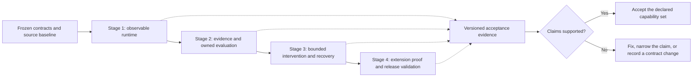
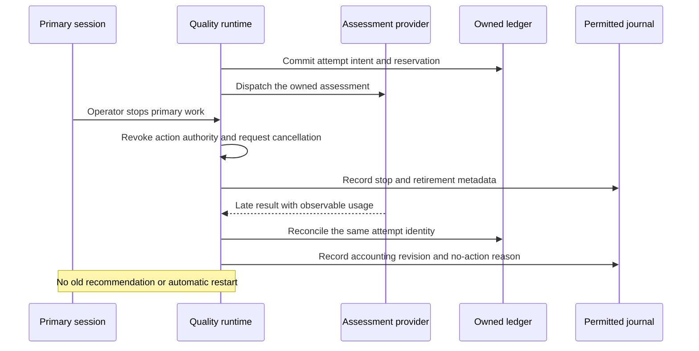

## Pi Quality Engine — Implementation, Testing, and Acceptance 🧪

**Document 4 of 4 · Architecture A1 · Contracts C1 · Observability O1 · Delivery baseline D1**

This document turns the preceding specifications into an implementable sequence of working increments and verifiable acceptance decisions. It defines what to build first, how to reuse inspected source material without inheriting another plugin's runtime, which behaviors require deterministic tests, which require a real Pi installation, and which require measurements with an actual assessment model.

The central acceptance question is not whether all planned files exist. It is whether a **standalone, observable feedback loop** works correctly: a trigger becomes due, the engine admits a check, the evaluator receives the declared evidence, owned requests are accounted for, a policy decides whether to intervene, and an admitted effect has an honest receipt. The same chain must remain understandable when something is missing, late, cancelled, expensive, or unavailable.

> [!important] The release-defining scenario
> A clean Pi installation, this package, an explicitly approved provider route, and ordinary project documents are sufficient. The engine performs a short assessment and a fresh Pi-session review, returns bounded feedback when authorized, and records its own context, requests, decisions, and costs. No Warden, OMP Advisor, Ribbons Advisor, pi-jev, or pi-subagents installation supplies a hidden part of that path.

### Authority and document boundaries 📑

| Document | Authoritative responsibility |
|---|---|
| [01 — Architecture and Decisions](01-architecture-and-decisions.md) | A1 ownership, invariants, standalone deployment, feedback-loop architecture, and source-reuse decisions. |
| [02 — Component Contracts and Configuration](02-component-contracts-and-configuration.md) | C1 interfaces, configuration keys and defaults, registration, permissions, component behavior, and named operations. |
| [03 — Observability and Data Policy](03-observability-and-data-policy.md) | O1 event payloads, data projection, accounting, checkpoints, journal storage, capture, retention, and diagnostic limitations. |
| **04 — Implementation, Testing, and Acceptance** | D1 development stages, executable proof obligations, evidence requirements, model-quality evaluation, and acceptance decisions. |

D1 does not introduce a second runtime configuration format, new public component kinds, or competing event names. Development task examples are repository tooling, not commands supplied by Pi; only the implemented commands in [BUILD.toolchain](../Инструкции/BUILD.toolchain.instructions.md) are active. Internal file organization may change without a contract revision; externally observable C1/O1 behavior may not.

“Must” identifies an acceptance requirement. “Should” identifies a default approach with a recorded, evidence-based exception. “May” identifies an optional implementation choice. A test plan is not a test result. A source-inspection observation is not proof that the local integration works.

### Reading map 🗺️

| Need | Start here |
|---|---|
| Understand delivery boundaries and avoid test-driven overengineering | [1–2](#section-1) |
| Reproduce dependencies and choose a small development toolchain | [3–4](#section-3) |
| Implement the four working stages | [5–9](#section-5) |
| Turn requirements into concrete behavior tests | [10–16](#section-10) |
| Verify privacy, accounting, storage, and restoration | [17–19](#section-17) |
| Measure model usefulness and runtime overhead | [20–21](#section-20) |
| Package, review evidence, and accept a release | [22–25](#section-22) |
| Locate exact donor files and immutable upstream references | [26](#section-26) |



<a id="section-1"></a>

## 1. Delivery objective and the meaning of done 🎯

### 1.1 A working increment crosses the real boundaries 🧭

Each stage delivers an executable vertical slice rather than a collection of disconnected interfaces. Even the first slice processes an actual observation, reaches an admission decision, runs a simple evaluator, and produces permitted diagnostic evidence. Later slices replace the external model boundary and add consequences; they do not replace the underlying runtime with a different implementation.

An increment is not accepted merely because its unit tests return green. A supported host capability must be demonstrated through the pinned Pi API. A supported storage behavior must be demonstrated on the chosen destination. A claim about assessment quality requires appropriately labeled cases, not a scripted response that already contains the expected finding.

The four stages share one code path and one set of production contracts. It is acceptable for an early stage to expose only an implemented subset, provided missing capabilities are explicitly unavailable. It is not acceptable to return fabricated success from an unimplemented adapter to make an end-to-end demonstration appear complete.

### 1.2 Three independent acceptance dimensions 📐

| Dimension | What it establishes | What it does not establish |
|---|---|---|
| **Mechanical correctness** | Registration, scheduling, context assembly, validation, accounting, delivery, and storage follow A1/C1/O1. | That a real model's engineering judgment is useful. |
| **Integration correctness** | The actual Pi host, selected provider route, packaged resources, and filesystem behave as the adapter reports. | Universal support for every provider, host mode, or platform. |
| **Judgment usefulness** | A particular check, prompt, context plan, model profile, and policy perform adequately on the declared task sample. | A guarantee that every future finding is true or that another model inherits the same calibration. |

A release report keeps these dimensions separate. A profile may be structurally supported but approved only for `observe` mode. A host mode may support logging and manual assessment but lack a demonstrated autonomous idle-start capability. These limitations must appear in capability/status reporting and the release notes, not only in an engineer's private notes.

### 1.3 Gate states and non-results 🚦

An acceptance obligation has one of five report states: `not-run`, `passed`, `failed`, `blocked`, or `not-applicable`. These are **D1 report states**, not new C1 run outcomes. A blocked live probe with no approved credentials is not passed. An intentionally unsupported optional external integration can be not applicable, with its public capability absent.

A mandatory standalone capability cannot be waived into existence. In particular, no-donor operation, time-triggered diagnosis, explicit context coverage, clean Pi reviewers, stop protection, own-cost accounting, and metadata-only Standard diagnostics are not optional release claims.

> [!warning] A clean exit code is not a complete acceptance decision
> A test command can finish successfully while a case is skipped, marked TODO, or never discovered. Acceptance checks the expected case inventory, actual executions, failures, and documented exclusions as well as the process result. Node's test runner explicitly distinguishes skipped and TODO work from ordinary failures.[^node-test]

### 1.4 What evidence may legitimately remain unknown 🔎

The product is allowed to report unknown provider charges, partial SDK attempt visibility, missing request-transport visibility, and uncertain outcomes after process loss. Those are modeled states, not implementation defects by definition. The defect is presenting them as known, free, complete, or safe to repeat.

D1 therefore evaluates honesty at each boundary. When an adapter cannot observe whether a message entered the next primary request, `queued` can be the correct receipt. When a provider does not expose hidden retries, the observed dispatch group is accounted for with partial visibility. No test is allowed to force a stronger claim than the integration can substantiate.

<a id="section-2"></a>

## 2. Production-led implementation and restrained testing 🪶

### 2.1 Requirements drive behavior; tests establish evidence 🧱

Production code implements the task and the agreed contracts. Tests exercise that implementation. The package must not contain execution branches based on fixture names, test filenames, a magic testing environment variable, or the expectation that a mock will be present.

A legitimate boundary is one the application has in ordinary operation: reading time, receiving host events, dispatching a model request, accessing a permitted file, committing a checkpoint, or writing a diagnostic record. Those boundaries can be controlled in a test. A wrapper introduced solely to expose a private method to a test has no equivalent operational responsibility and should be removed or avoided.

The same principle applies to the project code being evaluated. Production code must satisfy product requirements, not recognize a particular test's constants. Tests may reveal a defect, but changing the implementation just to pass an incorrectly specified test is not a valid fix. A failing assertion is adjudicated against A1/C1/O1 and the fixture's declared task, not against the convenience of the current expected output.

### 2.2 A small default toolchain 🧰

The initial repository should use its normal TypeScript compiler, one test runner, strict assertions, temporary directories, and a few focused fixture helpers. The recommended D1 starting point is `node:test` with `node:assert/strict`, executing compiled JavaScript. Node 22.19.0 provides these facilities without another test-runner dependency.[^node-test][^node-assert]

Compilation avoids making production or acceptance depend on an experimental type-stripping mode. Another established runner is a valid implementation choice if it materially simplifies the actual Pi integration; the decision belongs in the build record. There is no requirement to adopt every donor's test runner or internal harness.

Use one timer-control strategy for deterministic tests. Prefer an existing runtime clock/scheduler dependency or the selected runner's timer support. It must be capable of distinguishing monotonic elapsed time from wall time. Mocking `Date` alone does not prove the behavior of a scheduler based on a separate monotonic clock.

### 2.3 Assertions should survive harmless refactoring 🧪

Tests should assert admitted run identities and counts, permitted observations, receipts, unchanged project files, normalized usage, and causal diagnostic records. They should not prescribe the number of private helper calls, an arbitrary class name, object allocation order, or the exact wording of a valid model explanation.

Exact assertions are appropriate for fixed contracts: a C1 enum, a public default, an O1 field name, the byte limit, a synthetic monetary calculation, or a machine-readable schema. Structural assertions are usually better for generated records with IDs and timestamps. A small golden file is useful for a stable public serialization or feedback template; a giant snapshot of an entire runtime is not the default test strategy.

Tests must not erase the very differences under investigation. Normalizing generated IDs in a presentation snapshot is acceptable; normalizing away duplicate event IDs, reordered actions, lost parent links, or a changed source revision would invalidate the evidence.

### 2.4 Helpers are justified by repetition, not by possibility 🔧

| Useful small helper | Why it exists | Excess to avoid |
|---|---|---|
| Temporary project builder | Creates a real disposable repository and the same few source documents. | A custom virtual filesystem that never exercises disk behavior. |
| Deferred response/controller | Holds and releases one real async boundary to reproduce a race. | A second implementation of the provider retry engine. |
| Clock driver | Advances the actual scheduler's time dependency deterministically. | A parallel simulator with its own scheduling rules. |
| Permitted-record collector | Receives the real post-projection sink output for assertions. | A test logger that bypasses projection and therefore never proves privacy. |
| Scripted provider fixture | Returns typed responses and tool calls through a normal supported model boundary. | A production `testMode` route or a fake Pi session class. |
| Independent contribution package | Exercises registration and component replacement across package roots. | A vendor-specific branch in the core that recognizes the fixture. |

A helper is added only when its responsibility is clear and it removes repeated setup or exposes a real boundary. The first implementation does not need property-based generators, exhaustive interleaving exploration, mutation testing, or an elaborate evaluation platform to satisfy the core cases. Such tools may be introduced later for a reproduced defect or measured coverage need.

### 2.5 Defect handling without weakening the contract 🛠️

When a test fails, first determine whether the failure is in production behavior, the host adapter's assumptions, the test oracle, or the contract itself. A mistaken fixture is corrected with an explanation and its revision recorded. A contradictory contract is resolved in the authoritative document before changing expected behavior.

Do not reduce privacy, discard unknown charges, broaden model permissions, or mark a source optional merely to produce a passing test. Do not build extra error-handling layers around every function. Catch and classify failures where the external or component boundary actually requires it, then preserve their meaning through the result path.

The final implementation review asks whether each new abstraction owns a real lifecycle, integration, repeated decision, or extension contract. A single-use function is not automatically wrong; an unexplained framework is not automatically justified by the word “testable.”

<a id="section-3"></a>

## 3. Frozen inputs, source acquisition, and build provenance 📌

### 3.1 Preserve the agreed baseline 🔒

The source baseline remains **12 October 2026**, inherited from Documents 1–3. New development must not silently replace pinned donor files with current `main` or treat a blob hash as a repository commit. A source manifest version is not proof that an identical npm release artifact exists.

| ID | Repository | Source manifest version | Frozen commit |
|---|---|---|---|
| B1 | `earendil-works/pi` | Coding Agent `1.1.0` | `c661bc574f9e9713cc2af567fc1ac00621377a0c` |
| B2 | `DevMortimer/pi-warden` | `1.6.0` | `74989d5adf091c9cb5651450917d9f110e3fba2d` |
| B3 | `riposta/pi-jev` | `0.2.3` | `7c1ab8c82b66d845eda0f5cd111f858e9aed0cd1` |
| B4 | `Scott-Meyer/pi-omp-advisor` | `0.7.2` | `95917211d150ff95484fc3bb85462656bf9ebdfb` |
| B5 | `ribbons-digital/pi-advisor` | `0.5.0` | `34a148e7993bf6f5661e0bdc92b4391ec072e8db` |
| B6 | `pinojs/pino` | `10.4.0` | `b29dbe97820630e7128e464c50263b427965ec99` |
| B7 | `iccicci/rotating-file-stream` | `3.2.10` | `f00ed46c57fc25e9ac4c535f32134338f84cd9c4` |
| B8 | `storytold/photocraft` | Workspace `0.7.0` | `78c611007be069535d76813b339461bc2d75114e` |

B8 is command-oriented design inspiration, not a Rust dependency or a requirement to build an editor. B2–B5 are inspected donors, not required active plugins. B6/B7 remain implementation candidates behind the sink; their acceptance is conditional on O1 behavior.

A test report records the actual Pi package version/build reference used. If a source checkout is used, its commit is recorded. If an npm package is used, retain its version, integrity, and relationship to the baseline. Unknown equivalence is labeled unknown; it is not filled in from the version string.

### 3.2 Reproduce a donor checkout without executing it 📂

The following commands demonstrate acquisition of the frozen Warden source in a new disposable destination. They download and select source; they do not install its dependencies, enable its extension, or authorize its scripts. Each command is separate for deliberate execution.

```sh
git clone --no-checkout https://github.com/DevMortimer/pi-warden.git donor-pi-warden
```

```sh
git -C donor-pi-warden checkout --detach 74989d5adf091c9cb5651450917d9f110e3fba2d
```

```sh
git -C donor-pi-warden rev-parse HEAD
```

The printed commit must match B2 exactly. The same pattern applies to another donor with its own repository and SHA. A checkout that cannot resolve the pin blocks that reuse decision; the acquisition script must not fall back to a branch, a nearby tag, or an arbitrary archive.

Donor directories should be outside the observed fixture project and outside the publishable package. Building an upstream donor is unnecessary when only its source is being inspected. A test of a selected library dependency may require installing that library, but never requires running all donor plugins together.

### 3.3 The project lockfile describes actual dependencies 🧾

The application lockfile, compiler version, package-manager version, Node runtime, and host SDK declarations form the build record. Use the repository's chosen lockfile consistently. `npm ci` is appropriate for an npm-managed reproducible installation because it uses the lockfile and fails on incompatible manifest/lock state rather than silently updating it.[^npm-ci]

The pinned Pi package documentation distinguishes host-provided packages from ordinary extension dependencies. It instructs extensions to declare the supplied Pi packages as peers rather than bundling physical copies that can create duplicate registries/classes. A package-installation test must verify this boundary instead of relying on a development workspace's accidental module resolution.[^pi-packages]

A development-only exact Pi baseline can be installed in the isolated verification environment. The released extension must still use the host's supported package mapping. A separate installed Quality contribution must not depend on resolving an undeclared import from the engine's dependency tree.

### 3.4 Provenance accompanies each actual import ⚖️

For copied or adapted code, retain the upstream license/copyright notices and record the source repository, frozen commit, exact file/symbol, local destination, modifications, and associated behavior tests. A tiny `provenance.json` or equivalent section in the repository's existing notices is sufficient; this is not a requirement for a new provenance service.

A library dependency, a source-level adaptation, and an independently implemented idea are distinct reuse modes. The implementation record must name the actual mode. Prompt text copied from a donor is source material too. OMP's upstream ancestry and attribution files require attention when its derived portions are reused; MIT licensing does not make those notices disappear.[^omp-provenance]

Before release, inspect the licenses of the actual distributed files and transitive dependencies. The source pins in this specification do not themselves prove that a final tarball includes only the inspected material.

### 3.5 Environment record and scope of support 🖥️

Each acceptance run records OS version, architecture, Node version, package manager/version, Pi version/build, engine commit, lockfile digest, configuration revision, relevant filesystem type, and host mode. Provider tests additionally record actual model identity and available revision metadata.

The initial portability target is Windows and at least one POSIX environment. macOS support is claimed only after the required macOS tests run. Network filesystems, multiple machines writing the same journal, and unverified host modes are not silently covered by a local filesystem result. A release may explicitly narrow platform support, but must not describe untested behavior as portable.

<a id="section-4"></a>

## 4. Test layers and repository execution surface 🧰

### 4.1 Four layers with different purposes 🪜

| Layer | Real code exercised | Controlled boundary | Typical evidence |
|---|---|---|---|
| Contract/logic | Parsers, schemas, triggers, policies, normalization, projections. | Time readings and small input values. | Deterministic assertions and structured output. |
| Runtime integration | Actual orchestrator, files, checkpoint, journal, queues, cancellation. | Provider responses, sink delays, selected filesystem failures. | Real journal segments, receipts, before/after filesystem state. |
| Pi/package integration | Actual Pi SDK or CLI, installed extension, independent package, clean reviewer. | A registered scripted model and disposable tools where needed. | Host events, observed next model input, package inventory, no-donor trace. |
| Live assessment/in-use validation | Approved real provider and selected engineering profile. | Fixed task corpus and explicit experiment plan. | Usage visibility, model conclusions, human labels, task outcomes, measured cost/latency. |

The lower layers should run without cloud credentials or public provider traffic. A scripted provider is an ordinary test implementation of a real provider boundary, not a claim about real model quality. Live work is opt-in and cannot be hidden in installation hooks or a normal test command.

### 4.2 A compact command set 📋

The implementation repository should expose the following development tasks. Their names are proposed D1 tooling and do not create new `/quality` operations.

| Task | Contract |
|---|---|
| `npm run build` | Build the distributable code and copy required resources/schemas. No provider calls. |
| `npm run check` | Static checks plus the ordinary deterministic test suite; excludes billable/live experiments. |
| `npm test` | Run deterministic contract/runtime tests through the actual implementation. |
| `npm run test:pi` | Run real Pi host integration with isolated configuration and scripted provider fixtures. |
| `npm run test:package` | Pack, inspect, and install the candidate in a clean package environment, then exercise the extension path. |
| `npm run test:live -- ...` | Explicitly approved route/quality experiments with a recorded plan and spending bounds. |
| `npm run bench -- ...` | Named local workloads and measurement reports; no model traffic unless the plan explicitly authorizes it. |

`check` can invoke the other deterministic tasks through a small portable Node script or package scripts. It must not hide a failed subcommand behind a successful final `echo`, a permissive pipeline, or an ignored exit code. If linting is used, it follows the repository's normal style rules rather than adding arbitrary code-shape constraints solely to raise a score.

For routine development after those scripts exist:

```sh
npm ci
```

```sh
npm run check
```

```sh
npm run test:pi
```

```sh
npm run test:package
```

These commands are intended for the future implementation repository; the Markdown document set by itself is not an executable package.

### 4.3 Keep test environments genuinely isolated 🔐

The integration driver creates a temporary Pi agent directory, session/state directories, test project, and explicit environment. It removes inherited provider keys and unrelated service credentials from the child environment unless a live plan explicitly supplies the selected route. Tests never edit the operator's real Pi settings or run against a personal working tree.

Use a temporary bare-Pi package list containing only the candidate and, where required, the independent fixture contribution. Record the loaded component/package inventory. A no-donor test must fail when an unapproved donor appears, even if the rest of the scenario succeeds.

Dependency acquisition is a separate setup step with normal package-manager networking. The ordinary test run itself must not contact a public model service. A loopback scripted endpoint or supported in-process provider fixture is acceptable and must be clearly identified as such.

### 4.4 Production resources must be tested as shipped 📦

The built package must contain the C1 built-in prompt files, question set, result schema, feedback resource, configuration schema, event schemas, and extension entry declared in its manifest. Tests that read resources from `src/` while the release omits them prove nothing about the installed package.

At least one deterministic test imports the built artifact rather than the TypeScript source. At least one Pi integration resolves resources through the actual package root after packing. The same rule applies to donor notices and static examples intended to ship.

The exact script implementation and test filenames are internal choices. There is no requirement for one file, class, or process per acceptance ID.

<a id="section-5"></a>

## 5. Four-stage delivery plan and shared exit rules 🗺️

### 5.1 Stage map 📍

| Stage | Working result | Irreplaceable proof |
|---|---|---|
| **S1 — Observable standalone runtime** | Configuration, registry, observations, clocks, bounded admission, simple evaluation, permitted journal, and essential state ownership. | A time-triggered check runs without another primary tool event; the journal explains the decision; no paid work is needed. |
| **S2 — Real evidence and owned evaluators** | Original project context, deterministic/direct model evaluation, and clean Pi-session review with owned accounting. | Bare Pi performs both a direct assessment and an independent reviewer without donor plugins or unmanaged transcripts. |
| **S3 — Bounded feedback and recovery** | Policies, explicit grants, delivery receipts, expert escalation through `check.run`, freshness, stop protection, and recovery. | A correct finding reaches the right primary boundary once, while stale/stopped/uncertain work does not regain authority. |
| **S4 — Public extensibility and release validation** | Independent contribution proof, complete advertised C1/O1 behavior, semantic evaluation, performance evidence, and installable artifact. | The package works outside its development workspace and supports only the behaviors actually demonstrated. |

Baseline acquisition and repository setup are entry work, not a fifth product stage. Integration probes for uncertain host or library behavior start during S1/S2 because they can affect the design; they are not postponed until final packaging.

### 5.2 Shared stage entry conditions 🧷

Before starting a stage, the implementation identifies the applicable A1/C1/O1 sections, inherited defaults, expected capabilities, and open integration gates. It records the candidate source/build identity and a bounded test plan. A stage may begin while an independent optional experiment remains blocked, but no dependent feature is declared available before its gate passes.

The previous stage's accepted behavior remains part of every later regression run. A later feature cannot quietly reset counters, change data disclosure, or depend on a donor that was absent in the earlier standalone proof.

### 5.3 Shared stage exit conditions ✅

A stage exits only when its required scenarios have actually run on the implementation, the relevant journal/receipt evidence is available, failed cases are resolved or the capability is explicitly unavailable, and the implementation matches the contract rather than a weakened fixture.

The acceptance record identifies the exact commit and artifact tested, commands, environment, executed case IDs, exclusions, deviations, and known limitations. It links to a small evidence bundle. It does not copy source bodies or live credentials into an ordinary Standard-mode journal merely to make the report easier to read.

A commit after acceptance changes the candidate. The new candidate needs the affected regression evidence; an earlier green report is not evidence for untested edits. Documentation-only changes can be classified separately when they genuinely do not alter packaged prompts, schemas, defaults, or code.

### 5.4 Stage reports stay small and factual 🧾

One concise stage summary plus machine-readable results and selected permitted artifacts is enough. The four design documents are not duplicated into four new specifications for every stage. Logs and fixture outputs are generated evidence, not another source of requirements.

The report should answer: what changed; which contract behavior is now implemented; how it was tested; what was not tested; what remains unavailable; and whether the stage is accepted. “All done” without these facts is not a delivery record.

<a id="section-6"></a>

## 6. Stage S1 — Observable standalone runtime ⏱️

### 6.1 Scope and construction order 🧰

S1 establishes the execution path before cloud spending is introduced. Implement the package entry, exact C1 configuration parser/resolution, namespaced acknowledged registry, host observation adapter, bounded runtime view, trigger instances, queue admission, and one simple deterministic check. Implement the O1 metadata projector, bounded recent history, initial JSONL journal, and protected ownership/checkpoint foundation alongside them.

Start with the count trigger and at least one actual time-driven trigger. A normal monotonic clock drives production. The deterministic tests can advance the same scheduler's clock boundary. One real-clock smoke test verifies that the adapter arms a timer and processes it while no further primary event arrives.

The first contribution fixture supplies a custom trigger and a small context or sink implementation through the C1 registry. This prevents the core from becoming dependent on a private built-in execution path before extensibility is tested.

### 6.2 What must work without configuration 📴

A cold installation with no Quality configuration remains inspectable and starts no paid evaluation. Root `enabled` remains false and `mode` remains observe by default. Empty model/profile/action grants are not inferred from the primary session's model or credentials.

The package can list its built-in capabilities and explain missing setup. Registering a component, discovering a prompt file, opening status, or parsing a source reference does not start provider work. Invalid configuration leaves cold startup inactive; failed explicit apply leaves the previously accepted configuration unchanged.

### 6.3 First end-to-end demonstration 🔄

In a disposable Pi project, explicitly configure an enabled observation-only deterministic check. Deliver five identified primary top-level tool completions. The configured trigger produces one due intent, the runtime admits it, context is assembled from the test project/activity, and the deterministic evaluator returns its scoped outcome.

Next, establish expected unfinished work, advance the chosen inactivity/progress deadline without another tool completion, and demonstrate another diagnostic assessment. The observation is a reason to inspect, not an instruction to restart Pi. Repeat with a known active wait and with an operator stop; the decision records must distinguish these states.

The Standard journal must show the selected trigger, admission, run, context metadata, outcome, and no-action decision without retaining the fixture's source or command body. Functional identity must remain stable across size rotation and observer pause/resume.

### 6.4 S1 acceptance matrix 📋

| Obligation | Required result | Evidence |
|---|---|---|
| Closed configuration and exact defaults | Unknown core keys, invalid primitive types, and conflicting file formats are rejected; C1 defaults remain unchanged. | Parser assertions and effective configuration provenance. |
| Registration in either load order | Subscribe/query registration succeeds once; delayed readiness blocks dependent checks until acknowledged. | Component lifecycle events and test results. |
| Origin and counting | Five primary completions count once each; nested/default-excluded, reviewer, and engine activity do not inflate the counter. | Accepted observation IDs and admitted-run count. |
| Real time-driven eligibility | One due check occurs without a new completed-tool event. | Real-clock host trace plus deterministic deadline test. |
| Coalescing and bounded queue | Coincident reasons preserve their identities but do not create duplicate runs; configured bounds hold. | Admission records and queue/capacity observations. |
| Stop and generation ownership | Observer resume/reload does not clear operator stop; retired callbacks cannot dispatch. | Status and rejected/record-only outcomes. |
| Metadata-only diagnostics | Sentinel source/argument/response content is absent from every engine diagnostic destination. | Automated scans and parsed O1 records. |
| Journal/checkpoint distinction | Diagnostic failure does not erase stop/control state; checkpoint failure cannot be hidden as safe autonomy. | Failure fixture and intact primary control path. |
| Independent contribution | A separate fixture package affects a real check and disposes cleanly. | Package inventory and lifecycle records. |

S1 can use controlled request receipts to exercise accounting structures without claiming live-provider integration. No stage proof requires spending money at this point.

### 6.5 Storage integration probes begin now 🗄️

Test the actual proposed Pino/destination arrangement early. Verify that the stored envelope is O1 rather than O1 plus uncontrolled Pino fields, that profile selection is not defeated by a second logger threshold, and that downstream completion is observed when closing.

Also probe exact elapsed-time rotation with an arbitrary permitted millisecond interval. B7's textual/calendar interval interface is not assumed to meet that contract. If the candidate cannot satisfy O1 through supported public APIs, record the failure and choose a simpler conforming destination behind the same sink interface. Private-method access, silent rounding to midnight, and a new public configuration surface are not acceptable fixes.[^pino-api][^rfs-source]

Full retention, capture, and cross-platform hardening may be completed in later stages, but the library decision must not remain an unexamined dependency on the eve of release.

### 6.6 S1 exit package 📦

The S1 bundle contains the candidate commit, build/lock identity, deterministic test results, one no-content journal from the real-clock demonstration, effective C1 configuration, the independent contribution's package identity, and a short list of unresolved host/storage gates. No model-performance claim is made.

### 6.7 Accepted S1 local preview — 2026-10-14 🧾

K01–K03 now close the bounded S1 stage at implementation **`035aaa3fe767c62cd16b962cf06012e2bb37f480`**, package `0.1.0`, unsigned annotated local `v0.1.0` object **`de3711bec7232101f6cf44929fd17ab412447fc0`**. The [S1 stage summary](../verification/K03/reviewer/20261014202738294-p53924-b2973cbe/S1-stage-summary.md), [sealed implementation gate](../verification/K03/reviewer/20261014202738294-p53924-b2973cbe/implementation-gate.json), [exact-commit gate](../verification/K03/reviewer/20261014202738294-p53924-b2973cbe/committed-verification/verification.json), [all payload binding](../verification/K03/reviewer/20261014202738294-p53924-b2973cbe/committed-verification/package-byte-binding.json) and [tag readback](../verification/K03/reviewer/20261014202738294-p53924-b2973cbe/tag-readback.json) are retained local ignored evidence, not publication.

Working and exact `git show` source gates each complete the literal full check: **70 unit /25 actual Pi-host definitions /one installed consumer /routing exit0**, no failures/cancellations/skips/TODO. The final release-only repair proves exactly seven version literals in five files; established independent **113/113** behavior/correction witnesses are reused through that explicit invariant, not advertised as rerun on the release bytes. Git normalized 32 of the 46 extracted source paths; all 34 compiled files and 38 tar payloads bind to the tested commit. Accepted tar SHA-256: **`d9c2c27cfa0bb0c8ca2cac6662b88b69bbdb15c09561c6d6095a6568fd127bb7`**. Precommit/committed tar differs only by shipped `package.json` CRLF→LF.

Actual primary control is `0 → 0 → 1 → 1 → 2`, owned dispatch/effects zero and primary usable after retirement. Each phase preserves 202 actual older-stage originals and 202 sandbox copies around the real confined routing producer; each scans 4,326 projected O1 readbacks with zero canaries/captureRefs. Earlier sealed counterexamples and corrected protected-state/storage/source/generation witnesses remain dated immutable records. A 150 ms actual timer, one run, zero new tool completions and closed journal records lateness 218 ms working /224 ms exact commit: a modest baseline, not a performance guarantee.

This accepts initial observable eligibility, protected Stop/authorization ownership, bounded lifecycle/admission/contributions and native Windows metadata storage. Public history-evidence selection supports only `core.history`; unsupported scopes remain honestly unavailable. No paid/live-provider route, financial model ledger, original source/Git collection, feedback/action, capture/export, universal TUI/RPC/POSIX/ACL/power-loss or live usefulness claim is made. Instruction/README/workbook synchronization is a later separate documentation commit and never moves the tag. Next is [K04](08-development-checkpoints-and-release-checklists.md#k04) /[S2](#section-7), not implementation or paid-trial authorization from this report.

<a id="section-7"></a>

## 7. Stage S2 — Original evidence and engine-owned evaluation 📚

### 7.1 Add evidence before adding autonomous consequences 🧭

Implement the C1 context providers and prompt resources needed by the initial profiles. Source paths resolve relative to their declarations, project globs use the explicit project root, and mandatory requirement versions remain pinned to the authorized episode. The context assembler records configured, retrieved, selected, and final-observable request stages.

Build the model service and its protected attempt ledger before making a real paid request. Add `core.classifier` and `core.chat` through approved profiles, then `core.pi-session` through the same ownership services. The first live route probe stays in observe mode. No policy feedback or automatic expert escalation is needed to prove evaluation behavior at this stage.

### 7.2 Evidence preservation is an acceptance condition 🌳

The change collector must demonstrate that it does not alter the real Git index, working tree, stash list, or repository configuration. A clean tracked baseline, a dirty tracked file, a staged hunk, an existing untracked file, and a file created during the episode are separate cases.

Later commits must remain part of episode-relative evidence. A `git commit` does not make an observed change vanish. Shared-worktree edits remain repository evidence with attribution limits. If the baseline did not establish the prior contents or absence of a file, coverage is partial rather than reconstructed from a convenient but incorrect HEAD diff.

The Warden snapshot implementation is inspected as a donor reference, but C1 specifically rejects its broad temporary-index/tree persistence as the default collector. A test must detect accidental `git add`/tree-object writes as well as visible working-tree mutation.[^warden-turn]

### 7.3 Direct request and structured result proof 🧪

A scripted route validates the exact approved model profile, input capabilities, final request manifest, result schema, evidence references, and attempt ownership. Follow it with an explicitly authorized real route probe to establish which usage and request boundaries the actual SDK/provider exposes.

Valid no-finding, supported finding, suspected finding, incomplete evidence, conflicting requirements, malformed result, timeout, and unavailable route are distinct cases. A returned boolean or score cannot manufacture an evidence ID. A failed format validation remains a failed assessment even when its provider usage is fully known.

The default repair count is zero. A separate configured single repair case proves that repair is billed, bounded, and cannot add missing evidence or switch providers. A context/prompt provider that performs model-assisted preparation uses the same approved service and parent budget; it does not receive a hidden free-request path.

### 7.4 Clean Pi reviewers are part of S2, not a later optional integration 🤖

Create an actual SDK session with explicit model profile, in-memory session storage, no ambient extension/skill/context discovery, and the configured tool list. The official full-control example demonstrates the independent session/resource boundary, but the actual Quality configuration and wrappers must be exercised by the test.[^pi-full]

A registered scripted provider first asks to read a permitted file, receives the real wrapped tool result, and then submits a structured assessment. The test inspects the next reviewer request and confirms that the permitted evidence actually entered it. A configured internal structured-result tool must survive the allowlist; otherwise the reviewer may investigate but be unable to return its answer.

The fixture installs a harmless ambient extension that records activation. The observed primary may load it where the test intends, but the owned reviewer must not inherit it. The observer itself must not recursively initialize inside the reviewer. The test inspects disk and confirms that no unfiltered reviewer transcript appeared.

### 7.5 S2 acceptance matrix 📋

| Obligation | Required result | Evidence |
|---|---|---|
| Original source use | Existing documents are read through configured references, not copied into a new rule database. | Context/source/manifest records and unchanged documents. |
| Mandatory coverage | Missing, denied, over-cap, or changed-during-read required material prevents an unqualified clean review. | Assessment coverage and zero inappropriate feedback proposals. |
| Read-only change collection | Dirty/staged/untracked starting state survives; later commits remain visible. | Git/index/tree-state assertions before and after collection. |
| Direct evaluator contract | One approved request produces a validated result with exact operational/coverage distinctions. | Final-observable manifest, attempt receipt, result validation. |
| Clean Pi-session review | A real Pi reviewer reads only approved resources, returns structure, and is disposed. | Reviewer/tool/model events, resource inventory, absence of transcript files. |
| Owned accounting | Direct requests, preparation, repair, and every owned reviewer request count once. | Attempt ledger and O1 normalization assertions. |
| Uncertain usage | Missing/zero-filled SDK usage and hidden attempts remain partial or unknown. | Status/summary coverage and budget admission behavior. |
| No donor requirement | The candidate works with no donor plugin installed. | Clean package list and successful direct/reviewer runs. |
| Bounded cancellation | A timed-out non-cooperative operation loses action authority without becoming a free capacity slot. | Retired/unsettled state and late-usage reconciliation. |

A completed S2 implementation can be useful in observation-only mode. It must not imply that automatic correction profiles are already calibrated or that every provider route is supported.

### 7.6 S2 exit package 📦

Retain permitted evidence for one direct assessment, one multi-request clean reviewer, one missing-source result, and one timeout/late settlement. Include the actual route visibility report and the Git-preservation test. Live traffic, when used, needs a preapproved plan and explicitly reported spend; absence of live authorization remains a blocked route gate, not a disguised pass.

### 7.7 Accepted K04 increment — 2026-10-16 🧾

K04 original-source/Git custody, approved direct assessment and protected owned
accounting are independently accepted on working candidate57 `d3aca697…` by Astra;
[the final decision](../verification/K04/reviewer/input-capability-20261016T010630Z-f1689a96/FINAL.md)
preserves the exact original33/36/56 qualification stack and honest unrun/unknown limits.
Sol's [exact committed/EOL gate](../verification/K04/reviewer/local-release-20261016T014116Z-1c6a6ecb/implementation-gate.json)
binds implementation `28960100016fbe85729159413a1b6e977c2cdac2` and annotated local
`v0.2.0`:115 unit,26 host, routing and installed consumer pass;42 compiled files,
50 package payloads and the entire tested tarball equal the accepted artifact.
The initial unit114/115 environment failure remains recorded; only owned Git-discovery
isolation changed before the corrected unit run. No production/test assertion changed.

This is **not full S2 exit**, clean Pi-reviewer acceptance or live usefulness.
Polza/Jev, OpenRouter/Jev and local d3-mini Q8 remain individually UNVERIFIED.
Follow [K04](08-development-checkpoints-and-release-checklists.md#k04) for exact identities
and [K05](08-development-checkpoints-and-release-checklists.md#k05) for the existing next
checkpoint. No K05 execution, new live authority, push or publication follows from this note.

<a id="section-8"></a>

## 8. Stage S3 — Bounded intervention, escalation, and recovery 🚦

### 8.1 Enable consequences only after their boundaries exist 🧷

Implement `core.record-only`, `core.engineering`, `core.feedback`, and `core.request-check` through the C1 policy/action contracts. Admission remains the final authority. The policy returns proposals; the action performs an already admitted effect; the runtime owns permission, freshness, deduplication, spending, and generation validity.

Keep root observe mode in the initial integration run. Demonstrate that a suspected finding is recorded without automatically launching its expert target. Then explicitly grant advise mode and the required action IDs, rerun the scenario, and demonstrate the admitted consequence. A defined evaluator or policy target alone is not a permission grant.

### 8.2 Test the host's actual delivery boundary 📬

A scripted primary model/tool cycle allows precise observation of message inclusion. While a primary tool is held, issue an admissible steering action. Confirm the strongest state the actual host reports, release the tool, and inspect the subsequent primary model request where supported.

Do not assert immediate command interruption. Steering, follow-up, and abort are different host operations. The frozen Pi documentation identifies actionable `turn_end`/`agent_before_settle` boundaries and notification-only `agent_settled`; the adapter must exercise the correct API instead of relying on a callback's name.[^pi-events][^pi-sdk]

For natural-idle continuation, both the operator grant and policy option must permit it, current evidence must establish outstanding authorized work, and the episode allowance must remain. A pending dependency, unknown task authority, explicit stop, or already spent continuation allowance prevents the wake.

### 8.3 Expert escalation uses the existing evaluator path 🔎

A preliminary suspected issue requests a configured expert check. That check uses the S2 clean Pi-session evaluator; there is no separate subagent-launch subsystem. The expert receives the suspicion as a hypothesis and can reject it, narrow it, or return a supported finding.

A scheduled deep review and an equivalent policy-requested review can coalesce when their criteria, scope, and required evidence match. Static escalation cycles are rejected during configuration apply; dynamic contributed routes are still bounded by depth and per-episode limits.

The expert's own reads and model calls remain engine-owned. A future external executor adapter is tested separately as a handoff and does not change the standalone path.

### 8.4 Recovery tests precede acceptance of autonomy 🧯

Exercise a user stop while assessment is active, a new task while a reviewer reads, a relevant file change before action dispatch, a lost action acknowledgment, and process loss around reservation/dispatch/checkpoint boundaries. The same runtime must preserve uncertainty without replaying old paid work or effects.

A late usage receipt can improve the session ledger. It cannot revive the retired result's authority. A new runtime generation must reject old registry endpoints and stale host contexts. Branch navigation changes evidence eligibility but not money already spent.

A journal failure remains diagnostic degradation. A control checkpoint failure prevents new paid/effectful autonomy that depends on persisting intent. The primary remains usable in both cases. The engine must not ask the primary to modify project code to fix the observer's log directory.

### 8.5 S3 acceptance matrix 📋

| Obligation | Required result | Evidence |
|---|---|---|
| Observe/advise separation | Observe performs permitted assessment but suppresses feedback and policy escalation. | Policy/action records and request counts. |
| Supported feedback | Current supported finding reaches the primary through the normal admitted path. | Action intent, receipt, and observable request inclusion where available. |
| No automatic authority | Model interpretation never clears operator stop, adds grants, or changes the approved route. | Last-moment rejection records and unchanged authority state. |
| Freshness | Relevant changes suppress stale correction; unrelated changes do not arbitrarily invalidate a narrow finding. | Dependency comparison and final dispatch decision. |
| Finite escalation | One suspected issue produces at most the admitted expert work; no recursive reviewer tree. | Parent/root run linkage, shared budgets, component inventory. |
| Duplicate protection | Rewording or a lost acknowledgment does not create a blind repeat. | Stable effect identity and reconciliation result. |
| Stop/reload behavior | Timers, observer resume, and old callbacks cannot restart an intentionally stopped primary. | Real Pi lifecycle trace and deterministic race cases. |
| Restoration honesty | Missing/corrupt checkpoint or uncertain dispatch does not reset spend or declare a safe retry. | Persisted state and restart outcomes. |
| O1 controls | All advertised detail/capture/storage settings preserve functional accounting and permissions. | O-series test results and configuration comparison. |

### 8.6 S3 exit package 📦

The bundle must include an authorized short-check-to-expert-to-feedback trace, an expert rejection of an incorrect preliminary suspicion, an operator-stop trace, and a crash-window recovery trace. Every action has a strongest demonstrated receipt, not a blanket success label. The report states whether the host-mode idle-start gate has passed and which modes remain observational only.

**Accepted local S3 exit:** Astra314 accepted K07's complete original33 at their
qualified scopes (32 PASS_SCOPED, X.04 downstream representation). Sol315 closed
that local representation/tag step at implementation
`cea8c878ee2955c0b8115fd5ada508baef4a8a8b` / `v0.5.0`.
See [the candidate-bound decision and evidence index](08-development-checkpoints-and-release-checklists.md#k07).
Exact committed build/common/package and affected EOL checks are qualification,
not a second acceptance campaign. The retained three crash windows prove actual
child termination, queued receipt identity and receiver counts0/1/1, not completed
input inclusion or remote exactly-once. Native checkpoint failures remain failed
operations; conservative liabilities/Stop and dependent-admission denial qualify
the permitted degradation, not error-free I/O. Native natural-idle evidence remains
K06's inherited mode scope, not TUI/RPC certification. Installed loading/resources/
K05 execution and identical tar do not establish new installed-K07 feedback or
live judgment/usefulness; S4 and route-specific finite allowances remain separate.

<a id="section-9"></a>

## 9. Stage S4 — Extensibility, usefulness, and a release candidate 📦

### 9.1 Complete the advertised contract, not every imagined feature 🧭

S4 closes the advertised C1/O1 behavior: independently installed components, all supported configuration examples, event-schema coverage, journal rotation/retention/capture, local inspection/export, and the capability map for host modes and platforms.

The stage does not require optional external adapters, persistent reviewer pools, automated browser acquisition, or model self-training. Those must remain absent capabilities rather than empty implementations. Conversely, a built-in feature explicitly advertised as C1/O1-complete cannot be deferred invisibly.

The strict standalone release requires the built-in count/time triggers, original document context, direct assessment, fresh Pi reviewer, policy feedback/escalation, and default Standard metadata-only observability. The package can ship with automatic activation off, as C1 requires, while still proving that these capabilities function when deliberately configured.

### 9.2 Prove recombination across a package boundary 🧩

Install a small independent contribution using its own module root. It must not import engine internals or depend on a shared workspace hoist. In one check, combine its trigger/context with a built-in evaluator and policy. In another, combine built-in observation/timing with a contributed evaluator or action and sink.

The fixture exercises late availability, readiness failure, cancellation, disposal, and a replacement generation. Its notes appear through `DiagnosticWriter`, its outputs pass normal validation, and its sink receives only projected records. The core must not contain the fixture's vendor ID in routing logic.

At least one check uses a prompt resource supplied by a package without requiring additional executable code for the prompt. Another replaces an assessment resource through ordinary configuration while preserving original project requirement sources.

### 9.3 Evaluate engineering judgment as a separate release claim 🎯

Run the bounded semantic evaluation described in section 20 on the exact selected prompt/context/model/policy revisions. Include justified near-misses and deliberately insufficient evidence. Do not score a model only on obvious violations.

The result determines whether the corresponding profile is recommended for observation, investigation, or corrective feedback. A failed profile-quality gate does not justify weakening A1/C1/O1. It means the profile needs improvement, narrower claims, or observation-only use.

Evaluate closed-loop usefulness separately from one-shot classification. A correct suggestion can still cost more work than it saves, and a superficially efficient intervention can cause a regression. The report must include false interventions, resolved findings, unwanted wakes, time, and owned observer spend.

### 9.4 Package and portability proof 🖥️

Pack the exact candidate and test from its installed/extracted artifact, not from a source checkout that contributes undeclared files. Verify resources, peer boundaries, licenses, no secret fixtures, clean settings, and actual extension loading. `npm pack --json` provides a machine-readable packing result for inspection; its output is not a replacement for running the installed artifact.[^npm-pack]

Run the chosen storage path on native Windows and a POSIX environment. Test supported Pi modes independently. SDK success is not automatically TUI Escape behavior, and a Linux rename test does not certify Windows replacement or ACL behavior.

### 9.5 S4 acceptance matrix 📋

| Area | Required decision |
|---|---|
| Public components | All shipped roles have contract tests; the independent package demonstrates real recombination, not registration alone. |
| Configuration/resources | Shipped examples validate, default activation remains off, and packaged resource references resolve without source-tree assistance. |
| Observability | Applicable O-01–O-30 obligations pass; optional unsupported destinations/capabilities are explicitly absent. |
| Host/platform | A recorded matrix identifies actual supported modes and operating systems. No capability is inferred from a version string. |
| Model routes | Approved route probes establish actual input/tool/usage behavior; missing live evidence remains visible. |
| Model usefulness | Each recommended automatic profile has a frozen evaluation plan and passing or explicitly limited results. |
| Performance | Predeclared workload-specific limits are met using the actual logger, reviewer activity, and rotation path. |
| Distribution | The tested artifact has a recorded digest, dependency/notice inventory, and no unapproved generated content. |
| Release decision | No unresolved critical contract violation is hidden by skip/TODO status or a passing summary command. |

### 9.6 Final release record 🧾

The final record joins the four stage summaries by candidate revision. It states whether the artifact is an internal preview, observation-only pilot, or release candidate for the declared capability set. These labels describe validated scope; they are not automatic consequences of a package version number.

No code or prompt is changed after the accepted artifact is packed without producing a new artifact and affected test evidence. A new model alias target or pricing revision can invalidate a profile recommendation even when the extension's binary is unchanged; that is recorded separately from package correctness.

<a id="section-10"></a>

## 10. Behavioral acceptance catalog and traceability IDs 🗂️

### 10.1 IDs describe proof obligations, not a required test-file count 🧭

The D-series IDs below group related behavior. An implementation may cover one group with a small table-driven test and several integration cases. The catalog does not require forty test classes, forty fixture packages, or a separate harness per row.

The O-01–O-30 IDs in Document 3 remain authoritative observability obligations. Section 17 maps them to D1 execution stages and evidence. Reusing an O-series test result is preferable to writing a second test with an identical oracle under another name.

### 10.2 Foundation and lifecycle obligations 🧱

| ID | Behavior to establish | Primary stage |
|---|---|---|
| **D-01** | Exact baseline/build/package identity; no silent donor-ref or lockfile substitution. | S1, repeated at release |
| **D-02** | C1 parsing, defaults, schema bounds, reference resolution, and failed-apply atomicity. | S1 |
| **D-03** | Operator ceilings and configuration/resource revisions control actual dispatch. | S1–S3 |
| **D-04** | Acknowledged registration, either load order, bounded readiness, duplicate rejection, and disposal. | S1 |
| **D-05** | Bare-Pi startup and the completed direct/reviewer/feedback path without donor plugins. | S1 skeleton; S2/S3 complete |
| **D-06** | Attributable observations, unique terminal counts, top-level/nested distinction, and observer-origin exclusion. | S1 |
| **D-07** | Count thresholds, cooldown, coalescing, declared supersession, and pending-intent consumption. | S1 |
| **D-08** | Periodic, inactivity, no-progress, wait-deadline, evidence-change, and completion eligibility. | S1 core; S2/S3 completion |
| **D-09** | Monotonic deadlines, wall-clock independence, sleep/restart resynchronization, and trigger-spin containment. | S1 |
| **D-10** | Bounded queue/capacity, reviewer sublimit, fairness, and non-cooperative-operation accounting. | S1–S2 |
| **D-11** | Stop protection and generation ownership across pending results, reload, and replacement. | S1; real effects in S3 |
| **D-12** | Task episodes, ambiguous amendments, branch-sensitive evidence, and session-wide spending/effects. | S1–S3 |

### 10.3 Evidence and evaluator obligations 📚

| ID | Behavior to establish | Primary stage |
|---|---|---|
| **D-13** | Declaration-relative paths, bounded URI/glob reads, canonical-root checks, and protected-source exclusion. | S2 |
| **D-14** | Required/optional scope, consistent snapshots, final input manifests, size/image bounds, and honest missing evidence. | S2 |
| **D-15** | Episode-relative Git evidence preserves dirty/staged/untracked state and later commits without writing repository state. | S2 |
| **D-16** | Versioned prompt/question/schema resources, typed classifier mapping, and no hidden preparation costs. | S2 |
| **D-17** | Canonical assessment validation, coverage/conclusion separation, reference validation, and bounded format repair. | S2 |
| **D-18** | Explicit approved routes, capability preflight, supported reasoning/input, and no silent model fallback. | S2 |
| **D-19** | Shared request admission, observable attempt ownership, retries, cancellation, and late settlement. | S2 |
| **D-20** | Clean Pi reviewer creation with explicit resources, no ambient plugin recursion, and no persistent raw transcript. | S2 |
| **D-21** | Actual reviewer tools, permitted additional reads, structured-result submission, and manifest extension. | S2 |
| **D-22** | Reviewer/adapter cleanup, finite resource use, and honest handling of an operation that does not stop. | S2–S3 |

### 10.4 Policy, visibility, and recovery obligations 🚦

| ID | Behavior to establish | Primary stage |
|---|---|---|
| **D-23** | Policy proposals remain separate from authority; observe mode produces no autonomous feedback/escalation. | S3 |
| **D-24** | Feedback byte limits, strongest evidenced receipt state, lost acknowledgment, and effect reconciliation. | S3 |
| **D-25** | Expert escalation is a normal check with finite graph/depth/episode limits and labeled hypotheses. | S3 |
| **D-26** | Dependency-scoped freshness, stable issue identity, and recheck rather than assumed resolution. | S3 |
| **D-27** | Metadata-only Standard/Trace projections, closed event schemas, sizes, identities, and no raw diagnostic escape. | S1 onward |
| **D-28** | Capture categories, path disclosure, artifact limits, policy tightening, and no composite-data laundering. | S2–S4 |
| **D-29** | Usage normalization, immutable price basis, correct decimal totals, and own/external boundaries. | S2 |
| **D-30** | Functional checkpoint and budget state survive detail/retention/branch changes and reject unsafe restoration. | S1 foundation; S2/S3 complete |
| **D-31** | Journal append, segment identity, size/time rotation, gzip, ownership, and scoped retention. | S1 probe; S3/S4 complete |
| **D-32** | Bounded recent history and per-sink pressure, gap evidence, passive callbacks, and scoped degradation. | S1 onward |
| **D-33** | Controlled crash windows preserve uncertainty and do not replay paid work or effects. | S3 |
| **D-34** | Local status/inspection/export stay non-billable and label missing metadata/artifacts/history. | S1 basic; S4 complete |

### 10.5 Release-specific obligations 📦

| ID | Behavior to establish | Primary stage |
|---|---|---|
| **D-35** | Independently installed contributions genuinely replace/recombine components and share normal controls. | S1 early; S4 complete |
| **D-36** | Built artifact, resources, peer/dependency boundaries, native platform behavior, and supported host modes. | S2 probe; S4 complete |
| **D-37** | Predeclared workload-specific performance and bounded-overload behavior. | S1 baseline; S4 acceptance |
| **D-38** | Version-bound semantic evaluation with near-misses, uncertainty, and uncontaminated holdout evidence. | S4 |
| **D-39** | Closed-loop net usefulness rather than warning volume or acknowledgment counts. | S4 |
| **D-40** | Final artifact/evidence match, truthful test inventory, explicit limitations, and a recorded release decision. | S4 |

<a id="section-11"></a>

## 11. Configuration, registration, and capability tests ⚙️

### 11.1 Parse exactly the C1 authoring language 📝

D-02 tests JSON and the restricted YAML authoring form against the same underlying data contract. Reject duplicate keys, aliases, merge keys, custom tags, inferred special values outside the contract, non-finite numbers, unsupported schema versions, and unknown core keys. A core options object is not an opportunity to silently preserve arbitrary configuration.

Test every parser bound at its documented edge: one value below where meaningful, the allowed boundary, and an invalid value above. For C1 this includes the configuration-size, nesting, named-map, and component-options limits. Use constructed fixture data rather than giant hand-maintained files. Rejection must occur before a component prepares or a source is read.

Durations remain integer milliseconds in unit-bearing keys. Size fields remain integer bytes. Null is accepted only where explicitly allowed; zero does not become a universal disable marker. IDs follow the C1 syntax and `core` remains reserved for built-ins.

A present configuration requires `schemaVersion: 1`. An absent configuration is a valid inactive setup, not a parse failure and not permission to inherit the primary model.

### 11.2 Resolution and provenance must match actual execution 🧾

Use small user/project/session fixtures to prove scalar replacement, map-by-ID merge, complete array replacement, and complete component-options replacement. In particular, replacing a check's trigger array must not accidentally append old triggers and double its cadence.

A project can select approved profile IDs and narrow limits; it cannot redefine `modelProfiles`, broaden reviewer tools, change `observability`, or authorize new actions. Defining a user model profile without listing it in `permissions.modelProfiles` must not authorize spending. Tests inspect the actual request/delivery boundary, not merely a validation return value.

The last accepted configuration remains active after a failed explicit reload. An accepted presentation-only change does not invalidate an engineering result solely because the logger became quieter. A revoked action or source permission does affect pending dispatch. Effective configuration inspection reports permitted field values and origin; it never dumps API credentials or arbitrary rejected values.

### 11.3 Readiness is a transaction, not an event-bus side effect 🔌

D-04 runs the registry consumer before the engine, after the engine, and while package preparation is deliberately delayed. The same registration occurs once. The returned `ready` result controls activation. A successful return from `pi.events.emit()` is not used as proof that asynchronous handlers finished.

Exercise a failed preparation, a preparation timeout, duplicate component IDs from different packages, repeated registration from the same valid instance, and API-major mismatch. Other ready packages continue. No model call, timer-owned evaluation, or external process can originate from preparation before live session activation.

After disposal, a stale endpoint must return the retired-generation error rather than attaching to the new session. A delayed old `ready` completion must not activate dependent checks under a replacement registry. A disposal handle from an old registration must not remove a newer registration with a similar name.

The pinned Pi event-bus source explains why an explicit acknowledgment is necessary. Its reload regression test is useful behavioral evidence for listener cleanup, but the Quality tests must exercise their own public integration rather than import Pi's internal test harness.[^pi-bus][^pi-reload-test]

### 11.4 Declared capabilities are checked before expensive work 🛡️

A text-only evaluator rejects required image context. A classifier-only profile is not substituted for a chat evaluator. Unsupported reasoning settings fail instead of silently changing the workload. An unavailable primary idle-start capability prevents that action without disabling unrelated read-only assessments.

A contributed action's granted effect declaration is pinned to the accepted configuration. Replacing its implementation with one declaring broader effects requires approval. Registration alone grants no side effect. The test verifies that the denied action's body did not execute.

Package resources must resolve from the declaring package/configuration location, including after independent installation. Wrong references report an unavailable or invalid configuration state; they are not converted to an empty prompt, empty rule set, or fallback current-working-directory file.

<a id="section-12"></a>

## 12. Time, progress, concurrency, and authority tests ⏱️

### 12.1 Count the event that the contract actually names 🔢

D-06/D-07 feed primary top-level tool completions with stable operation identities. Failed completed tools count as attempts. Duplicate completions do not count twice. An issued tool call with no terminal result does not become a fabricated completion. A cycle with three top-level tools increments the cycle counter once and the tool counter three times.

Nested calls remain observable but are excluded from default `core.every-tools` cadence. An explicit `includeNested` binding has its own tested counting semantics and cannot double count a nested call through both its event and the parent's summary. Owned reviewer activity, diagnostic writes, engine calls, and observer-generated messages never masquerade as primary progress.

A failed paid assessment does not rewind the trigger's next threshold. Cooldown preserves one latest pending intent instead of replaying every crossing. Several accumulated crossings after restoration create one coalesced intent and an appropriate missed-threshold measurement.

### 12.2 Test time without waiting minutes in ordinary CI 🕰️

The deterministic scheduler tests advance a controlled monotonic clock across the actual production scheduling path. Wall time is advanced independently, including forward and backward jumps. Deadline arithmetic must not accidentally use UTC subtraction.

At least one short real-clock integration test verifies timer wiring and absence of a dependency on a new tool event. It waits for a bounded observable condition, not an exact millisecond equality. Its outer test timeout is a harness safety bound; it is not the production scheduler's deadline and does not prove that cancellation stopped a provider.

A sleep/resume scenario advances beyond several deadlines and produces one current eligibility decision per relevant coalesced intent, not an empty-file or paid-check storm. Restored monotonic values from an old generation are not reused as though clocks were continuous.

The logging rotation clock is tested separately. A due journal rotation must never invoke an evaluator, and an evaluation's timer must not reset file-retention age.

### 12.3 Healthy waiting, inactivity, and no progress are separate cases 🚦

| Fixture state | What may happen | What must not be inferred |
|---|---|---|
| Long active tool, known owner, no expired wait | A bounded diagnosis can inspect current state if configured. | That quiet output proves abandonment. |
| Active model request awaiting provider | Inactivity evidence remains scoped to the observed boundary. | That the model finished, or that another request is free to launch without capacity checks. |
| Repeated reads with no new supported evidence | A no-progress check becomes eligible despite recent activity. | That every read-only investigation is waste. |
| Identified dependency past its review deadline | Reconcile the dependency or report unknown visibility. | That a stale status-file timestamp proves the worker died. |
| Natural idle, supported outstanding work, no wait/stop | A permitted diagnosis and separately authorized continuation are possible. | That idle time itself grants authorization. |
| User explicitly stopped | Record/suppress stale intentions and preserve the stop boundary. | That toggling the observer authorizes restart. |
| New input has unclear relationship to prior work | Work state may become unknown for automatic continuation. | That old tasks remain indefinitely authorized or were all cancelled. |

The tests supply evidence references for progress and outstanding work. A message saying “working on it” updates activity but must not satisfy a concrete progress assertion. An evidence-backed diagnosis can count as progress without a code edit.

### 12.4 Bounded overlap and fairness 🧵

D-10 holds a deep reviewer open, makes several short checks due, and verifies the global evaluation limit, reviewer sublimit, one-pending-intent-per-check rule, pending-byte limit, and evidence-memory limit. The short check must not be permanently starved by newly queued expert work.

The implementation records its chosen aging/fairness rule and tests the corresponding finite admission bound under available capacity. C1 does not prescribe a particular queue data structure. A straightforward bounded queue is acceptable; a priority scheduler is not accepted merely because it has a sophisticated name.

A non-cooperative request that times out must keep its resource reservation or enter the documented retired-unsettled state. Reaching that bound suspends new work on the affected route. Repeated timeout handling cannot create unbounded replacement sessions.

Continuous file edits test both trailing debounce and maximum wait. An edit-coalescing check may wait briefly for a coherent snapshot, but not forever. A maximum-wait assessment of ongoing work must not pretend that the implementation is final.

### 12.5 Authority is checked at the last meaningful boundary 🛑

Hold execution immediately before actual model dispatch and immediately before feedback dispatch using the ordinary services' controlled boundary. Change the configuration, authorization revision, or runtime generation. The previously prepared operation must revalidate its current authority.

An operator stop arriving between policy selection and action execution prevents a wake. A new unrelated file event does not automatically invalidate all findings. A new task that supersedes the reviewed task invalidates incompatible feedback, even if the old model response arrived first in a queue.

Observer pause/resume, primary interruption, branch change, and process replacement are not interchangeable state transitions. The tests exercise each explicitly and confirm that neither budget totals nor action tombstones are reset by a presentation or diagnostic operation.

### 12.6 Trigger-spin and component failure containment 🧯

A contributed trigger returning an immediate deadline without consuming state is disabled with the C1 spin reason. It must not block the event loop with recursive evaluation or turn a failed component into repeated provider calls.

A trigger that throws fails its own component/check boundary with permitted diagnostic evidence. Other checks remain usable. The runtime must not silently invoke a different trigger or change the interval to avoid the failure. A failed source marks visibility loss; downstream checks report the resulting coverage limitation.

<a id="section-13"></a>

## 13. Context, source integrity, and repository evidence tests 📚

### 13.1 Verify selection rather than only filenames 🔍

D-13/D-14 compare four stages: configured source, retrieved content, selected material, and final-observable request input. The expected result is not satisfied by a manifest listing `AGENTS.md`; the fixture provider or SDK request observation must establish which bytes or bounded selections actually reached the evaluator.

Test required full documents, selected heading sections, optional material, required globs with zero matches, capped glob expansion, inaccessible files, and a source that changes during read. A missing optional item can limit the claim without invalidating complete coverage of the explicitly required scope. A missing required item cannot become an unqualified pass.

The input budget includes prompt resources, task/amendments, question definitions, result schema, tool descriptions/schemas, message framing where visible, and attachments. Tests where files alone fit but the complete request does not fit catch the common mistake of budgeting only source text.

### 13.2 Pin requirements without inventing an extra rule store 🧷

At an episode boundary, accept the current version of a requirement file through `pin-at-episode`. Modify that file as ordinary executor work and verify that the change becomes a candidate revision, not immediate permission to repeal the earlier rule. An explicit operator approval can establish a new baseline.

After restart without a retained original body, the engine cannot reconstruct it from a hash. The corresponding review must report incomplete/unknown evidence until a supported baseline is available. Tests must not enable full capture behind the operator's back simply to make this scenario easier.

An assessment resource such as `engineering-v1.md` is distinct from a project requirement. Replacing a prompt changes the evaluator criteria/revision but must not create new project authority or auto-approve a changed `AGENTS.md`.

### 13.3 Filesystem permission tests should be portable and meaningful 🛡️

Exercise canonical-root resolution, symlinks, out-of-root targets, paths with spaces and non-ASCII characters, and project-relative globs. Opaque disclosure and source-read permission are different tests: hiding a path in a log does not authorize reading it.

The default protected set excludes credentials and the engine's own logs/state/captures. An in-project custom log location must remain excluded from change/progress evidence. A safe fixture named like an example environment file tests the documented narrow exception; it must not create a universal filename bypass.

A unit/integration fixture can return a real `EACCES`-class failure from the file boundary. A native platform smoke test must also verify actual permissions under a suitable nonprivileged account. A `chmod` test run with elevated privileges is not evidence that ordinary denial works, and POSIX mode bits are not a Windows ACL test.

### 13.4 Git fixture matrix 🌳

| Starting state or change | Required observation | Protected state to compare |
|---|---|---|
| Clean tracked file edited in the episode | Diff relative to the accepted baseline. | HEAD identity except intended fixture commits; index; working-tree contents. |
| Existing unstaged edit before the episode | Pre-existing work is not attributed as a new edit. | Initial dirty body and staged state. |
| Staged and unstaged changes in the same file | Both baseline layers are preserved and the actual episode delta is represented. | Raw index identity, cached diff, uncached diff. |
| Existing untracked file | Initial content is a baseline, not assumed absence. | File bytes and untracked membership. |
| Newly created or deleted path | New/deleted only when prior existence or absence is established. | Enumeration coverage and relevant path state. |
| Own changes committed mid-episode | Commit does not remove them from episode-relative review. | Expected commit history and episode baseline identity. |
| External/shared-worktree writer | Evidence can be reviewed, but authorship is qualified. | Attribution/coverage metadata. |
| Baseline or final enumeration exceeds bounds | Partial/insufficient coverage, not a complete shortened diff. | Omitted counts and no broad state mutation. |
| Rename, binary content, generated file, submodule | Supported scope handled explicitly; unsupported content remains limited. | No accidental external conversion or recursive collection. |

The fixture setup may deliberately commit or stage files to establish these states. The **collector under test** must not do so. Record or intercept its Git subprocess arguments through the legitimate process boundary, and compare index, stash list, config, status, and targeted object-store state where the no-write claim needs proof.

An external diff/textconv helper configured in the fixture must not run during collection. Shell quoting is tested with argument arrays and unusual path names; a harmless test helper can signal accidental invocation. Test scripts must never execute an untrusted command embedded in a source document just to reproduce a finding.

### 13.5 Images are evidence, not a special permission shortcut 🖼️

A local image fixture tests source lookup, binary byte limits, dimensions/MIME, model capability preflight, and attachment identity. Unsupported image input fails before dispatch. An image valid for evaluation but too large for capture remains valid functional evidence while its optional retained artifact is omitted.

The core image provider does not create screenshots. A contributed screenshot provider, when tested, identifies acquisition state, viewport, and allowed effects. The assessment must not claim to have seen a rendered UI solely because a CSS file changed or a screenshot path was mentioned.

Source references and visual descriptions are not interchangeable with actual image bytes. The manifest and request probe must make clear which form the evaluator received.

<a id="section-14"></a>

## 14. Model boundaries, structured results, and clean reviewers 🤖

### 14.1 Preflight is part of the tested request path 🧭

D-18 validates the selected route against the operator-approved profile and actual host capabilities. Test missing authentication, unavailable model, unsupported classifier input, unsupported image input, unsupported reasoning, excessive final input, insufficient output headroom, and exhausted budget.

The expected effect of preflight rejection is zero dispatched model attempts, a visible reason, and unchanged primary behavior. A rejected request must not silently use the current primary model, a similarly named provider, or a different pricing route. Credentials are provided through the host's approved mechanism; tests must verify that none are copied into prompts, journal records, or checkpoints.

A live route probe checks the exact relevant SDK path. A chat request succeeding does not establish that typed classification works. A direct classification succeeding does not establish that a tool-assisted Pi reviewer can operate with that route.

### 14.2 Result validation must reject plausible-looking fabrications 🧾

D-17 includes valid canonical results and individually malformed variants. Reject unknown core fields, non-finite or out-of-range scores, unsupported enums, invented context references, findings outside the declared check criteria, and result schemas that remove mandatory operational/coverage fields.

`conclusion: findings` requires a finding; `no-supported-finding` requires none. Failed, unavailable, or cancelled evaluation has an undetermined engineering conclusion. A reference with a plausible filename but no admitted evidence identity does not establish support.

The parser must not extract an arbitrary convenient JSON fragment from unrelated prose and call it a valid report. One explicitly configured repair attempt can correct format through the same route, but cannot supply missing sources, convert a suspicion into proof, or escape the parent request/deadline budget.

A model's response-local finding ID is not the engine's permanent issue identity. Two paraphrases of the same defect do not become two independent instructions merely because the model generated two IDs.

### 14.3 Classifier mappings have narrow, explicit meaning 🧪

For `mapping: progress-v1`, test every defined label and its relation to C1 outcomes. `progressing` and `waiting` produce no supported concern within the declared scope. `unclear` preserves uncertainty. `repeating` produces a suspicion linked to the supplied activity evidence, not a fabricated file/line accusation.

A negative `unfinished` answer does not mark the task complete. Probability, ordinal score, numeric score, and self-reported confidence remain distinct. No test should encode the rule “anything below 0.9 is failure” unless a specific configured, calibrated policy actually defines that meaning.

A custom question set without an explicit compatible mapping must be rejected or handled by a contributed evaluator. The engine does not guess severity from arbitrary labels or from the number of questions supplied.

### 14.4 A deterministic model fixture should still use the real session 🧩

The Pi integration fixture supplies a scripted sequence through a supported model/provider boundary: an investigative tool call, a second model request containing its result, and a structured assessment submission. The actual `AgentSession`, resource loader, tool wrappers, cancellation, and disposal code remain production code.

This fixture establishes lifecycle mechanics and request accounting. It does not establish that a live model would choose the correct file, obey the prompt, or reach the same engineering judgment. Those questions belong to section 20.

Do not create a fake `AgentSession` with the same method names and accept it as the standalone proof. A direct unit stub is useful for an isolated adapter error case, but the host/package acceptance must instantiate the real Pi SDK.[^pi-sdk][^pi-full]

### 14.5 Reviewer resource and permission tests 🔐

D-20/D-21 verify the explicit tool allowlist, presence of the internal result mechanism, absence of ambient resources, configured read roots, protected exclusions, and bounds on additional reads. A search returning many files is subject to the same evidence policy as a single read.

Text and structured JSON output surfaces must be filtered consistently. The next reviewer request's manifest identifies additional evidence actually included. A failed read or omitted tool result is not marked inspected merely because the tool was invoked.

The default reviewer does not execute tests, edit files, run a shell, launch another reviewer, or connect an ambient extension. A separately permitted investigation profile can have different effects, but must advertise them accurately. Observe mode does not make a profile with mutating investigative tools side-effect free.

### 14.6 Limits, cancellation, and cleanup are measured on owned work 🧯

Use configured small limits to exercise exhaustion quickly, while a separate defaults test verifies the C1 defaults. Count actual request attempts, configured repair, tool attempts, and added evidence according to the public definitions. Reaching a sublimit is an explicit bounded outcome, not an invitation to recreate the reviewer and start a new allowance.

The default owned reviewer has SDK retries and compaction disabled through the deliberate settings/resource construction. If the host still performs unobservable work, accounting is marked partial and the integration report names the limitation. It is not acceptable to suppress that information because the visible request count matches the plan.

On cancellation, the session loses result authority immediately and cleanup is requested. A non-cooperative response or tool remains unresolved under the runtime bounds. After disposal, no active subscriber should continue mutating the current session; late usage is routed only through its existing attempt identity.

<a id="section-15"></a>

## 15. Policy, feedback, escalation, and effect tests 🚦

### 15.1 Evaluate policy as an ordinary bounded decision function ⚖️

Test `core.record-only` and `core.engineering` against explicit `PolicyInput` values and then through the real runtime admission path. Unit tests establish which proposals are produced; integration tests establish that runtime gates can still reject those proposals.

A valid critical finding is not an operational crash. A partial or unavailable assessment is not a categorical instruction to rewrite code. An unsupported suspicion can request investigation only through an approved target check and remaining escalation allowance. The default unavailable-evaluator behavior is not “call a more expensive model.”

A requirement does not become optional because the primary ignores several messages. Tests separate suppression of repeated communication from continued existence of the requirement. A relevant edit marks a finding for recheck; an acknowledgment does not resolve it.

### 15.2 Verify the smallest correct message, not the largest transcript 📬

Feedback contains a bounded criterion/evidence explanation and useful next step. Its default byte cap is the C1 2048 UTF-8 bytes. Use multibyte text to prove that the cap is not a character-count shortcut. Optional extra findings remain inspectable rather than making an unbounded prompt.

Only the admitted note enters the primary through `core.feedback`. The reviewer transcript, private reasoning, raw tool output, and entire result JSON must not be appended automatically. The Quality journal may omit the note body while retaining its metadata and receipt; the primary's own transcript policy is a separate host boundary.

A test may inspect the primary input in controlled fixture memory to establish inclusion. That fixture inspection must not become a production logging backdoor.

### 15.3 Receipt states require actual evidence 🧾

D-24 covers `dispatched`, `queued`, `included`, `completed`, `rejected`, `failed`, `cancelled`, and `unknown` as applicable to the defined action. A failed transport does not imply the receiver never saw the message. A returned queue receipt does not imply the primary acted on it.

Hold a primary tool open and demonstrate that queued steering does not interrupt it. For follow-up, test an eligible naturally idle session and all the disqualifying conditions: stopped, unknown/outdated authority, unsupported outstanding work, pending dependency, denied grant, and spent continuation allowance.

Before an effect, the control state records the intent identity. A lost acknowledgment requires reconciliation of that same identity. If the host cannot determine inclusion, the result remains unknown/queued rather than repeating an effect to obtain a prettier success state.

### 15.4 Escalation is finite and attributable 🌿

The expert target is a normal configured check with a new run ID, root/parent links, its own current context snapshot, and shared session limits. `core.request-check` completes at admission/coalescing of that target; it does not claim the expert finished at the instant it was queued.

Static cycles are rejected. A contributed policy dynamically requesting a prohibited depth cannot bypass `maxEscalationDepth`. A scheduled expert and a policy-requested expert do not create two reviewers when C1 coalescing conditions are satisfied. They also do not merge when their scopes or required sources differ.

The expert receives preliminary findings as hypotheses. Include a fixture where the expert rejects the concern and no corrective note is sent. Include another where it confirms only part of the concern and feedback reflects the narrowed evidence.

### 15.5 Supported freshness and no false closure 🔁

D-26 changes a source on which a finding depends, an unrelated source, the task authority, and a pinned requirement candidate separately. The expected `current`, `stale`, or `unknown` result must follow the actual dependency relation, not a generic “some file changed” flag.

A finding remains tied to the old snapshot in history. If a new investigation is admitted, it receives a new identity and current evidence. No in-place rewrite makes the old finding appear to have reviewed the current code.

A resolved issue can be closed only by supported follow-up evidence or an appropriately recorded operator decision. “Understood,” a new log message, and a repeated commit statement do not independently establish that the defect is gone.

<a id="section-16"></a>

## 16. Focused scenario modeling with the production runtime 🧩

### 16.1 Scenario traces are small inputs, not another engine 🪶

A scenario is an ordered test arrangement: fixture project, initial C1 configuration, controlled boundary responses, and a short sequence of events/time advances. The production runtime processes it. The test observes public receipts, status, files, and O1 records.

A scenario helper may offer operations such as publish a known observation, advance the controlled clock, release a pending response, or inspect received records. These are test-driver conveniences, not a new public DSL and not product event types. Expected results are asserted independently rather than computed with a second copy of the scheduler or cost algorithm.

A replay of a metadata-only production journal cannot supply missing tool bodies or requirement text. Synthetic scenario fixtures can retain their own harmless source material, but the test must state that distinction. Reproducing a recorded timing pattern is not byte-identical reproduction of a provider request.

### 16.2 Scenario A — three reasons, one eligible check 🔄

| Point | Input | Required effect |
|---|---|---|
| Setup | Enabled check with count, time, and completion triggers; approved deterministic or scripted evaluator. | No run before eligibility. |
| Boundary | The selected count threshold, one deadline, and a completion boundary become due in the same scheduling window. | Reasons are retained and coalesced where they target the same compatible check. |
| Admission | The runtime evaluates current work/authority/capacity. | One run, not three; one resource reservation if a model is used. |
| Settlement | The evaluator returns no supported finding. | Valid no-action outcome with one accounting owner. |
| Replay | Duplicate delivery of a completed tool observation. | No new primary count or duplicate assessment. |

Required evidence includes trigger/admission links, the single run/attempt identity, current coverage, and no unexpected follow-up. The test checks both Standard observability and a Minimal summary of the same execution.

### 16.3 Scenario B — quiet tool versus abandoned work ⏳

A known long-running tool begins. No additional tool completion arrives while the inactivity deadline expires. The observer may assess the known wait, but must not claim that silence proves failure or inject an unauthorized restart.

Then a separate scenario establishes naturally idle execution, supported outstanding work, no dependency, and explicit idle-continuation grants. Its diagnosis can lead to one bounded follow-up. Repeating the same scenario with `operatorStopped: true` prevents it.

The three cases share the same production deadline mechanism. Only their evidence and authority differ. This proves that the behavior is not a hardcoded “timer means wake” implementation.

### 16.4 Scenario C — activity without progress 🔁

The primary repeatedly performs equivalent reads or failed commands without new relevant evidence. Activity timestamps keep advancing; the supported-progress marker does not. A configured no-progress check becomes due even though a generic inactivity timer would keep resetting.

Repeat with a genuine investigation that produces new evidence and a supported diagnosis. The observer must not issue a generic productivity reprimand just because no source file changed. A third case repeats a test after a relevant edit and must not be flagged as a redundant verification loop by the narrow deterministic checker.

These examples evaluate the trigger and mapping separately. The deterministic provider can prove routing; the semantic corpus later measures whether an actual model correctly recognizes the situations.

### 16.5 Scenario D — stop, late result, and late charge 🛑

An assessment dispatches, the operator stops the primary, and the provider responds after local cancellation/retirement. The run's action authority remains revoked. The returned usage can replace the unresolved attempt's partial accounting through its existing identity.

Reload the observer before the response in a second run. The old callback still cannot obtain the new host context. The current ledger can receive an admissible late accounting observation without dispatching the old recommendation or counting the response twice.

The journal must show the stop/retirement, suppressed action or cancelled assessment, and later accounting update. This trace is a mandatory demonstration of why result authority and financial ownership are different.



The diagram is a controlled acceptance scenario. A real provider may return no late receipt at all; that alternative must retain uncertainty rather than inventing an accounting update.

### 16.6 Scenario E — source changes during independent review 📚

A reviewer sees task revision T1, requirement R1, and source A1. While it works, an unrelated file changes; a narrow finding about A1 may remain current. In a separate run, source A changes to A2; the finding cannot produce an automatic correction without current evidence.

In a third run, the executor edits the requirement document to remove the rule. Because the rule was pinned at the authorized episode, this edit is a candidate revision, not self-issued permission. After restart without R1's retained body, coverage is incomplete until an authorized baseline is available; a hash is not reconstructed prose.

This scenario requires real temporary files or repository evidence, not only changing a string named `freshness` in a unit test.

### 16.7 Scenario F — intent persisted, acknowledgment missing 🧾

Persist a paid/effect intent through the ordinary control writer, hold the next actual dispatch boundary, and terminate the test child process at a controlled point. Restart against the same session identity and checkpoint. The implementation must preserve “may have occurred” uncertainty rather than replaying old work or resetting its allowance.

Repeat after receiver acceptance but before the local acknowledgment commits. The same action/attempt identity is reconciled if evidence permits it. No new ID is created simply to make the retry easy.

The driver uses process termination and normal filesystem/provider boundary coordination. There is no production `crashAfterDispatchForTest` switch. Unit fault injection can cover a particular I/O error; a child-process case proves the actual persisted transition.

### 16.8 Scenario G — rotation, capture policy, and a slow sink 🗄️

While a review is active, the journal approaches its size threshold and an additional contributed sink stops settling writes. Continue producing bounded Standard events, rotate the built-in file, and tighten capture before an optional artifact is committed.

The built-in journal and recent view remain usable within their bounds; the blocked sink receives a loss/degradation state rather than unbounded memory. Rotation preserves event identities, and newly forbidden capture is not written. Already handed-off permitted data is not falsely claimed retracted.

The functional budget and checkpoint remain correct even if the journal loses a selected diagnostic record. The report identifies which destination lost which evidence.

### 16.9 Scenario H — independent package replacement 🔌

Load the contribution before the engine, finish its asynchronous readiness later, and run a check that uses its trigger/context. Dispose it during pending work, replace it under a new registration generation, and deliver a late old callback.

The old callback cannot publish current-authority data or dispatch effects. The replacement uses the normal registry, schema validation, and diagnostics. No vendor-specific core change is allowed. Repeat after a real Pi reload to demonstrate listener/resource cleanup, not merely disposal of a fake registry object.

### 16.10 Scenario I — a deliberately wrong preliminary suspicion ⚖️

A short evaluator returns a suspected overengineering concern. The expert's explicit task is to investigate, not confirm. The controlled expert rejects the concern because an original requirement justifies the abstraction.

The normal policy sends no corrective criticism. The engine records the preliminary and expert outcomes, owned costs, and no-action reason. A live equivalent belongs in the quality corpus to check for confirmation bias.

This scenario prevents a design in which escalation merely amplifies the first model's accusation. A more capable evaluator must be allowed to disagree.

<a id="section-17"></a>

## 17. Observability acceptance and the O-series crosswalk 🔍

### 17.1 Test the actual projection across every destination 🔐

D-27/D-28 use fixture sentinels in task text, source code, commands, search expressions, edit arguments, tool failures, model findings, exposed reasoning, and dynamic labels. The sentinels are harmless synthetic strings, including values that do not resemble a conventional API key. Standard must omit them because content was never admitted to diagnostics, not merely because a secret regex recognized them.

Inspect the engine's recent history, built-in journal, archives, captured-artifact directory, checkpoint, diagnostic UI records, exports, and contributed sink inputs. Owned reviewer SDK transcript files must be absent by default. The test scope deliberately excludes Pi's ordinary primary transcript and unrelated applications; the Quality package does not claim authority to sanitize those stores.

Repeat in Trace with every capture category `none`. More timing and state records are expected; no additional source or model text is permitted. Repeat with Minimal and verify that retained decisions and summary coverage remain meaningful without the detailed event stream.

### 17.2 Content permissions must not bleed across categories 🧱

A composite model prompt contains documents, tool output, evaluator instructions, and possibly prior model text. Granting `capture.prompts: full` must not save the uncapturable parts merely because they were concatenated into one string. Test the lineage-preserving artifact path and the case where the composite cannot safely be separated; the latter retains metadata rather than laundering the whole request.

Raw engine stacks and arbitrary exception strings have no independent C1 capture grant. Known safe error categories and numeric fields remain available. A tool/provider response error can be captured only under the relevant result/response category and applicable sanitization.

Images use their own grant. An image that is valid evaluator input but larger than `maxCapturedBodyBytes` produces an omitted capture record, not a damaged/truncated image and not a failed engineering evaluation. Full capture remains bounded by per-body and per-run limits.

When capture tightens during execution, queued not-yet-handed-off data is reprojected or omitted and uncommitted artifact work is cancelled where possible. The test must not expect the system to retract bytes already accepted by a sink; it must expect an honest record of that boundary.

### 17.3 Measurements need independent oracles 📏

Verify UTF-8 bytes, Unicode scalar counts, line counts, serialization size, and token-estimate provenance independently. For the string `AЖ🙂` followed by LF, the source has 8 UTF-8 bytes, 4 Unicode scalar values, and 1 content line under O1. JavaScript string length is not the Unicode-scalar or byte oracle.

Test empty text, CRLF, a final unterminated line, combining marks, and multibyte content at an excerpt boundary. A serialized JSON record can be larger than the text it describes because of escaping and framing. `maxRecordBytes` applies after projection/serialization and includes its final LF.

The projector must not invoke a hostile getter or `toJSON` while trying to log a live object. A fixture with a side-effect counter proves that no such method was called. Oversized metadata becomes bounded parts or an omission record; it does not become truncated invalid JSON.

### 17.4 Event identity and coverage tests 🏷️

Assert the complete O1 envelope and event-specific closed schema. Pino's ordinary automatic fields must not appear as uncontrolled parallel fields. An engineering critical finding remains distinct from an operational logger error.

Diagnostic sequence is generation-scoped and advances after profile selection/projection. A new generation can start at 1 without corrupting session ordering. Rotation does not change event IDs. Fan-out sends the same event identity to every destination; a sink failure can produce a destination-specific gap, not a fabricated gap in all histories.

Manifest parts are checked against their header's item and part counts. Missing parts make exported audit coverage partial even when the original functional assessment completed successfully. Conversely, complete retained metadata does not change an incomplete evaluator input into a complete assessment.

### 17.5 O-01–O-08: disclosure and capture obligations 📋

| Existing ID | D1 execution requirement | Stage and related D-group |
|---|---|---|
| **O-01** | Put sentinels in all listed source/tool/model surfaces; scan every engine-owned diagnostic destination and verify useful metadata remains. | S1/S2; D-27 |
| **O-02** | Run the same trace under Standard and Trace-without-capture; assert extra timing metadata and identical content exclusion. | S1; D-27 |
| **O-03** | Capture a composite prompt while inserted document/tool categories remain denied; prove no lineage bypass. | S3; D-28 |
| **O-04** | Submit an edit with `oldText`/`newText`; retained arguments contain shape and measurements, not source text. | S2; D-27 |
| **O-05** | Put sensitive text in dynamic keys and model-generated finding IDs; prove validation/tokenization prevents label leakage. | S2; D-27/D-28 |
| **O-06** | Supply exposed reasoning separately and nested in a response; `modelResponses` does not implicitly grant reasoning retention. | S2/S3; D-28 |
| **O-07** | Use a valid evaluator image above the capture cap; assessment proceeds while capture is explicitly omitted. | S2/S3; D-14/D-28 |
| **O-08** | Tighten capture while sink/artifact work is held; assert the not-yet-handed-off boundary and no false retraction claim. | S3; D-28/D-32 |

### 17.6 O-09–O-18: accounting obligations 💰

| Existing ID | D1 execution requirement | Stage and related D-group |
|---|---|---|
| **O-09** | Normalize inclusive cache/reasoning counters and compare against the independent O1 synthetic arithmetic. | S2; D-29 |
| **O-10** | Apply provisional, final, duplicate final, and admissible correction to one attempt; replacements are not added charges. | S2; D-19/D-29 |
| **O-11** | Present zero-filled/default SDK usage without a reliable price; result stays unknown/partial rather than free. | S2; D-29 |
| **O-12** | Deliver late usage after cancellation/retirement; reconcile spend while action authority stays revoked. | S2/S3; D-11/D-19 |
| **O-13** | Race two admissions against one remaining allowance; only admissible reservations dispatch. | S2; D-10/D-30 |
| **O-14** | Run a multi-request clean Pi reviewer and return an aggregate; derived totals do not add to their child attempts. | S2; D-20/D-29 |
| **O-15** | Return cost fields from a fixture external executor; show the handoff but exclude its internal cost. | S4 adapter-boundary test; D-29/D-35 |
| **O-16** | Change verbosity, disable journaling, rotate, and remove archives; ledger and limits remain unchanged. | S2/S3; D-30/D-31 |
| **O-17** | Navigate to earlier branch history after paid work; session spend remains, branch amount is a labeled view. | S3; D-12/D-30 |
| **O-18** | Change a tariff between attempts; each retains its captured price basis and original accounting amount. | S2; D-29 |

The external executor in O-15 can be a tiny independent fixture. It does not require pi-subagents or any donor plugin. Its purpose is to prove the ownership boundary, not to add an external orchestration feature to the initial product.

### 17.7 O-19–O-30: storage, lifecycle, and integration obligations 🗄️

| Existing ID | D1 execution requirement | Stage and related D-group |
|---|---|---|
| **O-19** | Cross the segment threshold with bounded records below/at/above it; all JSONL records remain complete and overshoot is explained. | S1/S3; D-31 |
| **O-20** | Test arbitrary elapsed-millisecond rotation, suspension, and clock changes; no calendar substitution or empty-file storm. | S1 probe; S3/S4 acceptance; D-09/D-31 |
| **O-21** | Resume valid and truncated-tail journals; preserve damaged evidence and open a new segment when required. | S3; D-31/D-33 |
| **O-22** | Start two owners for one session; no shared uncontrolled append stream or duplicate autonomy. | S1/S3; D-30/D-31 |
| **O-23** | Hold retention before deletion while another owner resumes; revalidation protects the now-active file/capture. | S3/S4; D-31 |
| **O-24** | Interrupt compression at a real write boundary; retain the last complete source and report transient/uncertain maintenance state. | S3/S4; D-31/D-33 |
| **O-25** | Fail disk or hold a contributed sink indefinitely; assert bounds, degradation, primary usability, and no callback replay. | S1 onward; D-32 |
| **O-26** | Fail checkpoint commitment before a paid dispatch; no new dependent paid/effectful autonomy proceeds. | S2/S3; D-30/D-33 |
| **O-27** | Let a fixture sink mutate its received record; other destinations, history, and functional state remain unchanged. | S1/S4; D-27/D-35 |
| **O-28** | Export unsupported events, missing manifest parts, and expired artifacts; report limits without hidden retrieval. | S4; D-34 |
| **O-29** | Install a real independent package that emits notes and action outcomes through C1; inspect common lifecycle and projection. | S1 early; S4 complete; D-35 |
| **O-30** | Run a bare-Pi direct check and owned reviewer with traceable context/request/action evidence and no unmanaged reviewer transcript. | S2/S3; D-05/D-20/D-36 |

O1 remains the authority for the exact behavior of these tests. This crosswalk assigns execution responsibility; it does not weaken an obligation because a particular library is inconvenient.

<a id="section-18"></a>

## 18. Accounting, checkpoints, and crash-window acceptance 💰

### 18.1 Use exact synthetic arithmetic for mechanical tests 🧮

The O1 normalization example is the required starting oracle. It is synthetic and says nothing about current vendor pricing.

| Value | Test input | Required normalized value |
|---|---|---|
| Inclusive input | 10,000 tokens, including 8,000 cache-read | Input 10,000; uncached 2,000; cache-read 8,000 |
| Cache-write | Explicitly 0 | Zero in the established disjoint partition |
| Output | 600 tokens, including 200 reasoning | Output 600; reasoning 200 as a subset |
| Total | Derived from the established dimensions | 10,600, not 18,800 |
| Rates per million | Uncached USD `0.20`; cache-read USD `0.02`; output USD `0.80` | Captured immutable synthetic price basis |
| Calculated amount | Sum of applicable charges | USD `0.00104` |

Replacing an earlier provisional amount `0.00090` with final `0.00104` leaves `0.00104`, not `0.00194`. An independently dispatched second attempt later reporting `0.00025` produces known subtotal `0.00129`. Until that second settlement is known, the report shows an unresolved attempt rather than calling the first amount the complete total of both.

Tests also cover explicit legitimate zero prices, missing rates, unknown usage, partial category relationships, mixed currencies, fractional micro-costs, and very large but valid safe-integer counts. Expected monetary strings are checked exactly under the chosen decimal representation; display rounding is tested separately.

### 18.2 Count actual owned attempts, not every event that mentions them 🧷

One dispatched direct call, an SDK terminal message, a streaming usage update, a check-settled event, and a reviewer summary can all refer to the same work. The ledger must replace/update one identity rather than sum every occurrence.

The OMP usage source is useful evidence about its particular normalized SDK counters and invisible retry limitations. It is not a universal provider-schema definition. Each actual route adapter records which schema and normalization relationship it uses.[^omp-usage]

A provider request denied before dispatch is not a paid attempt. An after-dispatch cancellation cannot be treated as definitely free. A hidden SDK retry group must be labeled partial if individual attempts are not observable. An evaluator that reports an unlinked amount cannot create a new exact internal charge merely by returning a number.

### 18.3 Shared budgets must cover preparation and reviewers 🔗

Use a small configured session cap and let a direct evaluator, a model-assisted prompt/context provider, and an owned reviewer compete for it. Admission is serialized and reservations are recorded before dispatch. The reviewer sublimit is not a separate free allowance.

A response that arrives late may correct the ledger after a run is retired. It cannot modify current task authority or start feedback. A price-profile update affects subsequent attempts, not old rates. A report may explicitly re-estimate historical usage under another rate table, but must label that alternative and leave original receipts intact.

Deleting journal files, changing to Minimal, rotating archives, navigating branches, or starting a new work episode inside the same observed session does not reset cumulative spend. A genuinely new observed session has a different scope. The fixture must make those identities explicit rather than changing a variable named `session` and assuming the ledger should reset.

### 18.4 Checkpoint fault matrix 🧯

| Failure point | Required default behavior | Acceptance observation |
|---|---|---|
| Initial state validation fails | Stay inspectable; no new dependent autonomous work. | Safe reason and no dispatch. |
| Reservation/intent temp write fails | Do not dispatch a paid request or uncertain effect. | Previous valid checkpoint unchanged. |
| Replacement/commit fails | No acknowledgment of committed revision. | New paid/effectful autonomy suspended. |
| Process dies after intent commit, before a dispatch receipt | Preserve possible dispatch and uncertainty. | No blind replay/refund on restart. |
| Provider finishes before final receipt persists | Mark unresolved until actual reconciliation evidence exists. | No invented zero cost or success. |
| Ledger commits but journal event is lost | Functional total can be complete while history is partial. | Correct total and labeled journal gap. |
| Checkpoint exceeds O1's 4 MiB bound | Pause dependent new autonomy; retain unresolved facts. | No eviction of unknown spend or effect tombstones to fit. |
| Existing session loses its checkpoint | Enter degraded reconciliation, not a fresh allowance. | Prior work markers/identity and explicit uncertainty. |

A checkpoint test uses the real serialization and writer around controlled I/O outcomes. At least one real child-process restart covers the selected replacement/durability mechanism on each supported platform. It need not simulate every possible hardware failure, and must not claim to do so.

### 18.5 A small crash driver is enough 🛠️

A child process runs the packaged or built runtime in a temporary environment and signals arrival at an existing external boundary through the test harness. The parent can release it, fail the fixture dependency, or terminate the child. A second process opens the same owned session scope and records restoration behavior.

The signaling belongs to the test boundary wrapper, not to a production environment-variable branch. The process under test still uses the real checkpoint format, real journal writer, and ordinary runtime state transitions. Crash tests do not need a second persistence engine or a generic chaos-testing service.

The oracle distinguishes a logical timeout from real process exit. It also distinguishes “the local process ended” from “a remote provider stopped computing.” The latter remains unknown without an actual receipt.

### 18.6 Financial reports remain within the product boundary 📊

The runtime's **Owned observer cost** includes direct assessments, permitted model-assisted preparation, format repair, and engine-created Pi reviewers. Primary executor billing is excluded. Optional external executor internals are excluded even if the remote result contains token or cost fields.

The test driver may record a separate experiment-level primary measurement when available, but must not merge it into the production owned ledger. A user's own dollar cap is not presented as limiting an external executor's remote bill. No test requires scraping a different plugin's private files to complete the engine's totals.

<a id="section-19"></a>

## 19. Journal storage, retention, pressure, and portability 🗄️

### 19.1 One logical journal must survive several physical segments 🗂️

D-31 verifies one observed-session journal with shared owned-reviewer correlation, a stable active basename, monotonically ordered segment identities, generation-opening records, and continuation after a valid resume. There is no new file for every short evaluation or every reviewer by default.

After rotation, the same event IDs remain attached to their records. Repeated resource descriptors can make a segment independently interpretable without rereading code. After a generation change, sequence 1 is valid again when combined with the correct generation/session identity.

A crash-truncated tail is preserved, and a new segment is opened. The reader can display earlier valid records and mark the tail incomplete. It must not append after damaged JSON or silently rewrite the old segment to manufacture a clean history.

### 19.2 Size and time limits test the real adapter ♻️

Use small but valid configured limits to cross boundaries quickly. The test data includes records immediately below, at, and above the rotation threshold; multibyte content; manifest parts; and lifecycle markers. One event must never be split between files. The reported overshoot is bounded by the documented record/marker behavior, not falsely labeled a hard file maximum.

For time rotation, include a non-calendar interval such as 137 milliseconds in a controlled timing test. The purpose is to distinguish C1/O1 elapsed-millisecond behavior from a library's restricted calendar units, not to require exact real-world callback timing. A real-clock smoke test then verifies eventual rotation and no model request side effect.

The selected adapter must use supported public APIs. If B7 cannot satisfy this boundary without private access, another ordinary destination or a small bounded segment writer is permissible. The justification is recorded in the implementation decision; the public `rotationIntervalMs` contract is not silently weakened.[^rfs][^rfs-source]

### 19.3 Retention is one deletion policy 🧹

Exercise archive count, age, directory-wide occupied-byte target, and protection of active sessions/captures. The final closed file of a completed session becomes eligible history even when it still has the stable active-looking basename. A filename is not proof that the file is currently owned and active.

The default four-archive count excludes an actual active segment. The fourteen-day rule uses the defined closure/creation metadata, not arbitrary last access time. Unknown or backward-clock age preserves uncertain files and reports incomplete maintenance. The global 268,435,456-byte target is not a filesystem quota; protected active data may prevent reaching it.

Hold maintenance between candidate selection and deletion while another session resumes. The deletion path must revalidate live ownership. Unknown files, symlink surprises, checkpoints, primary Pi transcripts, and unrelated files are never removed by broad directory cleanup.

Only one mechanism owns deletion. Running library retention and a conflicting engine sweep over the same files is not acceptable. A tampered rotation-history file cannot authorize deletion of arbitrary paths.

### 19.4 Compression and archive reading are bounded 🗜️

Compression uses built-in gzip or an equivalent explicitly accepted non-shell path. It runs only after closure, preserves the last complete source until output completion is established, and reports temporary occupied bytes. No configured shell command is executed to compress a log.

Interrupt compression and restart maintenance. The source must remain recoverable and the incomplete output must not be reported as a complete archive. Readers handle recognized gzip files incrementally and limit decompressed bytes; compressed size alone does not establish safe expansion.

Round-trip tests compare the decompressed complete JSONL records and their identities, not raw compressed bytes, because container metadata can legitimately differ. This is a case where byte-for-byte compressed snapshots would prescribe irrelevant implementation detail.

### 19.5 Pressure and lost records are observable, not magical 🧵

O1's initial internal per-sink queue is bounded to 256 pending records or 1 MiB encoded data, with an 8 MiB aggregate queue bound. The documented dedicated in-flight exception for one larger otherwise-admissible record is tested separately. These are implementation bounds, not new user configuration keys.

A never-settling contributed sink must not block the built-in file destination, recent view, budget updates, or primary session. The file adapter must honor downstream backpressure rather than hiding an unbounded Pino/worker buffer after the engine queue.

Under pressure, coalescible verbose diagnostics are lost before compact high-value results and receipts. Unlimited losslessness is not promised. When high-value records also cannot fit, a bounded loss state survives outside the failed queue and a recovery gap names the affected sink and known ranges/counts. Filtered-out events are intentional profile selection, not transport loss.

A sink failure must never execute the wrapped business callback twice. The callback's return or rejection is preserved. A diagnostic health notice does not recursively generate another health notice until the event loop is saturated.

### 19.6 Native platform proof matters 🖥️

On Windows and the selected POSIX platform, test append, close, rename/replacement, gzip, exclusive ownership conflict, unusual path names, and permission failure under the intended account. The report identifies filesystem and privilege context.

Do not infer runtime Windows compatibility from a donor development test script, and do not require the operator to install a Unix shell merely because an upstream repository's tests use one. The built-in compression path must not depend on `bash`, `gzip`, or `logrotate` executables.

A stale PID is insufficient for automatic writer takeover. The chosen local ownership mechanism must demonstrate its actual conflict/recovery semantics. Ambiguous ownership leaves a session inspect-only or safely unavailable; it must not create two active observers with separate spending views over one logical session.

### 19.7 Shutdown must include the final downstream boundary 🧯

Normal shutdown disarms timers, stops admission, revokes action authority, requests cancellation, reconciles known receipts, commits essential state, emits summaries, stops producers, and flushes/closes destinations under bounded waits. The test asserts no surviving ordinary timers/listeners after a clean close.

Flushing a logger alone does not establish that a downstream rotating stream finished. A completed stream write is not automatically `fsync` durability. The accepted implementation reports the boundary it actually reached. A timed-out flush leaves explicit uncertainty rather than a raw-buffer dump to stderr.[^pino-api][^rfs-source]

<a id="section-20"></a>

## 20. Semantic evaluation and profile promotion 🎯

### 20.1 Evaluate the exact assessment system, not a model name 🧠

A semantic result belongs to a tuple: task/evidence corpus revision, requirement/source revisions, context plan and selection rules, prompt/question/schema revision, evaluator implementation, model profile and actual model identity, score mapping, and reaction policy. Changing one can change the behavior being evaluated.

The label “Jev,” “strong model,” or “architecture reviewer” is not a calibration record. A high self-reported confidence score is not independent evidence that the finding is correct. Typed classifiers and generative reviewers can be compared on the same declared task scope, but their raw scores are not interchangeable.

The evaluation target is the accepted finding and resulting intervention, not merely a probability vector. A model may produce useful uncertainty that prevents a harmful action. Another may produce valid JSON that invents a rule and should fail the semantic assessment.

### 20.2 Start with a small, balanced corpus 📚

An initial calibration study should be small enough to inspect manually. A useful starting design is six concern families, each with two clear violations, two legitimate near-misses, and two incomplete/ambiguous-evidence cases: 36 cases in total. These are **proposed study sizes**, not minimum unit-test counts or evidence that such a corpus already exists.

| Concern family | Positive case | Necessary near-miss or limitation |
|---|---|---|
| Task/instruction compliance | A required behavior or explicit instruction is ignored. | A later authorized amendment changes the requirement; unrelated historical instructions do not apply. |
| Architecture/proportionality | A redundant layer or speculative feature has no current responsibility. | A one-use helper or adapter has a documented, legitimate boundary. |
| Test-specific production behavior | Production code recognizes fixture constants or a test-only environment to pass the test. | Ordinary dependency injection or a test double is legitimate and does not alter the product contract. |
| Required operational logging | A named operational failure path omits the project's required logging. | A trivial pure function needs no log; sensitive values must not be logged. |
| Progress and waiting | Repeated ineffective work produces no new evidence. | A long healthy tool or evidence-producing read-only investigation is justified. |
| Completion/verification | The agent claims verified completion without relevant current evidence. | Checks were genuinely run after the last relevant change, or the task legitimately needs no executable check. |

A visual-review profile uses an additional small image/viewport/reference set only when that capability is being recommended. Code-only cases cannot validate visual quality. A missing screenshot must produce a limitation rather than a claim that a layout was inspected.

### 20.3 Labels must identify evidence and permitted responses 🧾

Each case records the actual task, permitted source set, expected scope, known issue or absence, acceptable conclusions, and evidence supporting the label. A label should distinguish `supported finding`, `suspected/needs investigation`, `no supported finding`, `conflicting requirements`, and `insufficient evidence` where applicable.

Expected behavior is not a demand for one exact sentence. Several legitimate corrections can exist. The assessor checks whether the returned finding refers to real supplied evidence, identifies a concrete failure mode, respects the task, and proposes a proportionate response.

Ambiguous labels are adjudicated before they become a held-out oracle. A person or independent process reviewing the outcome should not be asked to rubber-stamp the same observer's self-rating. Disagreement and uncertainty belong in the report.

### 20.4 Freeze the holdout before tuning 🔒

Separate development and holdout cases before adjusting prompts or thresholds. Keep related variants of a repository/defect together when splitting, so a cosmetic rewrite of the same case does not masquerade as independent validation. Record a corpus digest and split assignment.

Tuning uses the development portion. The held-out run uses the frozen candidate. If a held-out failure leads to a prompt or mapping change, that candidate is new; the old held-out result cannot be reported as its uncontaminated acceptance. Retain the failure and evaluate against a fresh or explicitly reclassified holdout.

Stochastic repeats are permitted when planned in advance. All planned runs and outcomes remain in the result set. Do not repeat until a favorable answer appears, drop timeouts from the denominator, or treat correlated repeats of one case as independent new engineering problems.

### 20.5 Metrics with explicit denominators 📊

| Metric | Definition and interpretation |
|---|---|
| Structured-result validity | Valid canonical results divided by attempted case evaluations; report unavailable/timeouts separately as well as their inclusion policy. |
| Supported-finding precision | Accepted categorical findings judged supported divided by all accepted categorical findings. Duplicate wording for one defect is not another true positive. |
| Violation detection | Labeled supported violations found within the supplied scope divided by eligible labeled violations. |
| False corrective intervention rate | Clean/near-miss cases receiving an unwarranted corrective action divided by evaluated clean/near-miss cases. |
| Coverage honesty | Cases with missing/ambiguous required evidence that retain the correct limitation rather than issuing an unqualified verdict. |
| Escalation precision | Expert investigations that address a justified suspicion divided by admitted escalations, with their cost and outcome. |
| Useful abstention | Correctly inconclusive cases where more evidence is genuinely needed; do not count these as clean passes. |
| Over-intervention | Repeated, irrelevant, scope-expanding, or disproportionate advice, separately from factual finding accuracy. |
| Cost and delay | Owned attempts, known/unknown amount, review duration, added primary delay, and intervention count per case. |

A zero denominator is not 100% success. Report counts alongside percentages. Small corpora support bounded pilot conclusions, not universal claims about architecture judgment. Profile recommendations must name their tested domain and known limitations.

### 20.6 Freeze an explicit promotion gate before the acceptance run 🚦

D1 requires a versioned acceptance plan with numerical targets or explicit categorical criteria before a profile is promoted to automatic corrective use. The plan states corpus scope, repeats, route, known budget, valid-result threshold, precision/detection requirements, acceptable false interventions, and maximum added delay/cost for the intended workflow.

As an initial **product-policy proposal for a small pilot**, the team may use at least 95% structured-result validity, at least 90% precision for accepted categorical findings, and at least 70% detection of eligible labeled violations, with no categorical correction based on explicitly missing mandatory evidence and no unsafe authority-changing intervention. These numbers are not C1 configuration defaults, calibrated model probabilities, or a universal scientific standard. They must be accepted or replaced before the run, not chosen afterward to make the results pass.

A sample with too few applicable outcomes remains a limited pilot even if the percentages are favorable. The report must expose that sample size. A profile that cannot meet the accepted gate stays observation-only or investigation-only; the underlying package can still be mechanically supported.

The kernel must independently prevent forbidden side effects regardless of a model's semantic score. A model attempting to exceed authority is counted as a semantic failure even when the runtime successfully rejects the proposal.

### 20.7 Closed-loop evaluation measures the work that follows 🔄

For D-39, select a small set of representative tasks and run matched trials with the observer absent/inactive, observe-only, and the candidate advise profile where practical. Use independent workspaces from the same starting revision, the same original task/requirements, and the same primary model settings. Randomize or alternate order to reduce simple sequencing bias.

The observer's correctness is evaluated against task acceptance criteria, actual artifacts, relevant tests, and independent inspection. The observer's own assessment is not the ground truth for the task it influenced.

Record whether a useful correction occurred, whether a new defect or unnecessary rewrite was introduced, whether the agent finished the authorized work, how many extra tool/model cycles occurred, and what observer-owned cost/delay was added. A message acknowledgment or an edit after a warning does not prove benefit.

Primary usage, if available for the experiment, is a separate experimental measurement. It must not be folded into the production **Owned observer cost** ledger or reconstructed from private plugin files. When exact primary cost is unavailable, use honest task/tool/time measurements and leave monetary savings unclaimed.

### 20.8 Live execution is deliberate and bounded 💳

`test:live` must require an explicit plan and spending authorization from the operator running the tool. A plan-only invocation prints selected cases, routes, expected request counts, applicable limits, and data destinations without dispatching. The execution form must not derive authorization merely from discovering an API key.

Each case has a timeout and request allowance; the overall study has its own external test-driver ceiling in addition to the product's ordinary session budgets. Provider-side cost after cancellation may remain uncertain. The tool reports that limitation and stops new work rather than claiming a guaranteed invoice ceiling.

Live results do not become raw persistent context by default. Synthetic fixtures can be retained in the test corpus; private project content requires explicit data permission. The evidence report stores permitted manifests, revisions, result labels, and usage coverage.

<a id="section-21"></a>

## 21. Performance, boundedness, and regression evidence 📈

### 21.1 Measure the actual observer, not an empty logger loop 🧭

D-37 measures synchronous host-callback work, projection/serialization time, queue depth, deadline lateness, file throughput, cleanup duration, process memory trend, and lost diagnostics under a representative event mix. Owned reviewer activity and rotation must appear in the workload.

An empty `logger.info()` benchmark does not represent context manifests, safe projection, checkpoint admission, multi-turn reviewers, and storage maintenance. Equally, a benchmark dominated by a cloud model's latency says little about the extension's own synchronous overhead.

Record environment and workload before measurement. Keep warmup, sample count, repetitions, and normalization fixed for the comparison. Background system noise, filesystem caches, and provider variability are reported where material.

### 21.2 Required workload families 🧪

| Workload | What it exercises | Required observations |
|---|---|---|
| Idle/inactive installation | No Quality configuration or root disabled. | No paid work, no repeating assessment timer, small inspectable footprint. |
| Standard ordinary work | Mixed primary tool completions, source changes, context manifests, and direct scripted assessments. | Callback/projection timings, valid records, no content leakage, stable bounded queues. |
| Deep reviewer overlap | One slow owned reviewer plus due short checks. | Capacity/fairness, reviewer sublimits, additional-read bounds, complete/partial usage. |
| Continuous edits and deadlines | Repeated evidence changes with debounce/max-wait and time checks. | No starvation, no overdue-work storm, explicit coalescing. |
| Trace without content | More state/deadline events over the same workload. | Expected metadata increase, bounded memory, no per-token write explosion. |
| Rotation and sink pressure | Size/time rotation, gzip where enabled, slow or failed extra sink. | Complete records, bounded overshoot, loss/degradation, downstream flush behavior. |
| Resume/reload cycles | Repeated generation replacement and source/check recreation. | No accumulating listeners/timers, stable ownership, no repeated charges/effects. |
| Long bounded session | Many operations up to declared workload limits. | Stable retained-state bounds, explicit capacity pressure rather than silent unbounded caches. |

A long-session workload should pass enough events to exercise retention and bounded maps, but not use millions of irrelevant records simply to create an impressive count. The chosen size is justified by expected use and the bounds under test.

### 21.3 Set numeric envelopes before measuring the candidate 📏

The performance plan must record numerical limits for synchronous callback latency, acceptable timer lateness under the defined workload, cleanup/flush upper bound, bounded queue occupancy, acceptable memory trend, and throughput needed by the intended event rate. These values are selected on the supported environment and frozen before the acceptance run.

The specification deliberately does not invent a universal “under 1 ms” or “less than 5% overhead” guarantee. Hardware, filesystem, workload, and host behavior are not known from the design documents. A plan with unset limits is not ready for performance acceptance; a result with no baseline is descriptive only.

For every regression comparison, retain the baseline and candidate commit, identical workload definition, and raw permitted measurements. If the environment changes materially, establish a new labeled baseline rather than reusing incomparable percentages.

### 21.4 Tail behavior and failure are part of performance 🧯

Report at least central and tail latency measures, maximum relevant queue occupancy, known loss, and the slowest cleanup cases. A favorable mean can hide a blocking synchronous callback or one unbounded destination.

An observer that meets the happy-path throughput target but hangs on a failed sink does not pass. Nor does one that meets a memory target by dropping functional effect identities or unknown spending. Performance optimization cannot erase A1/C1/O1 guarantees.

Memory observations must account for ordinary runtime allocation and garbage collection. Prefer sustained growth/bounds over an assertion that RSS returns to an exact byte count after every run. Inspect component/resource ownership to explain a trend; do not insert forced garbage collection into production to satisfy a test.

<a id="section-22"></a>

## 22. Packaging, host modes, platforms, and CI 🖥️

### 22.1 Test the candidate tarball as a consumer would 📦

The package test performs a normal build, packs the candidate, records the tarball digest/file inventory, and installs it in a new isolated environment. It then points a fresh Pi configuration at the installed package using a supported package path, not the original repository checkout.

The frozen Pi package documentation supports npm, Git, and local directory sources. A local package is loaded from its resolved location and does not have dependencies installed automatically. Therefore extracting a tarball into a directory is not alone proof that its dependency tree is correct; the package test must perform the appropriate package-manager installation and then use that installed root.[^pi-packages]

Inspect both undeclared dependence and accidental bundling. Runtime dependencies must be declared; host-provided Pi peers must not be copied into production dependencies in a way that creates duplicate session/registry classes. Development hoisting must not be required. The independent contribution gets its own module root.

### 22.2 Artifact contents and resource resolution 📋

The tarball inventory must include the actual extension entry, compiled/importable runtime code, public declarations if promised, C1/O1 schemas, built-in assessment/question/feedback resources, and required license/provenance notices. Every `builtin:` or packaged example reference advertised for the candidate must resolve from that artifact.

Exclude private logs, checkpoints, captured model bodies, provider keys, donor checkouts, benchmark caches, and accidental development fixtures that contain nonpublic data. A package with only source TypeScript can be a legitimate distribution if the host supports and the project deliberately chooses it, but the acceptance test must exercise that exact distribution. It must not silently rely on a local unbundled build path unavailable to consumers.

Re-run package acceptance after changes to a manifest, dependency list, resource path, build step, or peer strategy. A test of yesterday's tarball is not evidence for today's modified repository.

### 22.3 Host-mode matrix 🚦

| Mode or surface | Required proof before claiming support |
|---|---|
| Pi SDK in-process | Fresh owned reviewer, explicit resources, cancellation/disposal, and usage instrumentation. |
| Interactive Pi | Commands, status presentation, real operator Stop, queued steering, reload, and controlled continuation behavior. |
| Noninteractive/print execution | No unsolicited stdout corruption, correct process lifetime, bounded pending work, and clearly supported/unsupported continuation. |
| RPC-hosted Pi where supported | Identity/lifecycle and receipt semantics under actual RPC input/abort behavior; SDK similarity is not assumed. |
| Resumed/branched session | Compatible restoration, generation rebinding, retained stop/effect/financial facts, and honest lost evidence. |

An unsupported mode can remain inspect-only or reject a capability, but the status and documentation must be explicit. A headless integration test cannot impersonate an interactive Escape key; an actual TUI/terminal test or a documented manual acceptance step is needed for that claim.

### 22.4 Platform matrix and workload isolation 🗺️

Run deterministic tests on the baseline Node runtime and the supported runtime range selected for the package. Run native filesystem/package smoke tests on Windows and the selected POSIX systems. Record the actual Node and Pi builds for every matrix cell; an engine's loose peer range is not a list of versions already verified.

Use platform-correct process invocation and path handling. Unix-only environment assignment in a test script or an assumption that `rm`, `cp`, or `gzip` exists must not become a runtime installation requirement. Portable Node filesystem/process helpers are sufficient for the small acceptance tooling.

Tests operate in disposable directories and restore only resources they created. No reset, clean, or force operation is run in an operator project. A failed cleanup reports the retained temporary path safely; it does not widen deletion scope.

### 22.5 A small CI layout is sufficient 🔧

| Job class | Trigger and authority | Content |
|---|---|---|
| Deterministic checks | Ordinary source/resource changes; no cloud secrets. | Compile, contract/runtime tests, schema/default/resource checks. |
| Pi/package integration | Candidate changes and release preparation; no public model calls. | Actual host lifecycle, packaged standalone path, independent contribution, platform storage cases. |
| Live route/quality experiment | Explicit authorized run, never untrusted fork code with credentials. | Fixed plan, scoped keys, request ceilings, permitted evidence. |
| Performance validation | Accepted workload/baseline, candidate comparison. | Actual production instrumentation and storage path. |

A release can reference several existing job results if they all correspond to the same candidate and relevant environment. There is no need for a job per test ID. Live tests must not be silently retried by CI until they look favorable; planned reruns are recorded as separate observations.

The release process retains counts of discovered/executed/skipped/TODO cases and fails when a required suite is unexpectedly empty. A zero-test command cannot satisfy D-40 even with exit code 0.

<a id="section-23"></a>

## 23. Acceptance evidence, report format, and reproducibility 🧾

### 23.1 A compact evidence bundle per candidate 🗃️

Generated acceptance artifacts can live under an ignored `artifacts/verification/<candidate-id>/` directory or a separate private output root. That location must be excluded from observed project evidence and from the published package. The generated files are not additional architectural documents.

A minimal bundle contains a manifest, stage summary, test results, relevant allowed journal segments/manifests, and small filesystem/usage assertions. Live studies additionally include the frozen plan, corpus/resource digests, labels, route identity, and coverage/cost results. Exact raw context is included only under explicit data permission; a metadata-only bundle says when full replay is unavailable.

The report should link to existing artifacts rather than embed the whole journal in prose. File digests establish which artifact was reviewed; they do not substitute for missing content or prove that its original source was trustworthy.

### 23.2 Required acceptance-manifest fields 📋

| Field group | Required content |
|---|---|
| Identity | Delivery baseline D1; A1/C1/O1 versions; candidate engine commit/build; package artifact digest; report/stage identity. |
| Inputs | Document revisions; baseline donor/library references actually used; lockfile and configuration revisions; prompt/corpus versions where relevant. |
| Environment | OS/architecture, Node/package-manager/Pi versions, host mode, filesystem and privilege context where material. |
| Execution | Exact invoked commands, start/end timestamps, exit results, discovered/executed case counts, individual gate states. |
| Evidence | Artifact paths relative to the bundle, digests, relevant run/attempt/action identities, history/capture coverage. |
| Limits | Predeclared performance/quality/spend constraints and actual known measurements, including unknowns. |
| Decision | Accepted/failed/blocked scope, unavailable capabilities, unresolved issues, and the reviewer/approval record used by the project. |

A report must not contain secrets in command-line arguments or unfiltered environment dumps. Recording which profile was used is normally sufficient; the credential value is never part of build reproducibility.

### 23.3 Example planned report, explicitly not a result 📝

The following is a **D1 development-report example** for work that has not run. It is not a runtime event schema and does not imply that any stage has passed.

```json
{
  "reportSchema": 1,
  "deliveryBaseline": "D1",
  "contracts": {"architecture": "A1", "components": "C1", "observability": "O1"},
  "stage": "S2",
  "candidate": {"commit": null, "artifactDigest": null},
  "state": "not-run",
  "environment": null,
  "executedCases": [],
  "blockedCases": [],
  "evidence": [],
  "ownedObserverCost": {"byCurrency": [], "coverage": "unknown"},
  "externalWorkIncluded": false,
  "decision": null
}
```

Before acceptance, candidate/environment fields and required results must be real. A default template is never checked in as a passed report. A test driver can generate this structure with a small script; D1 does not require a custom report server or a new results database.

### 23.4 Reproducibility levels remain honest 🔗

A structural reproduction uses configuration, manifests, IDs, and known event sequences. A synthetic fixture reproduction also has the harmless committed inputs and scripted provider behavior. A live exact-input reproduction requires permitted retained bytes or immutable original sources and the corresponding model route; even then a stochastic or changing provider need not return identical output.

Reports name the supported level. They do not use “reproducible” to mean that an original code file's hash was saved but its content is unavailable. Reconstructing current context through `context.inspect(materialize: true)` is a new acquisition, not the original evidence package.

### 23.5 Reviewing a stage without drowning in logs 🔎

A reviewer first checks the declared capability scope and gate summary, then opens a small number of causal traces for the highest-risk boundaries: stop/late result, required-source omission, ownership/accounting, and the current stage's new effect. Routine deterministic case results can remain machine-readable.

When a discrepancy is found, the report links it to the specific run, request, source revision, or action. The response should be an issue with a reproducible case and affected requirement, not a larger undirected audit request. Evidence review must not become another perpetual verification loop.

<a id="section-24"></a>

## 24. Contract traceability and deviation control 🧱

### 24.1 A1 invariant coverage matrix 📐

| A1 invariant | D1 proof groups | Required kind of evidence |
|---|---|---|
| **A-01 Standalone core scenarios** | D-05, D-20, D-36 | Actual bare-Pi package run with direct and clean-session evaluation. |
| **A-02 Original project requirements** | D-13, D-14, D-16 | Declaration-relative source selection and unchanged authoritative documents. |
| **A-03 Separate observation/assessment/policy/action** | D-17, D-23, D-24 | Valid result, bounded proposal, independent final admission, and receipt. |
| **A-04 First-class time** | D-08, D-09 | Real timer-driven check without a subsequent primary tool event. |
| **A-05 Activity/progress/wait/permission distinction** | D-06, D-08, D-12 | Healthy waiting and genuine stalled-work scenarios with evidence references. |
| **A-06 Versioned evidence** | D-14, D-15, D-26 | Final context manifest, dependency versions, and scoped freshness decisions. |
| **A-07 Missing evidence is not a pass** | D-14, D-17, D-38 | Incomplete/undetermined outcomes and no categorical correction from missing sources. |
| **A-08 Explicit runtime ownership** | D-04, D-10, D-11, D-22, D-33 | Retired callbacks denied, bounded cleanup, and uncertain requests retained. |
| **A-09 Operator stop priority** | D-11, D-12, D-24 | No timer/reload/late-review automatic restart after actual stop. |
| **A-10 Mandatory visibility, optional content** | D-27, D-28, D-31, D-34 | O1 Standard metadata, declared gaps, and independent capture controls. |
| **A-11 Ownership-based spending** | D-19, D-20, D-29, D-30 | Single attempt ledger, owned reviewer costs, explicit primary/external exclusion. |
| **A-12 Common extension lifecycle and visibility** | D-04, D-35 | Independently installed recombined components using normal grants/diagnostics. |
| **A-13 Suppress repetition, not obligations** | D-23, D-25, D-26 | Stable finding identity, finite escalation, and no automatic repeal of requirements. |
| **A-14 Honest bounded degradation** | D-10, D-19, D-30, D-32, D-33 | Scoped failure, no fabricated zero/pass, primary usability, and no blind replay. |

C1's required-behavior matrix and O1's O-series catalog must also be covered. This table is the high-level index, not an excuse to skip their more precise cases.

### 24.2 Maintain an executable C1 example inventory 🧾

Every complete configuration example in Document 2 must have a matching test input or documented installation precondition. Tests validate structure, references, ceiling behavior, and intended dispatch mode. A placeholder provider/path in an illustrative example is identified as such and supplied by the test fixture; it is not silently treated as a working public service.

All C1 public roles and built-in catalogs require either implemented conformance or an explicitly unadvertised capability. A namespaced custom `options` object is checked by its declared schema. The implementation must not add undocumented top-level shortcuts to make examples shorter.

O1 configuration examples must resolve to the same defaults as C1. In particular, a logging library's default severity, calendar rotation, retention count, or unlimited buffer does not override the public policy just because it is convenient.

### 24.3 Defaults worth asserting exactly 🔢

The defaults remain authoritative in C1/O1; the following short selection identifies high-risk drift rather than defining a new defaults table.

| Boundary | Required inherited default |
|---|---|
| Activation and mode | `enabled: false`; `mode: observe`; no implicit model/action grants. |
| Scheduling | Two concurrent evaluations; one concurrent reviewer; one coalesced pending intent per check within global bounds. |
| Continuation | Idle continuation permission false; policy option false; one per-episode follow-up allowance is not a grant. |
| Owned reviewer | Fresh in-memory Pi session; explicit narrow tools/resources; no ambient discovery; no SDK compaction/retry behavior silently added. |
| Financial scope | Owned direct/preparation/reviewer work included; primary/external internal spend excluded. |
| Diagnostics | Standard; every capture category none; relative path disclosure; no raw stdout stream. |
| Journal | 10,485,760-byte size threshold; time rotation null; four retained archives; fourteen-day age; 268,435,456-byte cleanup target. |
| Recovery | `reconcile-only`; diagnostics cannot reset the functional ledger or dispatch identities. |

Small test overrides may shorten a scenario's duration or reduce a cap. They must use real configuration fields and remain distinguishable from tests of the shipped defaults. A production branch that recognizes the override as a testing trick is forbidden.

### 24.4 An issue is classified before the expected result changes 🛠️

| Finding during implementation | Correct response |
|---|---|
| Production violates a clear contract | Fix the code and add or repair the smallest regression case. |
| Fixture expects unsupported behavior | Correct the fixture against the contract; record why its old oracle was wrong. |
| Upstream behavior differs from documentation | Capture the actual trace, narrow the adapter capability, and decide whether a supported mapping exists. |
| Two normative requirements conflict | Record an explicit interpretation/amendment in the owning document, then update dependent tests and examples together. |
| Candidate library cannot meet O1 cleanly | Replace it behind the existing sink boundary or leave the capability unavailable; no silent semantic substitution. |
| Model judgment fails the profile gate | Tune only on allowed development cases, narrow the profile, or keep observe/investigation-only use. |
| Performance misses a predeclared envelope | Identify the measured boundary and optimize it; do not remove accounting/privacy evidence to improve the score. |

A deviation record is concise: affected requirement, actual evidence, proposed resolution, consequences, and changed tests. It can live in the stage summary or architecture decision section. A new ceremonial document for every defect is unnecessary.

### 24.5 Acceptance blockers and allowed limitations 🚧

An unresolved leak in the default data policy, unauthorized wake, duplicate paid/effect replay, budget reset, mandatory-source false pass, hidden donor dependency, or uncontrolled resource growth blocks the corresponding core release. These are contract failures, not caveats to bury in a README.

An actual provider's incomplete usage, unavailable hidden transport boundary, or unsupported optional host mode can be an allowed limitation if the product reports it accurately and does not advertise the stronger capability. A profile-quality failure can limit that profile without invalidating every mechanical feature.

A test marked TODO for a mandatory behavior remains a blocker. A supported feature cannot pass through an optional-test exclusion. Acceptance scope must be chosen before the final summary, not retrospectively narrowed without updating capability reporting and documentation.

<a id="section-25"></a>

## 25. Final release gate and handoff ✅

### 25.1 The final standalone walkthrough 🧭

The final candidate must complete one documented walkthrough in a clean installation. An operator explicitly configures existing task/architecture sources and approved model profiles. A count or time trigger admits a short assessment. A separately scheduled or admitted expert check creates a clean Pi session, reads permitted evidence, and returns structure. A current supported finding produces one bounded feedback action when its grants allow it.

The same walkthrough is repeated with an operator stop and with a missing mandatory source. The first must not restart primary work; the second must not become an unqualified successful review. The journal remains metadata-only, and owned direct/reviewer attempts appear once in its accounting summaries.

The walkthrough records no donor plugins in the active inventory. Optional external integrations are not used to supply missing behavior. A successful run from the development workspace alone is insufficient; the installed artifact must be tested.

### 25.2 The code review targets simplicity and ownership 🪶

Before acceptance, inspect the implementation for test-only behavior, duplicate scheduling/delivery paths, hidden provider retries, uncontrolled buffers, broad exception swallowing, implicit permission inheritance, and code copied without provenance. Each substantive abstraction must have an operational responsibility or a real extension boundary.

Check that an ordinary configured check can be explained as admit → assemble → evaluate → validate → decide → dispatch/record. A complex helper can be justified by a concrete race or external contract, but not by an imagined future need. A test that requires private object-shape changes should be reconsidered before production is rearranged around it.

The review also verifies that diagnostics are not the source of functional truth, model output is not authority, and a contributor's “metadata” is not automatically trusted text. These concerns belong to the product's behavior, not only to a style guide.

### 25.3 Final decision checklist 📋

| Decision question | Acceptance evidence |
|---|---|
| Is the candidate exactly identified? | Engine commit, build/lock references, tarball digest, document/profile revisions. |
| Do core scenarios work without donors? | Clean Pi direct/reviewer/feedback walkthrough and package inventory. |
| Is time-driven autonomy bounded? | Quiet/wait/stop/deadline cases, finite scheduling, no retired callback authority. |
| Is evaluator evidence honest? | Required-source, dirty-baseline, additional-read, and final-manifest cases. |
| Are consequences controlled? | Grants, freshness, dedupe, escalation limits, and strongest actual receipts. |
| Are own costs visible and correct? | Attempt normalization/reconciliation, reviewer inclusion, external exclusion, and unknown coverage. |
| Is Standard truly metadata-only? | Sentinel scan over all owned diagnostic surfaces and absence of unmanaged reviewer transcripts. |
| Is storage bounded and recoverable? | Rotation, retention, compression, writer conflict, pressure, and checkpoint/crash evidence. |
| Is extension behavior genuinely public? | Independent contribution installation, recombination, disposal, and common diagnostics. |
| Are quality/performance claims limited to evidence? | Frozen plans, actual measurements, denominators, environment, and explicit unavailable capabilities. |
| Does the published artifact match the accepted one? | Final inventory and checksum after all code/resource changes. |

### 25.4 What the completed document set enables 📚

A1 explains the system and its ownership boundaries. C1 supplies the implementation interfaces and configuration. O1 supplies the diagnostic/accounting/storage meaning. D1 supplies the order of construction and the evidence needed to call it implemented.

The next activity is implementation against these documents, not automatic generation of more architectural layers. A specific unresolved host/library behavior is addressed by its focused gate. A contradiction is amended explicitly in its owning contract. A model profile is promoted only on its own evidence.

> [!summary] Delivery baseline D1
> Build four working vertical slices. Use the real Pi SDK and a standalone package. Keep production behavior driven by requirements, with small controllable external boundaries rather than test-specific code. Prove time, context, ownership, feedback, and diagnostics through actual runtime scenarios. Count every owned model attempt honestly, preserve uncertainty, and never use logs as a substitute for functional state. Validate the installed artifact and a truly independent contribution. Treat model usefulness as a separate, version-bound experiment. A release is accepted for the capability set its evidence demonstrates—nothing broader.

<a id="section-26"></a>

## 26. Frozen source map, reuse instructions, and references 📌

### 26.1 Source reuse is selective and test-bound 🧷

The map below identifies concrete source locations useful to implementation. It does not authorize copying entire files or imply that a donor's existing test suite proves the new implementation. Each selected algorithm is checked against the C1/O1 differences before reuse.

| Responsibility | Frozen source and symbols | Reuse/test boundary |
|---|---|---|
| Standalone owned reviewer | [B1 SDK guide][src-sdk]; [full-control example][src-full], `createAgentSession`, `SessionManager.inMemory`, explicit resource loader | Use public SDK primitives. Prove resource isolation, actual tools, no disk transcript, and disposal in D-20–D-22. |
| Primary lifecycle and feedback | [B1 extension contracts][src-events]; [SDK prompting][src-sdk] | Test actionable versus notification-only boundaries and actual receipt strength in D-11/D-24. |
| Package roots and host peers | [B1 package guide][src-packages] | Follow actual dependency/discovery contracts. Prove independent module roots and tarball behavior in D-35/D-36. |
| Registry discovery semantics | [B1 event-bus implementation][src-bus], `createEventBus` | Inspect async-handler behavior; implement acknowledged C1 discovery. Do not use `emit` as a readiness barrier. |
| Reload regression pattern | [B1 event-bus lifecycle test][src-pi-reload-test] | Adapt the behavior under test, not Pi's private harness imports. Verify current/retired listeners through the real integration. |
| Original context injection | [B1 context-files example][src-context] | Explicitly supply approved project materials; do not inherit the entire primary conversation. |
| Typed classification | [B1 model guide][src-models] | Use the actual host classifier route with capability probes. No pi-jev installation is required. |
| Focused rules/repetition/completion checks | [B2 public export contract][src-warden-api]; [`src/rules.ts`][src-rules]; [`src/stuck.ts`][src-stuck]; [`src/done.ts`][src-done] | Inspect/adapt small supported mechanisms. Preserve evidence applicability, scope, and real outcomes. Public export status is verified per symbol. |
| Episode-relative change evidence | [B2 `src/turn-rules.ts`][src-turn], `snapshotTree`, `evaluateTurnRun` | Reference the problem solved, but do not copy temporary-index/tree persistence into C1's default collector. D-15 proves nonmutation. |
| Diagnostic content caution | [B2 `src/trace.ts`][src-warden-trace], detail-formatting helpers | Text-bearing donor trace output is not O1 Standard. Reuse only with an explicit new metadata projection. |
| Typed assessment organization | [B3 `src/questions.ts`][src-jev-questions]; [`src/config.ts`][src-jev-config]; [`src/modules/watchdog.ts`][src-jev] | Reuse separation/versioning ideas. Do not copy “command issued means verified” assumptions or donor-specific cadence as C1 defaults. |
| Isolated review resource construction | [B4 `src/advisor/orchestrator.ts`][src-isolation], `ADVISOR_RESOURCE_ISOLATION` | Adapt the small isolation/tool-list pattern with attribution. Do not adopt the whole orchestrator. |
| Batching deadline | [B4 orchestrator timing section][src-cadence], oldest buffered message scheduling | Reference deadline/coalescing behavior. It is not a complete inactivity/progress classifier. |
| Own usage observations | [B4 `src/advisor/usage.ts`][src-usage], `AdvisorUsageLedger` | Adapt only after mapping O1 inclusive/cache/reasoning semantics; final events are reconciled once and invisible retries stay partial. |
| Explicit delivery policy | [B5 `src/delivery.ts`][src-delivery], `selectAdviceDispatch`, bounded queue behavior | Useful pure-decision patterns. C1 mode/grant/freshness rules and limits remain authoritative. |
| Bounded metadata persistence | [B5 configuration/persistence reference][src-ribbons-config] | Borrow the separation of record classes and exclusions, not a second runtime or automatic replay policy. |
| Structured serialization | [B6 Pino API][src-pino]; [redaction reference][src-redaction] | Keep O1 envelope and prior projection. Fallback serializer bounds do not replace record-size/traversal limits. |
| Rotation candidate | [B7 README][src-rotation]; [`index.ts`][src-rotation-source] | Test public size/time/close/gzip behavior. Replace behind the sink if exact elapsed-time semantics cannot be met cleanly. |
| Telemetry interoperability | [B1 telemetry contracts][src-telemetry] | Optional explicit span alignment with passive callbacks; not unbounded reference storage or a second history system. |
| Unified named operation inspiration | [B8 control protocol][src-photocraft] | Conceptual reuse only: one operation path for manual and automatic callers. No Rust editor/transport dependency. |

### 26.2 Minimum provenance record for an imported mechanism 🧾

An implementation record contains repository URL, full commit SHA, file/symbol, inspected license/attribution paths, reuse mode, local destination, summary of changes, and the D/O test groups proving the adapted behavior. Record a package integrity value as well when the implementation consumes a published artifact instead of the inspected source tree.

When the chosen donor symbol is exported but outside its documented compatibility promise, either pin/adapt deliberately or avoid the internal dependency. “Exported” and “supported public contract” are not synonyms. The selected Warden documentation explicitly distinguishes them.[^warden-api]

No baseline in this document is asserted to have been downloaded, built, or tested by the writing of D1. The links make those actions reproducible for implementation. The acceptance report records which actions actually occurred.

### 26.3 Companion input fingerprints 🔖

These digests identify the exact companion artifacts used to prepare D1. They are document-byte fingerprints, not repository commits or proof of software execution.

| Companion | Version | SHA-256 |
|---|---|---|
| `01-architecture-and-decisions.md` | `0.1.0` / A1 | `d4b41752465c797c8a536edf1067fc70f82718ba492779a2d7e660cec3c80b1b` |
| `02-component-contracts-and-configuration.md` | `0.1.0` / C1 | `3e913c5993922911c18139a420faf123034190573edc591e120b7043fd163868` |
| `03-observability-and-data-policy.md` | `0.1.0` / O1 | `d82216045e53c4fd5481e159d18edb5961f349fc88cee9175a7c65aba862a5a6` |

A later amendment should update its document version and the corresponding implementation baseline/report. It must not preserve a digest while changing the file's meaning.

### 26.4 Immutable implementation and tooling references 🔗

[^pi-sdk]: Pi SDK at frozen B1: independent session construction, prompting, in-memory storage, replacement, and disposal. [Source][src-sdk].
[^pi-full]: Pi full-control SDK example at B1. The example is source evidence for explicit session/resource construction, not a completed Quality Engine integration. [Source][src-full].
[^pi-events]: Pi extension lifecycle and event contracts at B1. [Source][src-events].
[^pi-bus]: Pi event bus at B1; `emit` returns void and is not an asynchronous readiness barrier. [Source][src-bus].
[^pi-reload-test]: Pi event-bus lifecycle regression at B1; useful behavior reference, not a public test-harness dependency. [Source][src-pi-reload-test].
[^pi-packages]: Pi package/dependency/discovery documentation at B1. [Source][src-packages].
[^warden-api]: Warden's explicitly supported library boundary at B2. [Source][src-warden-api].
[^warden-turn]: Warden's whole-run snapshot/evaluation implementation at B2. C1 intentionally does not inherit its default temporary-index/tree persistence. [Source][src-turn].
[^omp-usage]: OMP Advisor's SDK-specific usage ledger and limitations at B4. [Source][src-usage].
[^omp-provenance]: OMP Advisor's origin/attribution record and MIT license at B4. [Provenance][src-omp-provenance]; [license][src-omp-license].
[^pino-api]: Pino API at B6, including field/serializer/flush behavior relevant to the candidate adapter. [Source][src-pino].
[^rfs]: rotating-file-stream README at B7: public rotation and retention mechanics. [Source][src-rotation].
[^rfs-source]: rotating-file-stream implementation/options at B7; verify the public adapter contract rather than depending on private methods. [Source][src-rotation-source].
[^node-test]: Node.js 22.19.0 test-runner documentation. Test execution, asynchronous completion, CLI discovery, skips, and TODO semantics inform the small D1 tooling choice. [Documentation](https://nodejs.org/download/release/v22.19.0/docs/api/test.html).
[^node-assert]: Node.js 22.19.0 strict assertion documentation. [Documentation](https://nodejs.org/download/release/v22.19.0/docs/api/assert.html).
[^npm-ci]: npm CLI v10 `npm ci` documentation. The exact npm executable and lockfile remain recorded build inputs. [Documentation](https://docs.npmjs.com/cli/v10/commands/npm-ci/).
[^npm-pack]: npm CLI v10 `npm pack` documentation. Packing and artifact inspection are distinct from testing an installed package. [Documentation](https://docs.npmjs.com/cli/v10/commands/npm-pack/).

[src-sdk]: https://github.com/earendil-works/pi/blob/c661bc574f9e9713cc2af567fc1ac00621377a0c/packages/coding-agent/docs/sdk.md
[src-full]: https://github.com/earendil-works/pi/blob/c661bc574f9e9713cc2af567fc1ac00621377a0c/packages/coding-agent/examples/sdk/12-full-control.ts
[src-events]: https://github.com/earendil-works/pi/blob/c661bc574f9e9713cc2af567fc1ac00621377a0c/packages/coding-agent/docs/extensions.md
[src-bus]: https://github.com/earendil-works/pi/blob/c661bc574f9e9713cc2af567fc1ac00621377a0c/packages/coding-agent/src/core/event-bus.ts
[src-pi-reload-test]: https://github.com/earendil-works/pi/blob/c661bc574f9e9713cc2af567fc1ac00621377a0c/packages/coding-agent/test/suite/regressions/7193-event-bus-lifecycle.test.ts
[src-packages]: https://github.com/earendil-works/pi/blob/c661bc574f9e9713cc2af567fc1ac00621377a0c/packages/coding-agent/docs/packages.md
[src-context]: https://github.com/earendil-works/pi/blob/c661bc574f9e9713cc2af567fc1ac00621377a0c/packages/coding-agent/examples/sdk/07-context-files.ts
[src-models]: https://github.com/earendil-works/pi/blob/c661bc574f9e9713cc2af567fc1ac00621377a0c/packages/coding-agent/docs/models.md
[src-warden-api]: https://github.com/DevMortimer/pi-warden/blob/74989d5adf091c9cb5651450917d9f110e3fba2d/docs/extension-authors.md
[src-rules]: https://github.com/DevMortimer/pi-warden/blob/74989d5adf091c9cb5651450917d9f110e3fba2d/src/rules.ts
[src-stuck]: https://github.com/DevMortimer/pi-warden/blob/74989d5adf091c9cb5651450917d9f110e3fba2d/src/stuck.ts
[src-done]: https://github.com/DevMortimer/pi-warden/blob/74989d5adf091c9cb5651450917d9f110e3fba2d/src/done.ts
[src-turn]: https://github.com/DevMortimer/pi-warden/blob/74989d5adf091c9cb5651450917d9f110e3fba2d/src/turn-rules.ts
[src-warden-trace]: https://github.com/DevMortimer/pi-warden/blob/74989d5adf091c9cb5651450917d9f110e3fba2d/src/trace.ts
[src-jev-questions]: https://github.com/riposta/pi-jev/blob/7c1ab8c82b66d845eda0f5cd111f858e9aed0cd1/src/questions.ts
[src-jev-config]: https://github.com/riposta/pi-jev/blob/7c1ab8c82b66d845eda0f5cd111f858e9aed0cd1/src/config.ts
[src-jev]: https://github.com/riposta/pi-jev/blob/7c1ab8c82b66d845eda0f5cd111f858e9aed0cd1/src/modules/watchdog.ts
[src-isolation]: https://github.com/Scott-Meyer/pi-omp-advisor/blob/95917211d150ff95484fc3bb85462656bf9ebdfb/src/advisor/orchestrator.ts#L65-L120
[src-cadence]: https://github.com/Scott-Meyer/pi-omp-advisor/blob/95917211d150ff95484fc3bb85462656bf9ebdfb/src/advisor/orchestrator.ts#L894-L1008
[src-usage]: https://github.com/Scott-Meyer/pi-omp-advisor/blob/95917211d150ff95484fc3bb85462656bf9ebdfb/src/advisor/usage.ts
[src-omp-provenance]: https://github.com/Scott-Meyer/pi-omp-advisor/blob/95917211d150ff95484fc3bb85462656bf9ebdfb/PROVENANCE.md
[src-omp-license]: https://github.com/Scott-Meyer/pi-omp-advisor/blob/95917211d150ff95484fc3bb85462656bf9ebdfb/LICENSE
[src-delivery]: https://github.com/ribbons-digital/pi-advisor/blob/34a148e7993bf6f5661e0bdc92b4391ec072e8db/src/delivery.ts
[src-ribbons-config]: https://github.com/ribbons-digital/pi-advisor/blob/34a148e7993bf6f5661e0bdc92b4391ec072e8db/docs/configuration.md
[src-pino]: https://github.com/pinojs/pino/blob/b29dbe97820630e7128e464c50263b427965ec99/docs/api.md
[src-redaction]: https://github.com/pinojs/pino/blob/b29dbe97820630e7128e464c50263b427965ec99/docs/redaction.md
[src-rotation]: https://github.com/iccicci/rotating-file-stream/blob/f00ed46c57fc25e9ac4c535f32134338f84cd9c4/README.md
[src-rotation-source]: https://github.com/iccicci/rotating-file-stream/blob/f00ed46c57fc25e9ac4c535f32134338f84cd9c4/index.ts
[src-telemetry]: https://github.com/earendil-works/pi/blob/c661bc574f9e9713cc2af567fc1ac00621377a0c/packages/telemetry/README.md
[src-photocraft]: https://github.com/storytold/photocraft/blob/78c611007be069535d76813b339461bc2d75114e/docs/control-protocol.md
