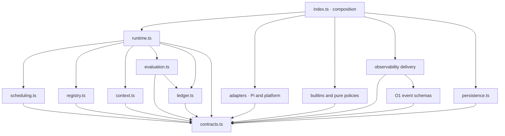
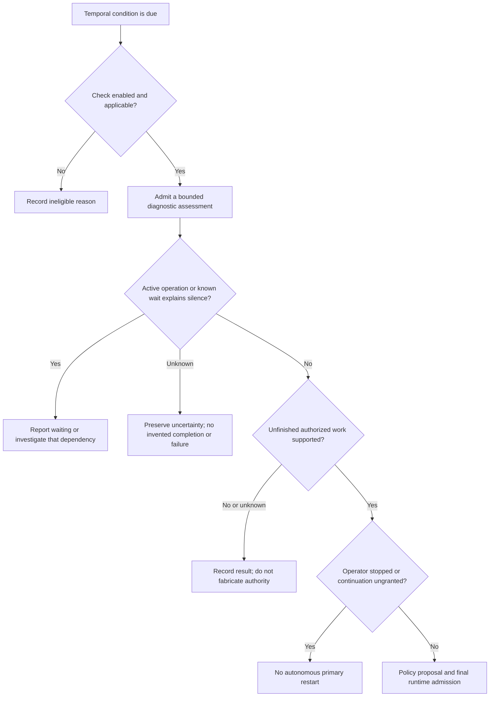
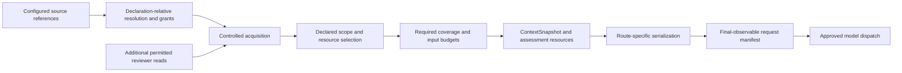
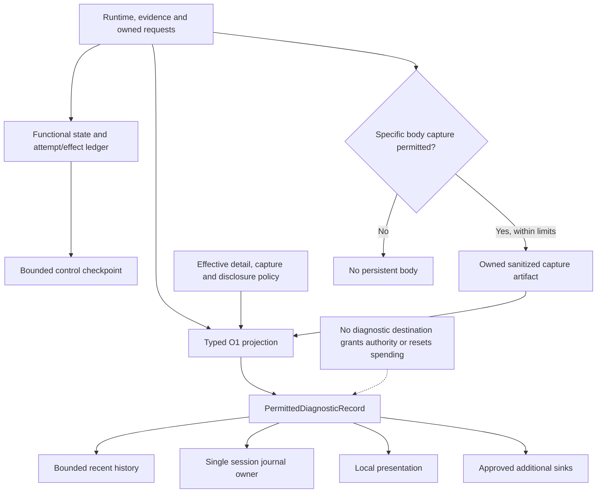

## Pi Quality Engine — Implementation Map and Dependency Rules 🧭

**Document 05 · Implementation supplement 1 of 2 · Map M1 · Preserves A1 / C1 / O1 / D1**

Pi Quality Engine is a standalone Pi extension that observes engineering work, assembles evidence from existing project sources, evaluates that evidence, and returns bounded feedback through an explicitly authorized path. Its independent reviewers are deliberately configured Pi SDK sessions. No donor observer or subagent plugin is required for the core execution path.

This supplement translates that architecture into an implementation map. It identifies where code belongs, which dependencies are allowed, who owns each resource and state transition, and which inspected upstream mechanisms can be reused without importing their unrelated assumptions. Its purpose is to prevent ambiguous organization—not to introduce another abstraction layer.

The essential distinction is between **replaceable behavior** and **shared control**. A trigger, context provider, prompt provider, evaluator, policy, action, or sink can be replaced. Ownership of a run, permission to act, request accounting, and the meaning of a receipt cannot be distributed among unrelated components.

> [!important] One implementation path, not one framework per capability
> A short assessment, a scheduled deep review, and an expert review requested by a policy all enter the same `check.run` path. A clean Pi reviewer is an evaluator implementation, not a mandatory dependency on `pi-subagents`. Diagnostic recording surrounds the execution path; it is not an optional action that a check can forget to request.

### Authority and relationship to the existing set 📑

| Document | Authoritative responsibility | Relationship to this supplement |
|---|---|---|
| [01 — Architecture and Decisions](01-architecture-and-decisions.md) | A1 invariants, product boundary, ownership, architectural decisions, and frozen sources. | M1 makes the implementation boundaries concrete without replacing those decisions. |
| [02 — Component Contracts and Configuration](02-component-contracts-and-configuration.md) | C1 types, component kinds, configuration, registration, profiles, permissions, and operations. | M1 maps those existing contracts to code. It does not invent substitute interfaces or settings. |
| [03 — Observability and Data Policy](03-observability-and-data-policy.md) | O1 event records, data projection, usage normalization, checkpoints, storage, and retention. | M1 identifies their owners and allowed dependencies. O1 retains the exact data semantics. |
| [04 — Implementation, Testing, and Acceptance](04-implementation-testing-and-acceptance.md) | D1 stages, test methodology, proof obligations, and release gates. | M1 supplies a code-organization crosswalk to those stages and obligations. |
| **05 — Implementation Map and Dependency Rules** | Implementation areas, dependency direction, assembly, resource lifetimes, and selective reuse. | This document. |
| `06-implementation-handoff-and-integration-probes.md` | Planned second supplement: practical handoff and focused probes against the real host and destinations. | Probe outcomes remain unproven until executed; a filename is not evidence that the report exists. |

If an M1 recommendation conflicts with an A1 invariant or an exact C1/O1 contract, the authoritative contract wins. The conflict must be recorded and resolved; it must not be hidden by a compatibility wrapper. D1 still determines acceptance. The previous documents are not silently edited by the existence of this supplement.

**Dependency rules below are organizational requirements. File names are a reference layout.** An implementation may merge or split internal files when the ownership and import rules remain intact. There is no requirement to allocate a class, interface, factory, or package for every box in a diagram.

Statements labeled as upstream observations refer to the frozen material inspected for this document set. Proposed Quality Engine behavior is not presented as an existing Pi feature. No donor checkout, package installation, provider experiment, filesystem portability test, or combined logger integration is claimed to have been performed by writing M1.

### Reading routes 🗺️

| Implementation question | Start here |
|---|---|
| Where should a change be placed? | [2 — Reference layout](#section-2), [3 — Dependency rules](#section-3) |
| How is the runtime constructed without a service locator or import cycle? | [4 — Composition](#section-4) |
| How do independently installed components become usable? | [5 — Registry lifecycle](#section-5) |
| Who owns time, state, evidence, requests, and cleanup? | [6 — Ownership map](#section-6), [8 — Time](#section-8), [13 — Retirement](#section-13) |
| How do short and tool-assisted evaluations use the same path? | [7 — Check execution](#section-7), [10 — Model services](#section-10), [11 — Pi reviewers](#section-11) |
| How are diagnostics separated from authority and billing? | [14–16](#section-14) |
| What can be taken from the pinned repositories? | [18 — Source baseline](#section-18), [19 — Reuse cards](#section-19) |
| What should a code reviewer or implementing agent check? | [20 — Change placement](#section-20), [21 — Construction and proof](#section-21) |

<a id="section-1"></a>

## 1. The implementation boundary in one page 🎯

### 1.1 The host, the engine, and contributions have different jobs 🧩

Pi owns the primary conversation, its tool execution, provider infrastructure, and host lifecycle. Quality Engine owns the assessments it starts, its explicitly configured review sessions, and its responses to the results. Contributions supply specialized behavior through C1; they do not become alternate owners of the primary session.

The normal path is:

```text
Attributable observation or runtime deadline
    → trigger intent
    → run admission and scheduling
    → context and assessment-resource assembly
    → selected evaluator
    → validated result
    → selected policy
    → action admission
    → admitted effect and honest receipt
```

This path is a sequence of concrete operations. It does not require a general workflow interpreter. Scheduling, permission checks, and dispatch should remain inspectable ordinary TypeScript code.

The runtime must retain enough state to reject a stale result, preserve an operator stop, account for a late charge, and avoid dispatching the same uncertain effect again. It does not need to know whether a particular project prefers service objects, functions, or a specific logging library.

### 1.2 Public roles stay exactly those defined by C1 🔌

C1 defines `observation`, `trigger`, `context`, `prompt`, `evaluator`, `policy`, `action`, and `sink`. M1 does not add a ninth public component kind for clocks, billing, or subprocesses. Those are runtime-owned services or internal adapters.

A public role is an extension boundary, not a deployment unit. One installed contribution may contain a trigger, a context provider, and a prompt resource. A configuration-only check can combine already available implementations. Static prompt resources require no new executable machinery.

Built-ins participate through the same declared execution contracts as contributions. The primary Pi host bridge and trusted resource construction are privileged implementation boundaries, but a built-in check must not bypass run admission, spending, result validation, or observability simply because its ID starts with `core`.

### 1.3 Three graphs must not be confused 🗺️

The **dependency graph** describes which source modules may import or call another module's implementation. The **execution graph** describes the order of operations and asynchronous callbacks. The **evidence graph** describes which task, instruction revision, and changed material support a finding.

A runtime can invoke an action that ultimately calls back into its check-request operation without a circular source import. Conversely, an acyclic folder tree does not prevent stale evidence or duplicate effects. All three graphs matter, but they solve different problems.

> [!note] A call back into scheduling is not a second scheduler
> `ActionContext.requestCheck()` is a run-bound capability supplied by the existing runtime. Its implementation submits a normal check request. It does not instantiate another runtime, invoke a reviewer recursively inside the policy, or create a new event-bus command protocol.

<a id="section-2"></a>

## 2. Reference source layout and responsibility map 📂

### 2.1 One package, with a small number of cohesive areas 📦

A1 already proposes a compact source layout. M1 keeps its major responsibilities and makes three distinctions explicit: primary-host adaptation, controlled external access, and functional accounting separate from diagnostic output. The following is a **growth layout**, not an instruction to create every file before the first working slice.

```text
src/
  index.ts                         Pi entry and composition root
  contracts.ts                     C1 public data and component declarations
  configuration.ts                 Parsing, resolution, validation, revisions
  registry.ts                      Acknowledged registration and readiness
  runtime.ts                       Session-owned execution and action authority
  scheduling.ts                    Trigger cursors, deadlines, bounded admission
  context.ts                       Evidence access, assembly, coverage, freshness
  evaluation.ts                    Owned request service and result validation
  ledger.ts                        Functional attempt and budget accounting
  persistence.ts                   Control checkpoint and reconciliation storage
  policy.ts                        Built-in pure reaction policies

  adapters/
    pi-host.ts                     Primary events, commands, feedback receipts
    pi-models.ts                   Approved Pi model dispatch and native mapping
    project-evidence.ts            Controlled filesystem/Git reads and revisions

  builtins/
    observations.ts                Built-in source definitions and normalization
    triggers.ts                    C1 count, time, wait, change, completion triggers
    contexts.ts                    C1 context-provider definitions
    prompts.ts                     Static assessment resources and typed questions
    evaluators.ts                  C1 evaluator definitions and small mappings
    pi-reviewer.ts                 Fresh SDK-review-session implementation
    actions.ts                     Feedback and request-check action definitions

  observability/
    events.ts                      O1 event-specific schemas and safe field rules
    projection.ts                  Functional data → permitted diagnostic records
    journal.ts                     Bounded sinks, session files, rotation, history
    artifacts.ts                   Explicitly permitted diagnostic capture/export

resources/
  prompts/                         Built-in assessment text and question resources
  checks/                          Bundled check resources, when shipped

examples/
  independent-extension/           Independently installed C1 contribution

test/                              Tests of the actual production paths
scripts/                           Small build, package, and probe drivers
```

`ledger.ts` is a physical-placement recommendation. A1's illustrative `observability/usage.ts` could also be used if it obeys the functional dependency rules below. The important rule is not the directory name: **spending state must not depend on the diagnostic sink, capture settings, or retained journal history**.

Similarly, a first implementation can keep the safe projection and journal delivery in one module, then split them when useful. Separating their authority in the design does not require an extra factory at every call site.

### 2.2 File-level ownership table 🧾

| Area | Owns | Main collaborators | Does not own |
|---|---|---|---|
| `index.ts` | Construction order and attachment to the live host. | All concrete factories needed to build one session runtime. | Engineering rules, scheduler decisions, cost arithmetic, or a second configuration merge. |
| `contracts.ts` | Shared C1 declarations and deliberately public schema/data definitions. | Language-level types and, where chosen, a schema library without startup side effects. | Pi session instances, filesystem handles, network clients, or global mutable registries. |
| `configuration.ts` | One effective configuration, field provenance, validation, and semantic revision calculation. | Schemas, registry descriptions, capability snapshots, declaration-relative resource resolution. | Starting model requests, installing packages, or creating permissions from project prose. |
| `registry.ts` | Registration handles, package readiness, definition ownership, and generation invalidation. | C1 definitions and bounded preparation context. | Per-check business scheduling or paid preparation during registration. |
| `runtime.ts` | Work episodes, run state, active/pending ownership, policy invocation, effect admission. | Registry handles, scheduler, evidence/evaluation services, ledger, checkpoint, host feedback. | Provider-specific response parsing or domain-specific code-quality tests. |
| `scheduling.ts` | Count/time eligibility, coalescing, cooldowns, queue bounds, and fairness. | Runtime views, trigger definitions, an actual clock/timer boundary. | Direct provider dispatch, a primary-session reference, or raw context retention. |
| `context.ts` | Controlled evidence access, pinned requirements, assembly, provenance, coverage, and freshness. | Evidence adapters, registered context/prompt providers, a bounded preparation request facet. | Rewriting source instructions or choosing corrective actions. |
| `evaluation.ts` | Run-bound request/review services, route preflight, attempt ownership, canonical result validation. | Ledger, native dispatch adapter, review runner, evidence and manifest services. | Primary feedback or subjective escalation outside the chosen policy. |
| `ledger.ts` | Owned attempt identities, usage revisions, price basis, reservations, and totals. | Plain normalized facts and persistence coordination. | Log formatting, archive scanning, or another executor's internal billing. |
| `persistence.ts` | Safe encoding and replacement of bounded functional checkpoint data. | Approved storage identity and an explicit state snapshot. | Inventing runtime decisions or replaying model work on its own. |
| `policy.ts` | Built-in bounded interpretation of validated results. | `PolicyInput`, options, and deterministic rendering references. | I/O, direct model calls, or automatic mutation of runtime state. |
| `adapters/*` | Specific host/platform I/O and normalization boundaries. | The verified Pi SDK or controlled filesystem/Git operations. | Widening grants, falling back to unapproved routes, or concealing partial visibility. |
| `builtins/*` | Standard C1 component implementations and fresh-review execution. | Only the capabilities appropriate to the role. | A second runtime, hidden timers, or bypasses unavailable to ordinary checks. |
| `observability/*` | O1 projection, bounded history/sinks, capture, inspection, and retention. | Permitted records and read-only functional summaries where explicitly supplied. | Granting actions, resetting budgets, or deciding that a project defect is fixed. |

### 2.3 Resource files are not a second requirements database 📚

Bundled assessment resources describe how to review, how to label uncertainty, and how to return structure. Existing `AGENTS.md`, architecture documents, requirements, and references remain at their original locations and are selected through C1 sources.

A generated configuration schema, a canonical evaluator-result schema, and shipped declarations must have one maintained source of meaning. It is acceptable to infer types from a schema or to use focused consistency tests over separately represented declarations. It is not acceptable to maintain several subtly different hand-edited copies of the same result contract.

Internal JSON needed for model questions is an assessment resource. It does not authorize an agent to replace fifty project instructions with a newly maintained rule catalog.

<a id="section-3"></a>

## 3. Allowed dependencies and forbidden shortcuts 🧱

### 3.1 The import graph points toward contracts and small mechanisms 📐

In the following diagram, **an arrow means that source area may depend on the target area**. It is not an execution timeline. The concrete assembly point is deliberately able to see several implementations; ordinary components are not.



The runtime receives concrete host feedback, model dispatch, persistence, and diagnostic services through construction. A source-level dependency on a narrow interface does not require the runtime to import `pi-host.ts`, Pino, or `rotating-file-stream`.

Private adapter contracts can remain next to the code consuming them. They need not all be promoted to the public `contracts.ts` export. C1 is the public extension API; an internal transport result used only between the model service and Pi bridge is not automatically a new supported SDK surface.

### 3.2 Dependency matrix for review and implementation 🧾

| Source area | Allowed dependency | Dependency to reject | Reason |
|---|---|---|---|
| Public declarations | Other public declarations; inert schema definitions. | Concrete host, logger, or donor runtime imports. | Importing the public contract must not start or duplicate anything. |
| Scheduler | Trigger definitions, immutable views, clock reading, bounded state. | `pi.sendMessage`, raw provider clients, journal-file parsing. | Time eligibility is not execution authority. |
| Context assembler | `EvidenceAccess`, source adapters, declared prompt/context providers, preparation request facet. | Primary feedback, arbitrary shell execution, unrelated provider fallback. | Context preparation has a defined evidence and spending boundary. |
| Deterministic trigger or policy | Supplied inputs, options, pure helpers. | Filesystem, timers, network, registry mutation. | C1 intentionally makes these bounded decision functions. |
| Direct evaluator definition | `EvaluationServices.request`, input resources, pure normalization. | Pi primary context, direct provider HTTP that bypasses ownership, action dispatch. | A finding is not a permission or a financial receipt. |
| Pi-session evaluator definition | `EvaluationServices.review`. | Directly constructing another scheduler or loading all installed extensions. | Review ownership must remain on the common path. |
| Review-session runner | Verified SDK, approved model gateway, constrained evidence/tools, its own operation scope. | Primary session mutation, uncontrolled donor launchers, diagnostic raw-body capture. | It owns investigation, not the primary agent. |
| Built-in action | Admitted input, run-bound host feedback or `requestCheck` facet. | Policy-time provider work or an independent unchecked queue. | Actions execute only what has passed admission. |
| Functional ledger | Normalized attempt facts, exact monetary helpers. | Pino, a diagnostic sink, retained-log reconstruction. | Logging cannot change money already spent or its uncertainty. |
| Diagnostic sink | `PermittedDiagnosticRecord`, destination options, lifecycle context. | `ContextSnapshot`, the live result object, credentials, or model service. | Extra destinations cannot receive unprojected functional content. |
| External contribution | C1 contract, its declared dependencies, permitted role services. | Undeclared imports from the engine's private package tree. | Separate Pi installations have independent module roots. |
| Composition root | Concrete implementations and their construction inputs. | Business-rule duplication. | Wiring should be explicit without becoming another engine. |

The private Pi SDK runner is a concrete adapter even if its file lives under `builtins/`. Its location does not grant ordinary evaluator definitions direct primary-session authority. Source review should follow capabilities and effects, not folder names alone.

### 3.3 Runtime callbacks do not require circular imports 🔁

The feedback action needs access to an admitted host effect. The request-check action needs a way to submit another check. Neither needs to import `runtime.ts` and retrieve a global current runtime.

Instead, the runtime constructs the C1 `ActionContext` for the current action. That context contains only the admitted `host` and `requestCheck` capabilities. A callback can submit a new queue item after revalidating scope and authority; it cannot start arbitrary work in a retired generation.

Similarly, the context service may need model-assisted preparation. It receives the direct-request subset of `EvaluationServices`, already bound to the parent run and approved profile. The evaluator service can receive an already prepared snapshot. These values break the apparent construction cycle without introducing a general service container.

> [!warning] Do not replace explicit construction with a global current-session lookup
> A helper that imports `currentRuntime`, `currentPi`, or a process-global service locator hides ownership. It is particularly dangerous after reload or when two sessions coexist. Session-bound closures and explicit handles should be constructed once and passed where needed.

### 3.4 Error handling belongs at real boundaries 🧯

External I/O, contributed-component calls, model result parsing, and host effect dispatch are boundaries that need validation and classified failures. Ordinary pure helpers do not each need a defensive `try/catch` that returns a success-shaped fallback.

A source denial must remain a source denial. A provider timeout must remain a failed or unavailable assessment with an unresolved attempt when appropriate. A sink error must not become an engineering finding. A dependency that was not ready must not be replaced by a no-op component that reports success.

This map permits small direct functions. The goal is to preserve the meaning of failure, not to maximize the number of adapters around it.

<a id="section-4"></a>

## 4. Composition root, activation, and safe shutdown 🏗️

### 4.1 Module import is not session startup 🧭

At module load, code may declare components, inert schemas, and factories. It must not start a provider request, watch a repository, open a journal for an unidentified session, or start a scheduling interval.

Pi's pinned extension guidance separates factory loading from session-owned resources: long-lived resources start from `session_start` or a supported command and are closed through an idempotent shutdown handler. Reload invalidates the old runtime context. These are source-observed host rules, not new M1 conventions.[^pi-events]

`index.ts` attaches the host bridge and creates one owned engine runtime per observed session generation. The default absence of configuration keeps autonomous evaluation disabled, as C1 already specifies. Basic status and safe configuration diagnostics remain available.

### 4.2 Assembly order is explicit but does not require a DI framework 🧰

A practical construction sequence is: acquire the actual host/session identity; obtain the permitted storage/configuration context; establish the registry and baseline capabilities; construct functional state, ledger, and checkpoint support; construct diagnostics; create evidence and evaluation services; bind the runtime's operation surface; register built-ins and publish registry availability; then admit work under a validated effective configuration.

Some local construction steps can be grouped. The critical ordering constraints are stronger than a fixed list of constructors:

| Before this can happen | What must already be established |
|---|---|
| A check becomes active | Valid references/options, completed component readiness, applicable grants, required capabilities. |
| A source body is read | Approved source resolution and protected-path policy. |
| A model request is dispatched | Owned run identity, approved exact route, final-observable input boundary, budget/attempt reservation. |
| A primary effect is attempted | Current scope and authorization, stop protection, freshness decision, action grant, dispatch-intent checkpoint. |
| A diagnostic destination receives data | O1 projection and bounds, destination authorization, sink ownership. |
| Old work can affect a new generation | It cannot reuse old authority; only explicit receipt/usage reconciliation is admitted. |

A logger can be unavailable while the primary remains usable. Essential functional checkpoint ownership is different: autonomous paid work or uncertain effects that depend on it remain suspended. Construction must keep these two outcomes distinguishable.

### 4.3 Composition diagram 🧩

```mermaid
sequenceDiagram
    participant Pi as Pi host
    participant Entry as Composition root
    participant Reg as C1 registry
    participant State as Runtime and functional state
    participant IO as Host, model, evidence and journal adapters
    participant Ext as Independent contribution
    Pi->>Entry: Live session context
    Entry->>IO: Establish scoped adapters and storage ownership
    Entry->>State: Restore or initialize bounded control state
    Entry->>Reg: Create generation-bound endpoint
    Ext->>Pi: Subscribe to available; query current endpoint
    Entry->>Pi: Announce C1 endpoint
    Pi-->>Ext: Matching endpoint
    Ext->>Reg: register(package definition)
    Reg-->>Ext: Registration handle
    Reg->>Reg: Bounded prepare
    Reg-->>Ext: ready result
    Entry->>State: Apply validated configuration and ready bindings
    State->>IO: Start eligible sources and deadlines
    Note over State,IO: No paid request is implied by installation or registration
```

The exact C1 available/query protocol appears in section 5. The sequence is a responsibility map, not a claim that Pi waits for event-bus promises.

### 4.4 Shutdown stops admission before it disposes resources 🛑

The first effect of shutdown, replacement, or disabling a relevant generation is to revoke its ability to admit new work and dispatch effects. Resource cleanup follows. Waiting for a model to cooperate before revoking authority would allow an old callback to intervene after the operator changed direction.

The runtime then cancels pending work, signals active owned operations, unregisters sources/deadlines, disposes registrations and review sessions within configured bounds, reconciles observable late facts, checkpoints necessary state, and drains/closes owned diagnostic destinations to their documented boundary. The order of independent cleanup tasks can vary; admission and authority revocation cannot.

Cleanup must not throw back through unrelated primary execution. A failed close is reported as a failure, not retried by rerunning the operation whose diagnostic record was being written. A non-cooperative request remains unsettled and retains the applicable reservation rather than silently becoming a free slot.

The synchronous/asynchronous cleanup differences between the host adapter, an owned `AgentSession`, and a writable stream must remain local to those adapters. There is no single generic `dispose()` meaning “the remote provider stopped, all bytes reached physical storage, and the task completed.”

<a id="section-5"></a>

## 5. Registration and independently installed components 🔌

### 5.1 Use the existing C1 protocol exactly 🧾

The public discovery channels are **`quality.registry.available.v1`** and **`quality.registry.query.v1`**. The endpoint is `RegistryEndpoint`; registration returns `Result<PackageRegistration>`; asynchronous preparation is acknowledged by `PackageRegistration.ready`; cleanup uses its `dispose()` method.

M1 does not replace these with `quality:discover`, a global registry import, or a new `registerPlugin()` function. Exact contract declarations remain in [Document 2, section 5](02-component-contracts-and-configuration.md#section-5).

A consumer subscribes before querying. This supports either load order. The registry endpoint identifies the actual observed session and engine generation. A response for another session is not a successful discovery.

The pinned Pi event-bus implementation has `emit(...): void` and wraps handlers in an asynchronous error guard. Emitting an event does not await every handler and does not establish that preparation completed.[^pi-bus] The distinction between discovery, synchronous manifest admission, and `ready` is therefore necessary.

### 5.2 The registry owns definitions; the runtime owns executions 🧠

`registry.ts` validates IDs, schemas, duplicate ownership, required capabilities, package resources, and preparation state. It supplies admitted definitions and registration handles to the runtime. It does not run a check merely because a definition appeared.

`runtime.ts` resolves a check to ready definitions, creates binding/run state, and invokes the selected methods with scoped services. It should not repeatedly parse a package manifest or infer readiness from whether a function happens to exist.

The registry's public definition data is immutable or copied at admission. Executable functions remain trusted code; no copying strategy turns them into a sandbox. A package changing its declared effects or resources after registration is not a valid way to widen its grant.

### 5.3 State belongs to the right instance 🔍

A **package registration** has readiness and ownership. A **component definition** describes an implementation. A **trigger binding** has its own cursor and deadline. A **run** has its own evaluation scope. A **sink instance** has its own queue/health/lifecycle. These must not collapse into one process-global object.

For example, two checks can both use `core.every-tools` with different thresholds. Sharing the same trigger state object would make one check consume the other's cadence. Likewise, an independent component installed in two sessions must not store the last primary tool result in a module-global variable that crosses session boundaries.

A repeated registration by the same installed instance is idempotent under C1. A different owner attempting the same component ID is rejected. A replacement disposes the old registration and waits for the new one to become ready. It does not silently swap a function under an active run.

### 5.4 Ready means usable, not authorized to spend 💳

Preparation may validate resources and bounded local state. It does not grant model routes, start an evaluator, or upload diagnostics. A ready component still needs an enabled check, a permitted context, approved models/effects, and runtime admission.

Late preparation after retirement cannot reactivate a package. The generation attached to the registration is checked before publishing readiness and before constructing any live source or sink. A timed-out or failed package leaves a visible unavailable dependency; other packages remain usable.

### 5.5 Independent packaging must be tested without accidental imports 📦

Pi documents separate module roots for installed packages. The host-provided Pi packages are peers, not bundled physical dependencies, and one installed package must not rely on another's undeclared dependency being resolvable.[^pi-packages]

The separate example contribution therefore discovers the engine through C1. It may use published declaration types as a development convenience, but cannot import the live engine registry from an internal file. It must work after packaging, not only through a monorepo symlink.

The public contract module must be safe to import for types or schemas without loading `src/index.ts`, opening files, or registering host callbacks. Package export choices must preserve that separation in the built artifact.

<a id="section-6"></a>

## 6. Ownership of state, identity, and resources 🏷️

### 6.1 One state table for implementation decisions 🗃️

| State/resource | Single logical owner | Lifetime | Replacement and persistence rule |
|---|---|---|---|
| Primary conversation and primary tool execution | Pi host. | Host session/run. | The engine observes; it does not replace Pi's session manager. |
| C1 `Scope` and `RuntimeView` | Session runtime. | Observed session generation plus active branch/episode. | Detached views are handed out; old generation authority is invalid. |
| Operator stop and authorization revision | Runtime, sourced from the trusted primary adapter. | Persists across observer reload as required by C1/O1. | An observer resume or custom message cannot clear it. |
| Effective configuration and provenance | Configuration service; accepted snapshot held by runtime. | Until an explicit valid apply. | Failed apply leaves old configuration unchanged. |
| Package registration/readiness | Registry. | Installed instance within one engine generation. | A replacement receives a new handle; old callbacks cannot claim it. |
| Trigger cursor and next due time | Scheduler, keyed by check and binding. | Active episode/binding semantics in C1. | Restored thresholds coalesce; old monotonic readings are not reused as current time. |
| Pending check intent | Scheduler under runtime admission. | Until admitted, coalesced, skipped, or retired. | Reasons and newest cursor are bounded; full prompts are not queued. |
| `RunRef` and active run lifecycle | Runtime. | One admitted check. | Configuration, authority, and evidence association remain explicit. |
| Required document bodies and evidence | Evidence/context service. | Bounded episode/run ownership. | Eviction or unavailable restoration reduces coverage, never invents content. |
| Final-observable input manifest | Model/evidence boundary. | One request attempt or declared observed request group. | Identifies the input actually provided at the available boundary. |
| Request attempt and spend reservation | Model service and functional ledger. | Session-wide until settled/reconciled. | Survives log rotation, branch changes, and logical cancellation. |
| Clean Pi reviewer | Review runner under an admitted evaluation. | One fresh review by default. | No ambient plugin recursion; in-memory session; bounded cleanup. |
| Finding identity and follow-up state | Runtime. | Relevant episode/evidence and bounded retained control state. | A model's local finding ID is not a global dedupe key. |
| Action intent and receipt | Runtime action service. | From admission through reconciliation. | Uncertain dispatch is not blindly repeated after restart. |
| Functional checkpoint file | Persistence service under session ownership. | Independent of diagnostics. | Stores bounded control metadata, not raw review context by default. |
| Diagnostic records/recent history | O1 projection and delivery service. | Configured retention/buffer lifetime. | Contains permitted data only. |
| Active journal and archive operations | Session journal owner. | One logical observed session, segmented as required. | Single writer; exact O1 rotation/retention semantics. |
| Captured diagnostic bodies | Capture/artifact helper. | Explicitly permitted bounded capture lifetime. | No body exists on disk merely because the model saw it. |

A stateful helper is justified when it owns one of these concrete responsibilities. The table does not require an object for every row. Several rows can be implemented by a small runtime state object and a few helpers if the ownership remains explicit.

### 6.2 Functional references must not become accidental capabilities 🔐

An opaque `runId`, `artifactId`, or `actionId` is an identifier. It is not proof of permission to read a file, bill another run, or revive another session. Services validate the supplied ID against the capability's bound owner and current generation.

Likewise, a `ContextSnapshot` contains functional material, not a log record. Passing it to a sink because it already has IDs is still a privacy violation. A model can cite an evidence ID only if that ID was actually issued for admitted evidence; it cannot create a reference by returning a plausible-looking path.

### 6.3 There are separate clocks, counters, and history scopes ⏱️

Runtime duration decisions use monotonic readings within one generation. UTC timestamps make diagnostics readable. Primary tool/cycle counters track only the observations defined by C1. Diagnostic record sequence is not a substitute for either counter.

Session-wide spending and dispatched effects remain real even when the active conversational branch changes. Branch-sensitive findings and work interpretations do not automatically transfer. The persistence implementation must preserve that distinction rather than restoring every field from the latest displayed transcript branch.

### 6.4 Resource retirement is deliberately asymmetric 🧯

Authority can be revoked immediately. A remote request may settle later. Diagnostic output may be unavailable. These facts are compatible.

The design must allow a late, owned usage observation to update the ledger without giving the old evaluator a reference to the new primary context. A small reconciliation channel bound to the original attempt is sufficient. It is not a new live execution context and cannot deliver feedback.

The same principle applies to an uncertain action receipt: reconcile what the receiver can prove, but do not rerun the effect as a way to discover its state.

<a id="section-7"></a>

## 7. The common check-execution path 🔄

### 7.1 Dispatch by registered role, not by a growing special-case switch 🧩

The runtime resolves the check's trigger, context plan, prompt provider, evaluator, and policy from the effective configuration and registry. It calls their C1 methods. A new evaluator implementation should not require another branch such as “if this is a Python check” in `runtime.ts`.

Built-in implementation dispatch is allowed inside the relevant adapter. For example, `pi-models.ts` must distinguish a native classifier request from a chat request because the host contracts differ. That transport distinction does not belong in the scheduler, policy, or context selection logic.

The code path should remain readable as admission, assembly, evaluation, validation, decision, and dispatch. Small helper functions can perform these steps; an inheritance hierarchy is not required.

### 7.2 Short assessment: complete ownership trace 🔎

```mermaid
sequenceDiagram
    participant Host as Primary Pi adapter
    participant RT as Session runtime
    participant SC as Scheduler and trigger binding
    participant CX as Context and prompt services
    participant EV as Registered evaluator
    participant MS as Owned model service
    participant LD as Functional ledger
    participant PL as Policy
    participant AC as Admitted action
    Host->>RT: Normalized primary tool completion
    RT->>SC: Current view and accepted observation
    SC-->>RT: Due intent with reasons
    RT->>RT: Admit one run; freeze scope and configuration
    RT->>CX: Assemble original task, requirements and evidence
    CX-->>RT: Snapshot, resources, coverage and dependencies
    RT->>EV: evaluate(options, input, scoped context)
    opt Model-backed evaluator
        EV->>MS: request(prepared input, approved profile)
        MS->>LD: Reserve and identify owned attempt
        MS->>MS: Dispatch through verified Pi route
        MS->>LD: Reconcile observed usage and outcome
        MS-->>EV: Model response and attempt references
    end
    EV-->>RT: AssessmentResult
    RT->>RT: Validate result and current dependencies
    RT->>PL: decide(options, PolicyInput)
    PL-->>RT: No action or proposals
    alt Observe mode or inadmissible proposal
        RT->>RT: Retain permitted outcome and reason
    else Admissible effect
        RT->>AC: execute(AdmittedAction, scoped services)
        AC-->>RT: EffectReceipt
    end
    Note over RT,AC: O1 diagnostics surround every relevant boundary, including silence
```

In the deterministic path, the model-service branch is absent. The rest of the execution remains real. This is why S1 can demonstrate a complete feedback-loop mechanism without a paid provider.

A no-finding assessment is a normal completed evaluation. A skipped run that never acquired required input is not an assessment that found no problem. The public C1 operational outcome, coverage, and conclusion remain separate throughout.

### 7.3 One run does not mean one model request 🧮

A direct evaluator may dispatch one request. A configured repair may dispatch another. A permitted preparation component may perform an additional request. A Pi reviewer may make several model requests separated by tool calls.

The common service owns each observable attempt and links it to its parent run. A wrapper around `EvaluatorDefinition.evaluate()` can measure evaluation duration, but cannot by itself establish request count or cost. The attempt boundary must be instrumented where actual model work is admitted and dispatched.

The evaluator's returned `usageAttemptIds` are references to owned records, not an independent source of totals. A component cannot attach an arbitrary monetary number and have it added as if the model service witnessed the request.

### 7.4 Ready results and pending intents do not store the same data 📦

Pending intents retain bounded reasons and evidence cursors. The evidence service owns bodies. The run owns a snapshot while executing. A ready result retains the references and functional information necessary for the decision; it is not automatically copied into every queued message or checkpoint.

This separation prevents a slow reviewer from multiplying the same full transcript across every new trigger. Coalescing should update the pending intent, not clone the active context repeatedly.

When capacity or coverage prevents evaluation, the runtime records the correct reason and preserves only the state required by C1. There is no fallback that silently sends a smaller, undeclared assessment and labels the original check successful.

<a id="section-8"></a>

## 8. Scheduling, time, and progress without hidden loops ⏱️

### 8.1 The scheduler owns deadlines; triggers only calculate them 🕰️

`TriggerDefinition.update()` is synchronous and bounded. It receives a view, a cause, its own state, and a clock reading; it returns updated state, an optional intent, and `nextDueMonoMs`. The scheduler validates and stores that result, then arranges the next callback.

The trigger does not start `setInterval()`, perform a file read, call a model, or wake Pi. External information belongs in an observation source or a context provider. This is the reason count, time, dependency, and custom triggers remain interchangeable.

A first implementation can keep a bounded set of deadlines and arm the nearest one. A sophisticated timer wheel or distributed scheduler is not required for the declared workload. The data structure can change without changing the C1 time semantics.

### 8.2 The four temporal questions are different 🚦

| Temporal check | What makes it due | What it does not prove | Responsible implementation |
|---|---|---|---|
| Periodic assessment | Configured elapsed interval, applicable work state, and any required new evidence. | That the primary is stuck or that an intervention is needed. | `core.periodic` plus scheduler. |
| Inactivity diagnosis | Expected activity absent beyond a deadline. | That a quiet model request or tool has died. | `core.inactivity` with execution/wait evidence. |
| No-progress diagnosis | No supported progress beyond a deadline, possibly despite many events. | That every read or investigation was wasted. | `core.no-progress` with progress evidence. |
| Expired wait reconciliation | An identified operation/dependency passed its review deadline. | Permission to kill a process or restart arbitrary work. | `core.wait-deadline` with an actual wait owner. |

The initial built-ins remain those specified in C1: `core.every-tools`, `core.every-cycles`, `core.periodic`, `core.inactivity`, `core.no-progress`, `core.wait-deadline`, `core.evidence-change`, and `core.before-completion`. M1 does not add an unqualified “step” counter or a second duration syntax.

### 8.3 A timestamp is not an authorization boundary 🛑



The diagram separates eligibility for diagnosis from permission to continue primary work. Actual eligibility still follows C1 check modes, work states, pauses, budgets, and capabilities. It is not a new policy that requires spending on every expired timer.

Operator stop has priority over a late finding. Observer resume, configuration reload, and a timer firing do not clear it. A long-running tool remains an identified operation until the host supplies a meaningful terminal fact; the engine must not synthesize a completion to make counters advance.

### 8.4 Count and time reasons coalesce without changing their meaning 🔢

A cycle with three parallel primary tools may produce three top-level completions and one cycle completion. Each terminal operation is counted once. Reviewer tools, diagnostic writes, and engine model work do not advance primary cadence.

Each trigger binding maintains its own threshold/cursor. The scheduler holds one coalesced pending intent per check, with bounded reasons and newest relevant evidence. Cooldown delays admission rather than creating many delayed copies. When several conditions become due together, the resulting run can record all causes without making redundant requests.

Declared `supersedes` is the only basis for one check covering another pending check. “Deep” in a profile name is not proof that the check includes all quick-check criteria. Different evidence requirements or a wait diagnosis can require separate work.

C1's global limits and reviewer sublimit remain authoritative. Fairness must prevent a continually due high-priority check from permanently starving older eligible work; it need not prescribe a particular queue library.

### 8.5 Suspend, restart, and final boundaries are explicit cases 🌙

After sleep or process restart, old monotonic deadlines cannot simply be compared against the new clock origin. The runtime establishes current identity and host state, converts retained intent into one eligible reassessment where appropriate, and does not replay every missed interval.

At the primary completion boundary, the default `boundaryWaitMs: 0` means that an unfinished network review is not awaited inside the host callback. A result already ready may be considered through the supported boundary. A later result is handled according to current authority and delivery capability; it does not retroactively extend a callback that has returned.

At B1, `agent_before_settle` and `turn_end` are actionable boundaries, while `agent_settled` is notification-only. Returning a continuation-shaped value from the wrong event does not create a supported wake route.[^pi-events]

### 8.6 Event-loop limits are real, not solved by more callbacks 🧯

A runtime-owned timer can notice missing primary events while the process is healthy. It cannot run while synchronous code blocks the event loop, and it cannot revive a terminated process. Node's timers depend on event-loop scheduling rather than exact execution times.[^node-timers]

Therefore synchronous trigger/policy work must remain bounded. A timeout around a synchronous callback does not preempt it. If external crash supervision is later required, it is a separately implemented observation/recovery integration with an explicit scope; the in-process scheduler must not claim that capability today.

The OMP oldest-message timer is useful evidence for one deadline that later messages do not indefinitely postpone. It is not a complete inactivity or work-state implementation, so only that narrow mechanism should be adapted.[^omp-cadence]

<a id="section-9"></a>

## 9. Evidence and context: explicit acquisition, no duplicate rule store 📚

### 9.1 One evidence boundary serves assembly and additional reviewer reads 🔍

`context.ts` owns the permitted evidence service and assembly rules. `adapters/project-evidence.ts` performs the controlled filesystem/Git operations. `builtins/contexts.ts` supplies `core.task`, `core.history`, `core.files`, `core.changes`, `core.waits`, `core.prior-findings`, and `core.images` through their C1 definitions.

The built-in changes provider may receive an internal, scoped Git-collection function through construction. That is not a new method on public `EvidenceAccess` and not a general shell capability handed to every context provider. Its operations remain subject to source grants, limits, provenance, and observability.

The same boundary protects additional reviewer reads. If the initial context excludes a credential file, a later `grep` cannot reveal it merely because the reviewer used a tool instead of the assembler. Search/list output can disclose filenames and fragments and needs the same care as `read`.

### 9.2 Context assembly preserves stages rather than only a final string 📦



The assembler does not accept a provider's `coverage: complete` claim blindly. It verifies the required selection and reports missing, denied, changed-during-read, or omitted material. Complete means complete for the configured scope, not a claim that every potentially relevant file in the repository was inspected.

The serialized model input also includes instructions, questions or result schema, tool descriptions, and attachments where applicable. Token estimates over file bodies alone do not describe the complete request. The manifest must name the last input boundary actually visible to the engine rather than claiming access to hidden provider transformations.

### 9.3 Requirements and assessment instructions have different authority 🧷

A project source establishes a requirement. A prompt resource tells the evaluator how to perform the assessment and return a result. The original task establishes current scope. A previous finding is a hypothesis or prior outcome, not a new operator instruction.

`revisionPolicy: pin-at-episode` preserves the approved requirement version during the work episode. An executor edit to the instructions is a candidate change, not automatic permission to relax the requirement under investigation. After restart, an unavailable pinned body cannot be recreated from a hash; affected checks must report the limitation or wait for an authorized new baseline.

The engine never requires copying all project rules into its own configuration. Stable criterion IDs identify evaluation dimensions, not a parallel rule database. A prompt such as “reject every helper used once” must not quietly override an existing project architecture that justifies that helper.

### 9.4 Git evidence requires explicit baseline semantics 🌳

The built-in collector is episode-relative and read-only with respect to repository state. Initial HEAD, staged/unstaged conditions, and relevant dirty/untracked bodies have different evidence roles. A final `git diff HEAD` cannot reconstruct a missing dirty baseline and can miss work already committed during the episode.

The collector must not create an easy snapshot by running `git add`, stashing changes, resetting the index, or writing a broad tree of the working directory. The inspected Warden `workTree()` uses a temporary index followed by `git add -A` and `git write-tree`. That avoids changing the real index but can write repository object data. It is intentionally not C1's default approach.[^warden-turn]

For the initial implementation, bounded in-memory baseline material and pinned Git blobs provide evidence where available. If a path's initial body or absence was never established, the collector reports partial coverage. A bounded enumeration that did not see a path cannot prove that the file did not exist.

Git commands use argument arrays, scope filtering, time/output bounds, and suppression of external diff/text-conversion behavior where relevant. They are not an arbitrary shell string assembled from model text. Concurrent writers produce repository changes with attribution limits; the engine must not claim that every changed line belongs to the observed agent.

### 9.5 Freshness is checked at the consequence boundary 🔁

An assessment may finish while unrelated work continues. Cancelling every evaluation whenever any file changes would starve the observer. Instead, the finding records authority and conclusion dependencies, and the runtime checks those dependencies before feedback or escalation dispatch.

A change to an unrelated file need not invalidate the result. A changed requirement, task amendment, or relevant implementation dependency can. An uncheckable dependency is unknown freshness, not current by default.

A relevant edit after feedback marks an issue as needing reassessment. It does not prove resolution. A new model phrase does not create a new permanent issue identity; the runtime correlates criterion, defect kind, location, and evidence relationship separately from note wording.

### 9.6 Live image evidence and saved image capture are separate 🖼️

`core.images` supplies explicitly selected local image artifacts and metadata. It does not start a browser. A screenshot producer is another authorized component. Model input capability is checked on the actual route; an image is not silently replaced with its filename when vision is unavailable.

Runtime image handles can exist entirely in memory. Diagnostic image capture is a separate O1 permission and budget. A reviewer can inspect an image while the journal stores only dimensions, sizes, references, and the input-manifest relationship. There is no need to persist a screenshot merely to demonstrate that it was sent.

<a id="section-10"></a>

## 10. Owned model services, evaluators, and canonical results 🧠

### 10.1 Separate an evaluator definition from the service that spends 💳

`src/builtins/evaluators.ts` defines `core.repeated-tools`, `core.classifier`, separate `core.quality-decision`, `core.chat` and `core.pi-session` interpretation. The actual shared request/accounting owner is `ModelService` in `src/models.ts`, exposed through run-bound model/review facets in `src/runtime.ts`, not the earlier proposed `evaluation.ts`. `src/adapters/pi-models.ts` implements approved public Pi dispatch and native normalization; `src/registry.ts` owns definition/options/extension-schema admission.

This separation is intentionally narrow. It exists because profile authorization, request identity, limits, input manifests, and usage must apply to every owned call. It is not a replacement provider SDK.

A direct evaluator calls `services.request()`. A Pi-session evaluator calls `services.review()`. A context or prompt component receives only the permitted request subset. None can pass another run's ID to charge its work elsewhere, or construct a new provider route from an evaluator response.

### 10.2 Avoid the reviewer recursion trap 🔄

The proposed call direction is:

```text
runtime invokes registered EvaluatorDefinition.evaluate()
    ├─ core.classifier / core.quality-decision / core.chat → EvaluationServices.request()
    │                                  → approved Pi model adapter
    └─ core.pi-session            → EvaluationServices.review()
                                       → concrete fresh-session runner
```

`EvaluationServices.review()` must not call the registered `core.pi-session` evaluator again. It invokes the concrete runner in `builtins/pi-reviewer.ts`. Likewise, the runner must not invoke `check.run` to perform its own next model turn. Its tool-assisted conversation belongs to the one admitted evaluation.

The composition root wires this relationship with explicit functions. There is no need for a class hierarchy of evaluator managers and reviewer managers that call each other through a service locator.

### 10.3 Native classifier and chat routes are not interchangeable formats 🧪

The pinned Pi model guide exposes typed classifier calls through `ctx.modelRegistry.classify()`. These take state and question definitions; they do not behave like arbitrary chat completions.[^pi-models]

`models.ts` prepares the copied/frozen complete typed `{state,questions}` before admission, serializing actual selected instructions, ordered text/JSON content, identities/provenance, coverage and criteria. Complete bytes/digest and the approximate byte/4 estimate govern input limits; runtime binds the selected profile/mapping/resources to that prepared representation. It is not a second scheduler or provider SDK. Images reject; the unsent generative schema is not classifier input.

The fixed `progress-v1` and separate `quality-decision-v1` evaluator interpretations validate compatible questions and normalized answers rather than guessing arbitrary labels into engineering severity. Probability distributions, distinct native confidence and optional unfinished probability are retained in bounded declared extensions; no line proof, correction or wake authority is fabricated. A chat evaluator validates the configured structured response rather than extracting the first JSON-looking substring from prose. Exact mappings and limits belong to C1 §§10–13.

The native adapter must follow verified host types for the route. It must not enable speculative compatibility flags because an endpoint advertises an OpenAI-like API. Unsupported reasoning or image input is an explicit preflight error, not an unreported downgrade.

### 10.4 Validation belongs at one outer assessment boundary 🧾

`EngineSession.#validateAssessment()` in `src/runtime.ts` validates the canonical result after the registered evaluator returns and at reviewer submission. `src/registry.ts` copies/compiles result-extension declarations; runtime validates/copies/freezes their bounded values before policy use. Provider-specific question/answer validation occurs earlier, but the same full shared C1 schema and contextual rules apply to built-ins and contributions. Safe fixed rejection categories supplement the stable outer invalid-result code, including through the reviewer's local FAILED envelope; bodies never become ordinary O1 fields.

The boundary checks operational outcome, coverage/conclusion consistency, allowed criteria, score ranges and meaning, valid evidence references, additional-evidence provenance, and allowed result extensions. `Finding.status` remains `suspected` or `supported`; M1 does not introduce `confirmed`, `approved`, or `proven` as substitute public states.

An unavailable or failed request cannot become a clean code review. An empty findings list does not prove the whole task complete. A partial result does not gain corrective authority because a score is numerically high. Model-authored work interpretations are evidence for the runtime, not mutations of stop/permission state.

Schema validation occurs at the boundary that can act on the data. It must not require a defensive reparse after every internal helper call. Conversely, a trusted TypeScript type annotation is not sufficient validation of provider or contributed JSON.

### 10.5 One retry owner and one observable attempt boundary 🔢

The model service admits the approved profile and complete prepared input, reserves capacity/budget, identifies the attempt, records dispatch and reconciles the response. Classification has no generative output allowance: operational0 means not applicable. The public adapter passes signal/timeout/maxRetries0 and bounds response bytes; question count does not multiply one invocation's usage. Unknown price stays unknown despite SDK placeholder zeros. Chat's generative cap is separate.

A supported explicit format repair is another billed attempt, not new evidence or another route. Classifier repair1 is rejected; chat repair does not cover every parseable invalid C1 object.

Owned reviewer SDK retries are disabled by default under C1, so an outer retry policy does not multiply hidden inner retries. Where a provider or SDK retry remains unobservable, the attempt record identifies the observable group and marks coverage partial. That limitation cannot be repaired by inventing a per-HTTP-attempt count.

The OMP usage ledger provides a useful observation pattern: finalized assistant events are its accounting boundary, while streaming updates and retained-history reads are not added again. However, its SDK-specific token interpretation and missing-cost handling must be mapped to O1, not copied as a universal billing formula.[^omp-usage]

### 10.6 Request admission is before dispatch, not only after the final event 🚥

A final-event listener can establish what was observed after a request. It cannot, on its own, enforce that the request should never have started. The native model adapter and reviewer runner therefore need a verified pre-dispatch boundary for profile authorization and limits, plus post-dispatch reconciliation for actual usage.

The exact B1 hook or SDK construction path supporting this boundary belongs to the focused integration probe in Document 06. M1 does not invent a public Pi method to make the diagram convenient. A model path that cannot provide a claimed limit must report its capability limitation; a test that only observes the final response is insufficient proof of pre-dispatch admission.

<a id="section-11"></a>

## 11. Fresh Pi reviewers without mandatory launcher plugins 🤖

### 11.1 The runner is ordinary Pi with explicit resources 🧭

A deep evaluator creates one fresh SDK session using the selected model profile, in-memory session storage, explicit settings, explicit resources, and a deliberate tool set. No primary transcript fork is implied. No Warden, OMP Advisor, Ribbons, pi-jev, or `pi-subagents` instance is activated as a hidden prerequisite.

The pinned SDK guide and full-control example establish the construction facilities. `CreateAgentSessionOptions` in `sdk.ts` is the exact source-level reference for supported options; it includes the model/runtime, resources, settings, session manager, and named tools.[^pi-sdk][^pi-sdk-source][^pi-full]

There is no need to invent a top-level `systemPrompt` constructor option. The explicit resource loader supplies system-prompt material. Tool selection uses the actual named allowlist contract, not an arbitrary array of built tool instances passed to a differently shaped option.

### 11.2 Keep native types at the integration boundary 🧱

The primary extension context exposes a model registry, but it is not interchangeable with every SDK runtime object. `ExtensionContext` and `ExtensionToolContext` also have different capabilities: `executeTool()` belongs to the latter, not to every lifecycle callback. Command-only session-switching operations cannot be assumed available in timer callbacks.[^pi-types]

`pi-models.ts` and the review runner perform the verified conversion/construction. The rest of the engine consumes C1 services and results. Casting an arbitrary context to a richer Pi type or reaching into private SDK fields to satisfy a type error is not an acceptable integration strategy.

Approved credentials can be resolved through the host's supported model/auth services. They are not copied into profile YAML, context items, diagnostic records, or another plugin's configuration. A route that depends on an ambient extension's lifecycle is a capability case to test, not a reason to enable all ambient extensions in the reviewer.

### 11.3 Exact tool and resource isolation matters 🔐

The initial runner must suppress automatic extension, skill, prompt-template, theme, and context-file discovery. It then supplies only the approved resources. The in-memory session manager prevents an unfiltered second transcript from being written beside a metadata-only Quality journal.

The OMP `ADVISOR_RESOURCE_ISOLATION` constant documents precisely this hazard: a default resource loader can start the user's whole extension stack inside every advisor. The same source also explains why an explicit tool allowlist must include an internal result-submission tool.[^omp-isolation]

A structured-result tool, when used, is an internal output mechanism. It validates the canonical result and does not expose primary feedback or nested review launch. Ordinary investigative tools cannot change permissions. C1's default reviewer access remains `read`, `grep`, `find`, and `ls` within granted roots; tests and browser work require separately authorized effects.

> [!warning] In-process independence is not an operating-system sandbox
> A fresh session provides independent conversation state and deliberate resources. It shares the host process and its system permissions. The supported tool/resource boundary prevents accidental overreach; it does not contain malicious same-process JavaScript. A future isolated-process runner would be another evaluator implementation with its own verified contract.

### 11.4 Tool-assisted execution and final result sequence 🔬

```mermaid
sequenceDiagram
    participant RT as Evaluation runtime
    participant ES as EvaluationServices.review
    participant PR as Pi review runner
    participant SDK as Fresh Pi session
    participant EV as Controlled evidence tools
    participant LD as Owned attempt ledger
    RT->>ES: ReviewRequest with frozen context and profile
    ES->>ES: Check reviewer capacity and route grant
    ES->>PR: Construct one owned review
    PR->>SDK: Explicit resources, tools and in-memory storage
    PR->>SDK: Subscribe before prompting
    PR->>SDK: prompt(prepared review task)
    SDK->>LD: Pre-dispatch admission through verified bridge
    SDK->>SDK: Approved model request
    SDK->>EV: Permitted read/search/list attempt
    EV-->>SDK: Bounded result and evidence identity
    EV-->>PR: Additional evidence and input-manifest update
    SDK->>LD: Next owned request admission and usage reconciliation
    SDK->>SDK: Structured assessment submission
    SDK-->>PR: Terminal assessment data
    PR->>PR: Validate result and dependencies
    PR->>SDK: Bounded abort/disposal as needed
    PR-->>ES: AssessmentResult and owned attempt references
    ES-->>RT: Canonical result; no primary effect yet
```

The arrows to the ledger represent the owned instrumentation path, not a claim that stock Pi calls the Quality ledger automatically. The adapter must establish and test those boundaries.

Additional reads extend the evidence manifest for the request that uses them. Logging only the original three filenames would be false if the reviewer later read ten more. Conversely, an attempted denied read must not be represented as acquired evidence.

### 11.5 Scheduled depth and escalation are the same mechanism 🪜

A scheduled engineering check selects `core.pi-session` directly. A preliminary check can cause `core.request-check` to request that same named engineering check. The scheduler may coalesce compatible requests. Both use identical profile authorization, model service, output validation, and observability.

The expert receives the preliminary concern as `prior-finding`, not as an instruction to prove the executor wrong. It may reject the suspicion. A more capable or expensive model does not gain permission to edit project files or recursively spawn reviewers.

A core review is engine-owned work and is included in owned cost. Only a deliberately configured external evaluator/adapter moves execution outside that accounting boundary. The core functionality remains complete with no such adapter installed.

<a id="section-12"></a>

## 12. Policies, admitted actions, and feedback receipts 🚦

### 12.1 Policy stays a small decision function ⚖️

A C1 policy receives the validated `AssessmentResult`, current `RuntimeView`, freshness, prior-delivery references, and effective mode. It returns no action or a bounded set of proposals. It performs no I/O and calls no model.

The built-in `core.record-only` policy preserves observation without action. `core.engineering` can propose feedback for supported current findings or request an expert check for configured suspicions. Default limits and coverage rules come from C1. The runtime must not add a second hidden policy in an action implementation.

Observe mode computes and records but suppresses both feedback and policy-driven escalation. A manually requested deep check can still spend through its approved evaluator; observe mode is not a promise that an explicitly selected model will run for free.

### 12.2 Runtime admission is the last shared authority check 🛡️

Before dispatch, the runtime checks current generation, episode/branch association, authorization revision, operator stop, action grant, evidence freshness, message/depth/count limits, and duplicate/uncertain effect state. A plugin's proposal cannot bypass these checks by naming an action directly.

The approved effect declaration is attached to the selected component revision. A component update that changes its effects cannot inherit broader authority by retaining the same ID. Ordinary implementation changes can remain compatible, but their provenance is recorded and the accepted capability declaration remains the boundary.

Partial preliminary evidence may justify a granted investigation when the chosen policy allows it. It does not justify categorical corrective prose. Insufficient evidence and high numerical confidence are not opposing votes that can be averaged into permission.

### 12.3 The two initial actions have different completion meanings 📬

`core.feedback` delivers one bounded note through `HostFeedback`. Its receipt stops at the strongest demonstrated state: dispatched, queued, included, or completed according to the action's actual meaning. “Included” requires evidence of model-input inclusion. A successful call to a send method is not sufficient.

`core.request-check` submits a named check with parent finding/evidence references. Its completion is queue admission/coalescing and the resulting run identity. It does not claim that the expert assessment already finished.

A simple response to the primary can cite the requirement, observed defect, uncertainty, and smallest correction. The complete private reviewer transcript, raw tools, all policy documents, and entire result JSON are not automatically injected. C1's feedback byte cap remains the governing limit.

### 12.4 Feedback is not an immediate tool interrupt 🛑

The pinned SDK describes steering after the current assistant turn and its tool calls, and follow-up after the current run's pending work. Aborting active execution is a separate operation.[^pi-sdk]

Therefore a hung tool may prevent a queued note from being consumed. The built-in observer can report this state; it cannot claim that another steering message unblocked the tool. A custom cancellation action needs an actual host capability, explicit grant, and truthful granularity. Cancelling an entire run cannot be labeled cancellation of one exact tool.

Similarly, natural idle and operator stop are different. Automatic continuation is available only through the configured C1 grants and evidence of unfinished authorized work. There is no “always wake on concern” shortcut in the host adapter.

### 12.5 No blind retries of uncertain effects 🔁

Before a potentially observable action, the runtime records the functional dispatch intent. Receipt updates refer to the same action identity. A lost acknowledgment remains uncertain unless the receiver or active branch can prove what happened.

An action retry is not the same operation as a model-format repair. Repeating an unacknowledged send may duplicate a note or start more primary work. Repeating a reviewer launch may duplicate spending. Reconciliation must precede any new admitted effect.

The pure dispatch selection and bounded keyed queue in Ribbons are useful donor mechanisms, but their memory-specific branches, local limits, and retention behavior are not automatically part of C1.[^ribbons-delivery]

### 12.6 Findings remain obligations with evidence, not a punishment score 🧷

The runtime's issue identity uses criterion, concrete defect kind, and affected evidence/location. Wording changes do not create a new issue. Evidence revisions allow reassessment without forgetting that an earlier intervention occurred.

An acknowledgment is not a correction. A relevant edit is not proof of resolution. Repeatedly ignored mandatory instructions are not silently disabled by an adaptive messaging heuristic. The communication strategy can change; project requirements remain authoritative until an authorized revision changes them.

<a id="section-13"></a>

## 13. Late results, cancellation, and lifecycle replacement 🧯

### 13.1 Three independent facts survive cancellation 🧾

After cancellation, the run's result may no longer be actionable, the remote request may still be consuming resources, and the eventual charge may still become observable. These facts require different handling.

The runtime revokes action authority immediately. The adapter requests abort and bounded disposal. The ledger retains the reservation/unresolved identity until settlement or explicit uncertain retirement under C1/O1. No code should release all capacity merely because `Promise.race()` returned a timeout.

### 13.2 Stop during review: consequence and billing split 🛑

```mermaid
sequenceDiagram
    participant User as Operator
    participant Host as Primary adapter
    participant RT as Runtime generation A
    participant Review as Owned reviewer
    participant Ledger as Functional ledger
    User->>Host: Stop primary work
    Host->>RT: Trusted stop observation
    RT->>RT: Revoke continuation authority; retain stop state
    RT->>Review: Cancel owned review
    Review-->>RT: Late assessment result
    RT->>RT: Reject result for intervention
    Review-->>Ledger: Late usage for an existing attempt
    Ledger->>Ledger: Reconcile once; preserve actual/unknown coverage
    Note over RT,Ledger: A charge correction never clears the stop or restores result authority
```

The example does not require a specific provider to ignore cancellation. It describes the behavior when that possibility occurs. A fully cooperative request simply settles sooner.

### 13.3 Reload does not retarget old callbacks ♻️

A replaced Pi context is not valid merely because it still has methods. The owned host adapter must detach its subscriptions and the runtime must retire the associated generation. New sessions receive new service handles.

Pending timers, unresolved preparation promises, reviewer responses, and sink callbacks can all complete after a replacement. Each has a documented owner and is either ignored for control, used for bounded reconciliation, or reported as uncertain. None can look up “whatever Pi session is current now” and perform the old action there.

The pinned Pi event-bus regression test checks cleanup across reload and rejection of stale extension API access. It is a useful behavior source, not a reason to import Pi's internal test harness into the product.[^pi-reload]

### 13.4 Configuration apply is a revision change, not unconditional destruction 🔀

C1 applies configuration transactionally. Invalid input leaves the running configuration intact. A presentation-only change does not invalidate the assessment evidence. A source, prompt, evaluator route, criterion, or policy change creates a meaningful assessment revision.

Active runs retain the snapshot under which they started. Current authority is still checked before acting: a newly revoked action cannot be performed by a run using an older accepted profile. This can be implemented with immutable configuration snapshots and a current authority reference; it does not require mutating options objects already handed to components.

A normal Pi reload is a host-generation replacement. A validated configuration reload is not automatically identical to a full Pi session replacement. The code should preserve that distinction rather than hiding both operations behind an indiscriminate reset.

### 13.5 Bound errors without constructing a compatibility maze 🧭

| Boundary failure | Correct containment | Incorrect shortcut |
|---|---|---|
| Component preparation fails | Keep that package unavailable and expose dependent-check reasons. | Register a fake successful implementation. |
| Required evidence disappears | Partial/insufficient coverage under the configured policy. | Mark the source optional to finish the run. |
| Model result is malformed | Classified invalid result; optional configured repair through owned accounting. | Extract arbitrary JSON until something looks acceptable. |
| Review ignores cancellation | Retired/unsettled state and constrained capacity. | Start unlimited replacements because the local timeout expired. |
| Feedback acknowledgment is lost | Reconcile or keep unknown. | Repeat the effect with a new ID and call it recovery. |
| Diagnostic sink fails | Degrade that destination, bound loss, preserve primary work and functional state. | Throw from a primary event or rerun the assessment. |
| Essential checkpoint fails | Suspend dependent autonomous paid work/effects; keep primary usable. | Treat it as just another ignored debug-log error. |

Catching an error once at its ownership boundary is normally sufficient. Additional fallbacks require a concrete supported failure mode and must remain visible in the resulting state.

<a id="section-14"></a>

## 14. Observability as a shared capability, not a raw-object logger 🔍

### 14.1 Functional data, control state, and diagnostics follow separate paths 🧭

The engine needs functional content in memory to assess work. It needs a compact control checkpoint to preserve stop protection, spending, and uncertain effects. It needs a diagnostic history to explain behavior. These are related but different representations.

The reference layout places O1 schemas in `observability/events.ts`, projection in `projection.ts`, delivery/storage in `journal.ts`, and optional retained bodies in `artifacts.ts`. The functional ledger and checkpoint remain independent of those destinations.



A captured body is not a bypass around O1. It is separately permissioned, bounded, referenced, and subject to export/retention rules. The default capture policy is none across all categories.

### 14.2 A component does not choose its own privacy level 🛡️

The C1 `DiagnosticWriter` accepts registered codes, bounded references, and validated numeric/boolean metadata. It is not a public `logger.info(any)` escape hatch. Core event producers can expose richer facts only through the O1 event-specific projection.

External components do not receive raw journal handles. Sinks receive `PermittedDiagnosticRecord` after projection and cannot request the original context or result object. Additional sinks may keep less detail; installing one cannot broaden capture or create a new upload grant.

The type boundary is operationally enforced by validation and copying. A TypeScript `readonly` or an interface name does not sanitize a model-provided error string. Unexpected fields and unclassified free text must not become loggable merely because they are nested under `details`.

### 14.3 Detail, content capture, and presentation remain orthogonal 🎚️

C1/O1 already define `minimal`, `standard`, `debug`, and `trace`; separate capture controls; path disclosure; file destinations; recent history; and presentation. M1 does not add another `logging` object or a second set of verbosity names.

Standard records meaningful operations and their relationships without source code, prompts, command values, output bodies, or unrestricted finding prose. Trace adds timing/state detail without enabling those bodies. UI presentation can remain concise while the journal carries detailed metadata.

This means O1 detail selection occurs before the concrete logger. A later Pino threshold must not silently suppress accepted Standard events or require `trace` at the library level to preserve O1 records whose `fields.detail` is `trace`. The adapter maps O1 severity deliberately and preserves the domain envelope.

### 14.4 Manifests describe what crossed a boundary 📦

The observation history can name configured sources, acquired materials, selected context, and the final-observable model input as different stages. File paths alone cannot establish that content reached the evaluator. The manifest records revisions, scope, selection, sizes, omitted material, and input-boundary visibility.

Additional reviewer reads extend this chain. A returned image, a schema description, or a search fragment is material that can affect the next model request. Their metadata must be attributable without forcing their content into persistent logs.

Request and tool counts must retain their definitions. Tool requests are not automatically executed tools. A diagnostic event mentioning a model request is not another billable request. An SDK response with absent or zero-filled usage is not proof that the request cost nothing.

### 14.5 Explanation does not require another model 🪶

Local status, causal timelines, and reports can be rendered deterministically from reason codes, typed results, manifests, and receipts. `runtime.status`, `check.inspect`, and default `context.inspect` should not trigger paid “explain my logs” calls.

The operator can explicitly run another assessment when necessary. That is a new `check.run` with its own cost and input identity, not a hidden feature of opening a status panel.

### 14.6 Instrumented execution must not duplicate business execution 🧯

Diagnostic wrappers record start, settlement, and failure around the actual callback exactly once. If recording fails, the callback is not invoked again. Cleanup and export failures are similarly separate from the work being observed.

The pinned Pi telemetry contract is useful here: recording methods are passive and failures in recording do not change whether the wrapped business callback executes. Its reference in-memory recorder is not a production buffer; it is unbounded and has no timestamps.[^pi-telemetry]

Native telemetry can be adapted to O1 operation identities when useful. It must not become a second independent ledger or an unbounded parallel transcript. Its use is optional unless the actual integration proves a concrete benefit.

<a id="section-15"></a>

## 15. The session journal, Pino, and rotation boundaries 🗄️

### 15.1 One writer owns the journal's physical behavior 📄

The journal adapter owns one logical observed-session history. Engine-owned reviewers contribute correlated events to that history rather than producing separate unfiltered SDK transcripts. The primary Pi transcript remains outside the engine's diagnostic retention policy.

O1 defines the active file, ordinal archives, bounded recent history, optional captures, and separate control checkpoint. The writer establishes exclusive ownership, validates an append target, and preserves damaged tails instead of silently rewriting them. A second process does not become authorized to append merely because it recognizes the filename.

For clarity, the existing O1 roles are:

```text
<Pi agent directory>/quality/
  logs/<session-key>.jsonl                 Active logical-session segment
  logs/<session-key>.p00000001.jsonl       Closed ordinal segment
  logs/<session-key>.p00000002.jsonl.gz    Optional compressed closed segment
  logs/<session-key>.rotation.json         Supporting inventory when needed
  captures/<session-key>/...               Explicit optional content capture
  state/<session-key>.json                 Functional control checkpoint
```

These are the existing O1 layout roles, not a requirement to create captures or a rotation inventory when the corresponding feature is unused. The current data file and the checkpoint have different retention and authority semantics.

### 15.2 The default values are inherited, not retuned here 📏

| Existing C1 setting | Default retained by M1 | Architectural interpretation |
|---|---:|---|
| `observability.maxRecordBytes` | `65536` | Bound the sanitized serialized event, not just one raw field. |
| `journal.maxFileBytes` | `10485760` | Rotation threshold; one complete record can cause bounded overshoot. |
| `journal.rotationIntervalMs` | `null` | No time rotation by default; a configured value has O1 elapsed-time meaning. |
| `journal.compressArchives` | `false` | Compression is explicit and applies only to eligible closed material. |
| `retention.maxArchivesPerSession` | `4` | Counts closed segments, excluding a current active segment. |
| `retention.maxAgeMs` | `1209600000` | Fourteen-day retention rule over eligible history. |
| `retention.maxStorageBytes` | `268435456` | Directory cleanup target, not a hard storage quota. |
| `recentHistory.maxEvents` / `maxBytes` | `512` / `2097152` | Independent bounds on the already-projected in-memory view. |

Exact keys remain in [C1 section 17](02-component-contracts-and-configuration.md#section-17); exact algorithms remain in [O1 sections 17–21](03-observability-and-data-policy.md#section-17). An implementing agent must not substitute round decimal megabytes or a calendar day for these meanings without a contract change.

### 15.3 Pino is a serializer/destination integration, not the queue owner 🧵

At the frozen B6 source, Pino's `write()` in `lib/proto.js` invokes `stream.write(...)` without consuming its boolean backpressure result. Its `flush()` delegates only when the stream has a `flush` method; otherwise a supplied callback can complete without downstream drain.[^pino-proto]

Consequently, directly feeding a slow stream from every event callback does not satisfy O1's bounded-queue and shutdown requirements. The engine-owned sink delivery layer must bound outstanding serialized work, apply its documented loss/degradation policy, and observe the actual destination completion boundary.

Node's high-water mark is a buffering/backpressure threshold, not a universal hard memory cap. Ignoring it can still accumulate work. A finished logger call is also not a physical-disk durability guarantee.[^node-streams]

The implementation should choose the smallest conforming arrangement. It may use Pino to serialize already-permitted events into a controlled destination. It must demonstrate that the resulting JSONL preserves the O1 envelope without uncontrolled fields, duplicate keys, arbitrary error serialization, or accidental stdout output.

### 15.4 Pino redaction is secondary defense, not evidence classification 🔐

Pino can remove configured field paths, but it does not know which arbitrary string is source code, a credential, or model-generated prose. The default protection is to omit such content from the permitted event entirely.[^pino-redaction]

Fallback serializer depth/edge settings also do not establish the total complexity or output size of every successfully serializable object. The projection must create a bounded data shape and enforce O1 limits independently.[^pino-api]

The sink must not call the logger with raw `Error` objects and then assume the error message was harmless. A classified code and permitted metadata are sufficient in the default profiles. Explicit capture, when enabled, follows the same central data policy as every other body category.

### 15.5 Time rotation is an unresolved library fit, not an unresolved requirement ⏱️

The O1 requirement is precise: a configured `rotationIntervalMs` expresses elapsed writable-segment lifetime, subject to the event loop and completion of the current record. After suspension, one due rotation is enough; a series of empty catch-up files is not required.

The pinned B7 library exposes textual intervals with calendar/grid calculations. Its `rotate()` implementation is private. That combination must not be assumed to provide arbitrary elapsed-millisecond rotation through a documented force-rotate method.[^rfs-source][^rfs]

The adapter decision is therefore conditional. If the required semantics are achievable through a small supported public arrangement, that arrangement is tested. If not, the destination implementation is replaced behind the same sink contract. A small Node stream/file implementation may be simpler than a large workaround, but that choice belongs to the focused probe—not to an unsupported assumption in this map.

> [!important] Keep the contract stable while the library choice remains provisional
> Do not round `rotationIntervalMs`, change it to local midnight, invoke private library methods as a public API, or add a second rotation setting to hide the mismatch. Report the candidate's limitation and select a conforming implementation.

### 15.6 Rotation and retention cannot have competing owners ♻️

Rotation decides when to seal/open segments. Retention decides which eligible closed material to delete. Capture has its own permission/budget. The functional checkpoint is not a retention candidate.

B7's `maxFiles` and `maxSize` track its own archives through supporting history. They do not constitute the full O1 directory policy across sessions, captures, active leases, or retention by age.[^rfs] The engine must not run the library's incompatible deletion algorithm and an independent global cleanup over the same files without one coordinating owner.

The deletion policy considers only owned, recognized, eligible material. Active writes, captures used by running evaluations, and in-progress compression are protected. Unknown ownership or suspicious paths remain untouched and visible as a maintenance limitation. Directory targets remain targets when active bytes alone exceed them.

### 15.7 Stream completion, crash preservation, and diagnostic loss 🧯

The writer serializes complete event writes with rotation. One record must not be split between physical files. Overshoot is bounded by the permitted record and lifecycle metadata, not an unbounded batch chunk. Closing waits for the selected destination's real completion boundary within the configured cleanup allowance.

A crash may leave an incomplete tail or an uncertain last write. O1 preserves the damaged segment and starts a new one rather than silently truncating evidence. A sink error does not replay an already written event under another identity. Loss and intentional retention are reported as distinct history limitations.

A bounded diagnostic gap does not erase a functional charge or action receipt. Conversely, keeping the control checkpoint intact does not justify reporting that the diagnostic timeline is complete.

<a id="section-16"></a>

## 16. Functional accounting and checkpoint dependencies 💰

### 16.1 Accounting is functional state even when it is displayed as telemetry 🧮

`ledger.ts` owns the canonical records and exact calculations needed to account for engine work. `evaluation.ts` is its controlled admission/reconciliation caller. `persistence.ts` stores bounded checkpoint data supplied by the functional owners. Diagnostic code observes summaries and revisions; it does not create financial truth by parsing log messages.

A design that reconstructs spending exclusively from surviving JSONL archives violates C1/O1. Minimal mode, a disabled journal, retention, a branch switch, or a failed sink cannot create a new allowance.

Private ledger implementation types need not be public C1 component kinds. O1's normalized usage and amount semantics remain authoritative. An internal helper may perform decimal arithmetic, but it must not use uncontrolled binary floating-point accumulation for monetary totals.

### 16.2 Ownership boundaries determine what is counted 🧾

| Work | Included in owned ledger? | Implementation owner |
|---|---|---|
| Direct classifier or chat assessment | Yes. | Owned model service. |
| Explicit model-assisted context/prompt preparation | Yes. | Same service, tagged to its parent run. |
| Model request inside a fresh engine-created Pi reviewer | Yes. | Review runner plus shared attempt bridge. |
| Configured repair/retry | Yes, at the observed dispatch granularity. | Same attempt owner, no second free allowance. |
| Primary user's ordinary Pi conversation | No. | Pi primary runtime; may be observed structurally. |
| Optional external executor's internal work | No. | External owner; our handoff/result remain visible. |

The table does not authorize hidden work. An evaluator claiming to be engine-owned must dispatch through the supported owned boundary. An external aggregate report is labeled external/partial rather than merged into an exact internal total.

### 16.3 Update records by identity rather than adding every appearance 🔗

A streaming usage fragment, terminal assistant message, completed review summary, and inspected history entry can all refer to the same request. They must not each add a new charge. The owned attempt identity and observation revision determine whether information is new, superseding, partial, or duplicate.

Input, cache reads, cache writes, output, and exposed reasoning can overlap depending on the source schema. O1 normalizes their meaning before totals are computed. The donor OMP comments state that its SDK-specific input excludes cache partitions and output already includes reported reasoning; those comments must not become a universal assumption for every provider.[^omp-usage]

The final evaluator result references attempts. A reviewer aggregate is a derived view, not another additive item. A late settlement can replace an unknown amount with a known amount once, while preserving the fact that the evaluation was cancelled for control purposes.

### 16.4 Admission limits are not provider invoices 🚥

A local soft money limit uses known tariffs and reservations. It cannot guarantee an external provider-side hard ceiling when in-flight calls or unreported work remain possible. The initial policy for unknown cost is the C1 policy, not an invented zero-price fallback.

Supported zero cost, no calls dispatched, missing usage, missing tariff, and hidden retries are different states. Presentation may be compact, but the ledger and report must retain those distinctions. An estimated subtotal does not become a reported invoice because it is shown with a currency symbol.

Concurrent checks reserve against one observed-session budget, including reviewer sublimits. A reviewer profile has a sublimit within that budget, not its own unrelated pool. Capacity remains occupied for non-cooperative work under the existing C1 retired/unsettled rules.

### 16.5 Persistence encodes decisions; it does not make them 🗃️

The runtime and ledger provide a bounded checkpoint snapshot with authority/stop state, totals/reservations, unresolved attempt IDs, effect intents/receipts, and necessary control references. The persistence service validates and commits that representation under session ownership.

The checkpoint must not include a complete private reviewer transcript or required document bodies under the metadata-only default. Losing a pinned body can limit restored coverage; it does not justify storing all source material secretly in “state.”

Atomic replacement and safe owner handling are implementation responsibilities to verify on supported filesystems. They are not proof of physical durability after every conceivable power failure. The specified response to uncertain state is reconciliation or suspension of dependent autonomy, not blind replay.

### 16.6 Two failure paths remain visibly different 🧯

A diagnostic write failure reduces observability. The runtime reports degradation and bounds loss while primary work remains usable. An essential checkpoint failure threatens accounting or effect correctness. It suspends new autonomous work/effects that require that state, again without turning the primary Pi session into a broken application.

An implementing agent must not route both through one `catch { ignore(); }` logger helper. Nor should it make every harmless diagnostic event a synchronous durable transaction. The checkpoint is updated around meaningful functional transitions; the journal remains a separate bounded diagnostic stream.

<a id="section-17"></a>

## 17. Named operations, build boundaries, and local inspection 🧰

### 17.1 One operation implementation for commands and automation 🧩

C1 already names `check.list`, `check.inspect`, `check.run`, `context.inspect`, `finding.deliver`, `runtime.pause`, `runtime.resume`, `runtime.status`, `config.show`, `config.reload`, and `report.export`. M1 does not introduce another command registry or a `review.spawn` bypass around `check.run`.

The Pi command adapter translates a supported operator command into the same owned operation used by automated paths where applicable. `/quality run engineering` and a policy request for `engineering` still differ in caller authority and cause metadata, but not in evaluator construction, validation, or budget accounting.

PhotoCraft's `engine.execute`/`engine.commands` control surface provides the conceptual precedent for one named operation with consistent semantics across callers. Only the principle is used here; its editor state, transport, and Rust runtime are not dependencies.[^photo-control]

### 17.2 Inspecting state must not execute a check 🪶

The inspection operations consume current functional views, existing manifests, and permitted diagnostic history. They should not call a model-assisted prompt provider or instantiate a reviewer merely to explain a configuration.

`context.inspect` with explicit materialization may read approved sources under its C1 contract. It is not permission to run an arbitrary model-assisted context pipeline invisibly. Any part that would require paid evaluation must remain a separately admitted operation, with the limitation shown rather than hidden.

`report.export` reads retained permitted data and reapplies current export policy. It does not follow source hyperlinks, fetch original files from a manifest, or regenerate missing explanations through a model. An expired capture reference remains expired.

### 17.3 Host-provided packages are peers, not embedded second runtimes 📦

The pinned Pi package guide lists the host-provided `@earendil-works/pi-ai`, `@earendil-works/pi-agent-core`, `@earendil-works/pi-coding-agent`, `@earendil-works/pi-tui`, and `typebox` packages. It directs extensions to declare the supplied packages as peers and avoid bundling physical copies that can duplicate classes or registries.[^pi-packages]

The build must be tested as a consumer installation, not only with a development workspace's accidental hoisting. The public contract export must not import the Pi extension entry as a side effect. Resource paths resolve from the package/declaration location, not whichever working directory happened to run the build script.

Pino and a chosen destination library, when used, are ordinary explicit dependencies. The optional Pi telemetry package is not in the inspected host-provided list; it must not be assumed resolvable merely because related Pi packages are present.[^pi-packages][^pi-telemetry]

### 17.4 Build output contains real shipped resources, not specification placeholders 📝

The package must ship the assessment text, question mappings, and result schema it advertises. A build that compiles TypeScript but omits `builtin:engineering-v1.md` has not implemented a usable engineering profile.

No arbitrary model route is enabled by installation. C1 defaults remain disabled/observe with empty model grants. A valid configuration chooses the route; a fixture's convenient model name must not become the hidden default for a user's primary session.

D1's build and packaging tests own the exact verification workflow. M1 adds only the dependency rule: deployment must not depend on an undeclared source checkout, a donor plugin, or an unpublished resource in the author's workspace.

<a id="section-18"></a>

## 18. Frozen upstream baseline and evidence status 📌

### 18.1 Preserve the snapshot used by the core documents 🔒

The source baseline is **12 October 2026**. The versions below identify source manifests at the frozen revisions. They do not automatically prove equivalence with a published npm artifact, the latest upstream branch, or a locally installed host.

| ID | Repository / pinned tree | Source manifest version | Full repository commit |
|---|---|---|---|
| B1 | [earendil-works/pi][b1] | Coding Agent `1.1.0` | `c661bc574f9e9713cc2af567fc1ac00621377a0c` |
| B2 | [DevMortimer/pi-warden][b2] | `1.6.0` | `74989d5adf091c9cb5651450917d9f110e3fba2d` |
| B3 | [riposta/pi-jev][b3] | `0.2.3` | `7c1ab8c82b66d845eda0f5cd111f858e9aed0cd1` |
| B4 | [Scott-Meyer/pi-omp-advisor][b4] | `0.7.2` | `95917211d150ff95484fc3bb85462656bf9ebdfb` |
| B5 | [ribbons-digital/pi-advisor][b5] | `0.5.0` | `34a148e7993bf6f5661e0bdc92b4391ec072e8db` |
| B6 | [pinojs/pino][b6] | `10.4.0` | `b29dbe97820630e7128e464c50263b427965ec99` |
| B7 | [iccicci/rotating-file-stream][b7] | `3.2.10` | `f00ed46c57fc25e9ac4c535f32134338f84cd9c4` |
| B8 | [storytold/photocraft][b8] | Workspace `0.7.0` | `78c611007be069535d76813b339461bc2d75114e` |

B1 is the host reference. B2–B5 are donors, not required active extensions. B6/B7 are candidate implementation dependencies whose fit must be demonstrated. B8 is conceptual inspiration only.

A source file's Git blob SHA is not a repository commit. The full repository commit above is used in every pinned file URL and checkout instruction. A manifest version is not a claim that a particular binary or npm tarball contains those exact bytes. The actual build record includes the installed host/library artifact and integrity data where available.

### 18.2 Evidence categories for reuse decisions 🔎

| Category | What it establishes | What it does not establish |
|---|---|---|
| Pinned source observation | The referenced code/document expresses the described behavior at the inspected revision. | That the behavior integrates correctly with Quality Engine. |
| Public upstream API | The upstream documents that particular use as supported. | Unlimited compatibility with arbitrary future releases or private imports. |
| Adaptation candidate | A small mechanism appears useful after stated changes. | That the whole donor file should be copied unchanged. |
| Conceptual inspiration | A design principle informs a local implementation. | A required dependency, license-free copied code, or identical behavior. |
| Integration gate | A focused test is required before advertising a capability. | Permission to return success while the feature is unimplemented. |

The reuse cards below deliberately include rejection boundaries. A donor's working implementation can be a poor default for this project if it writes Git objects, captures text by default, starts ambient extensions, or uses different delivery and accounting semantics.

<a id="section-19"></a>

## 19. Donor-to-implementation map and adaptation cards 🧰

### 19.1 B1 — Pi host contracts, isolated sessions, and package roots 🧭

| Exact pinned file / symbol | Evidence and intended use | Local responsibility | Required proof / rejection boundary |
|---|---|---|---|
| [SDK constructor source][pi-sdk-source-file] — `CreateAgentSessionOptions`, `createAgentSession` | Exact construction options and defaults. Use the public SDK rather than another plugin launcher. | `builtins/pi-reviewer.ts`, concrete model construction. | D-20–D-22: explicit tools/resources, no ambient recursion, disposal. Do not invent constructor options or import private internals as public API. |
| [SDK guide][pi-sdk-file] — prompting and lifecycle | Separate session state; in-memory option; queued steering/follow-up. | Review runner and `adapters/pi-host.ts`. | D-24: receipt strength and idle-start behavior require execution against the actual host. |
| [Full-control example][pi-full-file] | Explicit model, resource loader, tool list, settings, and in-memory session. | Reviewer construction pattern. | Adapt the pattern; do not copy sample paths, sample credentials, or broad tools as product defaults. |
| [Context-files example][pi-context-file] | Explicit project context override. | Context/resource bridge. | D-13/D-14/D-21: verify actual input, not only a list of configured documents. |
| [Extension guide][pi-events-file] and [types][pi-types-file] | Resource lifecycle, host modes, tool/context distinctions, actionable boundaries. | Primary adapter and capabilities. | D-11/D-24: no command-only APIs in arbitrary callbacks; no imagined `executeTool` on plain `ExtensionContext`. |
| [Event bus][pi-bus-file] — `createEventBus` | Non-awaiting emit and guarded async handlers. | C1 registry discovery. | D-04: readiness is the C1 acknowledgment, not successful `emit()`. |
| [Package guide][pi-packages-file] | Host peers and independent module roots. | `package.json`, build and independent contribution example. | D-35/D-36: test the packaged consumer path without a second SDK. |
| [Reload regression][pi-reload-file] | Listener cleanup and stale API behavior across reload. | Test scenario for registry/host lifetime. | Reuse the scenario, not Pi's private harness as a production dependency. |
| [Model guide][pi-models-file] | Native typed classification and route capability. | `adapters/pi-models.ts`. | D-18/D-19: exact approved route, real usage visibility, no guessed model fallback. |
| [Telemetry contract][pi-telemetry-file] | Passive span/event semantics without a required exporter. | Optional O1 telemetry adapter. | D-32: bounded storage and exactly-once callback execution; do not use the unbounded reference recorder as production history. |

The license reference is [B1 LICENSE][pi-license]. Application-specific wrappers remain small and own a concrete failure/lifetime boundary. This is use of the platform, not a mandate to copy the platform into the extension.

### 19.2 B2 — Warden's small checks, with explicit limits 🛠️

The first file to consult is [docs/extension-authors.md][warden-api-file]. It names the symbols covered by Warden's public library contract. `evaluateRules`, `RuleStore`, `parseRules`, `matchGlob`, `AttemptWindow`, `makeAttempt`, `evaluateStuck`, `recordOutcome`, `needsDoneCheck`, and `evaluateDone` are examples of the documented surface. An export elsewhere is not automatically covered by that promise.[^warden-api]

| Candidate source | Potential local use | Mandatory adaptation or rejection |
|---|---|---|
| [src/rules.ts][warden-rules-file] — `evaluateRules`, `RuleStore`, rule-question construction | Focused rule evaluation and bounded source/reference ideas. | Do not replace C1 source resolution with Warden's `pi-warden.md` priority or its fixed request truncation. |
| [src/stuck.ts][warden-stuck-file] — attempt windows and stuck evaluation | Evidence of repeated ineffective work. | Use actual outcomes, current task/evidence applicability, and C1 cadence. No direct donor delivery. |
| [src/done.ts][warden-done-file] — outcome recording and done-check selection | Reference for distinguishing requested work and observed verification. | Reconcile with actual applicable results; avoid a universal demand to run tests for every task. |
| [src/turn-rules.ts][warden-turn-file] — `workTree`, `snapshotTree`, `evaluateTurnRun` | Study dirty baselines, later commits, and whole-run evidence. | Do **not** port broad temporary-index/tree persistence into `core.changes`. Implement C1's read-only baseline semantics. |
| [src/trace.ts][warden-trace-file] — detail-formatting helpers | Inventory of useful diagnostic questions. | Raw command/final-response fragments are not O1 Standard metadata. Replace the projection instead of copying formatted strings. |

**Rule-size limitation.** The inspected implementation caps separate rules at 31, sampled content at 6,000 characters, edit text at 1,500, and individual rule body at 400; it has its own fallback/source priority. These are donor constraints, not our public context contract.[^warden-rules]

**Git limitation.** A copied index prevents changes to the real index, but `git add -A` and `git write-tree` can still persist content as Git objects. The fact that a comment calls the snapshot read-only does not erase the actual operations.[^warden-turn]

**Reuse mode.** Prefer a genuinely independent small algorithm or an explicitly supported function only when its dependency cost and semantics fit. If adopting a function would require activating the entire Warden runtime, that is the wrong boundary. A source-level adaptation carries [B2's MIT notice][warden-license], its original symbol/commit, and the local changes.

D-13–D-17 cover evidence and assessment differences; D-27/D-28 cover the no-content projection. These tests must exercise the adapted behavior rather than merely execute the donor's original suite.

### 19.3 B3 — pi-jev's explicit questions, not its evidence shortcuts 🧪

Useful pinned files are [src/questions.ts][jev-questions-file], [src/config.ts][jev-config-file], [src/messages.ts][jev-messages-file], and [src/modules/watchdog.ts][jev-watchdog-file]. The conceptual value is the separation of question definition, state preparation, decision mapping, and thresholds.

`evaluateWatchdog()` is a small example of turning structured answers into a decision. The local equivalents belong in `builtins/evaluators.ts` and assessment resources, behind the canonical C1 result boundary. They do not own host delivery.

The inspected watchdog marks `commandEvidence` when a verification-looking command is **requested** in `tool_call`. It also treats a file appearing in both write/read sets as evidence. These facts do not establish successful verification of the relevant revision.[^jev-watchdog]

The local adaptation must distinguish request, execution, terminal outcome, and applicability to current work. A readable file is not a passing test. A failed test invocation cannot be counted as verified completion. A configured requirement may not require a test run at all.

The generic lesson—perform exact checks in code and reserve model judgment for ambiguous questions—remains useful. The specific evidence boolean, donor lifecycle hooks, and default message templates should not be copied as our product policy. Source adaptations retain [B3's MIT notice][jev-license]. D-06, D-16, D-17, and D-38 cover the relevant correctness/usefulness boundaries.

### 19.4 B4 — OMP's isolation, deadline, and usage observations 👀

| Pinned file / symbol | Useful mechanism | What remains local and authoritative |
|---|---|---|
| [orchestrator.ts][omp-orchestrator-file] — `ADVISOR_RESOURCE_ISOLATION` | Prevent ambient resource/plugin loading in an owned session. | Explicit C1 context, tool grants, in-memory storage, and one review lifecycle. |
| [orchestrator.ts][omp-orchestrator-file] — `onMessage`, `#scheduleFlushTimer`, `onTurnEnd`, `onAgentSettled` | One oldest-message deadline, bounded accumulation, and distinct completion handling. | C1 trigger state/counters, monotonic scheduling, waits, fairness, and stop protection. |
| [usage.ts][omp-usage-file] — `AdvisorUsageLedger` | Finalized-event accounting and explicit partial-coverage reporting. | O1 normalization, exact money basis, attempt revisions, checkpoint persistence, and late reconciliation. |
| [advise-logic.ts][omp-logic-file] | Pure delivery-related decision helpers. | C1/O1 mode, grant, freshness, and receipt semantics. |
| [observations.ts][omp-observations-file] | Compact activity representations. | O1 permissioned metadata, C1 evidence coverage, and source-stage manifests. |

The whole OMP orchestrator is not an implementation skeleton for this product. It already owns its own sessions, queues, advice tools, context handling, and UI. Importing it would create parallel control authorities that then require reconciliation.

Its [PROVENANCE.md][omp-provenance-file] identifies copied/ported ancestry from `oh-my-pi`, and [LICENSE][omp-license] includes the corresponding authors. Prompt text is also source material. Any actual copied part must preserve the applicable attribution chain, not just the most recent repository name.[^omp-provenance]

### 19.5 B5 — Ribbons' pure dispatch choice and bounded queue 📬

The most direct candidates are in [src/delivery.ts][ribbons-delivery-file]:

**`selectAdviceDispatch()`** separates busy steering, deferred notes, and permitted idle follow-up using current execution/authorization-related facts. Its structure is a useful reference for small pure decision code.

**`BoundedKeyedByteFifo`** limits entries by count and total bytes and distinguishes accepted, duplicate, and capacity outcomes. It is a candidate for a genuinely bounded queue rather than an unbounded array hidden behind a library.

The memory-suggestion branch, Ribbons-specific advice types, its fixed continuation count, and cross-exit persistence are not inherited. Local queue metadata, action identity, and admission rules must match C1/O1. Copying the class name does not prove the local caller obeys those limits.[^ribbons-delivery]

The [configuration/persistence reference][ribbons-config-file] is useful for separate record classes and body exclusions. It must not replace O1's separate journal, retention, control checkpoint, or reconcile-only restoration. [B5 LICENSE][ribbons-license] supplies the MIT terms for actual adaptations.

### 19.6 B6/B7 — Serialization and files are conditional library integrations 🗄️

| Exact source | Observation | Required local consequence |
|---|---|---|
| [Pino `docs/api.md`][pino-api-file] | Logger options, levels, destination and serializer behavior. | Preserve O1 event shape and independent detail selection; bound input before serialization. |
| [Pino `docs/redaction.md`][pino-redaction-file] | Explicit field-path censor/removal. | Use after central classification as defense in depth, not as a universal secret detector. |
| [Pino `lib/proto.js`][pino-proto-file] — `write`, `flush` | Stream write result is not a complete engine queue policy; flush depends on destination support. | Own bounded queueing and actual destination completion. |
| [RFS `README.md`][rfs-readme-file] | Size/time rotation, whole-write behavior, history, gzip and archive limits. | Verify complete-record overshoot and avoid conflicting deletion policies. |
| [RFS `index.ts`][rfs-source-file] — `intervalBounds`, `interval`, private `rotate` | Calendar/grid interval calculation; no public arbitrary elapsed-time rotate contract is established here. | Prove exact O1 interval semantics or select another sink implementation. |

B6 and B7 are implementation candidates, not public component dependencies and not a frozen requirement to use these libraries at any cost. A contributed sink sees O1 records, not a Pino instance.

Their pinned [Pino LICENSE][pino-license] and [RFS LICENSE][rfs-license] use MIT. This does not eliminate the need to inspect the actual distributed dependency artifacts and retain their notices. D-31/D-32/D-36 and the O1 storage obligations govern acceptance, not a library's popularity or successful import.

### 19.7 B8 — A unified command contract, without importing an editor 🧭

The pinned [PhotoCraft control protocol][photo-control-file] describes named `engine.execute` and `engine.commands` operations. The relevant principle is one operation contract independent of the caller.[^photo-control]

Quality Engine applies that idea through C1's already-defined operations. There is no planned Rust code dependency, editor state model, or copied transport. B8's [workspace manifest][photo-package-file] declares `MIT OR Apache-2.0`; its separate notices/branding rules matter only if actual covered material is imported. Conceptual inspiration must not be represented as an installed dependency or a source port.

### 19.8 Minimal provenance accompanies actual reuse ⚖️

For every copied or adapted mechanism, the implementation records the repository, full commit, source file and symbol, inspected license/attribution paths, local destination, mode of reuse, local changes, and the D/O obligations that exercise those changes. A small machine-readable record or existing notice section is sufficient.

A documentation pin is not a runtime dependency lock. Library consumption uses the actual lockfile/artifact identity. A source adaptation uses the frozen source and retained notices. An independently implemented idea is described as such. Unavailable pins do not justify silently substituting current `main`.

Downloading a donor is source acquisition, not permission to execute its install hooks, run its extension, or mix its tests into the product. The concrete acquisition/probe workflow belongs to Document 06 and D1. This supplement deliberately does not claim that the upstream checkouts have been built or tested.

<a id="section-20"></a>

## 20. Change-placement rules for implementing agents and contributors 🧑‍💻

### 20.1 Place a change by responsibility, not by the nearest convenient file 🧭

| Requested change | Normal implementation location | Shared boundary that must remain intact |
|---|---|---|
| Add a check that runs every different number of tools | C1 configuration using `core.every-tools`. | No code or new public option is needed when existing semantics suffice. |
| Add a new temporal condition | A trigger definition, plus an observation source if it needs external facts. | Runtime clocks, due-time ownership, admission, and cancellation. |
| Read a new document service | A permitted source/context integration. | Original-source provenance, required coverage, route disclosure, and cancellation. |
| Change engineering review instructions | Existing project document or an assessment resource, according to which meaning is changing. | Requirement authority remains distinct from evaluator instructions. |
| Generate an assessment prompt dynamically | A `prompt` component. | Revisioned inputs, bounded preparation, and owned costs for any model assistance. |
| Add a new classifier question set | Prompt resources plus an explicit compatible mapping/evaluator. | No guessed label-to-severity conversion in the runtime. |
| Use another ordinary model for the same review | An operator-approved model/evaluator profile. | Actual route, capabilities, budgets, and calibration provenance. |
| Run a reviewer with extra investigative tools | Explicit reviewer profile and approved tool provider. | Evidence access, effect grants, in-memory review, tool limits, and accounting. |
| Change when findings escalate | A policy or its options. | Action admission and the same `check.run` path. |
| Send results to a new external issue system | A separately granted `action` implementation. | Effect identity, bounded dispatch, reconciliation, and no implicit external authorization. |
| Add a diagnostic destination | A `sink` component. | O1 post-projection data only, bounded delivery, destination permissions. |
| Replace Pino or RFS | The concrete journal/destination implementation. | C1 settings and O1 records/rotation/retention meanings do not change silently. |
| Change inclusive/cache token interpretation for a provider | Native response normalization in the model adapter/ledger boundary. | O1 accounting semantics and one owned attempt identity. |
| Change how an action is allowed after Stop | Not an ordinary component change. | A1/C1 authority invariant; requires an explicit contract decision, not a workaround. |

New specialized behavior should generally compose the existing roles. If a requested feature genuinely cannot be expressed, the proposed contract change must name the missing capability and the concrete scenario. It is not enough to add more options to `runtime.ts` until the particular plugin works.

### 20.2 Defaults and examples must have one executable meaning 📋

C1 owns defaults. A second set of constants in a logger adapter, sample configuration, or donor copy must not override them accidentally. D1 requires exact default assertions where values are fixed, while internal helper arrangements remain flexible.

Model-backed examples must validate against the same schemas as ordinary configuration. A code comment that says “manual only” cannot compensate for a trigger accidentally shipping enabled. A profile referenced in a check must resolve to a permitted route; defining the profile alone is not a spending grant.

A practical consistency check verifies the shipped examples, reference IDs, result schemas, and resources together. It does not require generating an entire SDK from the Markdown prose. The implementation should select one manageable representation for each maintained contract and test its exports/resources against the declared behavior.

### 20.3 Use small functions and narrow closures rather than test-only structure 🪶

A pure trigger, policy, score mapper, or cost-normalization function can be tested directly. A real clock, provider, file boundary, or host effect can be controlled through the operational boundary it already has. A private helper that exists only so a test can spy on it should not drive source organization.

D1 favors one ordinary test runner, strict assertions, real temporary files, limited event traces, and a scripted provider through the actual Pi integration. It does not require every donor's testing framework or its internal harness.

The important assertions concern admitted runs, retained stop authority, unchanged operator files, correct coverage, actual next model input, owned attempts, receipts, and permitted records. They do not prescribe the number of internal classes or the exact helper call sequence.

Tests follow the product contract, not whichever implementation happens to exist today. If a test is wrong, it is corrected against A1/C1/O1. If the product is wrong, it is corrected without recognizing the fixture. Neither direction permits changing requirements merely to get a green result.

### 20.4 Validate dependency rules without building a second tooling product 🔎

Source review and normal compilation can establish most initial import boundaries. A small automated dependency check is useful if it prevents a demonstrated accidental import, such as `ledger.ts` importing a concrete logger or public declarations importing the entry point. An established dependency-analysis tool can be used if the project already benefits from it.

The architectural rule is stable; a bespoke AST analyzer is not a prerequisite. The independent contribution package and packed-artifact test expose real dependency errors that a folder diagram cannot.

When files are reorganized, update this map and the corresponding import checks together. Do not freeze a poor file split merely to satisfy a diagram, and do not call a prohibited dependency acceptable merely because it moved behind a barrel export.

<a id="section-21"></a>

## 21. Construction order and architectural proof crosswalk 🧪

### 21.1 Build vertical slices, not an empty implementation of the full tree 🛤️

The reference layout is an implementation destination. D1's four stages remain the delivery sequence. A first commit should not create dozens of placeholder classes returning successful empty results.

| D1 stage | Working source responsibilities | Observable architectural proof |
|---|---|---|
| **S1 — Observable standalone runtime** | Public contracts/configuration; registry; scoped runtime; count/time scheduling; simple real context; deterministic evaluator; record-only policy; initial projection/journal/checkpoint. | Actual primary facts and a real deadline reach one managed check. No donor is required, no provider is paid, and Standard data is metadata-only. |
| **S2 — Evidence and owned evaluation** | Original sources and read-only Git evidence; prompt resources; direct model adapter; ledger normalization; clean Pi runner and constrained tools. | A short request and a multi-turn reviewer use actual approved context and owned attempt accounting without ambient plugin recursion. |
| **S3 — Bounded intervention and recovery** | Action admission, `HostFeedback`, expert-check requests, freshness, checkpoint/effect reconciliation. | Current supported findings can be delivered; stopped/stale/uncertain work cannot trigger blind effects. |
| **S4 — Extension and release proof** | Complete advertised component support, independent recombination, package/platform tests, useful local inspection/export, profile evaluation. | An independently installed contributor works through the same lifecycle/visibility and the built artifact satisfies its declared capabilities. |

Unsupported stage capabilities remain explicit and inactive. A missing classifier implementation must not pretend to run by returning `no-supported-finding`. An incomplete sink integration must not claim arbitrary elapsed-time rotation until that behavior is tested.

Storage-library probes begin in S1 because their result can affect the simplest conforming adapter. Clean Pi review is part of S2, not postponed until an optional subagent integration. Time-driven diagnosis is exercised in S1 because an event-only runtime would miss the stated inactivity scenario.

### 21.2 Dependency and ownership rules map to existing acceptance obligations 🔗

| M1 boundary | Existing D1/O1 evidence to use | What would fail the map |
|---|---|---|
| Host packages remain peers; public contract import is inert. | D-01, D-05, D-36. | A second SDK instance, undeclared dependency, or startup work when importing types. |
| C1 registration is acknowledged and generation-bound. | D-04, D-11, D-35. | Treating `emit()` as readiness; a late registration activating after disposal. |
| Primary origin/counts are separate from owned observer work. | D-06, D-12. | Reviewer reads advancing the primary cadence or custom notes creating operator authority. |
| Runtime alone owns time admission and bounded overlap. | D-07–D-10. | Hidden per-plugin intervals, duplicate requests, infinite catch-up, or free timeout slots. |
| Evidence remains original, bounded, and dependency-aware. | D-13–D-17, D-26. | Silent required truncation, fabricated refs, broad Git-object snapshots, or stale corrective advice. |
| Model-backed preparation and review use one owned request path. | D-16, D-18–D-22, D-29. | Hidden preparation cost, unapproved fallback, or double charging final and aggregate events. |
| Clean reviewer isolation is explicit. | D-20–D-22 and O1 capture obligations. | Ambient plugins, unrestricted tool access, missing structured-result tool, or an unfiltered SDK transcript. |
| Policy proposals and effects are separated. | D-23–D-26. | I/O inside a policy, feedback in observe mode, or expert spawning outside `check.run`. |
| Functional state is not a diagnostic artifact. | D-29, D-30, D-33. | Retention resetting spend, uncertain-effect replay, or checkpoint failure ignored as debug loss. |
| Sinks receive only permitted O1 records and have bounded pressure. | D-27, D-28, D-31, D-32. | Raw context/error leakage, unbounded buffering, or claims that logger flush guarantees downstream completion. |
| Inspection uses retained/current facts without implicit paid work. | D-34. | A status command running an evaluator or fetching external source bodies silently. |
| New capabilities are measured, not inferred from names. | D-36–D-40. | Untested platform claims, uncalibrated automatic correction, or acceptance based only on a clean exit code. |

These are references to D1's existing obligations, not a second parallel acceptance catalog. The second supplement will spell out a small number of actual integration probes and their expected artifacts.

### 21.3 Important probes remain open and scoped 🚧

The following facts cannot be established by a source diagram alone:

| Probe boundary | What needs execution | Consequence until demonstrated |
|---|---|---|
| Primary event/delivery mapping | Actual TUI/other claimed host modes, Stop, idle-start, inclusion evidence, reload. | Advertise only the supported route; never overstate receipt strength. |
| Reviewer model/auth construction | The chosen SDK path with explicit resources and the actual approved provider route. | A hook-dependent or unavailable route stays unavailable; no ambient-stack fallback. |
| Request admission and usage visibility | A direct request and multi-turn reviewer, including failure, retry visibility and late settlement. | Partial or unknown accounting stays explicit; claimed pre-dispatch caps need actual proof. |
| Pino and destination closure | Real bytes, O1 shape, bounded pressure, finish/close behavior and failure. | Library choice remains a candidate. |
| Exact elapsed-time rotation | Arbitrary permitted intervals, suspend/resume and whole-record handling through supported API. | Replace the destination if needed; do not change the public setting's meaning. |
| Git evidence collection | Clean, dirty, staged, untracked, committed-during-episode, and concurrent-change fixtures. | Incomplete baseline remains incomplete; no state-mutating shortcut. |
| Separate package registration | Both load orders, delayed readiness, replacement, packed resources and no shared undeclared dependency. | Registration demonstration alone is not full extension conformance. |

These probes do not require another large simulation framework. Small controlled examples should exercise the actual production adapters and preserve their results in the D1 acceptance record.

### 21.4 Architectural review should find bypasses, not cosmetic differences 🧱

A final implementation review asks where paid calls are dispatched, where primary effects are authorized, where source bodies become diagnostic data, where state survives log deletion, and where a retired callback could still acquire a live capability.

It should also inspect whether the first implementation is understandable without tracing through generic registries inside generic registries. A direct function with a clear owner is preferable to a generalized class whose only purpose is to support a hypothetical future adapter.

The target is not “no uncertainty anywhere.” The target is that unknowns are confined to named boundaries, reported accurately, and unable to produce unapproved consequences. That is a practical organization an implementing model can follow without silently redesigning the project.

<a id="section-22"></a>

## 22. Maintained decisions and handoff to the second supplement ✅

### 22.1 What M1 fixes 📍

M1 fixes the recommended source responsibility map, allowed dependency direction, the concrete split between evaluator definitions and owned execution services, assembly and retirement ordering, and the local destinations/rejection boundaries for inspected donor mechanisms.

It preserves all eight C1 component roles, C1 discovery channels and named operations, C1 configuration defaults, O1 data/financial semantics, and D1's four-stage delivery plan. It does not require new observer plugins, a separate launcher system, a new configuration grammar, or a second diagnostic record format.

### 22.2 What remains flexible 🛠️

Internal file grouping, small helper names, a particular bounded-queue representation, and a conforming file-destination implementation remain engineering choices. They can change when behavior, ownership, and public contracts remain intact.

A decision to use a different logger behind the sink is not a reason to change component code. A decision to move `ledger.ts` under another folder is not permission to make it depend on debug logs. A decision to add a new evaluator is not permission to bypass the common request or action gates.

### 22.3 What Document 06 should provide next 🧪

The second supplement should turn the open integration boundaries into a concise implementation handoff: actual source acquisition at the frozen pins, package/SDK verification, a no-paid-request S1 starting path, narrowly scoped host/reviewer/logger/Git probes, and the artifact expected from each.

It should reference this map rather than create another one. It should state what to do when a library does not meet the contract: record the evidence, choose a conforming internal implementation, or propose an explicit authoritative contract change. It must not equate source inspection, an available method, or an unexecuted test script with successful integration.

### 22.4 Final implementation rule 🧭

> [!summary] A small core with real extension boundaries
> Components decide when to assess, what evidence to assemble, how to evaluate, and what response to propose. One session-owned runtime controls admission, time, authority, costs, freshness, and effects. Concrete adapters connect those contracts to Pi and the filesystem. A separate diagnostic projection explains the work without becoming its source of truth.
>
> The correct implementation is not the one with the most interfaces. It is the one in which a new component can be added without editing the runtime, a late callback cannot act on a replaced session, every owned request has a financial identity, and every retained record says what actually happened within its permitted visibility.

<a id="section-23"></a>

## 23. Companion fingerprints and immutable references 🔖

### 23.1 Exact companion artifacts used for M1 📑

The following are SHA-256 fingerprints of the supplied Markdown files. They identify the document bytes used for this implementation map, not Git commits, built packages, or runtime validation results.

| Companion | Baseline | SHA-256 |
|---|---|---|
| `01-architecture-and-decisions.md` | `0.1.0` / A1 | `d4b41752465c797c8a536edf1067fc70f82718ba492779a2d7e660cec3c80b1b` |
| `02-component-contracts-and-configuration.md` | `0.1.0` / C1 | `3e913c5993922911c18139a420faf123034190573edc591e120b7043fd163868` |
| `03-observability-and-data-policy.md` | `0.1.0` / O1 | `d82216045e53c4fd5481e159d18edb5961f349fc88cee9175a7c65aba862a5a6` |
| `04-implementation-testing-and-acceptance.md` | `0.1.0` / D1 | `18f97c37be9a4fa03fcfc827ac2770a34135074d2eebc2b1902964b12d181bfa` |

An amendment that changes a public meaning belongs in the authoritative document and its recorded baseline. A map update can then explain the resulting implementation consequences. Preserving an old fingerprint while changing the file would defeat the purpose of this record.

### 23.2 Source references 🔗

The links below support specific upstream observations. They do not replace the normative Quality Engine contracts or prove that the combined implementation runs. All repository links remain pinned to the full B1–B8 commits; Node references identify the runtime-documentation version.

[^pi-events]: Pi B1 extension lifecycle and event contracts: session-owned resources, actionable boundaries, callback ordering and concurrent tools. [Pinned source][pi-events-file].

[^pi-bus]: Pi B1 `createEventBus`: `emit()` returns void; guarded asynchronous listeners do not create a readiness barrier. [Pinned source][pi-bus-file].

[^pi-packages]: Pi B1 package guide: host-supplied peers, independent module roots and resource loading. [Pinned source][pi-packages-file].

[^node-timers]: Node.js 22.19.0 timer documentation: scheduling follows the event loop and does not guarantee exact callback timing. [Versioned documentation](https://nodejs.org/download/release/v22.19.0/docs/api/timers.html).

[^omp-cadence]: OMP Advisor B4 `orchestrator.ts`: `onMessage`, `#scheduleFlushTimer`, `onTurnEnd` and `onAgentSettled`; an oldest-buffered-message deadline is not a complete work-state monitor. [Pinned source][omp-orchestrator-file].

[^warden-turn]: Warden B2 `turn-rules.ts`, particularly `workTree()` and `snapshotTree()`: temporary-index construction invokes `git add -A` and `git write-tree`. C1 deliberately does not copy that persistence strategy. [Pinned source][warden-turn-file].

[^pi-models]: Pi B1 model guide: typed classifier access and route-specific capabilities. This is source evidence, not a claim that a provider remains available or an API route has been run. [Pinned source][pi-models-file].

[^omp-usage]: OMP Advisor B4 `AdvisorUsageLedger`: finalized-message accounting, SDK-specific token partitions and explicit limits of visibility. Local O1 semantics remain authoritative. [Pinned source][omp-usage-file].

[^pi-sdk]: Pi B1 SDK guide: separate sessions, prompting/queueing, explicit resources, in-memory persistence and disposal. [Pinned source][pi-sdk-file].

[^pi-sdk-source]: Pi B1 `sdk.ts`: actual `CreateAgentSessionOptions` and `createAgentSession` implementation. [Pinned source][pi-sdk-source-file].

[^pi-full]: Pi B1 full-control SDK example: explicit resource loader, model, tools, settings and in-memory session. The example is not a completed Quality integration. [Pinned source][pi-full-file].

[^pi-types]: Pi B1 extension declarations: `ExtensionContext`, `ExtensionToolContext`, `ExtensionCommandContext` and related host capabilities are distinct types. [Pinned source][pi-types-file].

[^omp-isolation]: OMP Advisor B4 resource-isolation and tool-allowlist considerations in `orchestrator.ts`, including `ADVISOR_RESOURCE_ISOLATION`. [Pinned source][omp-orchestrator-file].

[^ribbons-delivery]: Ribbons B5 `delivery.ts`: `selectAdviceDispatch()` and `BoundedKeyedByteFifo`. Only their stated mechanisms are adaptation candidates; donor limits and unrelated policy are not inherited. [Pinned source][ribbons-delivery-file].

[^pi-reload]: Pi B1 regression `7193-event-bus-lifecycle.test.ts`: reload/disposal listener behavior and stale API rejection. Reuse the tested behavior, not the internal harness as a production dependency. [Pinned source][pi-reload-file].

[^pi-telemetry]: Pi B1 telemetry contract: explicit passive contexts/spans; reference memory storage is unbounded and has no timestamps. [Pinned source][pi-telemetry-file].

[^pino-proto]: Pino B6 `lib/proto.js`, `write()` and `flush()`: stream dispatch and optional destination-flush delegation. These do not establish the engine's bounded queue or downstream completion contract. [Pinned source][pino-proto-file].

[^node-streams]: Node.js 22.19.0 stream documentation: write backpressure, buffering, completion, and limits of high-water marks. [Versioned documentation](https://nodejs.org/download/release/v22.19.0/docs/api/stream.html).

[^pino-redaction]: Pino B6 field-path redaction and removal API; not a classifier for arbitrary sensitive prose. [Pinned source][pino-redaction-file].

[^pino-api]: Pino B6 logging API and serializer/destination options. O1 input/output limits are not delegated to a fallback serializer. [Pinned source][pino-api-file].

[^rfs-source]: rotating-file-stream B7 `index.ts`: public options, interval calculations, private rotation implementation and stream behavior. Exact elapsed-time semantics require a demonstrated supported adapter. [Pinned source][rfs-source-file].

[^rfs]: rotating-file-stream B7 README: complete-write rotation, interval/size options, gzip and supporting history/retention mechanics. [Pinned source][rfs-readme-file].

[^photo-control]: PhotoCraft B8 control protocol: named `engine.execute` / `engine.commands` operations. Conceptual inspiration only. [Pinned source][photo-control-file].

[^warden-api]: Warden B2 documented supported library exports; an export outside the enumerated contract is not automatically a stable API. [Pinned source][warden-api-file].

[^warden-rules]: Warden B2 `rules.ts`: rule-source order and bounded question/content constants. These are donor limits, not C1 configuration defaults. [Pinned source][warden-rules-file].

[^jev-watchdog]: pi-jev B3 watchdog: question/result separation and evidence flags set from requested commands/read-write membership. A request is not proof of a successful applicable check. [Pinned source][jev-watchdog-file].

[^omp-provenance]: OMP Advisor B4 [PROVENANCE.md][omp-provenance-file] and [LICENSE][omp-license]: upstream ancestry and retained author notices for adapted code and prompts.

<!-- Pinned source links. Preserve the B1–B8 revisions unless the authoritative baseline changes. -->

[b1]: https://github.com/earendil-works/pi/tree/c661bc574f9e9713cc2af567fc1ac00621377a0c
[b2]: https://github.com/DevMortimer/pi-warden/tree/74989d5adf091c9cb5651450917d9f110e3fba2d
[b3]: https://github.com/riposta/pi-jev/tree/7c1ab8c82b66d845eda0f5cd111f858e9aed0cd1
[b4]: https://github.com/Scott-Meyer/pi-omp-advisor/tree/95917211d150ff95484fc3bb85462656bf9ebdfb
[b5]: https://github.com/ribbons-digital/pi-advisor/tree/34a148e7993bf6f5661e0bdc92b4391ec072e8db
[b6]: https://github.com/pinojs/pino/tree/b29dbe97820630e7128e464c50263b427965ec99
[b7]: https://github.com/iccicci/rotating-file-stream/tree/f00ed46c57fc25e9ac4c535f32134338f84cd9c4
[b8]: https://github.com/storytold/photocraft/tree/78c611007be069535d76813b339461bc2d75114e
[pi-sdk-file]: https://github.com/earendil-works/pi/blob/c661bc574f9e9713cc2af567fc1ac00621377a0c/packages/coding-agent/docs/sdk.md
[pi-sdk-source-file]: https://github.com/earendil-works/pi/blob/c661bc574f9e9713cc2af567fc1ac00621377a0c/packages/coding-agent/src/core/sdk.ts
[pi-full-file]: https://github.com/earendil-works/pi/blob/c661bc574f9e9713cc2af567fc1ac00621377a0c/packages/coding-agent/examples/sdk/12-full-control.ts
[pi-context-file]: https://github.com/earendil-works/pi/blob/c661bc574f9e9713cc2af567fc1ac00621377a0c/packages/coding-agent/examples/sdk/07-context-files.ts
[pi-events-file]: https://github.com/earendil-works/pi/blob/c661bc574f9e9713cc2af567fc1ac00621377a0c/packages/coding-agent/docs/extensions.md
[pi-types-file]: https://github.com/earendil-works/pi/blob/c661bc574f9e9713cc2af567fc1ac00621377a0c/packages/coding-agent/src/core/extensions/types.ts
[pi-bus-file]: https://github.com/earendil-works/pi/blob/c661bc574f9e9713cc2af567fc1ac00621377a0c/packages/coding-agent/src/core/event-bus.ts
[pi-packages-file]: https://github.com/earendil-works/pi/blob/c661bc574f9e9713cc2af567fc1ac00621377a0c/packages/coding-agent/docs/packages.md
[pi-reload-file]: https://github.com/earendil-works/pi/blob/c661bc574f9e9713cc2af567fc1ac00621377a0c/packages/coding-agent/test/suite/regressions/7193-event-bus-lifecycle.test.ts
[pi-models-file]: https://github.com/earendil-works/pi/blob/c661bc574f9e9713cc2af567fc1ac00621377a0c/packages/coding-agent/docs/models.md
[pi-telemetry-file]: https://github.com/earendil-works/pi/blob/c661bc574f9e9713cc2af567fc1ac00621377a0c/packages/telemetry/README.md
[pi-license]: https://github.com/earendil-works/pi/blob/c661bc574f9e9713cc2af567fc1ac00621377a0c/LICENSE
[warden-api-file]: https://github.com/DevMortimer/pi-warden/blob/74989d5adf091c9cb5651450917d9f110e3fba2d/docs/extension-authors.md
[warden-rules-file]: https://github.com/DevMortimer/pi-warden/blob/74989d5adf091c9cb5651450917d9f110e3fba2d/src/rules.ts
[warden-stuck-file]: https://github.com/DevMortimer/pi-warden/blob/74989d5adf091c9cb5651450917d9f110e3fba2d/src/stuck.ts
[warden-done-file]: https://github.com/DevMortimer/pi-warden/blob/74989d5adf091c9cb5651450917d9f110e3fba2d/src/done.ts
[warden-turn-file]: https://github.com/DevMortimer/pi-warden/blob/74989d5adf091c9cb5651450917d9f110e3fba2d/src/turn-rules.ts
[warden-trace-file]: https://github.com/DevMortimer/pi-warden/blob/74989d5adf091c9cb5651450917d9f110e3fba2d/src/trace.ts
[warden-license]: https://github.com/DevMortimer/pi-warden/blob/74989d5adf091c9cb5651450917d9f110e3fba2d/LICENSE
[jev-questions-file]: https://github.com/riposta/pi-jev/blob/7c1ab8c82b66d845eda0f5cd111f858e9aed0cd1/src/questions.ts
[jev-config-file]: https://github.com/riposta/pi-jev/blob/7c1ab8c82b66d845eda0f5cd111f858e9aed0cd1/src/config.ts
[jev-messages-file]: https://github.com/riposta/pi-jev/blob/7c1ab8c82b66d845eda0f5cd111f858e9aed0cd1/src/messages.ts
[jev-watchdog-file]: https://github.com/riposta/pi-jev/blob/7c1ab8c82b66d845eda0f5cd111f858e9aed0cd1/src/modules/watchdog.ts
[jev-license]: https://github.com/riposta/pi-jev/blob/7c1ab8c82b66d845eda0f5cd111f858e9aed0cd1/LICENSE
[omp-orchestrator-file]: https://github.com/Scott-Meyer/pi-omp-advisor/blob/95917211d150ff95484fc3bb85462656bf9ebdfb/src/advisor/orchestrator.ts
[omp-usage-file]: https://github.com/Scott-Meyer/pi-omp-advisor/blob/95917211d150ff95484fc3bb85462656bf9ebdfb/src/advisor/usage.ts
[omp-logic-file]: https://github.com/Scott-Meyer/pi-omp-advisor/blob/95917211d150ff95484fc3bb85462656bf9ebdfb/src/advisor/advise-logic.ts
[omp-observations-file]: https://github.com/Scott-Meyer/pi-omp-advisor/blob/95917211d150ff95484fc3bb85462656bf9ebdfb/src/advisor/observations.ts
[omp-provenance-file]: https://github.com/Scott-Meyer/pi-omp-advisor/blob/95917211d150ff95484fc3bb85462656bf9ebdfb/PROVENANCE.md
[omp-license]: https://github.com/Scott-Meyer/pi-omp-advisor/blob/95917211d150ff95484fc3bb85462656bf9ebdfb/LICENSE
[ribbons-delivery-file]: https://github.com/ribbons-digital/pi-advisor/blob/34a148e7993bf6f5661e0bdc92b4391ec072e8db/src/delivery.ts
[ribbons-config-file]: https://github.com/ribbons-digital/pi-advisor/blob/34a148e7993bf6f5661e0bdc92b4391ec072e8db/docs/configuration.md
[ribbons-license]: https://github.com/ribbons-digital/pi-advisor/blob/34a148e7993bf6f5661e0bdc92b4391ec072e8db/LICENSE
[pino-api-file]: https://github.com/pinojs/pino/blob/b29dbe97820630e7128e464c50263b427965ec99/docs/api.md
[pino-redaction-file]: https://github.com/pinojs/pino/blob/b29dbe97820630e7128e464c50263b427965ec99/docs/redaction.md
[pino-proto-file]: https://github.com/pinojs/pino/blob/b29dbe97820630e7128e464c50263b427965ec99/lib/proto.js
[pino-license]: https://github.com/pinojs/pino/blob/b29dbe97820630e7128e464c50263b427965ec99/LICENSE
[rfs-readme-file]: https://github.com/iccicci/rotating-file-stream/blob/f00ed46c57fc25e9ac4c535f32134338f84cd9c4/README.md
[rfs-source-file]: https://github.com/iccicci/rotating-file-stream/blob/f00ed46c57fc25e9ac4c535f32134338f84cd9c4/index.ts
[rfs-license]: https://github.com/iccicci/rotating-file-stream/blob/f00ed46c57fc25e9ac4c535f32134338f84cd9c4/LICENSE
[photo-control-file]: https://github.com/storytold/photocraft/blob/78c611007be069535d76813b339461bc2d75114e/docs/control-protocol.md
[photo-package-file]: https://github.com/storytold/photocraft/blob/78c611007be069535d76813b339461bc2d75114e/Cargo.toml
