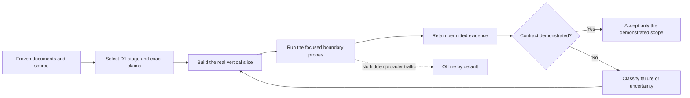
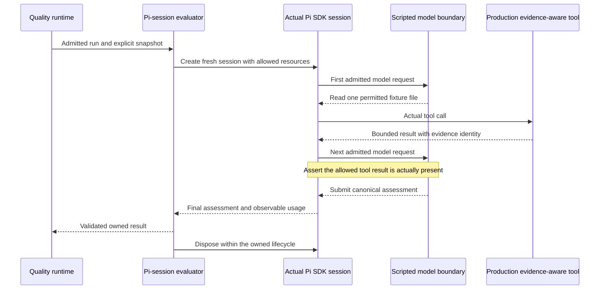

## Pi Quality Engine — Implementation Handoff and Integration Probes 🧭

**Document 06 · Implementation supplement 2 of 2 · Handoff H1 · Preserves A1 / C1 / O1 / D1 / M1**

This is the practical entry point for implementing Pi Quality Engine. It identifies the first working increment, freezes the inputs that must not drift, and turns the remaining integration assumptions into small, observable experiments. Its purpose is to let an implementing agent proceed without inventing host APIs, introducing mandatory donor plugins, or replacing unresolved behavior with success-shaped placeholders.

The target remains one standalone Pi package. Short assessments, ordinary model judgments, and fresh tool-assisted Pi reviewers share one managed check-execution path. Existing project documents supply requirements. Engine-owned requests have a single accounting owner. Standard diagnostics describe the work without retaining raw project or model content.

**The original starting deliverable below was S1, not the complete product.** Its work order is retained as a baseline, not a reset instruction. Bounded S1 and the K04/0.2.0 direct-assessment increment are now accepted; read the [current checkpoint and evidence](00-document-catalog-and-reading-guide.md#current-checkpoint). The next canonical locator is [K05 — clean Pi reviewers](08-development-checkpoints-and-release-checklists.md#k05). This navigation does not implement/launch K05, claim full S2 exit, or authorize paid evaluation or consequential feedback.

> [!important] Read this as an execution plan, not an executed report
> The source observations below come from the frozen repositories and the five companion documents. Every probe procedure is initially **not-run**. Nothing in this document asserts that a candidate package has been installed, a clean reviewer has been exercised, a provider has been billed, or a filesystem guarantee has passed. A generated report must contain actual evidence before its state changes.

### Authority and the complete document set 📑

| Document | Authority | How this handoff uses it |
|---|---|---|
| [01 — Architecture and Decisions](01-architecture-and-decisions.md) | A1 intent, invariants, ownership, and architectural decisions. | Defines which implementation shortcuts are unacceptable. |
| [02 — Component Contracts and Configuration](02-component-contracts-and-configuration.md) | C1 configuration, types, component methods, permissions, and operations. | Supplies the exact public contract used by fixtures and implementation. |
| [03 — Observability and Data Policy](03-observability-and-data-policy.md) | O1 event fields, projection, usage, storage, capture, and restoration. | Supplies the oracles for diagnostic and accounting probes. |
| [04 — Implementation, Testing, and Acceptance](04-implementation-testing-and-acceptance.md) | D1 stages, D/O acceptance obligations, evaluation method, and release decisions. | Determines acceptance; H1 does not introduce another release process. |
| [05 — Implementation Map and Dependency Rules](05-implementation-map-and-dependency-rules.md) | M1 responsibility placement, import direction, assembly, and reuse boundaries. | Determines where the production change belongs. |
| **06 — Implementation Handoff and Integration Probes** | Practical work order, source acquisition, probe recipes, evidence, and interpretation. | This document; procedures refine existing obligations without changing them. |

If a procedure reveals a genuine contradiction, the owning A1/C1/O1/D1 document is amended explicitly. A probe is not permitted to weaken a requirement in order to fit a convenient library. Internal helper names and file grouping may change under M1; public semantics may not change silently.

The **P-01–P-10 identifiers are probe-family references**, not new runtime event names, configuration keys, component kinds, or an alternative acceptance catalog. Each family maps to existing D1/O1 obligations. Several cases can share one ordinary test file and production adapter.

### Reading routes 🗺️

| Immediate need | Route |
|---|---|
| Start implementing without reading this document linearly | [1 — Immediate handoff](#section-1), [4 — S1 work order](#section-4) |
| Acquire the correct source and avoid moving baselines | [2 — Frozen inputs](#section-2), [3 — Environment](#section-3) |
| Understand what each experiment must prove | [5 — Probe discipline](#section-5), then the relevant P-family |
| Connect to real Pi rather than a fake host | [6–8](#section-6), [11–12](#section-11) |
| Verify evidence, costs, and privacy | [9–11](#section-9), [14](#section-14) |
| Resolve Pino, rotation, and storage assumptions | [13 — P-08](#section-13), [18 — Decision rules](#section-18) |
| Produce a useful implementation report | [19 — Evidence](#section-19), [21 — Handoff](#section-21) |
| Find exact files, symbols, and source identities | [17 — Source map](#section-17), [23 — Fingerprints and references](#section-23) |



<a id="section-1"></a>

## 1. Immediate handoff: what to build and what to preserve 🎯

### 1.1 The assignment in operational terms 🛤️

Implement one real, observable path from a primary Pi event or an elapsed-time condition to a deterministic assessment. Use the C1 registry and actual runtime. Record its trigger, admission, context metadata, outcome, and no-action decision through O1. Demonstrate that the same path can be activated by a separately installed contribution. Do not spend on a model or deliver feedback in this first slice.

That instruction is deliberately narrower than “implement all interfaces.” A directory of empty evaluators is not S1. A small working check that uses the real event adapter, scheduler, context boundary, projector, and journal is S1 evidence, provided unsupported capabilities are honestly unavailable.

The implementation should begin by translating the needed C1 declarations and schemas into compilable production files. Where a public declaration is not yet exercised, it may remain a declaration or an explicitly unavailable capability. It must not become a callable stub returning `completed` or `no-supported-finding`.

### 1.2 The non-negotiable starting conditions 🧱

| Condition | Concrete consequence for the first implementation |
|---|---|
| Standalone package | No installed Warden, OMP Advisor, Ribbons Advisor, pi-jev, or pi-subagents supplies functionality. |
| Original requirements remain authoritative | Source references point to existing documents; no second hand-maintained rule catalog is created. |
| No implicit spending | Missing configuration means `enabled: false`; no model route is inherited merely because the primary has credentials. |
| Observation before consequences | The first enabled fixture uses `mode: observe` and a deterministic evaluator. |
| Time is a real integration boundary | At least one check becomes due while no new primary completion occurs. |
| Explicit ownership | Runs, attempts, effects, reviewer sessions, and journal generations are attributable. |
| Metadata-only default | Source bodies, command values, prompts, tool output bodies, model prose, and exception messages do not enter Standard or Trace without separate capture permission. |
| Tests exercise production | No test-mode branch, alternate fake engine, fixture-name detection, or private-method exposure is introduced. |

A failure to provide a required feature is a visible capability limitation, not a reason to fabricate success. A source-only or partially integrated stage can still be useful, but its acceptance statement must match what actually ran.

### 1.3 Decision ownership during implementation 🧭

A coding agent can choose internal file grouping, use ordinary functions instead of classes, select a simple bounded queue representation, and repair a demonstrably incorrect test fixture. It cannot rename C1 fields, weaken source protection, switch an approved provider, change the elapsed-time meaning of rotation, or remove stop protection without an explicit contract decision.

The test oracle is the applicable contract plus the fixture's stated task. When a test disagrees with the contract, determine which is wrong rather than automatically changing production code. Conversely, “keep the code simple” does not justify omitting the state required to distinguish a stopped operator from a naturally idle agent.

> [!note] Simplicity is judged by responsibility
> A small injected clock is justified because time is an actual production boundary. An entire parallel scheduler simulator is not. A read wrapper is justified because source grants and manifests must apply to reviewer tools. An abstract factory around every pure helper is not.

### 1.4 A completed handoff produces evidence, not confidence language 🧾

At the end of an implementation increment, the report should identify the candidate, the exact capabilities implemented, the cases executed, the artifacts retained, and what remains blocked or unavailable. Statements such as “the SDK supports this” are source observations; statements such as “this adapter queued the message and the next model request contained it” require an executed trace.

D1 gate states remain `not-run`, `passed`, `failed`, `blocked`, and `not-applicable`. These are report states only. They do not replace C1 assessment outcomes or O1 event fields.

<a id="section-2"></a>

## 2. Frozen inputs, source acquisition, and artifact identity 📌

### 2.1 The source baseline does not move with development 🔒

The inherited source baseline is **12 October 2026**. The following full commit IDs identify the inspected repository trees. A manifest version is recorded for orientation; it does not prove that a published npm package contains identical bytes. A Git blob SHA returned for one file is not the repository commit.

| ID | Repository | Manifest version at the pin | Repository commit |
|---|---|---|---|
| B1 | [earendil-works/pi][pi-root] | Coding Agent `1.1.0` | `c661bc574f9e9713cc2af567fc1ac00621377a0c` |
| B2 | [DevMortimer/pi-warden][warden-root] | `1.6.0` | `74989d5adf091c9cb5651450917d9f110e3fba2d` |
| B3 | [riposta/pi-jev][jev-root] | `0.2.3` | `7c1ab8c82b66d845eda0f5cd111f858e9aed0cd1` |
| B4 | [Scott-Meyer/pi-omp-advisor][omp-root] | `0.7.2` | `95917211d150ff95484fc3bb85462656bf9ebdfb` |
| B5 | [ribbons-digital/pi-advisor][ribbons-root] | `0.5.0` | `34a148e7993bf6f5661e0bdc92b4391ec072e8db` |
| B6 | [pinojs/pino][pino-root] | `10.4.0` | `b29dbe97820630e7128e464c50263b427965ec99` |
| B7 | [iccicci/rotating-file-stream][rfs-root] | `3.2.10` | `f00ed46c57fc25e9ac4c535f32134338f84cd9c4` |
| B8 | [storytold/photocraft][photocraft-root] | Workspace `0.7.0` | `78c611007be069535d76813b339461bc2d75114e` |

B1 is the host reference. B2–B5 are source donors. B6/B7 are replaceable implementation candidates for logging. B8 supplies command-oriented design inspiration; neither a Rust toolchain nor a running graphics application is a prerequisite for Quality Engine.

It is unnecessary to clone or build every donor before the first commit. Acquire the source needed for the current boundary. Do not turn source provenance into installation of several independently active observers.

### 2.2 Separate source inspection from dependency execution 📂

Keep reference checkouts outside the observed fixture project, production package, and publishable artifact. A suitable layout is a sibling `quality-references` directory. The exact directory name is an implementation choice.

The following commands acquire B1 into a new destination and select the fixed tree. They are instructions for implementation; this document does not claim they have been executed.

```sh
git clone --no-checkout https://github.com/earendil-works/pi.git ../quality-references/pi
```

```sh
git -C ../quality-references/pi checkout --detach c661bc574f9e9713cc2af567fc1ac00621377a0c
```

```sh
git -C ../quality-references/pi rev-parse HEAD
```

```sh
git -C ../quality-references/pi status --porcelain=v1
```

The first result must be the full B1 commit; the reference checkout should have no local changes. `--no-checkout` avoids immediately populating the default branch before the deliberate checkout. Source acquisition still uses the local Git configuration and network; it is not a sandbox for an untrusted global filter or credential helper.[^git-clone]

Use the same procedure for a selected donor with its own repository and SHA. If the pin cannot be resolved, record `blocked` for that acquisition and investigate the exact identity. Never substitute `main`, a similarly numbered tag, or a nearby commit silently. A partial/shallow fetch strategy is acceptable only if it actually resolves and verifies the required commit.

No `npm install`, donor build, package activation, or donor test suite is implied by source checkout. Review the selected files and license first. Only libraries actually used by the candidate require dependency installation.

### 2.3 Record three distinct identities 🏷️

The build record distinguishes the **source tree**, the **installed package artifact**, and the **loaded runtime**. For the Pi host, record the package version, resolved entry point/build identity where available, runtime-reported version, and the basis for relating that artifact to B1. For the engine, record the candidate commit, local dirty state, lockfile digest, and packed artifact digest.

A source build can establish a direct connection to B1. A published artifact can be used after verifying its actual declarations and behavior; a matching version string alone is weaker evidence. An unavailable artifact does not justify letting an unqualified package manager command choose a newer host.

The reference manifest is not an application lockfile. The implementation uses one lockfile for actual runtime and development dependencies. Record the Node, compiler, and package-manager versions used. D1's starting test approach is compiled TypeScript executed through `node:test` and `node:assert/strict`; another runner requires a practical reason, not inheritance from every donor.

### 2.4 Provenance follows the code that is actually reused ⚖️

For every copied or adapted unit, retain the repository, full commit, exact path and symbol, local destination, modifications, relevant tests, and required notices. A small provenance table or JSON file beside the existing third-party notices is sufficient. Prompt text copied from a donor is source material too.

M1 already identifies which donor mechanisms are candidates and which assumptions are rejected. Reusing a small function does not authorize importing the donor's complete runtime. Declaring a library dependency does not prove that all distributed transitive material has been reviewed.

The relevant pinned license and provenance files are linked in [section 17](#section-17). Release inspection applies to the actual tarball, not merely to the repository homepage.

<a id="section-3"></a>

## 3. Reproducible environment and safe execution surface 🧰

### 3.1 A probe runs in an isolated, disposable workspace 📦

Create a temporary Pi agent directory, session/state locations, test project, and verification-output directory. Do not run probes against the operator's real settings or a personal repository. The primary model, test tools, and any independent contribution are explicit fixture inputs.

The child environment should be constructed deliberately. Preserve only the platform variables needed to start Node, Git, the filesystem, and the selected terminal mode. Supply an isolated home/agent configuration and test credential path. Unrelated provider keys, `NODE_OPTIONS`, module-path overrides, agent directory overrides, proxy settings, and unapproved service credentials must not leak into the probe merely because the parent shell has them. Required approved settings can be reintroduced by the probe plan.

An allowlist is an environment-construction strategy, not a demand for a universal sandbox. A loopback server or test provider can still access the process environment unless the driver removed those values. Record the names of explicitly provided settings when useful; never dump credential values into evidence.

Dependency acquisition may use package-manager networking as a separate setup operation. Ordinary test execution must not contact a public model service. A scripted in-process provider or a loopback fixture endpoint is permitted and must be identified as synthetic. No installer, status operation, or package registration may hide live model traffic.

### 3.2 Preserve the host's package boundary 🧩

The pinned Pi package guide supplies `@earendil-works/pi-ai`, `@earendil-works/pi-agent-core`, `@earendil-works/pi-coding-agent`, `@earendil-works/pi-tui`, and `typebox` to extensions. It directs extensions to declare these as peers and not bundle physical runtime copies. Independently installed Pi packages have separate module roots.[^pi-packages]

The candidate manifest and built output must preserve that arrangement. An isolated development environment may contain the exact host package needed for compilation and verification; the distributed engine must not include a second host runtime as an ordinary bundled dependency.

Do not assume `@earendil-works/pi-telemetry` is supplied merely because it is in the Pi monorepo. It is not in the inspected host-supplied list. A deliberate import needs an explicit dependency or a confirmed supported host export. Its reference in-memory adapter is also not the production journal: it is unbounded and lacks timestamps.[^pi-telemetry]

### 3.3 Use D1's existing commands, not a second probe framework 🛠️

| Repository task to implement | H1 use | Network/side-effect boundary |
|---|---|---|
| `npm run build` | Produce the candidate and packaged resources. | No model requests. |
| `npm run check` | Static validation and ordinary deterministic tests. | No public provider traffic. |
| `npm test` | Production logic/runtime cases. | Temporary local fixtures only. |
| `npm run test:pi` | Actual Pi lifecycle, reviewers, and contribution probes with scripted routes. | No billable credentials. |
| `npm run test:package` | Inspect and install the packed candidate in isolation. | Setup may acquire packages; runtime uses scripted routes. |
| `npm run test:live -- ...` | Explicitly approved provider and model-quality experiments. | Recorded route, data permission, and spending plan required. |
| `npm run bench -- ...` | Local workload envelopes and diagnostics overhead. | No implicit model traffic. |

These tasks are to be supplied by the implementation repository. The Markdown files alone do not make the commands executable. Probe-family selection can be a small driver argument or the chosen runner's ordinary filtering mechanism. H1 does not prescribe another public configuration file, task graph, or test server.

When an npm lockfile has been created and reviewed, the ordinary dependency-install command is:

```sh
npm ci
```

This executes the installation behavior configured for that candidate; scripts and native steps should be understood first. `npm ci` uses the lockfile rather than silently repairing a manifest/lock mismatch.[^npm-ci]

### 3.4 Freeze the environment before interpreting timing 🕰️

A probe report records OS, architecture, Node version, package manager, compiler, Pi build and host mode, candidate identity, filesystem, privilege context where relevant, and exact configuration revisions. A native Windows file test and a Linux file test establish different facts. A clean SDK run does not establish TUI Stop behavior.

For timing tests, declare an acceptable lateness envelope appropriate to that environment before running acceptance. No universal millisecond claim is introduced here. A deterministic scheduler test establishes arithmetic and state transitions; a real-clock host probe establishes that a timer is actually armed and handled without a new primary event.

<a id="section-4"></a>

## 4. The first working increment: exact S1 work order 🌱

### 4.1 Begin with the smallest real slice 🧭

Translate the C1 types and the subset of schemas required by the first check into production code. Build the configuration resolver and acknowledged registry. Attach the actual primary host adapter. Add the session-owned runtime, clock/deadline service, one count trigger, and one temporal trigger. Supply a simple real context, `core.repeated-tools`, and `core.record-only`. Add O1 projection, bounded history, a journal destination, and the essential checkpoint/ownership foundation at the same time.

This is an order of completed behavior, not a requirement for one commit or class per item. A commit should leave an understandable working path. Generating all M1 folders before implementing any of them is not progress.

The built-in evaluator must apply its real deterministic logic to fixture observations. It must not return the expected result based on a test label. Registration and status can work before a paid evaluator exists, but an unavailable evaluator remains unavailable.

### 4.2 Reuse the complete no-paid-call C1 configuration 📝

The following is the existing C1 pattern, included here as an implementation starting input. It is configuration for the proposed engine, not for Pi itself. It does not create a new schema or rename `checks` to a module list.

```yaml
schemaVersion: 1
enabled: true
mode: observe

prompts:
  repetition:
    use: core.prompt-files
    options:
      instructions: ["builtin:repetition-v1.md"]

contexts:
  recent-work:
    providers:
      - id: task
        use: core.task
      - id: history
        use: core.history
        options:
          limit: 12
          includeToolBodies: false
      - id: waits
        use: core.waits
    maxEstimatedTokens: 4000

evaluators:
  repetition-check:
    use: core.repeated-tools
    options:
      window: 12
      minimumRepeats: 3

policies:
  record:
    use: core.record-only

checks:
  repetition:
    triggers:
      - id: every-five
        use: core.every-tools
        options: {count: 5}
      - id: periodic
        use: core.periodic
        options: {everyMs: 120000, requireNewEvidence: true}
    context: recent-work
    prompt: repetition
    evaluator: repetition-check
    policy: record
    criteria: [efficiency.repetition]

observability:
  detail: standard
  presentation: summary
```

A short test may use a smaller positive `everyMs` through this ordinary configuration field. That is a fixture parameter, not a production test flag or a change to the shipped example. With `requireNewEvidence: true`, the periodic fixture must establish eligible new evidence and expected work before waiting; a timer that correctly declines a no-new-evidence check is not broken.

The user file location, project trust, merge semantics, and permission ceiling remain those in [C1 section 2](02-component-contracts-and-configuration.md#section-2). A fixture must not rely on the shell's current directory to reinterpret a declaration-relative resource URI.

### 4.3 The first demonstration has two causes and one execution path 🔄

Cause one is five uniquely identified primary top-level tool completions. Cause two is a due temporal condition while the primary emits no further tool completion. Both must reach the same admission, context, evaluator, policy, and diagnostic code.

The demonstration should show a repeated operation as well as a harmless sequence. It should also show that a known wait and an operator stop are not treated as instructions to restart the primary. At S1 the policy records only; no success claim about feedback delivery is made yet.

A Standard journal should permit following `quality.trigger.due`, check admission/start, context metadata, assessment outcome, policy decision, and check settlement by their actual O1 correlation IDs. If a needed event family is not implemented, the capability/report must say so rather than claiming complete observability.

### 4.4 Integrate one real contribution before the core hardens 🔌

Create a small independent Pi package that contributes a trigger and a context or sink component through C1. It must be installed separately, not imported from the engine's private source tree. The contribution should change the behavior of a real check, survive the documented readiness protocol, be cancelled or disposed, and appear in normal diagnostics.

Its test can start early with one narrow role pair; full recombination belongs to S4. The early proof exists to reveal hidden built-in bypasses, not to create a gallery or a generalized plugin-development kit.

### 4.5 S1 ends before paid assessment and autonomous feedback 🛑

The S1 report includes actual no-paid-call host behavior, exact defaults, count/time and stop tests, independent registration, permitted journals, and the current logger/rotation decision. Direct model adapters and fresh reviewers are S2 work. They may have small exploratory source/probe files under development, but they are not silently enabled by the first profile.

Do not allow the presence of an operator API key to collapse this order. A no-paid-call stage has no reason to acquire public model credentials.

<a id="section-5"></a>

## 5. Probe catalog, execution rules, and claim boundaries 🧪

### 5.1 Ten small probe families, one existing acceptance system 🗺️

| Probe | Boundary under investigation | Primary D1 obligations | Earliest useful stage |
|---|---|---|---|
| **P-01** | Frozen host/package identity, SDK surface, and inert distribution. | D-01, D-05, D-36. | S1 setup; repeat on packed candidates. |
| **P-02** | Configuration, independent registry discovery, readiness, and cleanup. | D-02–D-04, D-11, D-35. | S1. |
| **P-03** | Real primary lifecycle, counting, time, waits, and operator stop. | D-06–D-12. | S1; effect subcases repeated in S3. |
| **P-04** | Original source acquisition, context coverage, and read-only Git evidence. | D-13–D-17, D-26. | S2; source subset in S1. |
| **P-05** | Direct model admission, structured results, request identity, and usage. | D-16–D-19, D-29. | S2. |
| **P-06** | Clean Pi-session reviewer, tools, input manifests, limits, and disposal. | D-05, D-20–D-22, D-29. | S2. |
| **P-07** | Feedback inclusion, expert checks, freshness, and uncertain effects. | D-11, D-23–D-26, D-33. | S3. |
| **P-08** | Actual serializer/destination, pressure, closure, rotation, and retention. | D-27, D-31, D-32, D-36. | Candidate probes in S1; full storage proof by S4. |
| **P-09** | Cross-surface privacy, functional checkpoint recovery, and cost independence. | D-27–D-30, D-33, D-34. | S1 foundation; S2/S3 full path. |
| **P-10** | Installed standalone path, platform/mode matrix, and optional live route evidence. | D-05, D-35–D-40. | S1 smoke; S4 declared release scope. |

The table groups work; it does not require ten new executables. A short table-driven test may cover several cases. The D/O acceptance IDs remain the requirements and should appear in the generated results. The P identifiers explain which integration experiment supplied the evidence.

### 5.2 Every case has an independent oracle 🧭

Before executing a case, write down the contract claim, fixture state, stimulus, expected facts, allowed uncertainty, and evidence to retain. An oracle must not be “the component returned success.” It should observe the relevant boundary: actual input to the scripted model, unchanged Git state, real destination bytes, a current host receipt, or the independent contribution's behavior.

A positive case needs a meaningful negative control. A log test that finds no secret is weak unless the fixture actually placed the sentinel on the protected surface. A reviewer-isolation test is weak unless the primary environment contains a harmless ambient resource that would reveal accidental inheritance. A no-feedback case is weak unless a valid finding was produced and the policy would otherwise request feedback.

The probe must not change the production algorithm to make the case observable. Use ordinary injected I/O boundaries, scoped event subscribers, temporary files, and supported SDK provider registration. A test-only copy of the scheduler proves only that copy.

### 5.3 Keep three evidence layers separate 🔎

**Source inspection** establishes that a method or behavior appears in the pinned implementation. **Local integration** establishes what the candidate adapter actually did in one controlled host/environment. **Live route validation** establishes what a particular real provider exposed for the approved request.

The layers can disagree. A documented API may be absent from an installed artifact. An SDK fixture can produce complete usage while a real provider omits it. A Writable can pass simple writes and fail during rotation. The report states the strongest demonstrated claim and retains the unresolved limitation.

A blocked live request is not a failure of a passing deterministic scheduler test. It is also not permission to advertise fully observed live billing. Likewise, a passing provider smoke test does not establish the semantic accuracy of overengineering detection; D1's separate model-quality study remains necessary.

### 5.4 Do not hide missing capabilities inside test setup 🚫

A probe must not enable Warden to supply a missing inactivity detector, use pi-subagents to supply a missing reviewer, or read unfiltered SDK files to supply a missing context manifest. It must not enable every ambient extension merely because one approved model route requires a special hook.

When a setup dependency is genuinely needed, record it and distinguish a fixture from a product prerequisite. A local scripted provider is a testing boundary, not an extra plugin required by a normal release. A harmless ambient canary is present only in the isolation experiment; it is absent from the final clean-deployment inventory.

### 5.5 Probe outcomes feed small decisions, not speculative rewrites 🧾

Each completed probe should end with one of a few concrete statements: the adapter meets the contract in the declared environment; the adapter has a specific defect; the candidate library lacks the required public capability; the fixture was incorrect; the host/route is unavailable; or the contract needs an explicit decision.

The next change should address that statement. A failed close test is not a reason to add a distributed event system. A registration race is not a reason to replace Pi's package mechanism. The smallest fix that preserves the existing contract is the preferred response.

<a id="section-6"></a>

## 6. P-01 — Verify the actual host and package boundary 📦

### 6.1 Claim and source anchors 📍

The candidate loads as one Pi extension, uses the host-provided SDK rather than a bundled second copy, and exposes inert public contracts. The actual artifact can create a deliberately configured reviewer with the documented SDK options.

Inspect B1 [package guidance][pi-packages-file], [`CreateAgentSessionOptions` and `createAgentSession`][pi-sdk-source-file], the [full-control example][pi-full-file], and the [extension declarations][pi-types-file]. Do not implement against a remembered API from an older package name or a moving online example.

At B1, `tools` is a string allowlist/modifier interface, `customTools` supplies tool definitions, and a resource loader supplies the session's resources. `modelRuntime`, `sessionManager`, and `settingsManager` are explicit constructor boundaries. The inspected options do not provide a convenient top-level `systemPrompt` field; a prompt belongs in the configured resource path.[^pi-sdk-source]

### 6.2 Fixture and procedure 🔧

Use the actual B1-related host artifact selected for the verification environment, the built engine candidate, and an isolated Pi agent directory. The core identity probe needs no provider credentials.

First, record the host's manifest and actual runtime/build identity. Inspect the candidate tarball or extracted distribution for an accidentally bundled host SDK and for every required prompt/schema resource. Import the candidate's deliberately public contract entry without starting a session. Confirm that the import does not open a journal, create a timer, make a request, or register primary callbacks.

Then load the real extension entry through the normal Pi path. With no Quality configuration, inspect status and component availability. The package must remain inactive for autonomous work. Finally, supply the S1 deterministic configuration and demonstrate that the built artifact—not only `src/`—can resolve its resources and execute the check.

A schema/type compilation check should use the actual installed SDK declarations. This catches argument-shape errors before a live model call. It must not satisfy the compiler by casting a fictional constructor option through `any`.

### 6.3 Required cases and evidence 🧪

| Case | Stimulus | Expected observation |
|---|---|---|
| P-01/source-identity | Compare selected checkout and installed host evidence. | Exact repository SHA when applicable; artifact equivalence explicitly proven or labeled unknown. |
| P-01/inert-import | Import the public contract module only. | No session-owned resources, model traffic, or mutable current-session singleton. |
| P-01/cold-install | Load the candidate without Quality configuration. | `enabled: false`; no model profile inferred; local status available. |
| P-01/resource-pack | Run the deterministic check from the packed artifact. | Built-in prompt/schema references resolve without a source-tree fallback. |
| P-01/peer-boundary | Inspect dependency resolution and load inventories. | No extra bundled copy of the host packages; no undeclared shared package singleton. |
| P-01/sdk-options | Compile and create a minimal controlled session using real options. | Unsupported arguments fail during development; actual resource/model/tool identity can be inspected. |

Retain a package inventory, candidate digest, host identity, and small no-paid-call trace. A version string printed by the CLI alone is not the full evidence bundle.

### 6.4 Failure interpretation 🧯

A missing export in the actual artifact is a host/build mismatch or unsupported integration, not an invitation to import private source files from an unrelated checkout. A resource present in the repository but absent from the tarball is a packaging defect. A second host instance is a dependency-boundary defect. These problems must be corrected before higher-level tests are accepted.

If a published host artifact cannot be mapped exactly to the frozen tree, record that fact and run the required interface/behavior probes against the actual artifact. Do not fabricate equality from the manifest version. Any deliberate host-baseline change must be documented separately from an implementation fix.

<a id="section-7"></a>

## 7. P-02 — Prove configuration, independent registration, and readiness 🔌

### 7.1 Claim and integration constraint 🧭

A separately installed contribution discovers the correct session registry, registers exactly once under the C1 ownership rules, and becomes usable only after acknowledged preparation. Either load order works. A retired endpoint cannot reactivate a component in a replacement session.

C1's existing channels are `quality.registry.available.v1` and `quality.registry.query.v1`. The returned `PackageRegistration.ready` is the preparation boundary. B1's event bus has `emit(...): void`; emitting a notification does not wait for asynchronous listeners. Therefore a test must exercise readiness independently of event delivery.[^pi-bus]

### 7.2 Fixture: a genuinely separate Pi package 📂

The fixture package contributes one bounded trigger and one small context or sink implementation. It uses only C1 declarations and its own declared dependencies. It does not import `runtime.ts`, read a global variable exported by the engine entry, or depend on a hoisted package from a monorepo workspace.

A deferred preparation promise allows the driver to hold readiness, emit a relevant primary observation, and then release preparation. This is an ordinary async boundary. The production registry does not recognize the fixture's name or alter its behavior for tests.

Configure two checks with separate bindings of the same trigger implementation. The result should demonstrate that each binding retains its own cursor rather than consuming a shared module-global counter.

### 7.3 Execution sequence and negative controls 🔄

Load the contribution before the engine. It subscribes, queries, and later receives the endpoint. Repeat with the engine already active. In both cases, verify the endpoint's observed session and generation, the registration result, and the transition from waiting to ready. Emit activity while preparation is unresolved: the dependent check must not evaluate yet.

After readiness, drive the trigger through a real check and observe its result in the normal O1 path. Repeat the same registration from the same installed instance and verify idempotence. Submit a conflicting component ID from a different owner and verify explicit rejection.

Next, dispose the registration while one check is pending. It must stop admitting new work and release its resources. Repeat with preparation completing after generation retirement. The late completion must not reattach itself to the newly active generation.

Apply one invalid core configuration, one invalid contributed `options` object, and one forbidden project override. The running accepted configuration must remain unchanged after a failed explicit apply. Cold startup with invalid configuration remains inactive instead.

### 7.4 Case matrix 📋

| Case | Expected assertion | Evidence owner |
|---|---|---|
| P-02/load-order | Subscribe-then-query works in both orders. | Actual registry handshake and independent package. |
| P-02/delayed-ready | Dependent checks wait; readiness activates them only under valid grants. | Registry and runtime admission records. |
| P-02/duplicate | Same-instance repetition is idempotent; a distinct conflicting owner fails. | Registration receipt and component inventory. |
| P-02/binding-state | Two trigger bindings keep independent counters and deadlines. | Admitted runs associated with binding IDs. |
| P-02/prepare-failure | One package fails without pretending to be partially ready or disabling unrelated packages. | Readiness result and unavailable-check reason. |
| P-02/dispose-reload | Old listeners, sources, and deadlines cannot produce new work. | Listener effects, generation IDs, cleanup evidence. |
| P-02/config-transaction | Invalid apply preserves the prior revision and grants. | Effective configuration before/after and rejection record. |
| P-02/packed-contribution | The independent package works after packaging, without source-root imports. | Installation manifest and real check trace. |

### 7.5 Source reuse and limits 📎

B1's [event-bus lifecycle regression][pi-reload-file] supplies an excellent behavioral reference: it tests listener cleanup after reload and rejects use of a stale API. Reuse the scenario, not the upstream internal test harness as a production dependency. Our own late evaluator, timer, and sink callbacks still require generation checks even if Pi cleans up its event listeners.[^pi-reload]

A passing registration demo is not complete extension conformance. The contributed component must actually run, participate in diagnostics, receive cancellation, and unload. Additional roles are covered incrementally and in P-10's final recombination proof.

<a id="section-8"></a>

## 8. P-03 — Prove primary lifecycle, time, waits, and stop protection ⏱️

### 8.1 Claim: the observer can diagnose silence without inventing authority 🧠

The runtime must receive actual Pi lifecycle facts, count selected primary completions once, and schedule time-based diagnosis without waiting for another tool event. It must distinguish activity from progress, a live dependency from abandonment, and operator stop from natural idle.

B1 distinguishes actionable `turn_end`/`agent_before_settle` boundaries from notification-only `agent_settled`. It also permits parallel tool calls from one assistant message. The adapter must derive C1 facts from those semantics rather than assign one fictional “step” to every callback.[^pi-events]

### 8.2 Establish a host event map before asserting behavior 🗺️

Use a real Pi session with a scripted model and a few disposable tools: one immediate success, one held until the driver releases it, and one explicit failure. Record the observed event names, operation IDs, terminal messages, and supported cancellation signals. The fixture's event observer is diagnostic only; it does not drive a second implementation of the lifecycle.

The map should identify which observation establishes activity, which establishes a completed top-level tool, which establishes a completed cycle, and which merely reports notification or queued work. If the host does not provide a fact, the adapter must report that limitation instead of deriving certainty from a UI spinner or file modification time.

`ExtensionContext.signal` can be absent while the primary is idle. `isIdle()` means not streaming; it does not mean the task is complete. A generic lifecycle callback also does not gain `ExtensionToolContext.executeTool()` or command-only session replacement methods merely because a TypeScript cast is possible.[^pi-types]

### 8.3 Count probe: identifiers, not array order 🔢

Configure `core.every-tools` with count five and its default top-level selection. Emit five distinct terminal primary operations. Repeat one terminal fact, vary completion order for sibling tools, and introduce reviewer/engine-origin operations. Assert one qualifying count per unique selected completion and no count inflation from observer work.

Then configure `core.every-cycles`. A single assistant cycle with multiple tools must exercise the difference between tool and cycle counts. Test separate bindings concurrently so one does not advance the other's cursor.

A failure of the resulting assessment must not rewind the threshold and make the same fifth completion newly due. Coalesced reasons remain traceable; they do not become another five-tool batch automatically.

### 8.4 Timer probe: two clocks and actual inactivity 🕰️

Deterministic cases drive the production scheduler's clock boundary. Set a short permitted interval in the fixture configuration, establish relevant evidence, and advance monotonic time while wall time stays fixed. Then change wall time without advancing monotonic time. Eligibility must follow its declared clock rather than calendar jumps.

A separate real-clock smoke case proves that the native timer adapter actually fires with no additional primary event. Declare the allowed lateness before execution. Do not assert execution at an exact nanosecond or use a long arbitrary sleep as the sole synchronization primitive. Node timers run when the event loop can service them; precise callback timing is not guaranteed.[^node-timers]

For suspension/restoration, advance or rebase the appropriate clock model according to C1 and send the supported restoration signal. The result is a bounded reassessment of current conditions, not a burst of one check for every missed interval. A primary or observer state change after the deadline is rechecked before admission.

### 8.5 Distinguish periodic, inactivity, no-progress, and wait expiry 🚦

| Fixture | Required observation | Incorrect behavior to catch |
|---|---|---|
| Work expected, recent evidence exists, no next tool event. | Periodic/inactivity check can become due through time. | Event-only runtime never evaluates. |
| A long identified tool remains active. | Waiting evidence is preserved; diagnosis does not declare it dead without support. | Arbitrary quiet-period threshold becomes automatic cancellation. |
| Many repeated reads, no supported progress. | Activity advances, progress does not automatically advance. | Every tool result resets the progress clock. |
| Investigation produces a supported new hypothesis/result without editing code. | Progress evidence can advance without code mutation. | “No changed lines” is always interpreted as stagnation. |
| A known dependency passes its review deadline. | Wait-reconciliation reason names that dependency. | Generic failure or duplicate restart with no owner. |
| Work state is unknown. | Assessment preserves uncertainty; no invented unfinished-task authorization. | Idle plus elapsed time equals permission to continue. |

OMP's oldest-pending-message timer is a useful accumulation mechanism, not a substitute for these separate work-state cases. Its `#scheduleFlushTimer()` starts from pending observations and does not establish task completion or process liveness.[^omp-cadence]

### 8.6 Stop, pause, reload, and non-cooperative work 🛑

Exercise an operator stop through the actual host mode being claimed, not only by setting a mock boolean. Hold an evaluator result, stop the primary, then release the result. Observe mode remains consequence-free; at S3 the same trace must show that neither feedback nor an idle wake regains authority.

Pause and resume the observer. It may re-establish diagnostic eligibility, but it does not clear the primary stop. Reload or replace the session while an old deadline and an old evaluator are pending. Their late callbacks cannot invoke the new host context. Observable late usage may still reconcile through the original attempt owner.

Create one non-cooperative request fixture that does not settle after cancellation. The runtime retires its authority but preserves the applicable occupied capacity and unknown spending. A timeout must not free an unlimited sequence of replacement requests. This is a controlled fixture of one real async boundary, not a simulated alternate provider framework.

### 8.7 Required evidence and scope of the result 🧾

Retain the accepted primary observation IDs, trigger binding IDs, count/deadline snapshots, current work/stop state, run admission records, and any suppressed-effect reasons. A real-clock case reports configured delay and observed lateness. A reload case records both generations.

An in-process timer cannot prove recovery from a terminated or permanently event-loop-blocked Pi process. That limit is documented rather than hidden by a test that calls the scheduler manually after the process would have stopped. External process supervision is outside the built-in observer's guarantee.

<a id="section-9"></a>

## 9. P-04 — Prove source integrity, final context, and Git evidence 📚

### 9.1 Claim: assessment input corresponds to declared project evidence 🧭

The context path must preserve original requirement sources, declaration-relative resolution, coverage, version identity, and source grants. It must report what the evaluator actually receives, not just which paths were configured. The Git collector must leave repository state unchanged while retaining episode-relative evidence where the initial baseline is known.

C1 sections 9–10 and O1 sections 5/8 are the controlling contracts. Warden's `rules.ts` and `turn-rules.ts` are donor references only. Their input caps and temporary-index strategy are not substituted for C1's context behavior.[^warden-rules][^warden-turn]

### 9.2 Build a small fixture with deliberately different source roles 🗂️

Use an ordinary temporary project with `AGENTS.md`, one architecture document, one requirements document, a small source module, and a test file. Put a distinct harmless marker in each body. Include one protected source, one missing required source, and one optional source that cannot be read. Place generated logs and checkpoints outside the allowed project evidence by default.

Declare one source from a user configuration directory and one from a project configuration directory. Run the same fixture with a different process working directory. Source resolution must remain tied to the declaration or explicit `project:` root rather than whichever directory launched the command.

The source-control fixture is independent of the content-disclosure fixture. Code may be passed to the evaluator while omitted from diagnostics. Never “pass” privacy by starving the evaluator of evidence that its declared check requires.

### 9.3 Check each acquisition stage independently 🔎

Inspect configured sources, successful retrievals, selected fragments, and the final-observable model input. Use harmless synthetic content so the test provider can inspect the actual submitted bytes without retaining private project data in an ordinary journal.

A provider request includes instructions, evidence, serialization, and possibly tool definitions. The final manifest must identify the boundary it observes. SDK input is not automatically identical to provider wire bytes. A count derived from selected files must not be labeled exact provider usage.

| Case | Stimulus | Required result |
|---|---|---|
| P-04/declaration-root | Change the launching shell directory. | Resolved resources and grants remain tied to their declarations. |
| P-04/required-missing | Remove a required document before assembly. | Incomplete coverage; no complete positive or categorical corrective verdict. |
| P-04/optional-missing | Remove an optional reference. | Limitation is recorded without inventing its content. |
| P-04/budget-cut | Exceed a context budget with a required source. | Final manifest states what was not included; no silent success. |
| P-04/version-pin | Change a requirement during an active episode. | The original approved revision is retained or declared unavailable; the new prose is not self-authorizing. |
| P-04/final-input | Include unique allowed markers in several sources. | The scripted evaluator sees the selected markers; excluded markers remain absent. |
| P-04/unknown-uri | Put an unsupported URI or hyperlink in evidence. | No automatic network resolution or hidden source acquisition. |
| P-04/protected-search | Search a root containing excluded files. | Results do not reveal disallowed names/fragments through a different tool surface. |

Source filtering must apply to text, structured output, search fragments, and images as appropriate. A protected path cannot become allowed because a result is labeled JSON instead of text.

### 9.4 Git fixture matrix: distinguish baseline from final state 🌳

Create a real temporary Git repository and record its initial HEAD, index bytes/state, working files, stash references, and configuration. The collector's operations use controlled argument arrays and read-only inspection. Disable external diff/text-conversion behavior where applicable; model text must not become a shell command.

| Repository setup | Deliberate fixture action | Expected episode-relative evidence |
|---|---|---|
| Clean tracked file. | Edit after episode start. | Before/after evidence attributable to the observed repository interval. |
| Dirty tracked file before start. | Make an additional edit. | Preserve the dirty starting body; do not blame all changes from HEAD on this episode. |
| Staged hunk plus unstaged changes. | Change another hunk. | Preserve index and worktree distinctions; no staging/reset/stash by the collector. |
| Existing untracked file. | Modify after baseline capture. | Treat it as pre-existing, not newly created. |
| Verified-absent path. | Create during the episode. | Treat as new only because absence was established. |
| Path outside a bounded initial enumeration. | It appears in the final scan. | Unknown initial existence/body; partial coverage rather than invented absence. |
| Work committed during the episode. | Execute the fixture's explicit commit. | Relevant change remains visible after the working tree becomes clean. |
| Another writer changes a file. | Driver changes it outside primary-tool attribution. | Repository evidence with attribution limits, not proof of primary authorship. |
| Initial body exceeds the evidence budget. | Change the file later. | Missing baseline remains explicit; no reconstruction from a convenient final diff. |
| Repository absent or unreadable. | Invoke the collector. | Scoped unavailability/partial evidence without mutating the environment. |

The fixture driver's deliberate commit or file edit is distinct from collector behavior. Instrument or record the collector's actual Git invocations and compare state around each acquisition. Otherwise a test that intentionally creates Git objects can mask the collector's accidental object writes.

### 9.5 Do not copy Warden's snapshot side effect 🛑

B2's `workTree()` copies the index to a temporary file and runs `git add -A` plus `git write-tree`. It avoids changing the real index but can populate repository objects with working-tree content. C1 explicitly chooses bounded read-only inspection instead.[^warden-turn]

The probe therefore checks more than “the file still looks the same.” In a controlled repository without concurrent maintenance, retain before/after evidence for the real index, working files, stash/configuration, and relevant object-store changes caused by the collector. No collector path may invoke broad staging, reset, stash, or tree construction as a hidden snapshot shortcut.

Do not build an entire Git emulator to test this. Use a real small repository and a narrow command-recording boundary. A missing baseline should produce a truthful partial result, not a more invasive fallback.

### 9.6 Freshness cases and expected artifacts 🔁

Hold an evaluation after its context is assembled. Change an unrelated file and let the result finish; the result should not be globally cancelled merely because any event occurred. Repeat by changing an actual finding dependency or a requirement revision; before corrective dispatch, the result must become stale or require a fresh investigation.

Retain source/manifest metadata, selected request assertions from harmless fixtures, initial/final repository state checks, and the dependency-freshness outcome. A hash proves equality only in its named domain. It does not restore an unavailable original source or establish who authored a shared-worktree change.

<a id="section-10"></a>

## 10. P-05 — Prove direct model admission, results, and owned usage 💰

### 10.1 Claim: every owned request has a route, attempt, and honest outcome 🧾

A direct classifier or chat evaluator uses the approved model profile, the shared owned request service, a final input manifest, and one functional attempt identity. Result validation is independent of billing. Failures and partial visibility remain explicit rather than becoming a clean engineering assessment.

The pinned Pi model guide exposes typed classifier calls; they are not arbitrary chat completions. The adapter must follow the actual installed signature and capability. It must not depend on the pi-jev plugin to reach the native classifier route.[^pi-models]

### 10.2 Use a scripted route before a live provider 🧪

The first route is a supported in-process scripted provider or a loopback endpoint behind the normal adapter. It records request arrival and returns controlled data: a valid no-finding result, a supported finding, insufficient context, malformed structure, a retryable failure, and an intentionally late response. It also returns deterministic usage when the protocol permits it.

This fixture controls the external model boundary, not the engine's result or policy methods. A test that directly returns `AssessmentResult` from a mock evaluator cannot prove request admission, source delivery, provider parsing, or actual usage capture. Such a mock can still be useful in a scheduler unit test, but must not be presented as the P-05 integration.

### 10.3 Admission must precede request arrival 🚥

Preflight the exact provider/model profile, required inputs, supported reasoning, credentials, result mode, and context/output limits. The fixture counts requests received. A denied profile, missing capability, exhausted request allowance, or unapproved fallback must produce no request at that boundary.

Next, admit a valid request and record the attempt before dispatch. Return a malformed assessment while still reporting usage. The result is a failed assessment with an owned billable/estimated attempt, not a free failure or a valid empty review.

Use the ordinary `maxAttempts` and `repairAttempts` fields for explicit retry and repair cases. Their defaults remain one dispatch attempt and zero format repairs. A repair is another owned request and must not create missing evidence or switch to a different route. Retry behavior must have one owner; an SDK retry path that cannot be disabled or observed is a limitation to report, not a count to invent.

### 10.4 Canonical result cases 📐

| Case | Provider response/condition | Required engine behavior |
|---|---|---|
| P-05/no-finding | Valid completed result, sufficient coverage, empty findings. | `conclusion: no-supported-finding`; no fabricated task-complete claim. |
| P-05/supported | Finding references actual issued evidence and an allowed criterion. | Valid scoped finding, subject to policy and freshness. |
| P-05/suspected | Tentative finding or incomplete grounds. | Preserve suspicion and limitations; do not upgrade it by numeric confidence alone. |
| P-05/invalid-reference | Plausible-looking but nonexistent evidence ID/path. | Reject or classify invalid result; do not read arbitrary claimed evidence automatically. |
| P-05/conflict | Requirement sources disagree. | Conflicting/undetermined conclusion, not an invented precedence rule. |
| P-05/schema-failure | Extra/invalid fields or inconsistent conclusion and findings. | Validation failure; costs remain accounted. |
| P-05/repair | One explicitly allowed format repair. | Another owned attempt with the same authorized evidence scope. |
| P-05/route-denied | Unapproved model or unsupported required input. | No network request and explicit unavailable/denied capability. |
| P-05/cancel-late | Logical cancellation occurs before response settlement. | No result authority; late observed usage may reconcile once. |

A criterion score is not a receipt or a cost. Its scale and meaning belong to the assessment resource. A failed API response does not count as a low-quality implementation score.

### 10.5 Usage normalization oracle 🧮

Prepare a small table of synthetic usage cases outside production: ordinary input/output; cached input represented as a subset of total input; cached input represented as a separate partition; output that already includes reasoning; missing fields; a genuinely declared zero tariff; and an unknown tariff. Use O1's defined normalization rather than a donor-specific sum.

The test should compute expected decimal amounts independently from the production aggregation helper. It should also retain the normalized facts that explain the calculation. The main assertions are that cached or reasoning tokens are not added twice, unknown measurements remain unknown, and zero-filled synthetic error usage is not automatically interpreted as a free request.

For duplicate-event protection, deliver the same terminal identity through supported repeated observation paths and ensure the ledger has one recognized contribution. Streaming deltas, a final event, a completed-review total, and a later transcript scan cannot each charge the same request. Replacing a reviewer generation must not reset session-wide owned totals.

OMP's `AdvisorUsageLedger` is a useful source for finalized-message ownership and coverage reporting. Its comments also state that SDK/provider-internal retries and unreported usage are not observable. Those limitations must remain visible in our adapter rather than disappear behind a “complete” label.[^omp-usage]

### 10.6 A live smoke validates visibility, not pricing marketing 🛰️

Only after the scripted cases pass should an explicit `test:live` plan select one approved real route with harmless bounded material. Record requested and actual model identity, the observed input boundary, available usage, price basis, latency, and any hidden-retry limitation. Do not substitute a current model name from memory for the configured route.

A live result can establish that the route accepts the request and reports certain data. It does not establish a provider invoice, all internal HTTP attempts, or quality on an engineering corpus. No token-price claim needs to be hardcoded into H1. The report uses the actual permitted tariff revision or records unknown pricing.

The P-05 evidence bundle contains attempt IDs, route/preflight outcomes, request-arrival assertions, validated assessments, normalized usage assertions, and explicit coverage. Raw live payloads are optional protected evidence, not mandatory content in Standard logs.

<a id="section-11"></a>

## 11. P-06 — Prove a clean Pi reviewer with actual tools 🤖

### 11.1 Claim: a fresh SDK session is a complete built-in evaluator 🧭

The `core.pi-session` path creates one fresh, explicitly configured Pi session for an admitted evaluation. It can read permitted material, extend its input manifest, return the canonical assessment, and reconcile its own requests. It requires no installed subagent launcher and does not load the ambient extension stack.

Use B1's actual `CreateAgentSessionOptions`, the SDK guide, and full-control example. Use B4's `ADVISOR_RESOURCE_ISOLATION` and tool-selection comments as implementation evidence. Do not replace the production runner with a fake class called `AgentSession`.[^pi-sdk-source][^pi-sdk][^pi-full][^omp-isolation]

### 11.2 The fixture should make accidental inheritance obvious 🧩

Create a disposable primary environment with a harmless ambient extension that records its own activation and, if invoked, exposes a distinctive tool. The primary can load it for this isolation case. The reviewer must not load it unless the profile explicitly grants that exact resource in a separate positive case.

Also place a harmless distinctive context file and prompt/skill resource in the ambient discovery locations. The reviewer receives only the approved task, context plan, assessment instructions, selected model/authentication route, and tool list. Its first model input is inspected by the scripted provider for allowed and forbidden markers.

Use `SessionManager.inMemory()` for the owned reviewer. Record a before/after filesystem inventory of the temporary session and diagnostic roots. The main Pi transcript remains a different owner; the assertion is that the observer did not create an unfiltered secondary transcript beside its metadata-only journal.

### 11.3 Minimum tool-assisted sequence 🔄



The exact number of model requests depends on the verified result-submission mechanism. If a structured-result tool causes an additional host follow-up, that request must either be prevented through a supported termination path or admitted and counted. The test must not assume that receiving a tool submission magically stops all SDK work.

The allowlist must include the implementation's internal result-submission tool when that mechanism is used. Supplying only `read`, `grep`, `find`, and `ls` and filtering out the result tool is an integration defect. Do not silently grant all custom tools to repair it.

### 11.4 Assert limits before each model request, not only after the review 🧱

A reviewer may make several requests. A listener on its final messages can account after the fact, but cannot by itself prove that request number five was never sent when the profile allowed four.

Identify a supported B1 pre-dispatch boundary in the actual runner/model integration and prove it with the scripted provider's request counter. Record the exact SDK symbol/hook and how it sees the current approved profile, reservation, deadline, and request allowance. Do not add an invented top-level `streamFn` option to `CreateAgentSessionOptions` or access undocumented state through a cast to make the diagram work.

If the chosen path cannot enforce a claimed pre-dispatch limit, the probe is blocked/failed for that claim. Investigate a supported construction path or propose an explicit capability limitation. Observing an excessive request afterward is not a passing admission test.

Default compaction and nested automatic retries remain disabled under C1. A request arriving through unexpected cache warming, repair, or SDK recovery must be explained and accounted where observable; it cannot be ignored because it was not initiated by the evaluator's first call.

### 11.5 Reviewer case matrix 🧪

| Case | Required assertion |
|---|---|
| P-06/explicit-context | First request contains the declared task and sources, not the full primary conversation or ambient instructions. |
| P-06/ambient-isolation | Ambient canary extension, skills, templates, and context do not initialize or leak into the reviewer. |
| P-06/allowed-read | An actual permitted tool result enters a later reviewer request and extends the manifest. |
| P-06/denied-read | Protected/out-of-scope files remain excluded through read, search, list, and structured result surfaces. |
| P-06/result-tool | The canonical submission path is available under the explicit tool allowlist. |
| P-06/request-cap | The next disallowed model request is not observed at the scripted endpoint. |
| P-06/tool-cap | Attempt limits count attempted permitted tool work as specified, not only successes. |
| P-06/additional-bytes | Aggregate additional-read bounds hold; truncation and incomplete scope are visible. |
| P-06/no-transcript | In-memory storage avoids a raw secondary SDK transcript; Standard remains metadata-only. |
| P-06/cancel-dispose | Authority is retired immediately; resources settle or remain explicitly unresolved within bounds. |
| P-06/non-cooperative | A tool/provider that ignores cancellation does not produce unbounded replacement sessions. |
| P-06/hook-dependent-route | An unavailable lifecycle-dependent provider is reported; ambient discovery is not re-enabled as a fallback. |

### 11.6 What the proof does not establish 🔎

A clean in-process session has independent history and resources, not operating-system isolation. Read/search wrappers establish the supported cooperative source boundary; they do not sandbox arbitrary malicious TypeScript loaded into the same process.

A text-only route passing this probe does not prove image input. If a visual profile is shipped, run an explicitly scoped attachment case with a known harmless image, inspect the selected/prepared image metadata, verify actual route support, and confirm that default diagnostic capture does not save the image. A filename substituted for an unsupported image is a failed capability, not a degraded visual assessment.

The P-06 report names the actual model/auth construction path, observed request/tool boundaries, allowed resources, additional reads, result mechanism, disposal outcome, and usage coverage. It must be possible to distinguish “reviewer concluded nothing” from “reviewer could not invoke its submission tool.”

<a id="section-12"></a>

## 12. P-07 — Prove feedback, expert checks, freshness, and receipts 🚦

### 12.1 Claim: an admitted finding reaches only the intended boundary 📬

A policy proposes actions. The runtime rechecks scope, operator stop, grants, limits, and evidence freshness. `core.feedback` then uses the primary host adapter. `core.request-check` submits another normal check; it is not a second independent launcher.

C1 receipt states remain `dispatched`, `queued`, `included`, `completed`, `rejected`, `failed`, `cancelled`, and `unknown`. A successful `sendMessage` call does not prove the note reached a model request, and `completed` does not mean the engineering defect was fixed.

Pi's queueing semantics and the actual host mode must be exercised. Ribbons' `selectAdviceDispatch()` is useful source material because it considers abort, idle, newer instructions, and pending/capped continuation separately. Its own policy branches and numeric limits are not our defaults.[^pi-sdk][^ribbons-delivery]

### 12.2 Active-run delivery and inclusion oracle 🔎

Use a scripted primary model that requests a held tool. Produce a supported finding from a separate admitted observer check while that tool is active. The policy proposes a bounded note. Release the tool and inspect the next primary model request at the supported request boundary.

The expected facts are: one action identity; an authority check immediately before dispatch; the strongest real receiver state; and the note in the next request only if that route actually includes it. The note remains advisory content, not a new operator instruction. The private review transcript and full context package do not accompany it automatically.

Repeat with no receiver visibility beyond queue admission. The adapter must stop at `queued`, not synthesize `included`. This limitation should be visible in status and the probe report.

### 12.3 Natural idle and operator stop are separate cases 🛑

After a natural completion, configure explicit idle-continuation permission and provide supported evidence of unfinished authorized work. Verify the permitted path starts at most the allowed follow-up, using current context and limits. Repeat with the permission false, unknown work state, a newer conflicting user task, and an actual operator stop. None of those cases may silently restart the primary.

Exercise Stop both before a note is queued and after a queue exists but before its inclusion is established. The implementation must discover what the actual host does with pending messages in that mode. Do not use a neutral-looking synthetic user prompt to bypass a missing authorized wake route.

A final-boundary callback uses `boundaryWaitMs: 0` by default. A late network review is not awaited indefinitely inside that callback. Its eventual result is handled through current state, not through an expired callback's authority.

### 12.4 Expert escalation reuses `check.run` 🔁

Configure a preliminary check and an expert check using `core.pi-session`. A preliminary suspected finding is passed as a labeled hypothesis together with original task/source references and current evidence. The expert can reject it. The test should contain both a supported expert outcome and a no-supported-finding expert outcome.

Observe mode produces no policy-driven escalation. In advise mode, the runtime enforces configured depth and episode limits. A proposed cycle between checks is rejected or bounded according to C1; it must not create a tree of reviewers reviewing reviewers.

`core.request-check` completes at queue admission. It must return the expert run identity without falsely reporting that the expert has finished. The expert's actual conclusion and owned spending arrive later through its own run and attempts.

### 12.5 Freshness and uncertain-dispatch cases 🧩

| Case | Change at the boundary | Expected result |
|---|---|---|
| P-07/current-note | Dependencies unchanged and grants valid. | One bounded note follows the verified host route. |
| P-07/unrelated-change | An unrelated source changes during review. | No unconditional global invalidation; material dependencies decide freshness. |
| P-07/dependency-change | A cited implementation/requirement dependency changes. | No categorical stale corrective message; recheck or supported limitation. |
| P-07/new-task | Operator changes task authority before dispatch. | Old proposal cannot use the new episode's permission. |
| P-07/stopped | Operator stop occurs before callback completion. | No wake; observer resume/reload does not clear stop. |
| P-07/duplicate-note | Same underlying finding arrives with different wording. | Stable issue correlation prevents repeated unnecessary delivery. |
| P-07/unknown-receipt | Receiver may have accepted an effect, but acknowledgment is lost. | `unknown`/unresolved effect retained; no blind repeat. |
| P-07/restart-window | Process ends after intent or dispatch but before final receipt. | Reconciliation uses available evidence; it does not manufacture exactly-once success. |

Use controlled pause/release points at the real persistence and host boundaries to reproduce crash windows. Production must not contain a special “crash for test” branch. An out-of-process fixture driver can stop the candidate after observing the relevant boundary.

### 12.6 Evidence and interpretation 🧾

Retain proposal/action IDs, initial and final authorization revisions, material dependency checks, dispatch intent, host receipt, actual inclusion evidence where available, and the resulting expert run link. Model acknowledgment is only acknowledgment. A relevant edit is evidence for reassessment, not automatic proof that the finding was resolved.

A timeout is not evidence that the receiver did nothing. Correlation identifies an effect; it does not by itself make retrying the effect safe. The probe passes only when the candidate preserves that uncertainty and refrains from unapproved repeats.

<a id="section-13"></a>

## 13. P-08 — Prove actual logging, pressure, closure, and rotation 🗄️

### 13.1 Claim: the selected destination implements O1, not a library demo 🧭

The built-in journal stores the exact permitted O1 envelope as complete UTF-8 JSONL records. It remains bounded under a slow destination, reports failure/loss honestly, closes at the documented boundary, and preserves logical-session identity across rotation and retention. The implementation can change its internal logger or rotation library without changing public configuration or component behavior.

Pino and rotating-file-stream are still candidates. The source inspection identifies real integration questions; it does not establish that the candidate combination has passed this probe.

### 13.2 Source observations that must shape the experiment 🔎

In B6 `lib/proto.js`, Pino's `write()` calls the destination's `write()` without using the boolean return to pause production. `flush()` delegates to a destination `flush` method only when that method exists; otherwise its callback can run without a downstream drain. A successful logger call is therefore not a demonstrated queue bound or destination-completion receipt.[^pino-proto]

In B7 `index.ts`, interval scheduling uses `Date` and grid/calendar calculations. Its `rotate()` method is private. These observations matter because O1's configured `rotationIntervalMs` is elapsed writable-segment lifetime, not a calendar-midnight setting. The adapter must demonstrate that exact behavior through supported APIs or choose a different destination.[^rfs-source]

Node's writable high-water mark signals backpressure; it is not an absolute memory quota. Waiting for stream completion is separate from invoking a logger's flush callback. Neither operation, without additional supported synchronization, establishes power-loss durability.[^node-streams]

### 13.3 Start with the real O1 serializer boundary 🧾

Feed the production projector a small synthetic run containing configuration, trigger, context, tool, model, outcome, and action metadata. Send the resulting permitted records through the candidate logger/destination. Parse the actual file bytes against the O1 schemas.

The top-level record must remain `schemaVersion`, `eventId`, `sequence`, `event`, `observedSessionId`, and `fields`. Do not accept uncontrolled Pino `pid`, `hostname`, `msg`, or another root-level log `level` in addition to that envelope. O1's `fields.level` and `fields.detail` already have meanings. A second logger threshold must not discard events that O1 selected.

Include escape-heavy strings in permitted bounded identifiers/metadata, Unicode with supplementary code points, CRLF/LF line endings, and a record close to `maxRecordBytes`. Confirm that the measured serialized bound includes the terminating LF, that a record remains valid JSON, and that omission/manifest-part behavior does not silently claim complete metadata.

Raw functional snapshots, provider objects, and `Error` instances must never be handed to Pino as a substitute for projection. Pino redaction is a secondary defense; its fallback serializer depth/edge settings are not the engine's general object-traversal or output bound.[^pino-api][^pino-redaction]

### 13.4 Slow-destination and flush experiment 🧵

Use a real Writable whose completion callback can be held by the driver. Push enough O1 records through the production sink to reach its configured outstanding-work bound. Observe both the engine queue and any downstream buffered bytes. Release the destination and verify that accepted records settle in order while filtered/lost records are classified correctly.

Do not bypass the production queue by calling the logger directly for the conformance result. A tiny separate library experiment can demonstrate the Pino flush behavior, but the actual pass criterion concerns the wrapped engine destination.

The test needs separate observations for projection admission, sink acceptance, destination write completion, and final close. If `logger.flush()` calls back while the controlled destination still holds a write, record that observation and ensure the engine does not report the journal as fully drained. Close must wait for the actual chosen destination completion mechanism within its documented bound.

A stream that returns `false` from `write()` has not rejected the chunk merely because it signaled pressure. The adapter must neither write the same chunk again as a retry nor continue accepting unlimited chunks. The probe should detect both duplicates and unbounded accumulation.

### 13.5 Size rotation: actual bytes, one record at a time 📏

Use ordinary configuration to lower the segment threshold for a fixture. Write records that place the segment immediately below, at, and over the threshold. Include one maximum-permitted record. Parse all resulting segments and assert that no event is split, overwritten, or duplicated with a new ID.

The threshold is not a strict physical-file maximum. O1 allows bounded final-record and lifecycle-marker overshoot. The probe measures and explains that bound; it does not normalize away the extra bytes. Batching many records into one unbounded stream chunk would invalidate the intended bound and must be rejected.

Retain actual file lengths and record IDs. Test a clean close before any size threshold: its last file becomes closed history and must eventually be eligible for retention. A stable basename is not permission to retain that file forever.

### 13.6 Elapsed-time rotation: the decisive candidate-fit test ⏱️

Configure an arbitrary permitted millisecond interval, such as 1,370 ms in a bounded fixture, rather than a neat calendar unit that happens to fit the candidate library. Begin the segment at a controlled non-boundary time. Keep the writer active, record actual monotonic opening and rotation times, and compare against a predeclared scheduling tolerance.

Repeat after a forward/backward wall-clock change in a deterministic clock model and after a long suspension/resynchronization case. The elapsed lifetime must not silently become “next midnight.” One overdue rotation suffices on resume; do not generate a file for every missed interval. Evaluation timers must not fire merely because the journal rotates.

A candidate that cannot expose this behavior cleanly through public APIs does not pass full time-rotation support. Record the limitation and use the M1/O1 permitted internal substitution. Do not call the candidate's private `rotate()` method, round the setting into a textual interval, or create a second public timing key to hide the mismatch.

### 13.7 Rotation, compression, and retention matrix ♻️

| Case | Expected behavior |
|---|---|
| P-08/size-threshold | Complete records, bounded overshoot, stable IDs and continuing generation sequence. |
| P-08/elapsed-interval | Configured elapsed semantics through a supported destination; no calendar substitution. |
| P-08/suspend-resume | At most the appropriate overdue rotation, not empty catch-up archives. |
| P-08/gzip | Closed segment compressed through Node/internal gzip; decompressed bytes preserve records. |
| P-08/compression-failure | The only complete source copy is not destroyed; state is visibly degraded. |
| P-08/retention-count | Only eligible closed segments count toward deletion; active file is protected. |
| P-08/retention-age | Closure-based age follows O1; uncertain timing is not a speculative deletion permission. |
| P-08/directory-pressure | Closed eligible data is removed under one policy; active/checkpoint/unrelated files survive. |
| P-08/two-owners | A second writer cannot append to an already owned active journal. |
| P-08/damaged-tail | Crash-damaged evidence is preserved; a new valid segment is opened as required, not silent truncation. |
| P-08/destination-change | New approved destination is recorded without silently migrating or deleting old history. |
| P-08/native-platform | Append, rename/replacement, close, gzip, and permission failure run on each claimed platform. |

The built-in O1 layout remains one logical session journal, for example an active `<session-key>.jsonl` and ordinal closed segments `<session-key>.p00000001.jsonl`. A rotation inventory is supporting metadata. It is not another transcript or the source of financial truth.

Only one owner decides deletions. Running a library's independent archive removal policy and a separate directory-wide O1 cleanup over the same files requires explicit coordination; otherwise the test must reject the arrangement. The directory size is a cleanup target, not a quota that authorizes deleting active data.

### 13.8 Failure and evidence requirements 🧯

Inject permission denial, write failure, delayed drain, close failure, and an owner conflict at the appropriate external boundary. The primary must remain usable. The journal reports degradation/loss through a bounded route and must not recursively log its own failure forever. A diagnostic failure does not rerun the evaluation or reset its spending ledger.

Retain parsed segments, small file-inventory summaries, decompression equality results, queue high-water observations, loss/gap counters, and closure/rotation timing. Files containing only harmless synthetic fixtures can be preserved in the acceptance bundle. Live source content is not required for this proof.

The outcome is a concrete library decision: retain the candidate with a tested small adapter, change the destination behind the same contract, or leave the affected option explicitly unimplemented pending a contract decision. A green size-rotation test alone is not acceptance of elapsed-time rotation or Windows behavior.

<a id="section-14"></a>

## 14. P-09 — Prove privacy across surfaces and functional recovery 🔐

### 14.1 Claim: diagnostics cannot leak authority, content, or budget state 🧱

All diagnostic destinations receive the same permitted O1 projection. Standard and Trace with capture none omit raw content. Functional spending, operator stop, and uncertain effect identities survive logging choices and retained-history deletion. A failed functional checkpoint is not treated like a harmless lost debug line.

This probe combines the real projector, model/reviewer surfaces, sinks, checkpoint, and restoration path. A standalone string-redaction unit test is necessary in places, but is not sufficient evidence for the full boundary.

### 14.2 Sentinel matrix: test the channels that actually carry content 🧪

Use harmless synthetic markers, not real credentials. Put a distinct marker in each source category: document body, prompt, tool description, tool argument value, text result, structured result, model explanation, provider-exposed reasoning when present, error message/stack, and an image attachment's payload or accompanying description.

The runtime must actually encounter those markers on the relevant permitted evaluation surface. Then inspect engine-owned diagnostics: recent history, active and archived JSONL, optional additional sinks, local inspection/export, stderr/UI notifications, and any secondary SDK session files. The ordinary Standard/Trace case should reveal structure, identities, sizes, and registered reasons without the markers.

An assertion should report the category and artifact that leaked, not dump an entire live payload. Synthetic test inputs can be retained under their explicit fixture label; that permission must not become a general production capture default.

### 14.3 Disclosure and capture cases 🎚️

| Case | Required assertion |
|---|---|
| P-09/standard-none | All meaningful stages remain traceable without raw bodies. |
| P-09/trace-none | More internal decisions do not enable source, prompt, or response capture. |
| P-09/argument-shape | Argument names/types/counts are retained; arbitrary values are absent unless granted. |
| P-09/composite-output | Text and structured data are both filtered; one surface cannot launder a forbidden value from another. |
| P-09/error-surface | Error code and safe metadata survive; raw exception text is not automatically serialized. |
| P-09/path-disclosure | Relative/opaque/full path behavior matches operator policy; opaque mode is not a guessable unkeyed hash of a secret. |
| P-09/explicit-excerpt | Only the allowed category and bounded excerpt are captured, with correct truncation markers. |
| P-09/explicit-full | Full capture still obeys per-body/run limits and protected-source rules. |
| P-09/policy-tightening | Already queued diagnostic delivery is handled under the required tightened policy; no previously raw object bypasses projection. |
| P-09/extra-sink | A contributed sink gets permitted records, not functional snapshots or arbitrary artifact access. |
| P-09/reviewer-transcript | Clean reviewer persistence does not create a hidden raw transcript. |
| P-09/status-export | Inspection is non-billable by default and marks unavailable/expired material honestly. |

Changing log detail cannot change the approved model's live input contract. Conversely, supplying a file to the model does not authorize retaining it on disk. The test should demonstrate both directions explicitly.

### 14.4 Functional checkpoint and accounting survive diagnostic choices 🗃️

Run an owned model request with known synthetic usage, retain one pending/uncertain action identity, and set an operator-stop state through the real host path. Then change detail to Minimal, disable the journal, rotate/delete eligible diagnostic history, and navigate a conversational branch. The functional totals, spending uncertainty, and stop/effect state must not be reset by any of those operations.

Restore the runtime from its protected checkpoint and supported host evidence. Old monotonic values are not reused as the new clock origin. Branch-sensitive findings and source assumptions are reconciled independently from session-wide actual spending. A hash of a deleted requirement body does not recreate its text; an affected evaluation becomes incomplete or requires an authorized new baseline.

Where financial visibility is incomplete, retain that incompleteness. Do not convert an outstanding reservation into a zero charge just because its journal segment expired.

### 14.5 Controlled crash windows 🔄

| Crash window | Required retained interpretation | Forbidden shortcut |
|---|---|---|
| Intent saved; dispatch not established. | Reconcile available evidence; distinguish known-not-dispatched from unknown. | Automatically replay based only on absence of a terminal record. |
| Model dispatch occurred; response not observed. | Owned unresolved attempt and applicable reservation. | Assume free failure and clear the budget. |
| Response observed; checkpoint settlement interrupted. | Reconcile the same attempt identity where proof exists. | Count a new request or blindly repeat the old one. |
| Feedback may be queued; inclusion unknown. | Unresolved effect with strongest supported receipt. | Resend until something appears. |
| Journal write partially completed. | Preserve damaged history and begin a valid segment according to O1. | Silently trim evidence or reconstruct financial truth solely from the log. |
| Configuration/authority changed during retirement. | New generation uses current grants; old work cannot act. | Attach an old callback to a new current-session global. |

The driver should stop/restart a disposable process at observed real boundaries or hold one actual I/O callback. It must not add crash flags to production business logic. One narrowly scoped pause point at a genuine persistence/dispatch boundary is enough to test several cases.

### 14.6 Different failures have different consequences 🧯

A failed diagnostic sink causes bounded degraded observability; it does not destroy primary operation or rerun work. A failed essential control checkpoint can suspend new autonomous paid work or effects whose safe recovery depends on it. A failed provider produces an assessment failure and possibly unknown spending. A failed source read affects coverage. The report must not collapse these into one generic “guard error.”

Retain before/after functional summaries, checkpoint identity, permitted failure codes, gap/retention records, and replay/reconciliation decisions. If exact original content was not captured, the report should state that only structural/synthetic reproduction is available. This is an honest limitation, not an acceptance defect when the contract intentionally selected metadata-only history.

<a id="section-15"></a>

## 15. P-10 — Prove the installed standalone path and declared support 📦

### 15.1 Claim: the distributable works outside the development workspace 🧭

The release-defining scenario uses a clean Pi installation, the packed candidate, explicitly approved model routes, and ordinary project documents. It runs a short assessment and a fresh independent review, returns bounded feedback where authorized, and exposes owned costs and permitted history. No donor plugin supplies a hidden part of the path.

P-10 composes already tested boundaries. It does not replace them with one large happy-path demonstration. A passing overall scenario cannot waive a failed stop, privacy, or storage case.

### 15.2 Pack and inspect the exact candidate 🧾

After the implementation's build task exists, create the candidate artifact using the repository's ordinary package process. For an npm-managed package, the packing command is:

```sh
npm pack --json
```

The JSON result identifies the generated artifact for subsequent inspection; inspect the actual tarball contents and digest. Packing can involve lifecycle scripts, so the repository's scripts must already be reviewed. A dry-run listing or matching package name is not proof that the installed artifact includes all needed resources.[^npm-pack]

Install or extract the candidate through a supported isolated Pi package path and run it there. Confirm that prompt/question/schema files, extension entry points, notices, and public declarations are present and that source checkouts do not supply missing imports. Reference repositories, test secrets, generated captures, and unapproved fixtures must not be distributed accidentally.

If a tool requires a local path form that differs from a tarball path, use the documented package path and record the exact artifact/installation transformation. Do not assume an unverified Pi install syntax merely because npm accepts it.

### 15.3 A final no-donor scenario with both evaluator modes 🔄

Run the S1 deterministic path first. Then use the approved scripted provider path to execute a direct structured assessment and a fresh Pi reviewer that reads one real permitted fixture file. Produce a supported finding and exercise the authorized active-run feedback route. Repeat with a stopped primary and demonstrate suppression.

The package inventory for this final path contains only the candidate and the explicitly identified fixture provider/resource support, not the donor observers. A separate run adds the independent contribution to prove recombination; it is not required for the core path. The ambient isolation canary from P-06 is absent unless that specific case is running.

The final timeline links primary observation, trigger binding, context manifest, request attempts, reviewer session/tools, assessment, policy, and receipt. The observer's own review requests are counted. Primary-session spending and optional external-executor internals are excluded from its total.

### 15.4 Mode and platform claims are explicit matrices 🖥️

| Dimension | Evidence required before claiming support |
|---|---|
| SDK integration | Actual constructed session, tools, resource isolation, cancellation, and result boundary. |
| TUI | Real interactive Stop/queue behavior and permitted presentation, not only a scripted SDK flag. |
| JSON/print/RPC mode when advertised | Actual process/session lifetime, output framing, shutdown, and supported feedback/idle behavior for that mode. |
| Windows | Native append, rename/replacement, close, gzip, ownership conflict, and permission/error tests. |
| POSIX target | The same relevant filesystem/lifecycle cases in the actual supported environment. |
| macOS when separately claimed | Its own required tests; neither Linux nor Windows results certify it. |
| Independent package roots | Packed contribution discovery, readiness, resources, and no undeclared shared dependency. |
| Model input variants | Text, tool, structured-response, and image capabilities tested on the actual advertised routes. |

Record unsupported or blocked cells. Do not keep a short-lived print process alive forever with observer timers just to force parity with an interactive session. A host-mode capability can be narrower, but the release description must say so.

### 15.5 Optional live route and usefulness evidence 🎯

A live smoke is a small authorized experiment: one direct request and one bounded reviewer where approved. It validates route construction, observable usage, input/tool support, and cleanup. The live plan names the provider/model, permitted data, attempt/output/run limits, and expected cost basis. Keys are supplied only to that route and never stored in the result bundle.

Profile usefulness remains a D1 section 20 study using frozen prompt/context/model/policy revisions, real near-misses, and a separate holdout. Do not call a scripted finding “model accuracy.” Do not optimize the prompt against every holdout example and retain the old holdout label.

P-10 can pass the mechanical installed path while a live route remains blocked. The final decision then describes an internal or observation-only scope rather than claiming a validated automatic engineering reviewer. Mandatory release claims cannot be waived by labeling their unexecuted tests optional.

### 15.6 Final artifacts and rerun rule 🔖

Retain the packed artifact digest, installed inventory, public resource/schema validation, mode/platform matrix, no-donor trace, independent-contribution trace, and the applicable live/profile evidence. A later code or packaged-prompt change produces a new candidate and requires the affected probes to be rerun.

An externally moving model alias can change the meaning of a previously accepted profile even when the extension artifact is unchanged. Record actual model/revision metadata when supplied; otherwise preserve that uncertainty rather than claim permanent model reproducibility.

<a id="section-16"></a>

## 16. Keep probe code small, production-led, and reusable 🪶

### 16.1 A few ordinary helpers are enough 🧰

The probe suite can share a temporary-project builder, an isolated Pi launcher, a deferred async response, a controllable clock for the existing scheduler, and a permitted-record collector. A scripted provider implements a real external boundary. These helpers should not become a second agent runtime, virtual filesystem, universal fault-injection service, or independent interpretation of C1 scheduling.

One helper can create a real repository and the few same fixture documents used in P-04/P-06/P-09. Another can hold a Writable callback for P-08. Their interfaces remain internal test code. No public component kind or production setting is added simply to make a test helper convenient.

Use the actual production parser, projector, ledger, state transitions, and action admission in tests. Avoid making expected output by calling the same production calculation twice and comparing it to itself. A small independent arithmetic oracle or known fixture state is enough.

### 16.2 Synchronize on observable boundaries, not random sleeps ⏳

A race probe should wait until the fixture receives a request, observes a dispatch intent, or sees a real tool begin. It then releases, cancels, or changes the appropriate input. This makes the sequence reproducible without trying every possible thread interleaving.

Timeouts bound a broken test. They do not substitute for synchronization, nor do they prove that the remote operation stopped. Always clean up the held response/tool/stream in a `finally`-equivalent test ownership scope so a failed assertion does not leave the verification process hanging.

For a real timer smoke, some elapsed waiting is necessary. Keep it short and choose a predeclared tolerance. Most timer logic should be tested through the same scheduler with a controlled clock, including a wall-time jump distinct from monotonic advancement.

### 16.3 Assertions target public behavior and meaningful boundaries 📐

Assert the run/action/attempt relationships, included evidence, correct grants, retained uncertainty, valid event schemas, and unchanged project state. Do not prescribe private helper call counts, class hierarchy, or the exact wording of a model's rationale.

Exact assertions are appropriate for a C1 enum, fixed default, configured limit, O1 serialized field, known synthetic price calculation, and whether a protected marker appeared. A fixture that requires the production function to detect its test filename is invalid.

D1's recommended compiled `node:test` path is sufficient for these cases. The test driver must inspect discovered/executed/skipped case counts as well as the exit code; a TODO or skipped test is not evidence that its requirement passed.[^node-test]

### 16.4 Do not copy donor harnesses wholesale 🧩

Pi's reload regression is a behavior reference. OMP's usage tests can suggest final-event cases. Warden's rule examples can supply near-misses. Ribbons' queue tests can inform byte/capacity expectations. None requires adopting all upstream test frameworks, internal service factories, or repository-specific simulators.

When adapting a production helper, bring the small tests that justify its semantics and add the cases required by C1/O1. Do not copy upstream tests whose assertions embed a rejected donor policy, such as arbitrary verification sufficiency or a different spending boundary.

<a id="section-17"></a>

## 17. Exact source reading list and selective reuse instructions 📎

### 17.1 Read the files that answer the current boundary question 🧭

This is a task-oriented reading map, not an instruction to understand eight repositories completely. Each link is pinned. The symbol names are search targets within those files; line positions can be recorded by an implementation report after checkout. Read the surrounding implementation rather than copying a comment without its conditions.

| Boundary | Pinned file and concrete target | Use in the candidate | Important restriction |
|---|---|---|---|
| SDK construction | [B1 `src/core/sdk.ts`][pi-sdk-source-file] — `CreateAgentSessionOptions`, `createAgentSession`. | Real session-construction adapter and P-01/P-06. | Do not invent constructor fields or pass tool objects where names are required. |
| Explicit resources | [B1 full-control example][pi-full-file]; [context-files example][pi-context-file]. | Source of deliberate resource-loader/in-memory construction. | Examples are not a completed Quality implementation; use C1 grants and evidence tracking. |
| Host lifecycle | [B1 extension guide][pi-events-file]; [extension declarations][pi-types-file]. | Event mapping, available contexts, and delivery capability probes. | Distinguish lifecycle, command, tool, and replaced-session contexts. |
| Registry discovery | [B1 `event-bus.ts`][pi-bus-file] — `createEventBus`. | Explain why C1 readiness is separately acknowledged. | `emit()` is not an async-ready barrier. |
| Reload behavior | [B1 regression 7193][pi-reload-file]. | Test old context/listener retirement. | Do not import the upstream internal harness into production. |
| Model classification | [B1 model guide][pi-models-file]. | Verify native typed-decision route and actual installed API. | Source-listed model IDs are not guaranteed live availability. |
| Package peers/resources | [B1 package guide][pi-packages-file]. | Manifest and packed-install proof. | No bundled duplicate host runtime or undeclared shared package dependency. |
| Native telemetry | [B1 telemetry README][pi-telemetry-file]. | Optional passive operation-context adapter. | Not a guaranteed host peer; reference memory store is not bounded production history. |
| Rule evaluation | [B2 `rules.ts`][warden-rules-file] — `evaluateRules`, rule/source constants; [public API guide][warden-api-file]. | Selected mapping/parsing/evaluation ideas under the owned model service. | Do not inherit the 31-rule cap/source precedence as our universal context semantics. |
| Repeat and completion checks | [B2 `stuck.ts`][warden-stuck-file], [B2 `done.ts`][warden-done-file]. | Inspect `AttemptWindow`, evaluation of attempts, and completion evidence. | Validate against C1 task/current-evidence rules; do not turn every task into mandatory test execution. |
| Git baseline | [B2 `turn-rules.ts`][warden-turn-file] — `workTree`, `snapshotTree`. | Reference for episode/change questions. | Do not copy broad temporary-index/object-store writes. |
| Donor trace | [B2 `trace.ts`][warden-trace-file]. | Inspect useful causal facts and avoid unsafe formatting assumptions. | Contains content-bearing strings; not O1 Standard projection. |
| Typed assessment resources | [B3 `questions.ts`][jev-questions-file], [configuration][jev-config-file], [messages][jev-messages-file]. | Separate criteria, thresholds, and bounded state assembly. | Do not introduce a mandatory TypeSafe-specific plugin runtime. |
| Watchdog decision | [B3 `watchdog.ts`][jev-watchdog-file] — `evaluateWatchdog`, evidence accumulation. | Small decision/mapping reference. | Requested command/read-back membership is not proof of a successful applicable verification. |
| Advisor accumulation | [B4 `orchestrator.ts`][omp-orchestrator-file] — `onMessage`, `#scheduleFlushTimer`, lifecycle methods. | Bounded oldest-pending-message cadence and isolation lessons. | Not a complete inactivity/progress monitor; no wholesale runtime transplant. |
| Advisor delivery mapping | [B4 `advise-logic.ts`][omp-logic-file], [observations][omp-observations-file]. | Examine severity/state routing and compact observations. | Preserve C1 modes and receipt semantics, not donor defaults. |
| Usage ownership | [B4 `usage.ts`][omp-usage-file] — `AdvisorUsageLedger`. | Final-event accounting and visibility limitations. | O1 controls normalization, exact monetary representation, and restoration. |
| Delivery and bounded queue | [B5 `delivery.ts`][ribbons-delivery-file] — `selectAdviceDispatch`, `BoundedKeyedByteFifo`. | Candidates for small adaptations with tests. | Remove unrelated policy branches; use C1 limits and current authority. |
| Metadata persistence | [B5 configuration reference][ribbons-config-file]. | Useful distinction between lifecycle, attempt metadata, and content. | Do not inherit its entire persisted-state format or retention policy. |
| Logger behavior | [B6 `lib/proto.js`][pino-proto-file], [API][pino-api-file], [redaction][pino-redaction-file]. | Real serialization/flush/pressure probe. | Projection, bounds, queue ownership, and downstream closure remain ours. |
| Rotation behavior | [B7 `index.ts`][rfs-source-file], [README][rfs-readme-file]. | Evaluate public Writable, size, interval, gzip, and history behavior. | Private rotation is not an API; elapsed-time fit remains to be demonstrated. |
| Named command design | [B8 control protocol][photo-control-file]. | Inspiration for one named operation path across callers. | No graphics/runtime/transport dependency is implied. |

### 17.2 Reuse modes must be written down before copying 🧾

A reuse record states whether the candidate uses a **public library dependency**, **copied/adapted code**, or an **independently implemented idea**. Those modes imply different maintenance and attribution work.

For a public dependency, verify the documented export and actual package artifact, keep the dependency explicit, and run the integration tests that exercise its boundary. For copied code, preserve applicable notices and identify the local modifications and tests. For an independently implemented idea, describe the relevant design observation without pretending the implementation came from an unmodified upstream module.

Warden's public API guide explicitly enumerates stable library exports. Other exports from its index are not automatically part of that promise.[^warden-api] The engine's default standalone operation still must not require Warden to be activated as a Pi plugin.

### 17.3 Five donor assumptions that are intentionally not inherited 🚫

**Warden's repository snapshot** is not copied as the default collector because it can write working content into Git objects. **pi-jev's simple evidence flag** is not treated as successful current verification. **OMP's usage partitions** are not a universal billing schema. **Ribbons' policy branches and numeric caps** are not our configuration defaults. **Pino/RFS's output and retention mechanics** are not automatically O1 guarantees.

These are concrete adaptation boundaries, not criticism of the donors' purposes. Their implementations serve their own products. Our requirements differ in standalone deployment, exact source coverage, metadata-only diagnostics, elapsed-time rotation, and the ownership of effects and money.

### 17.4 License and provenance checkpoints ⚖️

The reviewed Pi, Warden, pi-jev, OMP, Ribbons, Pino, and rotating-file-stream trees carry MIT license files at the pinned revisions. Inspect the exact files that will be distributed and retain the applicable notices. For OMP, read both [LICENSE][omp-license] and [PROVENANCE.md][omp-provenance-file]; parts derive from `oh-my-pi` and have an explicit attribution chain.[^omp-provenance]

| Source | License/provenance reference |
|---|---|
| B1 | [Pi LICENSE][pi-license]. |
| B2 | [Warden LICENSE][warden-license]. |
| B3 | [pi-jev LICENSE][jev-license]. |
| B4 | [OMP LICENSE][omp-license] and [PROVENANCE][omp-provenance-file]. |
| B5 | [Ribbons LICENSE][ribbons-license]. |
| B6 | [Pino LICENSE][pino-license]. |
| B7 | [rotating-file-stream LICENSE][rfs-license]. |
| B8 | [Workspace manifest][photo-package-file]; conceptual inspiration only in this implementation plan. |

A source-level license inspection is not a complete distribution audit. The final package record must account for actual transitive dependencies and any copied resources. No donor's logo, brand, or unrelated asset is needed for the probe suite.

<a id="section-18"></a>

## 18. How to act on a failed probe without redesigning the product 🧯

### 18.1 Classify the failure before changing code 🧭

| Observation | Likely class | Correct next step | Incorrect shortcut |
|---|---|---|---|
| Pinned source cannot be acquired. | Input identity/access blocker. | Record the missing reference; resolve acquisition or explicitly revise the source baseline. | Fall back to `main`. |
| Installed SDK lacks an expected declared method. | Artifact mismatch or unsupported host path. | Inspect actual declarations and build relation; narrow the claim until proven. | Cast to `any` or import another checkout's private code. |
| Contributor is discovered but not ready. | Registry lifecycle state. | Wait for acknowledged preparation within bounds. | Treat `emit()` return as success. |
| Tool output never enters reviewer input. | Runner/tool/manifest integration defect. | Inspect allowlist and actual next request. | Mark tool invocation as sufficient evidence. |
| Reviewer exceeds its request limit. | Missing pre-dispatch admission. | Locate a supported request gate and prove denied requests do not arrive. | Count only the allowed first requests in the report. |
| Native route requires an unapproved ambient hook. | Route capability limitation. | Add a separately approved explicit integration or report unavailable. | Load every installed extension. |
| Pino flush callback precedes actual writes. | Destination contract mismatch. | Implement real downstream drain/close ownership. | Report the callback as durable completion. |
| RFS calendar intervals do not implement elapsed milliseconds. | Candidate-library fit failure. | Select a conforming internal destination. | Change public timing meaning or call a private method. |
| Standard leaks a free-form string. | Projection/privacy defect. | Fix the central projection and test every sink. | Hide the leak only in the default file destination. |
| Crash leaves effect/spend uncertain. | Expected unresolved external state. | Preserve uncertainty and reconcile. | Assume the operation did not happen and retry. |
| Test expects a helper name or fixture-specific output. | Test-oracle defect. | Rewrite the assertion against the real behavior. | Add production code solely for that fixture. |

### 18.2 Internal substitution versus contract amendment 🔧

Changing `observability/journal.ts` to a simpler conforming writer can be an internal substitution. Changing `rotationIntervalMs` to a calendar schedule is a contract amendment. Moving the ledger file is internal organization. Making totals depend on retained logs violates O1. Changing a provider adapter to use a supported SDK hook is an implementation fix. Silently selecting another model changes the authorized workload.

This distinction should be stated in the issue and patch summary. The implementing agent should not ask for broad architectural permission when a straightforward internal fix preserves the contract. It should also not hide a real public change under the phrase “compatibility handling.”

### 18.3 Keep unsupported capabilities local and explicit 🚧

A capability can remain unavailable during an early stage while independent work continues. The status and report identify the exact blocked boundary. Do not disable all observation because one optional visual route is absent, and do not mark all providers supported because one text route passed.

Required baseline behavior is not waived merely by calling it optional. The final no-donor path, actual time-triggered diagnosis, clean owned reviewer, stop protection, owned accounting, and metadata-only Standard diagnostics remain release-defining claims under D1.

### 18.4 Rerun only what the change can affect, but justify the selection 🔁

A pure typo in explanatory prose is different from a change to a packaged prompt, schema, default, or source-selection rule. A new prompt changes assessment behavior and requires the relevant profile evidence. A new sink implementation requires storage/privacy regression even if the evaluator code is unchanged. A registry lifecycle change requires both load-order and retirement cases.

The report records the selected affected probes and the reason. It should not rerun every live experiment automatically for every file edit, but it must not reuse an old green result for a changed artifact without a justified scope comparison.

<a id="section-19"></a>

## 19. Evidence bundles, reports, and reproducibility 🧾

### 19.1 One compact bundle per candidate, not another documentation system 📂

Use D1's existing verification-output convention, for example an ignored `artifacts/verification/<candidate-id>/` directory or an explicit private output root. The following is a suggested grouping, not a required filesystem contract for the product:

```text
artifacts/verification/<candidate-id>/
  manifest.json                     Candidate, environment and executed commands
  summary.md                        Short decision and unresolved limits
  tests/                            Ordinary runner results and case inventory
  probes/                           P-family results with D/O cross-references
  journals/                         Permitted segments needed for selected traces
  assertions/                       Small request, filesystem and ledger assertions
  package/                          Artifact inventory and digest
  live/                             Explicitly authorized live-plan/results, if run
```

Do not create all directories when they are unused. Do not publish this tree as part of the runtime package. Its model/context artifacts follow the same permissions as other diagnostic captures. Harmless fixture source can be retained as test data; production source is not copied simply to make the evidence bundle feel complete.

### 19.2 Information required for each probe result 📋

| Group | Required facts |
|---|---|
| Identity | Probe-family/case reference; D/O obligations; actual candidate and host artifact identity. |
| Contract inputs | A1/C1/O1/D1/M1/H1 document revisions; effective configuration; resource and schema digests relevant to the case. |
| Environment | OS, architecture, Node/toolchain, Pi mode, filesystem, and material privileges. |
| Stimulus | Initial fixture state and exact sequence of observed boundary actions. |
| Oracle | Expected facts selected before execution; timing/budget bounds where applicable. |
| Execution | Start/end, command and exit result, discovered/executed/skipped inventory, case state. |
| Evidence | Relative artifact paths and digests; relevant run, attempt, action, and generation references. |
| Limitations | Unobservable wire/retry details, unavailable source material, deliberately untested platform/route behavior. |
| Decision | Passed, failed, blocked, not-run, or not-applicable with a factual reason and next local action. |

These are development-report facts. They do not become new required fields in an O1 runtime event. The generated bundle can extend D1's report with probe grouping while preserving D1's existing authoritative fields and meanings.

### 19.3 Example initial report: explicitly not a success record 📝

The following preserves D1's planned-report shape. It is a template for an increment that has not run, not fabricated evidence.

```json
{
  "reportSchema": 1,
  "deliveryBaseline": "D1",
  "contracts": {
    "architecture": "A1",
    "components": "C1",
    "observability": "O1"
  },
  "stage": "S1",
  "candidate": {
    "commit": null,
    "artifactDigest": null
  },
  "state": "not-run",
  "environment": null,
  "executedCases": [],
  "blockedCases": [],
  "evidence": [],
  "ownedObserverCost": {
    "byCurrency": [],
    "coverage": "unknown"
  },
  "externalWorkIncluded": false,
  "decision": null
}
```

Before acceptance, the report has real identity/environment, actual executed cases, and linked evidence. An empty `executedCases` array cannot accompany a claim that the stage passed. A clean runner exit with skipped/TODO cases must be reviewed against the expected inventory.

### 19.4 What a useful short summary looks like 🧭

A summary should say which boundary was tested, what happened, which artifact proves it, and what remains unsupported. It should not paste every JSONL record into prose or describe private provider payloads as necessary debugging detail.

A factual negative result can be valuable: “the candidate destination wrote complete size-rotated records but its public interval path followed calendar boundaries; elapsed-time support remains unavailable and the internal destination will be replaced.” This is an example of result wording, not a report of an executed H1 experiment.

A positive summary is similarly bounded: it identifies the actual mode/platform and route. “Passed on one isolated SDK path” is more informative than “fully compatible with Pi.”

### 19.5 Reproduction levels and historical availability 🔖

A structural reproduction has configuration, manifests, identities, and causal sequences. A synthetic reproduction also has the harmless fixture inputs and scripted responses. A live exact-input reconstruction needs permitted original bytes or immutable sources and the relevant route identity; a changing or stochastic model may still return different text.

Metadata-only journals cannot reproduce deleted source bodies from hashes. Retention can remove old diagnostic detail without invalidating current functional totals. The bundle must state whether a missing event is intentional retention, profile filtering, known sink loss, or unknown history, rather than present a silently complete story.

<a id="section-20"></a>

## 20. Cross-document consistency and default-value checkpoint 🧱

### 20.1 Freeze the contract names before implementation expands 📍

The initial implementation checklist should compare the public type/schema/example names with C1 and O1. H1 does not define a new package API. In particular, preserve these distinctions:

| Existing concept | Exact baseline meaning |
|---|---|
| Public component roles | `observation`, `trigger`, `context`, `prompt`, `evaluator`, `policy`, `action`, `sink`. |
| Core execution operation | `check.run` for manual, trigger, and policy-requested evaluations. |
| Registry discovery | `quality.registry.available.v1` and `quality.registry.query.v1`, with acknowledged `ready`. |
| Assessment operation | `completed`, `unavailable`, `failed`, or `cancelled`. |
| Finding status | `suspected` or `supported`, not a new “proven” status. |
| Conclusion | `no-supported-finding`, `findings`, `conflicting-requirements`, or `undetermined`. |
| Observer mode | `observe` or `advise`; observe suppresses autonomous feedback and policy escalation. |
| Diagnostic record | O1 envelope and registered payload; not raw Pino JSON or functional context. |
| D1 gate state | `not-run`, `passed`, `failed`, `blocked`, `not-applicable`; report-only. |

An implementing agent should not normalize all these into one generic `success` flag. Their differences are the basis of correct action and reporting.

### 20.2 Important inherited defaults, not new recommendations ⚙️

| Setting | Baseline value | Probe implication |
|---|---:|---|
| Root `enabled` / `mode` | `false` / `observe` | Cold install starts no paid autonomous work. |
| `runtime.maxConcurrentEvaluations` | `2` | Active/preparing/unsettled work is bounded. |
| `runtime.maxConcurrentReviewers` | `1` | Reviewer capacity is a sublimit, not another pool. |
| `runtime.maxPendingChecks` / `maxPendingBytes` | `32` / `262144` | Pending intents are bounded metadata, not copied transcripts. |
| `runtime.maxEvidenceBytes` | `16777216` | Missing baseline material reduces coverage rather than allocating without bound. |
| `runtime.componentInitTimeoutMs` | `10000` | Preparation timeout is testable through ordinary options. |
| `runtime.componentStopTimeoutMs` | `2000` | Cleanup wait is finite, not proof of remote termination. |
| `runtime.boundaryWaitMs` | `0` | Completion callbacks do not wait on unfinished model reviews by default. |
| `runtime.maxRequestsPerSession` | `200` | All observed owned requests share one limit. |
| `runtime.maxOwnedTokensPerSession` | `400000` | Token monitoring/admission uses available normalized facts. |
| `runtime.maxOwnedCost` / `unknownCost` | `null` / `allow-with-token-limits` | Unknown pricing is not zero; no hard provider invoice guarantee. |
| `runtime.restore` | `reconcile-only` | No automatic replay of uncertain paid work/effects. |
| `runtime.maxFeedbackPerEpisode` | `3` | Counts admitted messages, not findings. |
| `runtime.maxAutonomousFollowUpsPerEpisode` | `1` | Permission and unfinished-task evidence are still required. |
| `runtime.maxEscalationsPerEpisode` / `maxEscalationDepth` | `2` / `1` | Expert checks cannot recurse indefinitely. |
| `permissions.allowIdleContinuation` / `allowPrimaryAbort` | `false` / `false` | Diagnosis is not a grant to restart or cancel. |
| `permissions.maxFeedbackBytes` | `2048` | Feedback is a bounded note, not the full reviewer transcript. |
| Reviewer `maxModelRequests` / `maxToolCalls` | `4` / `8` | Actual request/tool attempts must meet the sublimits. |
| Reviewer `compaction` / `repairAttempts` | `disabled` / `0` | No hidden history-maintenance or repair request is assumed. |
| `observability.detail` / capture | `standard` / all `none` | Full operation metadata without unapproved content. |
| `observability.maxRecordBytes` | `65536` | Full serialized JSONL record, including LF, is bounded. |
| `recentHistory.maxEvents` / `maxBytes` | `512` / `2097152` | Memory history has count and byte limits. |
| `journal.maxFileBytes` / `rotationIntervalMs` | `10485760` / `null` | 10 MiB threshold; no time rotation until configured. |
| `journal.compressArchives` | `false` | Compression is explicit. |
| `retention.maxArchivesPerSession` | `4` | Closed segment count, not an exemption for a last stable-basename file. |
| `retention.maxAgeMs` / `maxStorageBytes` | `1209600000` / `268435456` | Fourteen days and a 256 MiB cleanup target; active/control files remain protected. |

The tables summarize selected high-risk defaults only. C1 remains the complete field authority. Fixture overrides must be explicit and valid under the operator ceiling; a short test interval is not a new shipped default.

### 20.3 Semantic code resources need versioned consistency too 📝

Compilation and schema validation should include shipped prompt/question resources and examples. A public schema can be the type source, or a focused consistency test can compare representations; the project should not maintain several drifting manual copies of the same contract.

Question text, result mapping, and prompt revisions affect assessment behavior. Updating them is not a documentation-only change merely because the file extension is `.md` or `.json`. Their revision belongs in manifests and applicable profile evaluation.

### 20.4 Document defects are resolved visibly 🔍

If a declaration, example, and prose requirement disagree, record the smallest conflicting excerpts and identify the authoritative owner. Fix the owning source and its companion references. Do not add a permissive parser branch accepting both meanings indefinitely just to avoid deciding.

A genuine implementation freedom, such as choosing one small file instead of three helpers, does not need a new architectural review. H1 should make the implementing agent decisive about internal work and careful about actual contract changes.

<a id="section-21"></a>

## 21. Practical assignments for coding agents and reviewers 🧑‍💻

### 21.1 Initial implementation assignment: S1 only 🌱

The following text is a reusable implementation handoff. It introduces no new requirements and is not a request to implement the entire document set in one change.

```text
Implement the S1 vertical slice of Pi Quality Engine.

Authority:
- Document 01: architecture and invariants.
- Document 02: exact C1 interfaces, configuration, and operations.
- Document 03: O1 diagnostics, data policy, accounting, and storage semantics.
- Document 04: D1 stage and acceptance criteria.
- Document 05: M1 responsibility placement and dependency rules.
- Document 06: H1 source acquisition and focused integration probes.

Build one actual path:
primary observation or real deadline -> admitted check -> bounded context ->
deterministic evaluation -> record-only policy -> metadata-only diagnostics.

Use a clean Pi environment and the fixed source baseline. Do not require donor
plugins. Do not spend on models, activate autonomous feedback, or create a second
agent runtime. Do not create placeholder components that report successful work.

Demonstrate acknowledged independent registration, a count trigger, a time-driven
check without another primary event, correct handling of waits and operator stop,
and cleanup across reload. Exercise the real production path with small fixtures.

Probe the candidate journal destination early. Preserve O1 output, bounds,
closure, and elapsed-time meaning; replace an internal library if necessary.
Do not change the public contract to fit its defaults or private APIs.

Keep code direct. Add helpers only for actual responsibilities or repeated setup.
No production test flags, fixture-specific behavior, private-method test hooks,
or broad wrappers whose only purpose is satisfying mocks.

Return the candidate identity, implemented capability scope, commands and cases
actually run, permitted evidence, unresolved probe results, and S1 acceptance
status. A source observation or unexecuted test is not a passed integration.
```

### 21.2 S2 extension of the assignment 📚

After S1 is accepted, add original project sources and read-only episode-relative changes, the owned model service/ledger, one direct evaluator, and the clean Pi-session runner. Run P-04–P-06 with scripted routes before any explicit live experiment. Preserve the same scheduler, context, projection, and accounting owners.

The S2 reviewer must actually read permitted material and return a validated result. It must not load donor launchers, persist an unfiltered transcript, bypass per-request limits, or inherit arbitrary primary history. Keep the observer in observe mode while proving these boundaries.

### 21.3 S3 extension of the assignment 🚦

Add policy proposals, feedback admission, current-scope freshness, expert-check requests, and effect/checkpoint reconciliation. Run P-07 and the corresponding P-09 crash cases. The main proof is not that a note can be sent; it is that only the right note reaches the right session boundary and that stopped, stale, and uncertain work cannot regain authority.

A planned expert check and a policy-requested expert check use the same evaluator runner. Do not introduce a separate “subagent system” for escalation or a second financial ledger for it.

The qualified local S3 increment is now [K07 /0.5.0](08-development-checkpoints-and-release-checklists.md#k07),
accepted by Astra314 and locally tagged after Sol315's exact committed/EOL/artifact
qualification. Reuse its declared native-input, uncertainty, storage and cleanup
scopes; do not reopen closed B.02/retention/crash findings or promote scripted
mechanics into live judgment. The common `test:pi` command does not select the
K07 host/recovery/storage files; their actual selected case receipts are separately
bound in that release record. Next is K08's first independent packed trigger/context
check through public registration, with actual input/output and disposal evidence.
This navigation update starts no K08 code or workers and grants no live trials.

### 21.4 S4 completion and independent review 📦

Complete advertised component conformance, installed-artifact and native-platform tests, profile usefulness evidence, local inspection/export, and predeclared performance bounds. Run the P-10 composed path and affected regressions. Release only the capability/mode/platform/route scope demonstrated by the evidence.

The reviewing agent should inspect bypasses first: direct unmanaged model requests, raw diagnostics, hidden ambient resources, arbitrary primary authority in components, budget reset from log retention, or old callbacks reaching current state. Cosmetic differences from the M1 example tree are not architectural defects.

### 21.5 A short close-out is better than a ceremonial report 🧾

An increment close-out answers six questions: what changed; what works now; which tests/probes actually ran; where the permitted evidence is; what remains unknown or unsupported; and whether the declared stage or subset is accepted. Include a new candidate identity after any accepted-code change.

Do not conclude with “all tests passed” when live cases were blocked, a storage mode was disabled, or a required probe was never run. Equally, do not inflate an ordinary unresolved optional integration into a reason to stop unrelated S1 work.

<a id="section-22"></a>

## 22. Final readiness review and the boundary of this supplement ✅

### 22.1 Ready to implement is not the same as validated to ship 🧭

The document set is implementation-ready when the agent can identify the controlling contract, locate the relevant source, construct the first slice, and determine what evidence closes each integration question. It does not require every experimental result to be known before coding begins.

Release readiness is stronger. D1 requires actual behavior, artifact identity, supported-environment evidence, and valid profile claims. H1 provides the route from the first condition to the second; it does not collapse them.

### 22.2 Probe-to-stage close-out map 🗺️

| Stage | H1 evidence that should be available | What must remain explicitly unclaimed when absent |
|---|---|---|
| S1 | P-01 core identity, P-02 readiness, P-03 count/time/stop, early P-08 storage, initial P-09 metadata protection. | Paid evaluator correctness, feedback inclusion, live billing, full platform support. |
| S2 | P-04 evidence/Git, P-05 direct route, P-06 clean reviewer, own-cost and capture-boundary cases. | Autonomous feedback or expert-trigger policy correctness until S3. |
| S3 | P-07 effects/escalation, full relevant P-09 recovery, stronger P-03 stop/replacement cases. | Profile usefulness or untested deployment modes. |
| S4 | P-10 installed composed path, complete advertised role/platform coverage, applicable P-08/P-09 hardening, D1 usefulness/performance results. | Any mode, model route, platform, or capability not represented by passing evidence. |

The map does not permit skipping D1 obligations outside the ten family descriptions. H1 is a focused integration handoff, not a replacement for the complete D/O behavioral catalog.

### 22.3 The seven questions a final reviewer should answer 🔎

| Question | Evidence to inspect |
|---|---|
| Is the package truly standalone? | Installed inventory and composed direct/clean-review path. |
| Can time cause diagnosis without a new primary event? | Real-clock P-03 trace with wait/stop negative controls. |
| Did the evaluator receive the declared material? | Actual request-boundary assertions and final manifests. |
| Is every owned request counted once, with unknowns preserved? | P-05/P-06/P-09 attempt and checkpoint evidence. |
| Can an old or uncertain result cause an unauthorized effect? | P-07 stop/freshness/crash cases. |
| Do all sinks see only permitted bounded data? | P-08/P-09 projection, capture, pressure, and export cases. |
| Can a separate component change behavior without editing the core? | Packed contribution readiness, execution, cancellation, and diagnostic trace. |

An answer based only on a comment, interface declaration, or source screenshot is insufficient where execution is required. An answer with one narrowly demonstrated limit is preferable to an unsupported universal guarantee.

### 22.4 Completion of the two-supplement plan 📑

Document 05 specifies where responsibilities belong and how dependencies are constrained. Document 06 specifies how to start, which concrete boundaries to probe, what artifacts to retain, and what to do when a candidate mechanism does not meet the contract. Neither introduces a mandatory external observer, new runtime grammar, or another release-gate system.

> [!summary] Handoff H1
> Start with one real no-paid-call vertical slice. Preserve the frozen contracts and source identities. Exercise time, readiness, source coverage, clean Pi reviewers, usage, feedback, and storage at their actual boundaries. Keep logs metadata-only unless capture is explicitly granted. Treat source inspection as evidence about source, not about executed integration. Adapt small donor mechanisms, not whole runtimes. When a probe fails, fix the concrete boundary or record an explicit contract decision; do not hide uncertainty with extra layers or success-shaped fallbacks.

<a id="section-23"></a>

## 23. Companion fingerprints and source references 🔖

### 23.1 Exact companion artifacts used for this handoff 📑

The SHA-256 values below identify the supplied Markdown bytes used to prepare H1. They are document fingerprints, not repository commits, build artifacts, or evidence that an implementation passed. Documents 01–05 remain unchanged by this supplement.

| Companion file | Baseline | SHA-256 |
|---|---|---|
| `01-architecture-and-decisions.md` | `0.1.0` / A1 | `d4b41752465c797c8a536edf1067fc70f82718ba492779a2d7e660cec3c80b1b` |
| `02-component-contracts-and-configuration.md` | `0.1.0` / C1 | `3e913c5993922911c18139a420faf123034190573edc591e120b7043fd163868` |
| `03-observability-and-data-policy.md` | `0.1.0` / O1 | `d82216045e53c4fd5481e159d18edb5961f349fc88cee9175a7c65aba862a5a6` |
| `04-implementation-testing-and-acceptance.md` | `0.1.0` / D1 | `18f97c37be9a4fa03fcfc827ac2770a34135074d2eebc2b1902964b12d181bfa` |
| `05-implementation-map-and-dependency-rules.md` | `0.1.0` / M1 | `93b2e05fbb319f047f4ac183add5a97430edc60a2277df7f848fde770c5f30d2` |

An implementation can recompute these hashes when recording its inputs. A deliberate amendment produces a new recorded revision/fingerprint. Keeping the old fingerprint while editing the source document defeats the purpose of the baseline.

### 23.2 Reference interpretation 🔗

Repository references are immutable B1–B8 file/tree links. Node references use versioned runtime documentation where available. npm and Git documentation supports the described tool behavior but is not part of the frozen donor tree; the actual tool versions used in a probe belong in its environment record.

The references support narrow source observations. They do not assert that all library options compose correctly, that a route remains available, or that a model can reliably judge architecture. Those are precisely the subjects of the corresponding probes and D1 evaluation gates.

[^git-clone]: Git documentation for clone and checkout behavior, including `--no-checkout`. [git-clone](https://git-scm.com/docs/git-clone) and [git-checkout](https://git-scm.com/docs/git-checkout). Record the actual Git version used.

[^pi-packages]: Pi B1 package guide: host-supplied peers, independent module roots and resource loading. [Pinned source][pi-packages-file].

[^pi-telemetry]: Pi B1 telemetry contract: explicit passive contexts/spans; reference memory storage is unbounded and has no timestamps. [Pinned source][pi-telemetry-file].

[^npm-ci]: npm lockfile-based clean installation behavior and lifecycle-script controls. [npm ci documentation](https://docs.npmjs.com/cli/v10/commands/npm-ci/). Installation is a deliberate setup operation, not a hidden test dependency.

[^pi-sdk-source]: Pi B1 `sdk.ts`: actual `CreateAgentSessionOptions` and `createAgentSession` implementation. [Pinned source][pi-sdk-source-file].

[^pi-bus]: Pi B1 `createEventBus()` returns `void` from `emit()` and guards asynchronous handlers without an awaited readiness barrier. [Pinned source][pi-bus-file].

[^pi-reload]: Pi B1 regression `7193-event-bus-lifecycle.test.ts`: reload/disposal listener behavior and stale API rejection. Reuse the tested behavior, not the internal harness as a production dependency. [Pinned source][pi-reload-file].

[^pi-events]: Pi B1 extension lifecycle and event contracts: session-owned resources, actionable boundaries, callback ordering and concurrent tools. [Pinned source][pi-events-file].

[^pi-types]: Pi B1 extension declarations: `ExtensionContext`, `ExtensionToolContext`, `ExtensionCommandContext` and related host capabilities are distinct types. [Pinned source][pi-types-file].

[^node-timers]: Node.js 22.19.0 timer documentation: scheduling follows the event loop and does not guarantee exact callback timing. [Versioned documentation](https://nodejs.org/download/release/v22.19.0/docs/api/timers.html).

[^omp-cadence]: OMP Advisor B4 `orchestrator.ts`: `onMessage`, `#scheduleFlushTimer`, `onTurnEnd` and `onAgentSettled`; an oldest-buffered-message deadline is not a complete work-state monitor. [Pinned source][omp-orchestrator-file].

[^warden-rules]: Warden B2 `rules.ts`: rule-source order and bounded question/content constants. These are donor limits, not C1 configuration defaults. [Pinned source][warden-rules-file].

[^warden-turn]: Warden B2 `turn-rules.ts`, particularly `workTree()` and `snapshotTree()`: temporary-index construction invokes `git add -A` and `git write-tree`. C1 deliberately does not copy that persistence strategy. [Pinned source][warden-turn-file].

[^pi-models]: Pi B1 model guide: typed classifier access and route-specific capabilities. This is source evidence, not a claim that a provider remains available or an API route has been run. [Pinned source][pi-models-file].

[^omp-usage]: OMP Advisor B4 `AdvisorUsageLedger`: finalized-message accounting, SDK-specific token partitions and explicit limits of visibility. Local O1 semantics remain authoritative. [Pinned source][omp-usage-file].

[^pi-sdk]: Pi B1 SDK guide: separate sessions, prompting/queueing, explicit resources, in-memory persistence and disposal. [Pinned source][pi-sdk-file].

[^pi-full]: Pi B1 full-control SDK example: explicit resource loader, model, tools, settings and in-memory session. The example is not a completed Quality integration. [Pinned source][pi-full-file].

[^omp-isolation]: OMP Advisor B4 resource-isolation and tool-allowlist considerations in `orchestrator.ts`, including `ADVISOR_RESOURCE_ISOLATION`. [Pinned source][omp-orchestrator-file].

[^ribbons-delivery]: Ribbons B5 `delivery.ts`: `selectAdviceDispatch()` and `BoundedKeyedByteFifo`. Only their stated mechanisms are adaptation candidates; donor limits and unrelated policy are not inherited. [Pinned source][ribbons-delivery-file].

[^pino-proto]: Pino B6 `lib/proto.js`, `write()` and `flush()`: stream dispatch and optional destination-flush delegation. These do not establish the engine's bounded queue or downstream completion contract. [Pinned source][pino-proto-file].

[^rfs-source]: rotating-file-stream B7 `index.ts`: public options, interval calculations, private rotation implementation and stream behavior. Exact elapsed-time semantics require a demonstrated supported adapter. [Pinned source][rfs-source-file].

[^node-streams]: Node.js 22.19.0 stream documentation: write backpressure, buffering, completion, and limits of high-water marks. [Versioned documentation](https://nodejs.org/download/release/v22.19.0/docs/api/stream.html).

[^pino-api]: Pino B6 logging API and serializer/destination options. O1 input/output limits are not delegated to a fallback serializer. [Pinned source][pino-api-file].

[^pino-redaction]: Pino B6 field-path redaction and removal API; not a classifier for arbitrary sensitive prose. [Pinned source][pino-redaction-file].

[^npm-pack]: npm packing, JSON output, and lifecycle behavior. [npm pack documentation](https://docs.npmjs.com/cli/v10/commands/npm-pack/). Inspect the actual produced artifact and record the npm version.

[^node-test]: Node.js 22.19.0 test runner documentation, including ordinary tests and skipped/TODO results. [Versioned documentation](https://nodejs.org/download/release/v22.19.0/docs/api/test.html). The probe driver must inspect executed case inventory, not only the exit code.

[^warden-api]: Warden B2 documented supported library exports; an export outside the enumerated contract is not automatically a stable API. [Pinned source][warden-api-file].

[^omp-provenance]: OMP Advisor B4 [PROVENANCE.md][omp-provenance-file] and [LICENSE][omp-license]: upstream ancestry and retained author notices for adapted code and prompts.

<!-- Immutable source links; preserve the frozen B1–B8 commits. -->

[pi-root]: https://github.com/earendil-works/pi/tree/c661bc574f9e9713cc2af567fc1ac00621377a0c
[warden-root]: https://github.com/DevMortimer/pi-warden/tree/74989d5adf091c9cb5651450917d9f110e3fba2d
[jev-root]: https://github.com/riposta/pi-jev/tree/7c1ab8c82b66d845eda0f5cd111f858e9aed0cd1
[omp-root]: https://github.com/Scott-Meyer/pi-omp-advisor/tree/95917211d150ff95484fc3bb85462656bf9ebdfb
[ribbons-root]: https://github.com/ribbons-digital/pi-advisor/tree/34a148e7993bf6f5661e0bdc92b4391ec072e8db
[pino-root]: https://github.com/pinojs/pino/tree/b29dbe97820630e7128e464c50263b427965ec99
[rfs-root]: https://github.com/iccicci/rotating-file-stream/tree/f00ed46c57fc25e9ac4c535f32134338f84cd9c4
[photocraft-root]: https://github.com/storytold/photocraft/tree/78c611007be069535d76813b339461bc2d75114e
[pi-packages-file]: https://github.com/earendil-works/pi/blob/c661bc574f9e9713cc2af567fc1ac00621377a0c/packages/coding-agent/docs/packages.md
[pi-sdk-source-file]: https://github.com/earendil-works/pi/blob/c661bc574f9e9713cc2af567fc1ac00621377a0c/packages/coding-agent/src/core/sdk.ts
[pi-full-file]: https://github.com/earendil-works/pi/blob/c661bc574f9e9713cc2af567fc1ac00621377a0c/packages/coding-agent/examples/sdk/12-full-control.ts
[pi-types-file]: https://github.com/earendil-works/pi/blob/c661bc574f9e9713cc2af567fc1ac00621377a0c/packages/coding-agent/src/core/extensions/types.ts
[pi-reload-file]: https://github.com/earendil-works/pi/blob/c661bc574f9e9713cc2af567fc1ac00621377a0c/packages/coding-agent/test/suite/regressions/7193-event-bus-lifecycle.test.ts
[pi-context-file]: https://github.com/earendil-works/pi/blob/c661bc574f9e9713cc2af567fc1ac00621377a0c/packages/coding-agent/examples/sdk/07-context-files.ts
[pi-events-file]: https://github.com/earendil-works/pi/blob/c661bc574f9e9713cc2af567fc1ac00621377a0c/packages/coding-agent/docs/extensions.md
[pi-bus-file]: https://github.com/earendil-works/pi/blob/c661bc574f9e9713cc2af567fc1ac00621377a0c/packages/coding-agent/src/core/event-bus.ts
[pi-models-file]: https://github.com/earendil-works/pi/blob/c661bc574f9e9713cc2af567fc1ac00621377a0c/packages/coding-agent/docs/models.md
[pi-telemetry-file]: https://github.com/earendil-works/pi/blob/c661bc574f9e9713cc2af567fc1ac00621377a0c/packages/telemetry/README.md
[warden-rules-file]: https://github.com/DevMortimer/pi-warden/blob/74989d5adf091c9cb5651450917d9f110e3fba2d/src/rules.ts
[warden-api-file]: https://github.com/DevMortimer/pi-warden/blob/74989d5adf091c9cb5651450917d9f110e3fba2d/docs/extension-authors.md
[warden-stuck-file]: https://github.com/DevMortimer/pi-warden/blob/74989d5adf091c9cb5651450917d9f110e3fba2d/src/stuck.ts
[warden-done-file]: https://github.com/DevMortimer/pi-warden/blob/74989d5adf091c9cb5651450917d9f110e3fba2d/src/done.ts
[warden-turn-file]: https://github.com/DevMortimer/pi-warden/blob/74989d5adf091c9cb5651450917d9f110e3fba2d/src/turn-rules.ts
[warden-trace-file]: https://github.com/DevMortimer/pi-warden/blob/74989d5adf091c9cb5651450917d9f110e3fba2d/src/trace.ts
[jev-questions-file]: https://github.com/riposta/pi-jev/blob/7c1ab8c82b66d845eda0f5cd111f858e9aed0cd1/src/questions.ts
[jev-config-file]: https://github.com/riposta/pi-jev/blob/7c1ab8c82b66d845eda0f5cd111f858e9aed0cd1/src/config.ts
[jev-messages-file]: https://github.com/riposta/pi-jev/blob/7c1ab8c82b66d845eda0f5cd111f858e9aed0cd1/src/messages.ts
[jev-watchdog-file]: https://github.com/riposta/pi-jev/blob/7c1ab8c82b66d845eda0f5cd111f858e9aed0cd1/src/modules/watchdog.ts
[omp-orchestrator-file]: https://github.com/Scott-Meyer/pi-omp-advisor/blob/95917211d150ff95484fc3bb85462656bf9ebdfb/src/advisor/orchestrator.ts
[omp-logic-file]: https://github.com/Scott-Meyer/pi-omp-advisor/blob/95917211d150ff95484fc3bb85462656bf9ebdfb/src/advisor/advise-logic.ts
[omp-observations-file]: https://github.com/Scott-Meyer/pi-omp-advisor/blob/95917211d150ff95484fc3bb85462656bf9ebdfb/src/advisor/observations.ts
[omp-usage-file]: https://github.com/Scott-Meyer/pi-omp-advisor/blob/95917211d150ff95484fc3bb85462656bf9ebdfb/src/advisor/usage.ts
[ribbons-delivery-file]: https://github.com/ribbons-digital/pi-advisor/blob/34a148e7993bf6f5661e0bdc92b4391ec072e8db/src/delivery.ts
[ribbons-config-file]: https://github.com/ribbons-digital/pi-advisor/blob/34a148e7993bf6f5661e0bdc92b4391ec072e8db/docs/configuration.md
[pino-proto-file]: https://github.com/pinojs/pino/blob/b29dbe97820630e7128e464c50263b427965ec99/lib/proto.js
[pino-api-file]: https://github.com/pinojs/pino/blob/b29dbe97820630e7128e464c50263b427965ec99/docs/api.md
[pino-redaction-file]: https://github.com/pinojs/pino/blob/b29dbe97820630e7128e464c50263b427965ec99/docs/redaction.md
[rfs-source-file]: https://github.com/iccicci/rotating-file-stream/blob/f00ed46c57fc25e9ac4c535f32134338f84cd9c4/index.ts
[rfs-readme-file]: https://github.com/iccicci/rotating-file-stream/blob/f00ed46c57fc25e9ac4c535f32134338f84cd9c4/README.md
[photo-control-file]: https://github.com/storytold/photocraft/blob/78c611007be069535d76813b339461bc2d75114e/docs/control-protocol.md
[omp-license]: https://github.com/Scott-Meyer/pi-omp-advisor/blob/95917211d150ff95484fc3bb85462656bf9ebdfb/LICENSE
[omp-provenance-file]: https://github.com/Scott-Meyer/pi-omp-advisor/blob/95917211d150ff95484fc3bb85462656bf9ebdfb/PROVENANCE.md
[pi-license]: https://github.com/earendil-works/pi/blob/c661bc574f9e9713cc2af567fc1ac00621377a0c/LICENSE
[warden-license]: https://github.com/DevMortimer/pi-warden/blob/74989d5adf091c9cb5651450917d9f110e3fba2d/LICENSE
[jev-license]: https://github.com/riposta/pi-jev/blob/7c1ab8c82b66d845eda0f5cd111f858e9aed0cd1/LICENSE
[ribbons-license]: https://github.com/ribbons-digital/pi-advisor/blob/34a148e7993bf6f5661e0bdc92b4391ec072e8db/LICENSE
[pino-license]: https://github.com/pinojs/pino/blob/b29dbe97820630e7128e464c50263b427965ec99/LICENSE
[rfs-license]: https://github.com/iccicci/rotating-file-stream/blob/f00ed46c57fc25e9ac4c535f32134338f84cd9c4/LICENSE
[photo-package-file]: https://github.com/storytold/photocraft/blob/78c611007be069535d76813b339461bc2d75114e/Cargo.toml
[pi-sdk-file]: https://github.com/earendil-works/pi/blob/c661bc574f9e9713cc2af567fc1ac00621377a0c/packages/coding-agent/docs/sdk.md
