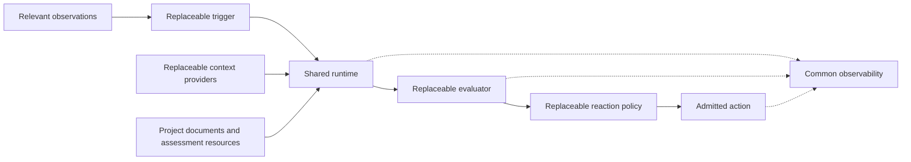
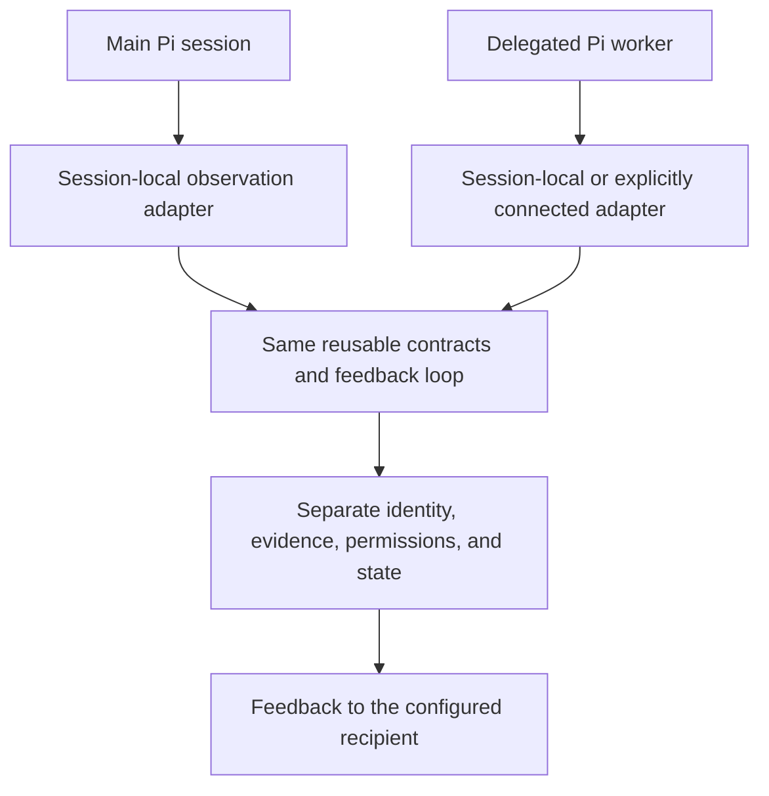
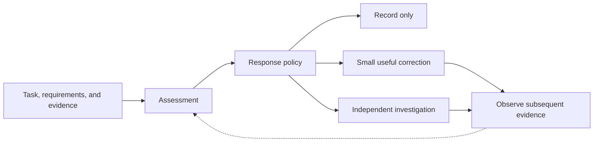

## Pi Quality Engine — Project Philosophy 🧭

**A small, independent engine for better engineering decisions.**

Pi Quality Engine exists to help an agent perform the right work, under the actual requirements of the project, with proportionate effort. Its purpose is not to produce more reviews, impose one architectural style, or surround development with another layer of procedural obligations. Its purpose is to reduce avoidable mistakes, forgotten instructions, unnecessary complexity, and unproductive repetition.

The project combines two commitments that must remain compatible: **a small, understandable core** and **a genuinely open extension model**. The core owns the reliable execution of a feedback loop. Contributors decide which evidence matters, how it should be assessed, and which permitted response is useful.

The result should be useful on an ordinary Pi installation, adaptable to different projects, and accountable for its own behavior. It should be possible to understand why a check happened without reading source code, and possible to add a new kind of check without rewriting the engine.

> [!abstract] The central idea
> Observe relevant work. Evaluate it against explicit intent and evidence. Choose the smallest useful response. Explain the observation and the response. Leave ownership of the surrounding system where it belongs.

### How this document should be used 📖

This is a statement of purpose and design values. It explains the reasoning behind the technical specifications and provides a way to evaluate future proposals. It does not introduce new configuration keys, replace existing contracts, or claim that a proposed capability has already been implemented.

Documents 01–06 remain authoritative for architecture, interfaces, diagnostics, implementation boundaries, and acceptance. If a future implementation cannot express a principle described here, the appropriate response is an explicit design decision—not a silent reinterpretation of an existing contract. The role-neutral observation principle below describes a design direction; support for a particular session topology still requires a working, authorized integration.

## 1. Engineering quality is the objective—not review activity 🎯

An implementation can pass its tests and still solve the wrong problem. It can satisfy the immediate request while adding unnecessary configuration, weakening a useful boundary, omitting operational logging, or depending on the exact shape of a known test fixture. An agent can also appear busy while repeatedly collecting information it already has.

Quality Engine therefore considers both the work product and the process. However, neither is reduced to a simplistic proxy. Many reads do not prove wasted effort. A single-use function does not prove overengineering. A long-running command does not prove a stall. A passing test does not prove that every requirement has been met.

A useful observer connects a concern to the actual task, the applicable project instructions, and specific evidence. Its contribution is a better decision, not a larger count of warnings. This purpose follows the engineering philosophy and quality concerns established in [Document 01, section 1](01-architecture-and-decisions.md#section-1).

### Improvement is more important than intervention 📈

The observer earns its place when it prevents consequential mistakes or reduces avoidable rework at a reasonable cost. A quiet session can be a successful session. An intervention that creates three unnecessary verification cycles is not successful merely because the agent obeyed it.

The relevant questions are whether a concern was valid, whether the response helped, and whether the combined effort was proportionate. Counts of checks, messages, and acknowledgments explain activity; they do not define success.

The same standard applies to the observer itself. A system intended to discourage overengineering should not impose a more elaborate workflow than the work warrants.

## 2. Modularity means independent choices behind shared contracts 🧩

The intended tradition of Pi-style modularity is practical: a contributor should be able to add a focused capability that composes with existing capabilities. Extension should not require a fork, changes to a central list of special cases, or knowledge of every other installed component.

A trigger determines when an assessment is worth considering. A context provider determines what evidence can be supplied. An assessment resource describes the questions. An evaluator performs the analysis. A policy selects a response. An action executes an admitted effect. A diagnostic sink receives permitted records. Observation sources supply the facts on which these pieces depend.

These are independent responsibilities, not mandatory classes, processes, or separate packages. One contribution may supply several complementary pieces. A new check may require only configuration and a Markdown resource, because all its executable components already exist. The exact roles are defined in [Document 02](02-component-contracts-and-configuration.md#section-1).

*The diagram describes responsibilities, not a requirement for a framework class at every node.*

### A modular core still needs a coherent center ⚙️

Replaceability does not mean that every component can invent its own rules for cancellation, permissions, spending, or delivery. A shared runtime owns these boundaries so that independently written components remain understandable together.

The core should not know whether a repository prefers service objects, functions, or a particular logging library. It should know which assessment owns a request, whether the result still applies, and whether a proposed response is permitted.

This is the distinction between **replaceable judgment** and **consistent execution**. A new evaluator can disagree with an old evaluator. It cannot silently redefine what “cancelled,” “delivered,” or “cost unknown” means.

> [!important] Built-ins are participants, not privileged exceptions
> Built-in checks should follow the same admission, evidence, accounting, and visibility rules as community checks. A public extension interface that cannot express a real built-in capability is not yet a convincing extension model.

## 3. Independence is the default; interoperability is optional 🔌

The baseline product is one package running on Pi. It supplies the mechanisms needed to observe, evaluate, explain, and return feedback. Another observer plugin, subagent manager, or orchestration package is not a prerequisite for those core scenarios.

A deep review can use a fresh, explicitly configured Pi session with its own model, instructions, context, and allowed tools. That review is an evaluator owned by Quality Engine. It is not a special privilege available only when a separate subagent plugin is installed.

Independence does not require reimplementing the host. Pi remains the agent platform. Ordinary libraries can be used where they remove real implementation work. The requirement is that the product not depend on another active plugin to complete its central feedback loop.

### Optional integration should add value, not repair a missing core 🤝

An external executor may offer convenient delegation. A monitoring extension may provide useful observations. An existing report viewer may present the engine's records. These are legitimate integrations when they improve a particular installation.

Removing such an integration should remove its specific capability, not make ordinary local assessment impossible. The engine should not load unrelated plugins automatically to compensate for a failed model route or an unavailable context source.

The test of independence is concrete: bare Pi, Quality Engine, a configured provider, and normal project documents are enough to perform short assessment and independent review. This is already the deployment baseline in [Document 01](01-architecture-and-decisions.md#section-3) and the release-defining scenario in [Document 04](04-implementation-testing-and-acceptance.md#section-1).

### Reuse should preserve freedom of design 🧰

The donor projects provide valuable algorithms, prompts, and lessons. Reuse is encouraged when a small, well-understood mechanism fits the product. It does not oblige the engine to inherit a donor's runtime, configuration model, hidden assumptions, or default behavior.

Copied or adapted material keeps its provenance and required notices. A design borrowed as an idea is distinguished from code actually shipped. The project should learn from existing work without becoming an assembly of independently active controllers.

## 4. The observed session's role should not define a new engine 👁️

A main conversation, a delegated worker, and a task-specific Pi session can all produce engineering work that deserves assessment. Their role in a wider workflow should not force a separate quality system with different concepts for triggers, evidence, or findings.

The intended abstraction is **an observed execution context within an explicitly supported scope**. A session is “primary” relative to the observer attached to it; it need not be the top-level orchestrator of an entire installation.

The same reusable assessment mechanism can therefore apply to different roles, with different profiles, evidence, permissions, and feedback destinations. A coding worker may be assessed for implementation quality. An orchestrator may be assessed for task coverage and delegation decisions. These are different checks—not different definitions of observation itself.

*The shared box means reuse of mechanisms. It does not imply a global runtime that automatically discovers, owns, or controls every session.*

### Role-neutral does not mean visibility is automatic 🧭

An observer attached inside a worker session may have direct lifecycle and tool observations. A parent session that receives only a completion report has a different evidence set. A separate process requires an explicit integration to expose its activity. These differences matter.

A worker's summary is evidence of what the worker reported, not proof that the observer saw its actual model input or every file it changed. The engine should preserve that distinction instead of making an attractive but unsupported claim of complete coverage.

The assessment contract stays reusable; the observation adapter declares the real visibility and available actions. The philosophy does not promise that the current host bridge already supports every topology, nor does it introduce an implicit cross-process discovery mechanism.

### Role, ownership, and permission are separate dimensions 🏷️

A session called a “subagent” may be externally owned work being observed, or an engine-owned reviewer doing the observing. Those are different responsibilities even if both use Pi.

Recording the tools and usage of an engine-owned reviewer does not mean launching another autonomous reviewer to judge it. Recursive observation is not the default. Any deliberate secondary review needs its own bounded, explicit policy.

Likewise, observing a worker does not automatically grant permission to interrupt its parent. Feedback is directed to the configured, authorized recipient. The role-neutral model preserves boundaries instead of erasing them.

## 5. Observing Pi is not the same as owning Pi-wide observability 📐

Quality Engine needs selected execution facts to make useful assessments. It also needs comprehensive explanations of its own assessments. Neither requirement makes it responsible for monitoring the entire Pi installation.

There are three distinct concerns: **observations used as assessment inputs**, **observability of the engine's own behavior**, and **general observability of Pi and its surrounding infrastructure**.

| Concern | Quality Engine's responsibility | Boundary |
|---|---|---|
| Facts needed by a check | Obtain relevant events, artifacts, and waiting information within the declared scope. | No claim of access to unexposed activity. |
| The engine's own decisions | Explain triggers, admission, evidence, requests, conclusions, policies, and effects. | Diagnostics describe what the engine actually knows and did. |
| Independent reviewers created by the engine | Own their assessment lifecycle, allowed context, resource use, and cleanup. | They are bounded evaluations, not a general workforce. |
| Whole-Pi transcripts, fleet dashboards, and infrastructure health | Consume or export useful information through optional integrations. | Dedicated monitoring and orchestration tools retain their responsibilities. |
| The primary agent's overall execution and billing | Use relevant evidence where available. | Do not become the authoritative controller or accountant for unrelated work. |

A tool result may legitimately appear as bounded metadata in a quality journal because it explains why a check ran. That does not imply copying all tool output, replaying the entire primary transcript, or maintaining a competing general-purpose monitoring database.

Existing monitoring capabilities can supply observations, and their interfaces can display quality records. Cooperation is preferable to duplication. Such cooperation remains optional because the engine's ordinary local path is self-contained.

> [!note] The boundary in one sentence
> Quality Engine explains its decisions **about Pi's work** and the work it starts itself; it does not promise to explain or manage everything Pi does.

## 6. Existing project documents remain the source of truth 📚

The engine should accept the project's instructions, architecture documents, requirements, and decisions where they already live. It should not require their authors to maintain a second collection of rules solely for the observer.

Configuration identifies sources and determines when and how they are used. Assessment resources describe the evaluation task. Those are different responsibilities: a prompt that explains how to review architecture is not a replacement for the architecture itself.

Different projects should be able to supply different standards without changing the kernel. A project that values a small procedural solution should not receive unsolicited layers because an evaluator prefers a fashionable architecture. A project with established service boundaries should not have those boundaries removed merely because an evaluator prefers fewer files.

### Requirements are contextual, not slogans 🧠

“Prevent overengineering” does not mean “reject every abstraction.” “Require logging” does not mean “log every function.” “Verify the result” does not mean “rerun every test after every observation.” A commit is required when the authorized workflow requires it, not whenever a checker notices a dirty working tree.

The observer's task is to establish whether an applicable requirement has been violated and what proportionate correction would restore it. Its own preferences are not additional product requirements.

If a source is missing, too large, contradictory, or no longer current, the observer should make that limitation visible. It should not replace missing project intent with confident improvisation. Source selection, coverage, and freshness are specified in [Document 02, section 9](02-component-contracts-and-configuration.md#section-9).

## 7. Autonomy should preserve progress, not manufacture it ⏱️

A useful observer should not need a person to read every status card. It may carry out an approved assessment, deliver a proportionate recommendation, or request independent review without repeated manual intervention.

Autonomy is nevertheless delegated authority, not ownership of the user's objective. The observer follows the authorized task and the configured response policy. It does not make a paused project active merely because a timer has expired.

### Time matters even when no new event arrives 🕰️

An event-only observer misses the case where the expected next event never occurs. Time-based observation therefore belongs in the core scheduling model.

But elapsed time is a reason to investigate, not a verdict. Activity, progress, legitimate waiting, and permission to continue are different facts. A command can be quiet and healthy. An agent can be active and unproductive. A session can be idle because it is waiting for a human decision.

The desired behavior is to diagnose the situation and choose the smallest justified response. The system should not reward apparent activity by forcing the agent to generate another message or rerun a check.

### A stopped agent is not an invitation to take over 🛑

Explicit operator stops remain authoritative. A late assessment, an observer restart, or a high severity score cannot silently revoke them. Where the reason for inactivity is unknown, uncertainty should remain visible until suitable evidence is obtained.

This is not an argument for passivity. It is an argument for interventions that preserve the distinction between helping work continue and overriding a deliberate decision to stop.

## 8. Assessment is a judgment; intervention is a separate decision ⚖️

A finding is not a command. It is a claim supported to a particular degree by particular evidence. The evaluator should identify the concern and its limitations. A separate policy determines whether to record it, provide a short recommendation, request deeper investigation, or take another explicitly permitted action.

That separation allows the same evaluator to operate in different settings. During calibration, its output can be recorded without affecting the agent. In a familiar project, supported findings may justify immediate advice. A consequential or ambiguous concern may require an independent review.

### A reviewer verifies; it does not prosecute 🔎

An independent reviewer should receive a concern as a hypothesis to examine, not as a conclusion it is expected to defend. It should be able to confirm the issue, narrow it, or reject it.

The desired output is a grounded correction, not a more forceful version of the first model's opinion. The observer is an engineering aid, not a mechanism for winning an argument against the executor.

A concise observation such as “the new adapter only forwards to the existing service; the documented contract does not require a new boundary” is more useful than an unexplained quality score. A valid response may be to keep the adapter if additional evidence demonstrates its purpose.

### Compliance is not a measure of truth 🧪

An agent saying “understood” does not establish that a finding was correct or resolved. An agent rejecting a suggestion does not establish that the project requirement should disappear.

The engine may improve the timing and form of feedback based on evidence. It should not silently disable mandatory instructions because a particular executor tends to ignore them. Repeated messages may be suppressed; the underlying obligation remains intact until its legitimate source changes.

## 9. Interchangeable evaluators should retain honest capabilities 🧠

A deterministic check, a decision model, a conversational model, and an independent Pi reviewer are different ways to evaluate evidence. No particular vendor or model family should define the core.

A user may prefer frequent inexpensive checks, occasional deeper reviews, or a primarily deterministic setup. A visual check may require images; an architecture review may require additional file reading. Those differences belong in the selected evaluator and context profile.

Interchangeability does not imply that every evaluator can perform every task equally well. A text-only route cannot inspect a screenshot. A model's confidence is not automatically calibrated. A large context window does not guarantee a sound architectural judgment.

The shared contract should preserve capability differences and uncertainty rather than force everything into one misleading score. Missing evidence, unavailable evaluation, and a completed check with no supported finding are different outcomes.

### Frequency, depth, and response are independent choices 🎚️

The engine may assess frequently and intervene rarely. A deeper assessment does not automatically require more aggressive action. A more expensive model does not gain more authority over the primary session.

Model choice is a means to a useful decision. The initial implementation should favor understandable, bounded behavior over automatic model-selection machinery whose benefits have not been demonstrated.

## 10. The observer must be observable without becoming a transcript collector 🔍

Every meaningful assessment should be explainable: why its trigger became due, why the runtime admitted or skipped it, which evidence reached the evaluator, which requests were made, what was concluded, and what happened to the proposed response.

A modular system makes this more important, not less. A community component should participate in the same diagnostic chain as a built-in component. A component that cannot explain its activity through the supported contract is an incomplete integration.

Observability also includes reasons for silence. “No supported concern,” “insufficient context,” “already under review,” “operator stopped,” and “provider unavailable” are not equivalent outcomes.

### More detail does not authorize more disclosure 🔐

The default should be a compact sequence of metadata, not copied source code, prompts, or tool-result bodies. Names, bounded identifiers, permitted paths, sizes, timings, status codes, and usage can explain substantial behavior without storing the material itself.

Operational detail and content capture are independent choices. A detailed scheduling trace should not unexpectedly expose repository contents. A full-content diagnostic mode is an explicit, bounded choice, not a side effect of selecting a more verbose log level.

One observed session has one logical quality journal, including its engine-owned reviews. Rotation and retention manage the physical files. They do not change evaluation permissions or reset the functional accounting state. The complete behavior belongs to [Document 03](03-observability-and-data-policy.md).

> [!important] Transparency has limits that should remain visible
> A file listed in configuration was not necessarily read. A file read by a collector was not necessarily sent to a model. A message queued for delivery was not necessarily included in the next request. The journal should explain the strongest fact actually established, not the outcome the system hoped for.

### Accounting follows ownership, not session labels 💰

The engine accounts for its own model work, including direct checks, model-assisted preparation, and clean Pi review sessions it creates. A session does not become financially external merely because someone calls it a subagent.

Conversely, observing an externally owned worker does not make its entire token usage part of the engine's bill. Work handed to an optional external executor remains external; the engine records the handoff and returned result within its visibility.

Reported usage, estimated cost, and unknown charges remain distinguishable. The purpose of accounting is to explain the cost of quality control honestly, not to replace Pi-wide billing or imply that unreported work was free.

## 11. Simplicity applies to implementation, testing, and evolution 🪶

The preferred implementation uses ordinary functions, explicit data, and small stateful objects where state actually exists. An extension role does not justify an inheritance hierarchy. A named operation does not justify another general-purpose execution framework.

A useful abstraction protects a real boundary: model access, source acquisition, time, action delivery, or diagnostic output. An abstraction whose only purpose is to make a hypothetical future abstraction easier should face a high burden of justification.

This does not require eliminating every wrapper or demanding a minimum number of call sites. A boundary may be valuable because it isolates authority or makes ownership clear. The test is whether it serves an actual requirement and leaves the code easier to reason about.

### Tests challenge behavior; they do not authorize special behavior 🧪

Production code implements the product contract. Tests exercise it through meaningful boundaries. There should not be test-only branches, fixture-aware success paths, or a second imitation engine that passes while the shipped path remains untested.

Equally, tests should not be weakened merely to agree with an incorrect implementation. Both code and tests remain accountable to the intended behavior. Controllable clocks, scripted provider boundaries, and temporary files are appropriate when they exercise real variability; they do not require a large simulation platform.

The implementation strategy is already stated in [Document 04](04-implementation-testing-and-acceptance.md#section-2): working increments with evidence, rather than test-driven architectural ornament.

### Extension should be proven through use 🌱

The first independent contribution should do something real: add a trigger or context source, participate in a check, obey cancellation, and appear in diagnostics. A registration demo alone does not establish modularity.

Growth should follow demonstrated needs. A small initial set of components can establish the contracts. New domains, destinations, and integrations can then be added without making every installation carry their operational complexity.

## 12. Decisions should preserve the project's center of gravity 🧭

A proposal fits the project when it improves an evidence-based feedback loop while preserving independence, replaceability, and clear ownership. The question is not simply whether a feature is useful somewhere in the Pi ecosystem. It is whether Quality Engine is the appropriate owner of it.

| Proposal | Philosophical fit |
|---|---|
| A new inactivity condition for a specialized workflow | A trigger or observation contribution, using the same runtime and visibility. |
| A different model or a new technical review discipline | An evaluator/profile and assessment resource, not a redesigned kernel. |
| Observation of a delegated worker with an explicit integration | The same quality mechanisms in a new declared scope, with honest coverage and permissions. |
| A richer presentation of the engine's own findings and costs | A useful interface over the existing diagnostic contract. |
| A complete replacement for Pi's fleet monitoring or orchestration | A different product responsibility, even if it could consume quality records. |
| A new requirement copied from an evaluator's personal preference | Not a project obligation until a legitimate source establishes it. |

A feature should also survive a proportionality question: does it improve the outcome enough to justify its implementation and operational cost? Adding an extension point is useful when it enables a real independent choice. Adding a layer only to advertise extensibility is not.

The project should remain easy to adopt in its smallest form and capable of growing through composition. Users should be able to replace a check without replacing their workflow, replace a model without replacing their rules, and replace a diagnostic destination without changing the meaning of an assessment.

## The enduring promise ✨

Pi Quality Engine should be **independent enough to work alone, modular enough to adapt, and observable enough to be held accountable**.

It observes Pi's engineering work without taking ownership of all Pi operations. It applies the same conceptual mechanisms to an authorized observed session regardless of that session's role. It preserves existing project instructions rather than creating another authority. It offers proportionate feedback instead of rewarding criticism, activity, or obedience for their own sake.

Its own design is subject to the same engineering standard it asks of an executor: explicit responsibilities, justified complexity, honest evidence, and no special behavior merely to make a demonstration pass.

> [!summary] Project philosophy
> A small shared core. Open and replaceable capabilities. Existing sources of truth. Role-neutral observation with explicit scope. Independent, proportionate judgment. Transparent ownership of effects and costs.
>
> The engine should grow by adding useful capabilities—not by acquiring responsibility for every surrounding system.

### Relationship to the technical documents 🔗

The philosophy provides a reading lens, not another implementation baseline. The existing documents retain their responsibilities:

[01 — Architecture and Decisions](01-architecture-and-decisions.md) explains the system and its invariants. [02 — Component Contracts and Configuration](02-component-contracts-and-configuration.md) defines how components and profiles compose. [03 — Observability and Data Policy](03-observability-and-data-policy.md) defines what the engine records, stores, and counts.

[04 — Implementation, Testing, and Acceptance](04-implementation-testing-and-acceptance.md) defines delivery and proof. [05 — Implementation Map and Dependency Rules](05-implementation-map-and-dependency-rules.md) identifies ownership and permitted dependencies. [06 — Implementation Handoff and Integration Probes](06-implementation-handoff-and-integration-probes.md) connects the design to focused implementation work and real integration evidence.

Where this philosophy motivates broader support—particularly observation of additional session roles—the corresponding technical contract and integration proof must be updated explicitly. A statement of intent is not a hidden claim that an unsupported topology already works.
