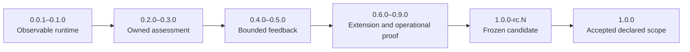
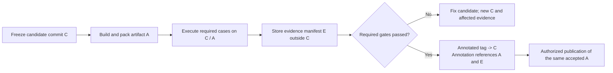

## Pi Quality Engine — Development Checkpoints and Release Checklists 🧭

**Document 08 · Checkpoint workbook K1 · Project roadmap: 0.0.1 → 1.0.0**

A development checkpoint is accepted when the actual implementation produces the required behavior, an independent test observes that behavior at the relevant boundary, and the retained diagnostics explain it. A model-written statement that the feature “should work” is not acceptance evidence. A plausible log line is not sufficient either: the test must establish that the reported operation actually occurred, or that an operation which should not occur was prevented.

This workbook turns the four delivery stages already defined in [Document 04](04-implementation-testing-and-acceptance.md#section-5) into a versioned sequence of practical gates. The planned endpoint is **1.0.0 for the declared, tested standalone capability set**. That is a destination, not a prediction or a deadline. Development may pause at an earlier useful preview. No number is earned merely by finishing a checklist in prose.

> [!important] What a checked box means
> A checked box means there is evidence for **this candidate commit and the stated scope**: an executed case, a concrete assertion, and a retained artifact or an explicit documented non-artifact reason. The box does not mean that an implementing model is confident, that a source file exists, or that a helper returned `success`.
>
> Boxes started unchecked. Checked items apply only to the recorded accepted K01–K04 candidates and their stated qualifications. Bounded S1 exit is accepted; K04 is not full S2. K05–K13 and later stage exits remain unproved. Evidence reuse is explicitly scoped, never an assertion that every mapped subcase was freshly run.

### Authority and use 📑

| Existing document | What remains authoritative |
|---|---|
| [01 — Architecture and Decisions](01-architecture-and-decisions.md) | A1 scope, independence, ownership, invariants, and frozen sources. |
| [02 — Component Contracts and Configuration](02-component-contracts-and-configuration.md) | C1 configuration, public component kinds, registered operations, permissions, and result types. |
| [03 — Observability and Data Policy](03-observability-and-data-policy.md) | O1 event names, capture, usage normalization, checkpoints, rotation, retention, and privacy. |
| [04 — Implementation, Testing, and Acceptance](04-implementation-testing-and-acceptance.md) | D1 stages and D-01–D-40 obligations. |
| [05 — Implementation Map and Dependency Rules](05-implementation-map-and-dependency-rules.md) | M1 implementation responsibilities and dependency direction. |
| [06 — Implementation Handoff and Integration Probes](06-implementation-handoff-and-integration-probes.md) | H1 practical source instructions and P-01–P-10 integration probes. |
| [07 — Project Philosophy](07-project-philosophy.md) | Pragmatism, extensibility, role-neutral observation, and limits of responsibility. |
| **08 — This workbook** | Version allocation, actionable completion checklists, evidence packaging, and release-tag procedure. |

K1 does not add another runtime, new YAML settings, a ninth component role, or new O1 event names. `K01`–`K13` and their item/case suffixes are **workbook references only**. An existing test can satisfy several workbook items and D/O obligations. There is no requirement for a test class or file for every box.

If a checkbox conflicts with an authoritative contract, record the contradiction and resolve it in the owning document. Do not silently weaken the implementation or the expected assertion. Internal function and file organization remain implementation choices within M1.

### How to read the workbook 🗺️

| Immediate question | Start here |
|---|---|
| Which release is being built, and when is the baseline complete? | [Version map](#version-map) |
| What counts as proof, rather than self-reporting? | [Evidence rules](#evidence-rules), [common gate](#common-gate) |
| Which precise boxes and tests belong to the next version? | [K01](#k01) through [K13](#k13) |
| How are logs and actual effects reconciled? | [Observability cross-check](#observability-crosscheck) |
| How are commits, artifacts, evidence, and Git tags bound together? | [Tagging protocol](#tagging-protocol) |
| What happens when a test fails or a feature remains unproven? | [Failure and regression rules](#failure-rules) |
| What should an implementing agent report at a checkpoint? | [Handoff template](#handoff-template) |

<a id="version-map"></a>

## 1. Version map and the meaning of 1.0.0 🏷️

### Four delivery stages, thirteen reviewable checkpoints 🛤️

The checkpoints split work into increments small enough to inspect. They do not create thirteen independent architectures or require thirteen public package announcements. Internal accepted tags are useful even when the package is not published to a registry.

| Checkpoint | Project version / Git tag | Existing stage | Concrete milestone | Exposure after acceptance |
|---|---|---|---|---|
| [K01](#k01) | `0.0.1` / `v0.0.1` | S1 entry | Installable, inert package with identity and a minimal real diagnostic path. | Internal foundation; no autonomous assessment. |
| [K02](#k02) | `0.0.2` / `v0.0.2` | S1 | One deterministic check reached through both tool-count and real-time triggers. | Explicitly enabled, observation-only developer preview. |
| [K03](#k03) | `0.1.0` / `v0.1.0` | **S1 exit** | Bounded lifecycle, independent registration, quiet-time diagnosis, stop protection, and usable metadata journals. | No-paid-call runtime preview. |
| [K04](#k04) | `0.2.0` / `v0.2.0` | S2 | Original project evidence, direct model assessment, and owned request accounting. | Explicitly approved model-assisted observation. |
| [K05](#k05) | `0.3.0` / `v0.3.0` | **S2 exit** | Clean Pi-session reviewer with controlled tools, final input manifests, and owned-path accounting with explicit coverage. | Standalone deep-review observation pilot. |
| [K06](#k06) | `0.4.0` / `v0.4.0` | S3 | Permissioned recommendations with actual inclusion receipts and staleness checks. | Opt-in feedback on tested routes. |
| [K07](#k07) | `0.5.0` / `v0.5.0` | **S3 exit** | Expert-check escalation, safe recovery, independent financial state, and hardened session storage. | Bounded supervised-use preview, not a universal autonomy claim. |
| [K08](#k08) | `0.6.0` / `v0.6.0` | S4 | Real third-party recombination and an installable, resource-complete package. | Contributor preview. |
| [K09](#k09) | `0.7.0` / `v0.7.0` | S4 | Version-bound engineering judgments and approved live-route evidence. | Only profiles with passing evidence are recommended for intervention. |
| [K10](#k10) | `0.8.0` / `v0.8.0` | S4 | Native-platform storage, bounded operation, and useful local diagnostics. | Operational preview for the measured platform/mode matrix. |
| [K11](#k11) | `0.9.0` / `v0.9.0` | S4 | Integrated beta exercised on bounded real tasks and negative controls. | Explicit beta for the declared capability set. |
| [K12](#k12) | `1.0.0-rc.1` / `v1.0.0-rc.1` | S4 release gate | Frozen release candidate with complete package/evidence reconciliation. | Prerelease candidate; repeat as `rc.2`, `rc.3`, etc. if needed. |
| [K13](#k13) | `1.0.0` / `v1.0.0` | **S4 exit** | Final stable-version artifact accepted and tagged at the exact tested commit. | First stable release of the documented scope. |

The version values are a proposed project release policy. The existing document version `0.1.0`, C1 schema version `1`, and the Pi host version are separate identities; none is advanced automatically with these package versions.

### What the endpoint promises—and what it does not 🎯

Version 1.0.0 means the standalone count/time → context → assessment → policy → authorized response path, public component contracts, owned-cost accounting, metadata-only observability, and supported storage/recovery behaviors have met their relevant gates. Public API commitments become deliberate and documented. Semantic Versioning treats `0.y.z` as initial development and `1.0.0` as the point at which the public API is defined; prerelease identifiers distinguish candidates from a normal release.[^semver]

It does not mean every model gives correct advice, every provider exposes full billing, every Pi topology is automatically discovered, or every operating system has been tested. A vision route, remote source provider, external executor, or Pi-wide monitoring integration is included only when it is actually shipped and proved. Capability negotiation and refusal of unsupported inputs still require tests even when a particular optional integration is absent.

Core standalone functionality cannot be made “optional” solely to obtain a 1.0.0 label. Explicit uncertainty is allowed where the contracts allow it—for example, missing provider usage. Missing runtime behavior is not the same kind of uncertainty.

### Version discipline during development 📐

A failed checkpoint stays at its candidate commit or moves to another untagged candidate. It does not receive an accepted `v*` tag. A published checkpoint is never silently replaced. Corrections after `v0.3.0`, for example, use a new version such as `0.3.1`, while planned feature work continues toward `0.4.0`.

Under major version zero, incompatible public changes still require explicit C1/O1 decisions, migration/limitation notes, and a suitable next minor version; major-zero status is not permission to change a contract secretly. After 1.0.0, patch, minor, and major versions follow the declared public API compatibility policy. A pure package version bump is not evidence that a checkpoint's capabilities exist.



<a id="evidence-rules"></a>

## 2. Evidence rules: logs explain; assertions establish behavior 🔬

### Two witnesses for consequential claims 👁️

A normal acceptance case uses both **the product's causal diagnostic record** and **an independent observation of the relevant boundary**. The journal answers why the engine acted. The test checks what actually happened. Neither should be a copy of the other implemented through the same success flag.

| Claim | Diagnostic witness | Independent witness | Insufficient substitute |
|---|---|---|---|
| A timer ran without a new tool event. | Due/admission/run records with the temporal basis. | The real scheduler callback and a frozen primary-tool count. | Calling the trigger function manually and naming the test “timer.” |
| Feedback entered the next model request. | Action receipt and its evidence references. | Captured input at the scripted provider boundary, containing the intended bounded message once. | A `sendMessage()` call returning or a log saying `included`. |
| Reviewer access stayed within scope. | Tool attempt metadata and context additions. | A denied read outside the grant plus an allowed read used in a subsequent request. | An empty tool list that prevents all investigation. |
| A record contains no prohibited text. | Data policy revision, resource descriptors, capture state. | Sentinel scan of actual journal/history/sink/artifact output after final flush. | Inspecting only the pre-serialization object. |
| A charge was counted exactly once. | Attempt revisions and usage summary. | Literal fixture arithmetic compared with the functional ledger. | Reusing the production normalization function to compute the expected answer. |
| Rotation obeys the contract. | Rotation/open/close metadata. | Actual files, complete parsed records, timer behavior, and segment identities. | Counting rotation callback invocations. |
| A policy respected Stop. | Admission or suppression record. | No new primary/model/effect call after a deliberately produced valid finding and real Stop. | No action when no finding was ever produced. |
| A model's suggestion was useful. | Versioned finding, subsequent observations, owned cost. | Requirement-anchored review of the actual result and preserved functional behavior. | The same model marking its own explanation as correct. |

A checksum links an artifact to a candidate; it does not prove that the artifact is truthful or that a finding is correct. Deterministic fixtures make expected external effects directly inspectable.

### Positive controls, negative controls, and bounded waiting 🧪

Every safety or absence claim needs a fixture that would expose the defect. Privacy cases put a harmless unique sentinel into the protected surface. Stop cases produce a genuine otherwise-actionable finding. Isolation cases include a harmless ambient canary which would leave a marker if accidentally loaded. Budget cases create real contention for the same small allowance.

For an absence assertion, establish a finite observation window appropriate to the configured deadline, then let relevant controlled work settle. “Nothing happened immediately” is weak evidence for a delayed effect. Deterministic races use controllable promises and the actual runtime's clock boundary; one real-clock smoke test separately proves a timer is armed. Tests need not sleep for several minutes merely because a production profile uses a several-minute interval.

### Report states and checkbox semantics 🚦

The existing D1 states remain `not-run`, `passed`, `failed`, `blocked`, and `not-applicable`. They are acceptance-report states, not C1 operational outcomes. An optional integration that is not shipped can be not applicable with a reason. A required clean reviewer cannot be marked not applicable because its implementation is missing.

A checkbox is checked only when its required cases are passed and linked to the accepted scope. A blocked test remains unchecked. An authorized optional exclusion is recorded as such; it does not appear in the pass count. Runner output must include discovered, executed, passed, failed, skipped/TODO, and blocked inventories or their truthful equivalent. A green aggregate exit is not proof that required tests were discovered.

### Reuse tests; do not multiply harnesses 🪶

The repository keeps D1's ordinary build/check/test tasks and H1's P-01–P-10 probe families. K1 assigns those existing obligations to version gates. A small parameterized test can cover several cases below. It must not create a parallel fake Pi runtime, a second scheduler, or production branches keyed on a test name.

Tests adapt to harmless implementation refactoring, not to broken required behavior. A wrong test expectation can be corrected with the contract and reason recorded. Weakening a correct expectation because the implementation fails is not a fix. Controlled clocks, provider I/O, and temporary files are real runtime boundaries, not overengineering by themselves.[^d1-tests]

<a id="common-gate"></a>

## 3. Common gate for every accepted version ✅

Historical K01 common-gate acceptance at `7efe1ff097319b741423c92cd327abb4c9633b6e` remains limited to its memory-only subset; COMMON-E.04 was not applicable there because no intentionally broken persistent/contributed destination was shipped.

**K02 follow-up, 2026-10-14:** the common boxes below are also evidenced for `9c7e3c2a7980895122a9ade72fb8436ad696d091` and its observation-only subset. COMMON-E.04 now passes with the real broken-journal degradation case and independent memory/host facts, not a fabricated disk receipt. See the [immutable implementation gate](../verification/K02-reacceptance3/implementation-gate.json) and [exact-commit results](../verification/K02-reacceptance3/committed-results.json). Reevaluate every later candidate; neither record accepts full S1 exit.

### Candidate and scope checklist 📌

- [x] **COMMON-C.01** Identify the intended project version, checkpoint, existing D1 stage, exact candidate commit, and declared capability subset before running acceptance.
- [x] **COMMON-C.02** Read the relevant A1/C1/O1/M1 sections and record any explicit contract amendment. Do not resolve a conflict by inventing a replacement field or event name.
- [x] **COMMON-C.03** Set the candidate version and any packaged defaults, schemas, prompts, notices, and lockfile changes before freezing the commit to be tested.
- [x] **COMMON-C.04** Record the actual Node, package-manager, Pi artifact/build, OS, host mode, and filesystem. A manifest version alone does not establish an identical loaded artifact.
- [x] **COMMON-C.05** Use a disposable fixture project and Pi configuration. Keep reference donors, acceptance artifacts, credentials, and generated logs outside the observed source scope and publishable package.
- [x] **COMMON-C.06** Keep cold activation disabled, default mode observe, capture categories none, and spending/action grants explicit unless an authoritative contract change says otherwise.
- [x] **COMMON-C.07** Enumerate required cases, allowed optional exclusions, and expected external effects. Freeze test-quality/performance thresholds before interpreting candidate results.
- [x] **COMMON-C.08** Confirm there is no unapproved donor plugin in the ordinary loaded inventory. A scripted test provider is identified as a fixture, not a production dependency.

### Execution and evidence checklist 🧾

- [x] **COMMON-E.01** Run checks against the actual candidate implementation. Record command, exit status, timestamps, test inventory, and relevant configuration/profile revisions.
- [x] **COMMON-E.02** Pair each consequential outcome with an independent assertion at the host, provider, filesystem, or functional ledger boundary.
- [x] **COMMON-E.03** Parse retained O1 records using the public envelope and link relevant run, attempt, action, generation, and manifest identities. Do not require a global total order across concurrent work.
- [x] **COMMON-E.04** Where a destination is intentionally broken, use the permitted in-memory diagnostic observer and independently measured filesystem/host behavior; do not fabricate a missing on-disk receipt.
- [x] **COMMON-E.05** Run the relevant earlier regression cases. List reused evidence narrowly and justify unchanged inputs; do not carry a whole green release report across a changed candidate.
- [x] **COMMON-E.06** Keep unknown usage, interrupted effects, incomplete context, and lost diagnostic ranges visible. No substitute zero, success, or clean-review verdict is inserted.
- [x] **COMMON-E.07** Leave a bounded evidence bundle with a manifest, case results, selected sanitized logs, and the independent observations needed for disputed claims.
- [x] **COMMON-E.08** Inspect substantive new abstractions for a real ownership, lifecycle, integration, or extension responsibility. Reject test-only branches and unrelated cleanup mixed into the checkpoint.

### Acceptance and release checklist 🏷️

- [x] **COMMON-X.01** All required checkpoint cases pass; optional exclusions have explicit scope and never cover a mandatory baseline function.
- [x] **COMMON-X.02** The final artifact or checkpoint build is traceable to the tested commit, not merely to the same branch name. Repack/retest when packaged bytes change.
- [x] **COMMON-X.03** The approval record states the accepted capabilities, known limitations, and evidence references. Model-written confidence language is not used as an oracle.
- [x] **COMMON-X.04** Create an annotated version tag only after the local evidence gate passes. Do not create or push tags as a side effect of ordinary test scripts.
- [x] **COMMON-X.05** Push or publish only with the repository operator's authorization, using the accepted artifact and exact named ref. A local tag is not a remotely published release.

All common boxes apply to the checkpoint's implemented scope. Early releases do not need future components, but they may not present a missing component as a successful empty implementation.

<a id="evidence-format"></a>

## 4. A small evidence bundle and a reusable case record 🗃️

### One candidate, one factual record 📂

D1 already allows a private output root or an ignored verification directory. Use one bundle for an acceptance run; do not add a new evidence platform. A useful layout is:

```text
verification/<candidate-id>/
  manifest.json              # commit, artifact, environment, scope, artifact digests
  results.json               # case IDs, D/O links, states, assertions, commands
  summary.md                 # short decision and limitations
  journals/                  # selected real post-projection O1 segments
  assertions/                # safe counts, hashes, manifests, filesystem before/after
  package/                   # packed candidate when applicable
  acceptance-plan.json       # only when thresholds/live experiments are relevant
```

These are generated delivery artifacts, not new product configuration files. A folder does not need to contain unused placeholders. The record should link to evidence rather than duplicate all logs into its summary.

Synthetic fixtures may capture literal test input at a controlled provider boundary to verify inclusion. Such files remain isolated test artifacts and must not be confused with the product's Standard journal policy. Real project text and credentials are not copied into acceptance evidence without the corresponding permission.

### Case record template 📝

This is a **report template**, not a completed result or a new O1 schema. Angle-bracket values are filled by the execution driver; the template itself must never pass the gate validator.

```json
{
  "checkpoint": "K02",
  "caseId": "K02-T02",
  "obligations": ["D-08", "D-09"],
  "probe": "P-03",
  "candidateCommit": "<full-tested-commit>",
  "status": "not-run",
  "command": "<actual command after execution>",
  "exitCode": null,
  "fixtureRevision": "<fixture digest>",
  "assertion": "One time-based check starts without another primary tool completion.",
  "expected": { "newChecks": 1, "newPrimaryToolCompletions": 0 },
  "actual": null,
  "evidence": [],
  "limitations": []
}
```

The final report must also capture case discovery and execution counts, actual environment and artifact identities, and whether visibility is complete. A test-only declared `status: passed` without measured `actual` values and resolvable evidence is rejected by the reporting process.

### The release-evidence loop must not be circular 🔗

The tested candidate commit is frozen **before** acceptance. Generated results stay outside the candidate commit while that candidate is being accepted. An annotation can link the final evidence manifest digest to that commit without requiring the evidence to be committed into its own target.

If evidence is kept in Git for project convenience, use a separate evidence location/ref or a later documentation record that explicitly points back to the tested source. Do not silently move the release tag to an untested “add test report” commit. Packaged Markdown prompts, schemas, defaults, or notices are not harmless report-only changes: they change the candidate artifact.



<a id="k01"></a>

## 5. 0.0.1 — A real package that stays inert until configured 🏁

**Checkpoint K01 · D1 S1 entry · Accepted local tag `v0.0.1` · State: passed for K01 scope**

Independent acceptance: implementation commit `7efe1ff097319b741423c92cd327abb4c9633b6e`; unsigned annotated tag object `c4ff06f2ea0ff986b629ccc5339ab138288633d8`. Strict build, 28 units, 6 real Pi/primary cases, seven repaired public-path counterexamples and one clean installed consumer passed with zero failed/skipped/TODO cases. The retained 13-file tarball SHA-256 is `5c50f703107df09d5e1d76fea70d262fede2c09ef37d9f04dafeb65b5e0c7b7c`; sealed local [evidence manifest](../verification/K01-reacceptance/manifest.json) SHA-256 is `6c7fe344147e5f618722a72d59c62b62e83353f61b020c2f16444f8c1ae4becd`. Detailed case mapping, [independent review](../verification/K01-reacceptance/review.md) and [tag receipt](../verification/K01-reacceptance/tag-receipt.json) remain local ignored evidence, not shipped resources.

Accepted scope is the inert foundation only: safe configuration, session-owned minimal lifecycle, truthful read-only status and bounded metadata-only memory history. Measured host is npm Pi 1.1.0 on native Windows/NTFS x64; source pin and actual npm SDK hashes are recorded separately, without whole npm/Git byte-equivalence claims. The real scripted primary remains usable after retirement and engine dispatch/effect counters stay zero. No product journal files, checks/timers, model evaluation, reviewers, feedback, interactive-TUI/other-platform certification or stage-exit acceptance is claimed. No remote push/publication occurred. Later instruction maintenance does not move this tested tag.

The first checkpoint is intentionally small. It proves that the actual package can be loaded by Pi, has an identifiable version, exposes only its implemented surface, and does not start a review, network call, timer storm, or extra plugin stack on import. A minimal runtime lifecycle record is real; the rest of the product is not represented by successful stubs.

| Gate input | Required reference |
|---|---|
| Existing obligations | D-01, D-02, D-05, D-27, D-34, D-36; P-01 and the cold-start subset of P-02. |
| Read before implementation | [D1 §§3–6](04-implementation-testing-and-acceptance.md#section-3), [M1 composition](05-implementation-map-and-dependency-rules.md#section-4), [H1 P-01](06-implementation-handoff-and-integration-probes.md#section-6). |
| Regression rule | Run the affected earlier checks and the common candidate gate. Inherited behavior cannot be weakened to make this checkpoint pass. |

### Construction and behavior checklist 🛠️

- [x] **K01-B.01** Create one package entry and only the contract/schema code needed for the first real slice. Do not generate the entire growth-layout tree as empty classes.
- [x] **K01-B.02** Use the host-provided Pi peer packages as documented. Test resolution must not be rescued by an undeclared sibling workspace dependency.
- [x] **K01-B.03** Record the agreed source baseline and actual loaded host/build identity; keep copied donor units and their notices explicit.
- [x] **K01-B.04** Keep public contract imports inert. Importing a type/runtime contract entry must not open files, start timers, load credentials, or create a session.
- [x] **K01-B.05** Implement cold configuration resolution with `enabled: false`, `mode: observe`, empty spending/effect grants, and metadata-only observability defaults.
- [x] **K01-B.06** Reject an invalid initial configuration without enabling the observer. Report a bounded configuration error without embedding the offending raw text.
- [x] **K01-B.07** Expose truthful local status for the implemented subset. Unsupported evaluators/actions are unavailable, not green placeholders.
- [x] **K01-B.08** Write actual `quality.runtime.started` / retirement metadata for an activated runtime lifecycle, without claiming any completed check.
- [x] **K01-B.09** Build the extension and verify its resource entry from the built package rather than reading a hidden development source path.
- [x] **K01-B.10** Ensure loading, listing capabilities, and retiring the package make zero owned provider dispatches and zero primary feedback calls.

### Pragmatic checkpoint tests 🧪

The table describes tests to execute, not results already obtained. Each row must be linked to an actual runner case and its artifacts. The final column names O1 events or retained diagnostic facts; the independent assertion remains necessary.

| Case | Fixture and stimulus | Independent pass condition | Diagnostic evidence |
|---|---|---|---|
| **K01-T01** | Load the built package into disposable Pi with no Quality configuration. | The package loads, reports inactive/observe defaults, and a provider-boundary counter stays zero. | `quality.runtime.started` when a runtime is created, truthful status, and no `quality.model.dispatched` or action dispatch. |
| **K01-T02** | Import the public contracts entry outside an active Pi session. | No timer/file/network/session side effects; exported declarations are loadable. | A small test result and resource/process observations; no invented lifecycle event is required for an inert import. |
| **K01-T03** | Supply an unknown core key and a secret sentinel as its value. | Configuration is rejected, the package remains inactive, and the sentinel is absent from every owned diagnostic destination. | `quality.config.rejected` with field path/error code, not the raw value. |
| **K01-T04** | Install/extract the built package in a clean package root. | Manifest entry resolves; required peer packages come from the intended host path; no donor plugin is loaded. | Package inventory, loaded entry identity, and build version. |
| **K01-T05** | Start and close the runtime once. | Owned listeners/resources return to the expected inactive count and the primary remains usable. | Started/retired correlation and an independently observed cleanup result. |

### Evidence to retain 🔍

- [x] **K01-E.01** Retain candidate commit, package version, lockfile digest, loaded Pi identity, and the exact built entry exercised.
- [x] **K01-E.02** Retain the actual cold-start and rejection test outcomes, including zero-dispatch counters from the boundary fixture.
- [x] **K01-E.03** Retain one small parsed lifecycle journal and the sentinel-scan result; do not generate fake model traffic to enrich it.
- [x] **K01-E.04** Record which commands and component families are intentionally unavailable at this checkpoint.

### Exit and tag decision ✅

- [x] **K01-X.01** Complete the common candidate gate for this limited scope; all K01 cases are executed, not merely compiled.
- [x] **K01-X.02** Prove inactive startup without cloud access or another observer plugin.
- [x] **K01-X.03** Confirm that the version in the loaded runtime and package is `0.0.1` before creating `v0.0.1`.

**The accepted tag may claim:** An installable, identifiable foundation with safe inactive startup and initial lifecycle diagnostics.

**It must not claim:** Time-based checks, model evaluation, independent reviewers, or autonomous feedback.

Upstream packaging and lifecycle details are source guidance; the installed-artifact tests above are the actual proof.[^pi-packages][^pi-extensions]

<a id="k02"></a>

## 6. 0.0.2 — One observable deterministic loop with count and time triggers 🏁

**Checkpoint K02 · D1 S1 entry · Local tag `v0.0.2` · State: ACCEPTED (2026-10-14)**

Accepted implementation: **`9c7e3c2a7980895122a9ade72fb8436ad696d091`**. Unsigned annotated local tag object: **`bb69b6f5d5846aa2c63d6bfc7971e31cdb3f7ebb`**. Exact-commit retained package SHA-256: **`95b2e9549097c7ae62166124ee8165fd54be269f015ad8cd0c20c65b260f0a02`**. [Gate](../verification/K02-reacceptance3/implementation-gate.json), [results](../verification/K02-reacceptance3/committed-results.json), [package binding](../verification/K02-reacceptance3/committed-package-byte-binding.json) and [tag readback](../verification/K02-reacceptance3/tag-readback.json) are local ignored evidence, not publication.

Build/check passed: **48 unit, 25 Pi-host, one clean installed consumer**; independent public assertions **31/31**, affected K01 **7/7**; every child exit 0, no failures/cancellations/skips/TODO. All K02-T01–T07 have actual mapped witnesses; real timer has zero new tool completions, coalescing is held at an actual evaluator, primary provider control is `0 → 0 → 1 → 1 → 2`, owned dispatch/effect counters are zero, and history/journal privacy is checked through final flush. All 36 tar payloads bind to exact committed source/build/resource bytes. Git EOL normalization changed only `package.json` in the precommit versus committed tar; the committed archive was independently rebuilt/tested/installed.

All earlier rejection rounds and their counterexamples remain preserved dated records, not rewritten passes. This acceptance covers the corrected R1/R5 paths and established mechanical K02 scope only. Durable control checkpoint, full lifecycle/storage hardening, rotation/retention, paid model routes, feedback, other SDKs/platforms, interactive TUI and RPC certification remain unaccepted. `v0.0.1` is unchanged; no push/publication occurred.

**Next agreed checkpoint:** [K03](#k03), with [D1 S1 exit](04-implementation-testing-and-acceptance.md#section-6), [M1 runtime ownership](05-implementation-map-and-dependency-rules.md#section-6) and [H1 P-08](06-implementation-handoff-and-integration-probes.md#section-13). No K03/K04 implementation is included here.

This checkpoint is the first useful execution, not a skeleton. A primary event and an elapsed-time condition reach the same runtime, real context, deterministic evaluator, record-only policy, and journal. No paid route or feedback action is needed.

| Gate input | Required reference |
|---|---|
| Existing obligations | D-04–D-09, D-11, D-27, D-32, D-35; O-01/O-02 subset; P-02 and P-03. |
| Read before implementation | [H1 S1 starting path](06-implementation-handoff-and-integration-probes.md#section-4), [C1 triggers](02-component-contracts-and-configuration.md#section-8), [O1 event catalog](03-observability-and-data-policy.md#section-7). |
| Regression rule | Run the affected earlier checks and the common candidate gate. Inherited behavior cannot be weakened to make this checkpoint pass. |

### Construction and behavior checklist 🛠️

- [x] **K02-B.01** Attach an attributable primary observation source through the actual Pi adapter. Distinguish operator, primary, engine, reviewer, and external origins.
- [x] **K02-B.02** Count uniquely identified eligible top-level tool completions. Duplicate completion reports and excluded nested/reviewer activity must not increment the same cadence.
- [x] **K02-B.03** Run the existing C1 deterministic profile using `core.repeated-tools` and `core.record-only`, with a small real evidence window.
- [x] **K02-B.04** Implement a configured count trigger and at least one genuine time-based trigger using the runtime-owned scheduler.
- [x] **K02-B.05** Keep activity age, progress age, active-operation evidence, and the work-expected decision distinct. A due timer proposes diagnosis, not automatic continuation.
- [x] **K02-B.06** Use the same `check.run` admission path for the count and temporal causes. Do not write a separate timer-only evaluator.
- [x] **K02-B.07** Coalesce overlapping reasons for one pending check while retaining their identities and reason codes.
- [x] **K02-B.08** Register one independent fixture trigger plus context or sink through C1 rather than importing private engine source.
- [x] **K02-B.09** Create a Standard metadata record for each meaningful boundary. Do not require Trace-only `quality.observation.accepted` records to exist in a Standard journal.
- [x] **K02-B.10** Create bounded recent history and an append-oriented session journal. Keep source bodies, command values, and evaluator prose out of the default records.
- [x] **K02-B.11** Run an actual real-clock timer smoke case in addition to deterministic clock tests. No extra primary completion may be used to wake the timer path.
- [x] **K02-B.12** Leave model dispatch and primary feedback unavailable at this checkpoint; status must explain that limitation.

### Pragmatic checkpoint tests 🧪

The table describes tests to execute, not results already obtained. Each row must be linked to an actual runner case and its artifacts. The final column names O1 events or retained diagnostic facts; the independent assertion remains necessary.

| Case | Fixture and stimulus | Independent pass condition | Diagnostic evidence |
|---|---|---|---|
| **K02-T01** | Deliver four eligible unique primary completions, then the fifth. | No early check, then exactly one real check; five duplicate/reviewer completions do not create a second threshold crossing. | `quality.trigger.due` count measurements, one admitted run, context metadata, and `quality.check.settled`. |
| **K02-T02** | Establish expected unfinished work and allow the real temporal deadline to expire with no new tool completion. | One diagnostic check is admitted by time; the primary-tool completion count does not change. | Temporal due basis, run identity, configured threshold/elapsed metadata, record-only decision. |
| **K02-T03** | Make count and time become eligible together while the first run is held at a controlled evaluator boundary. | One active run and at most the configured pending work; reasons are merged rather than silently lost. | `quality.check.admission` admitted/coalesced/queued states and independent evaluator invocation count. |
| **K02-T04** | Mark a known long-running wait and repeat the temporal case. | The system records a wait/diagnosis outcome without treating lack of edits as proof of abandonment. | Work eligibility and admitted or suppressed reason; zero feedback calls. |
| **K02-T05** | Produce a valid concern, then set operator Stop before the due callback. | No primary continuation or observer effect is dispatched. The callback cannot clear Stop. | Stop-sensitive admission/record-only outcome and independent zero-effect counter. |
| **K02-T06** | Load the independent contribution separately and use it in a configured check. | Its trigger/context or sink affects actual execution and retires cleanly. | `quality.component.lifecycle`, its registered IDs in the run, and the independent package inventory. |
| **K02-T07** | Place distinct sentinels in task, source, command arguments, and tool error. | The Standard log is useful but no sentinel appears in file/history/contributed-sink output. | Actual parsed records and a scan result with positive fixture controls. |

### Evidence to retain 🔍

- [x] **K02-E.01** Retain one count-trigger and one actual timer-trigger O1 trace, linked to independent invocation counts.
- [x] **K02-E.02** Retain a negative control for duplicate completions, known waiting, and operator Stop.
- [x] **K02-E.03** Retain the independent contribution package/version and actual registration/disposal results.
- [x] **K02-E.04** Retain the Standard sentinel scan and observed bounded-history measurements.

### Exit and tag decision ✅

- [x] **K02-X.01** Demonstrate both causes through one production path on bare Pi with zero owned model calls.
- [x] **K02-X.02** No test-only scheduler, fake Pi session, or donor observer supplies a missing part of the demonstration.
- [x] **K02-X.03** Only after those facts are recorded may `v0.0.2` identify this checkpoint.

**The accepted tag may claim:** A real observation-only deterministic check triggered by both activity count and time.

**It must not claim:** Complete lifecycle hardening, deep code judgment, cloud-model usefulness, or feedback delivery.

<a id="k03"></a>

## 7. 0.1.0 — Bounded lifecycle and diagnostics — S1 complete 🏁

**Checkpoint K03 · D1 S1 exit · Local tag `v0.1.0` · State: ACCEPTED (2026-10-14)**

Accepted implementation: **`035aaa3fe767c62cd16b962cf06012e2bb37f480`**; unsigned annotated local tag object **`de3711bec7232101f6cf44929fd17ab412447fc0`**. Exact-commit tar SHA-256 **`d9c2c27cfa0bb0c8ca2cac6662b88b69bbdb15c09561c6d6095a6568fd127bb7`**. [Full S1 summary](../verification/K03/reviewer/20261014202738294-p53924-b2973cbe/S1-stage-summary.md), [sealed implementation gate](../verification/K03/reviewer/20261014202738294-p53924-b2973cbe/implementation-gate.json), [exact-commit results](../verification/K03/reviewer/20261014202738294-p53924-b2973cbe/committed-verification/verification.json), [all payload binding](../verification/K03/reviewer/20261014202738294-p53924-b2973cbe/committed-verification/package-byte-binding.json) and [tag readback](../verification/K03/reviewer/20261014202738294-p53924-b2973cbe/tag-readback.json) are retained local evidence, not publication.

Both working and exact-commit literal full checks pass **70 unit /25 actual Pi-host definitions /one installed consumer /routing exit0**, zero failures/cancellations/skips/TODO. The final release-only delta is exactly seven version literals in five files; earlier independent **113/113** behavior/correction cases are explicitly reused through that invariant, not claimed newly rerun. All 46 source files were extracted from actual Git bytes; 32 paths differ only by Git EOL normalization. All 34 compiled files and 38 payloads bind to the tested commit. Only shipped `package.json` CRLF→LF differs between working and committed tar.

Actual primary control `0 → 0 → 1 → 1 → 2`, zero owned dispatch/effects and continued primary use; actual 150 ms timer/zero new completions/one run/closed journal, observed lateness 218 ms working and 224 ms committed, without a performance guarantee. Each phase retains 202 genuine older-stage originals plus202 exact sandbox controls unchanged around a real default-routing producer confined to a NEW owned mirror. Each privacy scan reads 4,326 O1 values, zero canaries/captureRefs. Earlier 8,570 sealed members, protected-state/storage witnesses and all rejection stages remain immutable dated facts.

Accepted native S1 covers protected Stop/authorization ownership, physical reservation and late retirement, acknowledged contributions, observable initial eligibility and bounded O1 delivery/rotation/gzip/eligible retention. Public evidence-change supports only `core.history`; other scopes are honestly unavailable. It does not certify arbitrary sources, paid/model accounting, feedback/actions, capture/export, universal platform/TUI/RPC/ACL/power-loss or usefulness. README/instructions/S1 maintenance follows in a separate docs commit; the implementation tag never moves. K01/K02 tags remain unchanged; no push/publication occurred.

**Next bounded checkpoint:** [K04](#k04), [D1 S2](04-implementation-testing-and-acceptance.md#section-7), [C1 context/resources](02-component-contracts-and-configuration.md#section-9), [O1 accounting](03-observability-and-data-policy.md#section-12) and [H1 P-04/P-05](06-implementation-handoff-and-integration-probes.md#section-9). Original evidence/direct assessment remains observe-only, scripted boundary first, shared admission/attempt/accounting path and no second controller; live/paid routes require separate authorization. No K04 implementation is included here.

S1 is accepted when the deterministic loop remains understandable under ordinary concurrency, reload, missing resources, and failure. This is the first no-paid-call runtime preview suitable for deliberate local use. Storage probes happen now so an unsuitable destination is not discovered after most code depends on it.

| Gate input | Required reference |
|---|---|
| Existing obligations | D-02–D-12, D-27, D-30–D-35 foundation, D-37 baseline; O-01/O-02/O-19/O-25/O-29 subsets; P-01–P-03, P-08/P-09 foundation. |
| Read before implementation | [D1 S1](04-implementation-testing-and-acceptance.md#section-6), [M1 ownership](05-implementation-map-and-dependency-rules.md#section-6), [H1 P-08](06-implementation-handoff-and-integration-probes.md#section-13). |
| Regression rule | Run the affected earlier checks and the common candidate gate. Inherited behavior cannot be weakened to make this checkpoint pass. |

### Construction and behavior checklist 🛠️

- [x] **K03-B.01** Complete acknowledged registry readiness, either load order, duplicate-ID rejection, and disposal. A fire-and-forget `emit()` is not readiness.
- [x] **K03-B.02** Implement the initial promised count, periodic, inactivity/no-progress, wait, evidence, and completion eligibility semantics as far as observable without paid assessment; unimplemented bindings remain unavailable.
- [x] **K03-B.03** Use monotonic elapsed time for runtime deadlines and UTC wall time for record presentation. Clock changes cannot produce a backdated burst of checks.
- [x] **K03-B.04** Bound active operations and pending intents. A timed-out but physically unsettled evaluator does not repeatedly create free capacity for replacement work.
- [x] **K03-B.05** Preserve ordinary fairness between configured checks and retain explicit capacity/cooldown/coalescing outcomes.
- [x] **K03-B.06** Carry generation, branch, episode, and authorization identity into asynchronous completions. A retired callback has no right to dispatch.
- [x] **K03-B.07** Preserve operator Stop across observer pause/resume and reload. An engine-generated prompt is not a new human authorization.
- [x] **K03-B.08** Implement failed-apply atomicity: invalid new configuration leaves the last accepted configuration active.
- [x] **K03-B.09** Persist the essential control/ownership foundation separately from diagnostic records. Disabling the journal cannot clear stop or effect state.
- [x] **K03-B.10** Prove the selected serialization/destination preserves the O1 envelope and actual downstream completion. Do not equate `logger.flush()` with destination finish.
- [x] **K03-B.11** Probe elapsed-time rotation through supported library APIs. Record the decision or reject the candidate destination without changing C1/O1 semantics.
- [x] **K03-B.12** Keep sink buffers and recent history bounded by both count and bytes; log-degradation reporting cannot recursively log forever.
- [x] **K03-B.13** Expose local runtime/capability/configuration status without provider traffic and without reading additional project content implicitly.
- [x] **K03-B.14** Run the early independent contribution across repeated reloads and removal; no permanent listeners or timers accumulate.
- [x] **K03-B.15** Record a modest representative runtime measurement as an S1 baseline without turning it into an unmeasured performance guarantee.

### Pragmatic checkpoint tests 🧪

The table describes tests to execute, not results already obtained. Each row must be linked to an actual runner case and its artifacts. The final column names O1 events or retained diagnostic facts; the independent assertion remains necessary.

| Case | Fixture and stimulus | Independent pass condition | Diagnostic evidence |
|---|---|---|---|
| **K03-T01** | Register engine/contribution in both orders; delay readiness; unregister during readiness. | A dependent check waits for acknowledged readiness, activates once, and never activates after its registration is retired. | Component lifecycle phases, admission reasons, and externally counted activations. |
| **K03-T02** | Release a held deterministic assessment after runtime reload. | Its old-generation result cannot create feedback, a new check, or a new timer in the replacement generation. | Retirement/late-result disposition plus zero unexpected host effects. |
| **K03-T03** | Move wall time backward and forward while advancing monotonic time independently. | Eligibility follows the configured elapsed condition, not wall-clock jumps. | Deadline/resynchronization diagnostics in Debug/Trace and exact invocation counts. |
| **K03-T04** | Simulate suspension with several missed intervals. | One resynchronized pending assessment per applicable coalescing policy; no replay storm for each missed tick. | Due/admission counts and `quality.clock.resynchronized` under the relevant detail profile. |
| **K03-T05** | Hold one evaluator or sink forever and submit more eligible work. | Configured capacity remains bounded, later requests receive explicit queue/deny behavior, and the primary keeps responding. | Queue/health/gap records and independent primary progress/resource measurements. |
| **K03-T06** | Apply valid configuration A, then invalid B. | A remains in effect; B does not partly widen grants, change sources, or reset counters. | `quality.config.rejected.runtimeUnchanged` backed by actual next-run behavior. |
| **K03-T07** | Write real O1 records through the candidate logger and close the destination. | Every completed record parses; downstream completion is observed; no uncontrolled logger fields or sentinel leakage. | Actual file bytes, parsed envelope/schema results, close outcome. |
| **K03-T08** | Probe an arbitrary valid elapsed rotation interval, not local midnight. | The chosen destination meets the contract or is explicitly rejected as a candidate; no hidden rounding/private method becomes a solution. | Probe measurements and the recorded library/destination decision; this is not yet a full portability claim. |
| **K03-T09** | Disable diagnostic recording and separately fail the control checkpoint. | Diagnostic choice does not reset functional state; a control-state failure suspends only dependent unsafe autonomy. | Functional-state assertions, permitted health/status record, and no false reset. |

### Evidence to retain 🔍

- [x] **K03-E.01** Retain the complete S1 stage report linking K01–K03 evidence to the final S1 candidate and listing inherited cases rerun.
- [x] **K03-E.02** Retain one real-host clock/wait/Stop trace and separate deterministic clock-race results.
- [x] **K03-E.03** Retain the registry load-order/reload inventory, configuration-apply proof, and generation rejection evidence.
- [x] **K03-E.04** Retain actual file-sink closure/pressure results and the exact elapsed-rotation library decision, including any still-unavailable advertised option.
- [x] **K03-E.05** Retain the no-provider-traffic proof and the small S1 performance baseline/environment.

### Exit and tag decision ✅

- [x] **K03-X.01** All mandatory S1 obligations pass; remaining S2/S3 capabilities are explicitly inactive, not simulated successes.
- [x] **K03-X.02** Functional state survives diagnostic changes, and the actual primary session remains usable after observer failure.
- [x] **K03-X.03** Approve the S1 stage summary and then create `v0.1.0` at the tested candidate.

**The accepted tag may claim:** The S1 standalone observation runtime, bounded scheduling/lifecycle, independent contribution path, and verified initial metadata diagnostics.

**It must not claim:** All storage/platform combinations, provider accounting, semantic judgment quality, or permissioned feedback not yet implemented.

<a id="k04"></a>

## 8. 0.2.0 — Original project evidence and direct model assessment 🏁

**Checkpoint K04 · D1 S2 increment · ACCEPTED / verified local implementation release · `v0.2.0`**

Astra's [final independent decision](../verification/K04/reviewer/input-capability-20261016T010630Z-f1689a96/FINAL.md),
[verdict](../verification/K04/reviewer/input-capability-20261016T010630Z-f1689a96/verdict.json) and
[coverage continuity](../verification/K04/reviewer/input-capability-20261016T010630Z-f1689a96/coverage-continuity.json)
accept working candidate57 **`d3aca6976e9d05bf46dfbbf27ff7fd7a2dd9b77b7fa59a24a9ff462724493ba3`**,
not partial acceptance or consultation. Fresh final review:3 real-host cases/10 focused
regressions; earlier115-unit/26-host/routing/consumer receipts remain author execution
with independent readback. Prior33/36/56 dispositions retain every qualification,
unrun/unavailable/intrinsic boundary and evidence class; checked boxes are not all-fresh PASS.

Sol's [exact-commit gate](../verification/K04/reviewer/local-release-20261016T014116Z-1c6a6ecb/implementation-gate.json),
[artifact binding](../verification/K04/reviewer/local-release-20261016T014116Z-1c6a6ecb/artifact-binding.json) and
[tag readback](../verification/K04/reviewer/local-release-20261016T014116Z-1c6a6ecb/tag-readback.json)
close **COMMIT_EOL_TAG / K04-X.03** at implementation
**`28960100016fbe85729159413a1b6e977c2cdac2`**, unsigned annotated local tag object
**`4b46dbe1378fbf8d7c5f643be76b153931bdc21e`**. All57 committed source members match
accepted bytes or only CRLF→LF (10 files); committed57 digest
**`1272e5570cf56da3a9506d4acc7258d23ba5118d378ab5e1cb75a12f6e4486f1`**.
The settled exact-commit common/package cycle passes115 unit/26 host/routing/one installed
consumer. All42 compiled files and50 payloads match; actual tested tar144,733B SHA256
**`403f2e58a9b9383ba32d06f07dddc107db02362cafae9369c72dcba5b22f8dde`** is byte-identical
to Astra's accepted artifact. First unit114/115 failed because owned TEMP discovered
an ancestor checkout; its failure and narrow Git-ceiling environment correction are retained.
Only unit was repeated; no source/test repair or extra queue/rotation acceptance replay.

The [single canonical handoff](../verification/K04-repair17-s5-final-handoff.md) preserves
prior rejections and current closure. Later instruction synchronization is a distinct
docs commit and does not move the tag or change packaged README/resources. **Polza/Jev,
OpenRouter/Jev and local d3-mini Q8 each remain UNVERIFIED**. No full S2, clean Pi-reviewer,
feedback/usefulness, hidden vendor-wire, universal durability or publication claim.
Next canonical locator: [K05](#k05), still not-run; this release task launches nothing.

The observer now assembles real project evidence and can make an explicitly approved direct model judgment. Mechanical acceptance uses a scripted provider and known usage values; actual paid-route validation remains separately identified. Feedback stays observe-only during this increment.

| Gate input | Required reference |
|---|---|
| Existing obligations | D-13–D-19, D-27–D-30; O-03–O-13/O-16–O-18 as applicable; P-04, P-05, P-09. |
| Read before implementation | [C1 context and assessment resources](02-component-contracts-and-configuration.md#section-9), [O1 accounting](03-observability-and-data-policy.md#section-12), [H1 P-04/P-05](06-implementation-handoff-and-integration-probes.md#section-9). |
| Regression rule | Run the affected earlier checks and the common candidate gate. Inherited behavior cannot be weakened to make this checkpoint pass. |

### Construction and behavior checklist 🛠️

- [x] **K04-B.01** Read instructions and technical documents from existing configured sources. Do not create a second manually maintained rules database.
- [x] **K04-B.02** Resolve paths relative to their declarations and enforce canonical read roots, protected paths, and symlink policy before reading.
- [x] **K04-B.03** Distinguish configured, retrieved, selected, assembled, and actually sent materials. Produce a final observable-request manifest rather than just a requested-file list.
- [x] **K04-B.04** Retain required/optional coverage and explicit missing/truncated information. Required missing evidence cannot become a complete clean verdict.
- [x] **K04-B.05** Build episode-relative Git evidence without changing the real index, worktree, stash, or broad Git object store. Preserve dirty/staged/untracked baselines within declared bounds.
- [x] **K04-B.06** Include relevant changes committed during the episode. A later commit must not make those changes disappear from assessment.
- [x] **K04-B.07** Treat shared-worktree changes as evidence with uncertain authorship when appropriate; do not attribute them solely because they appeared after session start.
- [x] **K04-B.08** Version the prompt, typed question set, output schema, selected source revisions, and evaluator profile. Do not mix calibration from different prompt generations.
- [x] **K04-B.09** Implement direct classifier and/or chat assessment through the allowed common model service; keep typed questions distinct from free-form chat instructions.
- [x] **K04-B.10** Authorize concrete routes and capabilities before dispatch. An absent model or unsupported image/reasoning capability is unavailable, not a reason for silent fallback.
- [x] **K04-B.11** Create an owned attempt identity at the actual observable request boundary. Preparation or format-repair calls use the same accounting path.
- [x] **K04-B.12** Validate the assessment operational outcome, coverage, conclusion, findings, and references. A provider error is not a negative score for the code.
- [x] **K04-B.13** Normalize usage and prices with explicit provenance, precision, missing fields, cache/reasoning semantics, and replacement revisions.
- [x] **K04-B.14** Keep budgets and unresolved spending outside the rotatable diagnostic file. Concurrent admissions reserve from one shared allowance.
- [x] **K04-B.15** Preserve capture none for all diagnostic destinations even when the provider legitimately receives source text.
- [x] **K04-B.16** Leave autonomous feedback and expert escalation disabled until their S3 permissions and receipts are implemented.

### Pragmatic checkpoint tests 🧪

The table describes tests to execute, not results already obtained. Each row must be linked to an actual runner case and its artifacts. The final column names O1 events or retained diagnostic facts; the independent assertion remains necessary.

| Case | Fixture and stimulus | Independent pass condition | Diagnostic evidence |
|---|---|---|---|
| **K04-T01** | Provide task text, two required documents, an optional absent document, and a scoped diff. | The scripted provider sees precisely the selected content; the manifest describes that actual input and reports the optional omission. | Context source/manifest parts, model dispatch/settlement, validated result with coverage. |
| **K04-T02** | Remove or make unreadable a required architecture document. | The resulting coverage is incomplete; no unqualified clean verdict or categorical corrective action is emitted. | Source failure/coverage reason, assessment result, record-only policy. |
| **K04-T03** | Use a repository with pre-existing staged and unstaged edits, one untracked file, then commit part of the episode changes. | Index bytes/status and unrelated files remain unchanged by collection; later committed episode work remains visible; missing baselines remain partial. | Before/after Git assertions, source revisions, manifest ranges and omission reasons. |
| **K04-T04** | Point a configured path through a disallowed symlink/root and use a hostile filename. | Access is denied without shell interpolation or widening protection. The test sees no unauthorized file read. | Sanitized source-rejection code and read-boundary counter. |
| **K04-T05** | Select a missing or unapproved model profile, then a supported explicit profile. | No dispatch occurs for the denied route; one dispatch occurs for the approved fixture route with the actual model recorded. | Preflight/admission evidence, `quality.model.dispatched`, observed provider call count. |
| **K04-T06** | Return malformed JSON, a nonexistent evidence reference, a valid concern, and insufficient context in separate cases. | Validation distinguishes the cases; any allowed repair is finite, identified, and accounted; the invalid response never becomes a supported finding. | Attempt IDs, validation state, operational/coverage/conclusion separation. |
| **K04-T07** | Deliver provisional usage, final usage, duplicate final usage, and a late correction for one request. | The functional ledger replaces revisions rather than adding all of them. The literal accounting oracle in section 19 agrees. | `quality.model.settled`, usage update, and summary tied to one attempt. |
| **K04-T08** | Hold two admissions just below a small synthetic budget. | The shared reservation gate does not admit both against the same remaining allowance; a denial makes zero provider calls. | Budget denial and independent dispatch count. |
| **K04-T09** | Insert a sentinel into source, prompt, command result, and model error; run in Standard then Trace with capture none. | Both produce useful allowed metadata but no sentinel or unapproved body in owned diagnostics. | Parsed file/history/contributed-sink scan and policy revision. |

### Evidence to retain 🔍

- [x] **K04-E.01** Retain the provider-boundary input observation for a synthetic fixture and the corresponding final manifest. Keep literal synthetic bodies separate from Standard logs.
- [x] **K04-E.02** Retain Git before/after hashes and status for the dirty/staged/untracked/commit case.
- [x] **K04-E.03** Retain direct request/validation/usage cases with independent literal arithmetic and coverage decisions.
- [x] **K04-E.04** Retain denial-path counters, required-source negative controls, and cross-surface sentinel scan.
- [x] **K04-E.05** Label whether any real provider route was exercised. Scripted-provider success is not a live-route claim.

### Exit and tag decision ✅

- [x] **K04-X.01** Original-source fidelity, direct assessment validation, and owned-attempt accounting pass independently.
- [x] **K04-X.02** No source-protection, budget, or coverage rule has been weakened to make a fixture pass.
- [x] **K04-X.03** Create `v0.2.0` only for the tested direct-assessment scope; paid routes remain opt-in.

**The accepted tag may claim:** Controlled direct model assessment with explicit source coverage and owned-cost accounting on the demonstrated integration path.

**It must not claim:** The usefulness of every engineering prompt, automatic intervention, or independent Pi-reviewer functionality not yet proved.

<a id="k05"></a>

## 9. 0.3.0 — Clean Pi reviewers — S2 complete 🏁

**Checkpoint K05 · D1 S2 exit · Candidate tag `v0.3.0` · Initial state: not-run**

Deep review becomes a normal evaluator profile that creates a fresh Pi SDK session. This checkpoint removes any dependency on an installed subagent or advisor plugin. The session must actually investigate a permitted file and return structure; creating an empty session is not enough.

| Gate input | Required reference |
|---|---|
| Existing obligations | D-05, D-18–D-22, D-27–D-30, D-36 subset; O-01/O-03/O-04/O-06/O-07/O-12/O-14/O-15/O-30; P-05/P-06/P-09. |
| Read before implementation | [C1 clean reviewer](02-component-contracts-and-configuration.md#section-12), [M1 reviewer ownership](05-implementation-map-and-dependency-rules.md#section-11), [H1 P-06](06-implementation-handoff-and-integration-probes.md#section-11). |
| Regression rule | Run the affected earlier checks and the common candidate gate. Inherited behavior cannot be weakened to make this checkpoint pass. |

### Construction and behavior checklist 🛠️

- [ ] **K05-B.01** Create reviewers through the actual Pi SDK, with explicit model/auth route, resource loader, tools, and in-memory session storage.
- [ ] **K05-B.02** Do not inherit the full primary conversation or ambient extension stack. Material enters through the approved context plan or later controlled reads.
- [ ] **K05-B.03** Include the structured-result submission tool in the actual allowlist when that return path is used. Test its exposure, not only its registration.
- [ ] **K05-B.04** Constrain reads to granted sources/roots and record additional evidence with its version, range, role, and coverage.
- [ ] **K05-B.05** Use a fresh session for each initial deep-review run. Any later reuse/compaction feature must be declared and its maintenance requests accounted, not silently inherited.
- [ ] **K05-B.06** Record reviewer tools as owned-reviewer activity. They cannot advance primary tool counters or create operator task authority.
- [ ] **K05-B.07** Account for each owned model request before combining reviewer summaries. Reviewer aggregate usage does not create an additional charge.
- [ ] **K05-B.08** Apply finite request, tool, time, context, and cost bounds to the reviewer. A selected profile alone does not grant spending.
- [ ] **K05-B.09** Capture the strongest observable request inputs rather than asserting knowledge of hidden provider transformations.
- [ ] **K05-B.10** Retire/dispose owned sessions and detach their subscriptions. A provider that ignores abort remains an unresolved physical operation rather than an instantly free slot.
- [ ] **K05-B.11** Keep provider-exposed reasoning and tool output out of default capture. In-memory reviewer storage must not silently create a disk transcript elsewhere.
- [ ] **K05-B.12** Return malformed or incomplete reviewer output as a validated operational result, not an invented successful assessment.
- [ ] **K05-B.13** Use the same evaluator/check path for scheduled deep review that later expert escalation will request.
- [ ] **K05-B.14** Confirm that the complete S2 path works on bare Pi with only the engine and an explicitly configured normal provider route.

### Pragmatic checkpoint tests 🧪

The table describes tests to execute, not results already obtained. Each row must be linked to an actual runner case and its artifacts. The final column names O1 events or retained diagnostic facts; the independent assertion remains necessary.

| Case | Fixture and stimulus | Independent pass condition | Diagnostic evidence |
|---|---|---|---|
| **K05-T01** | Create a reviewer with a synthetic task, request one allowed read, then return structured findings. | Two or more real model turns occur; the second request contains the actual read result and applicable instructions; the final result validates. | Reviewer start/settle, tool requested/completed, request-level manifest additions, attempt IDs. |
| **K05-T02** | Place a harmless ambient extension/skill canary in the primary environment. | The reviewer does not load or execute it; its marker remains absent, while the allowed read/result tool still works. | Loaded reviewer resource inventory and independent marker absence. |
| **K05-T03** | Request an outside-root read and a shell/mutating tool not granted by the profile. | Both are denied through real tool capability/source boundaries, not merely discouraged by prompt text. | Tool admission metadata and filesystem/dispatch negative controls. |
| **K05-T04** | Run the same five primary tool completions while the reviewer performs several reads. | Only primary eligible completions advance the cadence; reviewer activity is identified but not counted as executor progress. | Origin-specific tool metadata and exact trigger counts. |
| **K05-T05** | Return request usage for two reviewer calls plus an aggregate of both. | Owned total equals the two unique calls only. A scripted external executor report is excluded from owned totals. | Attempt ledger, reviewer summary, and independent ownership arithmetic. |
| **K05-T06** | Abort or reload while a reviewer model call is pending, then release a late result. | Late usage can reconcile; no stale result acquires effect authority. Cleanup state remains honest if the underlying call has not settled. | Retirement, reviewer disposal state, usage revisions, and zero late primary effects. |
| **K05-T07** | Scan the disposable session/state/log locations after deep review. | No unapproved reviewer transcript or raw sentinel body has been persisted; primary-session test data is scoped separately. | Filesystem inventory and owned-surface privacy scan. |
| **K05-T08** | Use unavailable credentials or a hook-dependent route without granting its resources. | The route is explicitly unavailable; the engine does not load all ambient plugins or silently switch models. | Route rejection and zero unapproved-provider calls. |

### Evidence to retain 🔍

- [ ] **K05-E.01** Retain a complete synthetic multi-turn reviewer trace and the independently captured next-request inputs.
- [ ] **K05-E.02** Retain reviewer resource/tool inventory, ambient canary outcome, and prohibited-read/command outcomes.
- [ ] **K05-E.03** Retain exact owned-request accounting with aggregate exclusion and late-usage reconciliation.
- [ ] **K05-E.04** Retain no-transcript filesystem scan and disposal/resource measurements after cancellation.
- [ ] **K05-E.05** Retain the S2 stage summary showing both direct assessment and clean reviewer execution without donor plugins.

### Exit and tag decision ✅

- [ ] **K05-X.01** All mandatory S2 mechanical/integration obligations pass; unknown live billing remains labeled rather than concealed.
- [ ] **K05-X.02** The clean reviewer is useful as a controlled investigation, not a success-returning dummy session.
- [ ] **K05-X.03** Keep the default mode observe; no later feedback authority is inferred from successful reviewer execution.
- [ ] **K05-X.04** Approve the S2 report and tag the tested candidate `v0.3.0`.

**The accepted tag may claim:** Standalone short and tool-assisted deep assessment with explicit context, resource isolation, and owned accounting.

**It must not claim:** Automatic correctness of reviewer judgments, a general subagent orchestrator, or safe feedback delivery before S3.

<a id="k06"></a>

## 10. 0.4.0 — Evidence-based feedback on authorized host boundaries 🏁

**Checkpoint K06 · D1 S3 · Candidate tag `v0.4.0` · Initial state: not-run**

The engine may now return useful recommendations to an authorized primary session. A policy proposes an effect; the runtime admits it; the host adapter supplies a receipt. The milestone is not met merely because an advice card appears or a send method returns.

| Gate input | Required reference |
|---|---|
| Existing obligations | D-03, D-11/D-12, D-23/D-24/D-26/D-30; O-01/O-10/O-16/O-26; P-03 effect cases and P-07. |
| Read before implementation | [C1 policy/action contracts](02-component-contracts-and-configuration.md#section-14), [O1 feedback visibility](03-observability-and-data-policy.md#section-11), [H1 P-07](06-implementation-handoff-and-integration-probes.md#section-12). |
| Regression rule | Run the affected earlier checks and the common candidate gate. Inherited behavior cannot be weakened to make this checkpoint pass. |

### Construction and behavior checklist 🛠️

- [ ] **K06-B.01** Keep policy evaluation free of direct host/model side effects. It returns proposals which pass runtime admission.
- [ ] **K06-B.02** In observe mode, record intended decisions but dispatch neither feedback nor an expert escalation caused by the finding.
- [ ] **K06-B.03** Require explicit action grants and appropriate current work/authorization state. A high model score alone never grants authority.
- [ ] **K06-B.04** Check task/source/finding dependencies again before dispatch; unrelated edits do not invalidate everything, but changed relevant evidence does.
- [ ] **K06-B.05** Render the smallest actionable recommendation with the C1 byte bound. Do not send a full review transcript when a bounded finding suffices.
- [ ] **K06-B.06** Distinguish C1 receipt states: `dispatched`, `queued`, `included`, `completed`, `rejected`, `failed`, `cancelled`, and `unknown`.
- [ ] **K06-B.07** Claim `included` only when the real host/provider boundary establishes it. An API acknowledgment is not model inclusion.
- [ ] **K06-B.08** Preserve user Stop across pending delivery, observer pause/resume, reload, and delayed evaluator completion.
- [ ] **K06-B.09** Handle natural-idle continuation separately from busy steering; keep `allowIdleContinuation` false by default.
- [ ] **K06-B.10** Deduplicate findings and effects without deleting the underlying project obligation. Ignoring a rule does not make it optional.
- [ ] **K06-B.11** Keep feedback prose out of default diagnostics even though the primary legitimately receives it as model content.
- [ ] **K06-B.12** Persist enough effect intent/state for a crash or lost acknowledgment to remain unknown rather than trigger a blind second send.
- [ ] **K06-B.13** Treat acknowledgment, behavior change, and finding clearance as separate observations. No “fixed” receipt state is invented.

### Pragmatic checkpoint tests 🧪

The table describes tests to execute, not results already obtained. Each row must be linked to an actual runner case and its artifacts. The final column names O1 events or retained diagnostic facts; the independent assertion remains necessary.

| Case | Fixture and stimulus | Independent pass condition | Diagnostic evidence |
|---|---|---|---|
| **K06-T01** | Produce a valid concern in observe mode with a policy that would otherwise propose feedback. | The actual host send counter remains zero and no expert check is created by the proposed intervention. | Assessment, record-only/no-action policy disposition, no action dispatch. |
| **K06-T02** | Enable an explicit feedback grant and keep the primary busy at a known tool boundary. | One bounded message appears once in the next eligible actual model input, not in the middle of an unrelated tool execution. | Action admission/dispatch/receipt linked to the independently captured input. |
| **K06-T03** | Finish the primary naturally; repeat with idle continuation disabled, then explicitly enabled. | The first case does not wake it; the second uses only the demonstrated authorized host route and creates at most the admitted continuation. | Work/grant state, receipt strength, and exact next-request counts. |
| **K06-T04** | Press actual Stop in each claimed interactive host mode while a finding is pending. | No automatic wake follows. A documented operator reauthorization is required to resume consequential behavior. | Current authorization revision, suppressed/rejected effect, and absence of later host calls. |
| **K06-T05** | Modify a relevant source after evaluation but before send; separately modify an unrelated file. | Stale relevant evidence blocks categorical correction; unrelated change does not blindly cancel a still-valid finding. | Freshness references and actual action/no-action outcomes. |
| **K06-T06** | Return the same finding twice, then deliver an acknowledgment-only primary reply. | Only one admitted equivalent effect occurs; acknowledgment is not recorded as confirmed resolution. | Stable issue/effect identity, suppression reason, feedback classification. |
| **K06-T07** | Lose the send acknowledgment after the receiver accepts the message. | The system preserves uncertainty/reconciles actual inclusion; it does not resend merely because the local await failed. | Action intent/checkpoint/unknown-or-included receipt and receiver-side message count. |
| **K06-T08** | Generate a very long multibyte recommendation and a sentinel-bearing explanation. | Feedback obeys the actual UTF-8 byte limit; diagnostics retain permitted metadata without leaking the body. | Body descriptor, independent received-byte count, privacy scan. |

### Evidence to retain 🔍

- [ ] **K06-E.01** Retain actual recipient input for a synthetic feedback fixture alongside corresponding action receipts.
- [ ] **K06-E.02** Retain positive finding controls for observe, denied grant, natural idle, and operator Stop scenarios.
- [ ] **K06-E.03** Retain staleness/deduplication/lost-ack case outcomes and effect identity reconciliation.
- [ ] **K06-E.04** Retain exact rendered-byte measurements and the Standard no-feedback-body scan.

### Exit and tag decision ✅

- [ ] **K06-X.01** Every claimed delivery state is backed by a matching host boundary, not log text alone.
- [ ] **K06-X.02** No permission, Stop, freshness, or byte-limit guard was bypassed by a model-generated recommendation.
- [ ] **K06-X.03** Tag `v0.4.0` only for tested host modes; unsupported receipt/wake routes remain clearly unavailable.

**The accepted tag may claim:** Opt-in bounded feedback with truthful delivery evidence and stop/freshness protection on the tested routes.

**It must not claim:** General autonomous recovery, guaranteed immediate interruption, or a finding being fixed merely because a message was delivered.

<a id="k07"></a>

## 11. 0.5.0 — Bounded escalation, recovery, and state — S3 complete 🏁

**Checkpoint K07 · D1 S3 exit · Candidate tag `v0.5.0` · Initial state: not-run**

Escalation now requests another configured check, which may use the clean Pi reviewer already proved in S2. The same increment closes the dangerous boundaries around late results, unknown spending, crash windows, and session-journal lifecycle. It does not add a second launcher or make diagnostic files authoritative state.

| Gate input | Required reference |
|---|---|
| Existing obligations | D-10–D-12, D-19/D-22–D-33; O-10–O-27 as applicable; P-07/P-08/P-09. |
| Read before implementation | [D1 S3](04-implementation-testing-and-acceptance.md#section-8), [O1 ledger/checkpoint](03-observability-and-data-policy.md#section-13), [H1 storage/recovery probes](06-implementation-handoff-and-integration-probes.md#section-13). |
| Regression rule | Run the affected earlier checks and the common candidate gate. Inherited behavior cannot be weakened to make this checkpoint pass. |

### Construction and behavior checklist 🛠️

- [ ] **K07-B.01** Route an expert request through the ordinary `check.run` operation with root/parent identities. There is no separate subagent-only scheduler.
- [ ] **K07-B.02** Pass the preliminary finding as a hypothesis together with original task/requirements and source evidence, not as an authoritative verdict.
- [ ] **K07-B.03** Enforce finite escalation depth, episode limits, deduplication, and shared model/check budgets.
- [ ] **K07-B.04** Keep a logically cancelled but physically unsettled request identified and capacity-bounded. Late billing can arrive without late action authority.
- [ ] **K07-B.05** Persist action intent, unresolved attempts, current ceilings, stop state, and ledger revisions in functional checkpoints independent of logging verbosity/retention.
- [ ] **K07-B.06** Restore only compatible session/generation/branch/authority state. Abandoned task history cannot restore new permission or erase session-wide spending.
- [ ] **K07-B.07** Reconcile uncertain paid dispatches and effects before retry. Do not automatically recreate expert sessions after a lost local completion.
- [ ] **K07-B.08** Complete the one-logical-journal model with safe append, physical segment rotation, configurable elapsed rotation, and retention ownership.
- [ ] **K07-B.09** Keep the file-destination implementation behind O1. If RFS cannot satisfy the interval contract, replace that internal destination rather than rounding the setting.
- [ ] **K07-B.10** Implement built-in gzip without shell compression commands and preserve the last complete source on interruption.
- [ ] **K07-B.11** Bound all sink queues and implement visible degradation/gaps. A logger failure does not rerun evaluation or crash primary work.
- [ ] **K07-B.12** Distinguish diagnostic sink failure from control-checkpoint failure: the latter suspends new dependent paid work/effects rather than resetting state.
- [ ] **K07-B.13** Revalidate active ownership before retention deletion. Preserve files with uncertain ownership or unrelated content.
- [ ] **K07-B.14** Test one logical journal and functional accounting across observer reload/resume and branch navigation.
- [ ] **K07-B.15** Complete the previously deferred storage behavior before claiming it, while native-platform breadth remains an S4 gate.

### Pragmatic checkpoint tests 🧪

The table describes tests to execute, not results already obtained. Each row must be linked to an actual runner case and its artifacts. The final column names O1 events or retained diagnostic facts; the independent assertion remains necessary.

| Case | Fixture and stimulus | Independent pass condition | Diagnostic evidence |
|---|---|---|---|
| **K07-T01** | A fast assessment raises a serious hypothesis; the expert confirms it, then in another case rejects it. | One ordinary child check uses the existing Pi evaluator; only a current supported expert finding can feed an admitted response. | Parent/root run links, expert input manifest, result and policy/action records. |
| **K07-T02** | Repeated findings arrive while the expert is running; configure a small escalation/depth limit. | No duplicate expert session or unbounded review-of-review chain; limits appear as admission outcomes. | Independent reviewer-create count, queue state, budget/admission reasons. |
| **K07-T03** | Crash/restart at before-dispatch, after-dispatch-before-receipt, and after-receipt boundaries. | Each window preserves the strongest known state. Uncertain external work is not blindly replayed; proven completion is not duplicated. | Checkpoint revisions, receiver/provider counters, restored receipt/unknown coverage. |
| **K07-T04** | Disable or delete diagnostic history, switch to Minimal, rotate, then navigate to an older branch. | Owned spend and unresolved action/attempt state are unchanged; branch views do not refund historical calls. | Independent checkpoint/ledger before/after and current summary. |
| **K07-T05** | Use threshold-edge records and an arbitrary allowed millisecond rotation interval; simulate sleep. | Whole records remain parseable; bounded overshoot is explicit; one resynchronizing rotation occurs rather than an empty-file storm. | Actual segment bytes/order, rotation/open/close metadata, timer observations. |
| **K07-T06** | Truncate the final journal line, then resume; run retention while a session reopens. | Damaged evidence is preserved or safely segmented; live files are not deleted; removed history is labeled. | Filesystem inventory, tail/open state, retention references, no corruption of intact records. |
| **K07-T07** | Interrupt gzip and inject destination error or a permanently slow contributed sink. | The last complete archive source survives; buffers stay within declared bounds; primary remains usable; loss is visible. | Actual files, health/gap records from an available safe destination, process/resource observations. |
| **K07-T08** | Fail the control checkpoint immediately before paid request or feedback dispatch. | No new dependent request/effect occurs; observer degradation does not stop unrelated primary work. | Zero new boundary calls, checkpoint failure/status, intact prior budget. |
| **K07-T09** | Release late usage after the owning check was cancelled and the result became stale. | Cost updates the correct owned ledger entry while action admission remains revoked. | Attempt replacement revision and independent zero-effect count. |

### Evidence to retain 🔍

- [ ] **K07-E.01** Retain expert-confirmed and expert-rejected paths with original-source manifests and exact reviewer counts.
- [ ] **K07-E.02** Retain small crash-window reports naming which external effects may have happened and how uncertainty was preserved.
- [ ] **K07-E.03** Retain segment/retention/gzip actual filesystem assertions and bounded-sink pressure evidence.
- [ ] **K07-E.04** Retain ledger invariance after diagnostic loss/rotation/branch movement plus checkpoint-failure denial proof.
- [ ] **K07-E.05** Retain the S3 stage report and its affected S1/S2 regressions at the current candidate.

### Exit and tag decision ✅

- [ ] **K07-X.01** All mandatory S3 effects, escalation, and recovery behaviors pass without another plugin launcher.
- [ ] **K07-X.02** No unknown operation was relabeled complete or free to make restart appear clean.
- [ ] **K07-X.03** The supported local storage path meets exact O1 semantics; no unsupported private library call is treated as a stable contract.
- [ ] **K07-X.04** Approve S3 and tag `v0.5.0` at the accepted candidate.

**The accepted tag may claim:** A complete bounded feedback loop with own expert review, safe uncertainty handling, and tested local storage/recovery.

**It must not claim:** Whole-Pi fleet orchestration, external executor billing, universal platform support, or independent recovery from a dead/blocked host process.

<a id="k08"></a>

## 12. 0.6.0 — Public extension contracts and packaged recombination 🏁

**Checkpoint K08 · D1 S4 · Candidate tag `v0.6.0` · Initial state: not-run**

The core must now prove that modularity is more than a configurable set of built-ins. Independently installed contributions must supply new behavior while using the same scheduling, context, accounting, authority, and diagnostic boundaries. One fixture package can cover several roles; eight packages are not required.

| Gate input | Required reference |
|---|---|
| Existing obligations | D-02–D-04/D-05, D-27/D-28/D-34–D-36; O-27/O-29/O-30; P-01/P-02/P-10. |
| Read before implementation | [C1 independent extension](02-component-contracts-and-configuration.md#section-19), [M1 registry/dependencies](05-implementation-map-and-dependency-rules.md#section-5), [D1 S4](04-implementation-testing-and-acceptance.md#section-9). |
| Regression rule | Run the affected earlier checks and the common candidate gate. Inherited behavior cannot be weakened to make this checkpoint pass. |

### Construction and behavior checklist 🛠️

- [ ] **K08-B.01** Keep exactly the eight C1 contribution kinds: observation, trigger, context, prompt, evaluator, policy, action, and sink.
- [ ] **K08-B.02** Provide public contracts and validation for each advertised kind without requiring private engine imports.
- [ ] **K08-B.03** Install a real independent package from its packaged resources. It must not resolve the engine through an accidental monorepo path.
- [ ] **K08-B.04** Contribute a new trigger and a new context provider which participate in an actual configured check.
- [ ] **K08-B.05** Contribute or substitute an evaluator, policy, and action through normal registration and common effect/request admission.
- [ ] **K08-B.06** Contribute a sink that receives only permitted projected records and cannot mutate another destination or functional state.
- [ ] **K08-B.07** Exercise static prompt replacement through a file/resource alone. Dynamic preparation, when shipped, uses the owned request service for any paid work.
- [ ] **K08-B.08** Validate late readiness, duplicate IDs, unsupported contract versions, missing dependencies, unload, and re-registration after generation replacement.
- [ ] **K08-B.09** Package built-in prompts, typed questions, schemas, feedback resources, examples, and notices in the actual tarball.
- [ ] **K08-B.10** Keep imports of the public contract surface inert and Pi SDK packages host-provided as required.
- [ ] **K08-B.11** Expose component/configuration provenance and capability status without implicit assessment or external retrieval.
- [ ] **K08-B.12** Use role-neutral observed-session identity. Relabeling a supported observed worker as a sub-session must not create another hardcoded scheduler, billing scope, or authority rule.
- [ ] **K08-B.13** Keep optional cross-process/session integrations absent unless separately implemented and probed. Role neutrality is not automatic fleet discovery.
- [ ] **K08-B.14** Inspect the core for special cases keyed to the fixture package, a provider name, or a programming language; remove unjustified ones.

### Pragmatic checkpoint tests 🧪

The table describes tests to execute, not results already obtained. Each row must be linked to an actual runner case and its artifacts. The final column names O1 events or retained diagnostic facts; the independent assertion remains necessary.

| Case | Fixture and stimulus | Independent pass condition | Diagnostic evidence |
|---|---|---|---|
| **K08-T01** | Install the candidate plus one independent contributor in a clean Pi package root. | A new trigger/context combination changes the actual check input and output without any core edit. | Packed package inventory, registry lifecycle, component IDs in due/context/assessment records. |
| **K08-T02** | Replace only a prompt resource through configuration. | The correct versioned prompt reaches the evaluator; original project requirements remain the same sources. | Resource revision and actual request manifest; controlled provider input. |
| **K08-T03** | Replace evaluator/policy/action implementations in the contribution fixture. | The normal request and action gates still control dispatch; denied grants cannot be bypassed by a legitimate component path. | Common owned IDs, budget/action admission, and independent dispatch counts. |
| **K08-T04** | Make a contributed sink mutate its record and another sink stall. | Other sinks/history/function state stay unchanged; bounded per-sink degradation is visible. | Separate sink captures, record fingerprints, health/gap records. |
| **K08-T05** | Load in opposite orders, delay readiness, dispose, and reload. | No missed discovery, double registration, orphaned callback, or silent fallback to a private built-in. | Acknowledged lifecycle and active-instance counts. |
| **K08-T06** | Remove the source checkout after packing and run the installed artifact. | Prompts/schemas/resources still resolve; imports do not reach development-only files. | Actual installed paths, artifact inventory, package smoke results. |
| **K08-T07** | Exercise the same supported local observation path with parent-like and worker-like role labels. | Behavior follows scope/ownership/grants, not role name. Reviewer-origin activity remains excluded from primary cadence. | Same contract-level outcomes and separately attributed session/origin records. |

### Evidence to retain 🔍

- [ ] **K08-E.01** Retain the independent contribution tarball/source revision, dependency inventory, and registration/recombination results.
- [ ] **K08-E.02** Retain actual prompt/resource loading paths from the installed artifact and a no-source-checkout test.
- [ ] **K08-E.03** Retain cross-sink mutation/pressure evidence and component disposal counts.
- [ ] **K08-E.04** Retain a scoped role-neutrality fixture; state explicitly that it is not a cross-process topology certification.

### Exit and tag decision ✅

- [ ] **K08-X.01** Every advertised component role has contract coverage and at least one meaningful integration path, with shared controls intact.
- [ ] **K08-X.02** The separate contribution does more than register: it affects a check and then disposes cleanly.
- [ ] **K08-X.03** Tag `v0.6.0` only after the packed candidate passes the public extension boundary tests.

**The accepted tag may claim:** An externally usable component system and resource-complete package for the demonstrated standalone paths.

**It must not claim:** An operating-system sandbox for untrusted TypeScript, automatic compatibility with every Pi plugin, or arbitrary cross-process visibility.

<a id="k09"></a>

## 13. 0.7.0 — Engineering judgment and profile promotion 🏁

**Checkpoint K09 · D1 S4 · Candidate tag `v0.7.0` · Initial state: not-run**

The runtime can be mechanically correct while the model gives poor advice. This checkpoint tests the actual assessment profiles against requirements and near-misses. The implementing model cannot certify its own judgments. At least one explicitly approved real route must be exercised for any live-route claim.

| Gate input | Required reference |
|---|---|
| Existing obligations | D-16/D-17/D-18/D-29, D-38 and the one-shot portion of D-39; O-11/O-18/O-30; P-05/P-06/P-10 live subsets. |
| Read before implementation | [D1 semantic evaluation](04-implementation-testing-and-acceptance.md#section-20), [philosophy of judgment](07-project-philosophy.md), [H1 live evidence boundaries](06-implementation-handoff-and-integration-probes.md#section-5). |
| Regression rule | Run the affected earlier checks and the common candidate gate. Inherited behavior cannot be weakened to make this checkpoint pass. |

### Construction and behavior checklist 🛠️

- [ ] **K09-B.01** Freeze the task corpus, requirement sources, expected labels, prompt/questions, context plan, model profile, and reaction policy before evaluating the candidate.
- [ ] **K09-B.02** Include actual violations, justified near-misses, and intentionally insufficient evidence for each promoted assessment domain.
- [ ] **K09-B.03** Cover instruction compliance, task scope, architecture/overengineering, test-specific production behavior, operational logging, evidence of completion, and productive waiting/repetition.
- [ ] **K09-B.04** Keep a calibration subset separate from held-out cases. Do not rewrite held-out expected answers after seeing a model output.
- [ ] **K09-B.05** Set numerical acceptance thresholds and denominators in the experiment plan before the acceptance run. Empty thresholds mean the promotion decision is blocked.
- [ ] **K09-B.06** Use requirement-anchored independent adjudication for disputed semantic findings. A different expensive model alone is not ground truth.
- [ ] **K09-B.07** Record actual provider/model identity and available revision metadata, input coverage, unknown usage, latency, and owned spend for every live assessment.
- [ ] **K09-B.08** Approve no automatic corrective profile solely because its JSON validates or it catches obvious intentionally bad examples.
- [ ] **K09-B.09** Retain a narrow profile recommendation: observe-only, investigation, or supported corrective feedback. A failed profile remains limited; do not lower engine safeguards.
- [ ] **K09-B.10** Treat changing a prompt/question/schema or model route as a new evaluation input version. Reuse previous results only under an explicitly justified unchanged-input claim.
- [ ] **K09-B.11** Keep credential values, live source bodies, and unapproved reasoning out of ordinary evidence exports.
- [ ] **K09-B.12** If a visual route is included, validate actual image delivery and known viewport/reference criteria; unsupported routes must reject images clearly.

### Pragmatic checkpoint tests 🧪

The table describes tests to execute, not results already obtained. Each row must be linked to an actual runner case and its artifacts. The final column names O1 events or retained diagnostic facts; the independent assertion remains necessary.

| Case | Fixture and stimulus | Independent pass condition | Diagnostic evidence |
|---|---|---|---|
| **K09-T01** | Run a paired fixture: unnecessary forwarding layer versus a justified boundary required by the project. | The report records true/false findings against the frozen labels, including exact counts and disagreement reasons. | Assessment/resource/model revisions, evidence refs, owned usage and per-case result table. |
| **K09-T02** | Run logging-required and logging-not-applicable changes. | The evaluator does not demand a logger in every trivial function; promoted behavior matches the scoped operational requirement. | Criterion-level findings/coverage and independent requirement-based labels. |
| **K09-T03** | Run production logic keyed to a test fixture versus legitimate dependency injection. | The profile distinguishes requirement violations from ordinary testability; no blanket anti-injection rule is promoted. | Evidence references and paired labeled outcomes. |
| **K09-T04** | Run repeated passing verification with no relevant change versus a necessary rerun after a change. | Useful and wasteful repetition are scored separately; command issuance alone is not treated as successful verification. | Tool completion evidence, code revision links, per-case findings. |
| **K09-T05** | Withhold required task/architecture context from a case which otherwise looks wrong. | The result preserves insufficiency rather than confidently condemning the implementation. | Coverage state, conclusion, and independent missing-source assertion. |
| **K09-T06** | Use the approved live direct and clean-reviewer routes on synthetic nonsecret inputs. | Actual route behavior, tools, returned structure, and billing visibility are measured; unknown fields remain unknown. | Live request/manifest/reviewer traces and explicit limitations. |
| **K09-T07** | Repeat the required promotion analysis with the frozen threshold plan. | The decision follows actual numerators/denominators; a failed threshold blocks that profile recommendation. | Plan digest, raw permitted results, summary, and review decision. |

### Evidence to retain 🔍

- [ ] **K09-E.01** Retain the frozen experiment plan and development/holdout split with corpus/resource digests.
- [ ] **K09-E.02** Retain case-level predictions, expected labels, actual disagreements, independent adjudications, and denominators.
- [ ] **K09-E.03** Retain live route identity and usage-coverage results separately from mechanical scripted-provider tests.
- [ ] **K09-E.04** Retain per-profile promotion or limitation decisions, not a single undifferentiated “AI quality passed” flag.

### Exit and tag decision ✅

- [ ] **K09-X.01** Every promoted profile meets its predeclared gate; a nonpromoted profile is clearly labeled and not advertised for automatic correction.
- [ ] **K09-X.02** At least the route/behavior claims being published are backed by real execution; blocked live work is not counted as passed.
- [ ] **K09-X.03** Tag `v0.7.0` only with the study's actual scope and limitations. No statistical universality is claimed from a small corpus.

**The accepted tag may claim:** Profile-specific measured judgment results and the exact live-route capabilities demonstrated.

**It must not claim:** Guaranteed code quality, transferable confidence thresholds across all models, or proof of net productivity from classification accuracy alone.

<a id="k10"></a>

## 14. 0.8.0 — Operational observability and supported platforms 🏁

**Checkpoint K10 · D1 S4 · Candidate tag `v0.8.0` · Initial state: not-run**

This checkpoint makes the observer practical to operate and diagnose without leaking project content or destabilizing Pi. It uses the actual chosen serializer, destination, cleanup path, and native operating systems. It does not require a fleet dashboard or a new external observability service.

| Gate input | Required reference |
|---|---|
| Existing obligations | D-27–D-37; O-01–O-08 and O-19–O-30; P-08/P-09/P-10. |
| Read before implementation | [O1 storage and sinks](03-observability-and-data-policy.md#section-17), [D1 performance/platform gates](04-implementation-testing-and-acceptance.md#section-21), [H1 P-08/P-09](06-implementation-handoff-and-integration-probes.md#section-13). |
| Regression rule | Run the affected earlier checks and the common candidate gate. Inherited behavior cannot be weakened to make this checkpoint pass. |

### Construction and behavior checklist 🛠️

- [ ] **K10-B.01** Prove Minimal, Standard, Debug, and Trace as detail selection distinct from content permissions and presentation.
- [ ] **K10-B.02** Prove all shipped capture categories, bounds, composite-data handling, and policy tightening. Full capture is still bounded and never means “save credentials.”
- [ ] **K10-B.03** Expose useful local inspection of trigger reasons, context manifests, actual routes, tool metadata, action receipts, and owned cost coverage.
- [ ] **K10-B.04** Keep local status/history/export operations non-billable and free of implicit source fetching or model-generated report text.
- [ ] **K10-B.05** Complete count/age/directory retention with one deletion owner, safe active-file handling, and explicit partial history.
- [ ] **K10-B.06** Test native Windows and at least one POSIX environment for every storage/host claim in the intended initial release matrix.
- [ ] **K10-B.07** Claim macOS or additional host modes only after their own tests. SDK evidence does not substitute for TUI Stop behavior.
- [ ] **K10-B.08** Freeze workload-specific latency, timer lateness, shutdown, queue, memory, and throughput envelopes before the operational acceptance run.
- [ ] **K10-B.09** Run representative Standard and Trace workloads including reviewer activity and rotation; do not benchmark only empty log messages.
- [ ] **K10-B.10** Check that opaque path disclosure and model-generated identifiers cannot reintroduce sensitive labels into records.
- [ ] **K10-B.11** Preserve functional budgets and action reconciliation when archives are retained away or a sink is disabled.
- [ ] **K10-B.12** Validate export coverage for unknown events, missing manifest parts, expired captures, and crash gaps without treating all missing history as corruption.
- [ ] **K10-B.13** Publish a concise support matrix of actual host modes, filesystems/platforms, and known diagnostic limitations.

### Pragmatic checkpoint tests 🧪

The table describes tests to execute, not results already obtained. Each row must be linked to an actual runner case and its artifacts. The final column names O1 events or retained diagnostic facts; the independent assertion remains necessary.

| Case | Fixture and stimulus | Independent pass condition | Diagnostic evidence |
|---|---|---|---|
| **K10-T01** | Run the same owned work in all four detail modes with capture none. | Operational record volume changes as designed; code/command/prompt/result sentinels stay absent on all owned diagnostic surfaces. | Parsed O1 profile inventories, record bytes, positive-control scan. |
| **K10-T02** | Enable a prompt excerpt while inserted document/tool categories remain uncapturable; tighten policy while events are queued. | Disallowed nested content cannot be laundered through an allowed outer category; queued uncommitted content is reduced. | Capture artifacts/omissions, policy revisions, actual output scan. |
| **K10-T03** | Execute size/time rotation, interrupted gzip, resume, writer conflict, and retention cases on native Windows and POSIX. | Each platform meets declared file ownership/record/cleanup semantics. A failed platform remains unsupported until repaired. | Per-platform files, parsed records, environment manifest, and case inventory. |
| **K10-T04** | Run a representative long bounded session under the frozen performance plan. | Latency tails, queue depth, memory trend, losses, and shutdown meet the declared envelope without erasing functional identities. | Raw permitted measurements, prior baseline, actual sink settings, and pass/fail computation. |
| **K10-T05** | Break one sink and request local status, history, and export. | The primary remains usable; degraded/partial history is explicit; the inspection makes no provider calls. | Health/gap/export records and independent zero-paid-call counters. |
| **K10-T06** | Export a session after retention removed older segments and a capture artifact expired. | The export labels available ranges and missing material and does not silently fetch the source anew. | Export coverage, retained file inventory, and zero retrieval counters. |
| **K10-T07** | Observe an owned reviewer and a scoped external-work fixture. | Only engine-owned model costs are included; relevant external facts may explain a check without turning the package into a global monitor. | Origin/accounting ownership and literal total comparison. |

### Evidence to retain 🔍

- [ ] **K10-E.01** Retain actual native-platform and claimed-host-mode case reports; no single combined green flag hides an unrun platform.
- [ ] **K10-E.02** Retain the frozen performance envelopes, baseline/candidate identities, raw measurements, and negative-overload cases.
- [ ] **K10-E.03** Retain capture/privacy and local-inspection zero-dispatch proofs.
- [ ] **K10-E.04** Retain example compact Standard history and a Debug/Trace diagnosis of one real controlled failure, without raw project bodies.

### Exit and tag decision ✅

- [ ] **K10-X.01** All intended mandatory operational behaviors pass on the declared initial platform/mode matrix.
- [ ] **K10-X.02** No arbitrary size/latency claim is made without the predeclared workload and measurement.
- [ ] **K10-X.03** Tag `v0.8.0` only for supported modes/platforms and the tested diagnostic implementation.

**The accepted tag may claim:** Operationally usable local observability, bounded storage, and measured runtime behavior on the published support matrix.

**It must not claim:** Unlimited forensic replay in metadata-only mode, hard disk quotas from cleanup targets, or certification of untested remote filesystems/platforms.

<a id="k11"></a>

## 15. 0.9.0 — Integrated beta and closed-loop usefulness 🏁

**Checkpoint K11 · D1 S4 · Candidate tag `v0.9.0` · Initial state: not-run**

The complete loop is exercised on bounded engineering tasks, not only synthetic API responses. The beta must show whether recommendations actually help, while retaining the right to stay silent. The study is small and pragmatic; it must not become a benchmarking product inside the product.

| Gate input | Required reference |
|---|---|
| Existing obligations | D-05/D-23–D-26/D-34/D-38–D-40; O-30 and all applicable inherited O1 obligations; P-10. |
| Read before implementation | [D1 closed-loop evaluation and release](04-implementation-testing-and-acceptance.md#section-20), [project philosophy](07-project-philosophy.md), [H1 final standalone probe](06-implementation-handoff-and-integration-probes.md#section-15). |
| Regression rule | Run the affected earlier checks and the common candidate gate. Inherited behavior cannot be weakened to make this checkpoint pass. |

### Construction and behavior checklist 🛠️

- [ ] **K11-B.01** Freeze a modest task set and success criteria before running the beta study; include real benign engineering work, not only planted mistakes.
- [ ] **K11-B.02** Include an ordinary productive task where silence is correct, a forgotten requirement, a plausible unnecessary abstraction, and a legitimate wait.
- [ ] **K11-B.03** Run comparable baseline and observed tasks in clean equivalent fixture worktrees when feasible. Do not compare different task states as a causal experiment.
- [ ] **K11-B.04** Use actual product behavior and retained logs; the beta cannot call a private test-only review path.
- [ ] **K11-B.05** Record confirmed corrections, false interventions, unwanted wakes, relevant outcome regressions, elapsed work, and owned observer cost.
- [ ] **K11-B.06** Do not claim total monetary savings without observing the corresponding total cost. Primary billing remains outside the engine ledger.
- [ ] **K11-B.07** Preserve the difference between a received message, an acknowledgment, an implementation change, and verified resolution.
- [ ] **K11-B.08** Exercise one complete clean installation using only bare Pi, this package, configured original documents, and an approved provider route.
- [ ] **K11-B.09** Repeat the walkthrough with a missing required source and an operator Stop, not only the happy path.
- [ ] **K11-B.10** Close or explicitly narrow unsupported optional integrations; do not expand scope to general Pi monitoring or a replacement subagent orchestrator.
- [ ] **K11-B.11** Review actual source for unnecessary wrappers, duplicated state owners, dead configuration, test-specific branches, and borrowed code without provenance.
- [ ] **K11-B.12** Freeze the planned 1.0.0 capability matrix and list any remaining release blockers before the RC candidate is prepared.

### Pragmatic checkpoint tests 🧪

The table describes tests to execute, not results already obtained. Each row must be linked to an actual runner case and its artifacts. The final column names O1 events or retained diagnostic facts; the independent assertion remains necessary.

| Case | Fixture and stimulus | Independent pass condition | Diagnostic evidence |
|---|---|---|---|
| **K11-T01** | Perform one short assessment and one independent deep review on a clean installed candidate. | The intended source/context/tool chain occurs without donors; own spend and any admitted feedback are traceable. | Installed inventory, manifests, direct/reviewer attempts, action receipts, actual task result. |
| **K11-T02** | Run an already-appropriate implementation with no meaningful issue. | The observer does not manufacture corrective work to appear useful; failed/insufficient review is not misreported as deliberate silence. | Assessment operational/coverage/conclusion and no-action explanation. |
| **K11-T03** | Run a task with an actual scoped requirement omitted, then allow a current supported recommendation. | A independently verified resulting change resolves that requirement without breaking the declared task behavior. | Finding/source references, actual received feedback, changed artifact, and requirement tests. |
| **K11-T04** | Run a justified abstraction, necessary retest, and deliberate wait. | False corrections and unnecessary wakes are counted against the frozen plan rather than excluded after the fact. | Case labels, policy decisions, boundary effects, outcome review. |
| **K11-T05** | Stop during review and remove a required document in separate full walkthroughs. | No unauthorized restart; no complete approval from missing evidence; each limitation is visible. | Actual host/fixture state and causal negative-control logs. |
| **K11-T06** | Compare baseline/observed runs under the declared small pilot plan. | Report actual outcomes and overhead with denominators and limitations. A claimed usefulness gate passes only under that plan. | Task/candidate/profile revisions, measured observations, owned cost, independent adjudication. |

### Evidence to retain 🔍

- [ ] **K11-E.01** Retain the beta plan, task definitions and equivalent starting states, actual results, and honest limitations.
- [ ] **K11-E.02** Retain one end-to-end positive trace and the Stop/missing-source/productive-silence negative traces.
- [ ] **K11-E.03** Retain independent verification of alleged fixes; reviewer approval alone is not enough.
- [ ] **K11-E.04** Retain the pre-RC capability/support matrix and a concrete list of unresolved blockers.

### Exit and tag decision ✅

- [ ] **K11-X.01** The complete standalone path passes in its installed form and beta claims match measured behavior.
- [ ] **K11-X.02** No required safety/privacy/ownership/accounting defect is reclassified as a beta limitation to justify publication.
- [ ] **K11-X.03** Profiles that do not meet the usefulness criteria remain observation-only or unpromoted; product claims explicitly reflect this.
- [ ] **K11-X.04** Tag `v0.9.0` as the accepted beta candidate, not as proof that 1.0.0 is already ready.

**The accepted tag may claim:** A declared integrated beta with requirement-anchored closed-loop evidence and explicit operational limits.

**It must not claim:** Universal productivity gains, guaranteed problem detection, or stable API/release acceptance not yet completed.

<a id="k12"></a>

## 16. 1.0.0-rc.1 — Frozen release candidate and complete evidence reconciliation 🏁

**Checkpoint K12 · D1 S4 release gate · Candidate tag `v1.0.0-rc.1` · Initial state: not-run**

The release candidate is a specific immutable set of source, configuration resources, package bytes, and evidence. All required baseline features are present; this is not the version used to hide unfinished components. New defects produce a new commit and, after publication, a new RC identifier.

| Gate input | Required reference |
|---|---|
| Existing obligations | D-01–D-40 for the declared baseline; O-01–O-30 as applicable; P-01–P-10 evidence crosswalk. |
| Read before implementation | [D1 final gate](04-implementation-testing-and-acceptance.md#section-25), [H1 readiness](06-implementation-handoff-and-integration-probes.md#section-22), [tagging protocol](#tagging-protocol). |
| Regression rule | Run the affected earlier checks and the common candidate gate. Inherited behavior cannot be weakened to make this checkpoint pass. |

### Construction and behavior checklist 🛠️

- [ ] **K12-B.01** Freeze the final capability/support/profile matrix and explicit optional exclusions. All mandatory standalone functions must be implemented.
- [ ] **K12-B.02** Build a crosswalk from D-01–D-40 and applicable O-01–O-30 to executed cases, current candidate evidence, and the relevant P probes.
- [ ] **K12-B.03** Prepare the actual prerelease version in the manifest/lock/resources before committing the candidate. Do not let an automatic version command tag it before testing.
- [ ] **K12-B.04** Build and pack exactly once for acceptance, record the artifact digest, and test that artifact from a clean installation.
- [ ] **K12-B.05** Run the complete relevant deterministic and real-Pi/package suites. Reuse semantic/performance evidence only with an explicit unchanged-input applicability argument.
- [ ] **K12-B.06** Recheck default inactivity, empty grants, metadata-only capture, Standard completeness, and exposed capabilities in the installed RC.
- [ ] **K12-B.07** Inspect the package for missing prompts/schemas/notices and unintended reference checkouts, secrets, test transcripts, or large fixture dumps.
- [ ] **K12-B.08** Verify own direct/reviewer usage and external exclusion, especially after reload and retained-away diagnostics.
- [ ] **K12-B.09** Verify source/profile/contract versions and artifact identity in evidence. No evidence points only to a moving branch.
- [ ] **K12-B.10** Review release blockers by actual outcome: unresolved mandatory failure, unsafe unknown dispatch, missing test discovery, and unsupported advertised behavior all block RC acceptance.
- [ ] **K12-B.11** Prepare release notes and an annotation identifying exact source, artifact, evidence, supported scope, and remaining non-blocking limitations.
- [ ] **K12-B.12** Confirm that publishing the tag or artifact is explicitly authorized and not triggered by a routine test task.

### Pragmatic checkpoint tests 🧪

The table describes tests to execute, not results already obtained. Each row must be linked to an actual runner case and its artifacts. The final column names O1 events or retained diagnostic facts; the independent assertion remains necessary.

| Case | Fixture and stimulus | Independent pass condition | Diagnostic evidence |
|---|---|---|---|
| **K12-T01** | Run the accepted baseline obligation inventory against the RC package. | Every required item resolves to executed passing evidence; optional exclusions are explicit and do not hide mandatory gaps. | Crosswalk with actual runner counts, artifact digests, environment/scope. |
| **K12-T02** | Install only the packed RC and required normal provider configuration in a disposable Pi environment. | Complete short/deep/feedback path and its Stop/missing-source controls pass without the source checkout or donors. | Installed paths/inventory and full causal O1 walkthrough. |
| **K12-T03** | Inspect tag target and evidence candidate identity before creating the tag. | The planned target is exactly the tested commit; the prerelease manifest version is correct; no post-test packaged edits exist. | Git commit/tree status and package/evidence manifest comparison. |
| **K12-T04** | Validate release files and retention/privacy boundaries. | No unapproved content appears in the publishable artifact or public evidence; private evidence locators are handled appropriately. | Tarball inventory, sentinel/content scan, selected sanitized public bundle. |
| **K12-T05** | Exercise the release procedure in a disposable repository or dry local workflow. | One annotated tag points to the intended commit, failures prevent later publication steps, and no unrelated refs are pushed. | Actual tag object/peeled commit and release-driver exit behavior. |

### Evidence to retain 🔍

- [ ] **K12-E.01** Retain the final RC source/build/tarball/evidence digests and complete acceptance crosswalk.
- [ ] **K12-E.02** Retain explicit skipped/blocked/not-applicable inventories and confirm no required case is hidden there.
- [ ] **K12-E.03** Retain the installed RC walkthrough, package privacy/inventory report, and release-procedure rehearsal.
- [ ] **K12-E.04** Retain an approval record with capability scope and the actual person or project authority approving publication—not a simulated approver.

### Exit and tag decision ✅

- [ ] **K12-X.01** All required RC gates pass. A critical contract defect blocks the candidate regardless of the number of other green tests.
- [ ] **K12-X.02** Create the annotated `v1.0.0-rc.1` tag on the exact accepted commit and bind it to the tested artifact/evidence.
- [ ] **K12-X.03** If a published RC needs changes, create `1.0.0-rc.2` with a new candidate and affected regression evidence; never move the old published RC tag.

**The accepted tag may claim:** A tested release candidate for the frozen declared 1.0 scope.

**It must not claim:** The stable 1.0.0 artifact; changing a prerelease manifest to a stable version creates a different candidate.

<a id="k13"></a>

## 17. 1.0.0 — First stable release of the declared contract 🏁

**Checkpoint K13 · D1 S4 exit · Candidate tag `v1.0.0` · Initial state: not-run**

The stable endpoint is reached only after the final stable-version candidate has been built, tested, and accepted. A stable tag is not attached to an RC commit whose package still says `1.0.0-rc.1`. The publication step must preserve the accepted artifact rather than silently rebuilding it elsewhere.

| Gate input | Required reference |
|---|---|
| Existing obligations | D-01/D-05/D-36/D-38–D-40 and all inherited applicable D/O obligations; final P-10. |
| Read before implementation | [D1 release gate](04-implementation-testing-and-acceptance.md#section-25), [version/tag policy](#tagging-protocol), [failure rules](#failure-rules). |
| Regression rule | Run the affected earlier checks and the common candidate gate. Inherited behavior cannot be weakened to make this checkpoint pass. |

### Construction and behavior checklist 🛠️

- [ ] **K13-B.01** Prepare `1.0.0` in the package and applicable lock/resource metadata, commit it, and identify the stable candidate separately from the RC.
- [ ] **K13-B.02** Run the deterministic, host, package, and final standalone smoke obligations for the actual stable candidate. Do not substitute the RC tarball.
- [ ] **K13-B.03** Reuse only explicitly applicable expensive study evidence whose relevant code/profile/task/environment inputs are unchanged; record the comparison rather than assuming it.
- [ ] **K13-B.04** Confirm the supported platform/mode matrix and any model-specific limitations are present in the release notes and normal status diagnostics.
- [ ] **K13-B.05** Confirm that the public package/API compatibility commitment is identified. Future breaking changes follow the declared versioning policy.
- [ ] **K13-B.06** Freeze the stable tarball and sanitized acceptance evidence with digests before annotating the tag.
- [ ] **K13-B.07** Keep default activation, grants, and capture exactly as accepted; release packaging must not enable reviews automatically.
- [ ] **K13-B.08** Verify the full standalone path from the installed stable artifact, including time-driven diagnosis, direct/deep evaluation, optional authorized feedback, and negative controls.
- [ ] **K13-B.09** Retain license/provenance notices for the actual distributed donor code and transitive package inventory.
- [ ] **K13-B.10** Create and verify the annotated stable tag at the exact tested commit; publish only the explicitly approved ref/artifact.
- [ ] **K13-B.11** After publication, compare remote tag identity and downloadable/package artifact identity where publication is performed.
- [ ] **K13-B.12** Preserve a previous known-good version and a documented safe downgrade procedure; do not delete functional state to make downgrade look successful.

### Pragmatic checkpoint tests 🧪

The table describes tests to execute, not results already obtained. Each row must be linked to an actual runner case and its artifacts. The final column names O1 events or retained diagnostic facts; the independent assertion remains necessary.

| Case | Fixture and stimulus | Independent pass condition | Diagnostic evidence |
|---|---|---|---|
| **K13-T01** | Read version/build identity from installed stable package and compare with the manifest/evidence. | All stable identities agree with `1.0.0` and the tested commit/artifact, not an RC or source workspace copy. | Runtime metadata, package manifest, artifact hash, acceptance manifest. |
| **K13-T02** | Execute the final direct/reviewer/feedback walkthrough plus Stop and missing-source controls. | The declared baseline works without donor plugins, own requests count once, and default journals remain metadata-only. | Full causal trace, independent boundary assertions, no-donor inventory. |
| **K13-T03** | Verify the local annotated tag and, when published, the remote tag object and peeled commit. | The accepted commit is the target; the annotation links the exact evidence/artifact. Remote verification failure is not publication success. | Git object/peeled-target output and remote readback. |
| **K13-T04** | Download or install the published artifact when distribution was authorized. | It matches the accepted artifact digest or an explicitly established registry integrity equivalence and passes a minimal install smoke. | Published identity/readback and installed entry/version. |
| **K13-T05** | Rehearse reverting the package version in a disposable installation containing newer retained state. | Unsupported newer state is handled as documented, not erased or silently interpreted; no unapproved restart/spending occurs. | Checkpoint compatibility/status and independent provider/effect counts. |

### Evidence to retain 🔍

- [ ] **K13-E.01** Retain the stable candidate/lock/build/tarball identity and final execution report, not only the RC report.
- [ ] **K13-E.02** Retain the annotated tag object ID, peeled commit, evidence-manifest digest, and publication verification where applicable.
- [ ] **K13-E.03** Retain final platform/mode/profile limitations and the scoped rollback smoke result.
- [ ] **K13-E.04** Retain the release approval and any publication failure as separate factual outcomes.

### Exit and tag decision ✅

- [ ] **K13-X.01** All required stable gates pass and published claims are no broader than the evidence.
- [ ] **K13-X.02** The source commit, built artifact, evidence manifest, annotation, and any published package can be connected without a moving reference.
- [ ] **K13-X.03** Create `v1.0.0` only on the accepted stable candidate. Keep it immutable after sharing.
- [ ] **K13-X.04** Mark S4 complete for the declared baseline; record follow-up enhancements as future work rather than retroactive promises.

**The accepted tag may claim:** The first stable standalone Pi Quality Engine release for the supported contract, platforms, modes, and profile recommendations.

**It must not claim:** Zero future defects, perfect model judgment, or support for untested plugins, providers, session topologies, and storage environments.

<a id="observability-crosscheck"></a>

## 18. Observability checkpoints that apply throughout development 🔍

### A causal trace is not a prose progress report 🧭

The relevant O1 event vocabulary is already defined in [Document 03 §7](03-observability-and-data-policy.md#section-7). Tests use those names and their declared profile visibility. They must not introduce parallel “test events” into production just to make an assertion convenient.

| Boundary | Existing O1 evidence | Independent assertion to pair with it |
|---|---|---|
| Runtime/configuration | `quality.runtime.started`, `quality.config.applied`, `quality.config.rejected` | Actual loaded version and next-run effective behavior. |
| Contribution lifecycle | `quality.component.lifecycle` | Actual ready/active/disposed instances from the independent package boundary. |
| Trigger/admission | `quality.trigger.due`, `quality.check.requested`, `quality.check.admission` | Real invocation count, queue occupancy, and clock/tool conditions. |
| Context | `quality.context.source`, `quality.context.manifest`, `quality.context.manifest-part` | Actual observable model input or owned controlled read result. |
| Model calls | `quality.model.dispatched`, `quality.model.settled`, `quality.model.usage-updated` | Provider boundary counters and literal usage fixture. |
| Reviewer | `quality.reviewer.started`, `quality.reviewer.settled`, tool events | Actual tools/resources, subsequent request contents, and cleanup. |
| Conclusion | `quality.assessment.result`, `quality.policy.decided` | Schema validation and requirement-anchored case label, not evaluator confidence alone. |
| Intervention | `quality.action.admission`, `quality.action.dispatched`, `quality.action.receipt` | Recipient input/effect boundary and protected no-effect controls. |
| Follow-up result | `quality.feedback.observed` | New implementation evidence or declared unknown/acknowledgment-only state. |
| Costs | `quality.usage.summary`, budget events, attempt revisions | Functional ledger values independent of retained log volume. |
| File lifecycle | `quality.journal.opened`, `quality.journal.rotation`, `quality.journal.closed` | Actual files, sizes, whole records, and completed destination operations. |
| Degradation | `quality.sink.health`, `quality.diagnostic.gap`, `quality.diagnostic.omitted` | Actual loss/pressure/failure state, with coverage qualified when exact counts are unavailable. |
| Retention/export | `quality.retention.sweep`, `quality.export.completed` | Actual retained/deleted files and exported coverage with zero hidden model/retrieval calls. |

A Standard trace does not normally contain every raw observation or timer arming event. Use its due/admission measurements and an independent boundary counter for such tests. Debug or Trace can be explicitly enabled for a timing race without permitting source-text capture. A broken file destination is not required to record its own final error into itself; use a healthy permitted destination or status and report the missing file history honestly.

### Metadata-only checkpoint checklist 🔐

- [ ] **OBS.01** Put a different harmless sentinel into a task, document, prompt insertion, shell argument, search pattern, model response, and tool exception before running the scan.
- [ ] **OBS.02** Use the actual product projector and every owned destination: recent history, session journal segments, contributed sinks, allowed UI diagnostic presentation, capture directory, and control state according to their separate contracts.
- [ ] **OBS.03** Check that tool names, approved relative or opaque targets, field shapes, sizes, statuses, model identity, and token/cost coverage remain diagnostically useful.
- [ ] **OBS.04** Check that no arbitrary values, raw messages, model-generated labels, source snippets, stack/error text, or hidden body fields bypass the capture policy.
- [ ] **OBS.05** Enable Trace with capture none and repeat the scan. More scheduling detail must not widen disclosure.
- [ ] **OBS.06** Test allowed excerpts/full capture separately, including UTF-8 boundaries, aggregate byte budgets, category nesting, policy tightening, and images which may be evaluable but not retainable.
- [ ] **OBS.07** Confirm that reviewer sessions do not create their own unfiltered disk transcript. Do not require the observer to rewrite the primary Pi transcript or a third-party application's logs.
- [ ] **OBS.08** Copy only permitted evidence needed for the checkpoint before ordinary retention removes it. Release-evidence retention is deliberate and separate from automatic operational log retention.

### A proof that an event happened only once 🧵

Exactly-once acceptance of an observable event is a local assertion, not a universal distributed execution guarantee. For the applicable fixture, count the real admitted requests/effects and correlate event/attempt/action identities. Duplicate final notifications must not add charges; an unresolved network outcome must remain unresolved. Do not establish uniqueness merely by deduplicating the journal in the report generator.

The normal positive trace is a partial causal order:

```text
trigger due -> admission -> check started
                         -> context -> model request(s) -> assessment
                         -> policy -> admitted action -> actual receiver evidence
                         -> check settled and owned usage summary
```

Parallel checks and late usage may interleave. Assertions should require the necessary causal links and correct owners, not a global exact line sequence. Tool calls requested, allowed, completed, and used as evidence are separate facts.

<a id="accounting-oracle"></a>

## 19. A small literal accounting oracle 💰

### Known arithmetic should be computed independently 📏

The following synthetic prices are **test inputs only**, not any provider's current tariff. They permit a deterministic test with a hand-verifiable answer. Actual provider normalization continues to follow O1, including whether reported input/output totals already contain cache or reasoning subsets.

Synthetic price per million tokens: uncached input **$1.00**, cache read **$0.25**, output **$2.00**. Cache write is zero in this fixture. The values below are already the normalized nonoverlapping O1 buckets.

| Observation | Input | Cache read | Output | Token total | Known cost | Ledger treatment |
|---|---:|---:|---:|---:|---:|---|
| Attempt A1, initial authoritative usage | 100 | 40 | 20 | 160 | $0.000150 | Add one owned attempt. |
| Duplicate A1 notification | 100 | 40 | 20 | 160 | $0.000150 | Add nothing. |
| Corrected A1 revision | 100 | 40 | 25 | 165 | $0.000160 | Replace A1's previous contribution. |
| Attempt A2 | 50 | 0 | 10 | 60 | $0.000070 | Add one different owned attempt. |
| Reviewer aggregate for A1+A2 | 150 | 40 | 35 | 225 | $0.000230 | Summary only; add nothing again. |
| External executor report | — | — | — | — | $9.99 | Exclude from owned totals. |
| Owned attempt A3 with no reported usage | unknown | unknown | unknown | unknown | unknown | Retain unresolved/partial coverage; do not declare it free. |

After the correction and A2, the **known owned subtotal is 225 tokens and $0.000230**. If A3 was dispatched, the complete session total remains unknown or partial under O1; the known subtotal is not a claim that A3 cost zero. If A1's correction arrives after its evaluation was retired, its financial contribution still changes without restoring the old run's right to act.

A second fixture must cover inclusive provider usage—for example, input including cached tokens or output including reasoning—using an explicit expected decomposition. This table deliberately does not substitute for that normalization case.

### Accounting checkpoint checklist 🧾

- [ ] **COST.01** Use literal expected bucket values and decimal amounts from the fixture. Do not call production normalization to derive the expected answer.
- [ ] **COST.02** Validate final-message and attempt identities before aggregation. Streaming partials, turn events, retained history, and reviewer summaries cannot all be charged.
- [ ] **COST.03** Exercise provisional/final/corrected usage as replacement revisions for the same attempt, and retries as separate observable attempts.
- [ ] **COST.04** Exercise a timeout with late usage and an SDK-generated all-zero failure response. Neither authorizes a free-execution claim.
- [ ] **COST.05** Exercise direct calls, model-assisted preparation, format repair, and owned Pi reviewer turns through the same accounting owner when those capabilities are implemented.
- [ ] **COST.06** Exercise concurrent budget admission with a finite reservation and verify denied work has zero actual new provider dispatches.
- [ ] **COST.07** Preserve session-wide costs across branch navigation, journal disablement, rotation, retention, and runtime restoration.
- [ ] **COST.08** Keep external execution billing outside owned totals; recording a handoff or returned external cost is not permission to add it.
- [ ] **COST.09** Capture the tariff basis per attempt and test a changed later tariff without retroactively rewriting earlier costs.
- [ ] **COST.10** When the SDK/provider hides retries or usage, report that coverage limit explicitly instead of claiming perfect invoice reconciliation.

### Financial scope is not inferred from the word “subagent” 🏷️

A clean Pi reviewer created by this engine is owned assessment work and belongs in the engine ledger. A separate externally managed worker which supplies evidence does not. The observed primary agent's general execution and billing remain outside that ledger. Tests should explicitly label ownership rather than switching accounting behavior based on a role name.

<a id="semantic-plan"></a>

## 20. A pragmatic semantic and usefulness checkpoint 🎯

### A starter corpus, not a new benchmark framework 🧪

One practical initial corpus is **35 short cases** across seven concerns. For each concern, prepare two actual violations, two justified near-misses, and one insufficient-context case. Use one violation and one near-miss for calibration; retain the other three cases for a held-out pilot. That gives 14 calibration cases and 21 held-out cases. These are a proposed small study design, not new production limits or a statistically universal accuracy claim.

| Concern | Actual violation example | Near-miss that must not be condemned | Insufficient-context variant |
|---|---|---|---|
| Task completeness/scope | Omits an explicit requested behavior or adds unrelated work. | Performs a necessary supporting change included by the requirement. | An amendment or acceptance criterion is missing. |
| Project architecture | Places business logic across a documented forbidden boundary. | Preserves an existing service boundary despite a simpler-looking alternative. | The relevant architecture decision is absent. |
| Overengineering | Introduces forwarding wrappers/configuration for no stated responsibility. | A one-use helper or abstraction has a clear required role. | Call sites or rationale cannot be inspected. |
| Test-specific production behavior | Branches on a known test constant instead of satisfying the product contract. | Ordinary dependency injection or a necessary test update. | Production requirements are unavailable. |
| Operational logging | Omits required failure/operation records in an explicitly governed path. | Trivial code has no requirement to log every call. | Logging policy or relevant execution path is missing. |
| Completion/verification | Claims a successful current check when it failed or covered old code. | Reuses valid unchanged-scope evidence with an honest limitation. | The check result was never observed. |
| Progress/waiting | Repeats a failed approach without new information. | Waits on a known active operation or reruns after a relevant change. | The origin/status of the wait is unknown. |

The actual cases must be reviewed against their declared task/source evidence. Labels should not encode simplistic rules such as “one-use helper always bad” or “more tests always good.” Missing context is expected to produce a limited conclusion, not an automatic accusation.

### Freeze a small acceptance plan before the run 📋

- [ ] **SEM.01** Record all case IDs, expected labels, source/task revisions, and the calibration/holdout split before the candidate sees the holdout.
- [ ] **SEM.02** Record the exact evaluator profile, questions/prompt/schema/context revisions, requested model route, and available actual model revision.
- [ ] **SEM.03** Choose numerical thresholds for the published profile claim: supported-finding precision, false interventions on near-misses, treatment of insufficient context, and acceptable owned cost/latency.
- [ ] **SEM.04** List the exact numerator/denominator for every metric. A small pilot result such as 6/7 is not advertised as a population guarantee.
- [ ] **SEM.05** Separate deterministic authority failures from model-quality errors. Any unauthorized wake, protected-source read, or unknown-cost erasure fails the mechanism regardless of semantic accuracy.
- [ ] **SEM.06** Use an explicit live-spending grant and bounded corpus run. Ordinary build/check/test commands must never silently contact paid model services.
- [ ] **SEM.07** Adjudicate disputed findings from the requirement and actual implementation evidence. A second model can assist inspection but cannot replace the reference facts.
- [ ] **SEM.08** Record failed thresholds honestly. A rejected profile may remain usable for observation; it must not be recommended for automatic correction.
- [ ] **SEM.09** For closed-loop beta work, compare actual final behavior and rework, not simply the number of advice messages accepted.
- [ ] **SEM.10** Keep scope narrow: a few representative tasks with controls are more informative than hundreds of unexamined generated examples.

No universal precision or speed threshold is imposed here because D1 requires the project to choose an explicit workload-specific acceptance plan. **This is not a loophole:** if the numeric threshold or denominator is unset at the promotion gate, that gate is blocked. Thresholds cannot be lowered after a poor result while presenting the run as if it had met the original plan.

The final beta study additionally records confirmed corrections, false intervention cost, unwanted wakes, outcome regressions, and owned assessment overhead. A task that finishes faster but violates its requirements is not a success. A correct finding which causes excessive follow-up work may also fail the intended usefulness claim.

<a id="tagging-protocol"></a>

## 21. Git tags, candidate commits, and release publication 🏷️

### Tags identify accepted checkpoints; they do not certify themselves 🔒

Use **annotated** tags named `v<package-version>` for accepted checkpoints. Git stores a separate annotated tag object, while a lightweight tag points directly to its target; annotated tags can include an optional cryptographic signature.[^git-tag]

The project policy is stricter than “a tag exists”: an accepted tag must resolve to the exact tested candidate, and its annotation must reference the accepted artifact and evidence. Signing is recommended when the project's release environment already supports it; an unsigned annotation must not be described as cryptographically verified. Neither signing nor a passing CI badge proves the semantic usefulness of a model profile.

A version tag, a remote Git ref, a GitHub-style release page, and an npm package publication are different records. Creating one does not automatically perform or verify the others. No remote write is performed merely by following this document or running a test task.

### Before preparing a candidate 📋

K01 is a private local preview only. Its local tag name was free and is bound to the tested bytes; remote-tag/registry namespace collisions were not assessed because publication was neither requested nor performed. TAG-PRE.01's publication-specific verification remains unclaimed, as do remote/stable-release items below.

- [ ] **TAG-PRE.01** Select the intended checkpoint/version and verify that the same published tag/package version does not already designate different bytes.
- [x] **TAG-PRE.02** Commit the implementation, tests, packaged prompts/schemas/defaults, notices, and candidate version before acceptance. Review the actual changed paths rather than staging unrelated work.
- [x] **TAG-PRE.03** Confirm the intended source state is clean. Inspect untracked files as well as tracked diffs; a status command returning exit zero does not itself mean the tree is clean.
- [x] **TAG-PRE.04** Keep generated acceptance artifacts outside the candidate source commit/package and outside observed evidence collection.
- [x] **TAG-PRE.05** Record the full candidate commit, lockfile digest, environment, and exact artifact to be tested.
- [x] **TAG-PRE.06** Ensure a version-preparation command does not automatically create an untested tag or run unapproved lifecycle scripts.

### Separate commands for a candidate workflow 💻

The following commands are examples for the implementation repository once its D1 tasks exist. Replace `FULL_TESTED_COMMIT`, `CANDIDATE_ID`, and `ACTUAL_PACKAGE_FILE.tgz` deliberately; they are not shell variables or valid evidence values. The example version is `0.3.0`; use the actual checkpoint version. Each step is separate so that a failed command cannot be masked by a later successful command.

First inspect the working tree and version. Review output, not only exit status.

```sh
git status --porcelain=v1 --untracked-files=all
```

```sh
node -p "require('./package.json').version"
```

When a version change is needed, the following npm command prepares manifest/lock metadata without an automatic Git tag. `--ignore-scripts` avoids version lifecycle scripts; any deliberately required generation is a separate reviewed step.[^npm-version]

```sh
npm version 0.3.0 --no-git-tag-version --ignore-scripts
```

Stage and commit the reviewed candidate files using the repository's normal workflow. This workbook does not prescribe `git add -A`, amend someone else's commit, or choose a branch name. Then record the frozen commit:

```sh
git rev-parse HEAD
```

Run the existing deterministic tasks, stopping on failure:

```sh
npm ci
```

```sh
npm run check
```

```sh
npm run build
```

Pack the already built candidate to an external evidence directory. `--ignore-scripts` avoids a hidden prepack rebuild; required assets must already have been generated by the explicit build. The `--json` and `--pack-destination` options supply machine-readable artifact information and the chosen destination.[^npm-pack]

```sh
npm pack --json --ignore-scripts --pack-destination ../verification/CANDIDATE_ID/package
```

```sh
npm run test:pi
```

```sh
npm run test:package
```

The package task must report the actual tarball it tests. Arrange it to consume the recorded packed candidate, or treat any tarball it rebuilds as a new artifact and accept **that actual tested artifact**. Do not assume two pack operations produced identical bytes. A release must not publish an untested repack just because its version matches.

A small cross-platform Node command can compute the accepted artifact's digest:

```sh
node -e "const fs=require('node:fs'); const crypto=require('node:crypto'); console.log(crypto.createHash('sha256').update(fs.readFileSync(process.argv[1])).digest('hex'));" "../verification/CANDIDATE_ID/package/ACTUAL_PACKAGE_FILE.tgz"
```

Inspect tracked/untracked source state again after build/tests and compare `HEAD` with the captured candidate. Generated ignored build files need their artifact inventory; unexplained tracked changes invalidate the candidate identity. Normal test commands must contain no paid experiments unless the separate approved live task is explicitly invoked.

### Evidence annotation template 🧾

Prepare a compact annotation after acceptance, with real values. This is a template, not a tag message that is ready to publish.

```text
Pi Quality Engine 0.3.0 — clean reviewer checkpoint
Checkpoint: K05
D1-Stage: S2
Candidate-Commit: <full tested commit>
Package-Version: 0.3.0
Artifact-SHA256: <digest of the actually tested tarball>
Evidence-Manifest-SHA256: <digest of the sealed manifest>
Evidence-Location: <approved persistent location or artifact identifier>
Contracts: A1 / C1 / O1 / D1 / M1 / H1 / K1
Accepted-Scope: <exact scope>
Limitations: <honest limits or none within the stated scope>
Approval-Ref: <actual authorized release decision>
```

Seal the evidence manifest before hashing it. It can list hashes of result artifacts but cannot include its own digest recursively. The tag annotation links that manifest. A later publication receipt can separately record the tag object ID and remote readback; it need not be inserted into the manifest whose hash the tag already contains.

Sensitive local paths, credentials, raw prompts, and real project code are not appropriate public tag-annotation fields. A private evidence locator can be meaningful to the operator while a sanitized report accompanies a public release. Digest-only references without retained accessible evidence cannot support later detailed investigation.

### Create and verify the accepted tag 🔗

After the gate and annotation are approved, create the tag at the **explicit commit**, not an implicitly moving `HEAD`:

```sh
git tag -a v0.3.0 FULL_TESTED_COMMIT -F ../verification/CANDIDATE_ID/tag-message.txt
```

To make a signed tag instead, use the project's configured signing setup and `git tag -s` in place of the preceding creation command. Do not run both creation commands for the same tag. Signature verification applies only to a signed tag; it is not a universal test for an unsigned annotation.[^git-tag]

```sh
git cat-file -t refs/tags/v0.3.0
```

Expected object type: `tag`.

```sh
git rev-parse "v0.3.0^{commit}"
```

Expected value: the full accepted candidate commit.

```sh
git show --no-patch v0.3.0
```

Review the annotation and target. For a signed tag only:

```sh
git tag -v v0.3.0
```

### Authorized remote publication 📡

Push only the intended tag after publication approval. Avoid a broad `--tags` push which can expose unrelated local tags. Git supports explicit refspecs; this keeps the publication request narrow.[^git-push]

```sh
git push origin refs/tags/v0.3.0:refs/tags/v0.3.0
```

Then verify the actual remote state:

```sh
git ls-remote --exit-code --tags origin "refs/tags/v0.3.0" "refs/tags/v0.3.0^{}"
```

For an annotated tag, remote listing ordinarily provides its tag object and a peeled target line. Compare both with the local accepted objects. `--exit-code` distinguishes no matching ref from a successful match; an authentication or transport error is not evidence that the remote tag is absent.[^git-ls-remote]

Registry publication, when used, must upload the accepted tarball rather than rebuilding the directory. A remote failure leaves a locally accepted candidate but an incomplete publication state. Check actual remote state before retrying; never recreate a published tag at another commit to make the operation appear clean.

### Immutable tag policy checklist 🧱

- [x] **TAG-END.01** The tag is annotated and resolves to the accepted candidate commit; the package manifest version matches the tag version without its `v` prefix.
- [x] **TAG-END.02** The annotation names the actual artifact/evidence digests and accepted scope; it does not contain synthetic placeholder values.
- [x] **TAG-END.03** If signing is used, verification succeeds under the project's trusted key policy. If not, the release is described as unsigned rather than falsely verified.
- [ ] **TAG-END.04** The pushed ref, when authorized, is exactly the intended tag. Remote readback matches the local tag object and target.
- [ ] **TAG-END.05** A publication error is recorded separately from test acceptance; no forced retagging or history rewrite is used to disguise it.
- [ ] **TAG-END.06** A shared tag remains immutable. Corrections use a new patch version or RC suffix and new affected evidence.
- [ ] **TAG-END.07** The stable release is built from a commit whose package says the stable version. The stable tag is not merely another name for an RC artifact.
- [x] **TAG-END.08** An artifact changed by a last-minute prompt/schema/version/notice edit is repacked and retested before release.

### Regression fixes and rollback 🔁

If a released checkpoint contains a defect, preserve its tag and report the defect. A hotfix candidate gets a new version and includes the defect-reproducing case in its regression set. A fix must not silently relax an applicable C1/O1 guarantee. The public API rules govern whether a change is patch-compatible or requires a different version increment.[^semver]

A rollback changes the installed package to a previously accepted artifact; it does not move the older tag. Retained functional state may have a newer schema or unresolved operations. A downgrade rehearsal must confirm the documented refusal/limitation behavior, preserve uncertain evidence, and avoid clearing the ledger simply to restart cleanly.

<a id="failure-rules"></a>

## 22. Failure, regression, and scope decisions 🧯

### Classify a failure before changing code 🧭

| Observed failure | Proper next step | Invalid shortcut |
|---|---|---|
| Production behavior violates a correct contract assertion. | Fix the implementation and rerun the failing and affected earlier cases. | Change the expected answer to match the bug. |
| Fixture or oracle encodes the wrong requirement. | Correct the fixture with the source requirement and revision recorded. | Add a production branch for that fixture. |
| Host/library lacks the assumed public capability. | Record the probe; choose a conforming internal adapter or propose an explicit authoritative contract amendment. | Use a private method as a stable API or silently redefine the setting. |
| Provider omits usage or a call has an unknown outcome. | Preserve partial/unknown state and demonstrate bounded handling. | Add zero cost or retry blindly. |
| Optional unimplemented integration has no bearing on mandatory standalone behavior. | Mark it unavailable/not applicable with its scope documented. | Advertise it as supported because an interface exists. |
| Required case cannot run because credentials/platform are unavailable. | Mark blocked; obtain the required environment or narrow only an honestly optional claim. | Count skipped work as passed. |
| A quality profile gives false advice. | Limit its promotion, improve its evidence/prompt, and rerun the declared study. | Disable an obligatory project rule because the agent ignores it. |
| A test flakes because it races an uncontrolled boundary. | Identify the cause, control the real boundary, and retain failing evidence. | Retry until green and hide earlier failures. |
| A sink is broken. | Keep primary execution stable and report bounded degraded visibility. | Rerun the business callback to obtain another log record. |
| Functional checkpoint persistence is broken. | Pause new dependent paid work/effects without resetting state. | Treat it as an ignorable debug-log failure. |

### No “mostly passed” mandatory gate 🚫

A checkpoint can be accepted for its declared implemented subset, but a required item in that subset cannot be waived by a model's narrative. Before an early version, an unimplemented later-stage feature is legitimately unavailable. Before 1.0.0, a missing mandatory standalone function is a blocker. “Partial scope” must not become a mechanism for quietly deleting the original purpose of the project.

On a genuinely uncertain external behavior, the implementation can pass by preserving and handling uncertainty **when that is the contract**. For example, an unknown delivery outcome without a duplicate retry may be correct. In contrast, an unimplemented direct-model adapter returning `unknown` for every call is not completion of S2.

### Regression selection without a second process bureaucracy 🔄

A small affected-area list is enough. Use it to choose regressions and attach the selected case IDs to the candidate record.

| Changed area | Recheck at minimum |
|---|---|
| Count/time scheduler or event mapping | Tool dedupe, no-new-event timer, known waits, Stop, coalescing, suspension, reload. |
| Context sources or Git collection | Required coverage, actual request manifest, protected paths, dirty/staged/untracked baselines, later commits, freshness. |
| Model or reviewer adapter | Route grants, actual tools/input, result validation, retries/late usage, disposal, no transcript leak. |
| Policy or feedback action | Observe mode, grants, Stop, actual inclusion, byte bounds, duplicate/lost acknowledgment, expert graph. |
| Ledger/checkpoint | Literal arithmetic, reservation contention, correction/late usage, branch/retention independence, crash windows. |
| Logger/projection/retention | Standard/Trace privacy, actual file shape, pressure/finish, size/time rotation, compression, active ownership. |
| Registry/package/public contract | Both load orders, delayed readiness, disposal, inert imports, independent packed contribution, resource inventory. |
| Prompt/questions/quality defaults | Resource versioning, context contract, applicable paired semantic cases, holdout/promotion decision. |

A pure wording change to an internal comment need not rerun paid studies. A wording change to a packaged evaluator prompt can change behavior and must not be classified as harmless documentation. Any reused evidence states which relevant inputs remained unchanged and why the reuse is valid.

### What to do when a version slips 🪜

The roadmap has no calendar promise. Stay at the current accepted tag while developing another candidate. Patch checkpoints can be inserted to fix a shipped defect; RC suffixes can be incremented. Do not create a series of empty tags to preserve a schedule or claim an implementation percentage from checked boxes.

The goal is not to finish all milestones as fast as possible. It is to make each tagged increment trustworthy enough to build the next one on it.

<a id="handoff-template"></a>

## 23. Handoff to an implementing agent or reviewer 🧑‍💻

### Assign one checkpoint, not the whole future tree 📍

A work assignment should name the current accepted version, the target checkpoint, the relevant D/O/P references, the intended changed responsibilities, and the evidence required. The agent may choose small internal helpers and file grouping within M1. It may not change public keys, budget/Stop semantics, capture policy, or a test oracle solely to obtain a green result.

Example assignment template:

```text
Project: Pi Quality Engine
Current accepted tag: <actual tag or none>
Target checkpoint: K02 / 0.0.2
Authoritative inputs: A1, C1, O1, D1, M1, H1; this K1 checklist

Deliver one production count/time -> context -> deterministic assessment
-> record-only path on bare Pi. No paid model requests or feedback effects.

Use the K02 tests and related D/P obligations as acceptance cases.
Provide actual commands, case results, parsed permitted journals, independent
invocation counts, and a no-secret/no-provider-traffic check.

Do not create a tag until the checkpoint is accepted.
Do not push or publish without explicit repository authorization.
Do not claim future reviewer or feedback capabilities are implemented.
```

This is a task template, not an instruction embedded in the observer's runtime configuration.

### Checkpoint report template 📝

```text
Checkpoint and intended version:
Candidate commit / dirty state:
Package/build artifact and digest:
Pi/Node/OS/host mode:
Contract and source baseline:

Implemented scope:
Required cases executed:
Passed / failed / blocked / not applicable / not run:
Independent boundary assertions:
Journal/evidence manifest locations and digests:
Owned request/usage coverage, when relevant:

Unimplemented or unsupported capabilities:
Remaining failures and their classification:
Earlier regression evidence rerun or explicitly reused:

Acceptance decision and authority:
Tag created? If yes, tag object and target commit:
Remote publication requested/verified? If yes, exact ref/artifact:
```

The report should be short; detailed logs and structured case results remain linked artifacts. “Everything appears correct” is neither an implementation result nor a replacement for the missing fields.

### Reviewer checkpoint checklist 🔎

Checked reviewer items apply only to the K01 decision and exact tested commit in §5.

- [x] **REVIEW.01** Read the actual candidate diff and the declared checkpoint scope before interpreting the author's summary.
- [x] **REVIEW.02** Open at least the decisive artifacts for the important new behavior; verify their candidate/attempt/action identities and coverage.
- [x] **REVIEW.03** Confirm the test contains a meaningful positive and negative control rather than always-successful fixture output.
- [x] **REVIEW.04** Look for direct model/feedback/filesystem access which bypasses the common runtime/permission/ledger/projection boundaries.
- [x] **REVIEW.05** Check that a new abstraction has an actual responsibility. Do not demand another class, wrapper, service, or generic framework merely to make the design look formal.
- [x] **REVIEW.06** Confirm failures were repaired at the correct layer and required tests were not silently skipped or weakened.
- [x] **REVIEW.07** Verify the proposed tag target and artifact digest against the evidence; do not approve an untested follow-up commit by analogy.
- [x] **REVIEW.08** Record a concrete acceptance or a specific blocking discrepancy. A reviewer model's opinion alone cannot certify an unexecuted boundary.

<a id="crosswalk"></a>

## 24. D/O/P crosswalk and the final progress board 🗺️

### Existing obligations, not a competing acceptance catalog 🔗

| Existing family | Where it is first exercised | Where completion is checked |
|---|---|---|
| D-01–D-05: baseline, configuration, registration, standalone packaging | K01–K03 | K08, K12, K13 |
| D-06–D-12: observation, time, queueing, Stop, scope | K02–K03 | K06–K07 and release regressions |
| D-13–D-17: sources, manifests, Git, resources, outcomes | K04 | K05, K09 and release regressions |
| D-18–D-22: routes, requests, reviewers, cleanup | K04–K05 | K07, K09, K12–K13 |
| D-23–D-26: policy, effects, expert checks, freshness | K06–K07 | K11–K13 |
| D-27–D-28: projection and capture | K01–K05 subsets | K10 and all release artifacts |
| D-29–D-30: accounting and checkpoints | K03 foundation, K04–K05 full path | K07, K10, K12–K13 |
| D-31–D-34: journals, pressure, crash windows, inspection | K02–K03 probes | K07–K10 |
| D-35–D-36: independent extension and distribution | K01–K03 early fixtures | K08, K10, K12–K13 |
| D-37–D-40: performance, judgment, usefulness, final identity | K03 baseline; K09–K11 | K12–K13 |
| O-01–O-08: metadata-only and capture policy | K02/K04/K05 | K10–K13 |
| O-09–O-18: owned cost, correction, scope, retention independence | K04–K05 | K07, K10–K13 |
| O-19–O-28: storage, ownership, pressure, recovery, export | K03 probes | K07, K10–K13 |
| O-29–O-30: contributor and bare-Pi full path | K02 fixture / K05 reviewer | K08, K11–K13 |
| P-01/P-02/P-03 | K01–K03 | Actual package/host regressions |
| P-04/P-05/P-06 | K04–K05 | Actual source/model/reviewer regressions |
| P-07/P-08/P-09 | K03 partial, K06–K07 | Actual effects/storage/privacy/recovery regressions |
| P-10 | K08 onward | K12–K13 installed release proof |

The row groupings do not waive individual D/O obligations. The candidate manifest must resolve each applicable ID to actual cases or a legitimate optional exclusion. Workbook tests can cover multiple IDs, and one real test need not be duplicated under three names.

### Stage completion board 📋

| Stage | Exit version | State | Accepted commit/tag | Evidence manifest | Outstanding blockers |
|---|---|---|---|---|---|
| S1 — Observable standalone runtime | 0.1.0 | Bounded exit ACCEPTED; K01–K03 | K03 `035aaa3fe767c62cd16b962cf06012e2bb37f480` / `v0.1.0` | [K03 gate](../verification/K03/reviewer/20261014202738294-p53924-b2973cbe/implementation-gate.json) | No broader platform/usefulness claim |
| S2 — Real evidence and owned evaluators | 0.3.0 | K04 increment ACCEPTED/local release verified; exit NOT RUN | K04 `28960100016fbe85729159413a1b6e977c2cdac2` / `v0.2.0` | [K04 exact-commit gate](../verification/K04/reviewer/local-release-20261016T014116Z-1c6a6ecb/implementation-gate.json) | K05 clean reviewer/S2 exit not run; three real routes UNVERIFIED |
| S3 — Bounded feedback and recovery | 0.5.0 | Not run | — | — | Not assessed |
| S4 — Public extensibility and release validation | 1.0.0 | Not run | — | — | Not assessed |

Fill this board only from executed checkpoint decisions. It is not a separate source of approval. A failed later regression can reopen a previously accepted behavior for the new candidate without rewriting the historical meaning of the old tag.

### Practical stopping points 🌱

At **0.1.0**, the runtime can already be studied without model spending. At **0.3.0**, standalone direct and deep reviews can be used deliberately in observation mode. At **0.5.0**, the feedback loop can be piloted under explicit grants. The project does not need to wait for 1.0.0 to become useful, but each preview must state exactly which gates it has passed.

Version **1.0.0** closes this roadmap for the baseline product. Additional session integrations, specialized visual pipelines, new providers, advanced analytics, and other contributions can be added afterward through the existing boundaries. They do not need to be invented now to justify the architecture.

> [!summary] The checkpoint promise
> A tagged increment has a concrete scope, an exact candidate, executed tests, an independent observation of important effects, and logs that explain what happened. It preserves the project's center: a small standalone engine, replaceable components, original project requirements, bounded feedback, and honest self-observability.
>
> The acceptance question is not “does the model think it works?” It is “what ran, what did the test independently observe, where is the corresponding permitted evidence, and which exact commit and artifact produced it?”

<a id="sources"></a>

## 25. Source and document baseline 📌

### Companion fingerprints 🧾

The following SHA-256 values identify the actual companion files used when preparing this workbook. They identify document bytes, not proof of implementation or approval. Later edits require a recorded applicability review rather than silent substitution.

| Companion file | SHA-256 |
|---|---|
| [01-architecture-and-decisions.md](01-architecture-and-decisions.md) | `d4b41752465c797c8a536edf1067fc70f82718ba492779a2d7e660cec3c80b1b` |
| [02-component-contracts-and-configuration.md](02-component-contracts-and-configuration.md) | `3e913c5993922911c18139a420faf123034190573edc591e120b7043fd163868` |
| [03-observability-and-data-policy.md](03-observability-and-data-policy.md) | `d82216045e53c4fd5481e159d18edb5961f349fc88cee9175a7c65aba862a5a6` |
| [04-implementation-testing-and-acceptance.md](04-implementation-testing-and-acceptance.md) | `18f97c37be9a4fa03fcfc827ac2770a34135074d2eebc2b1902964b12d181bfa` |
| [05-implementation-map-and-dependency-rules.md](05-implementation-map-and-dependency-rules.md) | `93b2e05fbb319f047f4ac183add5a97430edc60a2277df7f848fde770c5f30d2` |
| [06-implementation-handoff-and-integration-probes.md](06-implementation-handoff-and-integration-probes.md) | `74daabf57f131d7d60ce5cb6ef8134e30cbbf62b76749199c5790e5b1c5622ee` |
| [07-project-philosophy.md](07-project-philosophy.md) | `9e9dcd6e8699f80b391ca118da6c2869de3bda9a1ebf0e8c77ba18062c87e212` |

### Frozen implementation source map 🔖

The inherited snapshot is 12 October 2026. No new main-branch donor revision is introduced by this workbook. The listed version is the source manifest version, not an assertion about an independently published registry artifact.

| Source | Version | Frozen repository commit | Use in this workbook |
|---|---|---|---|
| Pi | Coding Agent 1.1.0 | `c661bc574f9e9713cc2af567fc1ac00621377a0c` | Real SDK/package/lifecycle boundaries. |
| pi-warden | 1.6.0 | `74989d5adf091c9cb5651450917d9f110e3fba2d` | Selective rule/progress/evidence mechanisms; no installed plugin dependency. |
| pi-jev | 0.2.3 | `7c1ab8c82b66d845eda0f5cd111f858e9aed0cd1` | Question/version and small decision-function examples. |
| pi-omp-advisor | 0.7.2 | `95917211d150ff95484fc3bb85462656bf9ebdfb` | Isolated review, bounded accumulation, usage-source cautions. |
| Ribbons Advisor | 0.5.0 | `34a148e7993bf6f5661e0bdc92b4391ec072e8db` | Small delivery/queue mechanisms and data minimization. |
| Pino | 10.4.0 | `b29dbe97820630e7128e464c50263b427965ec99` | Candidate serialization/sink integration, to be proved. |
| rotating-file-stream | 3.2.10 | `f00ed46c57fc25e9ac4c535f32134338f84cd9c4` | Candidate destination; elapsed-time contract requires execution proof. |
| PhotoCraft | Workspace 0.7.0 | `78c611007be069535d76813b339461bc2d75114e` | Command-oriented inspiration only. |

For exact donor units and rejection boundaries, use [M1 source/reuse cards](05-implementation-map-and-dependency-rules.md#section-18) and [H1 source reading list](06-implementation-handoff-and-integration-probes.md#section-17). This checklist does not authorize copying every referenced repository or installing donor extensions.

### External references 📖

Git/npm references below document command mechanics. The checkpoint sequence, evidence policy, and immutable-tag discipline are project decisions. No Git tag, package publication, real Pi test, live-provider evaluation, or candidate release has been performed by generating this file.

[^semver]: Semantic Versioning 2.0.0, especially initial development, public API, immutable released versions, and prerelease precedence: https://semver.org/spec/v2.0.0.html . Consulted 13 October 2026.

[^git-tag]: Official Git `git-tag` reference, annotated/signed tags, explicit targets, file messages, verification, and retagging discussion: https://git-scm.com/docs/git-tag . Consulted 13 October 2026. A project may require signatures through its own release policy; this workbook does not manufacture a signing identity.

[^git-push]: Official Git `git-push` reference, explicit source/destination refspecs and remote update behavior: https://git-scm.com/docs/git-push . Consulted 13 October 2026.

[^git-ls-remote]: Official Git `git-ls-remote` reference, matching refs, `--exit-code`, and peeled annotated-tag targets: https://git-scm.com/docs/git-ls-remote . Consulted 13 October 2026.

[^npm-version]: npm CLI v11 `npm version`, version preparation, `git-tag-version`, and script behavior: https://docs.npmjs.com/cli/v11/commands/npm-version/ . Consulted 13 October 2026.

[^npm-pack]: npm CLI v11 `npm pack`, JSON output, pack destination, and script configuration: https://docs.npmjs.com/cli/v11/commands/npm-pack/ . Consulted 13 October 2026. The exact artifact tested remains the acceptance boundary.

[^pi-packages]: Pi frozen package guide: https://github.com/earendil-works/pi/blob/c661bc574f9e9713cc2af567fc1ac00621377a0c/packages/coding-agent/docs/packages.md . See the host-provided peer dependency and isolated package-root rules summarized in H1.

[^pi-extensions]: Pi frozen extension lifecycle reference: https://github.com/earendil-works/pi/blob/c661bc574f9e9713cc2af567fc1ac00621377a0c/packages/coding-agent/docs/extensions.md . Actual host-mode behavior still requires the P-03/P-07 probes.

[^d1-tests]: Project authority for production-led testing and real external boundaries: [Document 04 §2](04-implementation-testing-and-acceptance.md#section-2); for existing commands and isolated test layers, [§4](04-implementation-testing-and-acceptance.md#section-4).
