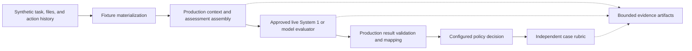
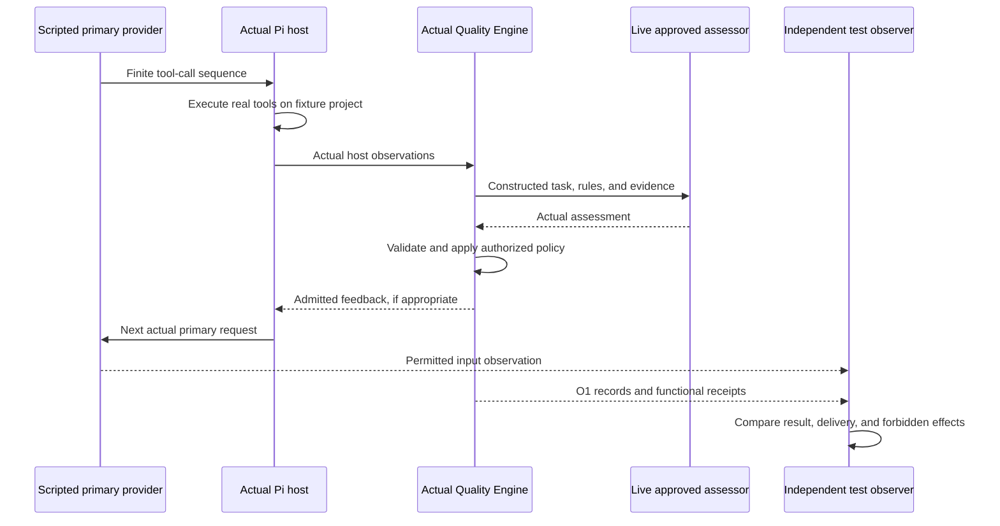

## Pi Quality Engine — Testing Philosophy and Behavioral Evidence 🧪

**Invented agent histories. Real model assessments. Real Pi integration. Bounded experiments. Inspectable evidence.**

The most characteristic test for this project begins with a deliberately constructed situation: an agent appears to have edited a file, repeated a check, forgotten a requirement, or stopped before finishing. The test supplies the corresponding task, project documents, code state, and execution evidence. **A real configured decision model—not a hardcoded answer—then evaluates that situation through the actual assessment path.** The test examines what reached the model, what it concluded, and how the engine interpreted the conclusion.

This is different from merely scripting what the evaluator should say. It is also different from asking a live primary agent to spend half an hour producing a mistake that could have been represented in a small fixture. Controlled histories make particular situations reproducible; a live assessor makes the judgment genuine.

Real Pi integration remains essential. Separate tests run the actual Pi SDK or installed host, execute real bounded tools, exercise the extension, and inspect the next model request. A small number of live, closed-loop tasks then establish whether advice helps actual work. No single layer substitutes for the others.

> [!important] The central commitment
> Simulate the agent's preceding work when that isolates the question. Do not simulate the assessor's answer and call it a live semantic evaluation. Run real Pi when claiming host integration. Inspect final behavior when claiming usefulness. Put a finite execution envelope around every experiment.

### How this document relates to the existing set 📑

This is a philosophy and experiment-design companion, not a replacement test framework. It preserves the existing configuration, component contracts, diagnostic records, release checkpoints, and source pins.

| Existing document | Authority retained |
|---|---|
| [01 — Architecture and Decisions](01-architecture-and-decisions.md) | Standalone deployment, responsibility boundaries, feedback-loop invariants. |
| [02 — Component Contracts and Configuration](02-component-contracts-and-configuration.md) | C1 observation, context, assessment, model, policy, action, and registry contracts. |
| [03 — Observability and Data Policy](03-observability-and-data-policy.md) | O1 permitted records, accounting, data capture, storage, and uncertainty. |
| [04 — Implementation, Testing, and Acceptance](04-implementation-testing-and-acceptance.md) | D1 test layers, D-series obligations, semantic promotion, and release acceptance. |
| [05 — Implementation Map and Dependency Rules](05-implementation-map-and-dependency-rules.md) | M1 source organization and ownership. |
| [06 — Implementation Handoff and Integration Probes](06-implementation-handoff-and-integration-probes.md) | H1 focused real-boundary probes P-01–P-10. |
| [07 — Project Philosophy](07-project-philosophy.md) | Simplicity, modularity, role-neutral observation, and product scope. |
| [08 — Development Checkpoints and Release Checklists](08-development-checkpoints-and-release-checklists.md) | K1 versions, checkpoint evidence, and Git-tag discipline. |
| **09 — This document** | How to construct meaningful evidence-driven tests, evaluate real assessors and prompts on synthetic work, and keep experiments finite. |

The terms *must*, *should*, and *may* express required test discipline, a preferred approach, and an optional technique. Illustrative case IDs, fixture files, and experiment-plan fields below belong to test tooling. They do not add public C1 keys, component kinds, or O1 event names.

The label **System 1** in this document means an explicitly selected typed decision/classifier route, such as a supported Jev route. It does not mean that a new model named “Model 1” must exist, that a model is automatically suitable for every criterion, or that a price or capability is inferred from its name.

### Reading map 🗺️

| Question | Start here |
|---|---|
| What constitutes proof rather than confidence? | [1 — Evidence](#section-1) |
| What exactly is simulated, and what remains real? | [2–3 — Test paths](#section-2) |
| How should an invented agent history be built? | [4–6 — Fixtures and concrete cases](#section-4) |
| How are prompts and classifier answers assessed? | [7–9 — Semantic evaluation](#section-7) |
| How is real Pi and context injection verified? | [10–12 — Integration and closed-loop work](#section-10) |
| How do tests avoid running forever? | [13–15 — Execution bounds](#section-13) |
| What evidence is small enough to retain in Git? | [16–17 — Artifacts and provenance](#section-16) |
| How are results used without chasing coverage or gaming tests? | [18–21 — Maintenance and handoff](#section-18) |

<a id="section-1"></a>

## 1. Tests establish observable facts, not confidence 🎯

### 1.1 A claim needs an observation independent of the claim 🧭

A useful test states a behavior, creates the conditions in which it matters, and observes the relevant boundary. The test must be capable of failing when that behavior is wrong.

A log entry saying that an assessment completed is evidence that the engine emitted that entry. It is not, by itself, evidence that the configured model was called, that the model received the required document, or that a recommendation reached the next primary request.

| Claim | Insufficient evidence | Stronger independent observation |
|---|---|---|
| The evaluator saw the project rule. | The rule's path appears in configuration. | The permitted rule bytes or fingerprint are matched against the actual request boundary, with the final manifest agreeing. |
| The real classifier evaluated the scenario. | A fixture file contains an expected classification. | An authorized live dispatch and response are observed; no replay or stub supplied the answer. |
| Feedback reached the executor. | An action returned `success`, or a log says `delivered`. | The next appropriate primary model input contains the admitted message at the documented boundary. |
| Stop was respected. | The runtime reports a paused state. | Relevant deadlines and late results occur, yet independent dispatch counters remain unchanged. |
| A test command succeeded. | The agent requested the command. | The real or explicitly simulated terminal result establishes the exit state, and the evidence identifies the revision checked. |
| The journal contains no source text. | `Standard` is selected. | A sentinel actually passes through the relevant input path and is absent from every owned diagnostic destination. |
| An intervention helped. | The executor acknowledged it. | The final work satisfies the independently evaluated requirement without the relevant regression. |

For a semantic question, the independent reference is the task, applicable requirements, actual fixture state, and a predeclared rubric. It is not the assessor's self-reported certainty.

Anthropic's published evaluation guidance distinguishes an agent's trajectory from the resulting environment state and discusses combining deterministic, model-assisted, and human grading. That distinction supports the use of separate input, action, and outcome evidence here; the concrete requirements in this document remain project decisions.[^agent-evals]

### 1.2 Coverage is a navigation aid, not a release objective 📊

Coverage may reveal a branch that no test exercises. It does not show that an assertion checks the intended behavior. A test can execute the complete feedback path and assert only that no exception was thrown.

The project therefore does not accept a feature because a coverage percentage rose. It accepts the stated scope when the appropriate D/O/P/K obligations have concrete evidence. A short test that detects a duplicate charge is more valuable than many assertions about irrelevant helper calls.

This does not mean refusing coverage tools. They remain optional diagnostics. An uncovered critical decision deserves investigation; a numerical target does not justify test-only production branches, trivial assertions, or disabling meaningful failures.

### 1.3 An outcome can be useful without being a clean pass ⚖️

A model can correctly report insufficient context. A provider can fail while the engine correctly contains the failure. A live evaluator can make a wrong judgment while the engine correctly refuses an unauthorized action.

Reports must keep these outcomes separate. D1's case states—`not-run`, `passed`, `failed`, `blocked`, and `not-applicable`—remain the acceptance vocabulary. More detailed observations can describe transport status, semantic correctness, action behavior, and resource termination without inventing a new production result type.

A requested live gate with no working route is blocked, not passed. A correctly limited semantic answer passes only a case whose expected behavior is that limitation; it does not certify that the work is correct.

<a id="section-2"></a>

## 2. The primary experiment: synthetic work, live judgment 🧠

### 2.1 What the test is trying to learn 🔬

The first question is:

> Given this task, these project rules, these changes, and this sequence of actions, does the actual configured assessor reach a defensible assessment?

The preceding work can be invented. A fixture can establish that an agent read a document, changed a handler, ran an unchanged test three times, and declared completion. The fixture must be internally consistent, but a paid primary model does not need to generate that exact history.

The evaluator, its configured assessment resources, the request construction, the real model call, the response normalization, and the policy interpretation remain genuine. This isolates the part under study: the assessor and the prompt/context system surrounding it.



*The fixture controls what happened before the assessment. It does not contain the answer returned by the live model.*

### 2.2 Two useful levels of synthetic-history evaluation 🪜

A **frozen-input assessor case** supplies a complete versioned evaluation input through the normal model/evaluator boundary. It answers a narrow question about prompt, question, route, and mapping behavior. It is particularly useful when diagnosing whether a poor result came from the assessor or from evidence selection.

A **materialized-history case** creates the project state and supplies a finite sequence of attributable fixture observations through the existing context/runtime path. The production collector selects the actual materials, applies limits, constructs the request, invokes the live assessor, and interprets the result. This is the preferred product-level semantic test.

The report distinguishes them. A frozen request does not prove that the production collector would have selected those same bytes. A materialized history does not prove that a real Pi host would have emitted the corresponding events.

Neither distinction makes the test unimportant. It identifies precisely what the result establishes.

### 2.3 No synthetic answer on the live path 🚫

A live semantic run must not silently fall back to a stored response, a heuristic label, or a scripted evaluator when credentials, transport, or the provider fail. It records unavailable or failed execution, with the applicable case outcome.

Recorded responses remain useful for deterministic parser and mapping regression tests. Those runs must be labeled replayed. A warm remote provider input cache is not the same as an application replay; an application cache that returns an old answer without a new model evaluation cannot count as a new live trial.

A case should retain the requested profile, actual route/model identity when exposed, assessment-resource revision, request identity, and whether a real dispatch occurred. An API key existing in the environment is not authorization to use it.

### 2.4 Ordinary requirements, not a second rule database 📚

Fixtures contain small project documents of the same kind the product is expected to consume: `AGENTS.md`, task descriptions, architecture decisions, and code. Expected labels are kept separately by the grader.

The experiment must use those documents as sources, not translate them into hidden special-case production rules keyed by a scenario ID. A model that sees the criterion “respect the current architecture” must receive the relevant architecture evidence, not just a filename.

<a id="section-3"></a>

## 3. A portfolio of tests with honest boundaries 🧩

The project needs complementary paths, not one enormous E2E test that attempts to establish everything at once.

| Test path | Agent work | Assessor | Pi host | Main claim |
|---|---|---|---|---|
| Focused logic/runtime test | Small controlled values or finite observations. | Deterministic or explicitly scripted. | Optional. | Scheduling, validation, mapping, policy, accounting, or storage behavior. |
| Live assessor case | Invented, versioned project and work history. | **Actual approved model.** | SDK/model service as needed; no claim of a primary host session. | Semantic and prompt/context behavior on the supplied scenario. |
| Real Pi mechanical integration | Finite scripted primary responses; actual tools and project changes. | Scripted where determinism is needed. | **Actual Pi.** | Host events, tools, context assembly, lifecycle, and feedback boundaries. |
| Hybrid Pi/live-assessor integration | Finite scripted primary responses. | **Actual approved model.** | **Actual Pi.** | Real assessment and its real host-side delivery in a controlled scenario. |
| Bounded live closed-loop task | Actual primary model performs a small task. | Actual approved evaluator/reviewer. | **Actual Pi.** | Task outcome and practical benefit within the declared scope. |

The scripted primary in a Pi integration test is a real provider-boundary fixture. Pi still decides how to process responses, run tools, retain context, and call the extension. A mock object named `AgentSession` with no actual Pi runtime cannot establish this integration.

Conversely, there is no need to run a live primary model to test every scheduler edge. A deterministic late response is a better way to reproduce a particular Stop race. The intended model behavior and the intended scheduling behavior are different test targets.

### 3.1 Mechanical correctness and semantic correctness are reported separately 📐

For a live case, the report can establish all of the following independently:

**Transport and execution:** the correct approved route received a bounded request and returned or failed.

**Evidence coverage:** the model input actually included the intended requirements and changes, or a declared limitation.

**Assessment quality:** the conclusion is supported by the independent rubric.

**Reaction quality:** the engine's allowed policy response is proportionate and respects authority.

**Final usefulness:** only a closed-loop task can establish that subsequent work improved.

A high semantic score never excuses a Stop violation. A flawless deterministic test suite never proves the live assessor identifies overengineering. A wrong classifier answer is not automatically a failure of the collector if the correct material reached the model.

<a id="section-4"></a>

## 4. Constructing a small, credible agent-history fixture 🎬

### 4.1 Every fixture establishes a world, not a verdict 🌍

A useful fixture describes the authorized task, original sources, starting state, ordered actions, observed results, and the assessment point. The world should be small enough for a person to understand without launching another investigative agent.

For example, a progress fixture can contain a CLI module, one requirement document, one test file, and five or six action records. It does not need a miniature company repository or dozens of irrelevant files.

| Fixture element | Purpose | Typical size discipline |
|---|---|---|
| Task and amendments | Define authorized work and its changes. | A few paragraphs; include only relevant amendments. |
| Project rules/architecture | Supply the actual applicable standard. | One or two short documents or selected original sections. |
| Initial and assessed code state | Establish what changed. | The smallest coherent functions/modules and required call sites. |
| Action history | Show actions, outcomes, revisions, and waits. | A finite sequence, usually a handful of meaningful steps. |
| Assessment point | Prevent later information leaking into the judgment. | One explicit cursor and evidence version. |
| Hidden rubric | Define supported issues and acceptable responses. | Separate from everything the evaluator can read. |
| Experiment plan | Set route, scope, limits, artifacts, and repetition count. | One small run-level plan rather than a platform. |

These are guidelines for fixture authoring, not production context limits.

### 4.2 File changes and execution records must agree 🧾

If the history says a file was changed, the materialized state at the assessment point must contain that change. If a command succeeded in a synthetic history, the event is a declared simulation result, not a claim that the actual command executed. If a real Pi test runs it, the real terminal result is used instead.

Requested, started, completed, and successfully checked are separate facts. The fixture must not treat a tool request as successful execution. A passing check must identify the relevant code/configuration/environment version; an older pass does not prove that later edits work.

A generated fixture should be checked for consistency before a paid model is called. Missing required fixture files, contradictory timestamps, an impossible result reference, or a supplied diff that does not match the assessed state are fixture failures. They are not interesting model failures.

### 4.3 Keep the hidden oracle outside the model's reach 🔐

The model must not receive expected labels, reference findings, grader code, target scores, or outcome-revealing case names. Neutral visible identifiers such as `case-017` are preferable to a workspace named `obvious-missing-logging-positive`.

For tool-assisted reviewers, hidden material must be outside their permitted read roots and resource discovery. Omitting `expected.json` from the initial prompt is insufficient if a broad `find` or `read` can still reach it.

Labels such as “this is the deliberately broken version” must not appear in comments, paths, commit messages, fixture metadata passed to the model, or model-visible test output. The request manifest and allowed tools are checked for these accidental channels.

This is a separation of concerns in the test environment. It does not require a new production sandbox. Where a live primary can execute broad shell commands, process isolation and the placement of hidden grader material must be adequate for the scope claimed; read-root conventions alone are not a security guarantee.

### 4.4 No information from the future 🔮

A review at the fifth action cannot use a fix made at the seventh. A test that replays an entire transcript must establish a cut-off before building the context.

The same rule applies to a claimed “before-final-response” check: the collector must not quietly include a later successful test that the real observer would not yet have seen.

After a later change, the same case may be evaluated again as a separate input revision. That is useful evidence of sensitivity to new facts. It is not the same trial with the expected answer silently changed.

### 4.5 The fixture is data, not a new scenario language 🪶

A directory of small files and an ordinary array of steps is enough. A short test function may perform the steps directly. There is no requirement for a generic workflow interpreter, agents generating agents, or a DSL with loops, branches, and dynamic shell execution.

The driver should dispatch a known finite set of fixture operations. It must not execute arbitrary command text merely because that text appears in a simulated tool record. Real tool execution belongs to the explicitly isolated Pi integration path.

<a id="section-5"></a>

## 5. Worked experiment: repeated verification, judged by a real classifier 🔁

### 5.1 The synthetic work situation 🧭

The task is to add a JSON output mode to a small command-line program while preserving its text mode. The project permits meaningful verification but asks the developer not to rerun unchanged successful checks without a new reason.

At the assessment point, the following work is represented:

| Position | Supplied fact | Evidence relationship |
|---|---|---|
| 1 | The task and verification instructions were read. | The applicable requirement is available. |
| 2 | The output module was changed. | Assessed code revision becomes `r2`. |
| 3 | The narrow output test completed successfully. | The result covers `r2`, test revision `t1`, configuration `c1`, and fixture environment `e1`. |
| 4 | The same test completed successfully again. | No material input, environment, requirement, or diagnostic question changed. |
| 5 | The same test completed successfully a third time. | The history still contains no new evidence or stated reason for repeating it. |

A separate supplied artifact may establish that a named part of the task is still unfinished. The grader must not infer unfinished work merely because the repeated commands look wasteful.

The actual configured progress prompt and typed questions are then used. The production C1 `progress-v1` mapping already recognizes `progressing`, `repeating`, `waiting`, and `unclear`. It produces a suspected progress concern for `repeating`; it does not turn a classifier choice into a fabricated file-level diagnosis. See [C1 §10](02-component-contracts-and-configuration.md#section-10) and [C1 §11](02-component-contracts-and-configuration.md#section-11).

### 5.2 What runs for real ⚙️

The fixture materializes the small project and supplies the bounded work observations. The engine builds the evaluation context and assessment resources, records the final input manifest, and sends a live request through the approved classifier route.

The model's actual decisions and available probabilities are preserved in the permitted result evidence. The ordinary mapping and policy are applied. In the first semantic-only run, the product runs in observe mode: no primary continuation is required to measure the assessment.

The pinned Pi documentation exposes classification as typed questions over state, including an extension call through `ctx.modelRegistry.classify()`. It is not an ordinary chat prompt with a model label pasted on top.[^pi-classifiers]

### 5.3 What the grader should accept and reject ✅

The case's rubric can require recognition of materially repeated, uninformative verification and reject a conclusion that three unchanged passes demonstrate three independent improvements.

It should not require an exact probability, one exact sentence, or a fixed word such as “wasteful.” A defensible answer may be a scoped suspicion that a new verification purpose is needed.

The policy test checks what the configuration actually allows. Under observe mode, a semantic finding plus zero dispatched feedback is correct. In a separately authorized hybrid delivery case, a brief supported progress recommendation can be examined at the primary request boundary.

If `unfinished` is false, this means that outstanding work was not established by the supplied evidence. It does not establish completion. Tests must preserve that C1 distinction.

### 5.4 The contrasting and incomplete versions 🧪

The **justified-repeat variant** changes one relevant fact: between checks, the agent changes a configuration value needed by the task, with an updated configuration revision and an explicit reason to recheck. The repeated command name is identical; the evidential situation is not. A categorical waste finding based only on command repetition is wrong.

The **incomplete-result variant** contains a requested check with no terminal result. The evaluator should not claim that it passed, and should not infer healthy completion from the absence of an observed error. Depending on the supplied scope, `unclear` or another explicit limitation is appropriate.

These three cases form a practical first live development batch: the same general question, a real violation, a legitimate near-miss, and insufficient evidence. They exercise prompt behavior as well as model behavior without requiring a live primary agent to discover the test script.

### 5.5 The useful diagnostic split 🔎

If the classifier misses the concern, inspect the actual request before changing the prompt. The cause may be omitted results, a missing instruction, an input truncated before the repeated actions, an incompatible mapping, or genuinely poor model judgment.

Only after the evidence path is confirmed should the experiment compare alternative prompt wording. Adding harsher instructions to compensate for missing facts is not a good repair.


<a id="section-6"></a>

## 6. A compact collection of meaningful case families 📚

### 6.1 Required operational logging 🪵

A small worker handles a remote-operation failure. The task and project standard require one failure event with an operation identifier and explicitly prohibit logging the sensitive request body.

The violation fixture catches the exception and returns a failure value without the required event. The rule, failure path, and relevant call chain are supplied. The live assessor should identify the missing required behavior rather than generically request more logs.

The legitimate variant puts the required event in the calling layer, as the project's documentation intends. The model must not insist on duplicate logging in the inner function. The incomplete variant withholds that caller or the applicable logging standard and expects a scoped limitation.

For a later closed-loop task, the final behavioral oracle induces the failure and observes the actual emitted event, its count, required fields, and absence of the synthetic secret. That is a product-outcome check. It is different from checking the Quality Engine's own diagnostic journal.

### 6.2 Unnecessary abstractions versus justified boundaries 🧱

The violation fixture introduces a forwarding class and extra configuration for a task already covered by an existing service. Supplied call sites and requirements show no distinct responsibility for the new layer.

The legitimate variant has a documented boundary—for example, translating an external transport contract into the domain interface—even if only one current caller uses it. Removing that boundary would violate the architecture. The incomplete variant lacks the dependency or rationale needed to determine whether the abstraction is justified.

The rubric does not count classes, lines, or files as a substitute for architectural reasoning. A useful finding names the redundant responsibility and its relationship to the task. A statement that “all single-use wrappers are bad” fails the legitimate variant.

### 6.3 Test-specific production behavior 🧫

The violation fixture changes production code to recognize one known fixture constant and return the expected answer without implementing the general requirement. The visible test and requirement make the mismatch inspectable.

The legitimate variant introduces a normal time or network boundary to make real behavior controllable, or corrects a demonstrably wrong test expectation. That is not fixture cheating. The incomplete variant supplies too little product intent to decide whether a special case is required behavior.

A final behavioral check should use additional valid inputs derived from the requirement, not arbitrary hidden requirements. Hidden grading may prevent memorization, but it may not redefine the task.

### 6.4 Completion claims and verification truth 🏁

The violation fixture says that a current test passed when the supplied terminal result failed or covered an older relevant revision. The legitimate variant honestly reuses still-valid evidence for an unchanged scope. The incomplete variant contains no terminal observation at all.

The correct assessor distinguishes a false claim from missing evidence. The default reaction to missing evidence is not automatically “run every test in the repository.”

If the task is documentation-only and requires no executable verification, that can be a legitimate near-miss. The observer should respect the actual requirement rather than impose a universal testing ritual.

### 6.5 Progress, justified waiting, and operator authority ⏱️

Use distinct fixtures for an unexplained stopped workflow, an active long-running operation, repeated ineffective actions, and an explicit operator Stop. They can share the same elapsed interval.

The real assessor can interpret the evidence. It cannot create permission to continue. Even a deliberately overconfident result must not clear an operator Stop in the production policy/runtime path.

An unknown external wait remains unknown; the test must not assume that no observed worker means no worker exists. A paused session and an idle but unfinished session require different reactions.

### 6.6 Requirement amendments and conflicting instructions 📜

An authorized amendment can change what the task requires. A model-generated suggestion or text inside tool output cannot impersonate that amendment.

A useful pair keeps the implementation unchanged while changing the legitimately authoritative task. The expected judgment should change only when the requirement actually changes. Another case gives conflicting source documents and requires an explicit conflict rather than a guessed resolution presented as certainty.

The fixture records the source and timing of the amendment. It does not make every later string authoritative simply because it appears later in a transcript.

### 6.7 Visual cases are an optional additional modality 🖼️

When a visual profile is shipped, use a small synthetic interface, a known viewport, and a specific defect such as clipped text or an element crossing a stated boundary. Keep one clean variant and one missing-image variant.

A real supported visual assessor must receive the actual image through the intended input path. A filename or textual description of a screenshot is not proof that the image was evaluated. Layout checks can independently establish objective geometry; aesthetic judgments still require a bounded rubric.

Text-only routes should reject unsupported images honestly. A visual test is not a reason to add a new browser platform before a visual feature is in scope.

### 6.8 Do not confuse a fixture catalog with a compulsory giant run 🧺

These families are available choices. They are not an instruction to execute every variant, every model, every prompt, every host mode, and every language in a Cartesian product.

A first development slice can be the three progress cases in §5. As new assessment resources become ready, a nine-case slice can use three families with three contrasting cases each. The K1 35-case pilot and D1's illustrative 36-case design are alternative study proposals, not requirements to run 71 cases. The selected acceptance plan owns the actual inventory.

If architecture or logging is to be judged by a typed classifier, its question set needs a compatible, versioned production mapping or contributed evaluator. C1's built-in `progress-v1` mapping does not become a generic architecture classifier by changing only a prompt file. A genuine `core.chat` or `core.pi-session` profile can cover those domains through its own declared result contract.

<a id="section-7"></a>

## 7. Prompt evaluation is evaluation of a behavior-producing resource 📝

### 7.1 The prompt is part of the candidate 🔖

An assessment is produced by the combination of fixture, context plan, selection rules, instruction resources, typed questions, result schema, evaluator implementation, actual model route, score mapping, and policy.

The candidate record therefore includes revisions of all changed resources. A new prompt is a new assessment candidate even when no TypeScript changes. A prompt-file edit packaged in the release is not a harmless documentation-only change.

For a classifier, the relevant resource includes question wording, available labels, and criteria for each answer. For a chat or Pi-session reviewer, it also includes the system/instruction structure and expected structured result. The two forms should not be treated as interchangeable text.

### 7.2 Compare one deliberate change at a time 🔬

A small comparison can keep three development cases, one model route, one context plan, and one mapping fixed while comparing an existing prompt with one revised prompt.

The revised prompt should address a stated hypothesis, such as “the current wording confuses repeated commands with repeated ineffective work.” That is more useful than asking a model to “improve the prompt” and then trying dozens of variants without an external criterion.

| Controlled comparison | Intended question |
|---|---|
| Prompt A versus B, same evidence and route | Did the wording improve the intended distinction? |
| Same prompt, complete versus incomplete evidence | Does the result respond appropriately to missing facts? |
| Same evidence, authorized task amendment | Does instruction applicability change correctly? |
| Same criterion, different approved model | Does the new profile need different calibration or support scope? |
| Same semantic situation, neutral renaming | Is the decision robust to irrelevant naming? |

Do not change prompt, model, threshold, and context selection together and attribute an improvement to the prompt alone. A deliberately combined change is allowed, but it must be reported as a combined candidate.

### 7.3 Prompt tuning has a stopping point 🛑

A development session should begin with one written hypothesis and a finite candidate count. The recommended first comparison is **the baseline plus one candidate**, not an open-ended optimization loop.

After the planned runs, inspect the evidence and make one of three decisions: keep the candidate, reject it, or record an unresolved issue for another explicitly planned experiment. The implementation agent does not keep generating prompts until the test collection turns green.

There must be no model-driven “repair prompt and rerun” loop inside acceptance. A format-repair request, when deliberately tested, is a bounded production behavior; it is not permission to change the assessment standard in response to a disappointing semantic result.

### 7.4 Context experiments must use the context actually sent 📦

Context selection can affect the result as much as wording. Compare the final observable model input—not just the configured source list.

A missing mandatory instruction should produce incomplete coverage. Adding an irrelevant file should not erase a supported concern. Reordering independent evidence may be a useful robustness case, but the experiment should not demand identical probabilities.

For tool-assisted review, initial context is only the beginning. The test records additional reads and verifies that the next model request contains their results. Otherwise a model may have requested a useful tool but never received its answer.

If model-assisted preparation summarizes documents, its own prompt, output, source coverage, and owned cost become part of the candidate. A small first implementation should prefer direct bounded materials over introducing this extra uncertainty solely for tests.

<a id="section-8"></a>

## 8. Grading the real assessor without circular reasoning ⚖️

### 8.1 Use the C1 result semantics rather than new verdict names 📐

C1 already distinguishes operational outcome, coverage, conclusion, finding status, and scores. The grader should use these dimensions.

| Expected situation | Relevant C1 interpretation |
|---|---|
| Successful assessment with no supported concern | `operational: completed`, `conclusion: no-supported-finding`, appropriate coverage. |
| A supported or scoped suspected concern | `conclusion: findings`, with valid findings and actual evidence references. |
| Missing mandatory evidence | Appropriate limited coverage and an undetermined or otherwise explicitly bounded result. |
| Conflicting requirements | `conclusion: conflicting-requirements` where supported. |
| Provider unavailable, failed, or cancelled | Operational limitation, not a successful quality judgment. |

A `supported` finding is a model's scoped claim, not a certificate of truth. The hidden case rubric determines whether the evidence actually supports it.

A classifier may provide choices and scores without generating explanatory evidence. Its deterministic mapping must not fabricate line numbers, requirement references, or confidence. The grader should examine the raw allowed typed decision and the normalized result separately.

### 8.2 Grade several concrete dimensions, not one quality number 🔎

A small grading record should answer whether the result is valid, whether its references exist, whether the requirement applies, whether the identified concern is supported, whether the limitation is honest, and whether the proposed or selected reaction is proportionate.

For the repeated-verification case, a useful grade might establish that the assessor recognized ineffective repetition and did not claim that the task was complete. For the logging case, the grade should connect the requirement to the missing event in the shown call path.

Schema validity is mechanically checked. Factual references can often be checked mechanically. Nuanced architectural judgment may require a short human review against a predeclared rubric. A second model may assist, but its approval is not a replacement for that rubric.

### 8.3 Accept legitimate alternatives ✨

The desired correction is not necessarily one exact patch. A requirement may be satisfied by using an existing service, removing a forwarding layer, or showing a valid responsibility not originally visible.

A grader should reject a real violation and accept legitimate solutions within the task. It should not force a particular identifier, function layout, log library, or call sequence unless the project explicitly requires it.

This applies to observer outputs too. A concise investigation request can be better than a confident categorical correction when the supplied evidence is incomplete.

### 8.4 Keep denominators visible 📊

Report case counts alongside percentages. A useful minimum report separates:

| Measurement | Meaning |
|---|---|
| Valid results / attempted evaluations | Whether the model produced an interpretable result. |
| Supported detected issues / eligible labeled issues | Detection within the declared supplied scope. |
| Supported accepted findings / all accepted categorical findings | Precision of claims that would be treated as findings. |
| Unwarranted corrections / evaluated clean or justified cases | False intervention risk. |
| Honest limitations / incomplete-evidence cases | Whether missing context remains visible. |
| Actual provider attempts and known/unknown usage | Cost and operational exposure of the study. |
| Completed / failed / blocked / not-run cases | Whether the planned inventory was actually exercised. |

A zero denominator is not perfect accuracy. Nine small development cases do not establish population performance. Repeated draws of one fixture are not new independent engineering problems.

When the batch stops early, report the stopped inventory and reason. Missing cases do not disappear from the plan. Model-quality errors normally remain in a finite run's results; operational stop conditions such as unsafe disclosure, budget exhaustion, or a repeated unavailable route may end the batch.

### 8.5 Quality errors and safety barriers are different outcomes 🧱

A model may wrongly propose an overbroad restart. If the runtime rejects it, the mechanism can pass the authority test while the semantic proposal fails its rubric.

This separation is necessary. Otherwise a strong runtime gate could hide a poor prompt, or a poor prompt could incorrectly discredit a correctly functioning safety boundary. The report should preserve both facts without averaging them into an opaque score.

<a id="section-9"></a>

## 9. A small corpus that does not teach the model the exam 📚

### 9.1 Begin with reviewed cases, not generated volume 🌱

The first live assessor development batch can be three cases from one family. It is useful because every input and result can be inspected.

A model may help draft fixture histories, but a fixture is admitted only after its task, source evidence, and expected interpretation are reviewed. Generated labels are hypotheses until checked. Ten near-identical generated histories should not be presented as broad domain coverage.

The immediate priority is a few realistic distinctions the observer must make: bad repetition versus justified verification, missing required logging versus centralized logging, unnecessary layers versus documented boundaries.

### 9.2 Keep related cases together when splitting 🧬

Development and held-out evaluation serve different purposes. Prompt tuning uses the development set. Profile acceptance uses a frozen held-out set appropriate to the claim.

Counterfactual variants derived from the same tiny repository should normally remain together in one split. A renamed function or one-line edit is not an independent held-out task. K1's illustrative calibration/holdout counts must be instantiated without contradicting D1's family-level leakage rule; if the proposed count split cannot do so, record another small split before the run.

The three-case and nine-case starter batches in this document are development aids, not substitutes for K09's declared semantic promotion evidence.

### 9.3 Separate a deterministic regression from a fresh live trial 🗄️

A saved provider response can be used to reproduce parsing, normalization, policy, or accounting behavior offline. It cannot prove that the current live model still produces that response.

When a live failure becomes a regression fixture, retain both uses clearly: replayed output protects the mechanics; a future explicitly approved live run measures current semantic behavior. Neither should silently stand in for the other.

Provider-side model aliases can change while retaining the same name. Record the available actual revision; when unavailable, state that limit. Freeze local prompts, questions, mappings, fixture bytes, and context plans regardless of upstream reproducibility.

### 9.4 Do not tune on the held-out answer and call it unchanged validation 🔒

If a failed held-out case causes a prompt or mapping edit, the new candidate requires a newly classified evaluation plan. The old failure remains in the historical record.

A practical small project does not need elaborate statistical infrastructure. It does need honest labels such as “development comparison,” “held-out pilot,” and “diagnostic rerun after inspecting the failure.” An implementing model must not collapse all of them into “tests passed.”

<a id="section-10"></a>

## 10. Real Pi integration is mandatory for host claims 🤖

### 10.1 Keep the host, tools, and extension path real 🧰

A mechanical integration test should load the built candidate in a disposable Pi environment, supply a supported scripted model/provider fixture, and let actual Pi process the finite responses.

The scripted provider can request a read, an edit, and another model turn. Actual tools act on a temporary project. The actual extension observes their lifecycle. The actual context assembler and reviewer runner execute. The test inspects what the next request contains.

The Pi SDK provides real session construction, resources, tools, model selection, subscription, and disposal. These are the boundaries to exercise, not classes to imitate inside a fake Pi implementation.[^pi-sdk]

Use an isolated settings/auth/session environment and a candidate package inventory. A harmless ambient canary may be added only to an isolation test; the ordinary clean-deployment test contains no donor observer or subagent plugin.

### 10.2 Add the live assessor to a deterministic primary history 🔗

The hybrid test is the closest match between controlled inputs and end-to-end observation:



The primary's preceding actions are reproducible. The evaluator's judgment is not fabricated. The feedback enters a real Pi session.

This test establishes delivery only if the semantic precondition occurs. If the live assessor misses the issue and emits no finding, the report should record the semantic miss. It must not call the absent feedback proof that delivery works. A separate deterministic supported-finding case verifies delivery regardless of the live model's choice.

### 10.3 Assert model-visible inclusion, not just queue acceptance 📬

A feedback test inspects the actual next suitable primary model input and identifies the admitted note without depending on its exact prose. It checks recipient scope, timing, causal identity where exposed, and absence of unintended content.

Queue admission, host acceptance, model-input inclusion, and executor behavior are separate receipts. The test claims only the strongest receipt it actually observes.

Steering does not necessarily interrupt a running tool. The pinned SDK describes steering and follow-up at different boundaries. The test should reflect those boundaries instead of demanding impossible instantaneous delivery.[^pi-sdk]

### 10.4 Negative cases must reach the decision they are testing 🛑

A Stop test needs a valid finding or pending action that would otherwise be delivered. A staleness test needs a completed assessment tied to an earlier evidence version. A duplicate test needs a repeated identity or same supported issue, not two unrelated warnings.

Use a controlled evaluator for precise races, then a small hybrid case to show the path with a live judgment. Neither requires waiting for a real model to coincidentally make the desired mistake at the desired millisecond.

A no-feedback result without a triggering finding is not proof of Stop protection. Likewise, a secret-scan test is weak unless the sentinel actually reached the protected surface.

### 10.5 Test the installed shape, not only the source workspace 📦

At least one relevant integration resolves prompts and schemas through the packed package and creates a clean Pi reviewer. This catches missing resources, duplicate host SDK copies, accidental imports from a sibling workspace, and implicit ambient extension dependencies.

Source-based tests remain useful, but package acceptance follows the actual distributed artifact and the D1/K1 candidate identity rules. No “test integration helper” should secretly supply a resource omitted from the tarball.

<a id="section-11"></a>

## 11. Independent reviewer tests and bounded escalation 🕵️

### 11.1 A deep review is another evaluation, not a second product 🧭

Scheduled deep checks and escalation use the same C1 `check.run` path and an explicitly configured `core.pi-session` evaluator. Tests must not enable a donor plugin to launch the reviewer or give it a separate hidden control path.

A useful reviewer fixture requires one additional permitted read before a correct conclusion can be formed. The test confirms that the file was actually read and that its result appeared in the subsequent reviewer request. Merely counting a requested tool call is insufficient.

The reviewer receives the original task and applicable project documents, plus any preliminary concern labeled as a hypothesis. It must not receive “the primary agent is definitely wrong” as an authoritative conclusion.

### 11.2 Wrong suspicions are valuable tests 🧪

Construct a preliminary suspicion that the supplied additional evidence disproves. A useful reviewer should dismiss or narrow it. An escalation path that always agrees with the initial judge may be propagating bias rather than adding independent verification.

Conversely, a correctly supported concern should not vanish solely because the reviewer shares the primary model's confident explanation. The case rubric refers to actual code and requirements.

These cases can use a scripted reviewer to test mechanics and a live reviewer to test judgment. The report does not merge those claims.

### 11.3 A reviewer cannot recursively expand the experiment 🔒

The small reviewer plan should allow a few reads, one structured result, and no repository mutation. It does not grant arbitrary shell access, new reviewers, a new model route, or the ability to revise the test plan.

An escalation action may request one configured expert check under its ordinary runtime budget. A finding from that reviewer must not automatically launch an endless chain of reviewers judging reviewers.

When testing a deliberately supported nested escalation capability in a future profile, the graph and limit are explicit. The default test remains one level deep.

### 11.4 Owned reviewer costs stay owned 💰

All model work in a clean Pi session created by the engine belongs to its own usage ledger. The test driver also records the total experiment exposure, including a live primary when one is used.

The production engine ledger and the experiment ledger have different scopes. A combined study total must not be created by adding both ledgers if the engine's requests already appear in the study total. Optional externally delegated work remains outside the production owned-cost total, as O1 requires.

<a id="section-12"></a>

## 12. A few live closed-loop tasks establish usefulness 🔄

### 12.1 Start with a small bounded task 🛠️

A full live trial should ask the primary model to complete one understandable task in a disposable project. The observer uses real approved assessors. A separate grader examines the result.

For example, repair the worker's failure handling so the specified operational event is emitted once without exposing the request body. The task should be implementable with a small change. It should not require installing an unfamiliar platform, discovering undocumented infrastructure, or solving an unrelated research problem.

The final check invokes the relevant failure and success paths, inspects actual emitted events, and verifies that the general requirement holds. The observer's own conclusion is not reused as the ground truth.

### 12.2 Natural tasks and injected-defect repair establish different claims 🧫

In a **natural task**, the primary starts from the normal initial project and chooses its own approach. A violation may never occur. Such a run can test non-interference, but it cannot demonstrate detection of an issue that was absent.

In an **injected-defect repair task**, a known defect is deliberately present in the starting state or a controlled preceding history. This makes the opportunity for assessment reproducible. The report must disclose that setup; it is not evidence that a live agent naturally produced the defect at that rate.

A scripted primary that repairs the issue after seeing feedback establishes mechanics, not real-agent persuasion or practical savings. A live primary whose actual final behavior improves provides the additional outcome evidence.

### 12.3 Compare matched starting states without pretending a tiny study is universal ⚖️

For an initial usefulness check, one task with an observer-disabled arm and an observer-enabled arm is enough to inspect the experiment design. Both start from separate copies of the same project state with the same task and primary settings.

The enabled arm adds observer overhead, so measure actual task completion, regressions, extra actions, delay, and separately scoped costs. Prompt order and model variability should be reported; a pair of runs is a pilot, not a universal efficacy claim.

If one arm hits a bound, the comparison is censored by that bound. Keep the result. Do not extend only the preferred arm until it wins.

### 12.4 Do not enforce one exact reasoning route 🧠

A live primary may choose a valid solution different from the reference implementation. Tests should examine required behavior and explicit architectural constraints, not require the exact sequence the fixture author imagined.

The observer is allowed to stay silent on correct work. It should not be rewarded for manufacturing a finding merely to make the trial look active.


<a id="section-13"></a>

## 13. Large experiments must have a small, explicit execution envelope ⏳

### 13.1 A test is not an autonomous project 🧱

The testing system must not give an implementing model an instruction equivalent to “keep experimenting until the observer is good.” Every invocation has a fixed case list, route list, prompt candidates, repetition count, stopping conditions, and output budget.

The driver, not a model, owns these bounds. An assessor cannot add another case, choose another provider, request an unlimited expert review, enlarge its context, or extend its deadline by saying more work is required.

This applies to the coding agent conducting the tests as well. Its assignment should name one bounded experiment and a stopping point for analysis. A test failure is a reason to report and diagnose a concrete issue, not authorization for an overnight search over prompts.

### 13.2 Recommended starter envelopes 📏

The following are **proposed test-plan presets**, not product configuration defaults, model pricing claims, or forecasts of execution time. They can be explicitly changed before execution. Limits must be finite in the actual plan, and the stricter applicable product or driver limit wins.

| Experiment | Fixed inventory | Live work ceiling | Suggested work / batch bounds |
|---|---|---|---|
| Live assessor smoke | 3 synthetic cases; 1 prompt; 1 route; 1 draw each. | 3 owned model dispatches; no primary; no reviewer; no effects. | 45 seconds per case; 3 minutes per batch. |
| Live assessor development slice | 9 selected synthetic cases; 1 prompt/route; 1 draw each. | 9 owned dispatches; no automatic expansion. | 45 seconds per case; 8 minutes per batch. |
| Prompt comparison | 3 development cases; baseline and 1 candidate; 1 route; 1 draw. | 6 owned dispatches in a paired plan. | 45 seconds per evaluation; 6 minutes per batch. |
| Pi mechanical integration | 4 selected finite host scenarios. | No public model traffic; bounded scripted turns/tools. | 60 seconds per case; 5 minutes per batch. |
| Hybrid Pi/live-assessor | 3 host scenarios with a scripted primary. | 3 live classifier dispatches; no deep reviewer in this first slice. | 90 seconds per case; 6 minutes per batch. |
| Live deep-reviewer pilot | 2 small cases. | At most 4 model requests and 6 tool calls per reviewer; 1 reviewer per case. | 180 seconds per case; 7 minutes per batch. |
| Live closed-loop pilot | 1 task, disabled and enabled arms. | At most 6 primary model requests per arm; enabled arm adds at most 4 owned reviewer requests; one intervention and one expert check. | 180 seconds per arm; 7 minutes per batch. |

A case work bound includes setup, assessment, and grading inside the case. Cleanup has a separately finite grace period, and the batch bound includes all case cleanup and reporting. The plan reserves time for finalization rather than starting a new case at the last instant.

For typed one-pass classifier calls, the common C1 allowance and the provider's actual capabilities govern response size. A driver-side maximum response-byte limit remains useful even when an API has no generation-token parameter. Ordinary chat/reviewer calls also receive a finite supported output-token limit.

### 13.3 A bounded plan is resolved before the first request 📋

A plan-only invocation should resolve the actual cases and resources and report the maximum work. Wildcards are expanded once into a fixed inventory. Discovery must not keep adding newly generated fixtures during the run.

The upper bound begins with straightforward arithmetic:

```text
Planned direct evaluations
    = selected cases
    × selected prompt candidates
    × selected routes
    × planned repetitions

Maximum owned requests
    = planned direct evaluations
    + explicitly allowed retry/repair requests
    + explicitly allowed reviewer requests
    + any approved model-assisted preparation requests
```

A suite of 9 cases, 2 prompts, 2 models, and 3 draws is 108 evaluations before retries or reviewers. It is not a nine-case smoke test. The resolved plan must make this multiplication visible and reject a plan whose ceiling is outside the authorization.

Use one live request at a time initially. Parallel execution can be introduced for a reason, with shared budget admission and explicit reporting. It is not a default way to conceal an oversized experiment.

### 13.4 Example of a finite test-driver plan 🧾

The following illustrates a proposed record consumed by the repository's existing `test:live` tooling. It is **not C1 runtime configuration and not a claim that these CLI fields already exist**. The implementation can use a smaller equivalent structure while retaining these facts.

```json
{
  "kind": "live-assessor-study",
  "planVersion": 1,
  "studyId": "progress-smoke",
  "cases": ["case-017", "case-018", "case-019"],
  "profile": "approved-live-judge",
  "assessmentResource": "builtin:progress-v1.md",
  "repetitions": 1,
  "concurrency": 1,
  "bounds": {
    "maxOwnedModelDispatches": 3,
    "maxPrimaryModelDispatches": 0,
    "maxInputTokensPerDispatch": 8192,
    "maxResponseBytes": 16384,
    "requestTimeoutMs": 30000,
    "caseWorkTimeoutMs": 45000,
    "batchWallTimeoutMs": 180000,
    "cleanupGraceMs": 5000,
    "maxFeedbackDispatches": 0,
    "maxEscalations": 0,
    "retryAllowance": 0,
    "maxArtifactBytes": 262144
  },
  "authorization": {
    "routeGrant": "operator-supplied",
    "knownCostCeiling": {
      "currency": "USD",
      "amount": "0.50"
    }
  }
}
```

The money value is an illustrative admission ceiling, not an estimated price or an authorization conveyed by this document. The executing operator must approve the actual resolved route and limits. The profile name is a local reference that must resolve; it is not a model ID.

The assessment's question resource, schema, mapping, and context configuration are resolved through the selected production check and recorded in the expanded plan. The driver may not bypass C1 grants to satisfy this example.

If input tokens are estimated, label that basis. A hard byte bound can be enforced independently. If provider pricing is unknown, the plan must not pretend that a dollar ceiling alone bounds the invoice; honor the existing unknown-cost policy and count/time bounds.

### 13.5 Case and batch bounds are enforced at different owners 🧷

The product still enforces its own run, tool, request, and effect limits. The test driver enforces the experiment inventory, total dispatch allowance, batch deadline, and artifact ceiling independently.

The driver must not treat a change from one model to another as a new free budget. Retrying, format repair, a model-assisted summary, or a deep review all consume the previously declared allowance.

SDK-internal retries may be opaque. Disable them where the approved path supports it for initial studies. Where individual provider requests cannot be observed or bounded through the selected path, record the limitation instead of claiming an exact physical-request ceiling.

### 13.6 Stop expanding when the experiment no longer answers its question 🛑

Abort new admissions when the global deadline, allowed requests, permission boundary, or artifact budget is reached. A suspected secret leak or unsafe external action ends the batch immediately. Two consecutive transport/unavailability failures on the same route are a reasonable starter stop rule for avoiding pointless paid retries; this rule is recorded in the plan.

Semantic misses do not normally abort a finite batch: clean and negative cases still provide useful context for the error. The batch does not respond to misses by adding cases or changing the prompt.

No planned repeat is replaced by “retry until one response passes.” No failed call is automatically moved to a different model. No deadline is extended mid-run by the implementing agent.

<a id="section-14"></a>

## 14. Timeouts must terminate the experiment, not just the wait 🛑

### 14.1 Cancellation, completion, and remote billing are different facts ⏱️

A promise racing against a timer can stop the caller from waiting while the underlying request, reviewer, or subprocess continues. The test must observe cleanup, not merely catch a timeout exception.

The Node test-runner documentation explicitly warns that its timeout cannot reliably cancel a test that blocks the application thread. Consequently, process-level integration and live experiments need an outer real-time owner independent of any mocked clock or event loop inside the test.[^node-test]

The supervisor is a small execution boundary, not another agent framework. A short-lived worker can run the real Pi test while its parent enforces the overall deadline.

### 14.2 A practical shutdown sequence 🧯

When a case or batch reaches its bound, the driver first prevents new work. It requests cancellation of the owned assessment/session, closes or aborts owned tools through their supported interfaces, and allows only the predeclared short cleanup grace.

If the worker does not stop, the supervisor terminates that specific owned worker using a supported platform mechanism and verifies termination. If descendants were allowed, their ownership and termination must be handled explicitly. Broad commands that kill every `node` or `pi` process on the machine are unacceptable.

Node's `subprocess.killed` records successful signal delivery, not verified process exit. The `close` event also has a different meaning from `exit` because it waits for the process's stdio closure. A result should identify the evidence actually observed rather than infer cleanup from a method return.[^node-child]

A timeout or forced termination produces a factual failure/blocked result for the dependent claim, partial artifacts, and any unresolved-resource information. It must not become a green “gracefully handled” live-quality case unless handling that timeout was the explicit expected behavior of a deterministic fault test.

### 14.3 Preserve only the ownership that really exists 🔒

A test supervisor may terminate the Pi process it created for the test. It must not terminate the developer's active Pi session, the operating system's unrelated processes, or an external service that it does not own.

For small integration cases, use fixed fixture tools without arbitrary descendants. A cleanup test that intentionally creates a child process must record and target that child. Platform-specific tree handling must be demonstrated before claiming support.

Ending a local request or worker cannot guarantee cancellation of provider-side computation or billing. Record dispatched-but-unsettled attempts as uncertain. Stop new work; do not erase their cost exposure.

### 14.4 Partial evidence must survive a failed child 🗃️

The parent should know the case that started, its candidate identity, applicable limits, and the last confirmed request/action boundary before the child can fail. Per-case results should be saved incrementally; one crashed final aggregation must not erase the entire batch.

The report can be small. It needs enough to say “case-019 exceeded its deadline after a live dispatch; no response was observed; cleanup was confirmed; billing remains unknown.” It does not need a full memory dump.

The final run status must also account for reporting failure. A zero child exit code with missing expected case records is not complete evidence.

### 14.5 Test the watchdog with a controlled hang 🧪

One deliberate hanging-worker case should establish that the external deadline works. Another can simulate a request that ignores cancellation and returns after authority has been retired.

The independent assertions are finite termination or a clearly reported unresolved resource, zero unauthorized follow-up work, and preserved uncertainty in accounting. The test must not add a production “test timeout mode” to make shutdown easy.

<a id="section-15"></a>

## 15. A bounded workflow for the coding agent conducting the tests 🧑‍💻

### 15.1 One assignment, one question, one stop point 📍

An implementation assignment should name the target checkpoint, the relevant D/O/P obligations, the experiment question, the permitted suites, and the output artifact.

For example:

```text
Evaluate the current progress assessment on the three reviewed development
fixtures through the actual classifier path.

Use the existing resolved model profile and the approved plan.
Do not change prompts, mappings, thresholds, or test labels during the run.
Do not launch the primary agent or an expert reviewer for this experiment.
Do not expand the case list or switch providers.

Inspect all three results and the actual input manifests.
Report semantic mistakes, context mistakes, transport limitations, and cost
separately. Stop after the planned run and its bounded analysis.
```

This is a task template for an implementing agent, not an autonomous product instruction.

A separate prompt-improvement assignment may permit one candidate and one comparison. That authorization is explicit and consumes its own recorded experiment allowance.

### 15.2 Do not run every expensive suite after every edit 🔁

An ordinary implementation change gets the relevant deterministic regression tests and affected integration cases. A prompt change needs resource/schema checks plus a small approved live development slice. A release gate selects the broader fixed plan from K1.

The existing command surface remains sufficient: `check`, `test`, `test:pi`, `test:package`, `test:live`, and `bench` as specified in D1/H1. This document does not require a new command for every case family or a continuously running benchmark service.

Dependency installation/build setup and live execution are separate phases. Their time and network boundaries are visible. A normal test command must not discover credentials and silently start a paid benchmark.

### 15.3 Triage a failure before spending on another run 🩺

The implementing agent should classify the failure from existing evidence:

| Failure class | Next bounded step | Invalid shortcut |
|---|---|---|
| Wrong or missing material reached the assessor. | Fix the collector/resource selection; rerun the relevant context test first. | Add more severe prompt language to compensate. |
| Correct material, semantically wrong answer. | Inspect the case rubric; propose one prompt/profile experiment. | Repeat until a favorable answer appears. |
| Invalid structured result or mapping mismatch. | Fix or explicitly change the appropriate contract/resource binding. | Guess arbitrary labels into severity. |
| Genuine host delivery defect. | Reproduce with a deterministic supported finding on actual Pi. | Pay for many live judgments hoping delivery eventually occurs. |
| Deadline or cleanup failure. | Fix the smallest ownership/cancellation boundary; use controlled hangs. | Raise every timeout indefinitely. |
| Fixture expected an unjustified implementation detail. | Correct the fixture with a recorded requirement rationale. | Add a test-only production wrapper or branch. |
| Live route unavailable. | Mark the required live gate blocked and preserve local passing evidence separately. | Substitute cached answers and call the suite live. |

A useful failure report identifies one next question. It does not become an unbounded mandate to redesign the runtime.

### 15.4 Large acceptance studies run as explicit jobs 🚧

The 35-case K1 semantic pilot, multi-platform suites, and release-level live trials are deliberate jobs. They should not be launched casually inside an ongoing coding conversation merely because “more tests would be reassuring.”

Their plans can have different finite envelopes from the starter presets. Larger limits need explicit justification and authorization before execution. The implementation agent reports blocked or unfinished work rather than silently increasing those limits.

This is how the project avoids a paradox: a tool designed to reduce unnecessary agent work must not require unlimited agent work to test itself.

<a id="section-16"></a>

## 16. Small artifacts that a maintainer can actually review 📦

### 16.1 Retain evidence, not everything that happened 🧾

A small evidence bundle should let a reviewer answer: what was tested, what was actually sent, what the real model returned, what the engine did with that answer, what independent assertions observed, and why the claim passed or failed.

The existing K1 layout remains appropriate. There is no need for a new artifact platform.

```text
verification/<candidate-id>/
  manifest.json
  results.json
  summary.md
  acceptance-plan.json
  assertions/
    case-017-request-proof.json
    case-017-rubric.json
  journals/
    selected-o1-events.jsonl
```

Only necessary files are created. A small case can use one result file with embedded safe assertions. Artifact names are examples; the contractual requirement is traceable evidence.

The actual final request may be reconstructed from committed synthetic fixture bytes and the recorded assembly/resource revisions, or captured at the permitted request boundary. A hash alone cannot reconstruct missing content. The report states which reconstruction path is available.

### 16.2 What should be committed and what should remain temporary 🗂️

| Material | Normal treatment |
|---|---|
| Small invented project fixtures, task documents, and hidden rubrics | Commit with the tests; prevent model access to hidden material during runs. |
| Prompt/question candidates and production mappings | Version as source/resources; accepted changes form a new candidate. |
| A selected acceptance summary and compact factual result set | May be committed, tied to the tested source/artifact. |
| A few safe actual typed decisions from a live synthetic study | May be retained when useful; record route/resource revisions and never present them as fresh results on replay. |
| Complete routine logs, repeated passes, process dumps, temporary repositories | Keep outside Git or in expiring CI artifacts. |
| Live credentials, private project bodies, hidden reasoning, uncontrolled provider payloads | Do not include in a commit-ready bundle. |
| Optional synthetic visual fixtures | Keep only the small images needed to establish the advertised visual behavior. |

Hidden expected labels may be committed in the implementation repository, but must not be copied into the temporary assessed workspace or otherwise exposed through the reviewer's tools. Keeping them in Git does not make it acceptable for the tested agent to read them.

### 16.3 Starter size targets, with honest overflow 📏

A practical target for a small text-only case is tens of kilobytes of retained evidence. A reasonable initial commit-selection policy is at most **128 KiB per text case** and **1 MiB for a selected small study bundle**, excluding already committed fixture source. These are proposed artifact policies, not O1 event limits or mandatory benchmark sizes.

A driver can keep a somewhat larger temporary working bundle under its explicit execution plan, then select the required safe evidence for retention. It should prefer shared fixture/resource hashes and concise typed results over duplicating the same prompt in every record.

If a required proof does not fit, summarize structural facts and preserve the indispensable safe excerpt. If it still cannot fit, mark the commit-ready artifact incomplete and request a deliberate exception or another evidence location. Do not truncate the only evidence of a failure while calling the bundle complete.

Visual studies may need a separate explicitly approved allowance. No video is required for a defect that two screenshots and a geometry assertion can prove.

### 16.4 Product journals and synthetic test captures remain separate 🔐

Standard and Trace-with-capture-none must continue to omit unapproved bodies. A test may separately capture its own harmless synthetic model input to prove inclusion. That does not authorize production source bodies in O1 journals.

The same distinction applies to a live model's free-text finding. The Standard journal can retain criterion, evidence references, status, and sizes. A small permitted semantic test artifact may retain the finding text needed for grading. Its separate capture permission and synthetic-data scope must be explicit.

No capture of hidden reasoning is needed to establish a structured decision, a delivered recommendation, or a final file state. Reviewable evidence should not become a demand for every internal token.

### 16.5 Preserve causal identity when normalizing artifacts 🔗

Stable placeholder substitution can remove temporary absolute paths or machine-specific identifiers. It must preserve equality, differences, ownership, and causal links.

For example, two different runtime generations must not both normalize to the same value if the test is checking stale callbacks. Replacing timestamps with relative offsets can be useful; sorting events into a misleading order is not.

Check partial orders rather than a byte-for-byte transcript: request before response, response before admitted feedback, operator Stop before suppression, and the correct request/run identities. Parallel unrelated operations need not share a universal line order.

Keep raw durations and usage as measured fields where relevant. Do not round away an actual deadline failure or erase a second charge.

### 16.6 A result template must not masquerade as a result 📝

The example below is a test-report template. Null measurements and unresolved identities mean it cannot pass an acceptance gate.

```json
{
  "caseId": "case-017",
  "path": "synthetic-history-live-assessor",
  "obligations": ["D-16", "D-17", "D-38"],
  "checkpoint": "K09",
  "candidateCommit": null,
  "fixtureRevision": null,
  "assessmentRevision": null,
  "actualModel": null,
  "status": "not-run",
  "expected": {
    "criterion": "efficiency.progress",
    "requiredInterpretation": "repetition without a new evidential purpose",
    "forbiddenClaim": "the task is proven complete",
    "feedbackDispatchesInObserveMode": 0
  },
  "actual": null,
  "evidence": [],
  "limitations": []
}
```

After execution, the actual values come from the request/response boundary, the production result, independent assertions, and the grader. The implementing model may summarize these records; it may not fill measured fields from expectation or intuition.

<a id="section-17"></a>

## 17. Reproducibility, commits, and release evidence 🏷️

### 17.1 Freeze the tested object before acceptance 🔒

Record the candidate source commit, dirty state, built artifact identity, lockfile, host version/build, environment, fixture revision, and assessment resources. A model profile name alone is insufficient.

A successful run on an uncommitted worktree can be useful development evidence, but it is not automatically acceptance of a later commit. Packaged prompts, schemas, defaults, and notices are part of the candidate.

The experiment plan and expected case inventory should be fixed before the candidate receives the held-out inputs. Their digests belong in the result manifest.

### 17.2 Evidence committed later still points back to the tested candidate 📌

The release candidate is tested first. Generated artifacts exist outside that candidate while the test is running. A later evidence commit or separate evidence ref can record a selected bundle and point to the tested source.

Do not move an accepted release tag to the later “add test report” commit and imply that the new tree was tested. Follow [K1's evidence loop](08-development-checkpoints-and-release-checklists.md#evidence-format) and [tagging protocol](08-development-checkpoints-and-release-checklists.md#tagging-protocol).

This document does not create tags, authorize pushes, or require ordinary tests to modify Git history. Tests produce evidence; the release procedure decides whether an annotated tag is justified.

### 17.3 Reproduction has levels of certainty 🔍

An offline replay can reproduce parsing and policy behavior from a saved response. A rerun of the same live request can measure the present model but is not guaranteed to produce identical output. A provider alias may not expose an immutable model revision.

A report should say “same local artifacts and declared route; remote revision unavailable” rather than promise perfect replay. That limitation does not invalidate every experiment, but it bounds the claim.

Similarly, an environment change can alter process timing or filesystem behavior. Native Windows and POSIX evidence establish different scopes. A successful SDK test does not automatically establish the TUI Stop path.

<a id="section-18"></a>

## 18. Keep the tests as pragmatic as the product 🪶

### 18.1 Requirements lead; tests observe 🧭

Production code should implement the agreed behavior with ordinary functions and clear ownership. Tests should exercise it through real public or intentionally controllable external boundaries.

A test should not dictate private helper names, require one class per architectural role, expose internals solely for inspection, or force a general-purpose mockable wrapper around every function.

Controllable clocks, provider routes, and file destinations are justified because those are actual runtime boundaries. They are not permission to construct a second implementation of the entire engine for tests.

The inverse rule matters too: when a correct behavioral assertion fails, the product is repaired. Expected results are not edited simply to accept the current bug.

### 18.2 The smallest independent oracle is usually enough 📏

For request counts, a supported provider-boundary counter is sufficient. For input inclusion, inspect the actual request. For retained bytes, read the written file. For Git preservation, compare the relevant state before and after. For clock behavior, control the clock service and separately verify a real host timer.

Do not call the same production decision helper to compute both the actual value and the expected answer. That only proves self-consistency.

The literal accounting example in [K1 §19](08-development-checkpoints-and-release-checklists.md#accounting-oracle) is a useful pattern: a few known inputs and arithmetic that can be checked independently, not a second copy of the ledger algorithm.

### 18.3 Negative controls prove that the test can notice a failure 🧪

A privacy test first establishes that its sentinel reached the intended surface. A reviewer-isolation test uses a harmless ambient resource whose accidental loading would be visible. A Stop test includes a pending finding that would produce feedback in the otherwise identical control.

For a few critical assertions, a controlled deliberately broken variant can verify that the test becomes red. Examples include duplicated final usage, missing source filtering, or removal of the Stop gate. Such experiments stay in a disposable development branch or fixture path and are never shipped as production switches.

A universal mutation-testing campaign is not required. The purpose is to detect a vacuous oracle, not to generate another coverage score.

### 18.4 Avoid brittle snapshots and accidental performance traps 🧯

A full serialized session snapshot is rarely the best assertion. It is large, sensitive, unstable under unrelated changes, and often conceals which property matters.

Assert the selected fields, identities, causal relationships, and independent effects. Retain a small diagnostic excerpt when it explains a failure.

Do not spin on filesystem polling, repeatedly run expensive live assessments, or sleep for real minutes in ordinary scheduler tests. The finite scenario should contain the minimum necessary actions. One real-time integration check can establish that the timer path is connected; controlled time can exercise the decision cases.

### 18.5 Flakiness is evidence of an unresolved boundary 🔧

A flaky deterministic test should be investigated: uncontrolled event ordering, shared state, an incomplete cleanup, a stale input, or a wrong oracle may be responsible.

Retries may be used as an explicitly reported diagnostic, not as an invisible green-making wrapper. Live semantic variation is not the same as an async race in the test harness. Keep those failure classes separate.

A quarantined test remains visible with its scope and reason. Quarantine is not a way to keep claiming the corresponding release capability without proof.

<a id="section-19"></a>

## 19. Connecting this philosophy to the existing checkpoints 🗺️

The project already has D/O/P obligations and K01–K13 checkpoints. This document adds experiment-design guidance, not another numbered acceptance inventory.

| Existing checkpoint | Testing emphasis added by this guide | Claim that remains out of scope at that point |
|---|---|---|
| K01–K03 / `0.0.1`–`0.1.0` | Real package/lifecycle, finite observation histories, clocks, negative controls, and metadata evidence without paid models. | Live semantic accuracy. |
| K04 / `0.2.0` | Actual source assembly and a small live classifier study once a route is approved; deterministic response validation first. | General usefulness of all review domains. |
| K05 / `0.3.0` | Actual clean Pi reviewer, real tool-result inclusion, resource isolation, finite request/tool limits. | A claim that scripted reviewer behavior predicts live judgment. |
| K06–K07 / `0.4.0`–`0.5.0` | Real-host feedback, hybrid live-assessor cases, Stop/staleness controls, bounded expert escalation. | Unbounded autonomy or arbitrary topology coverage. |
| K08 / `0.6.0` | An independently installed fixture contribution uses the same control and visibility path. | A private test-only import treated as public extensibility. |
| K09 / `0.7.0` | Frozen semantic corpus, prompt/profile evidence, case denominators, and explicit promotion decision. | Universal accuracy inferred from a small pilot. |
| K10 / `0.8.0` | Real native-platform storage, cleanup, pressure, and observable finite operation. | Untested platform guarantees. |
| K11 / `0.9.0` | A few bounded real-agent tasks and actual outcome comparisons. | Warning volume or acknowledgments treated as usefulness. |
| K12–K13 / RC and `1.0.0` | Exact candidate/artifact/evidence reconciliation and required declared scope. | Unexecuted or skipped obligations presented as passed. |

A checkpoint assignment should select its required cases, not re-run every future family. Existing evidence can satisfy multiple obligations when it genuinely covers them. No duplicate test is required merely because the same behavior appears in two documents.

### 19.1 A sensible immediate first implementation target 🌱

Once the basic evaluator path exists, implement the three progress fixtures from §5. Validate their consistency locally. Run the approved real classifier with the shipped progress resources through the production path. Save the actual typed decisions, final context manifests, and a short independent grade.

Next, exercise one of those histories through an actual Pi host with a scripted primary. Add the live assessor in a bounded hybrid run only after deterministic delivery is demonstrated.

This order answers the user's central question directly: **what does the real decision model conclude about the deliberately supplied agent behavior, using these prompts and this context?** It does not postpone that question behind a giant simulated agent platform.

<a id="section-20"></a>

## 20. A compact review guide for every new test ✅

Before accepting a new test or live case, a reviewer should be able to answer the following in ordinary language.

| Review question | What a good answer contains |
|---|---|
| Which realistic error would make this test fail? | A concrete wrong behavior, not “lower coverage.” |
| What is real, and what is simulated? | Explicit host, model, tool, filesystem, and history boundaries. |
| What establishes the expected result? | A requirement and an independent observation or reviewed rubric. |
| Does the model see the answer key? | No label, expected-result file, leaked path, or grader output in accessible context. |
| Is there a legitimate contrasting case? | A reason not to warn, or a case requiring uncertainty. |
| Can the run end without intervention? | Finite work, case and batch bounds, cleanup, and an outer stop where required. |
| Is live work really live? | Actual approved dispatch, no silent cached/stub fallback, explicit repeat count. |
| Are the artifacts useful and small? | Candidate identity, actual values, causal evidence, and visible omissions. |
| Can a valid alternative implementation pass? | Assertions about the contract, not unnecessary private structure. |
| What does a green result not prove? | The next untested boundary or scope limitation. |

A case that cannot answer these questions should be simplified or clarified before more machinery is added.

> [!warning] The test suite must not become the next unproductive agent
> More fixtures, more prompt candidates, more reviewers, and more reruns are not automatically better testing. The next experiment should resolve a named uncertainty within a known budget.

<a id="section-21"></a>

## 21. Source notes, scope of claims, and final commitment 📌

### 21.1 Existing project documents remain the main specification 📑

The detailed methods here are project guidance derived from the established architecture and the clarified testing goals. They do not claim that any live trial, fixture corpus, installed package integration, or benchmark was executed while this document was written.

The actual existing documents consulted for alignment were C1's assessment resources/mappings, D1's real-Pi and semantic evaluation sections, H1's probe/oracle rules, K1's evidence and release flow, and the project philosophy. Their links and section anchors above are the authoritative cross-references.

The frozen Pi baseline remains:

```text
Repository: earendil-works/pi
Commit: c661bc574f9e9713cc2af567fc1ac00621377a0c
Coding Agent source-manifest version: 1.1.0
```

This version identifies the agreed source snapshot. A future live test records its actual installed artifact and any relationship or deviation from that baseline.

### 21.2 Focused external references 🔗

| Reference | Used for | What it does not establish |
|---|---|---|
| [Pinned Pi classifier documentation](https://github.com/earendil-works/pi/blob/c661bc574f9e9713cc2af567fc1ac00621377a0c/packages/coding-agent/docs/models.md#use-classifier-models) | The typed state/question route and native extension entry point. | That a particular live route is available or accurate on this project's cases. |
| [Pinned Pi SDK documentation](https://github.com/earendil-works/pi/blob/c661bc574f9e9713cc2af567fc1ac00621377a0c/packages/coding-agent/docs/sdk.md) | Actual session, resource, tool, message, and lifecycle boundaries. | Executed host or provider integration evidence. |
| [Node test-runner documentation](https://nodejs.org/api/test.html) | Timeout limitations and controlled test execution. | A new Node runtime baseline for the project. |
| [Node child-process documentation](https://nodejs.org/api/child_process.html) | Signal versus termination and process/stream completion distinctions. | Automatic cleanup of every descendant on every platform. |
| [Anthropic: Demystifying evals for AI agents](https://www.anthropic.com/engineering/demystifying-evals-for-ai-agents) | Background on separating trajectory, outcome, and grading. | The thresholds, presets, fixtures, or acceptance results of Pi Quality Engine. |

The Node pages are consulted as official behavioral references; their displayed current runtime version does not replace D1's requirement to record and test the actual selected Node environment. The external evaluation article is background, not a dependency or a benchmark result for this project.

### 21.3 Final commitment 🧭

The project's tests should make a small number of consequential facts difficult to fake.

A synthetic history must be clearly synthetic. A live judgment must come from a real approved model. A prompt improvement must survive the relevant contrasting cases rather than merely produce a stronger accusation. A Pi integration must exercise actual Pi. A delivered message must appear at the intended boundary. A useful intervention must improve independently examined work.

The experiment itself must also behave well: finite cases, finite requests, finite time, finite artifacts, and no autonomous expansion when the results are disappointing.

> [!summary] Testing philosophy T1
> Construct small, credible agent histories. Evaluate them with real configured assessors and the actual prompt/context path. Test real Pi separately and in bounded hybrid cases. Keep independent evidence for model inputs, effects, and final outcomes. Retain compact, safe artifacts that can be reviewed and versioned. Use coverage as a clue, not a score to optimize. Stop when the declared experiment is complete—or when its explicit bounds are reached.

[^pi-classifiers]: Pi, `packages/coding-agent/docs/models.md`, “Use classifier models,” frozen at [`c661bc574f9e9713cc2af567fc1ac00621377a0c`](https://github.com/earendil-works/pi/blob/c661bc574f9e9713cc2af567fc1ac00621377a0c/packages/coding-agent/docs/models.md#use-classifier-models). The documented extension path is `ctx.modelRegistry.classify()`. Model availability and semantics still require an executed route test.

[^pi-sdk]: Pi, [`packages/coding-agent/docs/sdk.md`](https://github.com/earendil-works/pi/blob/c661bc574f9e9713cc2af567fc1ac00621377a0c/packages/coding-agent/docs/sdk.md), frozen at the same commit. The SDK describes `createAgentSession()`, explicit resource and tool configuration, session storage, prompting, subscriptions, and disposal. These are source observations, not a claim that the proposed package has run them.

[^node-test]: Node.js, [Test runner](https://nodejs.org/api/test.html), the `test()` timeout documentation. A timeout can fail a test but cannot reliably cancel work that blocks the application thread. Consulted 13 October 2026; use the actual supported runtime for implementation verification.

[^node-child]: Node.js, [Child process](https://nodejs.org/api/child_process.html), `subprocess.killed`, `exit`, and `close`. Signal delivery is not proof of termination; process exit and stdio closure are distinct. Consulted 13 October 2026.

[^agent-evals]: Anthropic, [“Demystifying evals for AI agents”](https://www.anthropic.com/engineering/demystifying-evals-for-ai-agents), published 9 January 2026. Used as background for separating agent trajectories from environment outcomes and selecting independent graders.
